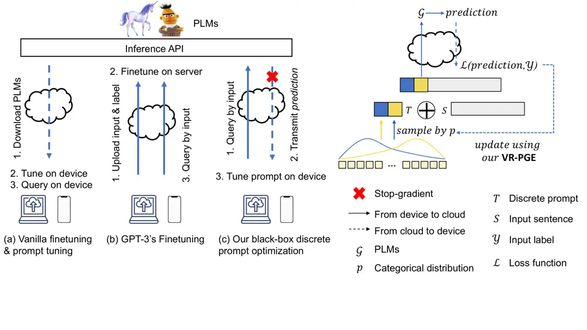
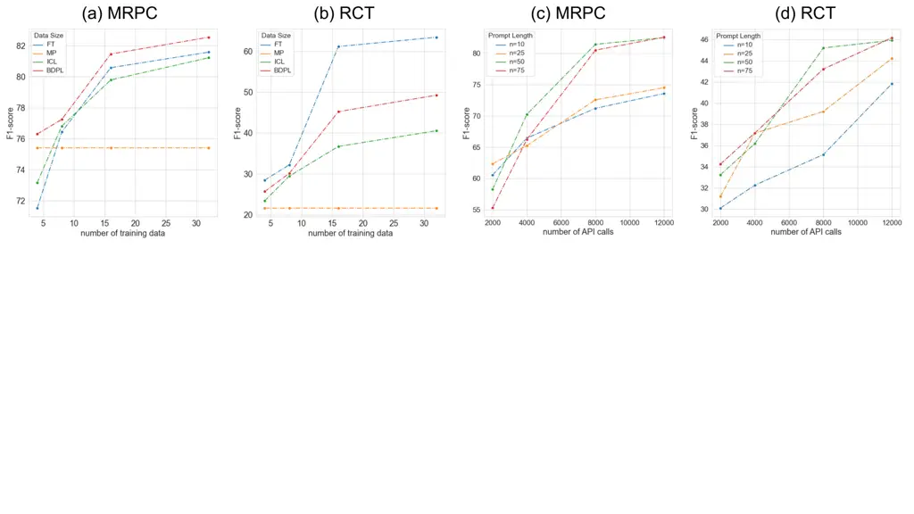
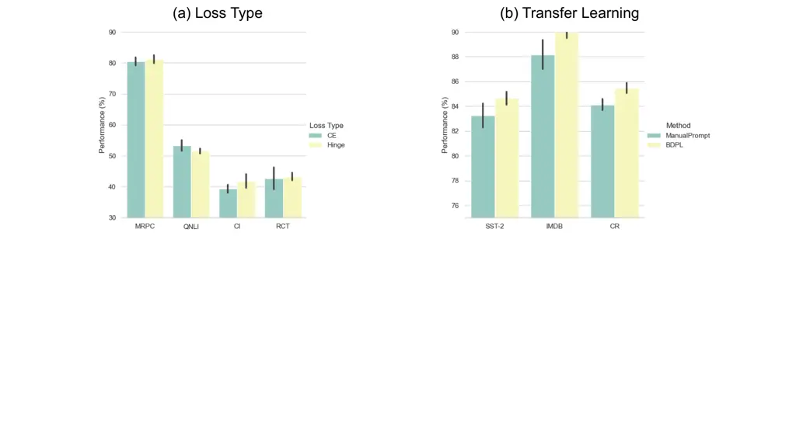
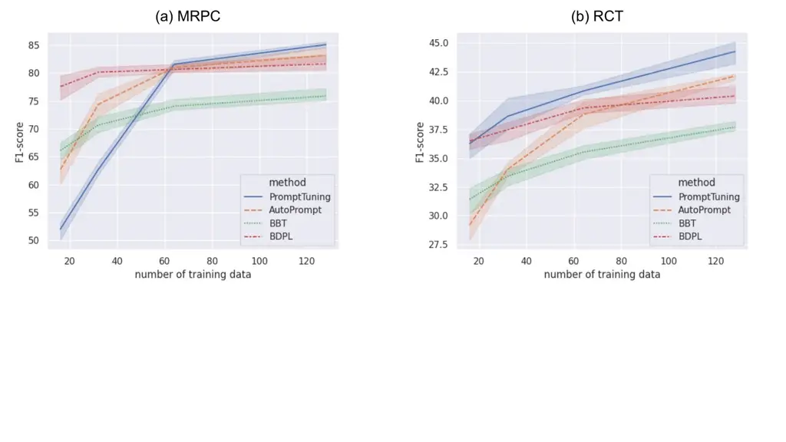

# Black-Box Prompt Learning for Pre-trained Language Models

Shizhe Diao sdiaoaa@connect.ust.hk Affiliation: The Hong Kong University
of Science and Technology    Zhichao Huang zhuangbx@connect.ust.hk
Affiliation: The Hong Kong University of Science and Technology   
Ruijia Xu rxuaq@connect.ust.hk Affiliation: The Hong Kong University of
Science and Technology    Xuechun Li xul021@ucsd.edu Affiliation:
University of California, San Diego    Yong Lin ylindf@connect.ust.hk
Affiliation: The Hong Kong University of Science and Technology    Xiao
Zhou xzhoubi@connect.ust.hk Affiliation: The Hong Kong University of
Science and Technology    Tong Zhang tongzhang@ust.hk ^(†)^(†)thanks:
Joint with Google research Affiliation: The Hong Kong University of
Science and Technology

###### Abstract

The increasing scale of general-purpose Pre-trained Language Models
(PLMs) necessitates the study of more efficient adaptation across
different downstream tasks. In this paper, we establish a Black-box
Discrete Prompt Learning (BDPL) to resonate with pragmatic interactions
between the cloud infrastructure and edge devices. Particularly, instead
of fine-tuning the model in the cloud, we adapt PLMs by prompt learning,
which efficiently optimizes only a few parameters of the discrete
prompts. Moreover, we consider the scenario that we do not have access
to the parameters and gradients of the pre-trained models, except for
its outputs given inputs. This black-box setting secures the cloud
infrastructure from potential attack and misuse to cause a single-point
failure, which is preferable to the white-box counterpart by current
infrastructures. Under this black-box constraint, we apply a
variance-reduced policy gradient algorithm to estimate the gradients of
parameters in the categorical distribution of each discrete prompt. In
light of our method, the user devices can efficiently tune their tasks
by querying the PLMs bounded by a range of API calls. Our experiments on
RoBERTa and GPT-3 demonstrate that the proposed algorithm achieves
significant improvement on eight benchmarks in a cloud-device
collaboration manner. Finally, we conduct in-depth case studies to
comprehensively analyze our method in terms of various data sizes,
prompt lengths, training budgets, optimization objectives, prompt
transferability, and explanations of the learned prompts.¹¹ 1 The code
is available at
[https://github.com/shizhediao/Black-Box-Prompt-Learning](https://github.com/shizhediao/Black-Box-Prompt-Learning).

Reviewed on OpenReview:
[https://openreview.net/forum?id=IvsGP7xRvm](https://openreview.net/forum?id=IvsGP7xRvm)

## 1 Introduction

Large Pre-trained Language Models (PLMs) have demonstrated impressive
versatility across a wide spectrum of downstream tasks, via either
fine-tuning (FT) (Devlin et al., 2019; Liu et al., 2019; Lewis et al.,
2020; Zhang et al., 2020; Yang et al., 2020; Diao et al., 2020; Pan et
al., 2022) or prompt-based learning (PL) (Gao et al., 2021; Liu et al.,
2021b; Schick & Schütze, 2021; Li & Liang, 2021; Liu et al., 2023).
Traditionally, these two tuning paradigms are conducted at a white-box
setting, where the parameters and gradients are accessible since the
model is usually open-sourced and can be duplicated in user devices.
Despite the fact that white-box methods have made remarkable progress,
however, the increasing scale of PLMs renders this setting implausible.
Nowadays, huge PLMs opt to serve users as commercial APIs deployed in
the cloud, such as OpenAI GPT-3²² 2
[https://openai.com/api/](https://openai.com/api/). In particular, the
service providers hide their model parameters and expose the query and
prediction interface, which is termed the black-box setting in this
paper.

Although solving NLP problems with APIs in a black-box setting is
considerably challenging, it is indeed aligned with the new norm of the
current interplay between the cloud infrastructure and edge devices.
Specifically, from the position of cloud providers, it is reasonable to
restrict the access of pre-trained model parameters since commercial,
ethical, legal, security, and other concerns might be raised (Bommasani
et al., 2021). First, under the white-box setting, the weaknesses and
biases rooted in the underlying PLMs are at higher risk of being misused
for harmful purposes. Second, the centralizing nature of PLMs exposes
them to potential attacks to cause a single-point failure (Krishna et
al., 2020). To this end, the black-box setting is more convincing to
secure the cloud infrastructure from being condemned. As for the
interests of user devices, the black-box paradigm grants them a more
economical option. Otherwise, if we have access to the model’s
gradients, it requires transmitting gradients from cloud to device,
causing high transmission costs.

| Methods                                                                                                                   | Frozen | Black-Box | Discrete | Interpretable | Learnable |
| ------------------------------------------------------------------------------------------------------------------------- | ------ | --------- | -------- | ------------- | --------- |
| Vanilla FineTuning                                                                                                        |        |           | N/A      | N/A           | N/A       |
| GPT-3’s FineTuning³³ 3 [https://beta.openai.com/docs/guides/fine-tuning](https://beta.openai.com/docs/guides/fine-tuning) | ✓      | ✓         | N/A      | N/A           | N/A       |
| FeatureProbe (Peters et al., 2019)                                                                                        | ✓      |           |          |               | ✓         |
| ManualPrompt                                                                                                              | ✓      | ✓         | ✓        | ✓             |           |
| InContextLearning(Brown et al., 2020)                                                                                     | ✓      | ✓         | ✓        | ✓             |           |
| PromptTuning (Lester et al., 2021)                                                                                        | ✓      |           |          |               | ✓         |
| P-Tuning v2 (Liu et al., 2021a)                                                                                           | ✓      |           |          |               | ✓         |
| AutoPrompt (Shin et al., 2020)                                                                                            | ✓      |           | ✓        | ✓             | ✓         |
| BBT (Sun et al., 2022)                                                                                                    | ✓      | ✓         |          |               | ✓         |
| BDPL (ours)                                                                                                               | ✓      | ✓         | ✓        | ✓             | ✓         |

Table 1: Comparison of different tuning methods. Frozen: the pre-trained
model is frozen and will not be updated. Black-Box: there are no access
to the parameters and gradients from the pre-trained model. Discrete:
the prompts are discrete tokens (compared with soft prompts).
Interpretable: the prompts are readable and interpretable. Learnable:
the prompts are parametric and learnable with explicit or estimated
gradients (compared with manual prompts). N/A: not applicable since the
corresponding descriptions are for prompt learning.

With this basic setting in mind, we further elaborate on a more
pragmatic scenario, i.e., the discrete prompt learning under the
black-box constraint. Particularly, we opt for the prompt learning
mechanism instead of the fine-tuning counterpart, partially due to the
fact that the prompt learning is more cost-effective by tuning fewer
parameters and can eliminate the gap between pre-training and downstream
transfer. Moreover, black-box fine-tuning³ requires users to upload
their private labels and save the fine-tuned model on the server, which
strongly relies on the cloud provider as the single-point trust for the
security of private data and model. On the contrary, our black-box
prompt learning allows users to store the private label and tune the
prompt locally, preventing potential data leakage and protecting the
users’ commercial interests. For instance, in our setting, each user
device can query the output from the cloud and then update its prompts
separately on its own data.

It is noteworthy that we optimize discrete prompts, which are more
interpretable to power users from different backgrounds to develop their
own applications with PLMs. On the contrary, continuous prompt learning
methods, e.g., BBT (black box tuning (Sun et al., 2022)), are difficult
to interpret their learned prompts. Moreover, these methods fail to be
directly applied to prediction APIs because APIs only accept discrete
inputs (e.g., GPT-3). However, the discrete nature of our BDPL allows
commercial prediction APIs to directly take the learned prompt tokens
without pain. Overall, our established Black-Box Discrete Prompt
Learning (BDPL) is closely in accordance with the recent progress of
huge PLMs, whose comparisons with the existing settings can be found in
table 1. As shown in the table, BDPL can be specified under the
constraints that the PLMs are frozen and both their parameters and
gradients are invisible and share the virtue of optimizing discrete,
interpretable, and learnable prompt tokens simultaneously.

To embrace this paradigm shift of tuning PLMs, we design a policy
gradient inspired framework that can be optimized without relying on the
parameters and gradients of the pre-trained models. Specifically, we
characterize the prompt learning procedure as a discrete token selection
problem, where the proper prompt tokens are sampled according to a
categorical distribution. Because the PLM’s parameters are invisible and
gradients cannot be back-propagated, the categorical distribution needs
to be optimized by some gradient-free algorithms. We resort to the
policy gradient algorithm to estimate the gradients without
back-propagation. Moreover, to eliminate the high variance issue of
policy gradient, we adopted a variance-reduced policy gradient
estimator.

Experimental results on two kinds of datasets, i.e., datasets without
domain-shift and datasets with domain-shift, demonstrate the
effectiveness of the proposed black-box discrete prompt learning, which
significantly improves the performance over a generic pre-trained model
and outperforms all baseline models on eleven datasets. The results
confirm that incorporating black-box prompt learning for pre-trained
models is an effective and efficient solution to the PLM adaptation. We
also present further analyses by investigating the effects of different
training data sizes, prompt lengths, training budgets, and objectives.
Our analyses demonstrated the robustness, scalability, and
transferability of the proposed method.

The contributions of our work are as follows:

$`\bullet`$ We propose a new setting called black-box prompt learning,
where we only have access to the output of prediction APIs without the
need to access the PLM’s parameters or gradients. The black-box prompt
is optimized without the requirements of tuning pre-trained models,
saving the fine-tuning costs.

$`\bullet`$ We propose a new black-box discrete prompt learning (BDPL)
method to solve this new problem, and demonstrate its effectiveness in
dealing with domain shifts on various tasks.

$`\bullet`$ We conduct comprehensive analyses on eleven benchmark
datasets under cloud-device collaboration settings, demonstrating its
effectiveness for commercial APIs. BDPL has a much wider range of
applications than previous methods, such as transfer learning, model
personalization, and decentralized training.



Figure 1: Schematic illustrations of the comparisons across various
tuning paradigms and the cloud-device interplay at the training phase of
our algorithm. Left: (a) Vanilla finetuning and prompt tuning can be
conducted on user devices in a white-box manner since the PLMs are
feasible to be duplicated at user devices. After tuning, users can still
access services of PLMs on the device. (b) Increasing scale hinders the
democratizing of PLMs. In GPT-3’s finetuning, users have to upload the
input and associated labels to the server. After finetuning, the model
is saved on the server. (c) In our black-box discrete prompt learning
setting, users send queries to the server and then rely on PLMs’
predictions to update their discrete prompts on the devices using a
gradient-free optimization. Right: In our framework, the user query is
created by concatenating the discrete prompt and the input sentence,
where the prompt tokens are sampled from their categorical distributions
respectively. After calculating the loss between the PLMs’ predictions
and input labels, we apply a variance-reduced policy gradient algorithm
to estimate the gradient of the categorical distribution and update it
accordingly.

## 2 Approach

In our setting, the input is a sentence
$`S={s_{1}s_{2}\cdots s_{l}\cdots s_{m}}`$ with $`s_{l}`$ indicating the
$`l`$-th token and the output corresponds to its category $`y`$. Our
goal is to learn $`n`$ discrete prompt tokens
$`T=t_{1}t_{2}\cdots t_{i}\cdots t_{n}=\mathcal{V}[j_{1}]\mathcal{V}[j_{2}]\cdots\mathcal{V}[j_{i}]\cdots\mathcal{V}[j_{n}]`$,
which are prepended to the input sentence to create the user query
$`[T,S]`$. Note that $`\mathcal{V}`$ represents the vocabulary list
consisting of a total of $`N`$ tokens, and $`t_{i}=\mathcal{V}[j_{i}]`$
is the $`i`$-th token in $`T`$ and $`j_{i}`$-th token in
$`\mathcal{V}`$.

The overall architecture is shown in Figure 1. During the black-box
training, we freeze the prediction model $`\mathcal{G}`$ with a
stop-gradient strategy, and only optimize the discrete prompts $`T`$.
Here, we assume independent categorical distribution for each prompt
index $`j_{i}\sim\operatorname{Cat}(\bm{p}_{i})`$, where the random
variable $`j_{i}`$ is sampled with the probability distribution
$`\bm{p}_{i}=[p_{i,1},\cdots,p_{i,N}]`$ over the $`N`$ token indexes,
where $`\bm{p}_{i}\in\mathcal{C}`$ and
$`\mathcal{C}=\{\bm{p}:\|\bm{p}\|_{1}=1,0\preceq\bm{p}\preceq 1\}`$.
Since $`\bm{p}_{i}`$ is independent of each other, the joint probability
of the whole discrete prompt is
$`P(T)=\Pi_{i=1}^{n}P(t_{i})=\Pi_{i=1}^{n}p_{i,j_{i}}`$.

Because the prediction model’s parameters are invisible and gradients
cannot be back-propagated to the prompts, it is no longer possible to
directly update the prompts by back-propagating through
$`\nabla_{\bm{p}_{i}}\mathcal{L}(\mathcal{G}([T,S],y))`$, where $`y`$ is
the label. Inspired by the policy gradient algorithm in discrete
optimization, we resort to estimating the gradients without
back-propagation to accomplish black-box training.

For abbreviation, we denote the $`\mathcal{L}(\mathcal{G}([T,S],y))`$ as
$`\mathcal{L}(T)`$ since $`S,y`$ can be deemed as constants here. By the
virtue of the policy gradient estimator (PGE), we can optimize the loss
function via forward propagation with:

```math
\mathbb{E}_{T}\left[\mathcal{L}(T)\right]=\int\mathcal{L}(T)P(T)\mathop{}\!\mathrm{d}T, \tag{1}
```

and estimate the gradient of $`\bm{p}_{i}`$ by:

```math
\displaystyle\nabla_{\bm{p}_{i}}\mathbb{E}_{T}\left[\mathcal{L}(T)\right]= \displaystyle\int\mathcal{L}(T)\nabla_{\bm{p}_{i}}P(T)\mathop{}\!\mathrm{d}T \tag{2}
```

```math
\displaystyle= \displaystyle\int\mathcal{L}(T)\frac{P(T)}{P(T)}\nabla_{\bm{p}_{i}}P(T)\mathop{}\!\mathrm{d}T
```

```math
\displaystyle= \displaystyle\int P(T)\mathcal{L}(T)\nabla_{\bm{p}_{i}}\log P(T)\mathop{}\!\mathrm{d}T
```

```math
\displaystyle= \displaystyle\mathbb{E}_{P(T)}\left[\mathcal{L}(T)\nabla_{\bm{p}_{i}}\log\Pi_{j=1}^{n}P(t_{j})\right]
```

```math
\displaystyle= \displaystyle\mathbb{E}_{P(T)}\left[\mathcal{L}(T)\nabla_{\bm{p}_{i}}\log P(t_{i})\right]
```

The $`j`$-th component of $`\nabla_{\bm{p}_{i}}\log P(t_{i})`$ could be
solved explicitly by:

```math
\displaystyle\nabla_{p_{i,j}}\log P(t_{i})=\nabla_{p_{i,j}}\log p_{i,j_{i}} \tag{3}
```

When $`j=j_{i}`$, it is obvious that
$`\nabla_{p_{i,j}}\log P(t_{i})=\frac{1}{p_{i,j_{i}}}`$. When
$`j\neq j_{i}`$, equation (3) is calculated by:

```math
\displaystyle\nabla_{p_{i,j}}\log P(t_{i})= \displaystyle\nabla_{p_{i,j}}\log(1-\sum_{k=1,k\neq j_{i}}^{N}p_{i,k}) \tag{4}
```

```math
\displaystyle= \displaystyle-\frac{1}{1-\sum_{k=1,k\neq j_{i}}^{N}p_{i,k}}
```

```math
\displaystyle= \displaystyle-\frac{1}{p_{i,j_{i}}}
```

However, consistent with previous policy gradient applications (Sutton
et al., 1999; Rezende et al., 2014; Jang et al., 2017; Zhou et al.,
2021), we observed that conventional PGE suffers from high variance,
which makes it challenging to converge in practice. Therefore, we
adopted a variance-reduced policy gradient estimator (VR-PGE) as
described in Williams (1992); Dong et al. (2020); Zhou et al. (2021).
The estimated gradient is calculated by:

```math
\bm{g}^{vr}_{\bm{p}_{i}}=\frac{1}{I-1}\sum_{k=1}^{I}\left(\mathcal{L}(T^{(k)})-\frac{1}{I}\sum_{j=1}^{I}\mathcal{L}(T^{(j)})\right)\nabla_{\bm{p}_{i}}\log P(t_{i}) \tag{5}
```

where $`T^{(k)},k=1,\cdots,I`$ are sampled independently from $`P(T)`$.

Thus, the prompt token distribution $`\bm{p}_{i}`$ can be updated by a
projected stochastic gradient descent algorithm:

```math
\bm{p}_{i}\leftarrow\operatorname{proj}_{\mathcal{C}}(\bm{p}_{i}-\eta\cdot\bm{g}^{vr}_{\bm{p}_{i}}),i=1,\cdots,n \tag{6}
```

where $`\eta`$ is the learning rate of prompt learning, $`I`$ is the
sample size, and $`\operatorname{proj}_{\mathcal{C}}`$ is the projection
calculation (details are presented in the Appendix).

0:  Input batch $`S`$, Label batch $`Y`$, Parameter of categorical
distribution $`\bm{p}_{1},\cdots,\bm{p}_{n}`$, Prediction model
$`\mathcal{G}`$, Loss function $`\mathcal{L}`$.

1:  for $`k\leq I`$ do

2:   Sample
$`j_{1}^{(k)}\sim\operatorname{Cat}(\bm{p}_{1}),\cdots,j_{n}^{(k)}\sim\operatorname{Cat}(\bm{p}_{n})`$

3:
  $`T^{(k)}=t_{1}^{(k)}\cdots t_{n}^{(k)}=\mathcal{V}[j_{1}^{(k)}]\cdots\mathcal{V}[j_{n}^{(k)}]`$

4:  end for

5:
 $`\mathcal{L}_{\text{avg}}=\frac{1}{I}\sum_{k=1}^{I}\mathcal{L}(\mathcal{G}[T^{(k)},S],Y)`$

6:  for $`i\leq n`$ do

7:
  $`\bm{g}^{vr}_{\bm{p}_{i}}=\frac{1}{I-1}\sum_{k=1}^{I}\nabla_{\bm{p}_{i}}\log P(t_{i}^{(k)})(\mathcal{L}(\mathcal{G}[T^{(k)},S],Y)-\mathcal{L}_{\text{avg}})`$

8:
  $`\bm{p}_{i}\leftarrow\operatorname{proj}_{\mathcal{C}}(\bm{p}_{i}-\eta\cdot\bm{g}^{vr}_{\bm{p}_{i}})`$

9:  end for

10:  return $`\bm{p}_{1},\cdots\bm{p}_{n}`$

Algorithm 1 The black-box discrete optimization procedures.

Here we introduce the detailed training procedure for updating the
prompts using our proposed VR-PGE, whose mini-batch version is displayed
in Algorithm 1. Assuming the input data is divided into $`B`$ batches,
and within each batch, we will perform $`I`$ iterations of sampling to
reduce the variance of estimation. Specifically, at the $`k`$-th
iteration within each batch, we first sample the sequence of prompt
tokens
$`T^{(k)}=\mathcal{V}[j_{1}^{(k)}]\mathcal{V}[j_{2}^{(k)}]\cdots\mathcal{V}[j_{n}^{(k)}]`$
according to the joint distribution $`P(T)`$. When $`T^{(k)}`$ is
created, we will prepend it to the input sentence $`S`$ and feed the
query $`[T^{(k)},S]`$ into the black-box pre-trained language model
$`\mathcal{G}`$, which will return back the prediction. In light of the
model prediction and ground-truth label $`Y`$, we then calculate the
loss $`\mathcal{L}(\mathcal{G}[T^{(k)},S],Y)`$. Then the estimated
gradients $`\bm{g}^{vr}_{\bm{p}_{i}}`$ for each $`p_{i}`$ could be
obtained by executing Equation (5) after sampling all $`I`$ prompt
sequences for the training batch. Finally, the categorical distributions
are updated by Equation (6).

#### Vocabulary Construction

A natural question is how to construct the vocabulary $`V`$ and what is
the size $`N`$. Inspired by the observation in Diao et al. (2021), which
revealed the importance of domain-specific and task-specific words and
ngrams in representation learning, we introduce such important ngrams as
prompt candidates. Therefore, we adopt pointwise mutual information
(PMI) to construct the vocabulary of candidate prompt tokens in an
unsupervised way. For each sentence in the training set, we calculate
the PMI by

```math
\displaystyle\text{PMI}(\bar{x},\widetilde{x})=\log\frac{p(\bar{x}\widetilde{x})}{p(\bar{x})p(\widetilde{x})}, \tag{7}
```

where $`\bar{x}`$ and $`\widetilde{x}`$ are two adjacent words in the
sentence, and $`p(x)`$ is the probability of an n-gram $`x`$. If the PMI
score between these two adjacent words is high, they have a high
probability of co-occurrence and are more likely to form an n-gram,
suggesting they are good collocation pairs. If the PMI score is lower
than a threshold $`\sigma`$, a delimiter is inserted between $`\bar{x}`$
and $`\widetilde{x}`$. As a result, the sentence will be segmented by
several delimiters. Finally, we obtain a list of ngrams $`V`$ by
extracting those consecutive words after segmentation and with a
frequency of at least $`f`$. As for the size $`N`$, we observe that
large $`N`$ will cause an unstable optimization process and even
divergence. Therefore, we keep $`N`$ between 50 and 200.

## 3 Experimental Settings

In this section, we first introduce the datasets and evaluation metrics
(§3.1), followed by the baseline models (§3.2). Lastly, we describe the
implementation details (§3.3).

### 3.1 Datasets and Evaluation Metrics

In order to examine the model’s ability in generic classification tasks
as well as domain-specific classification tasks, we include seven
datasets from the GLUE benchmark (Wang et al., 2019): MNLI (Williams et
al., 2018), QQP (Iyer et al., 2017), SST-2 (Socher et al., 2013), MRPC
(Dolan & Brockett, 2005), CoLA (Warstadt et al., 2019), QNLI (Wang et
al., 2019), RTE (Dagan et al., 2005; Haim et al., 2006; Giampiccolo et
al., 2007; Bentivogli et al., 2009), and four domain-specific datasets:
CitationIntent (Jurgens et al., 2018), SciERC (Luan et al., 2018), RCT
(Dernoncourt & Lee, 2017), HyperPartisan (Kiesel et al., 2019) from
specific domains including computer science, biomedical science and news
following Gururangan et al. (2020); Diao et al. (2021). The statistics
of these datasets are shown in Table 2. Considering the data sparsity
issue and large query costs⁴⁴ 4 For example, only one training epoch on
10, 000 sentences with 300, 000 tokens will cause 6 USD costs for
GPT-3-Davinci. Not to mention tens of hundreds of rounds of training. in
cloud-device collaboration, we conduct our experiments on a popular and
more realistic setting — few-shot learning, where huge models have shown
their powerful ability (Brown et al., 2020). We follow Perez et al.
(2021) to simulate a true $`k`$-shot learning setting. We randomly
sample $`k`$ data from the original training set for each class to
construct the training set and another different $`k`$ data to construct
the validation set. The original validation set will be used as the test
set. Because the size of the QQP and RCT validation sets is too large,
we randomly sample 1K data to save costs. We adopt Matthews Correlation
Coefficient for CoLA, F1-score for QQP, MRPC, CitationIntent, SciERC,
HyperPartisan, RCT, and accuracy for SST-2, RTE, QNLI, SST-2, IMDB, CR,
MR, and MPQA following Wang et al. (2019); Diao et al. (2021). MNLI
results are an average of MNLI-match and MNLI-mismatch accuracy.

|                       |            |      |      |      |                         |                |                  |
| --------------------- | ---------- | ---- | ---- | ---- | ----------------------- | -------------- | ---------------- | ------- | --- | --- | -------- | --- | ---- | ------- | ------ |
| Dataset               | $`\mathbf{ | L    | }`$  | $`   | `$Train$`               | `$             | $`               | `$Dev$` | `$  | $`  | `$Test$` | `$  | Type | Metrics | Domain |
| Generic Tasks         |            |      |      |      |                         |                |                  |
| MNLI                  | 3          | 393K | 9.8K | 9.8K | NLI                     | acc.           | fiction, reports |
| QQP                   | 2          | 364K | 40K  | 391K | paraphrase              | F1             | Quora            |
| SST-2                 | 2          | 6.7K | 872  | 1.8K | sentiment               | acc.           | movie reviews    |
| MRPC                  | 2          | 3.7K | 408  | 1.7K | paraphrase              | F1             | news             |
| CoLA                  | 2          | 8.6K | 1K   | 1K   | acceptability           | Matthews corr. | books, articles  |
| QNLI                  | 2          | 105K | 5.5K | 5.5K | NLI                     | acc.           | Wikipedia        |
| RTE                   | 2          | 2.5K | 277  | 3K   | NLI                     | acc.           | news, Wikipedia  |
| Domain-Specific Tasks |            |      |      |      |                         |                |                  |
| CI                    | 6          | 1.6K | 114  | 139  | citation intent         | F1             | computer science |
| SE                    | 7          | 3.2K | 455  | 974  | relation classification | F1             | computer science |
| RCT                   | 5          | 180K | 30K  | 30K  | abstract sentence roles | F1             | biomedical       |
| HP                    | 2          | 516  | 64   | 65   | review helpfulness      | F1             | reviews          |

Table 2: The statistics of seven datasets in the generic domain and four
datasets in the specific domain. CI, SE, HP denote CitationIntent,
SciERC, HyperPartisan, respectively. $`\mathbf{|L|}`$: number of classes
for classification tasks. Note that we sample the few-shot training
split and development split from the original training split for
few-shot setting as described in Section 3.1.

### 3.2 Baselines

For GPT-3-based models, because previous white-box tuning methods and
black-box continuous prompt tuning methods (e.g., BBT) cannot be applied
to GPT-3, we compare our model with the following baselines.

- $`\bullet`$
  GPT-3’s FineTuning⁵⁵ 5
  [https://beta.openai.com/docs/guides/fine-tuning](https://beta.openai.com/docs/guides/fine-tuning):
  a GPT-3 inference API that is fine-tuned entirely on a labeled dataset
  (black-box).
- $`\bullet`$
  ManualPrompt: a GPT-3 inference API with manually composed prompts to
  conduct the zero-shot evaluation. The human-written prompts are shown
  in Appendix A.5 (black-box).
- $`\bullet`$
  InContextLearning (Brown et al., 2020): a GPT-3 inference API with a
  set of examples containing training sentences and labels as the input
  prefix, which is then prepended to the input texts (black-box).

For RoBERTa-based models, we adopt the RoBERTa-large as the backbone and
the following tuning methods.

- $`\bullet`$
  Vanilla FineTuning (Liu et al., 2019): a RoBERTa-large model that is
  fine-tuned entirely on a labeled dataset (white-box).
- $`\bullet`$
  PromptTuning (Lester et al., 2021): a frozen RoBERTa-large model with
  continuous prompt embeddings prepended to the input, and learned by
  gradients (white-box).
- $`\bullet`$
  P-Tuning v2 (Liu et al., 2021a): a frozen RoBERTa-large model with
  continuous prompt embeddings prepended to each layer, and learned by
  gradients (white-box).
- $`\bullet`$
  AutoPrompt (Shin et al., 2020): a frozen RoBERTa-large model with
  discrete prompts optimized based on gradient-guided search
  (white-box).
- $`\bullet`$
  FeatureProbe (Peters et al., 2019): a frozen RoBERTa-large model
  outputs the features given inputs and a newly added classification
  layer is trained with the gradients (white-box).
- $`\bullet`$
  ManualPrompt: a frozen RoBERTa-large model with manually composed
  prompts to conduct the zero-shot evaluation. The human-written prompts
  are shown in Appendix A.5 (black-box).
- $`\bullet`$
  InContextLearning (Brown et al., 2020): a frozen RoBERTa-large model
  with a set of examples containing training sentences and labels as the
  input prefix, which is then prepended to the input texts (black-box).
- $`\bullet`$
  BBT (Sun et al., 2022): a frozen RoBERTa-large model with continuous
  prompts that are optimized by covariance matrix adaptation evolution
  strategy (black-box).
- $`\bullet`$
  RLPrompt (Deng et al., 2022): a frozen RoBERTa-large model with
  discrete prompts that are generated by a policy network and optimized
  by a reward function (black-box).

### 3.3 Implementation

For GPT-3 experiments, we conduct experiments with four variants:
GPT-3-Ada, GPT-3-Babbage, GPT-3-Curie, and GPT-3-Davinci. The batch size
of training and evaluation is set to 4 to fulfill the query length limit
(i.e., 2048). We call the APIs directly from OpenAI’s services⁶⁶ 6
[https://openai.com/api/](https://openai.com/api/). For RoBERTa-large
experiments, we initialize it with pre-trained weights by Huggingface’s
Transformers library⁷⁷ 7
[https://github.com/huggingface/transformers](https://github.com/huggingface/transformers).
The batch size of training and evaluation is set to 16 and 32,
respectively. The number of API calls is limited to 8000 across all
datasets.

For BDPL, we optimize the prompts by AdamW (Loshchilov & Hutter, 2019)
for 30 epochs with a learning rate of $`1\times 10^{-4}`$. The prompt
length is 50, and the size of the candidate prompt list $`N`$ is 100.
Other hyper-parameters are detailed in the Appendix A.3.

| Dataset       | MNLI    | QQP     | SST-2   | MRPC    | CoLA    | QNLI    | RTE     | CI      | SE      | RCT     | HP      | Avg. | \$Cost |
| ------------- | ------- | ------- | ------- | ------- | ------- | ------- | ------- | ------- | ------- | ------- | ------- | ---- | ------ |
| GPT-3 Ada     |         |         |         |         |         |         |         |         |         |         |         |      |        |
| FT            | 38.50.8 | 44.51.4 | 71.61.2 | 45.74.3 | 0.00.0  | 49.82.1 | 52.71.2 | 27.73.2 | 3.50.3  | 57.04.2 | 24.41.4 | 37.8 | 5.6    |
| MP            | 26.50.9 | 31.21.8 | 63.11.3 | 35.62.1 | 0.00.0  | 45.61.5 | 47.32.0 | 26.92.0 | 1.20.6  | 15.82.4 | 15.21.8 | 28.0 | 0.5    |
| ICL           | 36.30.7 | 40.31.3 | 64.60.8 | 40.51.5 | 1.31.4  | 48.81.7 | 48.71.3 | 28.20.3 | 2.50.4  | 22.72.6 | 20.02.3 | 32.2 | 5.7    |
| BDPL          | 37.10.7 | 45.10.5 | 68.80.9 | 43.22.5 | 2.00.4  | 51.20.4 | 52.71.3 | 28.31.5 | 3.80.3  | 45.72.9 | 22.41.7 | 36.4 | 3.2    |
| GPT-3 Babbage |         |         |         |         |         |         |         |         |         |         |         |      |        |
| FT            | 40.70.5 | 46.21.4 | 87.41.5 | 66.41.7 | 0.30.1  | 50.90.2 | 52.31.0 | 5.20.4  | 4.11.0  | 61.15.2 | 33.31.3 | 40.7 | 8.5    |
| MP            | 28.90.8 | 34.11.2 | 83.51.2 | 62.43.2 | 0.20.1  | 48.81.4 | 51.20.6 | 31.42.8 | 1.70.5  | 21.72.3 | 27.21.5 | 35.6 | 0.6    |
| ICL           | 35.70.9 | 45.21.9 | 86.21.4 | 65.41.7 | 2.60.0  | 48.30.9 | 51.50.4 | 13.11.5 | 2.50.9  | 36.71.8 | 32.21.4 | 38.1 | 7.1    |
| BDPL          | 41.00.6 | 50.41.5 | 86.41.1 | 67.71.2 | 2.80.1  | 52.10.3 | 53.11.0 | 40.22.5 | 3.20.8  | 45.22.2 | 30.42.3 | 43.0 | 4.0    |
| GPT-3 Curie   |         |         |         |         |         |         |         |         |         |         |         |      |        |
| FT            | 42.22.8 | 53.31.4 | 88.93.1 | 76.32.1 | 3.41.3  | 49.01.3 | 54.51.7 | 28.41.9 | 5.10.8  | 50.61.3 | 43.31.5 | 45.0 | 42.3   |
| MP            | 34.51.9 | 44.32.1 | 84.21.4 | 73.31.2 | 2.00.6  | 47.20.9 | 44.01.2 | 19.21.3 | 2.80.3  | 31.01.4 | 37.11.5 | 38.1 | 2.5    |
| ICL           | 38.02.1 | 47.22.3 | 87.01.9 | 81.01.3 | 2.80.0  | 46.81.1 | 46.21.6 | 15.21.9 | 4.81.3  | 50.12.3 | 39.02.3 | 41.6 | 28.5   |
| BDPL          | 42.51.9 | 52.01.5 | 88.02.2 | 82.61.1 | 4.01.3  | 50.10.8 | 55.81.3 | 25.51.8 | 3.41.8  | 49.62.4 | 39.41.6 | 44.8 | 16.2   |
| GPT-3 Davinci |         |         |         |         |         |         |         |         |         |         |         |      |        |
| FT            | 60.23.8 | 67.82.1 | 92.92.4 | 84.61.3 | 55.31.5 | 54.22.5 | 57.01.2 | 35.41.7 | 10.32.3 | 51.62.7 | 60.11.8 | 57.2 | 423.2  |
| MP            | 40.22.5 | 39.21.6 | 86.72.7 | 69.72.1 | 55.22.4 | 28.01.3 | 55.31.9 | 25.62.0 | 4.91.0  | 26.81.9 | 52.61.4 | 44.0 | 25.0   |
| ICL           | 52.72.9 | 55.63.4 | 87.23.3 | 82.41.7 | 56.72.0 | 17.91.7 | 56.62.3 | 30.13.0 | 9.21.5  | 44.42.2 | 55.42.5 | 49.8 | 206.1  |
| BDPL          | 54.62.4 | 57.82.1 | 89.33.0 | 83.41.4 | 58.41.4 | 56.21.5 | 57.20.8 | 34.62.0 | 6.62.1  | 48.82.5 | 58.52.4 | 55.0 | 161.5  |

Table 3: The overall performance of black-box prompt and the comparison
on eleven datasets with GPT-3. We report average scores across three
random seeds, with standard deviations as subscripts. Avg. denotes the
average score across all tasks. \$Cost denotes the money cost in US
Dollar for calling GPT-3’s API during training and inference. FT:
GPT-3’s FineTuning. MP: ManualPrompt. ICL: InContextLearning.

## 4 Experimental Results

The overall results on eleven datasets are reported in Tables 3 and 4.

We first verify our proposed method’s effectiveness on a purely
black-box setting with GPT-3 APIs. From Table 3, BDPL shows great
superiority across eleven datasets. Compared with ManualPrompt and
InContextLearning, BDPL demonstrates significant improvements, which are
8.35% and 4.35% on average of Ada, Babbage, Curie, and Davinci models.
BDPL also achieves comparable performance with GPT-3’s fine-tuning,
which requires large money costs and uploading user’s data. In Babbage,
BDPL even outperforms GPT-3’s fine-tuning. As the experiments are
conducted on the few-shot setting, where a small number of data are
available to fine-tune the models’ parameters, for large models like
GPT-3, overfitting could be a serious problem that deteriorates the
performance so that fine-tuning is inferior to BDPL. Although careful
adjustment of the fine-tuning algorithm may mitigate overfitting and
improve accuracy, it needs a lot of manual effort and money costs, which
is implausible for cloud-device collaboration. Moreover, it is observed
that ManualPrompt and InContextLearning with less capable versions of
GPT-3 (e.g., Ada and Babbage) fail in some challenging datasets (e.g.,
CoLA and SE) but BDPL performs well on them. With the increase of the
model capacity (from Ada to Davinci), we observed ManualPrompt and
InContextLearning could also solve them, which is consistent with recent
observations of large model’s emergent abilities (Wei et al., 2022).
From this perspective, our method offers another option in addition to
increasing model size, which is an efficient solution for less capable
models to perform challenging tasks.

In addition to the auto-regressive model, we also conduct additional
experiments with an encode-only model, RoBERTa-large. Because the
weights of RoBERTa-large are released and gradients can be leveraged,
several white-box baseline models are introduced for comparison. First,
our model outperforms all black-box methods, demonstrating the
effectiveness of our proposed black-box discrete prompt optimization.
Second, BDPL achieves comparable performance compared with white-box
prompt-based methods including both discrete and continuous prompts. It
is observed that BDPL even outperforms some white-box methods (e.g.,
PromptTuning and AutoPrompt). We attribute this phenomenon to the
overfitting of white-box methods in terms of the given few-shot examples
while BDPL does not suffer severe overfitting due to its exploration
mechanism. We perform an ablation study in Section E to reveal the
effect of data size and accuracy. Given that white-box prompt tuning
methods cannot be applied in black-box settings when the gradients are
unavailable, previous black-box methods such as InContextLearning and
BBT can achieve 2.82% and 6.66% improvement on average over
ManualPrompt. BDPL outperforms the previous black-box methods BBT and
RLPrompt by an average of 2.7% and 2.5%, respectively. Compared with
BBT, our method, BDPL, not only outperforms it but is also more
practical considering its discrete nature. BBT is optimizing continuous
prompts and cannot be directly fed into current prediction APIs. We also
notice that there is still a large gap between FineTuning and all other
methods. FineTuning updates the full model with gradients and huge
parameters, serving as an upper bound for all methods. Across eleven
tasks, it is observed that the BDPL on domain-specific datasets is as
effective as on generic datasets. While it is known that domain shift
introduced difficulty for models to deal with, BDPL offers an effective
solution to domain-specific datasets.

|                   |         |         |         |         |         |         |         |         |         |         |         |      |
| ----------------- | ------- | ------- | ------- | ------- | ------- | ------- | ------- | ------- | ------- | ------- | ------- | ---- |
| Dataset           | MNLI    | QQP     | SST-2   | MRPC    | CoLA    | QNLI    | RTE     | CI      | SE      | RCT     | HP      | Avg. |
| White-Box Methods |         |         |         |         |         |         |         |         |         |         |         |      |
| FT                | 50.81.2 | 60.81.9 | 86.52.0 | 78.41.3 | 20.41.9 | 53.21.8 | 55.62.5 | 37.41.7 | 23.11.6 | 45.25.2 | 55.52.3 | 51.5 |
| PromptTuning      | 36.50.9 | 50.21.5 | 70.72.6 | 52.73.4 | 8.00.7  | 53.51.6 | 56.31.6 | 34.42.6 | 28.62.5 | 36.73.1 | 47.43.2 | 43.2 |
| P-Tuning v2       | 44.21.7 | 57.42.4 | 80.41.2 | 62.42.0 | 8.92.7  | 51.51.3 | 53.11.7 | 31.44.2 | 24.62.5 | 35.43.9 | 55.44.2 | 45.9 |
| AutoPrompt        | 40.11.5 | 45.71.3 | 71.52.1 | 63.83.1 | 5.42.3  | 50.21.3 | 52.11.6 | 27.92.9 | 21.52.5 | 29.62.5 | 40.63.8 | 40.8 |
| FeatureProbe      | 46.51.8 | 56.31.1 | 79.51.6 | 68.91.7 | 15.61.2 | 50.50.2 | 54.12.5 | 22.32.0 | 20.83.6 | 31.24.7 | 60.12.6 | 46.0 |
| Black-Box Methods |         |         |         |         |         |         |         |         |         |         |         |      |
| ManualPrompt      | 35.91.3 | 49.80.9 | 77.22.1 | 70.41.6 | 0.60.0  | 49.21.1 | 48.20.6 | 12.32.4 | 9.61.4  | 11.71.5 | 35.71.6 | 36.4 |
| ICT               | 37.21.6 | 50.10.9 | 82.82.1 | 72.12.3 | 1.10.4  | 50.80.5 | 49.32.3 | 14.61.7 | 9.21.5  | 25.81.6 | 38.52.4 | 39.2 |
| BBT               | 40.62.5 | 55.23.1 | 85.33.9 | 66.43.7 | 5.52.7  | 55.43.2 | 52.62.2 | 17.45.4 | 16.40.9 | 31.71.5 | 47.24.8 | 43.1 |
| RLPrompt          | 42.83.2 | 53.72.2 | 88.41.9 | 68.92.1 | 5.01.1  | 52.61.4 | 51.81.8 | 19.23.3 | 18.81.5 | 30.12.7 | 44.92.4 | 43.3 |
| BDPL              | 42.51.8 | 56.41.9 | 87.62.1 | 78.13.7 | 4.61.2  | 53.11.1 | 53.50.9 | 24.01.3 | 21.52.0 | 36.63.2 | 45.63.4 | 45.8 |

Table 4: The overall performance of black-box prompt and the comparison
on eleven datasets with RoBERTa-large. We report average scores across
three random seeds, with standard deviations as subscripts. Avg. denotes
the average score across all tasks. FT: Vanilla FineTuning. ICT:
InContextLearning.

## 5 Analysis

We analyze several aspects of BDPL, including the effects of different
training data sizes, prompt lengths, training budgets, and learning
objectives. In addition, we examine the transferability of our learned
prompts under the transfer learning setting and the explanation of
prompts. We choose GPT-3 Babbage as the backbone model in the following
discussion. The details are illustrated in this section.

### 5.1 Ablation Study

#### Effects of Training Data Size

First, we analyze the effects brought by four different training data
sizes: 4-shot, 8-shot, 16-shot, and 32-shot. Experiments are conducted
on MRPC and RCT datasets. As shown in the left part of Figure 2 (a) and
(b), with the increase in training data size, the performance of FT,
InContextLearning, and BDPL is improved on both MRPC and RCT, which is
consistent with the assumption that more data brings sufficient
training. Compared with baseline models, our model achieved consistent
improvement over ManualPrompt and InContextLearning, verifying its
effectiveness and scalability under different data sizes.



Figure 2: The effects of training data size, prompt length, and the
number of API calls on MRPC and RCT. FT, MP, and ICL denote GPT-3’s
FineTuning, ManualPrompt, and InContextLearning, respectively.

#### Effects of Prompt Length

It is known that prompt-based methods are sensitive to many aspects of
prompts, including contexts (Jiang et al., 2020), orders (Lu et al., 2022) and lengths (Lester et al., 2021), and inappropriately designed
prompts lead to bad performance. Here we study the effects of different
prompt lengths on MRPC and RCT. Considering the maximum number of tokens
is 2048 for the input of GPT-3 API, too many prompt tokens (e.g., more
than 100) cause additional costs and even failure of queries. Therefore,
we conduct experiments with length = 10, 25, 50, and 75. The results are
shown in the Figure 2 (c) and (d). With the increase in prompt length,
the performance increases at first and decreases when the prompt length
reaches 75 in most cases. We conclude that the approximate best prompt
length is 50, since a shorter prompt length limits the representation
capacity while a longer prompt length might involve noises contained in
the training data and is hard to optimize.

#### Effects of Training Budgets

Training budgets are essential factors for efficient-tuning methods. An
efficient method is expected to achieve good performance with as few as
training budgets. We measure the budgets by the number of prediction API
calls and report the performance of our models with different numbers of
API calls in Figure 2 (c) and (d). It is observed that with the increase
of API calls, BDPL under different settings obtains performance gains
because of sufficient training. All settings could converge within 12,
000 API calls. We also find that the $`50`$-prompt performs well at
first but the gap between $`75`$-prompt and $`50`$-prompt narrows down
when the training budget grows, and finally, $`75`$-prompt achieves
competitive performance. It told us that if we do not have a sufficient
training budget, it would be better to apply fewer prompt tokens, which
are easier to optimize.



Figure 3: (a) Ablations of loss function. CE and Hinge represent
cross-entropy loss and hinge loss, respectively. (b) Transfer learning
performance. SST-2 is the source task while IMDB and CR are two tasks in
the target domain.

#### Effects of Different Objectives

In the previous experiments, the prompts are optimized with the
cross-entropy loss, and here we explore the effectiveness of our model
with different objectives. With the same setting as our main experiment,
we conduct further experiments with hinge loss on four datasets: MRPC,
QNLI, CI, and RCT. We find that our model with both objectives can
achieve comparable results. As shown in Figure 3 (a), the model with
hinge loss outperforms that with cross-entropy loss on MRPC, CI, and
RCT, but underperforms it on QNLI. On average, our approach with hinge
loss works as well as that with cross-entropy loss. It is flexible
enough to work with different objectives, and we hope to extrapolate to
any kind of human-designed objectives.

#### Effects of Transfer Learning

A critical advantage of discrete prompts is the possibility of
transferring prompts learned from one task to another because discrete
tokens share the same text space instead of specific latent space for
continuous prompts. To verify the transferability of black-box optimized
prompt tokens, we conduct experiments on three sentiment analysis
datasets (i.e., SST-2 (Socher et al., 2013), IMDB (Maas et al., 2011),
and CR (Hu & Liu, 2004)) with GPT-3-Babbage model in the 16-shot
setting. First, we use SST-2 as the source task following Vu et al.
(2022) and optimize the discrete prompt tokens with our proposed BDPL.
Then we obtain those selected prompt tokens and simply prepend them to
the beginning of the input of the target task, IMDB and CR. Our setting
assumes no training data in the target domain, so we directly test the
performance in the target task. Following Wang et al. (2021a), for CR,
we randomly sample 2,000 instances as the test set. The results are
shown in Figure 3 (b). Consistent with the previous observation in
Section 4, BDPL outperforms ManualPrompt in the source task by a large
margin. Moreover, learned prompts are helpful in two target tasks,
demonstrating that our black-box method is robust under transfer
learning settings. The experimental results display the expansion
potential of prompt transfer, which is a promising practical application
of BDPL, especially when there are $`N`$ edge devices sharing a similar
task, but they have no training data. We can update the black-box
prompts in a general domain and then transfer them to the target domain.

Figure 4: Four correctly predicted examples by BDPL. We display the
prompts and salience map of the token \<s\>. The prompts are in green
and the input tokens are in red. The salient tokens are highlighted in a
blue background, where the darker color denotes the more dominant
weights for the prediction.

### 5.2 Prompt Explanation

To intuitively understand the prompts, we visualize the salience maps
using the Language Interpretability Tool (LIT) (Tenney et al., 2020). We
choose CoLA, RTE, CI, and RCT datasets because the sentences contained
in these datasets are easy for human interpretation. The comparisons
between models with discrete prompts and without them are shown in
Figure 4. By adding discrete prompt tokens, the model is able to find
coherence-related clues. For example, CoLA aims to distinguish the
acceptability of sentences. The grammar-related word ‘won’t’ and phrase
‘let alone’ dominate its prediction, which is consistent with the
decision process of human beings. Similar observations are found in
other datasets. Due to space limitations, more visualized examples are
not shown here. Based on considerable empirical evidence, we conclude
that BDPL can capture helpful information to guide the model.

We notice that most of the optimized prompts are readable but
in-comprehensible, useful to model improvement, but semantically
confusing to humans. Ilyas et al. (2019b) find that neural networks rely
on some non-robust features to achieve the highest possible accuracy.
These non-robust features are usually semantically meaningless to
humans, but we can still train a well-performed model only using these
features. We argue that while the optimized prompts that our method
finds are meaningless to humans, they are useful for the models to make
a more accurate prediction. In contrast, forcing the prompts to have
semantic meaning may remove the useful information and leads to degraded
performance. This observation is consistent with previous discrete
prompt learning studies (Shin et al., 2020).

## 6 Related Work

In this section, we present the review on prompt learning for
pre-trained language models and black-box optimization.

### 6.1 Prompts for Pre-trained Models

Large pre-trained language models are of great importance and a standard
paradigm is pre-training a language model on a large unlabeled corpus
and then fine-tuning the pre-trained model on different supervised
tasks. This approach shows great improvements on lots of downstream
tasks but it needs lots of computational resources to change all the
parameters and has to save a copy for each task. Therefore, prompt-based
learning, which does not require tuning the large model, is proposed to
solve the problem. Based on the format of prompts, the prompt-based
learning can be categorized into two kinds: discrete prompt (Wallace et
al., 2019; Shin et al., 2020; Jiang et al., 2020; Gao et al., 2021;
Ben-David et al., 2022) and continuous prompt (Zhong et al., 2021; Qin &
Eisner, 2021; Hambardzumyan et al., 2021; Liu et al., 2021b; Han et al.,
2021; Li & Liang, 2021). The discrete prompt is usually a sequence of
tokens or natural language phrases while the continuous prompt is
designed as a sequence of vectors. However, all of these studies are
limited to a white-box setting, which requires accessing all the
parameters of a pre-trained model so that the gradients could be
back-propagated to optimize the prompts. Recently, Sun et al. (2022)
proposed black-box tuning methods but they are optimizing continuous
prompts, which is impractical in real applications, because most of the
commercial APIs do not accept continuous vectors as input. Our method,
black-box prompt learning, provides a truly black-box solution with
discrete optimization, which optimizes a set of discrete prompts without
accessing the pre-trained model. There are some concurrent works (Deng
et al., 2022; Hou et al., 2022) exploring black-box tuning methods for
large language models. PromptBoosting (Hou et al., 2022) ensembles a
large number of weak learners by the AdaBoost algorithm to pair
pre-generated prompts with different elements of the LM’s output
distribution. They learn the verbalizer instead of discrete prompts of
the language model, which is complementary to BDPL. RLPrompt (Deng et
al., 2022) generates discrete prompts by a policy network and optimizes
it by a reward function. In contrast, we apply a variance-reduced policy
gradient estimator to optimize a few independent categorical
probabilities to select the appropriate prompt tokens. In addition, we
are the first to show that the black-box prompt learning methods can
generalize to real-world large language models like GPT-3.

### 6.2 Black-Box Optimization

One of the applications of black-box optimization is the score-based
black-box adversarial attack (Ilyas et al., 2018; Ilyas et al., 2019a;
Huang & Zhang, 2020; Andriushchenko et al., 2020; Cheng et al., 2019),
where the models are also invisible to the attacker. These studies use
zeroth-order optimization methods such as natural evolution strategy
(NES) (Wierstra et al., 2014) to optimize the input and increase the
loss to fool the model. Instead of deteriorating the models’ performance
in the adversarial attack, our direction is to find the inputs that
improve the accuracy. Policy gradient (Sutton et al., 1999), which also
belongs to the black-box optimization, is widely used in reinforcement
learning to find the best policy. In contrast to NES that can only be
used to search in the continuous search, policy gradient allows the
choice of discrete policy and can be used to find the optimal discrete
prompts. BDPL uses black-box optimization methods to find the optimal
prompts, which is a novel application direction of these methods.

Another line of research to adapt the black-box model is knowledge
distillation (KD) (Hinton et al., 2015), which learns a student model
with the outputs of large models. KD can be used to learn black-box
models (Nguyen et al., 2022; Wang, 2021), perform domain adaptation
(Liang et al., 2022), and adversarially attack the model Zhang et al.
(2022). Despite the wide applications of black-box KD, learning the
models with KD still requires a large number of queries and data for
training the student network. On the contrary, our proposed approach,
BDPL, is much more lightweight, and only needs to train a few prompts
with a small amount of data. Moreover, under the scenario of
cloud-device collaboration, BDPL only needs negligible computation on
the edge devices while KD has to train the local student network with
large computational resources. Therefore, BDPL is more practical for the
scenario of cloud-device collaboration.

## 7 Conclusion

This paper proposes a novel setting for text categorization namely
black-box prompt learning, where a large pre-trained model is invisible
so that the gradients cannot be back-propagated to update the prompts.
Compared with the standard pre-training then fine-tuning paradigm, our
approach only requires updating very few parameters. Compared with
previous prompt-based methods, our approach does not require the
visibility of pre-trained models, and thus it provides more flexibility
in practical applications. We propose a black-box prompt learning
method, BDPL, which employs a variance-reduced policy gradient estimator
to approximate the gradients, and then update the prompts. Experimental
results demonstrate that our approach outperforms all black-box methods
and is comparable with white-box methods, illustrating the effectiveness
of black-box optimization. Experiments on the transfer learning settings
further show the potential of our approach in realistic scenarios, where
the pre-trained model is deployed on the cloud, and the prompt learning
can be implemented on each device.

In the future, we would like to explore the effectiveness of our
proposed methods on more commercial classifiers, such as Google Cloud
APIs, Microsoft Azure APIs and so on. The black-box prompt learning for
large multi-modal models (Wang et al., 2021b; Singh et al., 2022; Wang
et al., 2021c; Zhou et al., 2022; Wang et al., 2022; Diao et al., 2023)
is another important scenario to explore in future work.

## Acknowledgments

We thank the anonymous reviewers for their valuable suggestions. This
work was supported by the General Research Fund (GRF) of Hong Kong (No.
16310222 and No. 16201320). Shizhe Diao, Ruijia Xu, and Yong Lin were
supported by the Hong Kong Ph.D. Fellowship Scheme (HKPFS).

## References

- Andriushchenko et al. (2020) Maksym Andriushchenko, Francesco Croce,
  Nicolas Flammarion, and Matthias Hein. Square attack: a
  query-efficient black-box adversarial attack via random search. In
  _Computer Vision–ECCV 2020: 16th European Conference, Glasgow, UK,
  August 23–28, 2020, Proceedings, Part XXIII_, pp. 484–501.
  Springer, 2020.
- Ben-David et al. (2022) Eyal Ben-David, Nadav Oved, and Roi Reichart.
  PADA: Example-based Prompt Learning for on-the-fly Adaptation to
  Unseen Domains. _Transactions of the Association for Computational
  Linguistics_, 10:414–433, 04 2022. ISSN 2307-387X. doi:
  10.1162/tacl_a_00468. URL
  [https://doi.org/10.1162/tacl_a_00468](https://doi.org/10.1162/tacl_a_00468).
- Bentivogli et al. (2009) Luisa Bentivogli, Peter Clark, Ido Dagan, and
  Danilo Giampiccolo. The fifth pascal recognizing textual entailment
  challenge. In _TAC_, 2009.
- Bommasani et al. (2021) Rishi Bommasani, Drew A Hudson, Ehsan Adeli,
  Russ Altman, Simran Arora, Sydney von Arx, Michael S Bernstein,
  Jeannette Bohg, Antoine Bosselut, Emma Brunskill, et al. On the
  opportunities and risks of foundation models. _ArXiv preprint_,
  abs/2108.07258, 2021. URL
  [https://arxiv.org/abs/2108.07258](https://arxiv.org/abs/2108.07258).
- Brown et al. (2020) Tom B. Brown, Benjamin Mann, Nick Ryder, Melanie
  Subbiah, Jared Kaplan, Prafulla Dhariwal, Arvind Neelakantan, Pranav
  Shyam, Girish Sastry, Amanda Askell, Sandhini Agarwal, Ariel
  Herbert-Voss, Gretchen Krueger, Tom Henighan, Rewon Child, Aditya
  Ramesh, Daniel M. Ziegler, Jeffrey Wu, Clemens Winter, Christopher
  Hesse, Mark Chen, Eric Sigler, Mateusz Litwin, Scott Gray, Benjamin
  Chess, Jack Clark, Christopher Berner, Sam McCandlish, Alec Radford,
  Ilya Sutskever, and Dario Amodei. Language models are few-shot
  learners. In Hugo Larochelle, Marc’Aurelio Ranzato, Raia Hadsell,
  Maria-Florina Balcan, and Hsuan-Tien Lin (eds.), _Advances in Neural
  Information Processing Systems 33: Annual Conference on Neural
  Information Processing Systems 2020, NeurIPS 2020, December 6-12,
  2020, virtual_, 2020. URL
  [https://proceedings.neurips.cc/paper/2020/hash/1457c0d6bfcb4967418bfb8ac142f64a-Abstract.html](https://proceedings.neurips.cc/paper/2020/hash/1457c0d6bfcb4967418bfb8ac142f64a-Abstract.html).
- Cheng et al. (2019) Shuyu Cheng, Yinpeng Dong, Tianyu Pang, Hang Su,
  and Jun Zhu. Improving black-box adversarial attacks with a
  transfer-based prior. In Hanna M. Wallach, Hugo Larochelle, Alina
  Beygelzimer, Florence d’Alché-Buc, Emily B. Fox, and Roman Garnett
  (eds.), _Advances in Neural Information Processing Systems 32: Annual
  Conference on Neural Information Processing Systems 2019, NeurIPS
  2019, December 8-14, 2019, Vancouver, BC, Canada_, pp.
  10932–10942, 2019. URL
  [https://proceedings.neurips.cc/paper/2019/hash/32508f53f24c46f685870a075eaaa29c-Abstract.html](https://proceedings.neurips.cc/paper/2019/hash/32508f53f24c46f685870a075eaaa29c-Abstract.html).
- Dagan et al. (2005) Ido Dagan, Oren Glickman, and Bernardo Magnini.
  The pascal recognising textual entailment challenge. In _Machine
  Learning Challenges Workshop_, pp. 177–190. Springer, 2005.
- Deng et al. (2022) Mingkai Deng, Jianyu Wang, Cheng-Ping Hsieh, Yihan
  Wang, Han Guo, Tianmin Shu, Meng Song, Eric Xing, and Zhiting Hu.
  RLPrompt: Optimizing discrete text prompts with reinforcement
  learning. In _Proceedings of the 2022 Conference on Empirical Methods
  in Natural Language Processing_, pp. 3369–3391, Abu Dhabi, United Arab
  Emirates, December 2022. Association for Computational Linguistics.
  URL
  [https://aclanthology.org/2022.emnlp-main.222](https://aclanthology.org/2022.emnlp-main.222).
- Dernoncourt & Lee (2017) Franck Dernoncourt and Ji Young Lee. PubMed
  200k RCT: a dataset for sequential sentence classification in medical
  abstracts. In _Proceedings of the Eighth International Joint
  Conference on Natural Language Processing (Volume 2: Short Papers)_,
  pp. 308–313, Taipei, Taiwan, 2017. Asian Federation of Natural
  Language Processing. URL
  [https://aclanthology.org/I17-2052](https://aclanthology.org/I17-2052).
- Devlin et al. (2019) Jacob Devlin, Ming-Wei Chang, Kenton Lee, and
  Kristina Toutanova. BERT: Pre-training of deep bidirectional
  transformers for language understanding. In _Proceedings of the 2019
  Conference of the North American Chapter of the Association for
  Computational Linguistics: Human Language Technologies, Volume 1 (Long
  and Short Papers)_, pp. 4171–4186, Minneapolis, Minnesota, 2019.
  Association for Computational Linguistics. doi: 10.18653/v1/N19-1423.
  URL
  [https://aclanthology.org/N19-1423](https://aclanthology.org/N19-1423).
- Diao et al. (2020) Shizhe Diao, Jiaxin Bai, Yan Song, Tong Zhang, and
  Yonggang Wang. ZEN: Pre-training Chinese text encoder enhanced by
  n-gram representations. In _Findings of the Association for
  Computational Linguistics: EMNLP 2020_, pp. 4729–4740, Online, 2020.
  Association for Computational Linguistics. doi:
  10.18653/v1/2020.findings-emnlp.425. URL
  [https://aclanthology.org/2020.findings-emnlp.425](https://aclanthology.org/2020.findings-emnlp.425).
- Diao et al. (2021) Shizhe Diao, Ruijia Xu, Hongjin Su, Yilei Jiang,
  Yan Song, and Tong Zhang. Taming pre-trained language models with
  n-gram representations for low-resource domain adaptation. In
  _Proceedings of the 59th Annual Meeting of the Association for
  Computational Linguistics and the 11th International Joint Conference
  on Natural Language Processing (Volume 1: Long Papers)_, pp.
  3336–3349, Online, 2021. Association for Computational Linguistics.
  doi: 10.18653/v1/2021.acl-long.259. URL
  [https://aclanthology.org/2021.acl-long.259](https://aclanthology.org/2021.acl-long.259).
- Diao et al. (2023) Shizhe Diao, Wangchunshu Zhou, Xinsong Zhang, and
  Jiawei Wang. Write and paint: Generative vision-language models are
  unified modal learners. In _International Conference on Learning
  Representations_, 2023.
- Dolan & Brockett (2005) William B. Dolan and Chris Brockett.
  Automatically constructing a corpus of sentential paraphrases. In
  _Proceedings of the Third International Workshop on Paraphrasing
  (IWP2005)_, 2005. URL
  [https://aclanthology.org/I05-5002](https://aclanthology.org/I05-5002).
- Dong et al. (2020) Zhe Dong, Andriy Mnih, and George Tucker. Disarm:
  An antithetic gradient estimator for binary latent variables. In Hugo
  Larochelle, Marc’Aurelio Ranzato, Raia Hadsell, Maria-Florina Balcan,
  and Hsuan-Tien Lin (eds.), _Advances in Neural Information Processing
  Systems 33: Annual Conference on Neural Information Processing Systems
  2020, NeurIPS 2020, December 6-12, 2020, virtual_, 2020. URL
  [https://proceedings.neurips.cc/paper/2020/hash/d880e783834172e5ebd1868d84463d93-Abstract.html](https://proceedings.neurips.cc/paper/2020/hash/d880e783834172e5ebd1868d84463d93-Abstract.html).
- Gao et al. (2021) Tianyu Gao, Adam Fisch, and Danqi Chen. Making
  pre-trained language models better few-shot learners. In _Proceedings
  of the 59th Annual Meeting of the Association for Computational
  Linguistics and the 11th International Joint Conference on Natural
  Language Processing (Volume 1: Long Papers)_, pp. 3816–3830,
  Online, 2021. Association for Computational Linguistics. doi:
  10.18653/v1/2021.acl-long.295. URL
  [https://aclanthology.org/2021.acl-long.295](https://aclanthology.org/2021.acl-long.295).
- Giampiccolo et al. (2007) Danilo Giampiccolo, Bernardo Magnini, Ido
  Dagan, and Bill Dolan. The third PASCAL recognizing textual entailment
  challenge. In _Proceedings of the ACL-PASCAL Workshop on Textual
  Entailment and Paraphrasing_, pp. 1–9, Prague, 2007. Association for
  Computational Linguistics. URL
  [https://aclanthology.org/W07-1401](https://aclanthology.org/W07-1401).
- Gururangan et al. (2020) Suchin Gururangan, Ana Marasović, Swabha
  Swayamdipta, Kyle Lo, Iz Beltagy, Doug Downey, and Noah A. Smith.
  Don’t stop pretraining: Adapt language models to domains and tasks. In
  _Proceedings of the 58th Annual Meeting of the Association for
  Computational Linguistics_, pp. 8342–8360, Online, 2020. Association
  for Computational Linguistics. doi: 10.18653/v1/2020.acl-main.740. URL
  [https://aclanthology.org/2020.acl-main.740](https://aclanthology.org/2020.acl-main.740).
- Haim et al. (2006) R Bar Haim, Ido Dagan, Bill Dolan, Lisa Ferro,
  Danilo Giampiccolo, Bernardo Magnini, and Idan Szpektor. The second
  pascal recognising textual entailment challenge. In _Proceedings of
  the Second PASCAL Challenges Workshop on Recognising Textual
  Entailment_, volume 7, 2006.
- Hambardzumyan et al. (2021) Karen Hambardzumyan, Hrant Khachatrian,
  and Jonathan May. WARP: Word-level Adversarial ReProgramming. In
  _Proceedings of the 59th Annual Meeting of the Association for
  Computational Linguistics and the 11th International Joint Conference
  on Natural Language Processing (Volume 1: Long Papers)_, pp.
  4921–4933, Online, 2021. Association for Computational Linguistics.
  doi: 10.18653/v1/2021.acl-long.381. URL
  [https://aclanthology.org/2021.acl-long.381](https://aclanthology.org/2021.acl-long.381).
- Han et al. (2021) Xu Han, Weilin Zhao, Ning Ding, Zhiyuan Liu, and
  Maosong Sun. PTR: Prompt Tuning with Rules for Text Classification.
  _ArXiv preprint_, abs/2105.11259, 2021. URL
  [https://arxiv.org/abs/2105.11259](https://arxiv.org/abs/2105.11259).
- Hinton et al. (2015) Geoffrey Hinton, Oriol Vinyals, Jeff Dean, et al.
  Distilling the knowledge in a neural network. _ArXiv preprint_,
  abs/1503.02531, 2015. URL
  [https://arxiv.org/abs/1503.02531](https://arxiv.org/abs/1503.02531).
- Hou et al. (2022) Bairu Hou, Joe O’Connor, Jacob Andreas, Shiyu Chang,
  and Yang Zhang. Promptboosting: Black-box text classification with ten
  forward passes. _ArXiv preprint_, abs/2212.09257, 2022. URL
  [https://arxiv.org/abs/2212.09257](https://arxiv.org/abs/2212.09257).
- Hu & Liu (2004) Minqing Hu and Bing Liu. Mining and summarizing
  customer reviews. In _Proceedings of the tenth ACM SIGKDD
  international conference on Knowledge discovery and data mining_, pp.
  168–177, 2004.
- Huang & Zhang (2020) Zhichao Huang and Tong Zhang. Black-box
  adversarial attack with transferable model-based embedding. In _8th
  International Conference on Learning Representations, ICLR 2020, Addis
  Ababa, Ethiopia, April 26-30, 2020_. OpenReview.net, 2020. URL
  [https://openreview.net/forum?id=SJxhNTNYwB](https://openreview.net/forum?id=SJxhNTNYwB).
- Ilyas et al. (2018) Andrew Ilyas, Logan Engstrom, Anish Athalye, and
  Jessy Lin. Black-box adversarial attacks with limited queries and
  information. In Jennifer G. Dy and Andreas Krause (eds.), _Proceedings
  of the 35th International Conference on Machine Learning, ICML 2018,
  Stockholmsmässan, Stockholm, Sweden, July 10-15, 2018_, volume 80 of
  _Proceedings of Machine Learning Research_, pp. 2142–2151. PMLR, 2018.
  URL
  [http://proceedings.mlr.press/v80/ilyas18a.html](http://proceedings.mlr.press/v80/ilyas18a.html).
- Ilyas et al. (2019a) Andrew Ilyas, Logan Engstrom, and Aleksander
  Madry. Prior convictions: Black-box adversarial attacks with bandits
  and priors. In _7th International Conference on Learning
  Representations, ICLR 2019, New Orleans, LA, USA, May 6-9, 2019_.
  OpenReview.net, 2019a. URL
  [https://openreview.net/forum?id=BkMiWhR5K7](https://openreview.net/forum?id=BkMiWhR5K7).
- Ilyas et al. (2019b) Andrew Ilyas, Shibani Santurkar, Dimitris
  Tsipras, Logan Engstrom, Brandon Tran, and Aleksander Madry.
  Adversarial examples are not bugs, they are features. In Hanna M.
  Wallach, Hugo Larochelle, Alina Beygelzimer, Florence d’Alché-Buc,
  Emily B. Fox, and Roman Garnett (eds.), _Advances in Neural
  Information Processing Systems 32: Annual Conference on Neural
  Information Processing Systems 2019, NeurIPS 2019, December 8-14,
  2019, Vancouver, BC, Canada_, pp. 125–136, 2019b. URL
  [https://proceedings.neurips.cc/paper/2019/hash/e2c420d928d4bf8ce0ff2ec19b371514-Abstract.html](https://proceedings.neurips.cc/paper/2019/hash/e2c420d928d4bf8ce0ff2ec19b371514-Abstract.html).
- Iyer et al. (2017) Shankar Iyer, Nikhil Dandekar, Kornél Csernai, et
  al. First quora dataset release: Question pairs. _data. quora.
  com_, 2017.
- Jang et al. (2017) Eric Jang, Shixiang Gu, and Ben Poole. Categorical
  reparameterization with gumbel-softmax. In _5th International
  Conference on Learning Representations, ICLR 2017, Toulon, France,
  April 24-26, 2017, Conference Track Proceedings_.
  OpenReview.net, 2017. URL
  [https://openreview.net/forum?id=rkE3y85ee](https://openreview.net/forum?id=rkE3y85ee).
- Jiang et al. (2020) Zhengbao Jiang, Frank F. Xu, Jun Araki, and Graham
  Neubig. How can we know what language models know? _Transactions of
  the Association for Computational Linguistics_, 8:423–438, 2020. doi:
  10.1162/tacl_a_00324. URL
  [https://aclanthology.org/2020.tacl-1.28](https://aclanthology.org/2020.tacl-1.28).
- Jurgens et al. (2018) David Jurgens, Srijan Kumar, Raine Hoover, Dan
  McFarland, and Dan Jurafsky. Measuring the evolution of a scientific
  field through citation frames. _Transactions of the Association for
  Computational Linguistics_, 6:391–406, 2018. doi:
  10.1162/tacl_a_00028. URL
  [https://aclanthology.org/Q18-1028](https://aclanthology.org/Q18-1028).
- Kiesel et al. (2019) Johannes Kiesel, Maria Mestre, Rishabh Shukla,
  Emmanuel Vincent, Payam Adineh, David Corney, Benno Stein, and Martin
  Potthast. SemEval-2019 task 4: Hyperpartisan news detection. In
  _Proceedings of the 13th International Workshop on Semantic
  Evaluation_, pp. 829–839, Minneapolis, Minnesota, USA, 2019.
  Association for Computational Linguistics. doi: 10.18653/v1/S19-2145.
  URL
  [https://aclanthology.org/S19-2145](https://aclanthology.org/S19-2145).
- Krishna et al. (2020) Kalpesh Krishna, Gaurav Singh Tomar, Ankur P.
  Parikh, Nicolas Papernot, and Mohit Iyyer. Thieves on sesame street!
  model extraction of bert-based apis. In _8th International Conference
  on Learning Representations, ICLR 2020, Addis Ababa, Ethiopia, April
  26-30, 2020_. OpenReview.net, 2020. URL
  [https://openreview.net/forum?id=Byl5NREFDr](https://openreview.net/forum?id=Byl5NREFDr).
- Lester et al. (2021) Brian Lester, Rami Al-Rfou, and Noah Constant.
  The power of scale for parameter-efficient prompt tuning. In
  _Proceedings of the 2021 Conference on Empirical Methods in Natural
  Language Processing_, pp. 3045–3059, Online and Punta Cana, Dominican
  Republic, 2021. Association for Computational Linguistics. doi:
  10.18653/v1/2021.emnlp-main.243. URL
  [https://aclanthology.org/2021.emnlp-main.243](https://aclanthology.org/2021.emnlp-main.243).
- Lewis et al. (2020) Mike Lewis, Yinhan Liu, Naman Goyal, Marjan
  Ghazvininejad, Abdelrahman Mohamed, Omer Levy, Veselin Stoyanov, and
  Luke Zettlemoyer. BART: Denoising sequence-to-sequence pre-training
  for natural language generation, translation, and comprehension. In
  _Proceedings of the 58th Annual Meeting of the Association for
  Computational Linguistics_, pp. 7871–7880, Online, 2020. Association
  for Computational Linguistics. doi: 10.18653/v1/2020.acl-main.703. URL
  [https://aclanthology.org/2020.acl-main.703](https://aclanthology.org/2020.acl-main.703).
- Li & Liang (2021) Xiang Lisa Li and Percy Liang. Prefix-tuning:
  Optimizing continuous prompts for generation. In _Proceedings of the
  59th Annual Meeting of the Association for Computational Linguistics
  and the 11th International Joint Conference on Natural Language
  Processing (Volume 1: Long Papers)_, pp. 4582–4597, Online, 2021.
  Association for Computational Linguistics. doi:
  10.18653/v1/2021.acl-long.353. URL
  [https://aclanthology.org/2021.acl-long.353](https://aclanthology.org/2021.acl-long.353).
- Liang et al. (2022) Jian Liang, Dapeng Hu, Jiashi Feng, and Ran He.
  Dine: Domain adaptation from single and multiple black-box predictors.
  In _Proceedings of the IEEE/CVF Conference on Computer Vision and
  Pattern Recognition_, pp. 8003–8013, 2022.
- Liu et al. (2023) Pengfei Liu, Weizhe Yuan, Jinlan Fu, Zhengbao Jiang,
  Hiroaki Hayashi, and Graham Neubig. Pre-train, prompt, and predict: A
  systematic survey of prompting methods in natural language processing.
  _ACM Computing Surveys_, 55(9):1–35, 2023.
- Liu et al. (2021a) Xiao Liu, Kaixuan Ji, Yicheng Fu, Zhengxiao Du,
  Zhilin Yang, and Jie Tang. P-tuning v2: Prompt tuning can be
  comparable to fine-tuning universally across scales and tasks. _ArXiv
  preprint_, abs/2110.07602, 2021a. URL
  [https://arxiv.org/abs/2110.07602](https://arxiv.org/abs/2110.07602).
- Liu et al. (2021b) Xiao Liu, Yanan Zheng, Zhengxiao Du, Ming Ding,
  Yujie Qian, Zhilin Yang, and Jie Tang. GPT Understands, Too. _ArXiv
  preprint_, abs/2103.10385, 2021b. URL
  [https://arxiv.org/abs/2103.10385](https://arxiv.org/abs/2103.10385).
- Liu et al. (2019) Yinhan Liu, Myle Ott, Naman Goyal, Jingfei Du,
  Mandar Joshi, Danqi Chen, Omer Levy, Mike Lewis, Luke Zettlemoyer, and
  Veselin Stoyanov. RoBERTa: A Robustly Optimized BERT Pretraining
  Approach. _ArXiv preprint_, abs/1907.11692, 2019. URL
  [https://arxiv.org/abs/1907.11692](https://arxiv.org/abs/1907.11692).
- Loshchilov & Hutter (2019) Ilya Loshchilov and Frank Hutter. Decoupled
  weight decay regularization. In _7th International Conference on
  Learning Representations, ICLR 2019, New Orleans, LA, USA, May 6-9,
  2019_. OpenReview.net, 2019. URL
  [https://openreview.net/forum?id=Bkg6RiCqY7](https://openreview.net/forum?id=Bkg6RiCqY7).
- Lu et al. (2022) Yao Lu, Max Bartolo, Alastair Moore, Sebastian
  Riedel, and Pontus Stenetorp. Fantastically ordered prompts and where
  to find them: Overcoming few-shot prompt order sensitivity. In
  _Proceedings of the 60th Annual Meeting of the Association for
  Computational Linguistics (Volume 1: Long Papers)_, pp. 8086–8098,
  Dublin, Ireland, 2022. Association for Computational Linguistics. doi:
  10.18653/v1/2022.acl-long.556. URL
  [https://aclanthology.org/2022.acl-long.556](https://aclanthology.org/2022.acl-long.556).
- Luan et al. (2018) Yi Luan, Luheng He, Mari Ostendorf, and Hannaneh
  Hajishirzi. Multi-task identification of entities, relations, and
  coreference for scientific knowledge graph construction. In
  _Proceedings of the 2018 Conference on Empirical Methods in Natural
  Language Processing_, pp. 3219–3232, Brussels, Belgium, 2018.
  Association for Computational Linguistics. doi: 10.18653/v1/D18-1360.
  URL
  [https://aclanthology.org/D18-1360](https://aclanthology.org/D18-1360).
- Maas et al. (2011) Andrew L. Maas, Raymond E. Daly, Peter T. Pham, Dan
  Huang, Andrew Y. Ng, and Christopher Potts. Learning word vectors for
  sentiment analysis. In _Proceedings of the 49th Annual Meeting of the
  Association for Computational Linguistics: Human Language
  Technologies_, pp. 142–150, Portland, Oregon, USA, 2011. Association
  for Computational Linguistics. URL
  [https://aclanthology.org/P11-1015](https://aclanthology.org/P11-1015).
- Nguyen et al. (2022) Dang Nguyen, Sunil Gupta, Kien Do, and Svetha
  Venkatesh. Black-box few-shot knowledge distillation. In _European
  Conference on Computer Vision_, pp. 196–211. Springer, 2022.
- Pan et al. (2022) Rui Pan, Shizhe Diao, Jianlin Chen, and Tong Zhang.
  Extremebert: A toolkit for accelerating pretraining of customized
  bert. _ArXiv preprint_, abs/2211.17201, 2022. URL
  [https://arxiv.org/abs/2211.17201](https://arxiv.org/abs/2211.17201).
- Perez et al. (2021) Ethan Perez, Douwe Kiela, and Kyunghyun Cho. True
  few-shot learning with language models. _Advances in Neural
  Information Processing Systems_, 34:11054–11070, 2021.
- Peters et al. (2019) Matthew E. Peters, Sebastian Ruder, and Noah A.
  Smith. To tune or not to tune? adapting pretrained representations to
  diverse tasks. In _Proceedings of the 4th Workshop on Representation
  Learning for NLP (RepL4NLP-2019)_, pp. 7–14, Florence, Italy, 2019.
  Association for Computational Linguistics. doi: 10.18653/v1/W19-4302.
  URL
  [https://aclanthology.org/W19-4302](https://aclanthology.org/W19-4302).
- Qin & Eisner (2021) Guanghui Qin and Jason Eisner. Learning how to
  ask: Querying LMs with mixtures of soft prompts. In _Proceedings of
  the 2021 Conference of the North American Chapter of the Association
  for Computational Linguistics: Human Language Technologies_, pp.
  5203–5212, Online, 2021. Association for Computational Linguistics.
  doi: 10.18653/v1/2021.naacl-main.410. URL
  [https://aclanthology.org/2021.naacl-main.410](https://aclanthology.org/2021.naacl-main.410).
- Rezende et al. (2014) Danilo Jimenez Rezende, Shakir Mohamed, and Daan
  Wierstra. Stochastic backpropagation and approximate inference in deep
  generative models. In _Proceedings of the 31th International
  Conference on Machine Learning, ICML 2014, Beijing, China, 21-26 June
  2014_, volume 32 of _JMLR Workshop and Conference Proceedings_, pp.
  1278–1286. JMLR.org, 2014. URL
  [http://proceedings.mlr.press/v32/rezende14.html](http://proceedings.mlr.press/v32/rezende14.html).
- Schick & Schütze (2021) Timo Schick and Hinrich Schütze. It’s not just
  size that matters: Small language models are also few-shot learners.
  In _Proceedings of the 2021 Conference of the North American Chapter
  of the Association for Computational Linguistics: Human Language
  Technologies_, pp. 2339–2352, Online, 2021. Association for
  Computational Linguistics. doi: 10.18653/v1/2021.naacl-main.185. URL
  [https://aclanthology.org/2021.naacl-main.185](https://aclanthology.org/2021.naacl-main.185).
- Shin et al. (2020) Taylor Shin, Yasaman Razeghi, Robert L. Logan IV,
  Eric Wallace, and Sameer Singh. AutoPrompt: Eliciting Knowledge from
  Language Models with Automatically Generated Prompts. In _Proceedings
  of the 2020 Conference on Empirical Methods in Natural Language
  Processing (EMNLP)_, pp. 4222–4235, Online, 2020. Association for
  Computational Linguistics. doi: 10.18653/v1/2020.emnlp-main.346. URL
  [https://aclanthology.org/2020.emnlp-main.346](https://aclanthology.org/2020.emnlp-main.346).
- Singh et al. (2022) Amanpreet Singh, Ronghang Hu, Vedanuj Goswami,
  Guillaume Couairon, Wojciech Galuba, Marcus Rohrbach, and Douwe Kiela.
  Flava: A foundational language and vision alignment model. In
  _Proceedings of the IEEE/CVF Conference on Computer Vision and Pattern
  Recognition_, pp. 15638–15650, 2022.
- Socher et al. (2013) Richard Socher, Alex Perelygin, Jean Wu, Jason
  Chuang, Christopher D. Manning, Andrew Ng, and Christopher Potts.
  Recursive deep models for semantic compositionality over a sentiment
  treebank. In _Proceedings of the 2013 Conference on Empirical Methods
  in Natural Language Processing_, pp. 1631–1642, Seattle, Washington,
  USA, 2013. Association for Computational Linguistics. URL
  [https://aclanthology.org/D13-1170](https://aclanthology.org/D13-1170).
- Sun et al. (2022) Tianxiang Sun, Yunfan Shao, Hong Qian, Xuanjing
  Huang, and Xipeng Qiu. Black-box tuning for
  language-model-as-a-service. _ArXiv preprint_, abs/2201.03514, 2022.
  URL
  [https://arxiv.org/abs/2201.03514](https://arxiv.org/abs/2201.03514).
- Sutton et al. (1999) Richard S Sutton, David McAllester, Satinder
  Singh, and Yishay Mansour. Policy gradient methods for reinforcement
  learning with function approximation. _Advances in neural information
  processing systems_, 12, 1999.
- Tenney et al. (2020) Ian Tenney, James Wexler, Jasmijn Bastings, Tolga
  Bolukbasi, Andy Coenen, Sebastian Gehrmann, Ellen Jiang, Mahima
  Pushkarna, Carey Radebaugh, Emily Reif, and Ann Yuan. The language
  interpretability tool: Extensible, interactive visualizations and
  analysis for NLP models. In _Proceedings of the 2020 Conference on
  Empirical Methods in Natural Language Processing: System
  Demonstrations_, pp. 107–118, Online, 2020. Association for
  Computational Linguistics. doi: 10.18653/v1/2020.emnlp-demos.15. URL
  [https://aclanthology.org/2020.emnlp-demos.15](https://aclanthology.org/2020.emnlp-demos.15).
- Vu et al. (2022) Tu Vu, Brian Lester, Noah Constant, Rami Al-Rfou’,
  and Daniel Cer. SPoT: Better frozen model adaptation through soft
  prompt transfer. In _Proceedings of the 60th Annual Meeting of the
  Association for Computational Linguistics (Volume 1: Long Papers)_,
  pp. 5039–5059, Dublin, Ireland, 2022. Association for Computational
  Linguistics. doi: 10.18653/v1/2022.acl-long.346. URL
  [https://aclanthology.org/2022.acl-long.346](https://aclanthology.org/2022.acl-long.346).
- Wallace et al. (2019) Eric Wallace, Shi Feng, Nikhil Kandpal, Matt
  Gardner, and Sameer Singh. Universal adversarial triggers for
  attacking and analyzing NLP. In _Proceedings of the 2019 Conference on
  Empirical Methods in Natural Language Processing and the 9th
  International Joint Conference on Natural Language Processing
  (EMNLP-IJCNLP)_, pp. 2153–2162, Hong Kong, China, 2019. Association
  for Computational Linguistics. doi: 10.18653/v1/D19-1221. URL
  [https://aclanthology.org/D19-1221](https://aclanthology.org/D19-1221).
- Wang et al. (2019) Alex Wang, Amanpreet Singh, Julian Michael, Felix
  Hill, Omer Levy, and Samuel R. Bowman. GLUE: A multi-task benchmark
  and analysis platform for natural language understanding. In _7th
  International Conference on Learning Representations, ICLR 2019, New
  Orleans, LA, USA, May 6-9, 2019_. OpenReview.net, 2019. URL
  [https://openreview.net/forum?id=rJ4km2R5t7](https://openreview.net/forum?id=rJ4km2R5t7).
- Wang et al. (2022) Peng Wang, An Yang, Rui Men, Junyang Lin, Shuai
  Bai, Zhikang Li, Jianxin Ma, Chang Zhou, Jingren Zhou, and Hongxia
  Yang. Unifying architectures, tasks, and modalities through a simple
  sequence-to-sequence learning framework. _ArXiv preprint_,
  abs/2202.03052, 2022. URL
  [https://arxiv.org/abs/2202.03052](https://arxiv.org/abs/2202.03052).
- Wang et al. (2021a) Sinong Wang, Han Fang, Madian Khabsa, Hanzi Mao,
  and Hao Ma. Entailment as Few-Shot Learner. _ArXiv preprint_,
  abs/2104.14690, 2021a. URL
  [https://arxiv.org/abs/2104.14690](https://arxiv.org/abs/2104.14690).
- Wang et al. (2021b) Wenhui Wang, Hangbo Bao, Li Dong, and Furu Wei.
  Vlmo: Unified vision-language pre-training with
  mixture-of-modality-experts. _ArXiv preprint_, abs/2111.02358, 2021b.
  URL
  [https://arxiv.org/abs/2111.02358](https://arxiv.org/abs/2111.02358).
- Wang (2021) Zi Wang. Zero-shot knowledge distillation from a
  decision-based black-box model. In Marina Meila and Tong Zhang (eds.),
  _Proceedings of the 38th International Conference on Machine Learning,
  ICML 2021, 18-24 July 2021, Virtual Event_, volume 139 of _Proceedings
  of Machine Learning Research_, pp. 10675–10685. PMLR, 2021. URL
  [http://proceedings.mlr.press/v139/wang21a.html](http://proceedings.mlr.press/v139/wang21a.html).
- Wang et al. (2021c) Zirui Wang, Jiahui Yu, Adams Wei Yu, Zihang Dai,
  Yulia Tsvetkov, and Yuan Cao. Simvlm: Simple visual language model
  pretraining with weak supervision. _arXiv preprint_, 2021c.
- Warstadt et al. (2019) Alex Warstadt, Amanpreet Singh, and Samuel R.
  Bowman. Neural network acceptability judgments. _Transactions of the
  Association for Computational Linguistics_, 7:625–641, 2019. doi:
  10.1162/tacl_a_00290. URL
  [https://aclanthology.org/Q19-1040](https://aclanthology.org/Q19-1040).
- Wei et al. (2022) Jason Wei, Yi Tay, Rishi Bommasani, Colin Raffel,
  Barret Zoph, Sebastian Borgeaud, Dani Yogatama, Maarten Bosma, Denny
  Zhou, Donald Metzler, Ed H. Chi, Tatsunori Hashimoto, Oriol Vinyals,
  Percy Liang, Jeff Dean, and William Fedus. Emergent abilities of large
  language models. _Transactions on Machine Learning Research_, 2022.
  URL
  [https://openreview.net/forum?id=yzkSU5zdwD](https://openreview.net/forum?id=yzkSU5zdwD).
  Survey Certification.
- Wierstra et al. (2014) Daan Wierstra, Tom Schaul, Tobias Glasmachers,
  Yi Sun, Jan Peters, and Jürgen Schmidhuber. Natural Evolution
  Strategies. _The Journal of Machine Learning Research_,
  15(1):949–980, 2014.
- Williams et al. (2018) Adina Williams, Nikita Nangia, and Samuel
  Bowman. A broad-coverage challenge corpus for sentence understanding
  through inference. In _Proceedings of the 2018 Conference of the North
  American Chapter of the Association for Computational Linguistics:
  Human Language Technologies, Volume 1 (Long Papers)_, pp. 1112–1122,
  New Orleans, Louisiana, 2018. Association for Computational
  Linguistics. doi: 10.18653/v1/N18-1101. URL
  [https://aclanthology.org/N18-1101](https://aclanthology.org/N18-1101).
- Williams (1992) Ronald J Williams. Simple statistical
  gradient-following algorithms for connectionist reinforcement
  learning. _Machine learning_, 8(3):229–256, 1992.
- Yang et al. (2020) Ze Yang, Wei Wu, Can Xu, Xinnian Liang, Jiaqi Bai,
  Liran Wang, Wei Wang, and Zhoujun Li. StyleDGPT: Stylized response
  generation with pre-trained language models. In _Findings of the
  Association for Computational Linguistics: EMNLP 2020_, pp. 1548–1559,
  Online, 2020. Association for Computational Linguistics. doi:
  10.18653/v1/2020.findings-emnlp.140. URL
  [https://aclanthology.org/2020.findings-emnlp.140](https://aclanthology.org/2020.findings-emnlp.140).
- Zhang et al. (2022) Jie Zhang, Bo Li, Jianghe Xu, Shuang Wu, Shouhong
  Ding, Lei Zhang, and Chao Wu. Towards efficient data free black-box
  adversarial attack. In _Proceedings of the IEEE/CVF Conference on
  Computer Vision and Pattern Recognition_, pp. 15115–15125, 2022.
- Zhang et al. (2020) Yizhe Zhang, Siqi Sun, Michel Galley, Yen-Chun
  Chen, Chris Brockett, Xiang Gao, Jianfeng Gao, Jingjing Liu, and Bill
  Dolan. DIALOGPT : Large-scale generative pre-training for
  conversational response generation. In _Proceedings of the 58th Annual
  Meeting of the Association for Computational Linguistics: System
  Demonstrations_, pp. 270–278, Online, 2020. Association for
  Computational Linguistics. doi: 10.18653/v1/2020.acl-demos.30. URL
  [https://aclanthology.org/2020.acl-demos.30](https://aclanthology.org/2020.acl-demos.30).
- Zhong et al. (2021) Zexuan Zhong, Dan Friedman, and Danqi Chen.
  Factual probing is \[MASK\]: Learning vs. learning to recall. In
  _Proceedings of the 2021 Conference of the North American Chapter of
  the Association for Computational Linguistics: Human Language
  Technologies_, pp. 5017–5033, Online, 2021. Association for
  Computational Linguistics. doi: 10.18653/v1/2021.naacl-main.398. URL
  [https://aclanthology.org/2021.naacl-main.398](https://aclanthology.org/2021.naacl-main.398).
- Zhou et al. (2022) Wangchunshu Zhou, Yan Zeng, Shizhe Diao, and
  Xinsong Zhang. VLUE: A multi-task multi-dimension benchmark for
  evaluating vision-language pre-training. In Kamalika Chaudhuri,
  Stefanie Jegelka, Le Song, Csaba Szepesvari, Gang Niu, and Sivan
  Sabato (eds.), _Proceedings of the 39th International Conference on
  Machine Learning_, volume 162 of _Proceedings of Machine Learning
  Research_, pp. 27395–27411. PMLR, 17–23 Jul 2022. URL
  [https://proceedings.mlr.press/v162/zhou22n.html](https://proceedings.mlr.press/v162/zhou22n.html).
- Zhou et al. (2021) Xiao Zhou, Weizhong Zhang, Zonghao Chen, Shizhe
  Diao, and Tong Zhang. Efficient neural network training via forward
  and backward propagation sparsification. _Advances in Neural
  Information Processing Systems_, 34:15216–15229, 2021.

## Appendix A Implementation Details

### A.1 Computing Infrastructure

For experiments on GPT-3, we directly call its APIs without any GPU for
computation. For experiments on RoBERTa, they are conducted with NVIDIA
2080Ti GPUs with 11GB memory.

### A.2 Evaluation Measures

For tasks from the GLUE Benchmark, we adopt Matthews correlation
coefficient for CoLA, F1 for MRPC, and accuracy for RTE and QNLI
following their original metric choices. We adopt macro-F1 for
CitationIntent, SciERC, RCT, and HyperPartisan as evaluation metrics.

### A.3 Bounds of Hyper-parameters

|                          |                                  |         |
| ------------------------ | -------------------------------- | ------- |
| Hyper-parameter          | GPT-3                            | RoBERTa |
| number of epochs         | 30                               | 30      |
| train batch size         | 4                                | 32      |
| eval and test batch size | 4                                | 16      |
| prompt length            | {10, 12, 25, 50, 75}             |         |
| learning rate            | \[1e-5, 1e-3\]                   |         |
| dropout                  | 0.1                              |         |
| learning rate optimizer  | AdamW                            |         |
| loss type                | {hinge loss, cross-entropy loss} |         |

Table 5: Bounds of hyper-parameters.

### A.4 Configuration of Best Model

The configuration of the best model for each dataset is shown in Table 6.

| Dataset       | MNLI | QQP  | SST-2 | MRPC | CoLA | QNLI | RTE  | CI   | SE   | RCT  | HP   |
| ------------- | ---- | ---- | ----- | ---- | ---- | ---- | ---- | ---- | ---- | ---- | ---- |
| prompt length | 10   | 25   | 50    | 50   | 50   | 50   | 50   | 50   | 50   | 50   | 50   |
| learning rate | 2e-4 | 1e-4 | 2e-4  | 1e-4 | 3e-4 | 2e-4 | 1e-4 | 1e-4 | 1e-4 | 1e-4 | 1e-4 |

Table 6: Configuration of the best model for each dataset. The rest
hyper-parameters are the default value in Table 5.

### A.5 Manual Templates

The manual templates are shown in Table 7.

| Dataset | Template                                                                                            |
| ------- | --------------------------------------------------------------------------------------------------- |
| MNLI    | sentence₁ entailment?\[MASK\], sentence₂. (yes/no)                                                  |
| QQP     | sentence₁ ?\[MASK\], sentence₂. (yes/no)                                                            |
| SST-2   | sentence₁. It was \[MASK\]. (great/terrible)                                                        |
| MRPC    | sentence₁ ?\[MASK\], sentence₂. (yes/no)                                                            |
| CoLA    | sentence₁. correct? \[MASK\]. (yes/no)                                                              |
| QNLI    | sentence₁ entailment?\[MASK\], sentence₂. (yes/no)                                                  |
| RTE     | sentence₁ entailment?\[MASK\], sentence₂. (yes/no)                                                  |
| CI      | sentence₁. What is the intent?\[MASK\]. (background/compare/extends/future/motivation/uses)         |
| SE      | sentence₁. What is the relation?\[MASK\]. (compare/conjunction/evaluate/feature/ hyponym/part/used) |
| RCT     | sentence₁. It is \[MASK\]. (background/conclusion/method/objective/result)                          |
| HP      | sentence₁. It is \[MASK\]. (yes/no)                                                                 |
| IMDB    | sentence₁. It was \[MASK\]. (great/terrible)                                                        |
| CR      | sentence₁. It was \[MASK\]. (great/terrible)                                                        |

Table 7: Prompts and label descriptions of ManualPrompt method. Most of
them are from Gao et al. (2021).

## Appendix B Projection Calculation

The projection from $`\bm{z}`$ to $`\mathcal{C}`$ can be calculated by:

0:  a vector $`\bm{z}`$.

1:  Solve $`v_{1}`$ from
$`\bm{1}^{\top}[\min(1,\max(0,\bm{z}-v_{1}^{*}\mathbf{1}))]-1=0.`$

2:  $`\bm{p}\leftarrow\min(1,\max(0,\bm{p}-v_{1}^{*}\mathbf{1})).`$

2:  $`\bm{p}`$

Algorithm 2 Projection from $`\bm{z}`$ to $`\mathcal{C}`$

###### Proof.

The projection from $`\bm{z}`$ to set $`\mathcal{C}`$ can be formulated
in the following optimization problem:

```math
\displaystyle\min_{\bm{p}\in\mathbb{R}^{n}}\frac{1}{2}\|\bm{p}-\bm{z}\|^{2},
```

```math
\displaystyle s.t. \displaystyle\mathbf{1}\top\bm{p}=1\mbox{ and }0\leq p_{i}\leq 1.
```

Then we solve the problem with the Lagrangian multiplier method.

```math
\displaystyle L(\bm{p},v) \displaystyle=\frac{1}{2}\|\bm{p}-\bm{z}\|^{2}+v(\mathbf{1}^{\top}\bm{p}-1) \tag{8}
```

```math
\displaystyle=\frac{1}{2}\|\bm{p}-(\bm{z}-v\mathbf{1})\|^{2}+v(\mathbf{1}^{\top}\bm{z}-1)-\frac{n}{2}v^{2}. \tag{9}
```

with $`0\leq p_{i}\leq 1`$. Minimize the problem with respect to
$`\bm{p}`$, we have

```math
\displaystyle\tilde{\bm{p}}=\mathbf{1}_{\bm{z}-v\mathbf{1}\geq 1}+(\bm{z}-v\mathbf{1})_{1>\bm{z}-v\mathbf{1}>0} \tag{10}
```

Then we have

```math
\displaystyle g(v)= \displaystyle L(\tilde{\bm{p}},v)
```

```math
\displaystyle= \displaystyle\frac{1}{2}\|[\bm{z}-v\mathbf{1}]_{-}+[\bm{z}-(v+1)\mathbf{1}]_{+}\|^{2}
```

```math
\displaystyle+v(\mathbf{1}^{\top}\bm{z}-1)-\frac{n}{2}v^{2}
```

```math
\displaystyle= \displaystyle\frac{1}{2}\|[\bm{z}-v\mathbf{1}]_{-}\|^{2}+\frac{1}{2}\|[\bm{z}-(v+1)\mathbf{1}]_{+}\|^{2}
```

```math
\displaystyle+v(\mathbf{1}^{\top}\bm{z}-1)-\frac{n}{2}v^{2}.
```

```math
\displaystyle g^{\prime}(v)= \displaystyle\mathbf{1}^{\top}[v\mathbf{1}-\bm{z}]_{+}+\mathbf{1}^{\top}[(v+1)\mathbf{1}-\bm{z}]_{-}
```

```math
\displaystyle+(1^{T}\bm{z}-1)-nv
```

```math
\displaystyle= \displaystyle\mathbf{1}^{\top}\min(1,\max(0,\bm{z}-v\mathbf{1}))-1.
```

It is easy to verify that $`g^{\prime}(v)`$ is a monotone decreasing
function with respect to $`v`$ and we can use a bisection method solve
the equation $`g^{\prime}(v)=0`$ with solution $`v^{*}_{1}`$. Finally we
have

```math
\displaystyle\bm{p}^{*}= \displaystyle\mathbf{1}_{\bm{z}-v_{1}^{*}\mathbf{1}\geq 1}+(\bm{z}-v_{1}^{*}\mathbf{1})_{1>\bm{z}-v_{1}^{*}\mathbf{1}>0} \tag{11}
```

```math
\displaystyle= \displaystyle\min(1,\max(0,\bm{z}-v_{1}^{*}\mathbf{1})). \tag{12}
```

∎

## Appendix C Effects of Prompt Positions

In our main experiments, we follow existing prompt-based learning
studies (Li & Liang, 2021) to prepend some prompt tokens to the original
sequence. We also investigate the effects of prompt positions. First, we
introduce two new baselines based on GPT-3-babbage: suffix-tuning
(placing prompt tokens after the original sequence) and infix-tuning
(placing prompt tokens in the middle of the sequence). The results are
shown in 8. From the results, we observed that prefix-tuning outperforms
suffix-tuning and infix-tuning by a large margin. We attribute this
performance drop to the position embedding of the learned prompts.
Compared with infix-tuning and suffix-tuning, prefix-tuning keeps the
prompt tokens at the same position, which is consistent during the
learning process. However, the infix-tuning and suffix-tuning require
the prompts to have adapting ability to dynamic positions. In addition,
putting the prompt tokens in the middle of the sequence may break the
semantic meaning of the original sequence, leading to even worse results
than ManualPrompt. These observations are consistent with the
prefix-tuning (Li & Liang, 2021), so we decide to adopt prefix-tuning in
our main method.

| Dataset       | MNLI    | QQP     | SST-2   | MRPC    | CoLA   | QNLI    | RTE     | CI      | SE     | RCT     | HP      | Avg. |
| ------------- | ------- | ------- | ------- | ------- | ------ | ------- | ------- | ------- | ------ | ------- | ------- | ---- |
| GPT-3 Babbage |         |         |         |         |        |         |         |         |        |         |         |      |
| FT            | 40.70.5 | 46.21.4 | 87.41.5 | 66.41.7 | 0.30.1 | 50.90.2 | 52.31.0 | 5.20.4  | 4.11.0 | 61.15.2 | 33.31.3 | 40.7 |
| MP            | 28.90.8 | 34.11.2 | 83.51.2 | 62.43.2 | 0.21.0 | 48.81.4 | 51.20.6 | 31.42.8 | 1.70.5 | 21.72.3 | 27.21.5 | 35.6 |
| ICL           | 35.70.9 | 45.21.9 | 86.21.4 | 65.41.7 | 2.60.0 | 48.30.9 | 51.50.4 | 13.11.5 | 2.50.9 | 36.71.8 | 32.21.4 | 38.1 |
| BDPL          | 41.00.6 | 50.41.5 | 86.41.1 | 67.71.2 | 2.80.1 | 52.10.3 | 53.11.0 | 40.22.5 | 3.20.8 | 45.22.2 | 30.42.3 | 43.0 |
| BDPL-infix    | 25.11.1 | 35.61.8 | 80.22.3 | 60.31.4 | 0.50.2 | 50.80.3 | 51.21.0 | 15.22.9 | 2.00.7 | 10.50.9 | 20.21.7 | 32.0 |
| BDPL-suffix   | 39.11.7 | 47.52.1 | 85.63.1 | 64.22.6 | 1.10.4 | 51.81.6 | 52.91.2 | 23.71.6 | 2.90.7 | 43.12.3 | 28.81.2 | 40.1 |

Table 8: The effects of different prompt token positions. We report
average scores across three random seeds, with standard deviations as
subscripts. Avg. denotes the average score across all tasks. FT: GPT-3’s
FineTuning. MP: ManualPrompt. ICL: InContextLearning.

## Appendix D Case Studies

More case studies for prompt explanation are provided in Figure 5.

Figure 5: Four correctly predicted examples by BDPL. We display the
prompts and salience map of the token \<s\>. The prompts are in green
and the input tokens are in red. The salient tokens are highlighted in a
blue background, where the darker color denotes the more dominant
weights for the prediction.

## Appendix E Performance with More Data

It is not very straightforward that black-box methods can outperform the
white–box methods (i.e., PromptTuning and AutoPrompt). However, some
similar observations were reported in previous and concurrent black-box
studies. For example, BBT outperforms PromptTuning and AutoPrompt, and
RLPrompt outperforms AutoPrompt. According to our experiments, we
attribute this phenomenon to the overfitting of white-box methods in
terms of the given few-shot examples. First, in our experiments, we
found that PromptTuning and AutoPrompt have lower training losses. It
suggests that white-box methods tend to overfit the small training data
(our experiments are 16-shot). Furthermore, we gradually increase the
number of training data and verify whether the experimental results are
consistent with our conjecture. Specifically, we increase the training
data from 16-shot to 32-shot, 64-shot, and 128-shot. The results are
shown in Figure 6. It is observed that as the amount of training data
increases, the white-box methods will outperform black-box methods,
which demonstrates that white-box methods are better than black-box
methods given sufficient data. Based on these experiments, we believe
black-box methods are good at few-shot settings due to their exploration
mechanism, which can mitigate overfitting.



Figure 6: The effects of training data size on MRPC and RCT with
RoBERTa-large model. PromptTuning and AutoPrompt are two white-box
methods. BBT and BDPL are two black-box methods.
