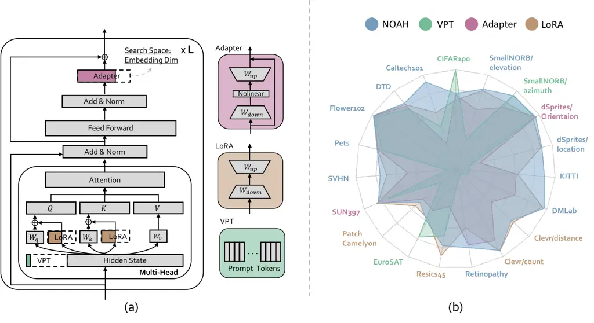

# Neural Prompt Search

Yuanhan Zhang    Kaiyang Zhou    Ziwei Liu ^(†)^(†)thanks: Corresponding
author Affiliation: S-Lab, Nanyang Technological University, Singapore
Affiliation: {yuanhan002, kaiyang.zhou, ziwei.liu}@ntu.edu.sg

###### Abstract

The size of vision models has grown exponentially over the last few
years, especially after the emergence of Vision Transformer. This has
motivated the development of parameter-efficient tuning methods, such as
learning adapter layers or visual prompt tokens, which allow a tiny
portion of model parameters to be trained whereas the vast majority
obtained from pre-training are frozen. However, designing a proper
tuning method is non-trivial: one might need to try out a lengthy list
of design choices, not to mention that each downstream dataset often
requires custom designs. In this paper, we view the existing
parameter-efficient tuning methods as “prompt modules” and propose
Neural prOmpt seArcH (NOAH), a novel approach that learns, for large
vision models, the optimal design of prompt modules through a neural
architecture search algorithm, specifically for each downstream dataset.
By conducting extensive experiments on over 20 vision datasets, we
demonstrate that NOAH (i) is superior to individual prompt modules, (ii)
has good few-shot learning ability, and (iii) is domain-generalizable.
The code and models are available at
[https://github.com/Davidzhangyuanhan/NOAH](https://github.com/Davidzhangyuanhan/NOAH).

## 1 Introduction



Figure 1: Our approach, neural prompt search, or NOAH for short,
subsumes three representative parameter-efficient tuning methods (i.e.,
Adapter \[17\], LoRA \[18\] and VPT \[19\]) and learns from data the
optimal design through neural architecture search (a). The approach is
motivated by the observation that none of the three individuals shows
dominance on the VTAB-1k benchmark (b). The colors of the datasets’
names indicate which method performs the best. Clearly, NOAH is the best
overall approach.

The size of vision models has grown exponentially from tens of millions
a few years ago (e.g., ResNet \[13\]) to today’s hundreds of millions
\[9\], or even billions \[3, 8, 40\], for Transformers \[41\]. Such an
increase can cause a number of problems to transfer learning \[17, 19\],
and the first and foremost is that fine-tuning becomes more difficult as
large model size can easily lead to overfitting in a typical-sized
dataset, let alone the increase of compute and storage costs.

Recently, there is a growing interest in developing parameter-efficient
tuning methods \[17, 18, 19\]. The key idea is to insert a tiny
trainable module to a large pre-trained model and only adjust its
parameters by optimizing some task-specific losses like the
cross-entropy for classification problems. The most representative
methods are Adapter \[17\], Low-Rank Adaptation (LoRA) \[18\], and
Visual Prompt Tuning (VPT) \[19\]. As exemplified in Fig. 1(a), Adapter
is a bottleneck-shaped neural network appended to a network block’s
output; LoRA is a “residual” layer consisting of rank decomposition
matrices; VPT prepends additional tokens to the input of a Transformer
block, which can be seen as adding learnable “pixels.”

By evaluating the three parameter-efficient tuning methods on a
commonly-used transfer learning benchmark, i.e., VTAB-1k \[48\], we
identify a couple of critical issues. _First_, none of the three methods
performs consistently well on all datasets, as illustrated in Fig. 1(b).
For instance, when it comes to scene structure understanding tasks, VPT
outperforms Adapter and LoRA on SmallNORB/ azimuth \[24\], but its
performance plunges on SmallNORB/elevation \[24\] and Clevr/count
\[20\], which is largely behind the two competitors. The results suggest
that, for a specific dataset, one needs to perform an extensive
evaluation on different tuning methods in order to identify the most
suitable one. _Second_, performance is found to be sensitive to the
selection of model parameters, such as Adapter’s feature dimension or
the token length in VPT—this is also observed by Jia et al. \[19\] that
the optimal token length in VPT varies from 1 to 200 on different
datasets.

In this work, we view the existing parameter-efficient tuning methods as
_prompt modules_ and propose to _automatically search for the optimal
prompt design from data via a neural architecture search (NAS)
algorithm_. Specifically, we introduce the concept of Neural prOmpt
seArcH (NOAH) for large vision models, particularly those equipped with
the Transformer block \[9\]. The search space is constructed by
subsuming Adapter \[17\], LoRA \[18\] and VPT \[19\] into each
Transformer block, as depicted in Fig. 1(a). The specific model
parameters, including the feature dimension for Adapter and LoRA and the
token length for VPT, are determined by a one-shot NAS algorithm.

We conduct extensive experiments on VTAB-1k \[48\], which is composed of
19 diverse vision datasets and covers a wide spectrum of visual domains
like objects, scenes, textures and satellite imagery. The results show
that NOAH significantly outperforms the individual prompt modules on 10
out of 19 datasets while the performance on the remaining is highly
competitive (see Fig. 1(b) for an overview of the results). We also
evaluate on few-shot learning and domain generalization where the
results also confirm the superiority of NOAH to the hand-crafted prompt
modules.

Our contributions are summarized as follows. (i) We present a systematic
study of three representative prompt modules and expose some critical
issues associated with performance and efficiency. (ii) A novel concept,
neural prompt search, is proposed to address the challenge of
hand-engineering prompt modules. (iii) An efficient NAS-based
implementation of NOAH is provided. (iv) We demonstrate that NOAH is
better than individual prompt modules in downstream transfer learning,
few-shot learning, and domain generalization. The models and code will
be released.

## 2 Neural Prompt Search

### 2.1 Background

#### Vision Transformer

We first briefly review Vision Transformer (ViT) \[9\], to which our
approach is mainly applied. ViT consists of alternating blocks of
multihead self-attention (MSA) and multi-layer perceptron (MLP). Given
an input sequence $`x\in\mathbb{R}^{N\times D}`$ where $`N`$ denotes the
token length and $`D`$ is the embedding dimension, MSA first maps $`x`$
to queries $`Q\in\mathbb{R}^{N\times d}`$, keys
$`K\in\mathbb{R}^{N\times d}`$ and values $`V\in\mathbb{R}^{N\times d}`$
using three projection matrices, $`W_{q}\in\mathbb{R}^{D\times d}`$,
$`W_{k}\in\mathbb{R}^{D\times d}`$ and
$`W_{v}\in\mathbb{R}^{D\times d}`$, respectively, where $`d`$ means the
hidden dimension. Then, MSA computes the weighted sums over the values
based on the self-attention between the queries and keys,

```math
\operatorname{Attention}(Q,K,V)=\operatorname{softmax}(\frac{QK^{T}}{\sqrt{d}})V, \tag{1}
```

where $`\frac{1}{\sqrt{d}}`$ is a scaling factor.

Below we briefly review the three representative—and
top-performing—parameter-efficient tuning methods, i.e., Adapter \[17\],
LoRA \[18\] and VPT \[19\], which will be incorporated into our search
space. An illustration of these three methods can be found in Fig. 1(a).
Note that VPT has been studied for vision models while Adapter and LoRA
have only been studied for language models.

#### Adapter

is essentially a bottleneck-like neural network consisting of a
down-sample layer $`W_{down}\in\mathbb{R}^{d\times r}`$ and an up-sample
layer $`W_{up}\in\mathbb{R}^{r\times d}`$, where $`r`$ denotes the
down-sampled dimension. A non-linear activation function
$`\phi(\cdot)`$, such as ReLU, is inserted in-between. The computation
can be formulated as

```math
h^{\prime}=\phi(hW_{down})W_{up}, \tag{2}
```

where $`h\in\mathbb{R}^{N\times d}`$ is a normalized output of the MLP
in a Transformer block.

#### LoRA

aims to update the two projection layers, $`W_{q}`$ (for queries) and
$`W_{k}`$ (for keys), in an indirect way by optimizing their
rank-decomposed changes, $`\bigtriangleup W_{q}=W_{q}^{down}W_{q}^{up}`$
and $`\bigtriangleup W_{k}=W_{k}^{down}W_{k}^{up}`$, where
$`W_{q/k}^{down}\in\mathbb{R}^{D\times r}`$ and
$`W_{q/k}^{up}\in\mathbb{R}^{r\times d}`$ ($`r`$ is the down-projection
dimension). For a specific input $`x`$, we have

```math
Q=xW_{q}+s\cdot xW_{q}^{down}W_{q}^{up},\quad K=xW_{k}+s\cdot xW_{k}^{down}W_{k}^{up}, \tag{3}
```

where $`s`$ is a fixed scaling parameter for modulating the updates.

#### Visual Prompt Tuning (VPT)

prepends a set of learnable tokens to the input of a Transformer block,
which can be viewed as adding some learnable pixels in the input space.
We investigate the best-performing version, VPT-Deep, which applies
prompt tuning to multiple layers \[19\]. We call this module VPT for
brevity hereafter and formulate it in mathematical terms below. A
typical input $`x\in\mathbb{R}^{N\times D}`$ to a Transformer block
contains a learnable class token \[CLS\] of $`D`$-dimension and a
sequence of image patch embeddings
$`\text{E}=\{\text{e}_{i}|\text{e}_{i}\in\mathbb{R}^{D},i=1,...,N-1\}`$
where the positional embeddings are omitted. VPT adds $`m`$ learnable
tokens,
$`\text{P}=\{\text{p}_{k}|\text{p}_{k}\in\mathbb{R}^{D},k=1,...,m\}`$,
to $`x`$, which then becomes

```math
x=[\text{CLS},\text{P},\text{E}]. \tag{4}
```

### 2.2 Prompt Search Algorithm

As discussed, none of the individual parameter-efficient tuning methods,
or _prompt modules_ called in this paper, shows dominance in the
transfer learning benchmark. Our approach, neural prompt search (NOAH),
incorporates Adapter \[17\], LoRA \[18\] and VPT \[19\] into each
Transformer block and learns the design that best suits a dataset
through neural architecture search (NAS). Specifically, we employ a
one-shot NAS algorithm, AutoFormer \[4\], for prompt module search. Our
supernet is a ViT-like model composed of 12 Transformer blocks (layers).
Below we detail the search space and how the search is done.

#### Search Space

As shown in Fig. 1(a), we embed the three prompt modules into each
Transformer block following the guidelines proposed in the original work
\[17, 18, 19\]. Concretely, we install VPT in the input position, add
LoRA alongside the two projection matrices as residuals, and insert
Adapter after the normalized output of the MLP. The search space mainly
contains the model parameters associated with the three prompt modules.
Specifically, each prompt module has two sets of parameters to search
from: (i) the embedding dimension $`\in\{5,10,50,100\}`$ or
$`\{1,5,10\}`$; (ii) the depth $`\in\{3,6,9,12\}`$. A depth means up to
which layer a module is applied, e.g., $`\text{depth}=3`$ for VPT means
layers 0, 1 and 2 have VPT installed while the remaining layers, 3 to
11, do not have VPT.¹¹ 1 Zero-based indexing is adopted. For VPT, the
embedding dimension means the token length whereas for Adapter and LoRA,
the embedding dimension means the down-sampled dimension, i.e., $`r`$.

#### Supernet Training

The supernet, as mentioned, has 12 Transformer layers, each containing
the three prompt modules with full embedding dimension, i.e., 100.
During each forward pass, a subnet is randomly sampled from the supernet
for training. Specifically, for _each_ prompt module, a depth is first
sampled from $`\{3,6,9,12\}`$ to determine which layers should have the
module. Then, for _each_ layer within the depth range, an embedding
dimension is chosen from $`\{5,10,50,100\}`$ or $`\{1,5,10\}`$, all with
a uniform probability. Note that only the prompt modules’ parameters are
learned while the pre-trained model is kept fixed. AutoFormer \[4\]
allows the weights in each prompt module to be entangled during
training, meaning that different weights are maximally shared, e.g., in
a VPT module, if 100 tokens are selected for training, the previously
trained tokens, such as 50, will be reused and trained together with
other 50 tokens. This way, as suggested in AutoFormer \[4\], leads to
faster convergence and low memory cost.

#### Evolutionary Search

After the supernet is trained, evolutionary search is conducted to
obtain the optimal subnet architecture under a parameter size limit
\[4\]. Specifically, we first select $`K`$ random architectures, from
which the top $`k`$ architectures (with the best performance) are used
as parents to produce the next generation through crossover and
mutation. For crossover, two candidates are randomly chosen and crossed
to produce a “child” architecture. For mutation, a candidate mutates its
prompt module design with a probability. See Fig. 2 for an illustration.

Figure 2: Illustration of crossover and mutation in the evolutionary
search method.

## 3 Experiments

In this section, we mainly address the following questions: (i) Is NOAH
better than the individual prompt modules? (ii) Can NOAH work in a
few-shot setting? (iii) Are models learned by NOAH robust to domain
shift? The answers are discussed in Sec. 3.1, 3.2 and 3.3, respectively.
We also conduct some analyses in Sec. 3.4 to have a deeper understanding
of NOAH, such as what a subnet looks like and whether it is transferable
beyond the dataset in which the architecture was found.

#### Baselines

The main competitors are the three representative prompt modules
subsumed by NOAH, which are Adapter \[17\], LoRA \[18\] and VPT \[19\].
Among them, only VPT is specifically designed for vision models while
the other two are originally developed for language models. We also
compare two common fine-tuning methods on the VTAB-1k benchmark: full
tuning (Full) and linear probing (Linear). Full simply tunes the entire
model parameters whereas Linear freezes the pre-trained part and only
adjusts the newly added linear classification layer.²² 2 Note that all
methods have a new linear classification layer to learn. It is worth
mentioning that Full has been considered as a strong baseline in
existing studies \[19, 17\].

#### Implementation Details

We keep the training parameters identical across all experiments
throughout this paper. ViT-B/16 \[9\] pre-trained on ImageNet-22K \[7\]
is used as the base model, which is strong enough so the results are
fair and convincing. The supernet for NOAH is trained for 500 epochs and
the ultimate subnet is trained for 100 epochs— note that “subnet” means
the prompt modules/architectures. Since the AutoFormer \[4\] algorithm
allows a subnet to be used without retraining, we demonstrate later that
the subnet found by NOAH without retraining is also comparable to the
retrained one. The evolutionary search in NOAH takes 5 epochs in total
and each step of random pick/crossover/mutation produces 50 new subnets.
The probability for crossover and mutation is set to 0.2, which follows
AutoFormer \[4\]. The individual prompt modules, i.e., Adapter \[17\],
LoRA \[18\] and VPT \[19\], are constructed using the best recipes
suggested by the original papers (also trained for 100 epochs; see the
Supplementary for more details). The parameter sizes for Adapter, LoRA
and VPT are 0.16M, 0.29M and 0.64M, respectively. For fair comparison,
we set the upper-limit of parameter size of the final subnet in NOAH to
0.64M so the resulting size would be comparable to the baselines. More
implementation details including image augmentation and other
hyper-parameters are provided in the Supplementary.

### 3.1 Experiments on VTAB-1k

#### Datasets

We choose the VTAB-1k \[48\] benchmark to evaluate the transfer learning
performance of our approach. VTAB-1k consists of 19 vision datasets,
which are clustered into three groups: Natural, Specialized and
Structured. The Natural group contains natural images that are captured
by standard cameras and cover a broad spectrum of concepts including
generic, fine-grained and abstract objects. The Specialized group
contains images captured by specialist equipment for remote sensing
(like aerial images) and medical purposes. The Structured group is
designed specifically for scene structure understanding, such as object
counting, depth prediction and orientation prediction. Each dataset in
VTAB-1k contains 1,000 labeled examples, which are split into a train
(80%) and a val (20%) set (the latter is used for hyper-parameter
tuning), while the test data comes from the original test set. The final
model used for evaluation is trained using the full 1,000 examples in
each dataset. Top-1 classification accuracy is used as the performance
measure.

[TABLE]

Table 1: Full results on the VTAB-1k benchmark. The first block contains
conventional tuning methods while the second block contains
parameter-efficient tuning methods, which is the main focus in this
paper. NOAH achieves the best overall performance, which is 1% higher on
average than the individual prompt modules.

Figure 3: Group-wise average results on VTAB-1k. NOAH performs the best
in the Natural and Structured groups while its performance in the
Specialized group is similar to that of LoRA—but NOAH does not require a
manual search over the architecture and hyper-parameters.

#### Results

Table 1 presents the full results on the VTAB-1k benchmark. A high-level
summary is shown earlier in Fig. 1(b). The average performance within
each group is summarized in Fig. 3. We have the following observations.

_Observation 1: Overall, NOAH is the best parameter-efficient tuning
method._ First and foremost, we demonstrate that searching for the
optimal combination of the individual prompt modules works the best.
This is evidenced by the 1% average gain over the strongest prompt
module, i.e., LoRA. Given the diversity of the benchmark, the 1% average
gain can be considered to be significant. It is also worth mentioning
that Adapter was previously proved to be the best-performing prompt
module in NLP \[31\], but in our study for computer vision tasks, LoRA
takes over the seat. This further confirms that search is a better
option than hand-engineering in practice.

_Observation 2: NOAH slightly dims in the Specialized group._ The
results suggest that NOAH’s weakness seems to be in the Specialized
tasks where the individual modules achieve the on-par performance:
NOAH’s results are not too far from those of the competitors, e.g.,
NOAH’s 84.9 vs LoRA’s 84.6 on average. And while NOAH is superior on a
Retinopathy, it lags on the other datasets, especially on the EuroSAT.
Since the individual modules require a manual search over architecture
and hyper-parameters, NOAH is more compelling.

### 3.2 Experiments on Few-Shot Learning

Figure 4: Results of few-shot learning on five fine-grained visual
recognition datasets. NOAH beats the individual modules on average.

#### Datasets

We choose five fine-grained visual recognition datasets, which include
Food101 \[2\], OxfordFlowers102 \[34\], StandfordCars \[22\], OxfordPets
\[35\], and FGVCAircraft \[30\]. The categories in these datasets cover
a wide range of visual concepts closely related to our daily life: food,
plant, vehicle and animal. We follow existing studies \[52, 37\] to
evaluate on 1, 2, 4, 8 and 16 shots, which are sufficient for observing
the trend.

#### Results

The results are summarized in Fig. 4. In terms of the average
performance, we can observe that: (i) In the low-data regime like 1 or 2
shots, NOAH, LoRA and Adapter perform similarly but VPT largely lags
behind; (ii) NOAH shows clear dominance when more shots become
available, e.g., with 16 shots the gap between NOAH and the runner-up is
around 2%. By looking at the individual graphs, we can see that none of
the individual prompt modules performs consistently well on all
datasets, which, again, justifies that search is better than
hand-engineering.

### 3.3 Experiments on Domain Generalization

|                |          |        |         |      |      |
| -------------- | -------- | ------ | ------- | ---- | ---- |
|                | Source   | Target |         |      |      |
|                | ImageNet | -V2    | -Sketch | -A   | -R   |
| Adapter \[17\] | 70.5     | 59.1   | 16.4    | 5.5  | 22.1 |
| VPT \[19\]     | 70.5     | 58.0   | 18.3    | 4.6  | 23.2 |
| LoRA \[18\]    | 70.8     | 59.3   | 20.0    | 6.9  | 23.3 |
| NOAH           | 71.5     | 66.1   | 24.8    | 11.9 | 28.5 |

Table 2: Results on domain generalization. NOAH is significantly better
than the individual prompt modules on the four domain-shifted datasets.

#### Datasets

Since domain shift is ubiquitous in real-world applications \[51\], we
are interested to know how our search-based approach compares with the
individual prompt modules in terms of domain generalization ability.
Following prior studies \[52, 53\], we first train a model on ImageNet
\[7\] (using 16 shots per category) and then directly test it on four
other variants of ImageNet that undergo different types of domain shift.
Specifically, the test datasets include (i) ImageNetV2 \[39\], which is
collected from different sources than ImageNet but following the same
collection protocol, (ii) ImageNet-Sketch \[43\], which is composed of
sketch images of the same 1,000 classes in ImageNet, (iii) ImageNet-A
\[16\], which contains adversarially-filtered images, (iv) ImageNet-R
\[15\], which is a rendition of ImageNet. Both ImageNet-A and -R have
200 classes derived from a subset of ImageNet’s 1000 classes. All
results are averaged over three random seeds.

#### Results

Table 2 compares NOAH with the three individual prompt modules. On
ImageNet, which is the source dataset, the gap between NOAH and the
individual modules is small, which is about 1%. However, on the four
test datasets, NOAH demonstrates significantly stronger robustness than
the baselines: over 6.8%, 4.8%, 5% and 5.2% improvements on -V2,
-Sketch, -A and -R, respectively. The results, together with those from
previous subsections, justify that our search-based approach is superior
to the individual prompt modules.

Figure 5: Average subnets (architectures) for the three groups in
VTAB-1k. Adapter and LoRA tend to live in deep layers while VPT is found
nearly in all depths. The demands for VPT (indicated by the embedding
dimension) differ in different groups. The co-existence of the three
modules, especially in deep layers, serves as strong evidence of their
complementarity, and such a synergy is difficult to obtain by
hand-engineering.

### 3.4 Further Analysis

#### Architecture of Subnet

A key question to answer is: how does NOAH’s subnet, i.e., the ultimate
architecture, look like. To make the results convincing, we visualize
the average architecture—instead of individual ones—found within each
group of VTAB-1k, as well as the global average over all datasets, in
Fig. 5. The x-axis represents the network depth while the y-axis
represents the embedding dimension. An intriguing observation is that
Adapter and LoRA, _across all groups_ (Fig. 5(a)), mainly appear in deep
layers with the embedding dimension larger than four and reduced to zero
in some shallow layers. In contrast, VPT can be found nearly in all
depths (layers), but the dimensions vary significantly in different
groups, which indicates different demands for VPT. For instance, in the
Natural group (Fig. 5(b)), shallow layers need more VPT modules; but in
the Structured group (Fig. 5(d)), deep layers need more VPT modules.
Moreover, the co-existence of the three modules, especially in deep
layers, suggests that they are complementary to each other—_such a
synergy is difficult to obtain by manual design_. In summary, the
observed high variances in the module designs strongly indicate that
search is much more efficient than hand-engineering when it comes to
developing parameter-efficient tuning methods.

Figure 6: Evaluation on the transferability of subnets. Dataset-specific
subnet means the architecture is found from the target dataset. ImageNet
subnet means the architecture is found from ImageNet and transferred to
the target dataset. All target datasets come from VTAB-1k. In general,
better transferability is achieved when the source and target datasets
are closer, and vice versa.

#### Transferability of Subnet

As discussed previously, the subnet (i.e., architecture) found for
different datasets differs dramatically. Here we study whether, or in
what circumstances, the subnet found from one dataset can be transferred
to another. To this end, we train NOAH on ImageNet and apply the
ultimate subnet to the VTAB-1k benchmark where the model is retrained
and evaluated. To measure transferability, we compare the ImageNet
subnet with the dataset-specific subnets on VTAB-1k. Fig. 6 shows the
comparisons. Overall, the gap between the ImageNet subnet and the 19
dataset-specific subnets on VTAB-1k is below 3%, meaning that NOAH has
fair transferability. By digging deeper into the results, we find that
the transfer gap is smaller when the source (i.e., ImageNet) and target
datasets are closer, and vice versa. For instance, the gaps in the
Natural group are less than 1%, which make sense because the ImageNet
images and those from the Natural group share similar visual concepts,
such as generic objects, flowers and animals.

|                    |      |      |      |         |
| ------------------ | ---- | ---- | ---- | ------- |
|                    | Nat. | Spe. | Str. | Average |
| VPT \[19\]         | 78.5 | 82.4 | 55.0 | 72.0    |
| Adapter \[17\]     | 79.0 | 84.1 | 58.5 | 73.9    |
| LoRA \[18\]        | 79.5 | 84.6 | 60.5 | 74.5    |
| NOAH (_inherited_) | 79.5 | 84.2 | 58.7 | 74.1    |
| NOAH (_retrained_) | 80.2 | 84.9 | 61.3 | 75.5    |

Table 3: With vs without retraining NOAH’s subnets. The results show
that there is no significant difference between them, suggesting that
retraining can be safely removed in practice if the compute resource is
limited.

#### With vs Without Retraining

Thanks to the weight entanglement strategy in AutoFormer \[4\], the
subnet extracted from the supernet can be directly deployed for use
without retraining. To verify if such a rule also applies to NOAH, we
compare the subnets with and without retraining on VTAB-1k. The results
averaged over each group are shown in Table 3 where we observe that NOAH
without retraining (denoted as _inherited_) is still competitive: the
inherited version still outperforms the VPT and Adapter. The results
suggest that the retraining cost can be safely removed without incurring
any significant loss.

## 4 Related Work

### 4.1 Parameter-Efficient Tuning

A recent trend in transfer learning is to develop parameter-efficient
tuning methods \[19, 17, 18, 12, 50, 52\], which is spurred by the rapid
increase in model size. Existing methods can be generally divided into
two groups. The first group fine-tunes a small portion of the internal
parameters, such as biases \[46\]. The second group adds tiny learnable
modules like Adapter \[17\] or LoRA \[18\], which is more relevant to
our research and thus the focus here. Adapter \[17\] and LoRA \[18\]
essentially share similar architectures—both look like a bottleneck—but
are installed at different places: Adapter is often installed at the
output of a block while LoRA is treated as residuals to the projection
matrices in a Transformer \[41\] block. It is worth noting that these
methods are first studied in natural language processing (NLP) since
pre-trained language models \[8, 3\] typically have an enormous
parameter size that reaches the billion level. Another popular design in
NLP is prompt learning \[50, 26, 25\], which turns some text prompt
tokens into learnable vectors. Such an idea has recently been applied to
vision-language models \[52, 53, 29\] and is also the source of
inspiration for the recently proposed VPT \[19\], which adds learnable
“pixels” to the input of ViT \[9\].

More relevant to our work are those trying to unify different
parameter-efficient tuning methods \[12, 31\]. He et al. \[12\] build a
connection between Adapter and prompt learning and cast the problem into
the learning of a modification vector, which leads to a unified view and
a stronger baseline. UNIPELT \[31\] is another unified framework, which
subsumes several prompt modules in a block and learns a set of gating
functions to selectively activate them. Our work differs from these
studies in two crucial ways: (i) we target _computer vision_ problems
whereas the previous studies \[12, 31\] focus on NLP; (ii) we unify
prompt modules from the NAS perspective with a much more _fine-grained_
control over the model hyper-parameters (e.g., token length and
embedding dimension). This allows our model to be deployed in a
resource-constrained environment. In the future, we plan to apply our
approach to NLP.

### 4.2 Neural Architecture Search

Neural architecture search (NAS) consists of two crucial components:
search space and search algorithm. A search space can subsume various
designs of how neurons are connected \[56\], diverse combinations of
model hyper-parameters \[55\], or different arrangements of specific
modules like normalization layers \[54\]. When it comes to the search
algorithm part, the community has witnessed significant advances: from
costly methods like reinforcement learning \[55\] or evolutionary search
\[38\] to more efficient ones based on weight-sharing \[36\] or
differentiable optimization \[27\]. The most relevant work to ours is
AutoFormer \[4\], which is a one-shot NAS method focusing on Transformer
\[41\] models. AutoFormer features a weight entanglement strategy, which
allows different subnets sampled from a big supernet to share weights
among each other. Our work leverages AutoFormer to solve the problem of
engineering parameter-efficient tuning methods, which we hope can
inspire future work to address efficient transfer learning.

## 5 Discussion, Limitation and Future Work

With the proliferation of large-scale pre-training data \[49, 37, 45\],
model size in neural networks has also been increased correspondingly in
order to reach a certain learning capacity. On the other hand, the rapid
increase in model size has also spurred interests in developing
efficient transfer learning methods \[19, 52\].

Our research presents timely studies on how some recently-proposed
parameter-efficient tuning methods, or prompt modules, fare in computer
vision problems. Crucially, our studies expose a critical issue that,
for any specific downstream dataset, hand-designing an optimal prompt
module is extremely challenging. More importantly, we for the first time
solve the problem from a NAS perspective and demonstrate the potential
of our search-based approach in terms of downstream transfer learning
performance, the ability to work in low-data regimes, and robustness to
domain shift, which is ubiquitous in real-world data \[51\].

Our studies also unveil some intriguing phenomena. In particular, we
find that the ultimate subnet exhibits different architectural patterns
for the three prompt modules across datasets of different natures. Since
neural networks’ features, as often suggested \[47\], progress from
low-level visual primitives in bottom layers to high-level abstractions
in top layers, the aforementioned findings entail that different prompt
modules work best for features at different levels. We hope such
findings and insights can inspire future work on designing more advanced
prompt modules.

In terms of limitations, NOAH requires additional training for the
supernet, which inevitably increases the development cost. Moreover, as
suggested by the few-shot learning results, NOAH’s advantages become
clearer when more labeled images are available. In other words, NOAH
would require more labels to unleash its full power in practice. For
future work, we plan to dig deeper into the mechanisms behind NOAH for
better interpretation of the intriguing results and apply NOAH to
broader application domains beyond computer vision, such as NLP.

## Appendix A Implementation Details

### A.1 Datasets

Table 4 briefly introduces dataset that we used.

|                 |                             |           |                          |        |        |                 |
| --------------- | --------------------------- | --------- | ------------------------ | ------ | ------ | --------------- |
|                 | Dataset                     | \#Classes | Train                    | Val    | Test   | License         |
| VTAB-1k \[48\]  | CIFAR100 \[23\]             | 100       | 800/1,000                | 200    | 10,000 | Research only   |
|                 | Caltech101 \[10\]           | 102       |                          |        | 6,084  | Research only   |
|                 | DTD \[6\]                   | 47        |                          |        | 1,880  | Research only   |
|                 | Oxford-Flowers102 \[34\]    | 102       |                          |        | 6,149  | Research only   |
|                 | Oxford-Pets \[35\]          | 37        |                          |        | 3,669  | CC BY-SA 4.0    |
|                 | SVHN \[33\]                 | 10        |                          |        | 26,032 | CC              |
|                 | Sun397 \[44\]               | 397       |                          |        | 21,750 | Research only   |
|                 | Patch Camelyon \[42\]       | 2         |                          |        | 32,768 | CC0             |
|                 | EuroSAT \[14\]              | 10        |                          |        | 5,400  | Research only   |
|                 | Resisc45 \[5\]              | 45        |                          |        | 6,300  | Research only   |
|                 | Retinopathy \[21\]          | 5         |                          |        | 42,670 | Research only   |
|                 | Clevr/count \[20\]          | 8         |                          |        | 15,000 | CC BY 4.0       |
|                 | Clevr/distance \[20\]       | 6         |                          |        | 15,000 | CC BY 4.0       |
|                 | DMLab \[1\]                 | 6         |                          |        | 22,735 | Research only   |
|                 | KITTI-Dist \[11\]           | 4         |                          |        | 711    | CC BY-NC-SA 3.0 |
|                 | dSprites/location \[32\]    | 16        |                          |        | 73,728 | Research only   |
|                 | dSprites/orientation \[32\] | 16        |                          |        | 73,728 | Research only   |
|                 | SmallNORB/azimuth \[24\]    | 18        |                          |        | 12,150 | Research only   |
|                 | SmallNORB/elevation \[24\]  | 18        |                          |        | 12,150 | Research only   |
| Few-shot \[52\] | Food-101 \[2\]              | 101       | (1/2/4/8/16)\*(#Classes) | 20,200 | 30,300 | Research only   |
|                 | Stanford Cars \[22\]        | 196       |                          | 1,635  | 8,041  | Research only   |
|                 | Oxford-Flowers102 \[34\]    | 102       |                          | 1,633  | 2,463  | Research only   |
|                 | FGVC-Aircraft \[30\]        | 100       |                          | 3,333  | 3,333  | Research only   |
|                 | Oxford-Pets \[35\]          | 37        |                          | 736    | 3,669  | CC BY-SA 4.0    |

Table 4: The first block introduces the information of the datasets in
the VTAB-1k \[48\] benchmark. The datasets in the second block are five
fine-grain dataset used in the CoOp \[52\] few-shot learning benchmark.
Especially, _Research only_ indicates that this dataset is for research
purposes only.

### A.2 Training Details

#### Augmentation

For the VTAB-1k \[48\], we follows its default augmentation settings,
implementing the resizing and normalization for input images.
Specifically, we resize a input image to $`224\times 224`$, followed by
normalizing it with ImageNet \[7\] means and standard deviation. For
few-shot learning and domain generalization experiments, we implement
color-jitters with the factor as 0.4, and RandAugmentation with
magnitude equals 9, magnitude standard deviation equals 0.5.

#### Hyperparameters

We consistently set the embedding dimension of Adapter \[17\] and LoRA
\[18\] as 8. We set prompt length of VPT \[19\] following the paper. For
few-shot learning (FS) and domain generalization (DG) experiments, we
consistently set the VPT prompt length as 8. We use AdamW optimizer
\[28\] with the cosine scheduler. The weight decay equals $`1`$e$`-3`$,
warm-up epochs equals 10, and the batch size equals 64. Other
hyperparameters are shown in below.

|               |               |          |           |               |            |
| ------------- | ------------- | -------- | --------- | ------------- | ---------- |
|               | Learning Rate |          | Dimension |               | Depth      |
|               | VTAB          | Others   | VTAB      | Others        |            |
| VPT           | 1$`e`$-3      | 5$`e`$-3 | {1,5,10}  | {5,10,50,100} | {3,6,9,12} |
| Adapter       | 1$`e`$-3      | 5$`e`$-3 |           |               |            |
| LoRA          | 1$`e`$-3      | 5$`e`$-3 |           |               |            |
| NOAH-supernet | 5$`e`$-4      | 5$`e`$-4 |           |               |            |
| NOAH-subnet   | 1$`e`$-3      | 5$`e`$-3 |           |               |            |

Table 5: Hyperparameters. Others includes few-shot learning and domain
generalization.

## References

- \[1\] Charles Beattie, Joel Z Leibo, Denis Teplyashin, Tom Ward,
  Marcus Wainwright, Heinrich Küttler, Andrew Lefrancq, Simon Green,
  Víctor Valdés, Amir Sadik, et al. Deepmind lab. arXiv preprint
  arXiv:1612.03801, 2016.
- \[2\] Lukas Bossard, Matthieu Guillaumin, and Luc Van Gool.
  Food-101–mining discriminative components with random forests. In
  European conference on computer vision (ECCV), pages 446–461.
  Springer, 2014.
- \[3\] Tom Brown, Benjamin Mann, Nick Ryder, Melanie Subbiah, Jared D
  Kaplan, Prafulla Dhariwal, Arvind Neelakantan, Pranav Shyam, Girish
  Sastry, Amanda Askell, et al. Language models are few-shot learners.
  Advances in neural information processing systems (NeuIPS),
  33:1877–1901, 2020.
- \[4\] Minghao Chen, Houwen Peng, Jianlong Fu, and Haibin Ling.
  Autoformer: Searching transformers for visual recognition. In
  Proceedings of the IEEE/CVF International Conference on Computer
  Vision (ICCV), pages 12270–12280, 2021.
- \[5\] Gong Cheng, Junwei Han, and Xiaoqiang Lu. Remote sensing image
  scene classification: Benchmark and state of the art. Proceedings of
  the IEEE, 105(10):1865–1883, 2017.
- \[6\] M. Cimpoi, S. Maji, I. Kokkinos, S. Mohamed, , and A. Vedaldi.
  Describing textures in the wild. In Proceedings of the IEEE Conf. on
  Computer Vision and Pattern Recognition (CVPR), 2014.
- \[7\] Jia Deng, Wei Dong, Richard Socher, Li-Jia Li, Kai Li, and Li
  Fei-Fei. Imagenet: A large-scale hierarchical image database. In
  Proceedings of the IEEE/CVF Conference on Computer Vision and Pattern
  Recognition (CVPR), pages 248–255. Ieee, 2009.
- \[8\] Jacob Devlin, Ming-Wei Chang, Kenton Lee, and Kristina
  Toutanova. Bert: Pre-training of deep bidirectional transformers for
  language understanding. arXiv preprint arXiv:1810.04805, 2018.
- \[9\] Alexey Dosovitskiy, Lucas Beyer, Alexander Kolesnikov, Dirk
  Weissenborn, Xiaohua Zhai, Thomas Unterthiner, Mostafa Dehghani,
  Matthias Minderer, Georg Heigold, Sylvain Gelly, et al. An image is
  worth 16x16 words: Transformers for image recognition at scale. arXiv
  preprint arXiv:2010.11929, 2020.
- \[10\] Li Fei-Fei, Rob Fergus, and Pietro Perona. Learning generative
  visual models from few training examples: An incremental bayesian
  approach tested on 101 object categories. In conference on computer
  vision and pattern recognition workshop, pages 178–178. IEEE, 2004.
- \[11\] Andreas Geiger, Philip Lenz, Christoph Stiller, and Raquel
  Urtasun. Vision meets robotics: The kitti dataset. The International
  Journal of Robotics Research, 32(11):1231–1237, 2013.
- \[12\] Junxian He, Chunting Zhou, Xuezhe Ma, Taylor Berg-Kirkpatrick,
  and Graham Neubig. Towards a unified view of parameter-efficient
  transfer learning. arXiv preprint arXiv:2110.04366, 2021.
- \[13\] Kaiming He, Xiangyu Zhang, Shaoqing Ren, and Jian Sun. Deep
  residual learning for image recognition. In Proceedings of the
  IEEE/CVF Conference on Computer Vision and Pattern Recognition (CVPR),
  pages 770–778, 2016.
- \[14\] Patrick Helber, Benjamin Bischke, Andreas Dengel, and Damian
  Borth. Eurosat: A novel dataset and deep learning benchmark for land
  use and land cover classification. IEEE Journal of Selected Topics in
  Applied Earth Observations and Remote Sensing, 2019.
- \[15\] Dan Hendrycks, Steven Basart, Norman Mu, Saurav Kadavath, Frank
  Wang, Evan Dorundo, Rahul Desai, Tyler Zhu, Samyak Parajuli, Mike Guo,
  et al. The many faces of robustness: A critical analysis of
  out-of-distribution generalization. In Proceedings of the IEEE/CVF
  International Conference on Computer Vision (ICCV), pages
  8340–8349, 2021.
- \[16\] Dan Hendrycks, Kevin Zhao, Steven Basart, Jacob Steinhardt, and
  Dawn Song. Natural adversarial examples. In Proceedings of the
  IEEE/CVF Conference on Computer Vision and Pattern Recognition (CVPR),
  pages 15262–15271, 2021.
- \[17\] Neil Houlsby, Andrei Giurgiu, Stanislaw Jastrzebski, Bruna
  Morrone, Quentin De Laroussilhe, Andrea Gesmundo, Mona Attariyan, and
  Sylvain Gelly. Parameter-efficient transfer learning for nlp. In
  International Conference on Machine Learning (ICML), pages 2790–2799.
  PMLR, 2019.
- \[18\] Edward J Hu, Yelong Shen, Phillip Wallis, Zeyuan Allen-Zhu,
  Yuanzhi Li, Shean Wang, Lu Wang, and Weizhu Chen. Lora: Low-rank
  adaptation of large language models. arXiv preprint
  arXiv:2106.09685, 2021.
- \[19\] Menglin Jia, Luming Tang, Bor-Chun Chen, Claire Cardie, Serge
  Belongie, Bharath Hariharan, and Ser-Nam Lim. Visual prompt tuning.
  arXiv preprint arXiv:2203.12119, 2022.
- \[20\] Justin Johnson, Bharath Hariharan, Laurens Van Der Maaten, Li
  Fei-Fei, C Lawrence Zitnick, and Ross Girshick. Clevr: A diagnostic
  dataset for compositional language and elementary visual reasoning. In
  Proceedings of the IEEE/CVF Conference on Computer Vision and Pattern
  Recognition (CVPR), pages 2901–2910, 2017.
- \[21\] Kaggle and EyePacs. Kaggle diabetic retinopathy detection. 2015.
- \[22\] Jonathan Krause, Michael Stark, Jia Deng, and Li Fei-Fei. 3d
  object representations for fine-grained categorization. In Proceedings
  of the IEEE international conference on computer vision workshops,
  pages 554–561, 2013.
- \[23\] Alex Krizhevsky, Geoffrey Hinton, et al. Learning multiple
  layers of features from tiny images. 2009.
- \[24\] Yann LeCun, Fu Jie Huang, and Leon Bottou. Learning methods for
  generic object recognition with invariance to pose and lighting. In
  Proceedings of the IEEE/CVF Conference on Computer Vision and Pattern
  Recognition (CVPR), volume 2, pages II–104. IEEE, 2004.
- \[25\] Brian Lester, Rami Al-Rfou, and Noah Constant. The power of
  scale for parameter-efficient prompt tuning. arXiv preprint
  arXiv:2104.08691, 2021.
- \[26\] Xiang Lisa Li and Percy Liang. Prefix-tuning: Optimizing
  continuous prompts for generation. arXiv preprint
  arXiv:2101.00190, 2021.
- \[27\] Hanxiao Liu, Karen Simonyan, and Yiming Yang. Darts:
  Differentiable architecture search. arXiv preprint
  arXiv:1806.09055, 2018.
- \[28\] Ilya Loshchilov and Frank Hutter. Decoupled weight decay
  regularization. arXiv preprint arXiv:1711.05101, 2017.
- \[29\] Yuning Lu, Jianzhuang Liu, Yonggang Zhang, Yajing Liu, and
  Xinmei Tian. Prompt distribution learning. In Proceedings of the
  IEEE/CVF Conference on Computer Vision and Pattern Recognition
  (CVPR), 2022.
- \[30\] Subhransu Maji, Esa Rahtu, Juho Kannala, Matthew Blaschko, and
  Andrea Vedaldi. Fine-grained visual classification of aircraft. arXiv
  preprint arXiv:1306.5151, 2013.
- \[31\] Yuning Mao, Lambert Mathias, Rui Hou, Amjad Almahairi, Hao Ma,
  Jiawei Han, Wen-tau Yih, and Madian Khabsa. Unipelt: A unified
  framework for parameter-efficient language model tuning. arXiv
  preprint arXiv:2110.07577, 2021.
- \[32\] Loic Matthey, Irina Higgins, Demis Hassabis, and Alexander
  Lerchner. dsprites: Disentanglement testing sprites dataset, 2017.
- \[33\] Yuval Netzer, Tao Wang, Adam Coates, Alessandro Bissacco, Bo
  Wu, and Andrew Y Ng. Reading digits in natural images with
  unsupervised feature learning. 2011.
- \[34\] M-E Nilsback and Andrew Zisserman. A visual vocabulary for
  flower classification. In Proceedings of the IEEE/CVF Conference on
  Computer Vision and Pattern Recognition (CVPR), volume 2, pages
  1447–1454. IEEE, 2006.
- \[35\] Omkar M Parkhi, Andrea Vedaldi, Andrew Zisserman, and CV
  Jawahar. Cats and dogs. In Proceedings of the IEEE/CVF Conference on
  Computer Vision and Pattern Recognition (CVPR), pages 3498–3505.
  IEEE, 2012.
- \[36\] Hieu Pham, Melody Guan, Barret Zoph, Quoc Le, and Jeff Dean.
  Efficient neural architecture search via parameters sharing. In
  International conference on machine learning (ICML), pages 4095–4104.
  PMLR, 2018.
- \[37\] Alec Radford, Jong Wook Kim, Chris Hallacy, Aditya Ramesh,
  Gabriel Goh, Sandhini Agarwal, Girish Sastry, Amanda Askell, Pamela
  Mishkin, Jack Clark, et al. Learning transferable visual models from
  natural language supervision. In International Conference on Machine
  Learning (ICML), pages 8748–8763. PMLR, 2021.
- \[38\] Esteban Real, Sherry Moore, Andrew Selle, Saurabh Saxena,
  Yutaka Leon Suematsu, Jie Tan, Quoc V Le, and Alexey Kurakin.
  Large-scale evolution of image classifiers. In International
  Conference on Machine Learning (ICML), pages 2902–2911. PMLR, 2017.
- \[39\] Benjamin Recht, Rebecca Roelofs, Ludwig Schmidt, and Vaishaal
  Shankar. Do imagenet classifiers generalize to imagenet? In
  International Conference on Machine Learning (ICML), pages 5389–5400.
  PMLR, 2019.
- \[40\] Scott Reed, Konrad Zolna, Emilio Parisotto, Sergio Gomez
  Colmenarejo, Alexander Novikov, Gabriel Barth-Maron, Mai Gimenez, Yury
  Sulsky, Jackie Kay, Jost Tobias Springenberg, et al. A generalist
  agent. arXiv preprint arXiv:2205.06175, 2022.
- \[41\] Ashish Vaswani, Noam Shazeer, Niki Parmar, Jakob Uszkoreit,
  Llion Jones, Aidan N Gomez, Łukasz Kaiser, and Illia Polosukhin.
  Attention is all you need. Advances in neural information processing
  systems (NeuIPS), 30, 2017.
- \[42\] Bastiaan S Veeling, Jasper Linmans, Jim Winkens, Taco Cohen,
  and Max Welling. Rotation equivariant CNNs for digital pathology.
  June 2018.
- \[43\] Haohan Wang, Songwei Ge, Zachary Lipton, and Eric P Xing.
  Learning robust global representations by penalizing local predictive
  power. Advances in Neural Information Processing Systems (NeuIPS),
  32, 2019.
- \[44\] Jianxiong Xiao, James Hays, Krista A Ehinger, Aude Oliva, and
  Antonio Torralba. Sun database: Large-scale scene recognition from
  abbey to zoo. In 2010 IEEE computer society conference on computer
  vision and pattern recognition, pages 3485–3492. IEEE, 2010.
- \[45\] Lu Yuan, Dongdong Chen, Yi-Ling Chen, Noel Codella, Xiyang Dai,
  Jianfeng Gao, Houdong Hu, Xuedong Huang, Boxin Li, Chunyuan Li, et al.
  Florence: A new foundation model for computer vision. arXiv preprint
  arXiv:2111.11432, 2021.
- \[46\] Elad Ben Zaken, Shauli Ravfogel, and Yoav Goldberg. Bitfit:
  Simple parameter-efficient fine-tuning for transformer-based masked
  language-models. arXiv preprint arXiv:2106.10199, 2021.
- \[47\] Matthew D Zeiler and Rob Fergus. Visualizing and understanding
  convolutional networks. In European conference on computer vision
  (ECCV), pages 818–833. Springer, 2014.
- \[48\] Xiaohua Zhai, Joan Puigcerver, Alexander Kolesnikov, Pierre
  Ruyssen, Carlos Riquelme, Mario Lucic, Josip Djolonga, Andre Susano
  Pinto, Maxim Neumann, Alexey Dosovitskiy, et al. A large-scale study
  of representation learning with the visual task adaptation benchmark.
  arXiv preprint arXiv:1910.04867, 2019.
- \[49\] Yuanhan Zhang, Qinghong Sun, Yichun Zhou, Zexin He, Zhenfei
  Yin, Kun Wang, Lu Sheng, Yu Qiao, Jing Shao, and Ziwei Liu. Bamboo:
  Building mega-scale vision dataset continually with human-machine
  synergy. arXiv preprint arXiv:2203.07845, 2022.
- \[50\] Zexuan Zhong, Dan Friedman, and Danqi Chen. Factual probing is
  \[mask\]: Learning vs. learning to recall. arXiv preprint
  arXiv:2104.05240, 2021.
- \[51\] Kaiyang Zhou, Ziwei Liu, Yu Qiao, Tao Xiang, and Chen Change
  Loy. Domain generalization: A survey. arXiv preprint
  arXiv:2103.02503, 2021.
- \[52\] Kaiyang Zhou, Jingkang Yang, Chen Change Loy, and Ziwei Liu.
  Learning to prompt for vision-language models. arXiv preprint
  arXiv:2109.01134, 2021.
- \[53\] Kaiyang Zhou, Jingkang Yang, Chen Change Loy, and Ziwei Liu.
  Conditional prompt learning for vision-language models. In Proceedings
  of the IEEE/CVF Conference on Computer Vision and Pattern Recognition
  (CVPR), 2022.
- \[54\] Kaiyang Zhou, Yongxin Yang, Andrea Cavallaro, and Tao Xiang.
  Learning generalisable omni-scale representations for person
  re-identification. IEEE Transactions on Pattern Analysis and Machine
  Intelligence (TPAMI), 2021.
- \[55\] Barret Zoph and Quoc V Le. Neural architecture search with
  reinforcement learning. arXiv preprint arXiv:1611.01578, 2016.
- \[56\] Barret Zoph, Vijay Vasudevan, Jonathon Shlens, and Quoc V Le.
  Learning transferable architectures for scalable image recognition. In
  Proceedings of the IEEE/CVF Conference on Computer Vision and Pattern
  Recognition (CVPR), pages 8697–8710, 2018.
