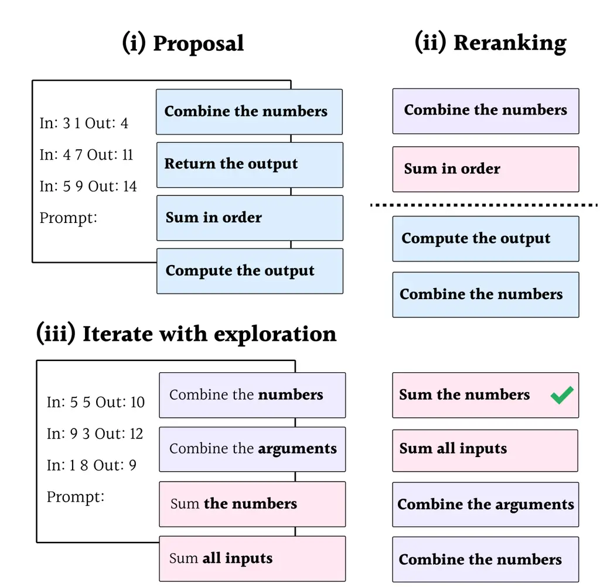
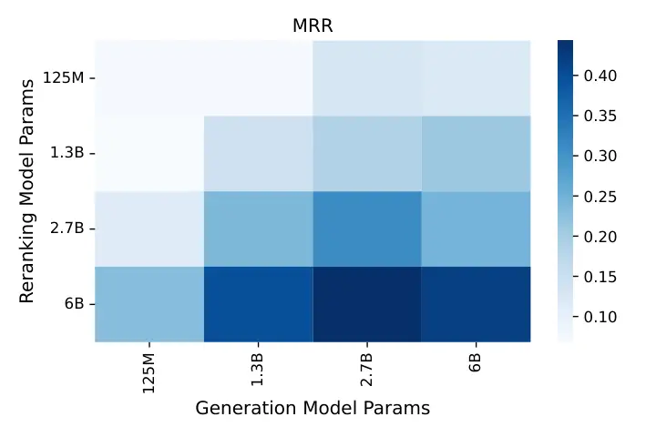
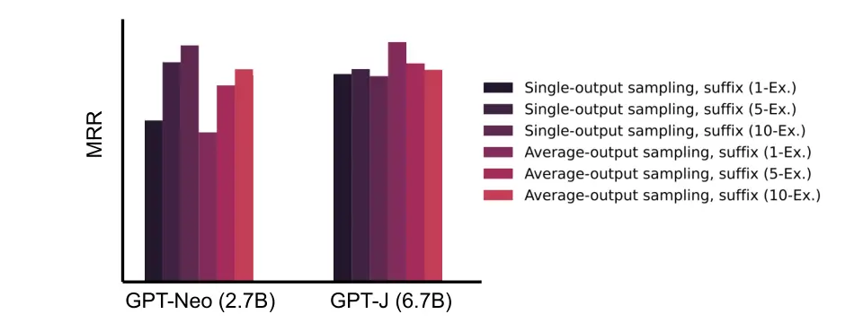
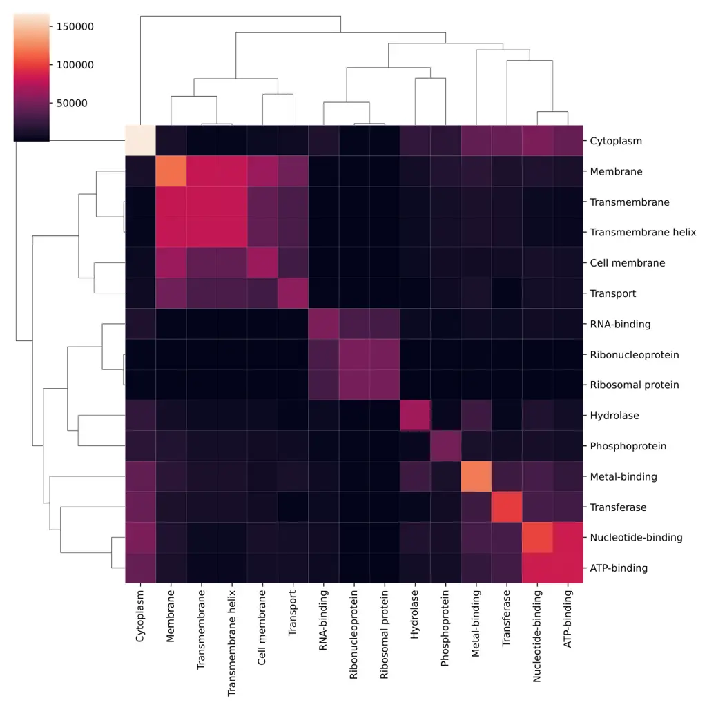
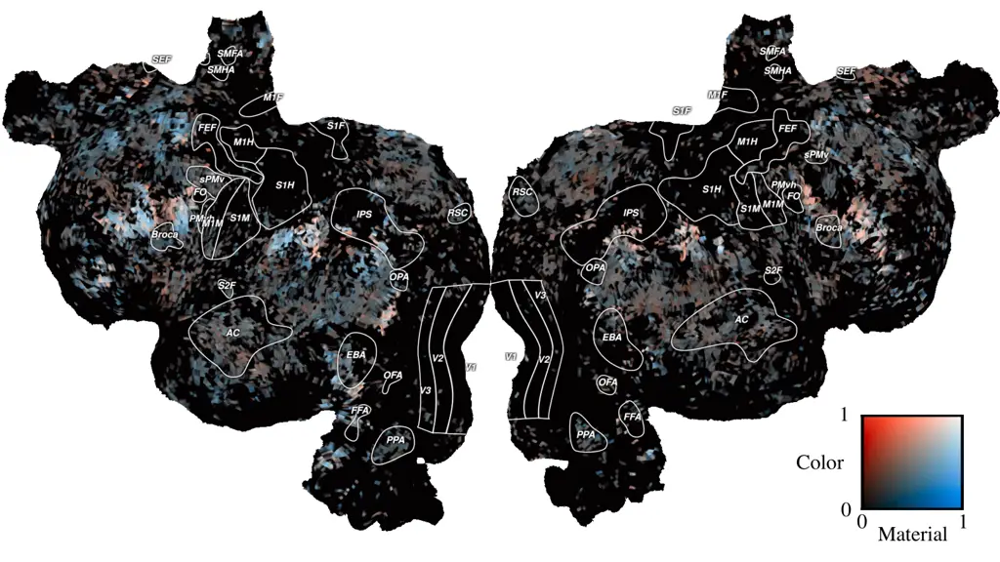
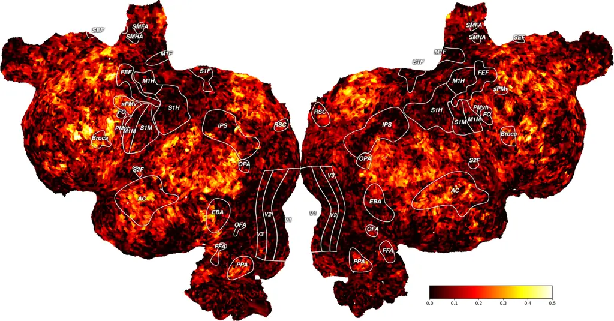

marginparsep has been altered.  
topmargin has been altered.  
marginparpush has been altered.

The page layout violates the ICML style.

Please do not change the page layout, or include packages like geometry,
savetrees, or fullpage, which change it for you.

We’re not able to reliably undo arbitrary changes to the style. Please
remove the offending package(s), or layout-changing commands and try
again.

 

iPrompt: Explaining Data Patterns in Natural Language  
via Interpretable Autoprompting

 

Chandan Singh ^(\* 1 ) John X. Morris ^(\* 2 ) Jyoti Aneja ¹  Alexander
M. Rush ²  Jianfeng Gao ¹ 

^(†)^(†)footnotetext: ^(\*)Equal contribution ¹Microsoft Research
²Cornell University. Correspondence to: Jianfeng Gao
\<jfgao@microsft.com\>.

###### Abstract

Large language models (LLMs) have displayed an impressive ability to
harness natural language to perform complex tasks. We explore whether we
can leverage this ability to find and explain patterns in data.
Specifically, given a pre-trained LLM and data examples, we introduce
interpretable autoprompting (iPrompt), an algorithm that generates a
natural language string explaining the data. iPrompt iteratively
generates explanations with an LLM and reranks them based on their
performance when used as a prompt. Experiments on a wide range of
datasets, from synthetic mathematics to natural language understanding,
show that iPrompt can yield meaningful insights by accurately finding
dataset explanations that are human-interpretable. On two of four
classification datasets, iPrompt discovers a prompt that outperforms
human-written prompts on GPT-3, despite only querying the relatively
small GPT-J model. Finally, experiments with scientific datasets show
the potential for iPrompt to aid in scientific discovery. ¹¹ 1 All code
for using the methods and data here is made available on Github.

## 1 Introduction

Large language models (LLMs) have attained an extraordinary ability to
harness natural language for solving diverse problems (Devlin et al.,
2018), often without the need for finetuning (Brown et al., 2020; Sanh
et al., 2021). Moreover, LLMs have demonstrated the capacity to excel at
real-world problems, such as mathematics (Lewkowycz et al., 2022),
scientific question answering (Sadat & Caragea, 2022), general
processing of scientific text (Beltagy et al., 2019), predicting brain
responses Schrimpf et al. (2021), and classifying proteins and chemical
compounds (Taylor et al., 2022).

In this work, we probe whether we can leverage the learned skills of an
LLM to discover and explain patterns in a dataset. To do so, we invert
the typical problem of fitting an LLM to data and instead ask whether we
can use a fixed LLM to produce a natural language string explaining
dataset patterns.

Our approach to this problem centers around prompting. Prompting has
emerged as an effective method for adapting LLMs to new datasets (Liu
et al., 2021a); a prompt string is combined with each example in a
dataset before querying an LLM for an answer. While prompts were
initially constructed manually, recent work has shown success in
autoprompting, automatically finding a prompt via optimization (Shin
et al., 2020; Li & Liang, 2021; Deng et al., 2022). However, previous
work on learning natural language prompts does not produce prompts that
are meaningful to humans.

Figure 1: Interpretable autoprompting (iPrompt) inverts the standard
prediction problem to instead find a natural language explanation of the
data using a fixed, pre-trained large language model.

Our approach, interpretable autoprompting (iPrompt), extends
autoprompting to generate a semantically meaningful natural language
prompt that explains a key characteristic of the data (see Fig. 1). For
example, given a dataset of examples of addition, e.g. 2 5
$`\Rightarrow`$ 7 … 3 1 $`\Rightarrow`$ 4, iPrompt yields the natural
language explanation Add the inputs. By changing the input form of the
data, we can generate explanations that accomplish different tasks from
the example, such as: i) recovering a dataset explanation, ii)
generating a prompt transferable between LLMs, and iii) proposing novel
descriptions. iPrompt works by using a pre-trained LLM to iteratively
propose and evaluate different candidate explanations.

For evaluation, we curate a diverse collection of datasets written in
natural language (Table 1) and measure iPrompt’s ability to accurately
explain a ground-truth pattern. We find that iPrompt outperforms
baseline methods in accurately finding a correct description; moreover,
the generated descriptions are interpretable, allowing human auditing
and enabling strong generalization when used as a prompt in a new
setting (i.e. when used for a different LLM). On real-world sentiment
classification datasets, iPrompt even produces prompts that match or
improve upon human-written prompts for GPT-3, while only using smaller,
locally-run language models. Finally, we find that iPrompt is able to
extract information from real-world scientific datasets.

## 2 Related work

#### Prompting and autoprompting.

With the advent of large-scale models, prompting (i.e. finding the right
prompt to use to query an LLM for a given task) has exploded as an area
of inquiry, often yielding impressive improvements in performance (Brown
et al., 2020; Petroni et al., 2019; Liu et al., 2021a) and spurring a
line of work aiming to make prompting easier (Strobelt et al., 2022; Lu
et al., 2022; Bach et al., 2022; Logan IV et al., 2022). Recently,
autoprompting (i.e. automatically searching for a prompt or
prompt-embedding via optimization) has emerged, with methods such as
prefix-tuning (Li & Liang, 2021), P-tuning (Liu et al., 2021b),
prompt-tuning with rules (Han et al., 2021), knowledgeable prompt
tuning (Hu et al., 2021) and many more (Liu et al., 2021a). These
strategies use gradient descent to find a set of “adapter” parameters
that maximize model performance, but do not require that the new
parameters map back to tokens in discrete space, rendering them
uninterpretable.

A few methods tackle the more difficult problem of searching for prompts
that can be expressed in natural language tokens. RLPrompt (Deng et al., 2022) searches for such a prompt using reinforcement learning and one
recent work (Honovich et al., 2022) queries an LLM to produce a prompt.
AutoPrompt (Shin et al., 2020) performs autoprompting via input
gradients (see Sec. 3). Similarly, adversarial triggers (Wallace et al., 2019) use autoprompting to identify adversarial inputs which can be used
to change a model’s prediction. These methods effectively alter a
model’s predictions, but do not constrain the discovered prompts to be
semantically meaningful, resulting in prompts that are difficult to
interpret (Webson & Pavlick, 2021). Another related work directly
finetunes an LLM to describe the difference between two datasets (Zhong
et al., 2022). Concurrent work proposes a method for natural language
prompting similar to the one here, with a focus on improving prediction
performance rather than on explaining data patterns Zhou et al. (2022).

#### Problems related to dataset explanation

The problem statement presented in this work closely resembles the
widely studied problems of symbolic regression (Augusto & Barbosa, 2000;
Schmidt & Lipson, 2009), program synthesis (Gulwani et al., 2017; Manna
& Waldinger, 1980), text/table summarization (Kryściński et al., 2019;
Liu et al., 2018), and pattern discovery in data-mining (Hand, 2007).
iPrompt can be viewed as an algorithm for symbolic regression, in which
the set of allowable symbols consists of semantically meaningful natural
language strings. One recent work proposes the task of inferring prompts
that improve supervised prediction (Honovich et al., 2022), which we
generalize here to diverse use cases for dataset explanation.

#### Alternative methods for neural-network interpretation

A popular method for interpreting neural networks is to inspect an LLM’s
individual predictions via feature importances (Lundberg et al., 2019;
Ribeiro et al., 2016), feature-interaction importances (Singh et al.,
2019; Tsang et al., 2017), extractive rationales (Zaidan & Eisner, 2008;
Sha et al., 2021), or natural language explanations for individual
predictions (Hendricks et al., 2016; Camburu et al., 2018). These works
can provide meaningful insights for individual predictions, but it is
difficult to parse them into an understanding of an entire dataset.
Alternatively, one can investigate whether an LLM’s learned
representations via probing (Conneau et al., 2018; Liu & Avci, 2019) or
by directly analyzing a model’s internal weights and activations (Wang
et al., 2021; Olah et al., 2018; Meng et al., 2022). However, these
approaches are limited in their ability to generate previously unknown
descriptions of data. A different approach involves distilling
information into a transparent model Tan et al. (2018); Ha et al.
(2021); Singh & Gao (2022) or simply using a transparent model in the
first place Breiman et al. (1984); Tan et al. (2022); Singh et al.
(2021); Agarwal et al. (2022).

## 3 Methods: Defining the task and approach

### 3.1 Task: Dataset Explanation

Given a dataset comprised of input-output string pairs
$`\{(x^{1},y^{1}),\ldots,(x^{N},y^{N})\}`$, the goal is to produce a
“semantically meaningful” natural language string that explains the
relationship between $`x`$ and $`y`$. We require that a string consists
of human-understandable text rather than a sequence of incongruous
tokens. For example, in the dataset shown in Fig. 1, given samples of
data performing addition, our task is to recover text synonymous to Add
the inputs. This dataset explanation can then be used for various
downstream tasks, such as prompting a different LLM.

#### Datasets

Table 1 shows the collections of datasets we study: (1) Synthetic math –
datasets that require inferring an underlying mathematical function
based on numeric input and outputs; (2) Allen NLI (ANLI) and (3)
Instruction induction (Honovich et al., 2022) – diverse language
tasks (Wang et al., 2022) with easily verifiable descriptions (e.g. Find
a country’s capital). (4) Sentiment – a collection of sentiment
classification datasets in different domains. For collections (1-3),
there is a ground-truth prompt available for evaluation. For example,
when adding two numbers (Fig. 1), the rule checks whether a description
contains any of the keywords add, sum, or +. We also study scientific
datasets on (5) proteins/chemicals, and (6) fMRI with full details given
in Sec. 6.

|                        |     |                                      |
| ---------------------- | --- | ------------------------------------ |
| Collection             | \#  | Description                          |
| 1\) Synthetic math     | 10  | Mathematical functions (i), (ii)     |
| 2\) Allen NLI          | 10  | Language tasks (i), (ii)             |
| 3\) Instr. induction   | 20  | Language tasks (i), (ii)             |
| 4\) Sentiment          | 4   | Sentiment classification (i), (ii)   |
| 5\) Proteins/chemicals | 3   | Protein/chemical properties (iii)    |
| 6\) Language fMRI      | 20  | Excitation of fMRI voxel (iii),(iii) |

Table 1: Dataset Explanation Tasks. Each collections contains \#
different task. Roman numerals correspond to the use cases in Fig. 1.
For full details on each dataset, see Sec. A.2.

### 3.2 Approach: iPrompt

We now detail approaches for the general problem of autoprompting before
introducing iPrompt, our method for interpretable autoprompting. We
specify autoprompting as a discrete search problem. Given a dataset of
$`n`$ input-output pairs {($`x^{1}`$, $`y^{1}`$), …, ($`x^{n}`$,
$`y^{n}`$)} and a pre-trained LLM $`f`$ that returns the log-probability
of a given string, autoprompting finds a natural language explanation
$`\hat{s}`$ maximizing:

```math
\displaystyle\hat{s}=\underset{s\in\mathcal{S}}{\text{argmax }}\sum_{i=1}^{n}f\left(\text{render}(s,x^{i},y^{i})\right) \tag{1}
```

The render function is a problem-specific function that renders a
natural language string from the prompt $`s`$ and each example in the
dataset $`(x^{i},y^{i})`$. We use $`\mathcal{S}`$ to indicate the set of
fluent strings, under some notion of syntactic fluency. This constraint
is used to ensure prompts are readable, and potentially generalize to
downstream LLMs. Solving this search problem exactly is intractable.

Figure 2: Prompt-based reranking depends on model size. Large models
(GPT-J 6B and GPT-3) align prompts correctly to tasks. The model is
given the prompt Return the   of the inputs., where     is filled in
with the shown prompt keyword before querying the output given two
inputs numbers in a string. Darker indicates a higher accuracy, and high
accuracy along the diagonal indicates that the correct prompt induces
the highest accuracy.

A core assumption of this objective is that semantically accurate
prompts lead a model to assign higher probability to the correct output.
To check this assumption, we analyze four datasets from the inverse
synthetic math collection that share common structure for the inputs and
prompts. Each dataset admits a prompt of the form Return the    of the
inputs., then is given two input numbers and queried for the output.

Fig. 2 shows the accuracy of different models at performing these tasks
across different input prompts.²² 2 The accuracy is normalized for each
task using softmax in order to visualize the effect of differing
prompts. For small models, the prompts are unsuccessful, but for large
models (GPT-J 6B and GPT-3), the model is accurate if and only if given
the correct prompt.³³ 3 For details on each model, see Table A3. This
result suggests that, at least for large models, the search for a prompt
that maximizes performance correlates well with the underlying task. We
will see in Fig. 4 that dataset explanation depends on this ability.

#### Baseline: AutoPrompt

AutoPrompt (Shin et al., 2020) targets the objective posed in Eq. 1
using a gradient-based local search. AutoPrompt searches for $`\hat{s}`$
following the gradients of the objective Eq. 1 with respect to
individual tokens in $`\hat{s}`$. It discretely changes individual words
in $`\hat{s}`$ and then checks whether or not the newly updated
$`\hat{s}`$ improves the objective score. The use of gradients allows
AutoPrompt to find an effective prompt $`\hat{s}`$, but makes it
difficult to find answers that satisfy the fluency constraint
$`{\cal S}`$.

#### Baseline: Zero-shot suffix decoding

LLMs themselves can be directly used to predict prompt strings.
Following Honovich et al., we give the model a prompt string which
contains data examples (e.g.
$`\underbrace{\textit{In: 2 5}}_{x^{i}}\underbrace{\textit{Out: 7.}}_{y^{i}}\underbrace{\textit{To compute the output from the input, }}_{\textit{template}}`$  ,)
and sample the output to recover a prompt $`\hat{s}`$ using nucleus
sampling.⁴⁴ 4 We also consider averaging the model’s output logits
across all examples in the dataset before decoding the output, but find
that it does not improve performance (see Sec. A.4).

#### Proposed method: iPrompt



Figure 3: Overview of iPrompt. iPrompt first proposes candidate prompts,
then ranks them based on their performance as a prompt, then truncates
and regenerates them. This entire process is repeated until performance
stops improving.

iPrompt (Fig. 3) is an iterative local search algorithm that alternates
between three steps: (i) proposing candidate prompts, (ii) reranking
candidate prompts, (iii) exploration.

(i) Proposal: Candidate prompts are generated by extending the zero-shot
LLM generation. Given a data instance as a prefix, we sample a number of
candidate prompts. The maximum length of each candidate is pre-specified
and fixed. For example, in the add-two-numbers task (Fig. 3), we may
generate four candidates: _{Combine the numbers, Return the output, Sum
in order, Compute the output}_.

(ii) Reranking: Given candidates, the objective Eq. 1 is evaluated for
each candidate prompt $`s`$. The top few candidates which maximize the
objective are kept, e.g. narrowing down the candidates to _{Combine the
numbers, Sum in order}_.

(iii) Iterate with exploration: Each of the top candidates from
reranking is truncated at a random position. These truncated candidates
are used as a prefix when generating new candidate prompts via suffix
decoding. For example, we may randomly select the start of the previous
candidates and fill in the endings: _{Combine the   , Sum   }_ $`\to`$
_{Combine the numbers, Combine both arguments, Sum the numbers, Sum all
inputs}_.

The algorithm is repeated until identifying a suitably strong
$`\hat{s}`$, e.g. _Sum the numbers_. Steps (i) and (iii) ensure that
prompts remain fluent, while step (ii) improves the score of the prompts
on the objective. Computationally, iPrompt only requires running
inference on the pre-trained LLM, yielding a significantly lower memory
requirement than methods such as AutoPrompt which require access to the
LLM’s gradients.

## 4 Experimental Setup

We consider two sets of experiments. First in Sec. 5, we explore
iPrompt’s ability to rediscover a correct and fluent prompt on the
variety of simple instruction datasets (Table 1, top) with known
answers. Experiments test the ability of the model to recover a known
prompt while also remaining fluent in a way that generalize to human
readers and to other language models. In Sec. 6 we apply iPrompt to
scientific datasets (Table 1, bottom).

#### Language Models

For the main set of experiments, we always generate prompts using GPT-J,
a 6 billion parameter model (Wang & Komatsuzaki, 2021). We restrict
prompts to $`\{`$6,12$`\}`$ tokens for sentiment classification and 6
tokens for the remaining data collections in Table 1. For generalization
experiments, alternative models are tested with the generated prompts
including OPT and GPT-3 Zhang et al. (2022); Brown et al. (2020). See
Sec. A.4 for a full discussion of experimental details and Sec. A.3 for
experiments on more models (e.g. Galactica (Taylor et al., 2022)) and
more datasets.

#### Evaluation metrics

We consider two types of evaluation: closeness to ground-truth and
accuracy as a prompt. To measure closeness we use three metrics: (1)
Correct – whether the generated explanation contains one of a set of
problem-specific keywords. (2) MRR – Mean reciprocal rank measuring the
rank of the first task-correct prompt. Given a set of datasets
$`\mathcal{D}=\{\mathcal{D}_{1},...,\mathcal{D}_{N}\}`$, we compute:
$`\text{MRR}=\frac{1}{|\mathcal{D}|}\sum_{i=1}^{|\mathcal{D}|}\frac{1}{\text{rank}_{i}}`$,
where $`\text{rank}_{i}`$ is the one-indexed rank of the first correct
explanation. (3) Human -- The human evaluation scores between the
top-generated explanation and a pre-specified groundtruth explanation,
when instructed ‘‘You are given a groundtruth description along with a
generated one. On a scale of 1 (worst) to 5 (best), how interpretable
and accurate is the generated description?’’⁵⁵ 5 Human evaluation scores
are averaged over 4 PhD students in machine learning not affiliated with
the study. . The mean human evaluation score (ranging from 1 to 5) is
normalized.

To measure generalization ability, we evaluate explanations based on
accuracy as a prompt for other models. Accuracy is computed following
Brown et al. (2020); Raffel et al. (2020): using exact matching with
beam search, a beam width of 4, and a length penalty of $`\alpha=0.6`$.

For sentiment evaluation, we learn a prompt within the template Input:
“\${input}”{prompt}.⁶⁶ 6 In initial experiments, we find that
performance drops significantly when learning a prompt that comes before
the input. We use positive and negative as positive and negative labels
and require the LLM to rank the two options. Human-written prompts are
adapted to this template from open-source prompts available through
PromptSource Bach et al. (2022).

## 5 Results and Analysis

### 5.1 Dataset explanation recovery

Table 2 compares prompting methods across three diverse data
collections. The Human evaluation scores are much higher for iPrompt
than the baselines, suggesting that it finds prompts which are both
accurate and human-interpretable. Similarly, the MRR and Correct scores
show that iPrompt considerably improves in finding accurate
explanations. See all generated explanations in Table A5.

|           |                |                |                |
| --------- | -------------- | -------------- | -------------- |
|           | iPrompt        | AutoPrompt     | Suffix         |
|           | H / M / C      | H / M / C      | H / M / C      |
| Math      | 60 / 0.69 / 60 | 25 / 0.14 / 13 | 20 / 0.08 / 03 |
| ANLI      | 56 / 0.41 / 37 | 21 / 0.07 / 07 | 25 / 0.06 / 01 |
| Induction | 42 / 0.35 / 28 | 21 / 0.09 / 08 | 23 / 0.04 / 01 |

Table 2: Performance for dataset explanation. Dataset from
Table 1 (1-3). Accuracy measured via (1) Human-evaluation (H, normalized
%), (2) Mean Reciprocal Rank across the collection (M) and (3) 1-best
correctness (C, %). For all metrics, higher is better.

Figure 4: Comparison of model accuracy with correct prompt and iPrompt
ability to find the correct prompt across each individual task
(single-task MRR). Prompt recovery ability is dependent on the model’s
ability to perform the task.

|      |              |                |         |            |           |
| ---- | ------------ | -------------- | ------- | ---------- | --------- |
|      |              | Correct Prompt | iPrompt | AutoPrompt | No prompt |
|      | GPT-J 6.7B\* | 54.0           | 51.5    | 41.6       | 16.3      |
| Math | OPT 6.7B     | 12.7           | 19.3    | 18.9       | 8.4       |
|      | GPT 20B      | 76.1           | 54.4    | 23.2       | 8.5       |
|      | GPT-3 175B   | 76.0           | 62.1    | 40.8       | 28.4      |
|      | GPT-J 6.7B\* | 9.0            | 4.7     | 1.9        | 2.0       |
| ANLI | OPT 6.7B     | 10.7           | 6.7     | 4.7        | 7.9       |
|      | GPT 20B      | 31.0           | 14.2    | 5.6        | 4.0       |
|      | GPT-3 175B   | 37.6           | 11.7    | 2.7        | 7.7       |

Table 3: Generalization accuracy (zero-shot) with the prompts generated
with GPT-J as the LLM across different models.

To assess the best-case absolute accuracy of the approach, we note it is
impossible for the approach to recover the prompt if the underlying LLM
cannot solve the task. Fig. 4 plots the prompt recovery performance
(MRR) against the underlying LLM’s accuracy (when using the groundtruth
prompt) for each dataset. When the model can solve the task, iPrompt
does well on recovery. However for many tasks the model has low accuracy
even with the correct prompt, putting a ceiling on the performance of
iPrompt.

### 5.2 Generalization accuracy of prompts

Do prompts generated for a specific LLM still work when applied to a
different model? Table 3 shows the generalization accuracy when testing
the prompts generated using GPT-J (Table 5) on different LLMs. The
prompts maintain effectiveness across most models. For the Math
datasets, the iPrompt prompts elicit improvement over the baselines and
approach the accuracy of the correct prompt. For the ANLI datasets, all
prompts induce poor performance. Notably, the gap between iPrompt and
AutoPrompt is larger for larger models (i.e. GPT 20B and GPT-3); this
suggests that, by generating fluent prompts, iPrompt generates more
generalizable descriptions.

|       |       |                  |                  |                  |           |
| ----- | ----- | ---------------- | ---------------- | ---------------- | --------- |
|       |       | Human- written   | iPrompt          | AutoPrompt       | No prompt |
| GPT-J | FFB   | 27.0 $`\pm`$ 1.9 | 79.3 $`\pm`$ 2.1 | 74.0 $`\pm`$ 9.1 | 47.5      |
|       | RT    | 58.9 $`\pm`$ 3.1 | 84.8 $`\pm`$ 0.9 | 73.0 $`\pm`$ 4.8 | 59.2      |
|       | SST-2 | 58.4 $`\pm`$ 2.8 | 86.7 $`\pm`$ 1.0 | 76.7 $`\pm`$ 3.9 | 60.9      |
|       | IMDB  | 66.0 $`\pm`$ 3.2 | 87.9 $`\pm`$ 1.4 | 86.7 $`\pm`$ 1.2 | 58.6      |
| GPT-3 | FFB   | 39.6 $`\pm`$ 1.6 | 57.2 $`\pm`$ 6.9 | 28.2 $`\pm`$ 3.1 | 39.1      |
|       | RT    | 82.7 $`\pm`$ 3.3 | 77.4 $`\pm`$ 2.8 | 57.8 $`\pm`$ 3.5 | 54.8      |
|       | SST-2 | 90.5 $`\pm`$ 3.9 | 82.4 $`\pm`$ 2.3 | 61.8 $`\pm`$ 7.0 | 58.4      |
|       | IMDB  | 75.6 $`\pm`$ 3.3 | 86.6 $`\pm`$ 1.1 | 70.0 $`\pm`$ 6.5 | 66.2      |

Table 4: Zero-shot accuracy on sentiment classification datasets: SST-2,
Rotten Tomatoes, IMDB, and the Financial Phrasebank  (Socher et al.,
2013; Malo et al., 2014; Pang & Lee, 2005). Generation with GPT-J 6B and
evaluation on both on the original GPT-J model and GPT-3
(text-davinci-002). Errors are standard errors of the mean.

|           |                                                                |                                                       |                                                               |
| --------- | -------------------------------------------------------------- | ----------------------------------------------------- | ------------------------------------------------------------- |
|           | Human-written prompt                                           | iPrompt                                               | AutoPrompt                                                    |
| Math      | Return the sum of the inputs                                   | Create a function named ‘sum                          | ¿:Returns Adding togetherFont accomplish                      |
|           | Return the square of the input                                 | Input number and return its square                    | Cal impl qApplySquare fiat                                    |
|           | Differentiate between prime/non-prime integers                 | Are these pairs of integers prime                     | ropheospels&& Norestricted                                    |
| ANLI      | Differentiate vegetarian/non-vegetarian foods                  | Are you a vegetarian?                                 | compliedthe whether methamphetamine provided comp             |
|           | Differentiate the subject in a sentence based on gender        | Predict the gender (F =                               | ¡ endoftext ¿ -¿ M Fundamental FG Fav                         |
|           | Return a synonym                                               | what is a synonym for                                 | Word termOn English meanings                                  |
|           | Translate english to spanish                                   | please write English meaning in Spanish               | the ththebb volunt                                            |
|           | Return a country’s capital city                                | Which city is the capital and                         | Ang Suppose AUTHthe beh Assassins                             |
| Sentiment | What is the sentiment expressed by the reviewer for the movie? | Describe what it is about this film has caused it     | Pap Azerb Saiyan Forean Talatar Yemeni IndBloomberg receiveda |
|           | How does the author of the news headline feel?                 | $`<`$input$`>`$ neutral$`>`$ The result was due to: ” | Fur resultolandgroundur augmented=                            |

Table 5: Examples of generated explanations by iPrompt and AutoPrompt.
See all prompts in Table A5.

Table 4 shows results on the sentiment analysis datasets. As prompts for
GPT-J, iPrompt outperforms not only AutoPrompt, but also the
manually-written prompt on all four datasets. Interestingly, the average
performance of human-written prompts on GPT-J is very low, unlike the
prompts generated by iPrompt. This indicates that models at 6B parameter
scale may be brittle to the choice of prompt, even among a set of
reasonable options, and iPrompt (and to an extent, AutoPrompt) is able
to discover how to phrase prompts so that models of this scale can
complete the task.

When sentiment prompt generalization is tested on GPT-3, we find that
iPrompt prompts outperform human-written prompts on two of the four
datasets. When tested on GPT-3, iPrompt prompt To summarize this review!
: outperforms all PromptSource IMDB prompts that use the same verbalizer
(positive/negative). When its prompts are tested on GPT-3, baseline
AutoPrompt only slightly outperforms testing with no prompt at all.

Table 5 shows the top-ranked explanation generated by each method for
selected datasets. iPrompt often finds an explanation that is indicative
of the underlying relationship, even if the phrasing is not perfect. For
example, for the add two numbers dataset, it finds Create a function
named ‘sum. The prompts found by iPrompt also read as fairly fluent
strings compared to AutoPrompt, which produces an incoherent set of
tokens.

### 5.3 Model ablations

We run ablation experiments to analyze the three steps of iPrompt: (1)
Proposal, (2) Reranking, and (3) Iteration. we use the Math and ANLI
datasets and run on a maximum of 5000 data points using 5 shots in
context for prompt generation.

|                 |                        |       |       |
| --------------- | ---------------------- | ----- | ----- |
|                 |                        | MRR   |       |
|                 |                        | Math  | ANLI  |
|                 | iPrompt                | 0.557 | 0.278 |
| \(1\) Proposal  | w/o inputs+outputs     | 0.400 | 0.015 |
|                 | w/o inputs             | 0.463 | 0.244 |
|                 | w/o outputs            | 0.539 | 0.255 |
| \(2\) Reranking | w/ in-context examples | 0.071 | 0.152 |
| \(3\) Iteration | No iteration           | 0.075 | 0.050 |

Table 6: Algorithmic ablations for each stage of iPrompt. Gives prompt
recovery (MRR) achieved by ablating each stage. Averaged over 3 random
seeds.

(1) Proposals are partially guided by examples. During the proposal
stage, iPrompt prefixes potential prompts with dataset examples. Table 6
considers variants of this stage that remove input and output examples
during the proposal stage. Note the system still has access to the full
examples during the reranking stage. We find the system can achieve
decent performance on Math simply by iterating. However for ANLI, the
model needs to at least see the inputs/outputs during the proposal in
order to find accurate prompts.

(2) Reranking zero-shot recovers better prompts. iPrompt uses zero-shot
accuracy to rank prompts. As we have examples of the task, we could
instead use in-context few-shot prompting for ranking. Prior work
suggests that prompt wording is less influential as the number of
in-context examples increases Webson & Pavlick (2021). Table 6 shows
that using these examples in-context for reranking does, in fact,
considerably hamper prompt recovery. We further find that the LLM used
for reranking is more important than the LLM used for proposals (see
Appendix Fig. A3).

(3) Iteration improves performance Finally, Table 6 shows that without
multiple iterations, performance drops nearly to zero (Fig. A2 shows
more details on loss as a function of iterations).

## 6 Scientific investigations with iPrompt

We now investigate whether iPrompt can explain patterns in scientific
datasets. Specifically, we analyze the Galactica model Taylor et al.
(2022) with 6.7 billion parameters. We query whether it can describe
differences in datasets of chemical compounds and protein sequences
before investigating a neuroscience problem.

#### Toxic chemical compounds

We first ask whether iPrompt can explain the difference between two
groups of chemical compounds with a known difference. We use the Tox21
dataset Richard et al. (2020) which contains toxicity measurements on 12
biological targets. For each of the 12 biological targets, we search for
a prompt that differentiates compounds that are toxic to the target
(positive) from those which are not toxic to any of the targets
(negative). We use 100 positive/negative examples for each biological
target and format each input with the text Here is a compound:\n
\[Compound Name\]\n Answer: followed by Yes for a positive compound and
No for a negative one. iPrompt is run for a single epoch with 5 shots in
each example.

Ideally, the elicited prompt would mention toxicity. Table 7 shows
results for whether the elicited prompts contain the substring tox, both
in terms of MRR and top-prompt correctness. iPrompt often finds an
accurate prompt: one representative example is: Answer yes if the
compound is toxic, and Otherwise answer NO. To ensure that this
substring is not simply a popular completion for the language model, we
compare against a baseline which runs iPrompt using Galactica proposals
from empty inputs/outputs and reranking with Galactica; over 36 random
seeds, tox appears in any generated prompt.

|                        |                   |          |
| ---------------------- | ----------------- | -------- |
|                        | iPrompt           | Baseline |
| MRR                    | 0.83 $`\pm`$ 0.04 | 0.0      |
| Top-prompt correctness | 0.67 $`\pm`$ 0.08 | 0.0      |

Table 7: iPrompt performance at recovering prompts for toxic chemical
compounds. Tox21 results are averaged over 12 datasets with 3 random
seeds each. Null data is averaged over 36 random seeds. Error bars are
standard error of the mean.

#### Differentiating protein sequences

We turn to whether iPrompt can explain the differences between two
groups of proteins. We use protein sequences and keywords from
Swiss-Prot (Bairoch & Boeckmann, 1991) (a high-quality subset of
Uniprot (Consortium, 2015)) to construct two datasets: each dataset
contains two groups of proteins, which are differentiated based on their
keywords.⁷⁷ 7 We search for reasonably popular but non-cooccuring
keywords in the proteins; see details in Fig. A5 The first dataset,
which we call Cyto, has proteins with either the keyword Cytoplasm or
Membrane. The second dataset, which we call Binding, has proteins with
either the keyword RNA-binding or ATP-binding. Each group is randomly
downsampled to 100 proteins and iPrompt is run with the same
hyperparameters as when finding chemical compounds.

We make this problem more challenging by feeding the model the raw
protein sequence (not the protein name) which ranges from hundreds to
thousands of amino acids. Each input is presented with the following
text: Here is a protein sequence:\n \[Protein Sequence\]\n Answer:
followed by Yes for a one group and No for the other. Table 8 shows
results for identifying whether the elicited prompt contains one of the
relevant keywords for each dataset (e.g. Cytoplasm). Despite the
difficult input format, the correct keywords are successfully identified
for both the Cyto and Binding datasets better than for the Baseline
(which again contains empty inputs).

|             |                   |                   |                   |
| ----------- | ----------------- | ----------------- | ----------------- |
|             | iPrompt (Cyto)    | iPrompt (Binding) | Baseline          |
| MRR         | 0.2 $`\pm`$ 0.08  | 0.08 $`\pm`$ 0.04 | 0.03 $`\pm`$ 0.01 |
| Recall @ 5  | 0.25 $`\pm`$ 0.13 | 0.17 $`\pm`$ 0.11 | 0.05 $`\pm`$ 0.05 |
| Recall @ 20 | 0.83 $`\pm`$ 0.11 | 0.33 $`\pm`$ 0.14 | 0.23 $`\pm`$ 0.09 |

Table 8: iPrompt performance at differentiating protein sequences. For
both the Cyto and Binding datasets, the correct keywords are succesfully
identified better than for the Baseline. Results are averaged over 12
random seeds; error bars are standard error of the mean.

#### Scientific investigation into an fMRI natural language dataset

We now explore using iPrompt in a simple neuroscience experiment. A
central challenge in neuroscience is understanding how and where
semantic concepts are represented in the brain. A recent seminal
study (Huth et al., 2016) explores this question by investigating where
different natural language categories are represented in the human
neocortex. Specifically, the authors collect functional MRI (fMRI)
responses as human subjects listen to hours of narrative stories. They
then build a predictive model of these responses for each voxel (i.e. a
small region in space) in the brain, which takes as input the words
contained in the stories (and other features). To interpret these
individual voxel models, they cluster the words in the narrative stories
into 12 groups and manually annotate them, resulting in 12 categories,
such as tactile, visual, and professional. Finally, they view the
spatial mapping of these 12 concepts (projected onto low dimensions)
across the brain using their individual voxel models.

We revisit a small piece of this study’s analysis through the lens of
iPrompt. Specifically, we ask whether iPrompt could generate plausible
categories that are well-represented across the brain but differ from
the manually identified 12. We fit a predictive model for each voxel,
following the pipeline of the original study (details in Sec. A.6). We
then use the resulting models to identify a list of the top-15 words
which most excite each voxel. For example, the top-15 words that excite
the best-predicted voxel are: sheet, edges, diameter, strips, cardboard,
copper, steel, colored, coloured, leaf, wire, cap, paper, shaped, tin.
To identify a plausible semantic category, we construct a template
string as follows: The following list of words all belong to the same
semantic category:   \n\n sheet, edges, …, shaped, tin. We then use
iPrompt (again with a GPT-6B parameter model) to generate a category by
filling in the blank (restricted to a single token). To make iPrompt
more effective, for each voxel we use iPrompt on a set of examples
consisting of 15 permutations of the top-15 words, allowing finding
patterns that are not overly sensitive to the word-ordering.

Given the top categories for each voxel, we analyze the mapping of
recurring categories across the neocortex. We aggregate the top-15
inferred categories⁸⁸ 8 We apply stemming and remove stopwords before
choosing the best categories. over the top-15 best-predicted voxels and
find that the most frequently inferred categories are: material, color,
surface, text, & fabric. Interestingly, these are sensible quantities
that different voxels could reasonably be selective for. We spatially
map each of these identified categories (e.g. material) across the
10,000 best-predicted voxels by using the LLM in a second way. For each
voxel, we condition the LLM (again GPT-6B) on the top-15 words list, and
evaluate the predicted probability for each category, i.e. The following
list of words all belong to the same semantic category: sheet, edges, …,
shaped, tin The semantic category they all belong to, in one word, is
  . The higher this predicted probability, the more selective we infer
that a voxel is for the category. Fig. 5 shows these predicted
probabilities for the top-two inferred categories (material and color)
across the cortex of a human subject.

Figure 5: Representations of the iPrompt-elicited concepts material
(blue) and color (red) across the surface of the neocortex are spatially
clustered and smooth. Only the top 10,000 best-predicted voxels are
shown, remaining voxels are shown in black. Only the right hemisphere is
shown (see both hemispheres, which show consistent smoothness in
Fig. A6).

While there is no groundtruth for this semantic map, one noteworthy
feature of the resulting map is that it is spatially smooth
(quantitatively, Fig. A8 shows that the variance of the map among
neighboring pixels is significantly lower than we would expect by
shuffling the map’s values). This is non-trivial, as nowhere in the
modeling process was spatial information incorporated: each voxel was
modeled independently and the displayed prediction was queried
independently. We expect the underlying map to be smooth, both due to
local connectivity in brain regions and also because the BOLD signal
measured by fMRI does not have perfect spatial resolution. Thus, the
fact that our inferred map is smooth suggests that (i) something about
these categories is genuinely captured by the representation in the
human brain, and (ii) that the iPrompt approach was able to reflect at
least some of it. Beyond the two categories shown, the five categories
generated by iPrompt exhibit spatial smoothness across the neocortex
(Fig. A8).

## 7 Conclusion and Discussion

iPrompt makes a meaningful step towards finding natural language prompts
that are both accurate and human-interpretable. We show this method can
be used to recover dataset descriptions, produce transferable prompts,
and provide explanations for experimental data. One future direction
could elicit targeted information from data via the use of a template.
For example, one may use iPrompt to extract feature importance by
prepending the learned prompt with the string “To get the answer from
the inputs, the most important inputs are   ”. As another example, in a
scientific study such as the fMRI study in Sec. 6, a scientist
interested in a particular topic (e.g. fear) may investigate that
particular topic by making a more specific template (e.g. How are these
words related to the concept of “fear”?).

While we focus on text, iPrompt could be applied generally settings
where an LLM performs well. For example, in computer vision, an
interpretable autoprompt may look like a mask of an image, and in
vision-language models, an interpretable prompt may be a description of
a vision task, e.g. find the largest shape in this image.

## Acknowledgements

AR is supported by NSF CAREER 2037519, NSF 1704834, and a Sloan
Fellowship. JM is supported by Weill Cornell Medicine. Thanks to Wenting
Zhao and Woojeong Kim for comments on drafts of this paper and to
Jeevana Priya Inala, Xin Wang, Baolin Peng, Michel Galley, and Hao Cheng
for interesting discussions related to the work. We would also like to
thank the authors of Huth et al. (2016) for making their data publicly
available.

## References

- Agarwal et al. (2022) Agarwal, A., Tan, Y. S., Ronen, O., Singh, C.,
  and Yu, B. Hierarchical shrinkage: improving the accuracy and
  interpretability of tree-based methods. _arXiv:2202.00858 \[cs,
  stat\]_, 2 2022. URL
  [http://arxiv.org/abs/2202.00858](http://arxiv.org/abs/2202.00858).
  arXiv: 2202.00858.
- Augusto & Barbosa (2000) Augusto, D. A. and Barbosa, H. J. Symbolic
  regression via genetic programming. In _Proceedings. Vol. 1. Sixth
  Brazilian Symposium on Neural Networks_, pp. 173–178. IEEE, 2000.
- Bach et al. (2022) Bach, S. H., Sanh, V., Yong, Z.-X., Webson, A.,
  Raffel, C., Nayak, N. V., Sharma, A., Kim, T., Bari, M. S., Fevry, T.,
  et al. Promptsource: An integrated development environment and
  repository for natural language prompts. _arXiv preprint
  arXiv:2202.01279_, 2022.
- Bairoch & Boeckmann (1991) Bairoch, A. and Boeckmann, B. The
  swiss-prot protein sequence data bank. _Nucleic acids research_,
  19(Suppl):2247, 1991.
- Beltagy et al. (2019) Beltagy, I., Lo, K., and Cohan, A. Scibert: A
  pretrained language model for scientific text. _arXiv preprint
  arXiv:1903.10676_, 2019.
- Black et al. (2021) Black, S., Leo, G., Wang, P., Leahy, C., and
  Biderman, S. GPT-Neo: Large Scale Autoregressive Language Modeling
  with Mesh-Tensorflow. March 2021. doi: 10.5281/zenodo.5297715. URL
  [https://doi.org/10.5281/zenodo.5297715](https://doi.org/10.5281/zenodo.5297715).
  If you use this software, please cite it using these metadata.
- Black et al. (2022) Black, S., Biderman, S., Hallahan, E., Anthony,
  Q., Gao, L., Golding, L., He, H., Leahy, C., McDonell, K., Phang, J.,
  et al. Gpt-neox-20b: An open-source autoregressive language model.
  _arXiv preprint arXiv:2204.06745_, 2022.
- Breiman et al. (1984) Breiman, L., Friedman, J. H., Olshen, R. A., and
  Stone, C. J. _Classification and Regression Trees_. Wadsworth and
  Brooks, Monterey, CA, 1984. URL
  [https://www.routledge.com/Classification-and-Regression-Trees/Breiman-Friedman-Stone-Olshen/p/book/9780412048418](https://www.routledge.com/Classification-and-Regression-Trees/Breiman-Friedman-Stone-Olshen/p/book/9780412048418).
- Brown et al. (2020) Brown, T., Mann, B., Ryder, N., Subbiah, M.,
  Kaplan, J. D., Dhariwal, P., Neelakantan, A., Shyam, P., Sastry, G.,
  Askell, A., et al. Language models are few-shot learners. _Advances in
  neural information processing systems_, 33:1877–1901, 2020.
- Camburu et al. (2018) Camburu, O.-M., Rocktäschel, T., Lukasiewicz,
  T., and Blunsom, P. e-snli: Natural language inference with natural
  language explanations. _Advances in Neural Information Processing
  Systems_, 31, 2018.
- Chung et al. (2022) Chung, H. W., Hou, L., Longpre, S., Zoph, B., Tay,
  Y., Fedus, W., Li, E., Wang, X., Dehghani, M., Brahma, S., Webson, A.,
  Gu, S. S., Dai, Z., Suzgun, M., Chen, X., Chowdhery, A., Narang, S.,
  Mishra, G., Yu, A., Zhao, V., Huang, Y., Dai, A., Yu, H., Petrov, S.,
  Chi, E. H., Dean, J., Devlin, J., Roberts, A., Zhou, D., Le, Q. V.,
  and Wei, J. Scaling instruction-finetuned language models, 2022. URL
  [https://arxiv.org/abs/2210.11416](https://arxiv.org/abs/2210.11416).
- Conneau et al. (2018) Conneau, A., Kruszewski, G., Lample, G.,
  Barrault, L., and Baroni, M. What you can cram into a single vector:
  Probing sentence embeddings for linguistic properties. _arXiv preprint
  arXiv:1805.01070_, 2018.
- Consortium (2015) Consortium, U. Uniprot: a hub for protein
  information. _Nucleic acids research_, 43(D1):D204–D212, 2015.
- Deng et al. (2022) Deng, M., Wang, J., Hsieh, C.-P., Wang, Y., Guo,
  H., Shu, T., Song, M., Xing, E. P., and Hu, Z. Rlprompt: Optimizing
  discrete text prompts with reinforcement learning. _arXiv preprint
  arXiv:2205.12548_, 2022.
- Devlin et al. (2018) Devlin, J., Chang, M.-W., Lee, K., and
  Toutanova, K. Bert: Pre-training of deep bidirectional transformers
  for language understanding. _arXiv preprint arXiv:1810.04805_, 2018.
- Gao et al. (2015) Gao, J. S., Huth, A. G., Lescroart, M. D., and
  Gallant, J. L. Pycortex: an interactive surface visualizer for fmri.
  _Frontiers in neuroinformatics_, pp.  23, 2015.
- Gulwani et al. (2017) Gulwani, S., Polozov, O., Singh, R., et al.
  Program synthesis. _Foundations and Trends® in Programming Languages_,
  4(1-2):1–119, 2017.
- Ha et al. (2021) Ha, W., Singh, C., Lanusse, F., Upadhyayula, S., and
  Yu, B. Adaptive wavelet distillation from neural networks through
  interpretations. _Advances in Neural Information Processing Systems_,
  34, 2021.
- Han et al. (2021) Han, X., Zhao, W., Ding, N., Liu, Z., and Sun, M.
  Ptr: Prompt tuning with rules for text classification. _arXiv preprint
  arXiv:2105.11259_, 2021.
- Hand (2007) Hand, D. J. Principles of data mining. _Drug safety_,
  30(7):621–622, 2007.
- Hendricks et al. (2016) Hendricks, L. A., Akata, Z., Rohrbach, M.,
  Donahue, J., Schiele, B., and Darrell, T. Generating visual
  explanations. In _European conference on computer vision_, pp. 3–19.
  Springer, 2016.
- Holtzman et al. (2019) Holtzman, A., Buys, J., Du, L., Forbes, M., and
  Choi, Y. The curious case of neural text degeneration. _arXiv preprint
  arXiv:1904.09751_, 2019.
- Honovich et al. (2022) Honovich, O., Shaham, U., Bowman, S. R., and
  Levy, O. Instruction induction: From few examples to natural language
  task descriptions. _arXiv preprint arXiv:2205.10782_, 2022.
- Hu et al. (2021) Hu, S., Ding, N., Wang, H., Liu, Z., Li, J., and
  Sun, M. Knowledgeable prompt-tuning: Incorporating knowledge into
  prompt verbalizer for text classification. _arXiv preprint
  arXiv:2108.02035_, 2021.
- Huth et al. (2016) Huth, A. G., De Heer, W. A., Griffiths, T. L.,
  Theunissen, F. E., and Gallant, J. L. Natural speech reveals the
  semantic maps that tile human cerebral cortex. _Nature_,
  532(7600):453–458, 2016.
- Kryściński et al. (2019) Kryściński, W., Keskar, N. S., McCann, B.,
  Xiong, C., and Socher, R. Neural text summarization: A critical
  evaluation. _arXiv preprint arXiv:1908.08960_, 2019.
- Lewkowycz et al. (2022) Lewkowycz, A., Andreassen, A., Dohan, D.,
  Dyer, E., Michalewski, H., Ramasesh, V., Slone, A., Anil, C., Schlag,
  I., Gutman-Solo, T., et al. Solving quantitative reasoning problems
  with language models. _arXiv preprint arXiv:2206.14858_, 2022.
- Li & Liang (2021) Li, X. L. and Liang, P. Prefix-tuning: Optimizing
  continuous prompts for generation. _arXiv preprint
  arXiv:2101.00190_, 2021.
- Liu & Avci (2019) Liu, F. and Avci, B. Incorporating priors with
  feature attribution on text classification. _arXiv preprint
  arXiv:1906.08286_, 2019.
- Liu et al. (2021a) Liu, P., Yuan, W., Fu, J., Jiang, Z., Hayashi, H.,
  and Neubig, G. Pre-train, prompt, and predict: A systematic survey of
  prompting methods in natural language processing. _arXiv preprint
  arXiv:2107.13586_, 2021a.
- Liu et al. (2018) Liu, T., Wang, K., Sha, L., Chang, B., and Sui, Z.
  Table-to-text generation by structure-aware seq2seq learning. In
  _Thirty-Second AAAI Conference on Artificial Intelligence_, 2018.
- Liu et al. (2021b) Liu, X., Zheng, Y., Du, Z., Ding, M., Qian, Y.,
  Yang, Z., and Tang, J. Gpt understands, too. _arXiv preprint
  arXiv:2103.10385_, 2021b.
- Logan IV et al. (2022) Logan IV, R., Balazevic, I., Wallace, E.,
  Petroni, F., Singh, S., and Riedel, S. Cutting down on prompts and
  parameters: Simple few-shot learning with language models. In
  _Findings of the Association for Computational Linguistics: ACL 2022_,
  pp. 2824–2835, Dublin, Ireland, May 2022. Association for
  Computational Linguistics. doi: 10.18653/v1/2022.findings-acl.222. URL
  [https://aclanthology.org/2022.findings-acl.222](https://aclanthology.org/2022.findings-acl.222).
- Lu et al. (2022) Lu, Y., Bartolo, M., Moore, A., Riedel, S., and
  Stenetorp, P. Fantastically ordered prompts and where to find them:
  Overcoming few-shot prompt order sensitivity. In _Proceedings of the
  60th Annual Meeting of the Association for Computational Linguistics
  (Volume 1: Long Papers)_, pp. 8086–8098, Dublin, Ireland, May 2022.
  Association for Computational Linguistics. doi:
  10.18653/v1/2022.acl-long.556. URL
  [https://aclanthology.org/2022.acl-long.556](https://aclanthology.org/2022.acl-long.556).
- Lundberg et al. (2019) Lundberg, S. M., Erion, G., Chen, H., DeGrave,
  A., Prutkin, J. M., Nair, B., Katz, R., Himmelfarb, J., Bansal, N.,
  and Lee, S.-I. Explainable ai for trees: From local explanations to
  global understanding. _arXiv preprint arXiv:1905.04610_, 2019.
- Malo et al. (2014) Malo, P., Sinha, A., Korhonen, P., Wallenius, J.,
  and Takala, P. Good debt or bad debt: Detecting semantic orientations
  in economic texts. _Journal of the Association for Information Science
  and Technology_, 65, 2014.
- Manna & Waldinger (1980) Manna, Z. and Waldinger, R. A deductive
  approach to program synthesis. _ACM Transactions on Programming
  Languages and Systems (TOPLAS)_, 2(1):90–121, 1980.
- Meng et al. (2022) Meng, K., Bau, D., Andonian, A., and Belinkov, Y.
  Locating and editing factual knowledge in gpt. _arXiv preprint
  arXiv:2202.05262_, 2022.
- Olah et al. (2018) Olah, C., Satyanarayan, A., Johnson, I., Carter,
  S., Schubert, L., Ye, K., and Mordvintsev, A. The building blocks of
  interpretability. _Distill_, 3(3):e10, 2018.
- Pang & Lee (2005) Pang, B. and Lee, L. Seeing stars: Exploiting class
  relationships for sentiment categorization with respect to rating
  scales. In _Proceedings of the ACL_, 2005.
- Petroni et al. (2019) Petroni, F., Rocktäschel, T., Lewis, P.,
  Bakhtin, A., Wu, Y., Miller, A. H., and Riedel, S. Language models as
  knowledge bases? _arXiv preprint arXiv:1909.01066_, 2019.
- Radford et al. (2019) Radford, A., Wu, J., Child, R., Luan, D.,
  Amodei, D., Sutskever, I., et al. Language models are unsupervised
  multitask learners. _OpenAI blog_, 1(8):9, 2019.
- Radford et al. (2021) Radford, A., Kim, J. W., Hallacy, C., Ramesh,
  A., Goh, G., Agarwal, S., Sastry, G., Askell, A., Mishkin, P., Clark,
  J., et al. Learning transferable visual models from natural language
  supervision. In _International Conference on Machine Learning_, pp.
  8748–8763. PMLR, 2021.
- Raffel et al. (2020) Raffel, C., Shazeer, N., Roberts, A., Lee, K.,
  Narang, S., Matena, M., Zhou, Y., Li, W., Liu, P. J., et al. Exploring
  the limits of transfer learning with a unified text-to-text
  transformer. _J. Mach. Learn. Res._, 21(140):1–67, 2020.
- Ribeiro et al. (2016) Ribeiro, M. T., Singh, S., and Guestrin, C. Why
  should i trust you?: Explaining the predictions of any classifier. In
  _Proceedings of the 22nd ACM SIGKDD International Conference on
  Knowledge Discovery and Data Mining_, pp. 1135–1144. ACM, 2016.
- Richard et al. (2020) Richard, A. M., Huang, R., Waidyanatha, S.,
  Shinn, P., Collins, B. J., Thillainadarajah, I., Grulke, C. M.,
  Williams, A. J., Lougee, R. R., Judson, R. S., et al. The tox21 10k
  compound library: collaborative chemistry advancing toxicology.
  _Chemical Research in Toxicology_, 34(2):189–216, 2020.
- Sadat & Caragea (2022) Sadat, M. and Caragea, C. Scinli: A corpus for
  natural language inference on scientific text. _arXiv preprint
  arXiv:2203.06728_, 2022.
- Sanh et al. (2021) Sanh, V., Webson, A., Raffel, C., Bach, S. H.,
  Sutawika, L., Alyafeai, Z., Chaffin, A., Stiegler, A., Scao, T. L.,
  Raja, A., et al. Multitask prompted training enables zero-shot task
  generalization. _arXiv preprint arXiv:2110.08207_, 2021.
- Schmidt & Lipson (2009) Schmidt, M. and Lipson, H. Distilling
  free-form natural laws from experimental data. _science_,
  324(5923):81–85, 2009.
- Schrimpf et al. (2021) Schrimpf, M., Blank, I. A., Tuckute, G., Kauf,
  C., Hosseini, E. A., Kanwisher, N., Tenenbaum, J. B., and
  Fedorenko, E. The neural architecture of language: Integrative
  modeling converges on predictive processing. _Proceedings of the
  National Academy of Sciences_, 118(45):e2105646118, 2021.
- Sha et al. (2021) Sha, L., Camburu, O.-M., and Lukasiewicz, T.
  Learning from the best: Rationalizing predictions by adversarial
  information calibration. In _AAAI_, pp. 13771–13779, 2021.
- Shin et al. (2020) Shin, T., Razeghi, Y., Logan IV, R. L., Wallace,
  E., and Singh, S. Autoprompt: Eliciting knowledge from language models
  with automatically generated prompts. _arXiv preprint
  arXiv:2010.15980_, 2020.
- Singh & Gao (2022) Singh, C. and Gao, J. Emb-gam: an interpretable and
  efficient predictor using pre-trained language models. _arXiv preprint
  arXiv:2209.11799_, 2022. doi: 10.48550/arxiv.2209.11799. URL
  [https://arxiv.org/abs/2209.11799](https://arxiv.org/abs/2209.11799).
- Singh et al. (2019) Singh, C., Murdoch, W. J., and Yu, B. Hierarchical
  interpretations for neural network predictions. _International
  Conference on Learning Representations_, pp.  26, 2019. URL
  [https://openreview.net/forum?id=SkEqro0ctQ](https://openreview.net/forum?id=SkEqro0ctQ).
- Singh et al. (2021) Singh, C., Nasseri, K., Tan, Y. S., Tang, T., and
  Yu, B. imodels: a python package for fitting interpretable models.
  _Journal of Open Source Software_, 6(61):3192, 2021. doi:
  10.21105/joss.03192. URL
  [https://doi.org/10.21105/joss.03192](https://doi.org/10.21105/joss.03192).
- Socher et al. (2013) Socher, R., Perelygin, A., Wu, J., Chuang, J.,
  Manning, C. D., Ng, A., and Potts, C. Recursive deep models for
  semantic compositionality over a sentiment treebank. In _Proceedings
  of the 2013 conference on empirical methods in natural language
  processing_, pp. 1631–1642, 2013.
- Strobelt et al. (2022) Strobelt, H., Webson, A., Sanh, V., Hoover, B.,
  Beyer, J., Pfister, H., and Rush, A. M. Interactive and visual prompt
  engineering for ad-hoc task adaptation with large language models.
  _arXiv preprint arXiv:2208.07852_, 2022.
- Tan et al. (2018) Tan, S., Caruana, R., Hooker, G., and Lou, Y.
  Distill-and-compare: Auditing black-box models using transparent model
  distillation. In _Proceedings of the 2018 AAAI/ACM Conference on AI,
  Ethics, and Society_, pp. 303–310, 2018.
- Tan et al. (2022) Tan, Y. S., Singh, C., Nasseri, K., Agarwal, A., and
  Yu, B. Fast interpretable greedy-tree sums (figs). _arXiv:2201.11931
  \[cs, stat\]_, 1 2022. URL
  [http://arxiv.org/abs/2201.11931](http://arxiv.org/abs/2201.11931).
  arXiv: 2201.11931.
- Taylor et al. (2022) Taylor, R., Kardas, M., Cucurull, G., Scialom,
  T., Hartshorn, A., Saravia, E., Poulton, A., Kerkez, V., and
  Stojnic, R. Galactica: A large language model for science. _arXiv
  preprint arXiv:2211.09085_, 2022.
- Tsang et al. (2017) Tsang, M., Cheng, D., and Liu, Y. Detecting
  statistical interactions from neural network weights. _arXiv preprint
  arXiv:1705.04977_, 2017.
- Wallace et al. (2019) Wallace, E., Feng, S., Kandpal, N., Gardner, M.,
  and Singh, S. Universal adversarial triggers for attacking and
  analyzing nlp. _arXiv preprint arXiv:1908.07125_, 2019.
- Wang & Komatsuzaki (2021) Wang, B. and Komatsuzaki, A. GPT-J-6B: A 6
  Billion Parameter Autoregressive Language Model.
  [https://github.com/kingoflolz/mesh-transformer-jax](https://github.com/kingoflolz/mesh-transformer-jax),
  May 2021.
- Wang et al. (2021) Wang, X., Xu, X., Tong, W., Roberts, R., and
  Liu, Z. Inferbert: a transformer-based causal inference framework for
  enhancing pharmacovigilance. _Frontiers in Artificial Intelligence_,
  4:659622, 2021.
- Wang et al. (2022) Wang, Y., Mishra, S., Alipoormolabashi, P., Kordi,
  Y., et al. Benchmarking generalization via in-context instructions on
  1,600+ language tasks. _arXiv_, 2022.
- Webson & Pavlick (2021) Webson, A. and Pavlick, E. Do prompt-based
  models really understand the meaning of their prompts? _arXiv preprint
  arXiv:2109.01247_, 2021.
- Zaidan & Eisner (2008) Zaidan, O. and Eisner, J. Modeling annotators:
  A generative approach to learning from annotator rationales. In
  _Proceedings of the 2008 conference on Empirical methods in natural
  language processing_, pp. 31–40, 2008.
- Zhang et al. (2022) Zhang, S., Roller, S., Goyal, N., Artetxe, M.,
  Chen, M., Chen, S., Dewan, C., Diab, M., Li, X., Lin, X. V., et al.
  Opt: Open pre-trained transformer language models. _arXiv preprint
  arXiv:2205.01068_, 2022.
- Zhong et al. (2021) Zhong, R., Lee, K., Zhang, Z., and Klein, D.
  Adapting language models for zero-shot learning by meta-tuning on
  dataset and prompt collections. _arXiv preprint
  arXiv:2104.04670_, 2021.
- Zhong et al. (2022) Zhong, R., Snell, C., Klein, D., and
  Steinhardt, J. Describing differences between text distributions with
  natural language. In _International Conference on Machine Learning_,
  pp. 27099–27116. PMLR, 2022.
- Zhou et al. (2022) Zhou, Y., Muresanu, A. I., Han, Z., Paster, K.,
  Pitis, S., Chan, H., and Ba, J. Large language models are human-level
  prompt engineers. _arXiv preprint arXiv:2211.01910_, 2022.

## Appendix A Appendix

### A.1 Sentiment classification results

Table A1 shows the best prompt produced by each method for each
sentiment dataset. iPrompt often learns to recreate significant examples
from the dataset, as a prompt. Figure A1 shows loss across training step
for each method and dataset, across three random seeds. We see that
AutoPrompt often finds a prompt with slightly lower loss on the training
data, although its prompts lead to worse generalization, as reported in
Table 4. Each training step represents a single word swap (in the case
of AutoPrompt) or the truncation and generation of a new prefix (in the
case of iPrompt).

Different from the other experiments in this paper, for sentiment
classification, we initialize AutoPrompt with random tokens instead of
all the, as we find AutoPrompt fails to find an effective solution for
longer prefix lengths when all tokens are initialized to the. To
accommodate for a complex input-output relationship, we test prompts of
length 12 as well as length 6.

Accuracy is measured on the test set when available; otherwise, it is
measured on a held-out 25% of the train set.

Task Method Prompt Financial phrasebank AutoPrompt Fur
resultolandgroundur augmented Human-written prompt How does the author
of the news headline feel? iPrompt $`<`$input$`>`$ neutral$`>`$ The
result was due to: ” IMDB AutoPrompt uclear cend Koretravel NAACP curses
SicAstings production received Human-written prompt The movie review in
negative/positive sentiment is: iPrompt This movie needs to be put up on
my profile as my Rotten Tomatoes AutoPrompt Whether{{
anotherath¡—endoftext—¿ how Human-written prompt What sentiment does the
writer express for the movie? iPrompt what words would you try to add to
help you express that SST-2 AutoPrompt
BryceSpecificallyWASHINGTONRatedam Human-written prompt What is the
sentiment expressed in this text? iPrompt It is clear from the sentence
that all three actors have something

Table A1: Best-of-three prompts generated by each method on sentiment
classification datasets. (Human-written prompts are best-of-eight and
take from PromptSource Bach et al. (2022)).

Figure A1: Loss plots for methods across sentiment analysis datasets,
showing AutoPrompt and iPrompt across three random seeds.

### A.2 Data/model details

Task name Samples Description Example fibonacci_one 10 Given an input x,
return the xth fibonacci number. Given the input x is 8, the output f(x)
is 21.\n\n double_one 10 Given an input x, return 2\*x. Given the input
x is 6, the output f(x) is 12.\n\n exp_one 10 Exponentiate the input to
get the output. Given the input x is 8, the output f(x) is 2980.96.\n\n
square_one 10 Square the input to get the output. Given the input x is
2, the output f(x) is 4.\n\n first_two 100 Return the first of the
inputs. Given the input numbers 7 and 8, the answer is 7.\n\n add_two
100 Return the sum of the inputs. Given the input numbers 9 and 7, the
answer is 16.\n\n subtract_two 100 Return the difference of the inputs.
Given the input numbers 5 and 4, the answer is 1.\n\n divide_two 100
Return the quotient of the inputs. Given the input numbers 2 and 7, the
answer is 2/7.\n\n multiply_two 100 Return the product of the inputs.
Given the input numbers 3 and 3, the answer is 9.\n\n max_two 100 Return
the maximum of the inputs. Given the input numbers 1 and 1, the answer
is 1.\n\n task1191_food_veg_nonveg 101 Return whether the input food
dish is vegetarian (yes or no). Input: Haq Maas Answer: no\n
task1149_item_check_edible 119 Return whether the input item is edible
(yes or no). Input: vase Answer: no\n task1146_country_capital 231 In
this task, you are given a country name and you need to return the
capital city of the given country Input: Saint Pierre and Miquelon
Answer: Saint-Pierre\n task1147_country_currency 232 You are given a
country name and you need to return the currency of the given country.
Input: Senegal Answer: CFA Franc BCEAO\n task1509_evalution_antonyms 551
In this task, you are given an adjective, and your job is to generate
its antonym. An antonym of a word is a word opposite in meaning to it.
Input: paper Answer: scissor\n task183_rhyme_generation 999 Given an
input word generate a word that rhymes exactly with the input word. If
not rhyme is found return ”No” Input: think Answer: sync\n
task107_splash_question_to_sql 2031 In this task you are expected to
write an SQL query that will return the data asked for in the question.
An SQL query works by selecting data from a table where certain
conditions apply. A table contains columns where every row in that table
must have a value for each column. Every table has a primary key that
uniquely identifies each row, usually an id. To choose which columns are
returned you specify that after the ”SELECT” statement. Next, you use a
”FROM” statement to specify what tables you want to select the data
from. When you specify a table you can rename it with the ”AS”
statement. You can reference that table by whatever name follows the
”AS” statement. If you want to select data from multiple tables you need
to use the ”JOIN” statement. This will join the tables together by
pairing a row in one table with every row in the other table (Cartesian
Product). To limit the number of rows returned you should use the ”ON”
statement. This will only return rows where the condition… Input: What
are the order ids and customer ids for orders that have been Cancelled,
sorted by their order dates? Answer: SELECT order_id , customer_id FROM
customer_orders WHERE order_status_code = ”Cancelled” ORDER BY
order_date\n task088_identify_typo_verification 6499 The given sentence
contains a typo which could be one of the following four types: (1)
swapped letters of a word e.g. ’niec’ is a typo of the word ’nice’. (2)
missing letter in a word e.g. ’nic’ is a typo of the word ’nice’. (3)
extra letter in a word e.g. ’nicce’ is a typo of the word ’nice’. (4)
replaced letter in a word e.g ’nicr’ is a typo of the word ’nice’. You
need to identify the typo in the given sentence. To do this, answer with
the word containing the typo. Input: A laege display of apples, pears,
and oranges Answer: laege\n task1336_gender_classifier 6500 Return the
gender of the person in the input sentence. Input: Justin made me feel
discouraged. Answer: M\n task092_check_prime_classification 6500 In this
task, you need to output ’Yes’ if the given number is a prime number
otherwise output ’No’. A ’prime number’ is a a whole number above 1 that
can not be made by multiplying other whole numbers. Input: 9319 Answer:
Yes\n

Table A2: Details for each dataset. For details on Instruction
induction, see Honovich et al. (2022) and for details on Distribution
differences, see Zhong et al. (2021).

Model name Huggingface identifier Citation GPT-2 (1.5B) gpt2-xl  Radford
et al. (2019) OPT (2.7B) facebook/opt-2.7b  Zhang et al. (2022) GPT-Neo
(2.7B) EleutherAI/gpt-neo-2.7B  Black et al. (2021) Flan-T5 (3B)
google/flan-t5-xl  Chung et al. (2022) GPT-J (6B) EleutherAI/gpt-j-6B
 Wang & Komatsuzaki (2021) OPT (6.7B) facebook/opt-6.7b  Zhang et al.
(2022) Galactica (6.7B) facebook/galactica-6.7b  Taylor et al. (2022)
GPT-Neo (20B) EleutherAI/gpt-neox-20b  Black et al. (2022) GPT-3 (175B)
text-davinci-002 (OpenAI API)  Radford et al. (2021)

Table A3: Models analyzed here.

### A.3 iPrompt results extended

We consider discriminators of varying sizes, with GPT-J (6B) as a prompt
generator. We also compare generators of varying sizes with GPT-J (6B)
as a prompt discriminator. Models considered are of
$`\{125M,1.3B,2.7B,6B\}`$ parameters from the GPT-Neo/GPT-J language
model family. Results are shown in Fig. A3. Performance varies smoothly
across model sizes, with the highest performance when using the largest
model for both reranking and generation. Reranking appears slightly more
important than generation. When using a 1.3B parameter model for
generation, MRR drops only slightly, from $`0.418`$ to $`0.399`$, while
when using a 1.3B parameter model for reranking, MRR drops to $`0.211`$.
In general, prompt recovery performance improves smoothly with reranking
model size.

Fig. A2 plots the progress of iPrompt across iterations, comparing runs
on Math datasets (blue) to runs on ANLI datasets (gray). iPrompt appears
to make most of its progress during the first $`20\%`$ of training and
then continue to slowly decrease the average loss. Running for more
iterations on additional datapoints would likely increase performance.

Figure A2: iPrompt performance across training, averaged across three
random seeds and all tasks from Math datasets (Blue) and ANLI (Gray).



Figure A3: iPrompt performance across different size language models for
the prompt proposal and reranking steps. Values are mean reciprocal rank
of first accepted prompt averaged across 20 tasks and 3 random seeds.

|                 |           |         |            |         |
| --------------- | --------- | ------- | ---------- | ------- |
|                 |           | iPrompt | AutoPrompt | Suffix  |
| MRR             | Math      | 0.2     | 0.09       | 0.025   |
|                 | ANLI      | 0.39    | 0.0025     | 0.085   |
|                 | Induction | 0.14    | 0.098      | 0.056   |
|                 | DD        | 0.064   | 0.0082     | 0.066   |
| Correct         | Math      | 0.12    | 0.075      | 0       |
|                 | ANLI      | 0.34    | 0          | 0.025   |
|                 | Induction | 0.071   | 0.087      | 0.02    |
|                 | DD        | 0.043   | 0          | 0.052   |
| BLEU-Top Prompt | Math      | 0.0073  | 0          | 0       |
|                 | ANLI      | 0.01    | 0          | 0.00032 |
|                 | Induction | 0.022   | 0          | 0.0027  |
|                 | DD        | 0       | 0          | 0.0015  |

Table A4: Performance of Galactica at prompt recovery, including DD
datasets Zhong et al. (2022); Zhong et al. (2021).

autoprompt iprompt suff active to passive `(= 18 the the subst`
`Choose a pronoun for each sentence` `Create a sentence or group of` add
two `>:Returns Adding togetherFont accomplish`
``Create a function named `sum`` `n>2 m1` antonyms `the bectheBut But`
`The noun to its opposite (` `The code to ascend. You` cause and effect
`REG Kinect virginity developed mosquit The`
`What would each sentence be if` `write programs that read through an`
common concept `???????? parted configuredthe ????????`
`Find a noun that includes all` `which is a common word used` diff
`""Fair 62 disgust 92 81` `Find the difference between largest`
`Write a program or function to` divide two
`soughtWomen surgicalthe Percentage treated` `"Divide each digit by`
`write a program or function who` double one
`says transit Farethe doubles dollars` `Write a function called double_`
`Given two function pointer A and` exp one `&&wl +# 123 270 Earthquake`
`Input this into your calculator (` `Type in number between 15 &`
fibonacci one `baptpi produce347).''` `Implement a function to find Fib`
`Given an integer n (1` first two
`Binding decode wr detect shortest numeric`
`Find first digit of given number` `When was Python added to Ubuntu`
first word letter `Exception Ps< endoftext >the the`
`Make a program that reads in` `nimshul, a` informal to formal
`CLASSIFIEDthe themselves strongly Plays Chamber`
`These are questions on simple sentences`
`Make the following sentences positive statements` larger animal
`????????thethethethethe` `What is the most common animal`
`dogAnswer to "What's` letters list `fluidsthethethethethe`
`Given the following list of tokens`
`The computer will make this document` max two `spendingthethethethethe`
`Implement a version of max()` `Write code to find out given` multiply
two `ruits="# multipl integer multiplied False` `'How do you multiply a`
`write a program or function who` negation
`performs antiv Sizethe NULL NULL` `I found these four mistakes below`
`Your friends think that you` num to verbal
`irritatedthedd respectfully Protectivethe`
`Output each number below in the` `The program outputs the first input`
orthography starts with `nextbusiness wordevery morphpp`
`Name of two homophones` `You will be given five words` rhymes
`Steal batter dating: unfold testosterone`
`Find the missing word for all` `Input [create] What` second word letter
`i mascot okay kk` `Who gave the answer "o`
`the United states government outlawed` sentence similarity
`value %%%% Math` `3 (5 marks). The`
`Read five sentences about your topic` sentiment
`positively optimistic&&&& negative` `I'm voting "negative"`
`Melvins at CBGB` singular to plural
`Enhanced shorthand Lets pluralbetweenthe` `Given a noun and its plural`
`1. It may be` square one `Cal impl qApplySquare fiat`
`Input number and return its square` `Write a program or function to`
subtract two `ignorethethethethethe`
`Write a function to find difference` `Given a non-negative integer` sum
`Photosthethethethethe` `Add two numbers together and then`
`The program outputs, without any` synonyms
`Word termOn English meanings` `what is a synonym for`
`Is there a cure for an` task088 identify typo verification
`thethethethethe` `This word scramble is to test`
`You wake up in the morning` task092 check prime classification
`ropheospels&& Norestricted` `Are these pairs of integers prime`
`Print the input numbers in order` task107 splash question to sql
`How Do You Connect SQL To` `To get into MySQL you first` task1146
country capital `Ang Suppose AUTHthe beh Assassins`
`Which city is the capital and` `France, England or the UK` task1147
country currency `aaaathecurrency Nib Sc`
`Ireland. Which currency is spoken` `"I am working on a` task1149 item
check edible `no the870830 yes` `coffee and beans are fruits.`
`Which one of the following is` task1191 food veg nonveg
`compliedthe whether methamphetamine provided comp`
`Are you a vegetarian?` `It could be any food,` task1336 peixian equity
evaluation corpus gender classifier
`< endoftext > -> M Fundamental FG Fav` `Predict the gender (F =`
`??????,???,` task1509 evalution antonyms
`contrad orously inverted ironically trans`
`find words with the opposite meaning` `Record your input and answer,`
task183 rhyme generation `quarterdream dug}. Thro rhy`
`Mind vs Glee! There` `what do you love to eat` taxonomy animal
`programmingQ errorsBefore admitting mont`
`What are the most common animals` `Each of these questions is a`
translation en-de `H prob Hyper Forthe` `You are a lawyer practicing in`
`This is an example of input` translation en-es `the ththebb volunt`
`please write English meaning in Spanish` `Porque?` translation en-fr
`IRthe< endoftext >thethe the` `What is the French word for`
`Your code needs to deal with` word in context
`("nSame distinguishedthethe` `Same and Not-Same -`
`What you will do is have`

Table A5: Examples of top-generated prompts for each method: GPT-J main
datasets.

autoprompt iprompt suff d3 0 `line contains this string? No`
`contains all 6 items, No` d3 1
`Ghostbustersthe interrogation condition criminall`
`sentence contains "yes" or` `string doesn't match any template` d3 10
`preceded Roosevelt nonexistentuphem_-_ Tw` `message contains "no". No`
`contains all of these words or` d3 11
`caused senator prompt Recall interacted` `string contains "No" or`
`was matched; output otherwise No` d3 12 `begin:" r "},{" contradict`
`tweet mentions yes` `is true or output false if` d3 13
`},{" vote [*"]=>` `answer "no" (or` `contains all correct answers, No`
d3 14 `nonexistent undead questions Enhance mandated no`
`string begins 'no' and` `string contains any non blank white` d3 15
`rarely ----Question not},{" geometric` `string contains "no" or`
`includes exactly two English words with` d3 16
`\n pearthemar Display RUN` `text contains any "yes".`
`text is true, otherwise write` d3 17 `EMP Similarly\t=== charsthe`
`is an answer ("no",` `contains all correct answers for this` d3 18
`\n\n Verb horm suffix Eucl` `phrase starts with 'no',`
`contains all correct answers else No` d3 19
`\n."," Emacs strips colors strips` `word starts with 'yes',`
`text contains any of these strings` d3 2
`indirectly [[ pervasive?"Spoiler exhaustive` `ends with "yes". If`
`sentence has an "O"` d3 20 `\n\n dips Vote flower Ainthe`
`ted sentence contains both "yes` `contains one of these words or` d3 21
`\nthePubLeft Abstract` `ends with 'no'. No`
`contains all correct answers, or` d3 22 `Nov wholesno Eucl NO`
`can output no/yes,` `data set contains results for output` d3 23
`vantage immediately recogn example nails 309`
`no else output none? Input` `contains data describing or referring to`
d3 24 `noBER nonosRew [` `datum defines finite number fields`
`is in fact equal 2;` d3 25 `withdrawalsnob inher nob Among`
`contains both gene list data file` `has already started in state x` d3
26 `Joined robberHigthe contradictionNarr` `line ends with a space,`
`ted series matches any of these` d3 27
`verseoleon:- inferred cannabinoids` `was positive answer and "No`
`string of words, as shown` d3 28 `\n repet999 REM=[nov`
`refers exclusively (only literally or` `was a real question that could`
d3 29 `\n Pat uncertaintiesMerit oppos` `line begins with yes`
`text meets any one or more` d3 3 `\n\n887odynamHor mun\t`
`ends with "yes" and` `statement reflects truth. Otherwise output` d3 30
`detainees gap ${. hardness` `statement is false? Otherwise`
`is an example from each category` d3 31 `\n055 helium **** itching`
`phrase does not contain any words` `given was false or not a` d3 32
`Afghthethethe` `matches either one of these strings`
`text is true, and write` d3 33 `le \r 253`
`has a duplicate word. Correct` `contains yes` d3 34
`the Carnegie allerg Qu the` `no,no for (1` `was "The End" or` d3 35
`Hatch Land pri poker[[ Yah` `would be a no (I`
`text can create a good argument` d3 36 `], egregbyte?Sensor`
`matches exactly a "no".` `string meets any, or exactly` d3 37
`noun441...? word first neg` `question has an answer "no`
`string meets any, and write` d3 38 `wond <+ HELP"},{"InvalidOtherwise`
`says yes` `"yes" has an` d3 39 `notnobbutthe but` `reads like no.`
`answers "yes" for all` d3 4 `\n\n 760 consensualNarr Fog cabbage`
`sentence ends with "no".` `string was a valid answer otherwise` d3 40
`modeXP/, \n but` `question contains an actual "no`
`given was wrong or not relevant` d3 41
`opinions universitythe began followingawaru`
`sentence is grammatically correct,` `equals to zero (i.` d3 42
`disqualified hemor Ratings [ contradiction Moham`
`phrase represents something that is actually`
`has 1 out of 2 responses` d3 43 `\n\n saturated Phot misc`
`would be rightAnswer :no` `was about a government regulation (` d3 44
`\n <[ npm spaces1` `was "no": Input` `was "yes" else false` d3 45
`\n\n pit VerbFalse Tok` `string contains one "no".`
`text starts with "OK",` d3 46 `},{" Neil kingthe`
`no when a string containing one` `contains this string! Yes,` d3 47
`network intuitive 19 Lamp` `sentence implies that no can mean`
`contains all digits, else No` d3 48
`nond307 Literally negativeJun corpor` `conforms with known facts no`
`ted number from user base 5` d3 49 `Falsethe Rect 802`
`string contains "no" or` `contains all of these words,` d3 5
`contradicts absurdity Luffythe neg answ` `string 'no' appears as`
`is correct ; No otherwise` d3 50
`________________________ WithNo","hedon` `mentions "no" (or`
`contains all correct items, No` d3 51
`\n\n 276WithNo noodles Cosponsors` `reads "no" no else`
`given was no; not output` d3 52 `\n\n 225Should laure`
`string was 'no' and` `string contains just one space.` d3 53
`never_{ Johns neo no` `is all lower case answer 1`
`was what I described above!` d3 6
`forbids Literally reminisNone negate` `text contains any "no"`
`text contains Syrian` d3 7 `},{"\r stringologically $\ git`
`contains 'no' or output` `text contains yes` d3 8
`unlikelyEitherselessletter Ches contradictory`
`sentence contains 'no' or` `contains any newlines after matching` d3 9
`reactive happensMiddle lot Inc` `matches any word (no is`
`text meets any, or none`

Table A6: Examples of top-generated prompts for each method: GPT-J DD
datasets Zhong et al. (2022); Zhong et al. (2021).

autoprompt iprompt suff active to passive
`Transmission Electthe chromosome initialized empl`
`4-way Multiple Choice` `Is the context a good response` add two
`addthe Hyper addi` `In order to add two or`
`Given three real-valued inputs` antonyms
`meet equilibration stiptertead asymmetry`
`What is the opposite of each` `[T1] Question` cause and effect
`shaking Dthethethethe` `Find clues as to why each`
`What do you think will happen` common concept `Bary techntbltbltbl Te`
`Where are all the animals?` `What' s the most common` diff
`quartic digits shorter recreational genomics`
`Given two positive integers a and` `What's the most efficient` divide
two `manipulations comput iterationects quotients`
`The ratio of two real or` `Given two different positive integers what`
double one `roll Add Pingthe brakingthe`
`Determine how much money did Al` `What's it like to` exp one
`visc poplLSPLC Viscositythe` `Given a number y and an`
`Find a formula for this linear` fibonacci one
`start Attstrass Prim Polynomial emotions` `\bigcirc m o`
`Write a function that gives an` first two `AICthethethe Adethe`
`Solve using negative exponents? Explain` `We have found it helpful to`
first word letter `d rthe l c syllable` `What is the last word?`
`the program {x.` informal to formal
`Why unpredictable comprobablyould Detecting` `Yes! However, since we`
`Text-to-Text Data` larger animal `sharkoganopeanionaller descri`
`A question is given about three` `Is the pair of animals on` letters
list `microm phon te photothermal te te` `How many 8 letter words`
`Given the following paragraph, indicate` max two
`$$amater Penet credible b` `How large was each of your`
`Is that as simple or complex` multiply two
`aris visualthe Gibson multiplicative lexical`
`When we multiply two even or` `What number divided by what other`
negation `brood he Apparent denselythe FIG`
`What did these people have as` `This time we do two prompt` num to
verbal `Pixel lum sedimentary precedenceathion thousand`
`P(data answer)` `Number pairs that are in the` orthography starts with
`criptions geochemistry Harvey preprocessed Kus Cap`
`The correct verb after each input` `Why did they choose this strategy`
rhymes `hallucinations song cooperationcorner ask smear`
`Which phrase did "sea` `My favorite food is a` second word letter
`oderraj dialectath u o` `What is the fourth letter`
`Is the object in this image` sentence similarity
`false provleastleast Apparently`
`I understand your definition correctly that` `Chinese No Vote and Euro`
sentiment `nominationnegative<unk>indolinivalentpolar`
`What is the sentiment of a` `What do you think will happen` singular to
plural `mes sequthethethethe` `Find the pluralization of`
`Do you have any good ways` square one
`AnalyticmassesAtomnamespace binning pow`
`Determine how much money did Al` `What's it like to` subtract two
`ComplexRemthe scienti Event` `Given a variable called A whose`
`Is that close to your actual` sum `Horujanthethethethe`
`I'm trying to solve` `Is the following number even?` synonyms
`straightforward conceptual Striking Etymology tra`
`Can you think of a word` `[T1],` task088 identify typo verification
`Etymology nom scalesrolateral QMples` `What is the plural form?`
`Other types Task Definition ::` task092 check prime classification
`Accept No source Inter question` `Q3_NoAnswerYes`
`Are there any types of chemical` task107 splash question to sql
`Question answering Input #Name`
`Is the following SQL clause equivalent` task1146 country capital
`Outer Hassan wal Tu Spontaneous Qu` `List the capital cities in each`
`The country that _____` task1147 country currency `Llthethestr the`
`Find the most common currency in` `What currency was the first to`
task1149 item check edible `nonthethe Characterizing Nothe`
`Why is no answer` `True or False, "` task1191 food veg nonveg
`gue axiomsepid Output yes Birk` `Are you a native speaker of`
`In a world where the Supreme` task1336 peixian equity evaluation corpus
gender classifier `lineage Mthe knockdown Fthe` `What is the gender of`
`Who is a good conversational partner` task1509 evalution antonyms
`Modern Carlson Weyl Linguistic counterfactual met`
`Find the opposite of each given` `We can predict text from an` task183
rhyme generation `stellarthethethe pl battle` `The 6-letter word`
`We are given a dataset consisting` taxonomy animal
`duoull Pap codebook varic lysozyme` `When two objects collide and expl`
`What's the most common` translation en-de
`shor Thanthe condens Intinte` `Test for spelling error in word`
`Is the object of your activity` translation en-es
`trophic Description params oscthethe` `In Spanish, there are two`
`cuatro con la frec` translation en-fr `TT tic tgtthethe Disk`
`Les champs du monde` `What can the words in bold` word in context
`" Tang samethe offOff` `Identify similar phrases based on given`
`Does this sentence come from an`

Table A7: Examples of top-generated prompts for each method: Galactica
main datasets.

autoprompt iprompt suff d3 0 `Alloy ReeABL vetotitledthe`
`satisfies sarcastic predicate; otherwise`
`is sarcastic, otherwise ignore` d3 1
`Cosm compositionallyind locom astro bfnm` `and output share 82`
`sentence describes or is related to` d3 10 `onso Seman NichentiVALID`
`paragraph does not contain any word` `says the answer is yes on` d3 11
`enzo conspicuous Widespreadfeature cis orth`
`mention e does not match any` `says that the United States president`
d3 12 `assert unco Nog antich DesignsFOR`
`contained a negation phrase otherwise an`
`says that someone arrives or de` d3 13 `functionnoAns medi monos BAA`
`text contains no keywords and none` `is valid, no otherwise.` d3 14
`E PotassiumztheANASS` `the United Nations integrated multi`
`contains the context word or response` d3 15
`no Nons TRANS Trajectories Exclusionifying` `phrase is not a noun;`
`example satisfies all rules, otherwise` d3 16
`TiHas Gomes immigPropthe` `sentence contains the word no`
`mentions the answer and @US` d3 17
`spatiotemporal extragalactic conflicts forbidden`
`data includes at least one Sem` `was true, and output false` d3 18
`formulAns revisit transcri neither` `ends in no no`
`contain any formals in it` d3 19 `fatSPR Inhibitsickel nestedyes`
`is valid.Answer: no` `text contains the word "` d3 2
`propositional ScalarAsp Attacks train Rabin`
`contain any of given words otherwise` d3 20
`Sem adjunct DCT Eriks admissibleArg` `is prochoice no otherwise`
`says something about abortion or human` d3 21
`scatterflows vetoriz pen` `sentences contain both "no`
`sentence includes sexual, gender identity` d3 22
`yesoscopyGal martingale Yes epistemic` `no. For ``yes`
`data satisfy certain conditions Otherwise No` d3 23
`NoELO predictors SBATCHvect`
`holds no otherwise [START_REF] Primordial`
`Predictive Models are Interpretable on` d3 24
`norist Investigating Nos tumorigenesis Bit` `term "noisy inputs`
`follows the given probability density function` d3 25
`nopins bil field ensembles Locus` `no output no yea Prom`
`says that neutrinos have been observed` d3 26 `NeuthePreftheDEthe`
`sentence is a negation; an` `sentence includes "cutter` d3 27
`no Conditional abstract definiteLD` `statement contains this word, and`
`says that certain events have happened` d3 28
`CIS raftriendrolimussubseteq` `data contains feminism, and`
`says that are feminists` d3 29
`noAns Semantic neitherHamiltonian dissoci` `text contains no,`
`says something against women or gender` d3 3
`nondec yes Census Tam Policies acyclic` `IS semst; else,`
`says something against your religion on` d3 30
`itasenta Assim allergic Fraser` `text contains answer=yes and`
`data includes y and n,` d3 31 `Strategy monitors Confl HaleFIELD Rhode`
`data contains a negative sentiment,` `matches at least one of a` d3 32
`Regulates term Cliff steer VER Saskatchewan` `mentions no and no`
`sentence includes a pronoun that refers` d3 33
`mut Congress SyntN weakhis` `text contains the phrase yes`
`sentence includes a token for each` d3 34
`yes<fragments> Kohn povertyyes Circular` `are based in movies. no`
`says that Erik has his` d3 35 `noon nonlocalakh no no s`
`question contains YesNo words like`
`movie was very good otherwise mark` d3 36
`describes nomoduleno RevealsAs` `sentence does not contain a factor`
`text includes any unanswerable` d3 37 `penADOapineg autoclHAL`
`phrase no appears only` `sentence has an answer. Otherwise` d3 38
`noNoEnabl complementation BIT Polar` `question contains the phrase no,`
`says that certain language has more` d3 39
`Neuastro neur runaway suffixthe` `utterance contains this phrase no`
`says something about your personality,` d3 4
`MULT semilinear unarybuffer Gior fate`
`sentence does not contain a modal` `meets any condition given in Sem`
d3 40 `outputs vigilance mK Unsupervised Status initial`
`data contains no and no else`
`correctly answers your question, otherwise` d3 41
`answ neph Membership Bess decomp neurop`
`equilibrium does not hold; no` `does not contain either of x` d3 42
`Surveillance Semantics Obl Inhibits Hels MEL` `string isn't in English`
`says that climate issues have worsened` d3 43 `Ans yesArg Zika spar`
`supports my belief no otherwise Input`
`follows the context; Otherwise output` d3 44
`wer: inducible affirm Abl reflex` `contain any formals words or` d3 45
`ana1 ERGsentence loopsyless` `string does not occur in training`
`question were "Is there` d3 46
`GitHub Clevelandck negation RCC Microbial` `contains no fake or misn`
`movie was released before year` d3 47 `ful eth massoc bis NA`
`debris affects doesnt have any` `says that we need your assistance` d3
48 `\n Nons FernclassGridUHFFFAOYSA` `holds for all possible inputs no`
`sentence includes a pronoun as well` d3 49 `noNo Imper Creating noPan`
`sentence contains no in` `matches answer which will give correct` d3 5
`volat Salv Artificial economies fut Hale` `prompt is followed by no`
`says that the output is a` d3 50 `failedkin ResDesMM`
`string does not contain any stop` `says that wight is decreasing` d3 51
`bl Frederthe Novo phylogeneticthe` `for "is my child`
`contains the context of your response` d3 52
`onasnono domainsex Quanti` `phrase has the value no,`
`sentence includes something that will lead` d3 53 `onisenony anonh`
`includes the words no output will` `contains at least two noun phrases`
d3 6 `Alle substrthe Edmund Hos forks` `answer no contains this word or`
`is a valid response and vice` d3 7 `Antithethethe Blakethe`
`word is a negation of micro`
`sentence includes all possible answers Prom` d3 8
`Brand abolished affili attri Recon`
`corresponds with prompt question no`
`sentence is suitable Question for yes` d3 9
`Bou counterex abstnougin literal` `question has answer no, output`
`is correct but maybe not relevant`

Table A8: Examples of top-generated prompts for each method: Galactica
DD datasets Zhong et al. (2022); Zhong et al. (2021).

### A.4 Experiment details / hyperparameters extended

#### Average-output suffix decoding

LLMs themselves can be directly used to predict prompt strings. We can
give the model a prompt that includes examples such as the following
context string:
$`\underbrace{\textit{In: 2 5}}_{x^{i}}\underbrace{\textit{Out: 7.}}_{y^{i}}\underbrace{\textit{To compute the output from the input, }}_{\textit{template}}`$  ,
and sample the output for the blank to recover a prompt $`\hat{s}`$.
Sampling directly from $`f`$ helps ensure that the generated explanation
is fluent and semantically meaningful. We decode the output using beam
search to find the highest-probability outputs for multi-token
prompts.⁹⁹ 9 Here we prefer beam search here over alternatives such as
nucleus sampling (Holtzman et al., 2019) as we are interested in finding
an accurate prompt description with as few samples as possible. To
improve on this approach, we place several examples into the model’s
context, and then average the model’s output logits across all the
examples in the dataset before decoding the output, an approach we refer
to as average-suffix decoding. However, we find that average-suffix
decoding does not yield a performance improvement over straightforward
decoding from a single sample with examples in the context. For example,
Fig. A4 shows that for the ANLI datasets, the mean reciprocal rank for
average-output sampling does not tend to be higher than for
single-output sampling across two different models.



Figure A4: Average suffix sampling versus individual-example suffix
sampling does not improve performance (for ANLI datasets).

#### Hyperparameters for iPrompt and AutoPrompt

This subsection discusses the hyperparameters set for prompts generated
on Math, NLI, and sentiment tasks. For Math and NLI tasks we considered
prompts of length $`6`$ tokens; for sentiment we considered prompts of
length $`16`$. For all experiments with iPrompt we consider $`8`$
candidate explanations for each step and generate $`4`$ new generations
per candidate, for a total of $`32`$ candidates. For fair comparison, we
consider $`32`$ candidates per step for AutoPrompt. We generate Math and
NLI from $`5,000`$ training steps and Sentiment candidates from
$`10,000`$ steps. We truncate examples to a maximum of $`128`$ tokens.
We measure loss for re-ranking (used by both AutoPrompt and iPrompt)
using the LLM’s loss over the full space of output tokens, i.e. we do
not restrict the vocabulary to the space of label tokens for
classification problems.

#### Details of iPrompt

Here we explicate the details of iPrompt. At each step, we consider a
fixed number of mutations for each example in the population, as well as
an additional number of random generations to prevent the population
from getting stuck in a local minimum. When we sample a new population,
we sample the best-performing prompts seen so far, as measured by a
running average zero-shot loss. In order to encourage diverse candidate
prompts, sample a population such that each sample starts with a
different token. During preliminary experiments, we found that enforcing
different starting tokens for each candidate prompt helped promote more
diverse and interpretable prefixes.

For generation, we sample directly from the LLM given the data
concatenated with the string  
nPrompt:. We sample with a temperature of $`1`$ and do not use a
sampling strategy like nucleus sampling. For Math and NLI, we set the
“repetition penalty” for generations to $`2.0`$ to discourage copying
from the training set. For the sentiment experiment, we reduce the
repetition penalty to $`1.0`$.

#### Details of AutoPrompt

We note several changes to AutoPrompt that were not mentioned in the
original paper but present in the original codebase, and proved crucial
in our implementation.

First, if we compute the top-candidates over every position, the
magnitude of the gradient will always be highest at position 0, and thus
AutoPrompt will prefer to make a swap at that position every time. To
fix this issue, at each training step, we randomly select a position of
the token to edit and consider word swaps only at that position.

Second, as described, AutoPrompt will always take one of the candidate
substitutions, even when said candidate does not improve the loss
compared to the current prefix. Instead, we only make a substitution if
the candidate prefix loss is lower than the loss on the same batch
computed with the current prefix.

Finally, unlike the AutoPrompt implementation found online, we allow
AutoPrompt to select from any token to substitute, including special
tokens and non-English characters.

To make AutoPrompt compatible with ranking-based metrics, we store the
losses for each candidate ranked during training. At the end, we
consider the “top prefix” to be the prefix with the lowest average loss
during training, that has been considered at least three times. This
final consideration criteria prevents candidates from the very end of
training that only have a few loss estimates from being counted as the
top prefix.

### A.5 Galactica experiment details



Figure A5: Swiss-Prot Bairoch & Boeckmann (1991) protein keyword
cooccurences. To construct the Cyto and Binding datasets, we search for
popular but non-cooccuring keywords.

### A.6 fMRI experiment details

This section gives more details on the fMRI experiment analyzed in
Sec. 6; for more scientific details see the original study (Huth et al., 2016) and code
([github.com/HuthLab/speechmodeltutorial](https://github.com/HuthLab/speechmodeltutorial)).
Sec. 6 analyzes data from one human subject in the original study, as
the subject listened to approximately two hours of narrative speech from
the Moth Radio Hour, which consists of short autobiographical stories.
The subject underwent fMRI scanning as they listened, yielding an fMRI
volume brain scan consisting of tens of thousands of voxels roughly
every two seconds.

The individual voxel models described in Sec. 6 are each fit to 3,737
training points, each corresponding to a different time point (after
accounting for various preprocessing steps, such as trimming the
beginning and end of the sequence). They are evaluated on 291 training
volumes which come from a 10-minute story that was not seen during
draining.

Fig. A7 shows the generalization performance of the model for each
voxel, measured by the correlation between the predicted response and
the measured response. Some regions are very poorly predicted (black),
but many voxels can be predicted quite well (bright).



Figure A6: Representations of the iPrompt-elicited concepts material
(blue) and color (red) across the surface of the neocortex are spatially
clustered and smooth. Left hemisphere corresponds to Fig. 5. Only the
top 10,000 best-predicted voxels are shown, remaining voxels are shown
in black. Plotted with pycortex (Gao et al., 2015).



Figure A7: Generalization performance for individual-voxel models,
measured by correlation between the prediction and the measured
response.

Figure A8: Concepts are spatially localized in the brain maps: the
variance between neighboring voxels is considerably lower than would be
expected from shuffling the voxel values. Note that we take care ot
shuffle the map values only within the 10,000 top-predicted voxels,
ignoring the poorly predicted voxels. Error bars (within the points) are
standard errors of the mean.
