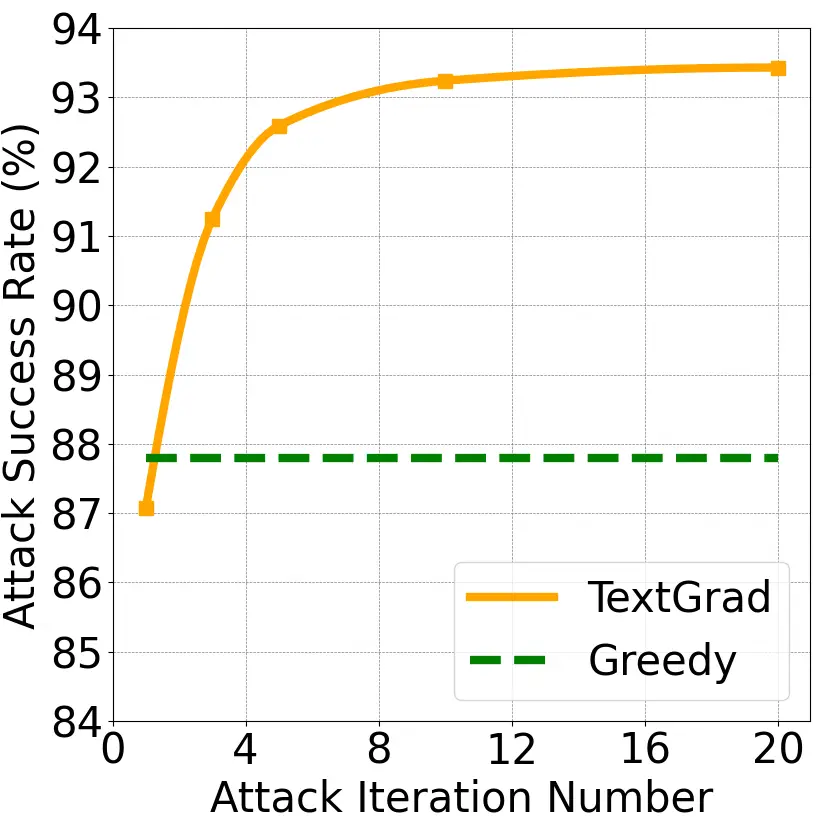
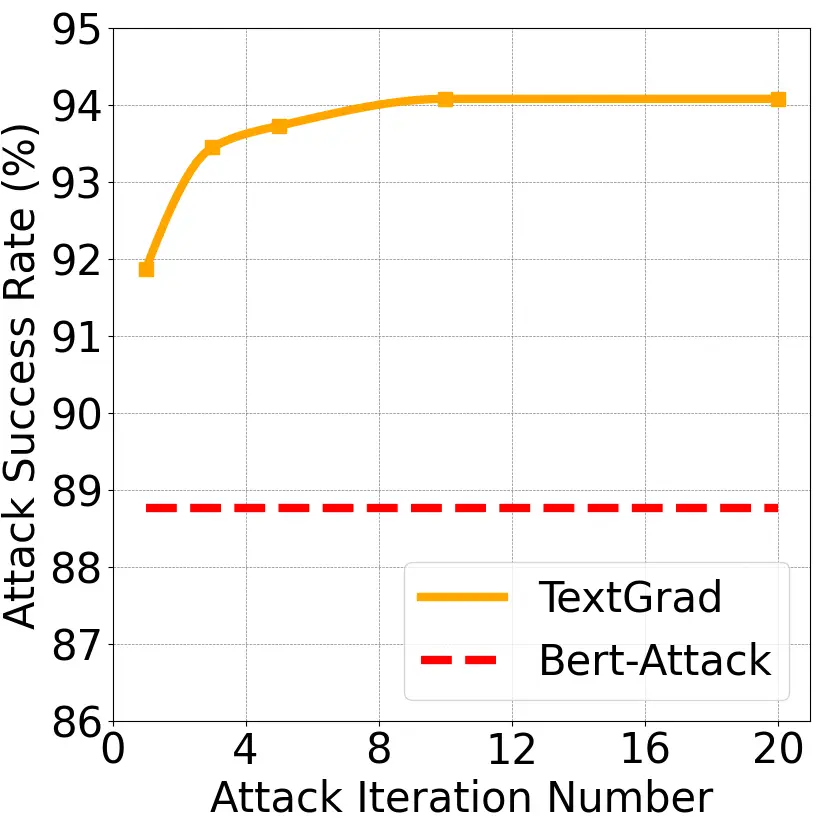
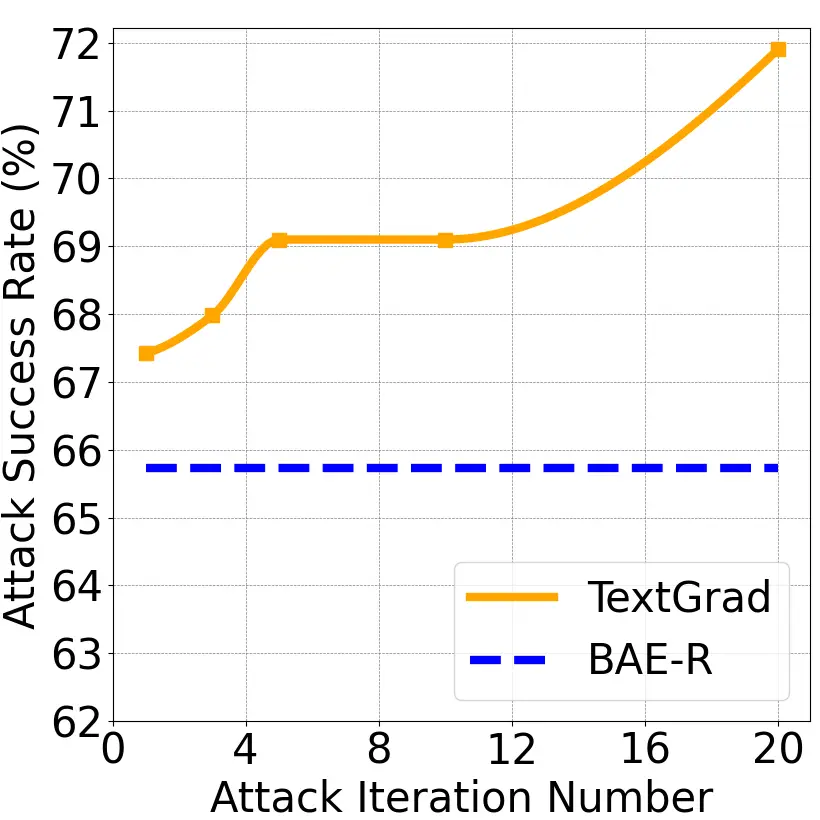
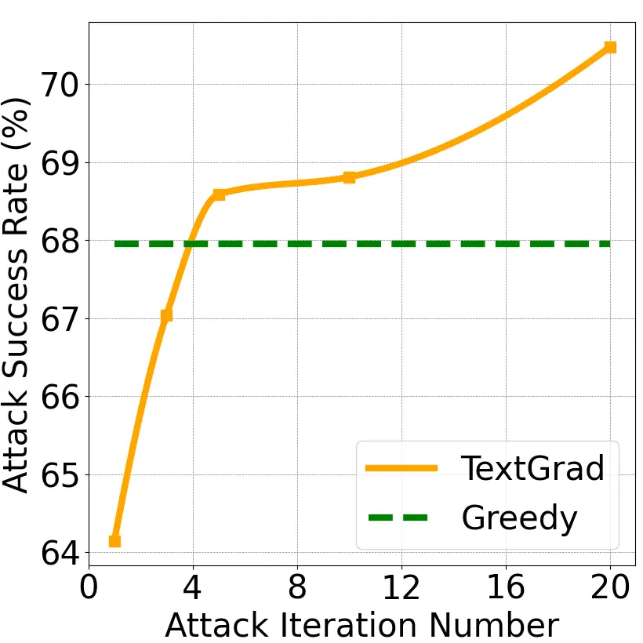
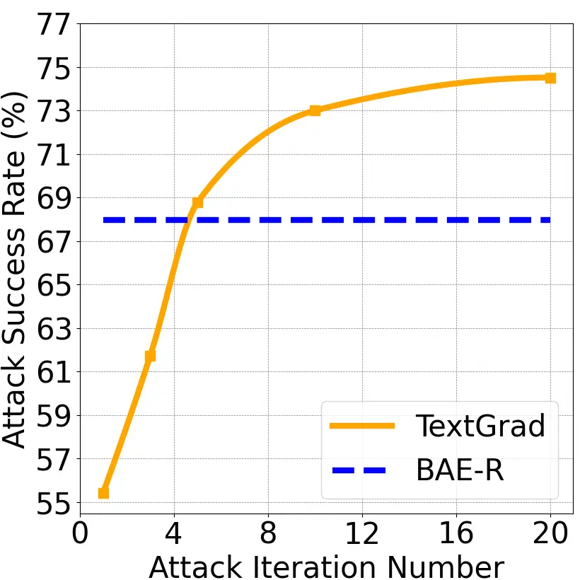

# TextGrad: Advancing Robustness Evaluation in NLP by Gradient-Driven Optimization

Bairu Hou Affiliation: UC Santa Barbara    Jinghan Jia
Affiliation: Michigan State University    Yihua Zhang
Affiliation: Michigan State University    Guanhua Zhang Affiliation: UC
Santa Barbara    Yang Zhang Affiliation: MIT-IBM Watson AI Lab    Sijia
Liu Affiliation: Michigan State University Affiliation: MIT-IBM Watson
AI Lab    Shiyu Chang Affiliation: UC Santa Barbara

###### Abstract

Robustness evaluation against adversarial examples has become
increasingly important to unveil the trustworthiness of the prevailing
deep models in natural language processing (NLP). However, in contrast
to the computer vision (CV) domain where the first-order projected
gradient descent (PGD) is used as the benchmark approach to generate
adversarial examples for robustness evaluation, there lacks a principled
first-order gradient-based robustness evaluation framework in NLP. The
emerging optimization challenges lie in 1) the discrete nature of
textual inputs together with the strong coupling between the
perturbation location and the actual content, and 2) the additional
constraint that the perturbed text should be fluent and achieve a low
perplexity under a language model. These challenges make the development
of PGD-like NLP attacks difficult. To bridge the gap, we propose
TextGrad, a new attack generator using gradient-driven optimization,
supporting high-accuracy and high-quality assessment of adversarial
robustness in NLP. Specifically, we address the aforementioned
challenges in a unified optimization framework. And we develop an
effective convex relaxation method to co-optimize the
continuously-relaxed site selection and perturbation variables, and
leverage an effective sampling method to establish an accurate mapping
from the continuous optimization variables to the discrete textual
perturbations. Moreover, as a first-order attack generation method,
TextGrad can be baked in adversarial training to further improve the
robustness of NLP models. Extensive experiments are provided to
demonstrate the effectiveness of TextGrad not only in attack generation
for robustness evaluation but also in adversarial defense. From the
attack perspective, we show that TextGrad achieves remarkable
improvements in both the attack success rate and the perplexity score
over five state-of-the-art baselines. From the defense perspective,
TextGrad-enabled adversarial training yields the most robust NLP model
against a wide spectrum of NLP attacks.

|     |
| --- |
|     |

¹¹footnotetext: Contributed equally.

## 1 Introduction

The assessment of adversarial robustness of machine learning (ML) models
has received increasing research attention because of their
vulnerability to adversarial input perturbations (known as adversarial
attacks) (Goodfellow et al., 2014; Carlini & Wagner, 2017; Papernot
et al., 2016). Among a variety of robustness evaluation methods,
gradient-based adversarial attack generation makes a tremendous success
in the computer vision (CV) domain (Croce & Hein, 2020; Dong et al.,
2020). For example, the projected gradient descent (PGD)-based methods
have been widely used to benchmark the adversarial robustness of CV
models (Madry et al., 2018; Zhang et al., 2019b; Shafahi et al., 2019;
Wong et al., 2020; Zhang et al., 2019a; Athalye et al., 2018). However,
in the natural language processing (NLP) area, the predominant
robustness evaluation tool belongs to query-based attack generation
methods (Li et al., 2020; Jin et al., 2020; Ren et al., 2019; Garg &
Ramakrishnan, 2020; Li et al., 2019), which do not make the full use of
gradient information.

Yet, the (query-based) mainstream of NLP robustness evaluation suffers
several limitations. First, these query-based attack methods could be
prone to generating ambiguous or invalid adversarial textual
inputs (Wang et al., 2021), most of which change the original semantics
and could even mislead human annotators. Second, the query-based methods
could be hardly integrated with the first-order optimization-based model
training recipe, and thus makes it difficult to develop adversarial
training-based defenses (Madry et al., 2018; Athalye et al., 2018). Even
though some first-order optimization-based NLP attack generation methods
were developed in the literature, they often come with poor attack
effectiveness (Ebrahimi et al., 2018) or high computational cost (Guo
et al., 2021), leaving the question of whether the best optimization
framework for NLP attack generation is found. The most relevant work to
ours is GBDA attack (Guo et al., 2021), which perturbs each token in the
input by sampling substitutes from the whole vocabulary of victim model.
The sample distribution is optimized using gradients to generate
adversarial examples, but yields low computational efficiency and high
memory cost. Inspired by above, we ask: How to develop a principled
gradient-based attack framework in NLP, like PGD in CV?

The main challenges for leveraging gradients to generate adversarial
attacks in NLP lie in two aspects. First, the discrete nature of texts
makes it difficult to directly employ the gradient information on the
inputs. Different from perturbing pixels in imagery data, adversarial
perturbations in an textual input need to optimize over the discrete
space of words and tokens. Second, the fluency requirement of texts
imposes another constraint for optimization. In contrast to
$`\ell_{p}`$-norm constrained attacks in CV, adversarial examples in NLP
are required to keep a low perplexity score. The above two obstacles
make the design of gradient-based attack generation method in NLP highly
non-trivial.

To bridge the adversarial learning gap between CV and NLP, we develop a
novel adversarial attack method, termed TextGrad, by peering into
gradient-driven optimization principles needed for effective attack
generation in NLP. Specifically, we propose a convex relaxation method
to co-optimize the perturbation position selection and token
modification. To overcome the discrete optimization difficulty, we
propose an effective sampling strategy to enable an accurate mapping
from the continuous optimization space to the discrete textual
perturbations. We further leverage a perplexity-driven loss to optimize
the fluency of the generated adversarial examples. In Table 1, we
highlight the attack improvement brought by TextGrad over some
widely-used NLP attack baselines. More thorough experiment results will
be provided in Sec. 5.

Our contribution. ❶ We propose TextGrad, a novel first-order
gradient-driven adversarial attack method, which takes a firm step to
fill the vacancy of a principled PGD-based robustness evaluation
framework in NLP. ❷ We identify a few missing optimization principles to
boost the power of gradient-based NLP attacks, such as convex
relaxation, sampling-based continuous-to-discrete mapping, and
site-token co-optimization. ❸ We also show that TextGrad is easily
integrated with adversarial training and enables effective defenses
against adversarial attacks in NLP. ❹ Lastly, we conduct thorough
experiments to demonstrate the superiority of TextGrad to existing
baselines in both adversarial attack generation and adversarial defense.

|                            |       |             |             |                     |       |            |       |                        |
| -------------------------- | ----- | ----------- | ----------- | ------------------- | ----- | ---------- | ----- | ---------------------- |
| Attack                     | Venue | Principle   |             | Attack Success Rate |       | Perplexity |       | Runtime Efficiency (s) |
|                            |       | Gradient    | Query       | ST                  | AT    | ST         | AT    |                        |
| Jin et al. (2020)          | AAAI  |             | $`\bullet`$ | 82.8%               | 43.6% | 431.4      | 495.7 | 1.03                   |
| Li et al. (2020)           | EMNLP |             | $`\bullet`$ | 86.4%               | 76.4% | 410.7      | 357.8 | 1.69                   |
| Garg & Ramakrishnan (2020) | EMNLP |             | $`\bullet`$ | 86.6%               | 77.5% | 286.6      | 302.9 | 1.15                   |
| Guo et al. (2021)          | EMNLP | $`\bullet`$ |             | 85.7%               | 79.7% | 314.0      | 381.7 | 11.44                  |
| Lee et al. (2022)          | ICML  |             | $`\bullet`$ | 86.0%               | 65.8% | 421.0      | 554.9 | 9.41                   |
| TextGrad (ours)            | -     | $`\bullet`$ |             | 93.5%               | 81.8% | 266.4      | 285.3 | 3.65                   |

Table 1: Effectiveness of TextGrad at-a-glance on the SST-2
dataset (Socher et al., 2013) against $`5`$ NLP attack baselines. Each
attack method is categorized by the attack principle (gradient-based vs.
query-based), and is evaluated at three aspects: attack success rate
(ASR), adversarial texts quality (in terms of language model
perplexity), and runtime efficiency (averaged runtime for attack
generation in seconds). Two types of victim models are considered, i.e.,
realizations of BERT achieved by standard training (ST) and adversarial
training (AT), respectively. Here AT integrates TextFooler (Jin et al., 2020) with standard training. Across models, higher ASR, lower
perplexity, and lower runtime indicate stronger attack. The best
performance is highlighted in bold per metric.

## 2 Background and Related Work

#### Adversarial attacks in CV.

Gradient information has played an important role in generating
adversarial examples, _i.e._, human-imperceptible perturbed inputs that
can mislead models, in the CV area (Goodfellow et al., 2014; Carlini &
Wagner, 2017; Croce & Hein, 2020; Madry et al., 2018; Zhang et al.,
2019b; Kurakin et al., 2016; Xu et al., 2019a; Xu et al., 2019c). PGD
attack is one of the most popular adversarial attack methods (Madry
et al., 2018; Croce & Hein, 2020), which makes use of the first-order
gradient to generate perturbations on the inputs and has achieved great
success in attacking CV models with a low computational cost. Besides,
PGD is also a powerful method to generate transfer attacks against
unseen victim models (Szegedy et al., 2013; Liu et al., 2016;
Moosavi-Dezfooli et al., 2017). Even in the black-box scenario (i.e.,
without having access to model parameters), PGD is a principled
framework to generate black-box attacks by leveraging function
query-based gradient estimates (Cheng et al., 2018) or gradients of
surrogate models (Cheng et al., 2019; Dong et al., 2018; Xie et al.,
2019; Zou et al., 2020; Dong et al., 2019).

#### Adversarial attacks in NLP.

Different from attacks against CV models, gradient-based attack
generation methods are less popular in the NLP domain. HotFlip (Ebrahimi
et al., 2018) is one of the most representative gradient-based attack
methods by leveraging gradients to estimate the impact of character
and/or word-level substitutions on NLP models. However, HotFlip neglects
the optimality of site selection in the discrete character/token space
and ignores the constraint on the post-attacking text fluency (to
preserve readability) (Ren et al., 2019). By contrast, this work
co-optimizes the selections of perturbation sites and tokens, and
leverages a perplexity-guided loss to maintain the fluency of
adversarial texts. Another attack method GBDA (Guo et al., 2021) models
the token replacement operation as a probability distribution which is
optimized using gradients. However, acquiring this probability
distribution is accompanied with high computation and memory costs. By
contrast, our work can achieve comparable or better performance with
higher efficiency.

The mainstream of robustness evaluation in NLP in fact belongs to
query-based methods (Li et al., 2020; Jin et al., 2020; Ren et al.,
2019; Garg & Ramakrishnan, 2020; Li et al., 2019; Wang et al., 2021; Li
et al., 2021b). Many current word-level query-based attack methods adopt
a two-phase framework (Zang et al., 2020) including (1) generating
candidate substitutions for each word in the input sentence and (2)
replacing original words with the found candidates for attack
generation.

Phase (1) aims at generating semantically-preserving candidate
substitutions for each word in the original sentence. Genetic Attack
(GA) (Alzantot et al., 2018) uses the word embedding distance to select
the candidate substitutes and filter out the candidates with an extra
language model. Such strategy is also adopted in many other attack
methods like Jin et al. (2020) and Ebrahimi et al. (2018). PWWS (Ren
et al., 2019) adopts WordNet (Miller, 1995) for candidate substitution
generation. Similarly, PSO Attack (Zang et al., 2020) employs a
knowledge base known as HowNet (Qi et al., 2019) to craft the candidate
substitutions. Along with the development of the large pre-trained
language models, Garg & Ramakrishnan (2020) and Li et al. (2020) propose
to utilize mask language models such as BERT (Devlin et al., 2019) to
predict the candidate substitutions. In TextGrad, we also adopt the
pre-trained language models to generate candidate substitutions.

Phase (2) requires the adversary to find a substitution combination from
the candidates obtained in phase (1) to fool the victim model. A
widely-used searching strategy is greedy search  (Li et al., 2020; Jin
et al., 2020; Ren et al., 2019; Garg & Ramakrishnan, 2020; Li et al.,
2019), where each candidate is first ranked based on its impact on model
prediction, and then the top candidate for each word is selected as the
substitution. Another popular searching strategy is leveraging
population-based methods, such as genetic algorithms and particle swarm
optimization algorithms (Kennedy & Eberhart, 1995), to determine
substitutions (Zang et al., 2020; Alzantot et al., 2018). Despite
effectiveness, these query-based attack are prone to generating invalid
or ambiguous adversarial examples (Wang et al., 2021) which change the
original semantics and could even mislead humans. To overcome these
problems, we propose TextGrad, which leverages gradient information to
co-optimize the perturbation position and token selection subject to a
sentence-fluency constraint. We will empirically show that TextGrad
yields a better attack success rate with lower sentence perplexity
compared to the state-of-the-art query-based attack methods.

#### Adversarial training.

Adversarial training (AT) (Goodfellow et al., 2014; Madry et al., 2018)
has been shown as an effective solution to improving robustness of deep
models against adversarial attacks (Athalye et al., 2018). AT, built
upon min-max optimization, has also inspired a large number of robust
training approaches, ranging from supervised learning (Wong et al.,
2020; Zhang et al., submitted to NeurIPS, 2021) to semi-supervised
learning (Zhang et al., 2019b; Carmon et al., 2019), and further to
self-supervised learning (Chen et al., 2020). Yet, the aforementioned
literature focuses on AT for vision applications. Despite some
explorations, AT for NLP models is generally under-explored. In (Jin
et al., 2020; Zang et al., 2020; Alzantot et al., 2018; Zhang et al.,
2019c; Meng & Wattenhofer, 2020; Li et al., 2021a), adversarial data are
generated offline and then integrated with the vanilla model training.
In Li et al. (2021b); Zhu et al. (2019); Dong et al. (2021); Wang et al.
(2020), the min-max based AT is adopted, but the adversarial attack
generation step (i.e., the inner maximization step) is conducted on the
embedding space rather than the input space. As a result, both methods
are not effective to defend against strong NLP attacks like TextGrad.

## 3 Mathematical Formulation of NLP Attacks

In this section, we start with a formal setup of NLP attack generation
by considering two optimization tasks simultaneously: (a) (token-wise)
attack site selection, and (b) textual perturbation via token
replacement. Based on this setup, we will then propose a generic
discrete optimization framework that allows for first-order
gradient-based optimization.

#### Problem setup.

Throughout the paper, we will focus on the task of text classification,
where $`\mathcal{M}(\mathbf{x})`$ is a victim model targeted by an
adversary to perturb its input $`\mathbf{x}`$. Let
$`\mathbf{x}=[x_{1},x_{2},\dots,x_{L}]\in\mathbb{N}^{L}`$ be the input
sequence, where $`x_{i}\in\{0,1,\dots,|V|-1\}`$ is the index of $`i`$th
token, $`V`$ is the vocabulary table, and $`|V|`$ refers to the size of
the vocabulary table.

From the prior knowledge perspective, we assume that an adversary has
access to the victim model (i.e., white-box attack), similar to many
existing adversarial attack generation setups in both CV and NLP domains
(Carlini & Wagner, 2017; Croce & Hein, 2020; Madry et al., 2018; Szegedy
et al., 2013). Besides, the adversary has prior knowledge on a set of
token candidates for substitution at each position, denoted by
$`\mathbf{s}_{i}=\{s_{i1},s_{i2},\dots,s_{im}\}`$ at site $`i`$, where
$`s_{ij}\in\{0,1,\dots,|V|-1\}`$ denotes the index of the $`j`$th
candidate token that the adversary can be used to replace the $`i`$th
token in $`\mathbf{x}`$. Here $`m`$ is the maximum number of candidate
tokens.

From the attack manipulation perspective, the adversary has two goals:
determining the optimal attack site as well as seeking out the optimal
substitute for the original token. Given this, we introduce site
selection variables $`\mathbf{z}=[z_{1},\ldots,z_{L}]`$ to encode the
optimized attack site, where $`z_{i}\in\{0,1\}`$ becomes $`1`$ if the
token site $`i`$ is selected and $`0`$ otherwise. In this regard, an
attack budget is given by the number of modified token sites,
$`{\mathbf{1}^{T}\mathbf{z}\leq k}`$, where $`k`$ is the upper bound of
the budget. We next introduce token-wise replacement variables
$`\mathbf{u}_{i}=[u_{i1},\ldots,u_{im}]`$, associated with candidates in
$`\mathbf{s}_{i}`$, where $`u_{ij}\in\{0,1\}`$, and
$`\mathbf{1}^{T}\mathbf{u}_{i}=1`$ if $`z_{i}=1`$. Then, the $`i`$th
input token $`x_{i}`$ will be replaced by the candidate expressed by
$`\hat{s}_{i}(\mathbf{u}_{i};\mathbf{s}_{i})=\sum_{j}(u_{ij}\cdot s_{ij})`$.
Please note that there is only one candidate token will be selected
(constrained through $`\mathbf{1}^{T}\mathbf{u}_{i}=1`$). For ease of
presentation, we will use $`\hat{\mathbf{s}}`$ to denote the
replacement-enabled perturbed input with the same length of
$`\mathbf{x}`$.

In a nutshell, an NLP attack can be described as the perturbed input
example together with site selection and replacement constraints (cstr):

```math
\displaystyle\hskip-14.22636pt\begin{array}[]{rl}&\text{Perturbed input:}~~\mathbf{x}^{\mathrm{adv}}(\mathbf{z},\mathbf{u};\mathbf{x},\mathbf{s})=(1-\mathbf{z})\circ\mathbf{x}+\mathbf{z}\circ\hat{\mathbf{s}}\\
&\text{Discrete variables:}~~~~\mathbf{z}\in\{0,1\}^{L},\mathbf{u}_{i}\in\{0,1\}^{m},\forall i\\
&\text{Site selection cstr:}~~\mathbf{1}^{T}\mathbf{z}\leq k,\ \ \ \ \ \ \ \ \text{Replacement cstr:}~~\mathbf{1}^{T}\mathbf{u}_{i}=1,~\forall i,\end{array}
```

where $`\circ`$ denotes the element-wise multiplication. For ease of
notation, $`\mathbf{u}`$ and $`\mathbf{s}`$ are introduced to denote the
sets of $`\{\mathbf{u}_{i}\}`$ and $`\{\mathbf{s}_{i}\}`$ respectively,
and the adversarial example $`\mathbf{x}^{\mathrm{adv}}`$ is a function
of site selection and token replacement variables ($`\mathbf{z}`$ and
$`\mathbf{u}`$) as well as the prior knowledge on the input example
$`\mathbf{x}`$ and the inventory of candidate tokens $`\mathbf{s}`$.
Based on (3), we will next formulate the optimization problem for
generating NLP attacks.

#### Discrete optimization problem with convex constraints.

The main difficulty of formulating the NLP attack problem suited for
efficient optimization is the presence of discrete (non-convex)
constraints. To circumvent this difficulty, a common way is to relax
discrete constraints into their convex counterparts (Boyd et al., 2004).
However, this leads to an inexact problem formulation. To close this
gap, we propose the following problem formulation with continuous convex
constraints and an attack loss built upon the discrete projection
operation:

```math
\displaystyle\hskip-5.69054pt\begin{array}[]{ll}\displaystyle\minimize_{\tilde{\mathbf{z}},\tilde{\mathbf{u}}}&\ell_{\mathrm{atk}}(\mathbf{x}^{\mathrm{adv}}(\mathcal{B}(\tilde{\mathbf{z}}),\mathcal{B}(\tilde{\mathbf{u}});\mathbf{x},\mathbf{s}))\\
\st&\mathcal{C}_{1}:\tilde{\mathbf{z}}\in[\mathbf{0},\mathbf{1}],~\mathbf{1}^{T}\tilde{\mathbf{z}}\leq k,\ \ \mathcal{C}_{2}:\tilde{\mathbf{u}}\in[\mathbf{0},\mathbf{1}],~\mathbf{1}^{T}\tilde{\mathbf{u}}_{i}=1,~\forall i,\end{array}\hskip-5.69054pt
```

where most notations are consistent with (3), $`\mathcal{B}`$ is the
projection operation that projects the continuous variables onto the
Boolean set, i.e., $`\mathbf{z}\in\{0,1\}^{L}`$ and
$`\mathbf{u}_{i}\in\{0,1\}^{m}`$ in (3), and we use
$`\tilde{\mathbf{z}}`$ and $`\tilde{\mathbf{u}}_{i}`$ as the continuous
relaxation of $`\mathbf{z}`$ and $`\mathbf{u}_{i}`$. As will be evident
later, an efficient projection operation can be achieved by randomized
sampling. The graceful feature of problem (3) is that the constraint
sets $`\mathcal{C}_{1}`$ and $`\mathcal{C}_{2}`$ are convex, given by
the intersection of a continuous box and affine inequality/equalities.

## 4 Optimization Framework of NLP Attacks

In this section, we present the details of gradient-driven first-order
optimization that can be successfully applied to generating NLP attacks.
Similar to the attack benchmark–projected gradient descent (PGD) attack
Madry et al. (2018)–used for generating adversarial perturbations of
imagery data, we propose the PGD attack framework for NLP models. We
will illustrate the design of PGD-based NLP attack framework from four
dimensions: 1) acquisition of prior knowledge on inventory of candidate
tokens, 2) attack loss type, 3) regularization scheme to minimize the
perplexity of perturbed texts, and 4) input gradient computation.

#### Prior knowledge acquisition: candidate tokens for substitution.

We first tackle how to generate candidate tokens used for input
perturbation. Inspired by Bert-Attack (Li et al., 2020) and BAE-R (Garg
& Ramakrishnan, 2020), we employ pre-trained masked language models
(Devlin et al., 2019; Liu et al., 2019; Lan et al., 2020), denoted as
$`\mathcal{G}`$, to generate the candidate substitutions. Specifically,
given the input sequence $`\mathbf{x}`$, we first feed it into
$`\mathcal{G}`$ to get the token prediction probability at each position
without masking the input. Then we take the top-$`m`$ tokens at each
position as the candidates. Please note that getting the token
predictions at each position does not require masking the input. Using
the original sentence as the input can make the computation more
efficient (only one forward pass to get predictions for all positions).
With a similar approach, it has been shown in (Li et al., 2020) that the
generated candidates are more semantically consistent with the original
one, compared to the approach using actual “\[mask\]” tokens. Note that
TextGrad is compatible with any other candidate tokens generating
method, making it general for practical usage.

#### Determination of attack loss.

Most existing NLP attack generation methods (Li et al., 2020; Jin
et al., 2020; Ren et al., 2019; Alzantot et al., 2018; Li et al., 2021a)
use the negative cross-entropy (CE) loss as the attack objective.
However, the CE loss hardly tells whether or not the attack succeeds.
And it would hamper the optimization efficiency when the attack
objective is regularized by another textual fluency objective (which
will be introduced later). Our rationale is that intuitively a sentence
with more aggressive textual perturbations typically yields a higher
attack success rate but a larger deviation from its original format.
Thus, it is more likely to be less fluent.

A desirable loss for designing NLP attacks should be able to indicate
the attack status (failure vs. success) and can automatically adjust the
optimization focus between the success of an attack and the promotion of
perturbed texts fluency. Spurred by the above, we choose the C&W-type
attack loss (Carlini & Wagner, 2017):

```math
\begin{array}[]{l}\ell_{\mathrm{atk}}(\mathbf{x}^{\mathrm{adv}})=\max\{Z_{t_{0}}(\mathbf{x}^{\mathrm{adv}})-\max_{i\neq t_{0}}Z_{i}(\mathbf{x}^{\mathrm{adv}}),0\},\end{array}
```

where $`\mathbf{x}^{\mathrm{adv}}`$ was introduced in (3), $`t_{0}`$
denotes the predicted class of the victim model against the original
input $`\mathbf{x}`$, and $`Z_{i}`$ denotes the prediction logit of
class $`i`$. In (4), the difference
$`Z_{t_{0}}(\mathbf{x}^{\mathrm{adv}})-\max_{i\neq t_{0}}Z_{i}(\mathbf{x}^{\mathrm{adv}})`$
characterizes the confidence gap between the original prediction and the
incorrect prediction induced by adversarial perturbations. The key
advantages of using (4) for NLP attack generation are two-fold. First,
the success of $`\mathbf{x}^{\mathrm{adv}}`$ (whose prediction is
distinct from the original model prediction) is precisely reflected by
its zero loss value, i.e.,
$`\ell_{\mathrm{atk}}(\mathbf{x}^{\mathrm{adv}})=0`$. Second, the attack
loss (4) has the self-assessment ability since it will be automatically
de-activated only if the attack succeeds, i.e.,
$`Z_{t_{0}}(\mathbf{x}^{\mathrm{adv}})\leq\max_{i\neq t_{0}}Z_{i}(\mathbf{x}^{\mathrm{adv}})`$.
Such an advantage facilitates us to strike a graceful balance between
the attack success rate and the texts perplexity rate after
perturbations.

#### Text fluency regularization.

We next propose a differentiable texts fluency regularizer to be jointly
optimized with the C&W attack loss,

```math
\displaystyle\hskip-5.69054pt\begin{array}[]{ll}\displaystyle\ell_{\mathrm{reg}}&=\sum_{i}z_{i}\sum_{j}u_{ij}(\ell_{\mathrm{mlm}}(s_{ij})-\ell_{\mathrm{mlm}}(x_{i}))=\sum_{i}z_{i}\sum_{j}u_{ij}\ell_{\mathrm{mlm}}(s_{ij})-\sum_{i}z_{i}\ell_{\mathrm{mlm}}(x_{i})\,\text{,}\end{array}\hskip-5.69054pt
```

where the last equality holds since $`\sum_{j}\mathbf{u}_{ij}=1`$.
$`\ell_{\mathrm{mlm}}(\cdot)`$ indicates the masked language modeling
loss (Devlin et al., 2019) which is widely used for measuring the
contribution of a word to the sentence fluency. For example,
$`\ell_{\mathrm{mlm}}(s_{ij})`$ measures new sentence fluency after
changing the $`i`$th position as its $`j`$th candidate. Smaller
$`\ell_{\mathrm{mlm}}(s_{ij})`$ indicates better sentence fluency after
the replacement. We compute the masked language model loss
$`\ell_{\mathrm{mlm}}(x_{i})`$ for $`i`$th token and minimize the
increment of masked language model loss after replacement.

#### Input gradient calculation.

The availability of the gradient of the attack objective function is the
precondition for establishing the PGD-based attack framework. However,
the presence of the Boolean operation $`\mathcal{B}(\cdot)`$ in (3)
prevents us from gradient calculation. To overcome this challenge, we
prepend a randomized sampling step to the gradient computation. The
rationale is that the continuously relaxed variables
$`\tilde{\mathbf{z}}`$ and $`\tilde{\mathbf{u}}`$ in (3) can be viewed
as (element-wise) site selection and token substitution probabilities.
In this regard, given the continuous values
$`\tilde{\mathbf{z}}=\tilde{\mathbf{z}}_{t-1}`$ and
$`\tilde{\mathbf{u}}=\tilde{\mathbf{u}}_{t-1}`$ obtained at the last PGD
iteration $`(t-1)`$, for the current iteration $`t`$ we can achieve
$`\mathcal{B}(\cdot)`$ through the following Monte Carlo sampling step:

```math
\displaystyle[\mathcal{B}^{(r)}(\tilde{\mathbf{z}}_{t-1})]_{i}=\left\{\begin{array}[]{ll}1&\text{with probability $\tilde{z}_{t-1,i}$}\\
0&\text{with probability $1-\tilde{z}_{t-1,i}$}\end{array}\right.,
```

where $`[\mathcal{B}^{(r)}(\tilde{\mathbf{z}}_{t-1})]_{i}`$ denotes the
$`i`$th element realization of $`\mathcal{B}(\tilde{\mathbf{z}}_{t-1})`$
at the $`r`$-th random trial. We use $`R`$ to denote the total number of
sampling rounds. The above sampling strategy can be similarly defined to
achieve $`\mathcal{B}^{(r)}(\tilde{\mathbf{u}}_{t-1})`$. It is worth
noting that a large $`R`$ reduces the variance of the random
realizations of $`\mathcal{B}(\tilde{\mathbf{z}}_{t-1})`$ and can
further help reduce the gradient variance. Our empirical experiments
show that $`R=20`$ suffices to warrant satisfactory attack performance.
Based on (4), the gradient of the attack objective function in (3) is
given by

```math
\displaystyle\mathbf{g}_{1,t}\mathrel{\mathop{:}}=\frac{1}{R}\sum_{r=1}^{R}\nabla_{\tilde{\mathbf{z}}}\ell_{\mathrm{atk}}(\mathbf{x}^{\mathrm{adv}}(\mathbf{z}^{(r)},\mathbf{u}^{(r)};\mathbf{x},\mathbf{s})),\ \ \ \ \mathbf{g}_{2,t}\mathrel{\mathop{:}}=\frac{1}{R}\sum_{r=1}^{R}\nabla_{\tilde{\mathbf{u}}}\ell_{\mathrm{atk}}(\mathbf{x}^{\mathrm{adv}}(\mathbf{z}^{(r)},\mathbf{u}^{(r)};\mathbf{x},\mathbf{s})), \tag{10}
```

where $`\mathbf{z}^{(r)}=\mathcal{B}^{(r)}(\tilde{\mathbf{z}}_{t-1})`$
and $`\mathbf{u}^{(r)}=\mathcal{B}^{(r)}(\tilde{\mathbf{u}}_{t-1})`$,
and $`\mathbf{g}_{1,t}`$ and $`\mathbf{g}_{2,t}`$ corresponds to the
variables $`\tilde{\mathbf{z}}`$ and $`\tilde{\mathbf{u}}`$,
respectively. Our gradient estimation over the discrete space also has
the spirit similar to straight-through estimator (Bengio et al., 2013)
and Gumbel Softmax method (Jang et al., 2016).

#### Projected gradient descent (PGD) framework.

Based on the C&W attack loss (4), the texts fluency regularization (4)
and the input gradient formula (10), we are then able to develop the PGD
optimization method to solve problem (3). At the $`t`$-th iteration, PGD
is given by

```math
\displaystyle\tilde{\mathbf{z}}_{t}=\Pi_{\mathcal{C}_{1}}(\tilde{\mathbf{z}}_{t-1}-\eta_{z}\mathbf{g}_{1,t}),\ \ \ \ \tilde{\mathbf{u}}_{t}=\Pi_{\mathcal{C}_{2}}(\tilde{\mathbf{u}}_{t-1}-\eta_{u}\mathbf{g}_{2,t}), \tag{11}
```

where $`\Pi_{\mathcal{C}}`$ denotes the Euclidean projection onto the
constraint set $`\mathcal{C}`$, i.e.,
$`\Pi_{\mathcal{C}}(\mathbf{a})=\arg\min_{\mathbf{x}\in\mathcal{C}}\|\mathbf{x}-\mathbf{a}\|_{2}^{2}`$,
and the constraint sets $`\mathcal{C}_{1}`$ and $`\mathcal{C}_{2}`$ have
been defined in (3). Due to the special structures of these constraints,
the closed forms of the projection operations $`\Pi_{\mathcal{C}_{1}}`$
and $`\Pi_{\mathcal{C}_{2}}`$ are attainable and illustrated in
Proposition A.1 in the appendix. Using the optimization framework above,
the empirical convergence of the PGD is relatively fast. It will be
shown later, 5-step PGD is sufficient to make our algorithm
outperforming all other baseline methods.

## 5 Experiments

### 5.1 Experiment Setup

#### Datasets and attack baselines.

We mainly consider the following tasks¹¹ 1 Codes are available at
[https://github.com/UCSB-NLP-Chang/TextGrad](https://github.com/UCSB-NLP-Chang/TextGrad)
: SST-2 (Socher et al., 2013) for sentiment analysis, MNLI (Williams
et al., 2018), RTE (Wang et al., 2018), and QNLI (Wang et al., 2018) for
natural language inference and AG News (Zhang et al., 2015) for text
classification. We compare our proposed TextGrad method with the
following state-of-the-art white box and black-box NLP attack baselines:
TextFooler(Jin et al., 2020), Bert-Attack (Li et al., 2020), BAE-R (Garg
& Ramakrishnan, 2020), HotFlip (Ebrahimi et al., 2018), BBA (Lee et al., 2022) and GBDA (Guo et al., 2021). We also include a greedy search-based
method termed Greedy, which combines the candidate genration method used
in ours and the Greedy-WIR search strategy in Morris et al. (2020). In
this regard, since the candidate substitute set is the same for Greedy
and TextGrad, we can better demonstrate the advantage of TextGrad over
baselines that use greedy search to craft adversarial examples. We
follow the benchmark attack setting in (Wang et al., 2021; Li et al.,
2021b). For baselines, the attack budget is set to 25% of the total word
numbers in a sentence. Since TextGrad modifies the sentence in
token-level, we set the maximum tokens that TextGrad can modify to be
25% of the total word numbers in a sentence. By doing so, TextGrad uses
the same or less attack budget than baselines, and ensures the fair
comparison. More details about the attack implementations could be seen
in Appendix B.

#### Victim models.

|         |               |       |         |         |        |        |        |
| ------- | ------------- | ----- | ------- | ------- | ------ | ------ | ------ |
| Dataset | Attack Method | BERT  |         | RoBERTa |        | ALBERT |        |
|         |               | ASR   | PPL     | ASR     | PPL    | ASR    | PPL    |
| SST-2   | TextFooler    | 82.84 | 431.44  | 69.38   | 483.29 | 69.77  | 536.34 |
|         | Bert-Attack   | 86.44 | 410.72  | 79.34   | 435.29 | 82.73  | 419.78 |
|         | BAE-R         | 86.62 | 286.63  | 85.92   | 300.08 | 85.80  | 293.29 |
|         | Greedy        | 87.79 | 427.73  | 91.12   | 408.12 | 88.47  | 432.29 |
|         | HotFlip       | 56.07 | 277.79  | 23.30   | 196.81 | 18.35  | 293.53 |
|         | BBA           | 85.96 | 421.00  | 81.51   | 532.69 | 81.19  | 461.60 |
|         | GBDA          | 85.70 | 314.00  | \-      | \-     | \-     | \-     |
|         | TextGrad      | 93.51 | 266.41  | 96.45   | 274.90 | 93.51  | 313.64 |
| MNLI-m  | TextFooler    | 74.82 | 320.47  | 67.33   | 314.11 | 66.02  | 322.00 |
|         | Bert-Attack   | 88.77 | 234.53  | 86.78   | 241.25 | 85.16  | 246.35 |
|         | BAE-R         | 87.00 | 196.20  | 84.56   | 191.29 | 85.39  | 223.62 |
|         | Greedy        | 88.17 | 263.47  | 90.43   | 265.53 | 88.66  | 272.94 |
|         | HotFlip       | 54.44 | 276.32  | 26.36   | 204.72 | 29.14  | 316.93 |
|         | BBA           | 82.86 | 346.60  | 78.44   | 329.63 | 77.84  | 423.60 |
|         | GBDA          | 93.37 | 290.41  | \-      | \-     | \-     | \-     |
|         | TextGrad      | 94.08 | 193.42  | 95.44   | 211.58 | 94.44  | 264.07 |
| RTE     | TextFooler    | 59.55 | 402.44  | 62.50   | 319.64 | 74.31  | 344.40 |
|         | Bert-Attack   | 64.61 | 329.30  | 74.57   | 279.86 | 79.17  | 343.69 |
|         | BAE-R         | 65.73 | 239.68  | 71.21   | 221.44 | 81.94  | 317.96 |
|         | Greedy        | 60.67 | 501.40  | 78.81   | 228.03 | 82.52  | 517.97 |
|         | HotFlip       | 45.51 | 318.13  | 70.25   | 184.47 | 34.97  | 801.32 |
|         | BBA           | 60.67 | 361.30  | 69.16   | 239.41 | 70.62  | 418.07 |
|         | GBDA          | 68.20 | 471.20  | \-      | \-     | \-     | \-     |
|         | TextGrad      | 71.91 | 202.96  | 83.90   | 140.51 | 87.41  | 378.07 |
| QNLI    | TextFooler    | 53.55 | 399.90  | 48.17   | 398.45 | 58.34  | 451.02 |
|         | Bert-Attack   | 63.86 | 384.28  | 60.11   | 376.25 | 64.31  | 411.93 |
|         | BAE-R         | 62.31 | 324.14  | 60.86   | 309.45 | 62.81  | 324.14 |
|         | Greedy        | 67.95 | 443.61  | 63.74   | 462.42 | 62.71  | 379.64 |
|         | HotFlip       | 48.07 | 301.35  | 49.91   | 313.47 | 44.27  | 383.42 |
|         | BBA           | 60.31 | 498.74  | 59.12   | 429.77 | 58.74  | 461.55 |
|         | GBDA          | 63.52 | 1473.15 | \-      | \-     | \-     | \-     |
|         | TextGrad      | 70.48 | 297.59  | 68.00   | 297.16 | 72.43  | 333.24 |
| AG News | TextFooler    | 59.43 | 486.53  | 60.77   | 427.19 | 64.37  | 475.62 |
|         | Bert-Attack   | 62.41 | 560.90  | 63.08   | 513.24 | 68.42  | 496.92 |
|         | BAE-R         | 67.97 | 519.42  | 68.79   | 527.68 | 72.73  | 374.35 |
|         | Greedy        | 60.35 | 523.64  | 62.35   | 579.84 | 73.25  | 375.42 |
|         | HotFlip       | 49.27 | 397.60  | 52.08   | 375.46 | 55.41  | 431.36 |
|         | BBA           | 74.70 | 147.22  | 66.03   | 157.49 | 55.61  | 323.71 |
|         | GBDA          | 70.28 | 456.60  | \-      | \-     | \-     | \-     |
|         | TextGrad      | 74.51 | 303.21  | 75.19   | 303.91 | 85.12  | 397.93 |

- 1
  The official implementation of GBDA does not support attacking
  RoBERTa/ALBERT. See Appendix  B for detailed explanations.

Table 2: Performance of proposed TextGrad attack method and baseline
methods against normally trained victim models. The performance is
measured by attack success rate (ASR) as well as perplexity (PPL) across
different datasets and model architectures. A more powerful attack
method is expected to have a higher ($`\uparrow`$) ASR and lower
($`\downarrow`$) PPL. The best results under each metric are highlighted
in bold and second best are underlined.

We consider two classes of victim models in experiments, namely
conventionally trained standard models and robustly trained models with
awareness of adversarial attacks. In the robust training paradigm, we
consider Adversarial Data Augmentation (ADA), Mixup-based Adversarial
Data Augmentation (MixADA) (Si et al., 2021), PGD-AT (Madry et al.,
2018), FreeLB (Zhu et al., 2019), InfoBERT (Wang et al., 2020), and ASCC
(Dong et al., 2021). Notably, except ADA and MixADA, other robust
training methods impose adversarial perturbations at the (continuous)
embedding space. Following (Li et al., 2021b), we remove the
$`\ell_{2}`$ perturbation constraint when training with PGD-AT and
FreeLB.

All the victim models are fine-tuned based on three popular NLP
encoders, i.e., BERT-base (Devlin et al., 2019), RoBERTa-large (Liu
et al., 2019), and ALBERT-xxlargev2 (Lan et al., 2020). When attacking
these models, TextGrad use the corresponding masked language model to
generate candidate substitutes. We also follow the best training
settings in (Li et al., 2021b).

#### Evaluation metrics.

First, attack success rate (ASR) measures the attack effectiveness,
given by the number of examples that are successfully attacked over the
total number of attacked examples. Second, perplexity (PPL) measures the
quality of the generated adversarial texts. We use the pre-trained
GPT-XL (Radford et al., 2019) language model for PPL evaluation.

### 5.2 Experiment Results

#### Attack performance on normally-trained standard models.

In Table 2, we compare the attack performance (in terms of ASR and PPL)
of TextGrad with 7 NLP attack baselines across 5 datasets and 3 victim
models that are normally trained. As we can see, TextGrad yields a
better ASR than all the other baselines, leading to at least 3%
improvement in nearly all settings. Except our method, there does not
exist any baseline that can win either across dataset types or across
model types. From the perspective of PPL, TextGrad nearly outperforms
all the baselines when attacking BERT and RoBERTa. For the victim model
ALBERT, TextGrad yields the second or the third best PPL, with a small
performance gap to the best PPL result. Additionally, the ASR
improvement gained by TextGrad remains significant in all settings when
attacking ALBERT, which shows a good adversarial robustness in several
past robustness evaluations (Wang et al., 2021).

|         |               |       |        |        |        |        |        |         |         |          |         |       |        |
| ------- | ------------- | ----- | ------ | ------ | ------ | ------ | ------ | ------- | ------- | -------- | ------- | ----- | ------ |
| Dataset | Attack Method | ADA   |        | MixADA |        | PGD-AT |        | Free-LB |         | InfoBERT |         | ASCC  |        |
|         |               | ASR   | PPL    | ASR    | PPL    | ASR    | PPL    | ASR     | PPL     | ASR      | PPL     | ASR   | PPL    |
| SST-2   | TextFooler    | 81.20 | 550.91 | 81.56  | 531.24 | 74.30  | 481.40 | 71.99   | 474.86  | 80.19    | 440.09  | 83.46 | 554.42 |
|         | Bert-Attack   | 84.77 | 455.21 | 84.47  | 459.72 | 81.38  | 408.57 | 79.45   | 407.13  | 86.52    | 443.85  | 83.33 | 431.65 |
|         | BAE-R         | 85.90 | 324.66 | 86.90  | 291.64 | 83.22  | 288.92 | 79.86   | 341.96  | 86.22    | 324.54  | 83.46 | 296.65 |
|         | Greedy        | 86.20 | 447.78 | 85.30  | 433.93 | 80.79  | 411.48 | 78.57   | 440.61  | 87.40    | 429.34  | 80.52 | 406.83 |
|         | HotFlip       | 47.11 | 353.28 | 49.26  | 365.85 | 40.87  | 353.18 | 23.84   | 299.68  | 48.79    | 355.40  | 61.55 | 354.29 |
|         | BBA           | 90.00 | 510.83 | 88.37  | 479.33 | 78.94  | 464.86 | 83.61   | 463.33  | 84.86    | 479.11  | 91.69 | 455.72 |
|         | GBDA          | 83.40 | 321.75 | 86.12  | 346.70 | 83.87  | 368.14 | 67.35   | 325.05  | 83.50    | 274.11  | 27.71 | 318.89 |
|         | TextGrad      | 93.81 | 316.85 | 93.72  | 324.24 | 89.00  | 271.32 | 92.20   | 272.11  | 93.00    | 270.37  | 92.00 | 255.78 |
| RTE     | TextFooler    | 62.42 | 300.29 | 65.62  | 384.39 | 56.22  | 214.87 | 63.40   | 270.23  | 68.36    | 405.06  | 49.41 | 278.88 |
|         | Bert-Attack   | 68.48 | 296.96 | 71.88  | 264.10 | 60.54  | 287.78 | 64.95   | 313.94  | 72.88    | 365.47  | 55.88 | 313.11 |
|         | BAE-R         | 66.67 | 271.80 | 72.50  | 230.12 | 61.62  | 199.79 | 67.53   | 274.13  | 69.49    | 293.98  | 52.35 | 216.94 |
|         | Greedy        | 63.86 | 378.57 | 73.46  | 432.57 | 58.60  | 392.67 | 68.88   | 463.37  | 71.35    | 372.42  | 55.03 | 435.63 |
|         | HotFlip       | 30.12 | 479.65 | 25.31  | 379.64 | 29.57  | 405.00 | 46.94   | 368.25  | 28.65    | 345.80  | 33.73 | 290.61 |
|         | BBA           | 69.69 | 340.60 | 70.65  | 418.07 | 62.16  | 271.51 | 66.49   | 419.29  | 66.10    | 358.07  | 52.35 | 237.69 |
|         | GBDA          | 81.81 | 986.36 | 75.30  | 473.80 | 67.02  | 973.50 | 70.10   | 1461.07 | 84.18    | 1331.04 | 34.70 | 483.38 |
|         | TextGrad      | 80.12 | 219.81 | 87.04  | 254.19 | 71.51  | 223.56 | 78.06   | 302.81  | 82.58    | 204.64  | 67.46 | 226.54 |

Table 3: Performance of attack methods against robustly-trained victim
models. Different robustified versions of BERT are obtained using
different adversarial defenses including ADA, MixADA (Si et al., 2021),
PGD-AT (Madry et al., 2018), Free-LB (Zhu et al., 2019), InfoBERT (Wang
et al., 2020), and ASCC (Dong et al., 2021). Two datasets including
SST-2 and RTE are considered. The attack performance is measured by ASR
and PPL. The best results under each metric (corresponding to each
column) are highlighted in bold and the second best results are
underlined.

#### Attack performance on robustly-trained models.

Table 3 demonstrates the attack effectiveness of TextGrad against
robustly-trained models. To make a thorough assessment, attack methods
are compared under 6 robust BERT models obtained using 6 robust training
methods on SST-2 and RTE datasets. As we can see, TextGrad yields the
best ASR in all settings. Among baselines, BBA and GBDA seem
outperforming the others when attacking robust models. However, compared
to TextGrad, there remains over 4% ASR gap in most of cases. From the
PPL perspective, TextGrad achieves at least the second best performance.
It is worth noting that the considered test-time attacks (including
TextGrad and baselines) are not seen during robust training. Therefore,
all the robust models are not truly robust when facing unforeseen
attacks. In particular, TextGrad can easily break these defenses on
SST-2, as evidenced by achieving at least $`89\%`$ ASR.

|               |             |              |              |              |              |              |
| ------------- | ----------- | ------------ | ------------ | ------------ | ------------ | ------------ |
| Attack Method | k = $`5\%`$ | k = $`10\%`$ | k = $`15\%`$ | k = $`20\%`$ | k = $`25\%`$ | k = $`30\%`$ |
| TextFooler    | 14.56       | 42.69        | 62.79        | 75.41        | 82.84        | 86.67        |
| Bert-Attack   | 19.40       | 43.99        | 72.35        | 84.85        | 86.44        | 92.03        |
| BAE-R         | 20.11       | 53.60        | 70.46        | 81.31        | 86.62        | 89.03        |
| Greedy        | 18.04       | 49.23        | 68.46        | 80.84        | 87.79        | 90.07        |
| HotFlip       | 9.26        | 27.48        | 39.80        | 49.65        | 56.07        | 59.96        |
| BBA           | 17.45       | 48.29        | 68.16        | 79.36        | 85.96        | 89.59        |
| TextGrad      | 31.56       | 56.78        | 77.73        | 88.74        | 93.51        | 95.81        |

Table 4: Effect of attack budget $`k`$ on ASR of TextGrad. Evaluation is
performed under the standard BERT model on SST. Recall that the attack
budget constraints the ratio of the words allowed to be modified in a
sentence. Here $`k=x\%`$ is short for $`k=x\%`$ of the number of words
in a sentence.

#### TextGrad versus attack strengths.

Moreover, we evaluate the attack performance of TextGrad from two
different attack strength setups: (a) the number of optimization steps
for attack generation, and (b) the maximum number of words modifications
(that we call attack budget), i.e., $`k`$ in (3). Results associated
with above setups (a) and (b) are presented in Figure 1 and Table 4. In
both cases, we compare the performance of TextGrad with that of
baselines when attacking a normally trained BERT model. As shown in
Figure 1, ASR of TextGrad increases as the number of attack iterations
increases. Moreover, TextGrad achieves a substantial ASR improvement
over the best baseline by merely taking a very small number of
iterations (less than $`8`$ iterations in all cases). As shown in
Table 4, ASR of TextGrad increases as the attack budget ($`k`$)
increases. Additionally, even if $`k`$ is small (e.g., $`k=5\%`$ of the
number of words), TextGrad still significantly outperforms the baselines
in ASR.

#### Other experiment results.

In Appendix C-E, we further include the attack transferability, ablation
study, and human evaluation. In a nutshell, we show that TextGrad
achieves graceful attack transferability. The optimization techniques
including random restarting and randomized sampling help boost the
attack performance. For human evaluation, TextGrad outperforms BAE-R,
which performs the best in automatic quality evaluation.





 (a) Dataset:
SST-2 (b) Dataset: MNLI-m (c) Dataset: RTE (d) Dataset: QNLI (e)
Dataset: AG News

Figure 1: ASR of TextGrad with different attack iteration numbers. We
attack the standard BERT model with TextGrad on different datasets. For
each dataset, we show the curve of ASR of TextGrad _w.r.t_ different
iteration numbers (the orange curves) as well as the ASR of the best
query-based baseline on each corresponding dataset from Table 2 (the
dashed lines). TextGrad can beat the best baseline with only 5
iterations on all datasets.

## 6 Adversarial Training with TextGrad

In this section, we empirically show that TextGrad-based AT (termed
TextGrad-AT) provides an effective adversarial defense comparing to
other AT baselines in NLP. We focus on robustifying a BERT model on
SST-2 dataset, and set the train-time iteration number of TextGrad to 5
and restart time to 1. During evaluation, we set TextGrad with 20 attack
iterations and 10 restarts.

|                 |                |               |            |             |       |         |        |
| --------------- | -------------- | ------------- | ---------- | ----------- | ----- | ------- | ------ |
| Model           | Clean Accuracy | Attack Method |            |             |       |         | Avg RA |
|                 |                | TextGrad      | TextFooler | Bert-Attack | BAE-R | AdvGLUE |        |
| ST              | 93.14          | 6.04          | 15.98      | 12.63       | 12.47 | 30.55   | 15.53  |
| PGD-AT          | 92.31          | 10.15         | 23.72      | 12.52       | 15.49 | 36.80   | 19.73  |
| Free-LB         | 93.52          | 7.30          | 26.19      | 14.66       | 18.84 | 27.77   | 18.96  |
| InfoBERT        | 92.86          | 6.47          | 18.40      | 9.28        | 12.80 | 28.47   | 15.08  |
| ASCC            | 87.94          | 7.02          | 14.55      | 14.66       | 14.55 | 40.27   | 18.21  |
| TextFooler-AT   | 88.16          | 16.03         | 49.70      | 20.81       | 19.82 | 54.86   | 32.24  |
| TextGrad-AT     | 80.40          | 50.58         | 33.94      | 27.62       | 41.13 | 53.47   | 41.34  |
| TextGrad-TRADES | 81.49          | 55.91         | 35.53      | 32.02       | 39.43 | 51.38   | 42.85  |

Table 5: Robustness evaluation of different adversarial training methods
on SST-2 dataset. The performance is measured by clean accuracy (%) and
robust accuracy (%) under different attack types. We also report the
average robust accuracy (Avg RA) over different attack types.

Table 5 makes a detailed comparison between TextGrad-AT with 6 baselines
including ① standard training (ST), ② PGD-AT (Madry et al., 2018), ③
Free-LB (Zhu et al., 2019), ④ InfoBERT (Wang et al., 2020), ⑤ ASCC (Dong
et al., 2021), and ⑥ TextFooler-AT. We remark that the AT variants ②–⑤
generate adversarial perturbations against the continuous feature
representations of input texts rather than the raw inputs at the
training phase. By contrast, ours and TextFooler-AT generate adversarial
examples in the discrete input space. As will be evident later,
TextFooler-AT is also the most competitive baseline to ours. Besides
TextGrad-AT, we also propose TextGrad-TRADES by integrating TextGrad
with TRADES (Zhang et al., 2019b), which is commonly used to optimize
the tradeoff between accuracy and robustness. See more implementation
details in Appendix B. At testing time, four types of NLP attacks
(TextGrad, TextFooler, Bert-Attack, and BAE-R) are used to evaluate the
robust accuracy of models acquired by the aforementioned training
methods.

Our key observations from Table 5 are summarized below. First, the
models trained by TextGrad-AT and TextGrad-TRADES achieve the best
robust accuracy in nearly all settings. The only exception is the case
of TextFooler-AT vs. the TextFooler attack, since TextFooler is an
unseen attack for our approaches but it is known for TextFooler-AT
during training. By contrast, if non-TextGrad and non-TextFooler attacks
are used for robustness evaluation, then our methods outperform
TextFooler-AT by a substantial margin (e.g., robust enhancement under
BAE-R). Second, we evaluate the performance of different robust training
methods under the AdvGLUE (Wang et al., 2021) benchmark. We observe that
TextGrad-AT and TextGrad-TRADES perform better than the baselines ②-⑤,
while TextFooler-AT is slightly better than ours. However, this is
predictable since AdvGlue uses TextFooler as one of the attack methods
to generate the adversarial dataset (Wang et al., 2021). As shown by the
average robust accuracy in Table 5, our methods are the only ones to
defend against a wide spectrum of attack types. Third, our methods trade
off an accuracy drop for robustness improvement. However, the latter is
much more significant than the former. For example, none of baselines
can defend against TextGrad, while our improvement in robust accuracy is
over $`35\%`$ compared to TextFooler-AT. We further show that robust
accuracy converges quickly in two epoch training in Appendix F,
demonstrating that TextGrad-AT can be used to enhance the robustness of
downstream tasks in an efficient manner.

## 7 Conclusion

In this paper, we propose TextGrad, an effective attack method based on
gradient-driven optimization in NLP. TextGrad not only achieves
remarkable improvements in robustness evaluation but also boosts the
robustness of NLP models with adversarial training. In the future, we
will consider how to generalize TextGrad to other types of
perturbations, such as word insertion or deletion, to further improve
the attack performance.

## References

- Alzantot et al. (2018) Moustafa Alzantot, Yash Sharma, Ahmed Elgohary,
  Bo-Jhang Ho, Mani Srivastava, and Kai-Wei Chang. Generating natural
  language adversarial examples. In _Proceedings of the 2018 Conference
  on Empirical Methods in Natural Language Processing_, pp.
  2890–2896, 2018.
- Athalye et al. (2018) Anish Athalye, Nicholas Carlini, and David
  Wagner. Obfuscated gradients give a false sense of security:
  Circumventing defenses to adversarial examples. _arXiv preprint
  arXiv:1802.00420_, 2018.
- Bengio et al. (2013) Yoshua Bengio, Nicholas Léonard, and Aaron
  Courville. Estimating or propagating gradients through stochastic
  neurons for conditional computation. _arXiv preprint
  arXiv:1308.3432_, 2013.
- Boyd et al. (2004) Stephen Boyd, Stephen P Boyd, and Lieven
  Vandenberghe. _Convex optimization_. Cambridge university press, 2004.
- Carlini & Wagner (2017) Nicholas Carlini and David Wagner. Towards
  evaluating the robustness of neural networks. In _IEEE Symposium on
  Security and Privacy (S&P)_, pp. 39–57. IEEE, 2017.
- Carmon et al. (2019) Yair Carmon, Aditi Raghunathan, Ludwig Schmidt,
  John C Duchi, and Percy S Liang. Unlabeled data improves adversarial
  robustness. In _Advances in Neural Information Processing Systems_,
  pp. 11190–11201, 2019.
- Chen et al. (2020) Tianlong Chen, Sijia Liu, Shiyu Chang, Yu Cheng,
  Lisa Amini, and Zhangyang Wang. Adversarial robustness: From
  self-supervised pre-training to fine-tuning. In _Proceedings of the
  IEEE/CVF Conference on Computer Vision and Pattern Recognition_, pp.
  699–708, 2020.
- Cheng et al. (2018) Minhao Cheng, Thong Le, Pin-Yu Chen, Jinfeng Yi,
  Huan Zhang, and Cho-Jui Hsieh. Query-efficient hard-label black-box
  attack: An optimization-based approach. _arXiv preprint
  arXiv:1807.04457_, 2018.
- Cheng et al. (2019) Shuyu Cheng, Yinpeng Dong, Tianyu Pang, Hang Su,
  and Jun Zhu. Improving black-box adversarial attacks with a
  transfer-based prior. _arXiv preprint arXiv:1906.06919_, 2019.
- Croce & Hein (2020) Francesco Croce and Matthias Hein. Reliable
  evaluation of adversarial robustness with an ensemble of diverse
  parameter-free attacks. In _International Conference on Machine
  Learning_, pp. 2206–2216. PMLR, 2020.
- Devlin et al. (2019) Jacob Devlin, Ming-Wei Chang, Kenton Lee, and
  Kristina Toutanova. Bert: Pre-training of deep bidirectional
  transformers for language understanding. In _Proceedings of the 2019
  Conference of the North American Chapter of the Association for
  Computational Linguistics: Human Language Technologies, Volume 1 (Long
  and Short Papers)_, pp. 4171–4186, 2019.
- Dong et al. (2021) Xinshuai Dong, Anh Tuan Luu, Rongrong Ji, and Hong
  Liu. Towards robustness against natural language word substitutions.
  In _9th International Conference on Learning Representations, ICLR
  2021,_. OpenReview.net, 2021.
- Dong et al. (2018) Yinpeng Dong, Fangzhou Liao, Tianyu Pang, Hang Su,
  Jun Zhu, Xiaolin Hu, and Jianguo Li. Boosting adversarial attacks with
  momentum. In _Proceedings of the IEEE conference on computer vision
  and pattern recognition_, pp. 9185–9193, 2018.
- Dong et al. (2019) Yinpeng Dong, Tianyu Pang, Hang Su, and Jun Zhu.
  Evading defenses to transferable adversarial examples by
  translation-invariant attacks. In _Proceedings of the IEEE/CVF
  Conference on Computer Vision and Pattern Recognition_, pp.
  4312–4321, 2019.
- Dong et al. (2020) Yinpeng Dong, Qi-An Fu, Xiao Yang, Tianyu Pang,
  Hang Su, Zihao Xiao, and Jun Zhu. Benchmarking adversarial robustness
  on image classification. In _Proceedings of the IEEE/CVF Conference on
  Computer Vision and Pattern Recognition_, pp. 321–331, 2020.
- Ebrahimi et al. (2018) Javid Ebrahimi, Anyi Rao, Daniel Lowd, and
  Dejing Dou. Hotflip: White-box adversarial examples for text
  classification. In _Proceedings of the 56th Annual Meeting of the
  Association for Computational Linguistics (Volume 2: Short Papers)_,
  pp. 31–36, 2018.
- Garg & Ramakrishnan (2020) Siddhant Garg and Goutham Ramakrishnan.
  Bae: Bert-based adversarial examples for text classification. In
  _Proceedings of the 2020 Conference on Empirical Methods in Natural
  Language Processing (EMNLP)_, pp. 6174–6181, 2020.
- Goodfellow et al. (2014) Ian J Goodfellow, Jonathon Shlens, and
  Christian Szegedy. Explaining and harnessing adversarial examples.
  _arXiv preprint arXiv:1412.6572_, 2014.
- Guo et al. (2021) Chuan Guo, Alexandre Sablayrolles, Hervé Jégou, and
  Douwe Kiela. Gradient-based adversarial attacks against text
  transformers. In _Proceedings of the 2021 Conference on Empirical
  Methods in Natural Language Processing_, pp. 5747–5757, 2021.
- Jang et al. (2016) Eric Jang, Shixiang Gu, and Ben Poole. Categorical
  reparameterization with gumbel-softmax. _arXiv preprint
  arXiv:1611.01144_, 2016.
- Jin et al. (2020) Di Jin, Zhijing Jin, Joey Tianyi Zhou, and Peter
  Szolovits. Is bert really robust? a strong baseline for natural
  language attack on text classification and entailment. In _Proceedings
  of the AAAI Conference on Artificial Intelligence_, pp.
  8018–8025, 2020.
- Kennedy & Eberhart (1995) James Kennedy and Russell Eberhart. Particle
  swarm optimization. In _Proceedings of ICNN’95-international
  conference on neural networks_, volume 4, pp. 1942–1948. IEEE, 1995.
- Kurakin et al. (2016) Alexey Kurakin, Ian Goodfellow, and Samy Bengio.
  Adversarial examples in the physical world. _arXiv preprint
  arXiv:1607.02533_, 2016.
- Lan et al. (2020) Zhenzhong Lan, Mingda Chen, Sebastian Goodman, Kevin
  Gimpel, Piyush Sharma, and Radu Soricut. Albert: A lite bert for
  self-supervised learning of language representations. In
  _International Conference on Learning Representations_, 2020.
- Lee et al. (2022) Deokjae Lee, Seungyong Moon, Junhyeok Lee, and
  Hyun Oh Song. Query-efficient and scalable black-box adversarial
  attacks on discrete sequential data via bayesian optimization. In
  _International Conference on Machine Learning_, pp. 12478–12497.
  PMLR, 2022.
- Li et al. (2021a) Dianqi Li, Yizhe Zhang, Hao Peng, Liqun Chen, Chris
  Brockett, Ming-Ting Sun, and William B Dolan. Contextualized
  perturbation for textual adversarial attack. In _Proceedings of the
  2021 Conference of the North American Chapter of the Association for
  Computational Linguistics: Human Language Technologies_, pp.
  5053–5069, 2021a.
- Li et al. (2019) J Li, S Ji, T Du, B Li, and T Wang. Textbugger:
  Generating adversarial text against real-world applications. In _26th
  Annual Network and Distributed System Security Symposium_, 2019.
- Li et al. (2020) Linyang Li, Ruotian Ma, Qipeng Guo, Xiangyang Xue,
  and Xipeng Qiu. Bert-attack: Adversarial attack against bert using
  bert. In _Proceedings of the 2020 Conference on Empirical Methods in
  Natural Language Processing (EMNLP)_, pp. 6193–6202, 2020.
- Li et al. (2021b) Zongyi Li, Jianhan Xu, Jiehang Zeng, Linyang Li,
  Xiaoqing Zheng, Qi Zhang, Kai-Wei Chang, and Cho-Jui Hsieh. Searching
  for an effective defender: Benchmarking defense against adversarial
  word substitution. _arXiv preprint arXiv:2108.12777_, 2021b.
- Liu et al. (2016) Y. Liu, X. Chen, C. Liu, and D. Song. Delving into
  transferable adversarial examples and black-box attacks. _arXiv
  preprint arXiv:1611.02770_, 2016.
- Liu et al. (2019) Yinhan Liu, Myle Ott, Naman Goyal, Jingfei Du,
  Mandar Joshi, Danqi Chen, Omer Levy, Mike Lewis, Luke Zettlemoyer, and
  Veselin Stoyanov. Roberta: A robustly optimized bert pretraining
  approach. _arXiv preprint arXiv:1907.11692_, 2019.
- Madry et al. (2018) Aleksander Madry, Aleksandar Makelov, Ludwig
  Schmidt, Dimitris Tsipras, and Adrian Vladu. Towards deep learning
  models resistant to adversarial attacks. In _International Conference
  on Learning Representations_, 2018.
- Meng & Wattenhofer (2020) Zhao Meng and Roger Wattenhofer. A
  geometry-inspired attack for generating natural language adversarial
  examples. In _Proceedings of the 28th International Conference on
  Computational Linguistics_, pp. 6679–6689, 2020.
- Miller (1995) George A Miller. Wordnet: a lexical database for
  english. _Communications of the ACM_, 38(11):39–41, 1995.
- Moosavi-Dezfooli et al. (2017) Seyed-Mohsen Moosavi-Dezfooli,
  Alhussein Fawzi, Omar Fawzi, and Pascal Frossard. Universal
  adversarial perturbations. In _Proceedings of the IEEE conference on
  computer vision and pattern recognition_, pp. 1765–1773, 2017.
- Morris et al. (2020) John Morris, Eli Lifland, Jin Yong Yoo, Jake
  Grigsby, Di Jin, and Yanjun Qi. Textattack: A framework for
  adversarial attacks, data augmentation, and adversarial training in
  nlp. In _Proceedings of the 2020 Conference on Empirical Methods in
  Natural Language Processing: System Demonstrations_, pp.
  119–126, 2020.
- Papernot et al. (2016) Nicolas Papernot, Patrick McDaniel, Somesh Jha,
  Matt Fredrikson, Z Berkay Celik, and Ananthram Swami. The limitations
  of deep learning in adversarial settings. In _IEEE European Symposium
  on Security and Privacy (EuroS&P)_, pp. 372–387. IEEE, 2016.
- Qi et al. (2019) Fanchao Qi, Chenghao Yang, Zhiyuan Liu, Qiang Dong,
  Maosong Sun, and Zhendong Dong. Openhownet: An open sememe-based
  lexical knowledge base. _arXiv preprint arXiv:1901.09957_, 2019.
- Radford et al. (2019) Alec Radford, Jeffrey Wu, Rewon Child, David
  Luan, Dario Amodei, Ilya Sutskever, et al. Language models are
  unsupervised multitask learners. _OpenAI blog_, 1(8):9, 2019.
- Ren et al. (2019) Shuhuai Ren, Yihe Deng, Kun He, and Wanxiang Che.
  Generating natural language adversarial examples through probability
  weighted word saliency. In _ACL_, 2019.
- Shafahi et al. (2019) Ali Shafahi, Mahyar Najibi, Amin Ghiasi, Zheng
  Xu, John Dickerson, Christoph Studer, Larry S Davis, Gavin Taylor, and
  Tom Goldstein. Adversarial training for free! _arXiv preprint
  arXiv:1904.12843_, 2019.
- Si et al. (2021) Chenglei Si, Zhengyan Zhang, Fanchao Qi, Zhiyuan Liu,
  Yasheng Wang, Qun Liu, and Maosong Sun. Better robustness by more
  coverage: Adversarial and mixup data augmentation for robust
  finetuning. In _Findings of the Association for Computational
  Linguistics: ACL-IJCNLP 2021_, pp. 1569–1576. Association for
  Computational Linguistics, 2021. doi:
  10.18653/v1/2021.findings-acl.137.
- Socher et al. (2013) Richard Socher, Alex Perelygin, Jean Wu, Jason
  Chuang, Christopher D Manning, Andrew Y Ng, and Christopher Potts.
  Recursive deep models for semantic compositionality over a sentiment
  treebank. In _Proceedings of the 2013 conference on empirical methods
  in natural language processing_, pp. 1631–1642, 2013.
- Szegedy et al. (2013) Christian Szegedy, Wojciech Zaremba, Ilya
  Sutskever, Joan Bruna, Dumitru Erhan, Ian Goodfellow, and Rob Fergus.
  Intriguing properties of neural networks. _arXiv preprint
  arXiv:1312.6199_, 2013.
- Wang et al. (2018) Alex Wang, Amanpreet Singh, Julian Michael, Felix
  Hill, Omer Levy, and Samuel R Bowman. Glue: A multi-task benchmark and
  analysis platform for natural language understanding. In
  _International Conference on Learning Representations_, 2018.
- Wang et al. (2020) Boxin Wang, Shuohang Wang, Yu Cheng, Zhe Gan, Ruoxi
  Jia, Bo Li, and Jingjing Liu. Infobert: Improving robustness of
  language models from an information theoretic perspective. In
  _International Conference on Learning Representations_, 2020.
- Wang et al. (2021) Boxin Wang, Chejian Xu, Shuohang Wang, Zhe Gan,
  Yu Cheng, Jianfeng Gao, Ahmed Hassan Awadallah, and Bo Li. Adversarial
  glue: A multi-task benchmark for robustness evaluation of language
  models. _ArXiv_, abs/2111.02840, 2021.
- Williams et al. (2018) Adina Williams, Nikita Nangia, and Samuel
  Bowman. A broad-coverage challenge corpus for sentence understanding
  through inference. In _Proceedings of the 2018 Conference of the North
  American Chapter of the Association for Computational Linguistics:
  Human Language Technologies, Volume 1 (Long Papers)_, pp.
  1112–1122, 2018.
- Wong et al. (2020) Eric Wong, Leslie Rice, and J. Zico Kolter. Fast is
  better than free: Revisiting adversarial training. In _International
  Conference on Learning Representations_, 2020.
- Xie et al. (2019) Cihang Xie, Zhishuai Zhang, Yuyin Zhou, Song Bai,
  Jianyu Wang, Zhou Ren, and Alan L Yuille. Improving transferability of
  adversarial examples with input diversity. In _Proceedings of the
  IEEE/CVF Conference on Computer Vision and Pattern Recognition_, pp.
  2730–2739, 2019.
- Xu et al. (2019a) Han Xu, Yao Ma, Haochen Liu, Debayan Deb, Hui Liu,
  Jiliang Tang, and Anil Jain. Adversarial attacks and defenses in
  images, graphs and text: A review. _arXiv preprint arXiv:1909.08072_,
  2019a.
- Xu et al. (2019b) Kaidi Xu, Hongge Chen, Sijia Liu, Pin-Yu Chen,
  Tsui-Wei Weng, Mingyi Hong, and Xue Lin. Topology attack and defense
  for graph neural networks: An optimization perspective. In
  _International Joint Conference on Artificial Intelligence (IJCAI)_,
  2019b.
- Xu et al. (2019c) Kaidi Xu, Sijia Liu, Pu Zhao, Pin-Yu Chen, Huan
  Zhang, Quanfu Fan, Deniz Erdogmus, Yanzhi Wang, and Xue Lin.
  Structured adversarial attack: Towards general implementation and
  better interpretability. In _International Conference on Learning
  Representations_, 2019c.
- Zang et al. (2020) Yuan Zang, Fanchao Qi, Chenghao Yang, Zhiyuan Liu,
  Meng Zhang, Qun Liu, and Maosong Sun. Word-level textual adversarial
  attacking as combinatorial optimization. In _Proceedings of the 58th
  Annual Meeting of the Association for Computational Linguistics_, pp.
  6066–6080, 2020.
- Zhang et al. (2019a) Dinghuai Zhang, Tianyuan Zhang, Yiping Lu,
  Zhanxing Zhu, and Bin Dong. You only propagate once: Accelerating
  adversarial training via maximal principle. _arXiv preprint
  arXiv:1905.00877_, 2019a.
- Zhang et al. (2019b) Hongyang Zhang, Yaodong Yu, Jiantao Jiao, Eric P
  Xing, Laurent El Ghaoui, and Michael I Jordan. Theoretically
  principled trade-off between robustness and accuracy. _International
  Conference on Machine Learning_, 2019b.
- Zhang et al. (2019c) Huangzhao Zhang, Hao Zhou, Ning Miao, and Lei Li.
  Generating fluent adversarial examples for natural languages. In
  _Proceedings of the 57th Annual Meeting of the Association for
  Computational Linguistics_, pp. 5564–5569, 2019c.
- Zhang et al. (2015) Xiang Zhang, Junbo Zhao, and Yann LeCun.
  Character-level convolutional networks for text classification.
  _Advances in neural information processing systems_, 28:649–657, 2015.
- Zhang et al. (submitted to NeurIPS, 2021) Yihua Zhang, Guanhua Zhang,
  Mingyi Hong, Shiyu Chang, and Sijia Liu. Revisiting and advancing
  adversarial training through the lens of bi-level optimization,
  submitted to NeurIPS, 2021.
- Zhu et al. (2019) Chen Zhu, Yu Cheng, Zhe Gan, Siqi Sun, Tom
  Goldstein, and Jingjing Liu. Freelb: Enhanced adversarial training for
  natural language understanding. In _International Conference on
  Learning Representations_, 2019.
- Zou et al. (2020) Junhua Zou, Zhisong Pan, Junyang Qiu, Xin Liu, Ting
  Rui, and Wei Li. Improving the transferability of adversarial examples
  with resized-diverse-inputs, diversity-ensemble and region fitting. In
  _European Conference on Computer Vision_, pp. 563–579. Springer, 2020.

## Appendix A Projection Operations in PGD framework

The projection operations $`\Pi_{\mathcal{C}_{1}}`$ and
$`\Pi_{\mathcal{C}_{2}}`$ in Equation 4 are demonstrated below:

###### Proposition A.1.

Given
$`\mathcal{C}_{1}=\{\tilde{\mathbf{z}}|1^{T}\tilde{\mathbf{z}}\leq k,\tilde{\mathbf{z}}\in[0,1]^{L}\}`$,
the project operation for a data point $`\tilde{\mathbf{z}}^{\prime}`$
with respect to $`\mathcal{C}_{1}`$ is

```math
\Pi_{\mathcal{C}_{1}}(\tilde{\mathbf{z}}^{\prime})=\left\{\begin{aligned} &P_{[0,1]}[\tilde{\mathbf{z}}^{\prime}]\hskip 29.59084pt\text{if}\ 1^{T}P_{[0,1]}[\tilde{\mathbf{z}}^{\prime}]\leq k,\\
&P_{[0,1]}[\tilde{\mathbf{z}}^{\prime}-\bm{\mu}\mathbf{1}]\hskip 5.69054pt\text{if}\ \bm{\mu}>0\ \text{and}\,1^{T}P_{[0,1]}[\tilde{\mathbf{z}}^{\prime}-\bm{\mu}\mathbf{1}]=k,\end{aligned}\right. \tag{12}
```

and for
$`\mathcal{C}_{2}=\{\tilde{\mathbf{u}}_{i}|1^{T}\tilde{\mathbf{u}}_{i}=1,\tilde{\mathbf{u}}_{i}\in[0,1]^{m}\}`$,
the project operation for a data point
$`\tilde{\mathbf{u}}_{i}^{\prime}`$ with respect to $`\mathcal{C}_{2}`$
is:

```math
\displaystyle\Pi_{\mathcal{C}_{2}}[\tilde{\mathbf{u}}_{i}^{\prime}]=P_{[0,1]}[\tilde{\mathbf{u}}_{i}^{\prime}-\bm{\upsilon}\mathbf{1}] \tag{13}
```

where $`\bm{\upsilon}`$ is the roof of
$`\mathbf{1}^{T}P_{[0,1]}[\tilde{\mathbf{u}}_{i}^{\prime}-\bm{\upsilon}\mathbf{1}]=1`$,
$`P_{[0,1]}(\cdot)`$ is an element-wise projection operation,
$`P_{[0,1]}(x)=x`$ if $`x\in[0,1]`$, $`0`$ if $`x<0`$, and $`1`$ if
$`x>1`$.

A similar derivation of the projection has been shown in (Xu et al.,
2019b).

## Appendix B Implementation Details

In this section, we include the implementation details of victim models,
hyper-parameters for baselines, and training details.

#### Training of victim models

We run our experiments on the Tesla V100 GPU with 16GB memory. We
fine-tune the pre-trained BERT-base-uncased model on each dataset with a
batch size of 32, a learning rate of $`2e`$-$`5`$ for $`5`$ epochs. For
RoBERTa-large and ALBERT-xxlargev2, we use a batch size of 16 and
learning rate of $`1e`$-$`5`$. For the robust models, we use the
implementation of (Li et al., 2021b). Each model is trained for $`10`$
epochs with a learning rate of $`2e\text{-}5`$ and batch size of $`32`$.
Specifically, for ADA and MixADA, we perturb the whole training dataset
for augmentation. For MixADA, we use $`\alpha=2.0`$ in the beta
distribution and mix the hidden representations sampled from layer
$`\{7,9,12\}`$. For PGD-AT, we use step size $`\alpha=3e\text{-}2`$ and
number of steps $`m=5`$ for both SST and RTE dataset. For Free-LB, we
use step size $`\alpha=1e\text{-}1`$ and number of steps $`m=2`$ on
SST-2 dataset and $`\alpha=3e\text{-}2,m=3`$ on RTE dataset. For
InfoBERT, the step size $`\alpha`$ is $`4e\text{-}2`$ and number of
steps is $`3`$ for both two datasets. Finally, we use
$`\alpha=10,\beta=4`$ and run for $`5`$ steps to generate perturbation
for ASCC. For datasets that the labels of testing dataset are not
available (MNLI, RTE, QNLI), we randomly sample 10% of training dataset
as validation dataset and use the original validation dataset for
testing. For the AG News dataset where the validation set is not
available, we use the same way to generate the validation dataset.

#### Attack Implementation

Regarding the hyper-parameters of TextGrad, we utilize 20-step PGD for
optimization and fix the number of sampling $`R`$ in each iteration to
be 20. We adopt a learning rate of 0.8 for both $`\tilde{\mathbf{z}}`$
and $`\tilde{\mathbf{u}}`$, and normalize the gradient
$`\mathbf{g}_{1,t}`$ and $`\mathbf{g}_{2,t}`$ to unit norm before the
descent step. After PGD optimization, we sample 20 different
$`\tilde{\mathbf{z}}`$ and $`\tilde{\mathbf{u}}`$ pairs for a single
input $`\mathbf{x}`$. To determine the final adversarial example of
$`\mathbf{x}`$, we select the one with the minimum PPL measured by the
GPT-2 language model (Radford et al., 2019) among all successful
attacks. Although such a post-processing approach via multiple sampling
introduces additional computational overhead, it ensures the high
quality of generated attacks. If all 20 sampled attacks fail to fool the
victim model, we allow TextGrad to restart the attack process with a
different initialization of $`\tilde{\mathbf{z}}`$ and
$`\tilde{\mathbf{u}}`$. Restart with different initializations is a
standard setting used in white-box PGD attacks for imagery data. Here,
we set the maximum number of restarts to 10. However, empirically we
find that most of the attacks will be successful with a single or
without restart. The average number of restarts in our experiment is
around 1.6-1.8. To ensure query-based baselines approaches with a large
enough query budget, we set the maximum number of queries for them to be 2000.

#### Attack parameters

We use the implementation of the TextAttack (Morris et al., 2020)
library for TextFooler, Bert-Attack, BAE-R and BBA. The number of
candidate substitutions for each word is 50 in TextFooler and BAE-R. For
Bert-Attack, we set this value to 48 following the default setting. For
BBA we use the same candidate substitution generation method as
TextFooler, which is consistent with the original paper. We use our
candidate substitute generation method in HotFlip and Greedy and the
number of candidate substitution tokens for the two baselines is also 50. For natural language inference datasets (MNLI-m, QNLI, RTE), we
restrict all the attackers to only perturb the hypothesis.

GBDA purely rely on soft constraints during attack instead of hard
attack budgets (_i.e._, the maximum perturbation which is 25% of the
total word numbers in a sentence for all the other methods including
TextGrad). Furthermore, the soft constraints in GBDA rely on an extra
causal language model (such as GPT-2 (Radford et al., 2019)) during
attacking. When attacking masked language models such as BERT, RoBERTa,
and ALBERT, one needs to train a causal language model that shares the
same vocabulary with the victim model, making their method less
flexible. Since the official implementation of GBDA only provides a
causal language model that has the same vocabulary table as BERT, it
only support attacking BERT and cannot be used to evaluation the
robustness of RoBERTa/ALBERT in our experiments in Table  2. Therefore,
we only report the experiment results when the victim model is BERT. We
use the default hyper-parameters of GBDA in their original paper (100
attack iterations with batch size 10 and learning rate 0.3;
$`\lambda_{\mathrm{perp}}=1`$). For $`\lambda_{\mathrm{sim}}`$, we
follow the paper’s setting to cross-validate it in range $`[20,200]`$.
Finally, for SST-2 and MNLI-m datasets, we use
$`\lambda_{\mathrm{sim}}=50`$; for other dataset we find the attack
example quality is very low given a small $`\lambda_{\mathrm{sim}}`$.
Therefore we use $`\lambda_{\mathrm{sim}}=200`$ for the other datasets.

For TextGrad, we also consider more attack constraints. Firstly, we
conduct part-of-speech checking before attacking and only nouns, verbs,
adjectives, and adverbs can be replaced. Secondly, after generating
candidate substitutions, we use WordNet (Miller, 1995) to filter
antonyms of original words to avoid invalid substitutions. Thirdly,
stop-words will not be considered during attacking, which means we will
not substitute original words that are stop-words or replace original
words with stop-words. Finally, considering the tokenization operation
in pre-trained language models, we filter out sub-words in the generated
candidate substitutions before attacking to further improve the quality
of adversarial examples.

## Appendix C Attack Transferability

We compare the attack transferability of various attack methods in this
section. Table 6 compares the attack transferability of various attack
methods given different pairs of a source victim model used for attack
generation and a targeted model used for transfer attack evaluation,
where the considered models (BERT, RoBERTa, and ALBERT) are normally
trained on SST-2. As we can see, transfer attacks commonly lead to the
ASR degradation. However, compared to baselines, TextGrad yields better
transfer attack performance in nearly all the cases. It is also worth
noting that there exists a large ASR drop when NLP attacks transfer to
an unseen model. Thus, it requires more in-depth future studies to
tackle the question of how to improve transferability of NLP attacks.

|               |              |                 |         |        |
| ------------- | ------------ | --------------- | ------- | ------ |
| Attack Method | Victim Model | Surrogate Model |         |        |
|               |              | BERT            | RoBERTa | ALBERT |
| TextFooler    | BERT         | 82.84           | 37.83   | 37.84  |
|               | RoBERTa      | 25.47           | 69.38   | 31.07  |
|               | ALBERT       | 20.69           | 23.46   | 69.77  |
| Bert-Attack   | BERT         | 86.44           | 39.38   | 42.78  |
|               | RoBERTa      | 36.50           | 79.34   | 42.84  |
|               | ALBERT       | 32.02           | 33.14   | 82.73  |
| BAE-R         | BERT         | 86.62           | 55.86   | 57.10  |
|               | RoBERTa      | 55.54           | 85.92   | 57.55  |
|               | ALBERT       | 53.36           | 58.15   | 85.80  |
| Greedy        | BERT         | 87.79           | 59.70   | 57.48  |
|               | RoBERTa      | 47.52           | 90.43   | 57.77  |
|               | ALBERT       | 44.45           | 55.59   | 88.66  |
| TextGrad      | BERT         | 93.51           | 64.92   | 55.13  |
|               | RoBERTa      | 54.10           | 96.45   | 57.39  |
|               | ALBERT       | 49.68           | 58.10   | 93.51  |

Table 6: NLP attack transferability. Attacks generated from source
victim models (BERT, RoBERTa, and ALBERT) are evaluated at the same set
of models. The experiment is conducted on the SST-2 dataset and all the
models are normally trained.

## Appendix D Ablation Studies

Table  7 demonstrates the usefulness of proposed optimization tricks:
random restarting and randomized sampling, where the former has been
commonly used in generating adversarial images (Madry et al., 2018), and
the latter is critical to calculate input gradients. As we can see, both
optimization tricks play positive roles in boosting the attack
performance of TextGrad. However, the use of randomized sampling seems
more vital, as evidenced by the larger ASR drop (6%-14%) when using
TextGrad w/o randomized sampling.

|                           |       |        |       |       |         |
| ------------------------- | ----- | ------ | ----- | ----- | ------- |
| Attack Method             | SST-2 | MNLI-m | RTE   | QNLI  | AG News |
| TextGrad                  | 93.51 | 94.08  | 71.91 | 70.48 | 74.51   |
| _w.o._ restart            | 90.27 | 91.90  | 67.42 | 65.26 | 68.87   |
| _w.o._ restart & sampling | 78.30 | 85.44  | 58.99 | 55.05 | 54.23   |

Table 7: Sensitivity analysis of random restarts and sampling. TextGrad
is conducted over a normally trained BERT model on SST-2.

## Appendix E Preliminary Human Evaluation

Besides automatic evaluation, we also conduct human evaluations for
justifying the validity of adversarial examples. Here an adversarial
example is regarded as valid when its label annotated by a human
annotator is consistent with the ground-truth label of the corresponding
original example. During the evaluation, each annotator is asked to
classify the sentiment labels (positive/negative) of the given
sentences, thus requiring no domain knowledge. Note that the
ground-truth label is not provided. The following instruction is
displayed to the annotator during annotation:

```math
\displaystyle\textit{Your answer (0/1)}:
```

Our method is compared with BAE, the baseline with the best attack
quality according to Table 2 and 3. Specifically, We randomly sample 100
examples from the SST-2 dataset that are successfully attacked by both
TextGrad and BAE-R, resulting in 200 adversarial examples in total.
These adversarial examples are randomly shuffled and annotated by four
annotators. We compute the validity ratios according to the annotations
of each annotator as well as the average validity ratio. Finally, the
average validity ratios are 43.5% for TextGrad and 39.75% for BAE-R,
showing that the quality of adversarial examples generated by TextGrad
is slightly better than the baseline. We will also conduct more
large-scale human evaluations in the next step.

## Appendix F Convergence Analysis

Figure 2: Clean accuracy and robust accuracy on SST-2 train/test dataset
during adversarial training.

In Figure 2, we further show the convergence trajectory of using
TextGrad-AT to fine-tune a pre-trained BERT, given by clean accuracy and
robust accuracy vs. the training epoch number. We observe that the
test-time clean accuracy decreases as the training epoch number
increases, implying the accuracy-robustness tradeoff. We also note that
the test-time robust accuracy quickly converges in two epochs. This
suggests that benefiting from a large-scale pre-trained model,
TextGrad-AT can be used to enhance the robustness of downstream tasks in
an efficient manner.

## Appendix G Limitation and Societal Impact

While the proposed TextGrad can both improve the robustness evaluation
and boost the adversarial robustness of NLP models, we acknowledge that
there are still some limitations that need to improve in the future.
Firstly, TextGrad crafts adversarial examples by synonym substitution.
It cannot handle other perturbations such as word insertion, word
deletion, and sentence-level modification. We hope to extend our convex
relaxation optimization to more perturbations in the future to further
promote the performance. Secondly, how to ensemble TextGrad with other
types of attacks (for example, black-box baselines) to form a more
powerful attack is not explored. Given the success of AutoAttack (Croce
& Hein, 2020) in computer vision, it is also plausible to build an
ensemble attack in NLP.

With the application of large pre-trained NLP models, the vulnerability
of pre-trained NLP models also raises concerns. We admit that TextGrad
may be employed to design textual adversarial examples in real life,
thus resulting in security concerns and negative outcomes. However, one
can still adopt TextGrad for robustness evaluation and adversarial
training so as to improve the security and trustworthiness of NLP
systems.
