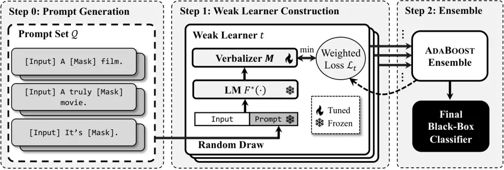

# PromptBoosting: Black-Box Text Classification with Ten Forward Passes

Bairu Hou Affiliation: UC Santa Barbara Correspondence to:
<bairu@ucsb.edu>    Joe O’Connor Affiliation: UC Los Angeles    Jacob
Andreas Affiliation: MIT CSAIL    Shiyu Chang Affiliation: UC Santa
Barbara    Yang Zhang Affiliation: MIT-IBM Watson AI Lab

###### Abstract

We describe PromptBoosting, a query-efficient procedure for building a
text classifier from a neural language model (LM) without access to the
LM’s parameters, gradients, or hidden representations. This form of
“black-box” classifier training has become increasingly important as the
cost of training and inference in large-scale LMs has grown. But
existing black-box LM classifier learning approaches are themselves
computationally inefficient, typically specializing LMs to the target
task by searching in a large space of (discrete or continuous) prompts
using zeroth-order optimization methods. Instead of directly optimizing
in prompt space, PromptBoosting obtains a small pool of prompts via a
gradient-free approach, and then constructs a large pool of _weak
learners_ by pairing these prompts with different elements of the LM’s
output distribution. These weak learners are then ensembled using the
AdaBoost algorithm. The entire learning process requires only a small
number of forward passes per batch and no backward pass. Experiments
show that PromptBoosting achieves state-of-the-art performance in
multiple black-box few-shot classification tasks, and matches or
outperforms full fine-tuning in both few-shot and standard learning
paradigms, while training 10x faster than existing black-box
methods.Codes are available at
[https://github.com/UCSB-NLP-Chang/PromptBoosting](https://github.com/UCSB-NLP-Chang/PromptBoosting).

###### Keywords: 

Machine Learning, ICML

## 1 Introduction

Prompt-based learning has emerged as an effective method to adapt
pre-trained language models (LMs) for downstream natural language
processing (NLP) tasks. A typical prompt-learning paradigm involves
appending a specially-designed sequence, called a prompt, to the input
to a pre-trained LM, which will thereby be repurposed for a given
downstream task. Compared to standard fine-tuning, prompt-based learning
is much more parameter-efficient.

Most prompt-based learning methods require searching for the optimal
prompt for the downstream task. When gradient information of the
pre-trained LM is available, such optimization can easily be performed
by standard gradient-based methods (Liu et al., 2021; Li & Liang, 2021;
Lester et al., 2021; Zhang et al., 2021; Liu et al., 2022). However, in
many real-world scenarios, the parameters, gradient, or hidden
representations of the LMs are not accessible, _a.k.a._ the black-box
tuning setting, which makes gradient-based prompt learning very
challenging (Sun et al., 2022b).

To tackle the challenges, the most common existing black-box solution is
to resort to gradient-free optimization techniques to search for the
optimal prompt, such as the zeroth-order gradient approximation (Sun
et al., 2022b; Diao et al., 2022) and reinforcement learning-guided
optimization (Deng et al., 2022). However, these methods would require a
large number of queries to the LMs, which, considering the ever-growing
size and computation cost of the pre-trained LMs, is highly inefficient
and could lead to large approximation errors.



Figure 1: Overview of PromptBoosting.

In this paper, we propose PromptBoosting, a novel black-box prompt
learning approach which does not rely on searching an optimal prompt and
can thus drastically improve the computational efficiency over the
existing methods. Figure 1 illustrates the pipeline of PromptBoosting.
Specifically, rather than optimizing over the prompts, PromptBoosting
constructs a small pool of prompts via a gradient-free approach. These
prompts are sub-optimal because they are not optimized for any
downstream tasks. Then, PromptBoosting creates a large pool of _weak
learners_ by pairing each prompt with different elements of the LM’s
output distribution, which is commonly known as the _verbalizer_.
Finally, these weak learners are ensembled using the AdaBoost algorithm,
where the optimization in each iteration is performed only over the
verbalizer, not the prompt. The entire process only needs to evaluate
the LM’s output with each of the prompts, so it only involves a small
number of forward passes per batch and no backward pass.

We evaluated our method on a number of downstream tasks. The results
show that PromptBoosting achieves state-of-the-art performance and
matches or even outperforms full fine-tuning in both few-shot and
standard learning paradigms. Furthermore, PromptBoosting can run 10x
faster than existing black-box prompt-learning approaches, with only ten
forward passes per batch.

## 2 Related Work

Prompt-based learning Prompt-based learning has emerged as a new
approach for adapting pre-trained LMs for downstream tasks fueled by the
success of GPT-3 (Brown et al., 2020). Since the prompts directly
influence the performance of prompt-based learning, recent studies have
focused on how to find the best prompts given a specific task.
AutoPrompt (Shin et al., 2020) designs a gradient-based discrete
optimization method to search for the optimal prompt. LM-BFF (Gao
et al., 2021) leverages the pre-trained T5 model (Raffel et al., 2020)
to automatically generate prompts and select the best one based on the
performance on the validation set. Since verifying the
automatically-generated prompts is time-consuming, the PTR (Han et al., 2021) method incorporates logic rules to construct prompts and to encode
prior knowledge into prompt-based learning.

Another line of work replaces the discrete prompt tokens with continuous
embeddings that have their own parameters. P-tuning (Liu et al., 2021)
trains a BiLSTM network to output continuous prompt embeddings.
Prefix-tuning (Li & Liang, 2021) inserts prompt embeddings to each
transformer layer in LMs and optimizes only the prompt embeddings during
training. Prompt Tuning (Lester et al., 2021) also keeps the LMs frozen
but adds prompt embeddings only in the input. P-tuning V2 (Liu et al., 2022) replaces the language model head in LMs with a linear layer for
classification and shows that soft prompt tuning scales to medium-sized
LMs and hard sequence tagging tasks. Our work adopts the discrete
prompts for prompt-based learning.

Black-box Tuning Extremely large LMs such as GPT-3 are only provided as
a service in the cloud, resulting inaccessible parameters and gradients
of LMs. Furthermore, from the model provider’s perspective, sharing
hidden representations or gradients of LMs may reveal the vulnerability
of the model and lead to security problems (Tramèr et al., 2016). How to
find the optimal prompts in such a black-box tuning setting has
attracted various explorations. BBT (Sun et al., 2022b) and BBTv2 (Sun
et al., 2022a) employ the CMA evolution strategy, a derivative-free
optimization method, to optimize continuous prompt embeddings. However,
both of the two algorithms require querying the LM tens of thousands of
times even in few-shot settings. Furthermore, both methods use soft
prompts whereas the black-box setting typically only permits querying
with textual input. Also, BBTv2 assumes that prompt embeddings can be
added to each layer of the original language model, which is not
accommodated in the standard black-box setting. Clip-Tuning (Chai
et al., 2022) proposes to optimize the prompt embeddings on multiple
subnetworks extracted from the original language model. While it
outperforms BBT (Sun et al., 2022b), this method requires full access to
the parameters of the language model. RLPrompt (Deng et al., 2022) is a
more realistic black-box tuning method where discrete prompt tokens are
optimized through reinforcement learning and the performance on
downstream tasks serves as the reward. BDPL (Diao et al., 2022) also
utilizes the reinforcement learning method to optimize the discrete
prompts but uses a lighter-weight policy network. It also narrows down
the search space of prompt tokens by utilizing pointwise mutual
information. TEMPERA (Zhang et al., 2022) uses reinforcement learning to
optimize discrete prompts and incorporates more components in
optimization (_e.g._, exemplars for in-context learning). GrIPS (Prasad
et al., 2022) performs phrase-level editing to generate discrete
prompts. Existing black-box tuning methods suffer from poor efficiency
and sub-optimal performance. Our method achieves high efficiency by
first generating only a small set of prompts and achieves superior
performance by then creating a set of weak learners from these prompts
and ensembling them together via AdaBoost (Freund & Schapire, 1997).

Model ensemble Model ensembling is a commonly used technique in machine
learning. Prior to deep learning, Bagging (Breiman, 1996; Breiman, 2001)
and Boosting (Freund & Schapire, 1997; Friedman, 2001) showed the power
of model ensembling. One of these methods, AdaBoost (Freund & Schapire,
1997), sequentially learns a series of weak learners and ensembles them
for better generalization. During training, each weak learner is tweaked
by leveraging examples that were misclassified by previous classifiers.
Since the performance of each individual prompt can be weak, our method
adopts AdaBoost as the framework for learning and ensembling multiple
prompts.

Prompt ensemble As has been pointed out by prior work (Lester et al.,
2021), ensembling prompts is more efficient than ensembling entire
fine-tuned models. Various ensemble strategies have been explored in
past work. Uniformly averaging the predictions from different prompts
has been used for factual probing (Jiang et al., 2020), text
generation (Yuan et al., 2021; Schick & Schütze, 2020), and
classification tasks (Schick & Schütze, 2021a; Lester et al., 2021).
Furthermore, some methods adopt a weighted averaging strategy for better
performance—the weight of each different prompt can be learned during
training (Jiang et al., 2020; Qin & Eisner, 2021) or defined using some
heuristics (Schick & Schütze, 2021a; Schick & Schütze, 2021b). Our
method also falls into the prompt ensemble category. The main difference
is each prompt-based model is sequentially learned conditioned on the
classification errors of prior models.

## 3 Methodology

In this section, we will describe the PromptBoosting algorithm. For
notation, we use $`|\mathcal{A}|`$ to denote the size of a finite set
$`\mathcal{A}`$; $`[A]`$ to denote an index set $`\{1,2,\cdots,A\}`$.

### 3.1 Problem Formulation

Consider a text classification downstream task. Denote
$`\mathcal{D}_{\mathrm{tr}}=\bigcup_{i}\{(\bm{x}_{i},y_{i})\}`$ as the
training set, where $`\bm{x}_{i}`$ denotes the input text sequence and
$`y_{i}`$ denotes the output label. We are given a pre-trained language
model, denoted as $`\bm{p}_{i}=F^{*}(\bm{x}_{i})`$, which, given the
input $`\bm{x}_{i}`$, produces a probability distribution over the
vocabulary set, $`\mathcal{V}`$, at a given location. In this paper, the
output distribution is relevant only where the input is \[mask\], so
$`\bm{p}_{i}\in\mathbb{R}^{|\mathcal{V}|\times 1}`$ is just a
$`|\mathcal{V}|`$-dimensional vector specifying the output probability
at the \[mask\] location, where $`|\mathcal{V}|`$ denotes the vocabulary
size. Our goal is to adapt the LM $`F^{*}(\cdot)`$ to the downstream
task using the downstream training set $`\mathcal{D}_{\mathrm{tr}}`$.

We adopt the common prompt-learning framework, where the parameters of
$`F^{*}(\cdot)`$ are frozen (we add a superscript ^(∗) to emphasize
this). The following two mechanisms are added to convert
$`F^{*}(\cdot)`$ into a text classifier for the given downstream tasks.

1.  1.  Prompt  A prompt is a sequence of tokens that is concatenated to the
        input. Formally, denote the prompt sequence as $`\bm{q}`$ and the
        concatenated input sequence as $`\bm{x}_{i}\|\bm{q}`$. Then the LM
        is modified as $`F^{*}(\bm{x}_{i}\|\bm{q})`$.
2.  2.  Verbalizer  To convert the output probability over the _vocabulary_
        into that over the _classes_, a verbalizer is introduced to assign
        each token into different classes. Formally, denote the number of
        classes of the downstream task as $`|\mathcal{Y}|`$, then the
        verbalizer is a $`|\mathcal{Y}|`$-by-$`|\mathcal{V}|`$ matrix,
        denoted as $`\bm{M}`$, where the element in row $`c`$, column $`v`$
        represents the assignment weight of the $`v`$-token in the
        vocabulary into class $`c`$. Each row of $`\bm{M}`$ would sum up to
        one. The predicted probability of all the classes can then be
        expressed as $`\bm{M}\bm{p}_{i}`$.

To sum up, after the prompt and verbalizer are applied, the adapted LM
becomes $`\bm{M}F^{*}(\bm{x}_{i}\|\bm{q})`$. Therefore, the
prompt-tuning process boils down to learning an appropriate verbalizer
$`\bm{M}`$ and prompt $`\bm{q}`$ for the downstream task.

### 3.2 Algorithm Overview

Conventional black-box prompt learning methods commonly use a pre-set
$`\bm{M}`$ while performing black-box optimization over $`\bm{q}`$,
which results in a large computation cost. In contrast, PromptBoosting
randomly chooses from a small number of pre-generated prompts and
performs optimization over $`\bm{M}`$ instead. Due to the sub-optimality
of pre-generated prompts and the limited representation power of
$`\bm{M}`$, the resulting classifiers are weak. However, this process is
able to quickly generate a large pool of such weak learners, which can
then be ensembled into a strong learner using the AdaBoost approach. As
the optimization over $`\bm{M}`$ is computationally cheap, the ensemble
process is much more efficient than the conventional black-box methods.

More specifically, PromptBoosting iteratively generates $`T`$ weak
learners, and each weak learner $`t`$ is optimized under its respective
loss function, denoted as $`\mathcal{L}_{t}(\bm{q},\bm{M})`$, which is
essentially a weighted loss over the training set with larger weights on
those that are misclassified by the previous weak learners (More details
of the AdaBoost algorithm will be provided in Section 3.5). As shown in
Figure 1, PromptBoosting consists of the following key steps.

Step 0: Generate a pool of prompts,
$`\mathcal{Q}=\bigcup_{j}\{\bm{q}_{j}\}`$, using a gradient-free method.

Step 1: Construct $`T`$ weak learners. For weak learner $`t`$, its
prompt $`\bm{q}_{t}`$ is uniformly randomly drawn from $`\mathcal{Q}`$;
its verbalizer $`\bm{M}`$ is determined by solving

```math
\displaystyle\min_{\bm{M}}\mathcal{L}_{t}(\bm{q}_{t},\bm{M}), \displaystyle\mbox{s.t.}\hskip 9.24994pt\bm{M}_{cv}\geq 0,\forall c\in[|\mathcal{Y}|],v\in[|\mathcal{V}|], \tag{1}
```

```math
\displaystyle\sum_{c\in[|\mathcal{Y}|]}\bm{M}_{cv}=1,\forall v\in[|\mathcal{V}|]
```

Step 2: Ensemble the weak learners using AdaBoost.

Section 3.3 will describe how to solve equation 1. Section 3.4 will
describe how the pool of prompts, $`\mathcal{Q}`$, is generated.

### 3.3 Learning the Verbalizer

As discussed, the loss function $`\mathcal{L}_{t}`$ as in equation 1 is
essentially a weighted sum of the individual loss over the training
dataset $`\mathcal{D}_{\mathrm{tr}}`$, _i.e._

```math
\small\mathcal{L}_{t}(\bm{q}_{t},\bm{M})=\sum_{(\bm{x}_{i},y_{i})\in\mathcal{D}_{\mathrm{tr}}}w_{ti}\ell(\bm{x}_{i},y_{i};\bm{q}_{t},\bm{M}), \tag{2}
```

where $`w_{ti}`$ denotes the weight on training data point $`i`$ for
learning weak learner $`t`$ as determined by AdaBoost;
$`\ell(\bm{x}_{i},y_{i};\bm{q}_{t},\bm{M})`$ denotes the loss on data
point $`(\bm{x}_{i},y_{i})`$ with the parameters set to $`\bm{q}_{t}`$
and $`\bm{M}`$. Since we focus on classification tasks, $`\ell(\cdot)`$
should ideally be the cross-entropy loss. However, the optimization
problem in equation 1 is essentially a partition problem, which can
easily lead to combinatorial complexity. To derive the tractable
solution, we adopt the following strategy. First, solve equation 1 with
$`\ell(\cdot)`$ set to the $`\ell_{1}`$ loss, which, though not optimal
for the classification task, bears a closed-form solution. Second,
further screen the token assignment by maximizing the training set
performance. The detailed method is described below.

#### Minimizing the $`\ell_{1}`$ loss

By replacing the $`\ell(\cdot)`$ in equation 2 with the $`\ell_{1}`$
loss, a closed-form solution can be derived, which can establish a basis
for the subsequent steps for deriving a good verbalizer. Formally, let
$`\bm{h}_{i}`$ be the one-hot representation of the class label
$`y_{i}`$, and let $`\bm{\pi}_{i}=F^{*}(\bm{x}_{i}\|\bm{q}_{t})`$
represent the LM output probability with the prompt $`\bm{q}_{t}`$
concatenated. Then, with the $`\ell_{1}`$ loss, equation 2 becomes

```math
\displaystyle\mathcal{L}_{t}(\bm{q}_{t},\bm{M}) \displaystyle=\sum_{(\bm{x}_{i},y_{i})\in\mathcal{D}_{\mathrm{tr}}}w_{ti}\lVert\bm{h}_{i}-\bm{M}\bm{\pi}_{i}\rVert_{1} \tag{3}
```

```math
\displaystyle=\sum_{(\bm{x}_{i},y_{i})\in\mathcal{D}_{\mathrm{tr}}}w_{ti}\bm{1}^{T}|\bm{h}_{i}-\bm{M}\bm{\pi}_{i}|
```

```math
\displaystyle=\sum_{(\bm{x}_{i},y_{i})\in\mathcal{D}_{\mathrm{tr}}}w_{ti}\big[(-\bm{1})^{\bm{h}_{i}}\big]^{T}(\bm{M}\bm{\pi}_{i}-\bm{h}_{i}).
```

Here, $`\bm{1}`$ represents a all-one column vector of dimension
$`|\mathcal{Y}|`$, and $`(-\bm{1})^{\bm{h}_{i}}`$ represents the
element-wise power operation. The last equality is because each element
of $`\bm{M}\bm{\pi}_{i}`$ is within $`[0,1]`$ and each element of
$`\bm{h}_{i}`$ is either $`0`$ or $`1`$, so we can easily remove the
absolute sign depending on the actual values of $`\bm{h}_{i}`$.

As shown in equation 3, the loss function is _linear_ with respect to
$`\bm{M}`$, so the optimization in equation 1 becomes a linear
optimization problem with linear constraints, which has closed-form
corner solutions. For notational brevity, define a score matrix,
$`\bm{S}`$, as

```math
\small\bm{S}=\sum_{(\bm{x}_{i},y_{i})\in\mathcal{D}_{\mathrm{tr}}}w_{ti}\bm{\pi}_{i}\big[(-\bm{1})^{\bm{h}_{i}}\big]^{T}, \tag{4}
```

which is the same size as $`\bm{M}`$ and is essentially the coefficients
multiplied with $`\bm{M}`$ in equation 3. Then, we state without
detailed derivations that the solution to equation 1 is such that each
token is assigned to the class for which it gets the highest score among
all the classes, _i.e.,_

```math
\bm{M}_{cv}=1,\quad\mbox{if }c=\argmax_{c^{\prime}\in[|\mathcal{Y}|]}\bm{S}_{c^{\prime}v},\quad\mbox{and }0\mbox{ otherwise}. \tag{5}
```

Since the $`\ell_{1}`$ loss does not generally work well for
classification tasks, we empirically find that the verbalizer derived in
equation 5 is of limited performance. However, this inspires us that the
score matrix, $`\bm{S}`$, is a good measure of how well each token
should be selected for a class. In the following step, we will further
screen the tokens with the help of the score matrix.

#### Screening the tokens

One issue with the verbalizer in equation 5 is that each token has to be
assigned to one class, even those tokens that are not good indicators of
any particular class. Therefore, by removing the non-informative tokens
and only retaining the best tokens for each class, we can improve the
verbalizer performance. To reduce the computational complexity, we will
retain only one token for each class. Specifically, we first identify a
candidate set of tokens for each class by choosing the tokens with
top-$`m`$ scores for that class, _i.e.,_ the top-$`m`$ elements in
$`\bm{S}_{c:}`$ for class $`c`$, where subscript $`c\colon`$ denotes the
$`c`$-th row. Then, we evaluate all the possible combinations that
include one token from the candidate set for each class (hence
$`m^{|\mathcal{Y}}|`$ combinations in total) and choose the combination
that achieves the best training accuracy (weighted by $`\{w_{ti}\}`$).

### 3.4 Constructing the Prompt Set

To generate the pool of prompts, $`\mathcal{Q}`$ (step 0 in
section 3.2), we adopt the optimization-free method proposed by Gao
et al. (2021), which employs the T5 (Raffel et al., 2020) model.
Specifically, we first construct a small subset of the training set,
denoted as $`\mathcal{D}_{\mathrm{gen}}`$, to induce the prompt
generation ($`\mathcal{D}_{\mathrm{gen}}`$ is exactly
$`\mathcal{D}_{\mathrm{tr}}`$ in few-shot setting). Then, for each data
point $`(\bm{x}_{i},y_{i})\in\mathcal{D}_{\mathrm{gen}}`$, we construct
an input to the T5 model as \<input\>\<A\>\<label token\>\<B\> (for
sentence-pair classification tasks, the input to T5 becomes
\<input1\>\<A\>\<label token\>\<B\>\<input2\>). Here, \<A\> and \<B\>
are mask tokens in T5 representing spans to be filled in. \<input\>,
\<input1\> and \<input2\> represent the input text $`\bm{x}_{i}`$.
\<label token\> is a pre-defined mapping to convert class labels to
tokens in $`\mathcal{V}`$. For example, positive label ($`y_{i}=1`$) in
SST-2 (Socher et al., 2013) dataset is mapped to token great while
negative label ($`y_{i}=0`$) is mapped to terrible. Given this input,
the T5 model fills in the spans for \<A\> and \<B\>. The decoding
process aims to maximize output probability conditioned on the input
over $`\mathcal{D}_{\mathrm{gen}}`$. Then the T5 generated outputs,
denoted as \<output A\> and \<output B\> will be converted into prompts
and concatenated to the training input text, _i.e.,_
$`\bm{x}_{i}\|\bm{q}`$, in the form of \<input\>\<output
A\>\[mask\]\<output B\> (for sentence-pair tasks, the form becomes
\<input1\>\<output A\>\[mask\]\<output B\>\<input2\>). As an example, on
SST-2 dataset, one of the generated outputs by T5 is \<output A\> = A
truly, \<output B\> = movie. Then the input sentence “I love it.” will
be converted to “I love it. A truly \[MASK\] movie”. With a wide beam
search width (by default we use $`100`$), we select the top-10 generated
prompts according to the log-likelihood to form the prompt pool,
$`\mathcal{Q}`$. All the generated prompts used in our experiments can
be found in Table 10 in Appendix C. Readers can refer to Gao et al.
(2021) for further details. The entire generation process does not
involve any optimization over the prompts, and thus is computationally
efficient. It is worth noting that the aforementioned approach can be
replaced with any other optimization-free prompt generation methods,
such as manually creating the prompts, making PromptBoosting flexible
for realistic use. Our experiment results in Table 3 in Section 4.2 show
that our method works well with different prompt generation methods.

### 3.5 Ensembling the Weak Learners

We follow the AdaBoost algorithm to ensemble the weak learners. As
discussed, each weak learner minimizes a weighted loss over the training
set (equation 2). The final prediction is produced by taking a weighted
average over the weak classifiers’ output. Further details, including
how the weights are computed, are shown in Algorithm 1. Algorithm 1
Model Ensemble in PromptBoosting 1:  Input: prompt set
$`\mathcal{Q}=\bigcup_{j}\{\bm{q}_{j}\}`$, LM $`F^{*}(\cdot)`$,
$`\mathcal{D}_{\mathrm{tr}}`$, 2:  Output: weak learners
$`\bigcup_{t}\{f_{t}(\cdot)\}`$ and their weights
$`\bigcup_{t}\{\alpha_{t}\}`$. 3:  Set initial data weight to
$`w_{1i}=1/|\mathcal{D}_{\mathrm{tr}}|`$,
$`\forall i\in[|\mathcal{D}_{\mathrm{tr}}|]`$ 4:  for Iteration
$`t=1,\ldots,T`$ do 5:   Randomly draw a prompt $`\bm{q}_{t}`$ from
$`\mathcal{Q}`$ 6:   Learn the verbalizer $`\bm{M}_{t}`$ with weight
$`\{w_{ti}\}`$ 7:   Set weak learner $`t`$ to
$`f_{t}(\cdot)=\bm{M}_{t}F^{*}(\cdot\|\bm{q}_{t})`$ 8:   Compute
weighted error as
$`err^{(t)}=\sum_{i=1}^{|\mathcal{D}_{\mathrm{tr}}|}w_{ti}\bm{1}_{\mathrm{y}_{i}\neq f_{t}(x_{i})}/\sum_{i=1}^{|\mathcal{D}_{\mathrm{tr}}|}w_{ti}`$
9:   Compute the weight on $`f_{t}`$ as
$`\alpha_{t}=\log\frac{1-err^{(t)}}{err^{(t)}}+\log(|\mathcal{Y}|-1)`$
10:   Adjust dataset weight
$`w_{(t+1)i}=w_{ti}\cdot\exp(\alpha_{t}\cdot\bm{1}_{y_{i}\neq f_{t}(x_{i})})`$,
$`\forall i\in[|\mathcal{D}_{\mathrm{tr}}|]`$ 11:   Re-normalize
$`\{w_{(t+1)i}\}`$. 12:  end for

It is worth mentioning that we can generate many weak learners at a very
low computational cost because we only need to evaluate the LM’s output
distribution with each of the pre-generated prompts in $`\mathcal{Q}`$,
beyond which no extra forward pass is needed when learning each weak
learner. Since the number of pre-generated prompts is small, typically
ten in our implementation, the entire learning process involves no more
than ten forward passes per batch in the training set, no matter how
many weak learners are generated.

## 4 Experiments

### 4.1 Experiment Setup

Datasets Previous approaches for black-box prompt-based learning (Sun
et al., 2022b; Sun et al., 2022a; Deng et al., 2022; Zhang et al., 2022)
are often evaluated on the following tasks: single sentence
classification (including SST-2 (Socher et al., 2013), MR (Pang & Lee,
2005), TREC (Voorhees & Tice, 2000) and AG’s News (Zhang et al., 2015))
and sentence-pair classification (including SNLI (Bowman et al., 2015),
MNLI-m (Williams et al., 2018), QNLI (Rajpurkar et al., 2016), and RTE
(Dagan et al., 2005)). We follow the same setting and report results on
the datasets above. The dataset statistics can be found in Table 4 in
Appendix A. For a more comprehensive understanding of our method, we
incorporate additional datasets including SST-5 (Socher et al., 2013),
CR (Hu & Liu, 2004), Subj (Pang & Lee, 2004), MPQA (Wiebe et al., 2005),
MRPC (Dolan & Brockett, 2005) in Table 9 in Appendix B—the conclusion is
the same.

Evaluation setting We mainly evaluate the performance of PromptBoosting
in few-shot settings. This is reasonable especially for black-box model
tuning scenarios, where the maximum allowed query times may be limited.
We randomly sample $`k`$ examples per class from the original training
set to construct a $`k`$-shot training set $`\mathcal{D}_{\mathrm{tr}}`$
for model training. Following previous work (Gao et al., 2021; Zhang
et al., 2021; Sun et al., 2022b), we also construct the validation set
$`\mathcal{D}_{\mathrm{val}}`$ by randomly sampling another $`k`$
examples per class from the original training set (i.e.,
$`|\mathcal{D}_{\mathrm{tr}}|=|\mathcal{D}_{\mathrm{val}}|`$). By
default we set $`k=16`$ for our main experiments. Also, while previous
work splits the training and validation sets in this way and we do so
for direct comparison, we also explore integrating the validation set
into the training set—in a truly few-shot setting, we should make full
use of as many examples as we can, and we show this leads to an
improvement in performance. As for evaluation, we use the whole testing
set. For SNLI (Bowman et al., 2015) and the datasets from the GLUE
benchmark (Wang et al., 2018), we use the original validation set for
evaluation.

Backbone models In the main experiments, we adopt the widely-used
RoBERTa-large model (Liu et al., 2019) for evaluation to allow for
direct comparison with baselines.

Baselines We compare PromptBoosting with fine-tuning and
state-of-the-art black-box tuning methods described below. For
reference, we also include white-box prompt-based learning methods that
are designed for a few-shot setting. Implementation details can be found
in Appendix A. (1) Fine-tuning is just standard model fine-tuning in a
few-shot setting. (2) LM-BFF (Gao et al., 2021) is a prompt-based
fine-tuning method. In LM-BFF, all input will be transformed using
automatically generated prompts. Then the whole model is fine-tuned
based on the transformed data. (3) DART (Zhang et al., 2021) replaces
the discrete prompts in LM-BFF with trainable prompt embeddings, which
can reduce the prompt generation cost. (4) BBT (Sun et al., 2022b)
employ zeroth-order gradients to optimize the continuous prompts. (5)
BBTv2 (Sun et al., 2022a) improves the performance of BBT by inserting
prompt embeddings into each layer of the language model (6)
RLPrompt (Deng et al., 2022) models the black-box optimization of
discrete prompts as a reinforcement learning problem and adopts
Q-learning to find the best prompt. Some black-box baselines (Zhang
et al., 2022; Chai et al., 2022) are not included because the official
implementation is not available.

|                              |            |            |            |            |            |            |            |            |      |
| ---------------------------- | ---------- | ---------- | ---------- | ---------- | ---------- | ---------- | ---------- | ---------- | ---- |
| Method                       | SST-2      | MR         | AG’s News  | TREC       | SNLI       | MNLI       | QNLI       | RTE        | Avg. |
| Fine-tuning                  | 81.4 (3.8) | 82.7 (3.6) | 86.2 (1.4) | 88.8 (2.1) | 48.4 (4.8) | 45.8 (6.4) | 56.3 (1.5) | 54.4 (3.9) | 68.0 |
| LM-BFF (Gao et al., 2021)    | 92.3 (1.5) | 87.4 (0.6) | 87.1 (1.2) | 83.4 (2.7) | 76.5 (2.6) | 68.7 (2.0) | 64.4 (4.6) | 66.6 (6.4) | 78.3 |
| DART (Zhang et al., 2021)    | 93.5 (0.5) | 88.2 (1.0) | 86.8 (0.5) | 87.1 (3.8) | 75.8 (1.6) | 67.5 (2.6) | 66.7 (3.7) | 59.0 (2.5) | 78.1 |
| BBT (Sun et al., 2022b)      | 88.2 (1.7) | 82.8 (2.6) | 81.2 (2.7) | 39.3 (5.2) | 44.7 (4.0) | 42.3 (2.8) | 56.8 (2.0) | 49.1 (3.3) | 60.6 |
| BBTv2 (Sun et al., 2022a)    | 88.5 (2.1) | 83.7 (1.8) | 83.6 (2.0) | 63.8 (9.9) | 57.4 (2.7) | 51.4 (3.3) | 58.1 (2.5) | 53.2 (7.0) | 67.5 |
| RLPrompt (Deng et al., 2022) | 90.5 (1.5) | 86.2 (2.5) | 76.2 (2.7) | 37.3 (3.5) | 42.9 (1.8) | 40.7 (4.7) | 52.1 (2.9) | 52.2 (2.2) | 59.8 |
| PromptBoosting               | 87.6 (3.0) | 84.6 (2.5) | 85.2 (0.9) | 81.6 (4.0) | 61.3 (3.5) | 52.5 (1.5) | 58.0 (3.3) | 60.0 (5.5) | 71.4 |
| PromptBoosting-32            | 87.6 (3.3) | 84.7 (2.1) | 84.2 (1.1) | 84.5 (1.4) | 62.0 (2.7) | 53.8 (1.2) | 58.3 (2.8) | 60.3 (2.4) | 71.9 |

Table 1: Performance of proposed PromptBoosting and baseline methods in
few-shot setting ($`k=16`$) measured by classification accuracy (%). All
methods use RoBERTa-large (Liu et al., 2019) as the backbone LM for a
fair comparison. Two white-box methods are included for reference
including LM-BFF and DART. BBT, BBTv2, and RLPrompt are the main
black-box baselines. PromptBoosting-32 combines both training and
validation sets for training. Mean accuracy (and standard deviation) is
reported over 5 different splits. The best results are highlighted in
bold and the second best are underlined.

|                              |                 |             |           |           |           |            |      |           |           |            |
| ---------------------------- | --------------- | ----------- | --------- | --------- | --------- | ---------- | ---- | --------- | --------- | ---------- |
| Method                       | Trainable param | Total param | AG’s News |           |           |            | RTE  |           |           |            |
|                              |                 |             | Acc       | Wall Time | \#Forward | \#Backward | Acc  | Wall Time | \#Forward | \#Backward |
| Fine-tuning                  | 335M            | 335M        | 86.2      | 13 min    | 100       | 100        | 54.4 | 19 min    | 100       | 100        |
| LM-BFF (Gao et al., 2021)    | 335M            | 335M        | 87.1      | 5 min     | 32        | 32         | 66.6 | 9 min     | 60        | 60         |
| DART (Zhang et al., 2021)    | 335M            | 335M        | 86.8      | 15 min    | 30        | 30         | 59.0 | 5 min     | 120       | 120        |
| BBT (Sun et al., 2022b)      | 25k             | 335M        | 81.2      | 88 min    | 8,000     | 0          | 49.1 | 52 min    | 8,000     | 0          |
| BBTv2 (Sun et al., 2022a)    | 25k             | 335M        | 83.6      | 90 min    | 8,000     | 0          | 53.2 | 70 min    | 8,000     | 0          |
| RLPrompt (Deng et al., 2022) | 3M              | 420M        | 77.2      | 117 min   | 1,000     | 0          | 52.2 | 90 min    | 1,000     | 0          |
| PromptBoosting               | $`<`$1k         | 335M        | 85.2      | 8 min     | 10        | 0          | 60.0 | 4 min     | 10        | 0          |

Table 2: Deployment efficiency of proposed PromptBoosting and baseline
methods in few-shot setting ($`k=16`$). With all methods using
RoBERTa-large (335M parameters) as the backbone LM, some baselines
introduce additional parameters, leading to a slight variation in total
parameters. Wall time is reported to measure the training time
efficiency. Query efficiency is evaluated by \#Forward and \#Backward,
which refer to the number of forward/backward passes per batch during
training respectively.

Implementation details We use the official implementations and
hyper-parameters for all baselines. For more details, please refer to
Appendix A. For our method, we sequentially train 200 weak classifiers
on each task and add them to our ensemble—we stop when validation
performance plateaus or when we reach the maximum number of weak
classifiers.

### 4.2 Evaluation Results

Overall comparison We first evaluate the effectiveness of PromptBoosting
in a few-shot setting with experiment results in Table 1. Although there
is some variance across datasets, PromptBoosting achieves
state-of-the-art performance compared to existing black-box tuning
methods.

We emphasize the effectiveness of model ensembling in PromptBoosting.
Firstly, on the SST-2 and MR datasets, which are sentiment analysis
tasks, even individual weak learners in PromptBoosting can achieve 100%
accuracy on the training set, making the model ensemble inapplicable
(note that AdaBoost cannot ensemble classifiers that achieve 100%
accuracy). Therefore, we directly train 10 weak learners using 10
prompts on the unweighted training set and then select the weak learner
that performs best on the validation set as the final model. Since the
advantage of model ensemble is limited on SST-2 and MR datasets, it is
not surprising that PromptBoosting performs slightly worse than BBT and
RLPrompt. However, PromptBoosting is still better than fine-tuning an
MLP, demonstrating the effectiveness of our proposed verbalizer learning
method.

Secondly, on the other 6 datasets, PromptBoosting consistently
outperforms all the baselines, with only one exception in the QNLI
dataset, where BBTv2 has a slight advantage. However, notice that BBTv2
has an unfair advantage over all the other black-box methods, including
ours, in allowing soft prompts to be added to each intermediate layer of
the language model. PromptBoosting also outperforms standard fine-tuning
on the 4 NLI tasks. It is worth noting that on the TREC dataset, all of
the black-box baselines performs very badly except for PromptBoosting,
which even achieves a level of accuracy close to that of white-box
methods. One potential reason is that the TREC dataset is harder for
prompt-based learning. For example, the manual prompt on the TREC
dataset achieves only 32% accuracy (Gao et al., 2021). According to our
experiments, individual weak learners trained on the unweighted training
set using our verbalizer learning method can only achieve 30%-50%
accuracy. However, after model ensembling, the performance is largely
improved, demonstrating the effectiveness of PromptBoosting.

Finally, we incorporate a variant of PromptBoosting, namely
PromptBoosting-32, which skips the hyper-parameter tuning and directly
integrates the validation set into training. The hyper-parameter, i.e.,
the number of weak classifiers, is determined manually according to its
value when the validation set is available. Expanding the training set
gives a slight improvement in the performance and decreases the
variance.

Deployment efficiency Another concern with black-box model tuning is the
deployment efficiency. As we have discussed above, directly adopting
zeroth-order gradient optimization techniques suffers from the need to
query many times, making it less applicable in realistic scenarios. We
visualize the deployment efficiency of different methods in Table 2.
AG’s News and RTE datasets are adopted due to the average input length
(see Table 4). The metrics include parameter efficiency (number of
trainable parameters and total parameters), wall time of training, and
number of forward/backward passes per batch. In terms of trainable
parameters, PromptBoosting optimizes only less than 1k parameters
($`|\mathcal{Y}|*200`$) and does not introduce any extra parameters. In
contrast, RLPrompt uses another network, DistilGPT2 (Sanh et al., 2019),
in addition to the backbone RoBERTa model and consequently increases the
training cost. In terms of wall time, PromptBoosting improves the
efficiency over existing black-box tuning baselines (BBT, BBTv2, and
RLPrompt) by more than 10 times. The query time is also significantly
lower. Only 10 forward passes per batch of training data are required
during the training of PromptBoosting. By contrast, our baselines
require thousands of forward passes, which makes them hard to use in
realistic scenarios. In addition, we can further significantly improve
the efficiency of PromptBoosting with some slight simplifications
without hurting the performance. Please refer to Table 7 in Appendix B
for more details.

(a) Performance on SST-2

(b) Performance on MR

(c) Performance on SNLI

(d) Performance on MNLI

Figure 2: Model performance as a function of training set size on
different datasets. For NLI tasks (SNLI and MNLI), we also include
prompt refinement for better performance.

Effect of training data size We also study the performance of
PromptBoosting as the size of the training set increases (see Figure 2).
Note that we still fix $`k=16`$ for the validation set regardless of the
training set size. Results on AG’s News, TREC, QNLI, and RTE dataset are
shown in Figure 3 in Appendix B. The conclusions are in three
dimensions. Firstly, on the SST-2 and MR datasets, PromptBoosting
consistently outperforms fine-tuning with lower variance, demonstrating
the effectiveness of our method. Secondly, on the AG News and TREC
datasets, PromptBoosting performs worse than fine-tuning. A similar
phenomenon also exists in past work (Gao et al., 2021), where even a
white-box prompt-based few-shot learning method can achieve performance
that is at most only comparable with fine-tuning. However, we remark
that our method still maintains large advantages compared to all
black-box baseline methods and achieves highly usable performance.
Finally, as the amount of training data increases, the performance of
fine-tuning improves and gradually outperforms our method on the four
NLI datasets. This finding is possibly due to the fact that pre-trained
LMs before fine-tuning are not good at tasks involving sentence pairs.

Refinement of prompts The performance of the weak learner in
PromptBoosting directly depends on the prompt. As has been shown in
previous work, different prompts have a significant influence on the
performance of prompt-based methods (Shin et al., 2020; Gao et al.,
2021). However, in PromptBoosting, the prompts are fixed and will not be
optimized during training. Therefore, we consider a simple yet effective
way to improve the performance through prompt refinement. Specifically,
because we automatically generate 100 prompts for each dataset but only
use 10 of them, we may select the top 10 prompts following some
heuristics to improve the quality of the prompts. Before training, we
first evaluate the performance on the validation set by training a weak
classifier using the method in Section 3.3 on the unweighted few-shot
training set. Then we construct the prompt pool by selecting the top 10
prompts according to the accuracy of the corresponding weak learner on
the validation set. Please note that the few-shot setting makes the
refinement process very efficient. Later on, PromptBoosting is trained
using the refined prompts. We mainly evaluate the effectiveness of the
prompt refinement on SNLI, MNLI, and QNLI datasets where the gap between
PromptBoosting and standard fine-tuning is relatively large with the
increase of training data. Experiment results can be found in Figure 2.
There are consistent improvements in few-shot performance across three
NLI tasks, especially on the QNLI dataset where the performance of
PromptBoosting was far from satisfactory without prompt refinement.
Overall, the prompt refinement leads to a trade-off between training
cost and model performance.

Effect of the number of prompts In our main experiments, we use 10
prompts by default. Intuitively, a large prompt pool increases the
diversity of weak classifiers which could improve the performance.
However, the training/inference cost will also increase if more prompts
are included for model training. We empirically study the relationship
between the number of prompts and the model performance in Table 5 in
Appendix B. In general, more prompts benefit the performance in most
datasets (except QNLI). We highlight the effectiveness of multiple
prompts on AG’s News and TREC dataset, on which the performance becomes
better and more stable. As we have discussed in the few-shot experiments
in Table 1, individual prompt performs very badly on TREC dataset. This
is also proved by PromptBoosting-1 that only achieves 41.3% accuracy.
However, by using our prompt ensemble framework, the performance can be
boosted to 84.6% when 10 prompts are provided. Finally, the performance
improvement is relatively small when the number of prompts increases
from 10 to 20, implying that 10 prompts should be good enough for
PromptBoosting.

Effect of the prompt generation method We also study the performance of
PromptBoosting when combined with other prompt generation methods.
Specifically, the following three alternative methods are compared with:
(a) PromptBoosting + LM-BFF with different prompt sets, where we select
a different 10-prompt subset from the large number of prompts generated
by LM-BFF; (b) PromptBoosting + prompts from PET (Schick & Schütze,
2021a); and (c) PromptBoosting + manually written prompts, where we
asked several computer science students to write the prompts for each
task. All the prompts are listed in the supplemental materials. The
results are shown in Table 3.

|                               |            |            |
| ----------------------------- | ---------- | ---------- |
|                               | AG’s News  | RTE        |
| PromptBoosting (original)     | 85.2 (0.9) | 60.0 (5.5) |
| PromptBoosting (LM-BFF set 1) | 85.4 (1.6) | 59.1 (5.4) |
| PromptBoosting (LM-BFF set 2) | 84.7 (1.3) | 60.3 (6.1) |
| PromptBoosting (PET)          | 85.0 (1.2) | 58.2 (3.7) |
| PromptBoosting (Manual)       | 85.2 (0.8) | 60.6 (2.0) |

Table 3: Performance of PromptBoosting with different prompt sets. We
test the performance with another two different prompt sets generated by
LM-BFF (Gao et al., 2021), one prompt set from PET (Schick & Schütze,
2021a), and one prompt set written by humans (denoted as ‘LM-BFF set 1’,
‘LM-BFF set 2’, ‘PET’ and ‘Manual’ respectively).

PromptBoosting maintains a consistently competitive performance
_regardless of_ the prompt generation method used. This further verifies
that what truly differentiates our work is the new way to get an
efficient and strong black-box classifier which _removes the need to
optimize over the prompts_. By shifting the optimization target to the
verbalizer compensated by ensembling in an effort, we show that a strong
black-box classifier can be obtained without strict requirements on the
quality of the prompts.

Ablation studies and Full data training We conduct ablation studies on
the verbalizer determination method and the prompt ensemble method in
Table 6 in Appendix B, showing that both the two modules contribute to
the final performance. Also, PromptBoosting can generalize to full data
training instead of just the few-shot setting due to the efficiency. We
compare PromptBoosting with fine-tuning on the entire training dataset
in Table 8 in Appendix B.

## 5 Conclusion

In this paper, we propose PromptBoosting, an effective black-box model
tuning framework. Without access to the parameters and gradients of
pre-trained LMs, PromptBoosting can adapt LMs for various downstream
tasks. The efficient weak learner construction method, together with the
AdaBoost ensemble algorithm, makes PromptBoosting achieve
state-of-the-art performance in black-box tuning setting with at least
10x run-time efficiency.

For future directions, we will explore how to generalize PromptBoosting
to more applications, _e.g._, chain-of-thought prompting (Wei et al.,
2022). Also, we will study how to combine the prompt ensemble idea in
PromptBoosting with gradient-based optimization and improve the
performance of existing prompt-based learning methods.

## 6 Acknowledgement

The work of Bairu Hou and Shiyu Chang was partially supported by
National Science Foundation (NSF) Grant IIS-2207052. The computing
resources used in this work were partially supported by the MIT-IBM
Watson AI Lab.

## References

- Bowman et al. (2015) Bowman, S., Angeli, G., Potts, C., and Manning,
  C. D. A large annotated corpus for learning natural language
  inference. In _Proceedings of the 2015 Conference on Empirical Methods
  in Natural Language Processing_, pp. 632–642, 2015.
- Breiman (1996) Breiman, L. Bagging predictors. _Machine learning_,
  24(2):123–140, 1996.
- Breiman (2001) Breiman, L. Random forests. _Machine learning_,
  45(1):5–32, 2001.
- Brown et al. (2020) Brown, T., Mann, B., Ryder, N., Subbiah, M.,
  Kaplan, J. D., Dhariwal, P., Neelakantan, A., Shyam, P., Sastry, G.,
  Askell, A., et al. Language models are few-shot learners. _Advances in
  neural information processing systems_, 33:1877–1901, 2020.
- Chai et al. (2022) Chai, Y., Wang, S., Sun, Y., Tian, H., Wu, H., and
  Wang, H. Clip-tuning: Towards derivative-free prompt learning with a
  mixture of rewards. _arXiv preprint arXiv:2210.12050_, 2022.
- Dagan et al. (2005) Dagan, I., Glickman, O., and Magnini, B. The
  pascal recognising textual entailment challenge. In _Machine learning
  challenges workshop_, pp. 177–190, 2005.
- Deng et al. (2022) Deng, M., Wang, J., Hsieh, C.-P., Wang, Y., Guo,
  H., Shu, T., Song, M., Xing, E. P., and Hu, Z. Rlprompt: Optimizing
  discrete text prompts with reinforcement learning. _arXiv preprint
  arXiv:2205.12548_, 2022.
- Diao et al. (2022) Diao, S., Li, X., Lin, Y., Huang, Z., and Zhang, T.
  Black-box prompt learning for pre-trained language models. _arXiv
  preprint arXiv:2201.08531_, 2022.
- Dolan & Brockett (2005) Dolan, B. and Brockett, C. Automatically
  constructing a corpus of sentential paraphrases. In _Third
  International Workshop on Paraphrasing (IWP2005)_, 2005.
- Freund & Schapire (1997) Freund, Y. and Schapire, R. E. A
  decision-theoretic generalization of on-line learning and an
  application to boosting. _Journal of computer and system sciences_,
  55:119–139, 1997.
- Friedman (2001) Friedman, J. H. Greedy function approximation: a
  gradient boosting machine. _Annals of statistics_, pp.
  1189–1232, 2001.
- Gao et al. (2021) Gao, T., Fisch, A., and Chen, D. Making pre-trained
  language models better few-shot learners. In _Proceedings of the 59th
  Annual Meeting of the Association for Computational Linguistics and
  the 11th International Joint Conference on Natural Language Processing
  (Volume 1: Long Papers)_, pp. 3816–3830, 2021.
- Han et al. (2021) Han, X., Zhao, W., Ding, N., Liu, Z., and Sun, M.
  Ptr: Prompt tuning with rules for text classification. _arXiv preprint
  arXiv:2105.11259_, 2021.
- Hu & Liu (2004) Hu, M. and Liu, B. Mining and summarizing customer
  reviews. In _Proceedings of the tenth ACM SIGKDD international
  conference on Knowledge discovery and data mining_, pp. 168–177, 2004.
- Jiang et al. (2020) Jiang, Z., Xu, F. F., Araki, J., and Neubig, G.
  How can we know what language models know? _Transactions of the
  Association for Computational Linguistics_, 8:423–438, 2020.
- Lester et al. (2021) Lester, B., Al-Rfou, R., and Constant, N. The
  power of scale for parameter-efficient prompt tuning. In _Proceedings
  of the 2021 Conference on Empirical Methods in Natural Language
  Processing_, pp. 3045–3059, 2021.
- Li & Liang (2021) Li, X. L. and Liang, P. Prefix-tuning: Optimizing
  continuous prompts for generation. In _Proceedings of the 59th Annual
  Meeting of the Association for Computational Linguistics and the 11th
  International Joint Conference on Natural Language Processing (Volume
  1: Long Papers)_, pp. 4582–4597, 2021.
- Liu et al. (2021) Liu, X., Zheng, Y., Du, Z., Ding, M., Qian, Y.,
  Yang, Z., and Tang, J. Gpt understands, too. _arXiv:2103.10385_, 2021.
- Liu et al. (2022) Liu, X., Ji, K., Fu, Y., Tam, W., Du, Z., Yang, Z.,
  and Tang, J. P-tuning: Prompt tuning can be comparable to fine-tuning
  across scales and tasks. In _Proceedings of the 60th Annual Meeting of
  the Association for Computational Linguistics (Volume 2: Short
  Papers)_, 2022.
- Liu et al. (2019) Liu, Y., Ott, M., Goyal, N., Du, J., Joshi, M.,
  Chen, D., Levy, O., Lewis, M., Zettlemoyer, L., and Stoyanov, V.
  Roberta: A robustly optimized bert pretraining approach. _arXiv
  preprint arXiv:1907.11692_, 2019.
- Pang & Lee (2004) Pang, B. and Lee, L. A sentimental education:
  Sentiment analysis using subjectivity summarization based on minimum
  cuts. _arXiv preprint cs/0409058_, 2004.
- Pang & Lee (2005) Pang, B. and Lee, L. Seeing stars: Exploiting class
  relationships for sentiment categorization with respect to rating
  scales. In _Proceedings of the 43rd Annual Meeting of the Association
  for Computational Linguistics (ACL’05)_, pp. 115–124, 2005.
- Prasad et al. (2022) Prasad, A., Hase, P., Zhou, X., and Bansal, M.
  Grips: Gradient-free, edit-based instruction search for prompting
  large language models. _arXiv preprint arXiv:2203.07281_, 2022.
- Qin & Eisner (2021) Qin, G. and Eisner, J. Learning how to ask:
  Querying lms with mixtures of soft prompts. In _Proceedings of the
  2021 Conference of the North American Chapter of the Association for
  Computational Linguistics: Human Language Technologies_, pp.
  5203–5212, 2021.
- Raffel et al. (2020) Raffel, C., Shazeer, N., Roberts, A., Lee, K.,
  Narang, S., Matena, M., Zhou, Y., Li, W., Liu, P. J., et al. Exploring
  the limits of transfer learning with a unified text-to-text
  transformer. _J. Mach. Learn. Res._, 21(140):1–67, 2020.
- Rajpurkar et al. (2016) Rajpurkar, P., Zhang, J., Lopyrev, K., and
  Liang, P. Squad: 100,000+ questions for machine comprehension of text.
  In _Proceedings of the 2016 Conference on Empirical Methods in Natural
  Language Processing_, pp. 2383–2392, 2016.
- Sanh et al. (2019) Sanh, V., Debut, L., Chaumond, J., and Wolf, T.
  Distilbert, a distilled version of bert: smaller, faster, cheaper and
  lighter. In _NeurIPS $`EMC^{2}`$ Workshop_, 2019.
- Schick & Schütze (2020) Schick, T. and Schütze, H. Few-shot text
  generation with pattern-exploiting training. _arXiv preprint
  arXiv:2012.11926_, 2020.
- Schick & Schütze (2021a) Schick, T. and Schütze, H. Exploiting
  cloze-questions for few-shot text classification and natural language
  inference. In _Proceedings of the 16th Conference of the European
  Chapter of the Association for Computational Linguistics: Main
  Volume_, pp. 255–269, 2021a.
- Schick & Schütze (2021b) Schick, T. and Schütze, H. It’s not just size
  that matters: Small language models are also few-shot learners. In
  _Proceedings of the 2021 Conference of the North American Chapter of
  the Association for Computational Linguistics: Human Language
  Technologies_, pp. 2339–2352, 2021b.
- Shin et al. (2020) Shin, T., Razeghi, Y., Logan IV, R. L., Wallace,
  E., and Singh, S. Autoprompt: Eliciting knowledge from language models
  with automatically generated prompts. In _Proceedings of the 2020
  Conference on Empirical Methods in Natural Language Processing
  (EMNLP)_, pp. 4222–4235, 2020.
- Socher et al. (2013) Socher, R., Perelygin, A., Wu, J., Chuang, J.,
  Manning, C. D., Ng, A. Y., and Potts, C. Recursive deep models for
  semantic compositionality over a sentiment treebank. In _Proceedings
  of the 2013 conference on empirical methods in natural language
  processing_, pp. 1631–1642, 2013.
- Sun et al. (2022a) Sun, T., He, Z., Qian, H., Zhou, Y., Huang, X., and
  Qiu, X. Bbtv2: Towards a gradient-free future with large language
  models. In _Proceedings of EMNLP_, 2022a.
- Sun et al. (2022b) Sun, T., Shao, Y., Qian, H., Huang, X., and Qiu, X.
  Black-box tuning for language-model-as-a-service. In _Proceedings of
  ICML_, 2022b.
- Tramèr et al. (2016) Tramèr, F., Zhang, F., Juels, A., Reiter, M. K.,
  and Ristenpart, T. Stealing machine learning models via prediction
  $`\{`$APIs$`\}`$. In _25th USENIX security symposium (USENIX Security 16)_, pp. 601–618, 2016.
- Voorhees & Tice (2000) Voorhees, E. M. and Tice, D. M. Building a
  question answering test collection. In _Proceedings of the 23rd annual
  international ACM SIGIR conference on Research and development in
  information retrieval_, pp. 200–207, 2000.
- Wang et al. (2018) Wang, A., Singh, A., Michael, J., Hill, F., Levy,
  O., and Bowman, S. Glue: A multi-task benchmark and analysis platform
  for natural language understanding. In _Proceedings of the 2018 EMNLP
  Workshop BlackboxNLP: Analyzing and Interpreting Neural Networks for
  NLP_, 2018.
- Wei et al. (2022) Wei, J., Wang, X., Schuurmans, D., Bosma, M., Chi,
  E., Le, Q., and Zhou, D. Chain of thought prompting elicits reasoning
  in large language models. _arXiv preprint arXiv:2201.11903_, 2022.
- Wiebe et al. (2005) Wiebe, J., Wilson, T., and Cardie, C. Annotating
  expressions of opinions and emotions in language. _Language resources
  and evaluation_, 2005.
- Williams et al. (2018) Williams, A., Nangia, N., and Bowman, S. A
  broad-coverage challenge corpus for sentence understanding through
  inference. In _Proceedings of the 2018 Conference of the North
  American Chapter of the Association for Computational Linguistics:
  Human Language Technologies, Volume 1 (Long Papers)_, pp.
  1112–1122, 2018.
- Wolf et al. (2019) Wolf, T., Debut, L., Sanh, V., Chaumond, J.,
  Delangue, C., Moi, A., Cistac, P., Rault, T., Louf, R., Funtowicz, M.,
  et al. Huggingface’s transformers: State-of-the-art natural language
  processing. _arXiv preprint arXiv:1910.03771_, 2019.
- Yuan et al. (2021) Yuan, W., Neubig, G., and Liu, P. Bartscore:
  Evaluating generated text as text generation. _Advances in Neural
  Information Processing Systems_, 34:27263–27277, 2021.
- Zhang et al. (2021) Zhang, N., Li, L., Chen, X., Deng, S., Bi, Z.,
  Tan, C., Huang, F., and Chen, H. Differentiable prompt makes
  pre-trained language models better few-shot learners. In
  _International Conference on Learning Representations_, 2021.
- Zhang et al. (2022) Zhang, T., Wang, X., Zhou, D., Schuurmans, D., and
  Gonzalez, J. E. Tempera: Test-time prompting via reinforcement
  learning. _arXiv preprint arXiv:2211.11890_, 2022.
- Zhang et al. (2015) Zhang, X., Zhao, J. J., and LeCun, Y.
  Character-level convolutional networks for text classification. In
  _NIPS_, 2015.

## Appendix A Implementation Details

#### Dataset Statistics

The dataset statistics can be found in Table 4. For a fair comparison,
the few-shot training/validation/testing split generation is strictly
following the implementation of Gao et al. (2021).

|                 |           |     |             |        |          |
| --------------- | --------- | --- | ----------- | ------ | -------- | ------- | ------ |
| Category        | Dataset   | $`  | \mathcal{Y} | `$     | Avg. \#W | \#Train | \#Test |
| single sentence | SST-2     | 2   | 17          | 6920   | 872      |
|                 | SST-5     | 5   | 18          | 8544   | 2210     |
|                 | MR        | 2   | 20          | 8662   | 2000     |
|                 | CR        | 2   | 19          | 1775   | 2000     |
|                 | AG’s News | 4   | 47          | 120000 | 7600     |
|                 | TREC      | 6   | 10          | 5452   | 500      |
|                 | MPQA      | 2   | 3           | 8606   | 2000     |
|                 | Subj      | 2   | 23          | 8000   | 2000     |
| sentence pair   | SNLI      | 3   | 22          | 549367 | 9842     |
|                 | MNLI      | 3   | 33          | 392702 | 9815     |
|                 | QNLI      | 3   | 41          | 104743 | 5463     |
|                 | RTE       | 3   | 59          | 2490   | 277      |
|                 | MRPC      | 2   | 43          | 3668   | 408      |

Table 4: The dataset statistics. $`|\mathcal{Y}|`$ is the number of
classes, Avg.#W is the average number of words in the input, and
\#Train/#Test refers to the number of examples in the training/testing
dataset.

#### Training of baselines

For standard fine-tuning, we adopt the Huggingface transformers
library (Wolf et al., 2019) to load RoBERTa-large backbone model and use
its Trainer for fine-tuning. The learning rate is set to 1e-5. We use
AdamW optimizer as the optimizer and the learning rate linearly decays
to 0. The training batch size is set to 16 and the total training epochs
is 100. For the Feature-MLP method, we use a three-layer MLP with a
hidden dimension of 100. The learning rate is set to 1e-3 without
learning rate decay. We also train the MLP for 100 epochs. For other
baselines, we use their official implementation with default
hyper-parameters including LM-BFF (Gao et al., 2021), DART (Zhang
et al., 2021), BBT (Sun et al., 2022b), BBTv2 (Sun et al., 2022a) and
RLPrompt (Deng et al., 2022). For RLPrompt, because of its low
efficiency, we set its training epochs to 1000 instead of the 12000 used
in their paper. This is reasonable since it takes nearly 2 hours for
RLPrompt to finish 1000 epochs of optimization.

## Appendix B Additional Experiments

#### Effect of the number of prompts

We visualize the relationship between the number of prompts and the
model performance in Table 5. As we discussed in the main paper, more
prompts benefit the performance in most datasets (except QNLI). Also,
the performance improvement is relatively small when the number of
prompts increases from 10 to 20, implying that 10 prompts should be good
enough for PromptBoosting.

|                   |            |            |            |            |            |            |            |            |      |
| ----------------- | ---------- | ---------- | ---------- | ---------- | ---------- | ---------- | ---------- | ---------- | ---- |
|                   | SST-2      | MR         | AG’s News  | TREC       | SNLI       | MNLI       | QNLI       | RTE        | Avg. |
| PromptBoosting-1  | 86.1 (1.0) | 85.1 (5.0) | 73.3 (3.7) | 41.3 (4.3) | 53.4 (4.0) | 49.5 (3.5) | 58.0 (2.4) | 56.5 (5.7) | 62.9 |
| PromptBoosting-5  | 88.8 (1.9) | 87.9 (1.6) | 83.5 (4.2) | 78.0 (2.5) | 59.1 (3.5) | 50.9 (4.8) | 56.5 (2.1) | 57.0 (4.5) | 70.2 |
| PromptBoosting-10 | 87.6 (3.0) | 84.6 (2.5) | 85.2 (0.9) | 81.6 (4.0) | 61.3 (3.5) | 52.5 (1.5) | 58.0 (3.3) | 60.0 (5.5) | 71.4 |
| PromptBoosting-20 | 88.1 (2.6) | 84.0 (2.3) | 86.4 (1.3) | 81.9 (2.7) | 60.8 (3.9) | 55.2 (1.2) | 57.0 (4.4) | 57.1 (3.2) | 71.3 |

Table 5: Performance of PromptBoosting with different numbers of prompts
in few-shot setting ($`k=16`$). PromptBoosting-$`d`$ means top-$`d`$
prompts (sorted according to the beam search score) are used for model
training. Mean accuracy (and standard deviation) is reported over 5
different splits.

#### Effect of the verbalizer construction and the prompt ensemble method

We conduct an ablation study to demonstrate the effectiveness of the
proposed verbalizer construction method. Furthermore, since
PromptBoosting use AdaBoost algorithm to ensemble the weak learners, we
also study the performance of our method when using other prompt
ensemble methods. Specifically, we design the following baselines. (a)
Ensemble (rand). We pair each prompt with a randomly generated
verbalizer (randomly select a token from the vocabulary for each class).
Then the 10 weak learners are ensembled using majority vote (b) Ensemble
(manual). Instead of using random verbalizers, we take the manually
designed verbalizers from LM-BFF (Gao et al., 2021). Then the 10 prompts
will be paired with the manual verbalizer to form 10 weak learners that
are ensembled using majority vote (c) PromptVoting. We use our
verbalizer construction method to find the verbalizer for each prompt
(on the unweighted 16-shot training dataset). Then we ensemble the 10
weak classifiers using the majority vote. The experiment results are
shown in Table 6.

|                   |            |            |            |            |            |            |            |            |
| ----------------- | ---------- | ---------- | ---------- | ---------- | ---------- | ---------- | ---------- | ---------- |
| Method            | SST-2      | MR         | AG’s News  | TREC       | SNLI       | MNLI       | QNLI       | RTE        |
| Fine-tuning       | 81.4 (3.8) | 82.7 (3.6) | 86.2 (1.4) | 88.8 (2.1) | 48.4 (4.8) | 45.8 (6.4) | 56.3 (1.5) | 54.4 (3.9) |
| Best baseline     | 90.5 (1.5) | 86.2 (2.5) | 83.6 (2.0) | 63.8 (9.9) | 57.4 (2.7) | 51.4 (3.3) | 58.1 (2.5) | 53.2 (7.0) |
| Ensemble (rand)   | 50.9       | 50.0       | 25.2       | 17.4       | 36.5       | 36.0       | 49.7       | 47.3       |
| Ensemble (manual) | 85.8       | 83.9       | 67.1       | 31.6       | 41.3       | 47.4       | 55.1       | 50.2       |
| PromptVoting      | 91.2 (1.2) | 87.2 (0.9) | 83.5 (1.3) | 67.2 (6.7) | 55.6 (3.0) | 48.9 (2.9) | 56.2 (3.0) | 54.6 (1.4) |
| PromptBoosting    | 87.6 (3.0) | 84.6 (2.5) | 85.2 (0.9) | 81.6 (4.0) | 61.3 (3.5) | 52.5 (1.5) | 58.0 (3.3) | 60.0 (5.5) |

Table 6: Ablation study of the verbalizer construction and the prompt
ensemble method in PromptBoosting in a few-shot setting ($`k=16`$)
measured by classification accuracy (%). All methods use
RoBERTa-large (Liu et al., 2019) as the backbone LM for a fair
comparison. The best results from black-box methods are highlighted in
bold.

From the experiment results above, we highlight the following
conclusions. (a) The effectiveness of our verbalizer construction
method. Given the same ensemble scheme (majority voting with 10
prompts), PromptVoting consistently outperforms Ensemble (rand) and
Ensemble (manual), indicating the effectiveness of our verbalizer
construction method. It is worth noting that even on sentiment
classification datasets (SST-2 and MR) which are very intuitive to
construct verbalizers, PromptVoting is still largely better than
manually defined verbalizers. PromptVoting even outperforms
state-of-the-art methods on some datasets. (b) The More advanced
ensemble improves the performance. One can clearly observe improvement
when we change the majority vote to the Adaboost ensemble. It is also
worth mentioning that PromptVoting offers an alternative solution to
ensemble weak learners on SST-2 and MR datasets where Adaboost cannot be
used¹¹ 1 We discussed why Adaboost cannot be used on SST-2 and MR
datasets in Section 4.2. Individual weak learners can achieve 100%
accuracy on the training dataset and Adaboost cannot be used to ensemble
models that achieve 100% accuracy.. In a summary, each module in our
method contributes to the final performance.

#### Improve the efficiency of PromptBoosting

In Table 2 in the main paper, we visualize the time cost of different
algorithms and demonstrate that PromptBoosting improves the efficiency
over existing black-box baselines by more than 10 times. In fact, the
training efficiency of PromptBoosting can be further improved by
adjusting the hyper-parameters.

Specifically, recall that when we screen the verbalizer, we will take
the top-$`m`$ tokens for each class and use brute force to find the best
one. For AG’s News, $`m`$ is set to 10 and for RTE,$`m`$ is set to 50.
That is, for each weak learner, there are $`10^{4}`$ verbalizers and
$`50^{2}`$ for AG’s News and RTE respectively. The main reasons that we
use such a large $`m`$ are two-fold. Firstly, we hope we can trade off
more time for better weak classifier performance. Secondly, the
efficiency of our baselines is very low. Even though we use a large
$`k`$ and spend much time on constructing individual classifiers, our
method is still 10x faster than existing black-box baselines. Therefore,
we did not use a smaller $`k`$ for better efficiency in the main
experiments.

Ideally, we can use a smaller k (i.e., $`m`$ = 5 for AG’s News and $`m`$
= 10 for RTE) which can largely improve the efficiency without hurting
the performance. The comparison between our original settings and the
new settings with a smaller $`m`$ is shown in Table 7. One can clearly
observe that the PromptBoosting can achieve the best efficiency (2
minutes and 0.7 minutes for training on AG’s News and RTE datasets
respectively).

|                              |                 |             |           |           |           |            |      |           |           |            |
| ---------------------------- | --------------- | ----------- | --------- | --------- | --------- | ---------- | ---- | --------- | --------- | ---------- |
| Method                       | Trainable param | Total param | AG’s News |           |           |            | RTE  |           |           |            |
|                              |                 |             | Acc       | Wall Time | \#Forward | \#Backward | Acc  | Wall Time | \#Forward | \#Backward |
| Fine-tuning                  | 335M            | 335M        | 86.2      | 13 min    | 100       | 100        | 54.4 | 19 min    | 100       | 100        |
| LM-BFF (Gao et al., 2021)    | 335M            | 335M        | 87.1      | 5min      | 32        | 32         | 66.6 | 9 min     | 60        | 60         |
| DART (Zhang et al., 2021)    | 335M            | 335M        | 86.8      | 15 min    | 30        | 30         | 59.0 | 5 min     | 120       | 120        |
| BBT (Sun et al., 2022b)      | 25k             | 335M        | 81.2      | 88 min    | 8K        | 0          | 49.1 | 52 min    | 8K        | 0          |
| BBTv2 (Sun et al., 2022a)    | 25k             | 335M        | 83.6      | 90 min    | 8K        | 0          | 53.2 | 70 min    | 8K        | 0          |
| RLPrompt (Deng et al., 2022) | 3M              | 420M        | 77.2      | 117 min   | 1K        | 0          | 52.2 | 90 min    | 1K        | 0          |
| PromptBoosting               | $`<`$1k         | 335M        | 85.2      | 8 min     | 10        | 0          | 60.0 | 4 min     | 10        | 0          |
| PromptBoosting (small $`k`$) | $`<`$1k         | 335M        | 84.4      | 2 min     | 10        | 0          | 59.1 | 0.7 min   | 10        | 0          |

Table 7: Deployment efficiency of proposed PromptBoosting and baseline
methods in few-shot setting ($`k=16`$). Wall time is reported to measure
the training time efficiency. Query efficiency is evaluated by \#Forward
and \#Backward, which refer to the number of forward/backward passes per
batch during training respectively. We include another variant of
PromptBoosting with a smaller $`m`$ ($`m`$ = 5 for AG’s News and $`m`$ =
10 for RTE) when screening the verbalizer.

#### Performance on full dataset

The high efficiency of PromptBoosting makes it possible to generalize to
medium-sized datasets. We evaluate the performance of PromptBoosting on
SST-2, MR, TREC, and RTE datasets. We sample 10% of the original
training set to construct the validation set and use the original
validation set for testing if the labeled test set is unavailable. The
experiment results can be found in Table  8.

|                |            |            |            |            |
| -------------- | ---------- | ---------- | ---------- | ---------- |
|                | SST-2      | MR         | TREC       | RTE        |
| Fine-tuning    | 95.5 (0.4) | 91.5 (0.6) | 97.2 (0.2) | 81.9 (1.1) |
| PromptBoosting | 94.1 (0.3) | 89.7 (0.4) | 90.5 (1.2) | 71.7 (2.0) |

Table 8: Performance of full data training

PromptBoosting achieves comparable performance with standard fine-tuning
on SST-2 and MR datasets, which is impressive given the fact that
PromptBoosting has no access to the parameters and gradients of the LM.
For the TREC dataset, standard fine-tuning outperforms PromptBoosting,
but we still remark that the performance is still highly usable in the
black-box setting. Finally, the gap between PromptBoosting and
fine-tuning is relatively large on the RTE dataset, which is consistent
with our previous discovery that it seems pre-trained LMs are not good
at sentence pair classification tasks before fine-tuning.

#### Experiments on more datasets

In Table 9 we display the experiments on all datasets. Similar to SST-2
and MR, we do not ensemble weak learners on the CR dataset since even
individual weak learners in PromptBoosting can achieve 100% accuracy on
the training set. Instead, we directly report the performance of the
individual weak learner that performs best on the validation set.
According to the experiments, our conclusion still holds that
PromptBoosting achieves state-of-the-art performance on a wide range of
datasets.

|                   |            |            |            |            |            |            |            |
| ----------------- | ---------- | ---------- | ---------- | ---------- | ---------- | ---------- | ---------- |
| Method            | SST-2      | MR         | AG’s News  | TREC       | SNLI       | MNLI       | QNLI       |
| Fine-tuning       | 81.4 (3.8) | 82.7 (3.6) | 86.2 (1.4) | 88.8 (2.1) | 48.4 (4.8) | 45.8 (6.4) | 56.3 (1.5) |
| LM-BFF            | 92.3 (1.5) | 87.4 (0.6) | 87.1 (1.2) | 83.4 (2.7) | 76.5 (2.6) | 68.7 (2.0) | 64.4 (4.6) |
| DART              | 93.5 (0.5) | 88.2 (1.0) | 86.8 (0.5) | 87.1 (3.8) | 75.8 (1.6) | 67.5 (2.6) | 66.7 (3.7) |
| BBT               | 88.2 (1.7) | 82.8 (2.6) | 81.2 (2.7) | 39.3 (5.2) | 44.7 (4.0) | 42.3 (2.8) | 56.8 (2.0) |
| BBTv2             | 88.5 (2.1) | 83.7 (1.8) | 83.6 (2.0) | 63.8 (9.9) | 57.4 (2.7) | 51.4 (3.3) | 58.1 (2.5) |
| RLPrompt          | 90.5 (1.5) | 86.2 (2.5) | 76.2 (2.7) | 37.3 (3.5) | 42.9 (1.8) | 40.7 (4.7) | 52.1 (2.9) |
| PromptBoosting    | 87.6 (3.0) | 84.6 (2.5) | 85.2 (0.9) | 81.6 (4.0) | 61.3 (3.5) | 52.5 (1.5) | 58.0 (3.3) |
| PromptBoosting-32 | 87.6 (3.3) | 84.7 (2.1) | 84.2 (1.1) | 84.5 (1.4) | 62.0 (2.7) | 53.8 (1.2) | 58.3 (2.8) |
|                   |            |            |            |            |            |            |            |
| Method            | RTE        | SST-5      | CR         | MPQA       | Subj       | MRPC       | Avg.       |
| Fine-tuning       | 54.4 (3.9) | 43.9 (2.0) | 75.8 (3.2) | 72.0 (3.8) | 90.8 (1.8) | 76.6 (2.5) | 69.5       |
| LM-BFF            | 66.6 (6.4) | 48.5 (1.5) | 89.2 (3.8) | 83.7 (2.4) | 90.7 (1.9) | 76.0 (3.4) | 78.0       |
| DART              | 59.0 (2.5) | 48.6 (1.5) | 91.8 (0.5) | 68.1 (8.9) | 90.7 (1.4) | 78.3 (4.5) | 77.1       |
| BBT               | 49.1 (3.3) | 36.3 (3.6) | 86.2 (1.3) | 78.4 (2.2) | 75.6 (3.2) | 73.7 (6.0) | 64.2       |
| BBTv2             | 53.2 (7.0) | 38.7 (2.2) | 88.5 (1.0) | 80.6 (2.7) | 78.2 (2.9) | 73.6 (7.6) | 69.2       |
| RLPrompt          | 52.2 (2.2) | 40.1 (1.9) | 87.4 (1.7) | 69.4 (3.7) | 81.9 (1.2) | 61.9 (5.1) | 63.0       |
| PromptBoosting    | 60.0 (5.5) | 42.3 (1.8) | 86.8 (0.8) | 72.7 (3.4) | 86.1 (4.8) | 70.5 (2.9) | 71.5       |
| PromptBoosting-32 | 60.3 (2.4) | 44.0 (1.5) | 88.1 (1.1) | 75.4 (2.3) | 90.4 (1.1) | 69.2 (5.8) | 72.5       |

Table 9: Performance of proposed PromptBoosting and baseline methods in
few-shot setting ($`k=16`$) measured by classification accuracy (%) and
F1 score (for the MRPC dataset only). All methods use RoBERTa-large (Liu
et al., 2019) as the backbone LM for a fair comparison. Two white-box
methods are included for reference including LM-BFF (Gao et al., 2021)
and DART (Zhang et al., 2021). Feature-MLP, BBT (Sun et al., 2022b),
BBTv2 (Sun et al., 2022a) and RLPrompt (Deng et al., 2022) are the main
black-box baselines. PromptBoosting-32 combines both training and
validation sets for training. Mean accuracy (and standard deviation) is
reported over 5 different splits. The best results are highlighted in
bold and the second best are underlined.

#### Effect of training data size

For AGNews, TREC, QNLI, and RTE datasets, we show the performance of
PromptBoosting as the size of the training set increases in Figure 3.

(a) Performance on AG

(b) Performance on TREC

(c) Performance on QNLI

(d) Performance on RTE

Figure 3: Model performance as a function of training set size on
different datasets. For the QNLI dataset, we also include prompt
refinement for better performance.

## Appendix C Generated Prompts

In this section, we visualize the prompts we used in our experiments for
each dataset in Table  10. Regardless of different few-shot
training/validation splits, we use the same 10 prompts for model
training.

|     |                                                   |                                      |
| --- | ------------------------------------------------- | ------------------------------------ |
|     |           SST-2                                   |           MR                         |
| 1   | \[Input\] It’s \[MASK\].                          | \[Input\] It’s \[MASK\].             |
| 2   | \[Input\] A \[MASK\] movie.                       | \[Input\] It’s \[MASK\]!             |
| 3   | \[Input\] A \[MASK\] film.                        | \[Input\] A \[MASK\] piece of work.  |
| 4   | \[Input\] A \[MASK\] piece of work.               | \[Input\] It’s \[MASK\].             |
| 5   | \[Input\] A truly \[MASK\] film.                  | \[Input\] A \[MASK\] waste of time.  |
| 6   | \[Input\] This is \[MASK\].                       | \[Input\] A truly \[MASK\] film.     |
| 7   | \[Input\] It was \[MASK\].                        | \[Input\] I thought it was \[MASK\]. |
| 8   | \[Input\] A \[MASK\] waste of time.               | \[Input\] It’s just \[MASK\].        |
| 9   | \[Input\] It’s \[MASK\]!                          | \[Input\] A truly \[MASK\] movie.    |
| 10  | \[Input\] A truly \[MASK\] movie.                 | \[Input\] The film is \[MASK\].      |
|     |             AG’s News                             |           TREC                       |
| 1   | \[Input\] This entry was posted in \[MASK\].      | \[Input\] What is \[MASK\]?          |
| 2   | \[Input\] U.S. \[MASK\] News.                     | \[Input\] What is the \[MASK\]?      |
| 3   | \[Input\] U.S. \[MASK\].                          | \[Input\] What \[MASK\]?             |
| 4   | \[Input\] This entry was posted in \[MASK\] News. | \[Input\] The \[MASK\].              |
| 5   | \[Input\] The \[MASK\] Journal reports.           | \[Input\] See \[MASK\].              |
| 6   | \[Input\] The \[MASK\] Journal has more.          | \[Input\] Which \[MASK\]?            |
| 7   | \[Input\] Read more at \[MASK\] News Now.         | \[Input\] The \[MASK\]?              |
| 8   | \[Input\] The New York Times \[MASK\].            | \[Input\] Full \[MASK\].             |
| 9   | \[Input\] The New York Times \[MASK\] Report.     | \[Input\] How many \[MASK\]?         |
| 10  | \[Input\] Read more at\[MASK\] Insider.           | \[Input\] 1.\[MASK\].                |
|     |           SNLI                                    |           MNLI                       |
| 1   | \[Input1\]. \[MASK\], \[Input2\]                  | \[Input1\]. \[MASK\], \[Input2\]     |
| 2   | \[Input1\]. \[MASK\]. \[Input2\]                  | \[Input1\]. \[MASK\], but \[Input2\] |
| 3   | \[Input1\]. \[MASK\] and \[Input2\]               | \[Input1\]. \[MASK\]. \[Input2\]     |
| 4   | \[Input1\]. \[MASK\], but \[Input2\]              | \[Input1\]! \[MASK\], \[Input2\]     |
| 5   | \[Input1\]. \[MASK\]: \[Input2\]                  | \[Input1\]. \[MASK\]. But \[Input2\] |
| 6   | \[Input1\]. \[MASK\] one of \[Input2\]            | \[Input1\]? \[MASK\], \[Input2\]     |
| 7   | \[Input1\]. \[MASK\]... \[Input2\]                | \[Input1\]. \[MASK\] and \[Input2\]  |
| 8   | \[Input1\]. \[MASK\], just \[Input2\]             | \[Input1\]. \[MASK\], and \[Input2\] |
| 9   | \[Input1\]. \[MASK\] it is \[Input2\]             | \[Input1\]. \[MASK\] but \[Input2\]  |
| 10  | \[Input1\]. \[MASK\]; \[Input2\]                  | \[Input1\]. \[MASK\]... \[Input2\]   |
|     |           QNLI                                    |           RTE                        |
| 1   | \[Input1\]? \[MASK\], \[Input2\]                  | \[Input1\]. \[MASK\], \[Input2\]     |
| 2   | \[Input1\]? \[MASK\], but \[Input2\]              | \[Input1\]. \[MASK\]. \[Input2\]     |
| 3   | \[Input1\]? \[MASK\]. \[Input2\]                  | \[Input1\]. \[MASK\], but \[Input2\] |
| 4   | \[Input1\]? \[MASK\]. But \[Input2\]              | \[Input1\]. \[MASK\] and \[Input2\]  |
| 5   | \[Input1\]? \[MASK\]. In fact, \[Input2\]         | \[Input1\]. \[MASK\]: \[Input2\]     |
| 6   | \[Input1\]? \[MASK\]; \[Input2\]                  | \[Input1\]. \[MASK\], the \[Input2\] |
| 7   | \[Input1\]? \[MASK\]. However, \[Input2\]         | \[Input1\]. \[MASK\]; \[Input2\]     |
| 8   | \[Input1\]? \[MASK\], and \[Input2\]              | \[Input1\]. \[MASK\]-\[Input2\]      |
| 9   | \[Input1\]? \[MASK\]: \[Input2\]                  | \[Input1\]. \[MASK\], and \[Input2\] |
| 10  | \[Input1\]. \[MASK\], \[Input2\]                  | \[Input1\]. \[MASK\] but \[Input2\]  |

Table 10: Prompts used by PromptBoosting on different datasets.
