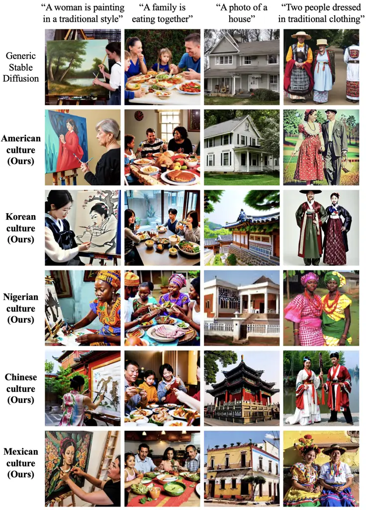
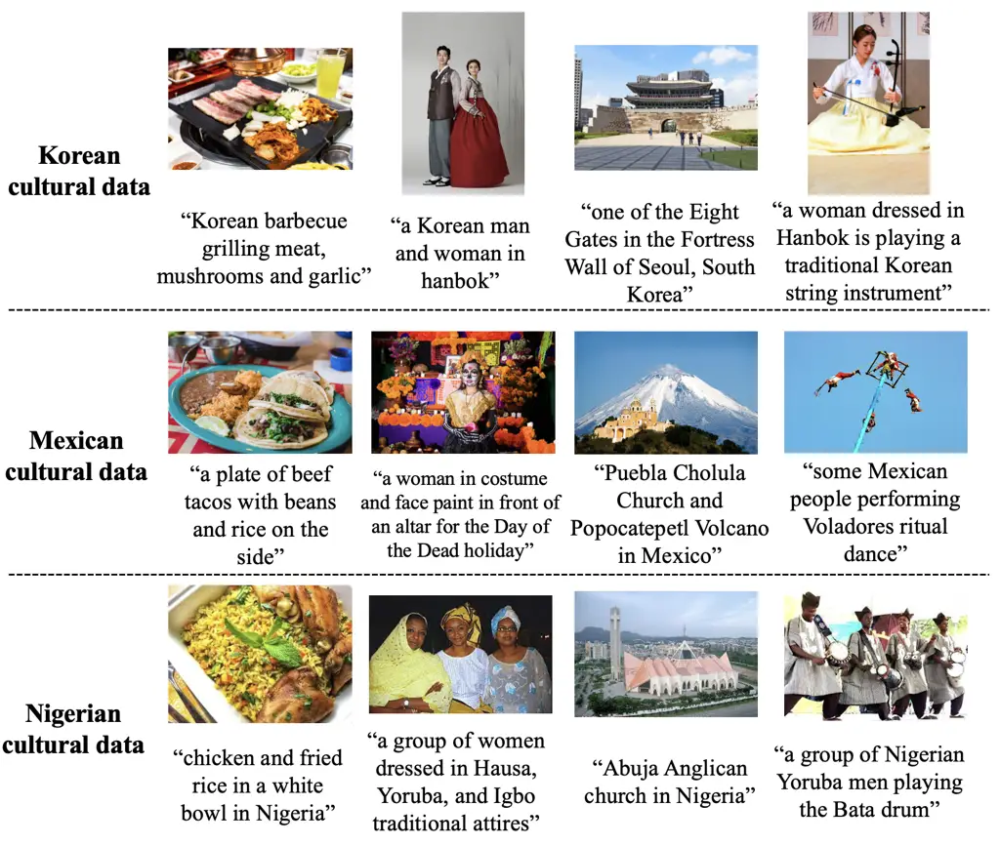
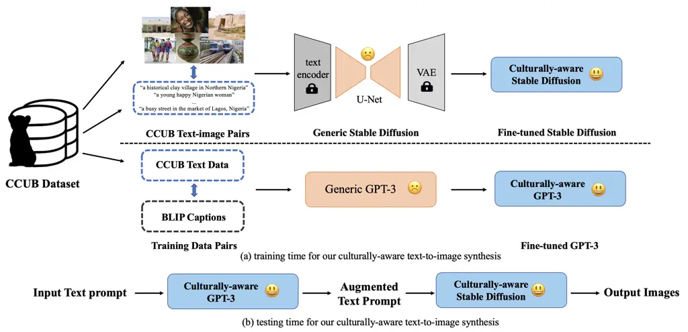
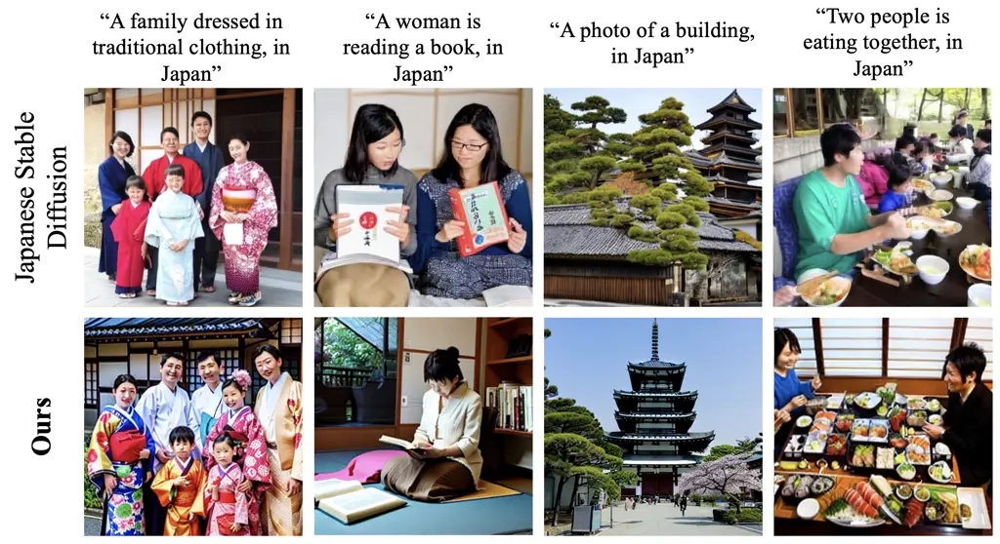
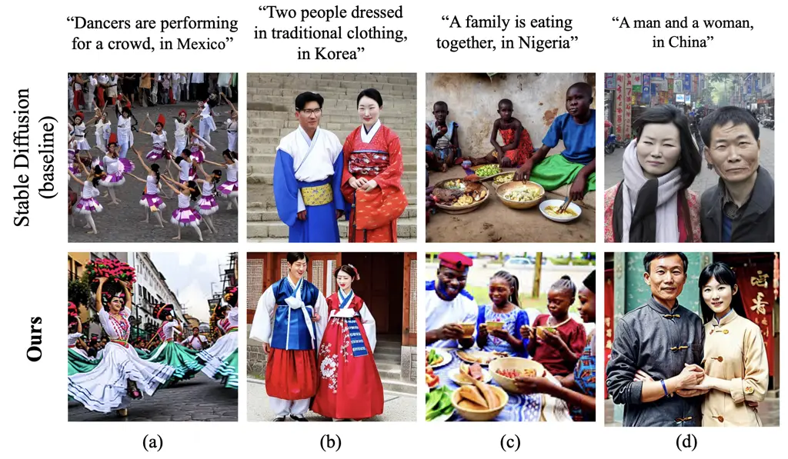
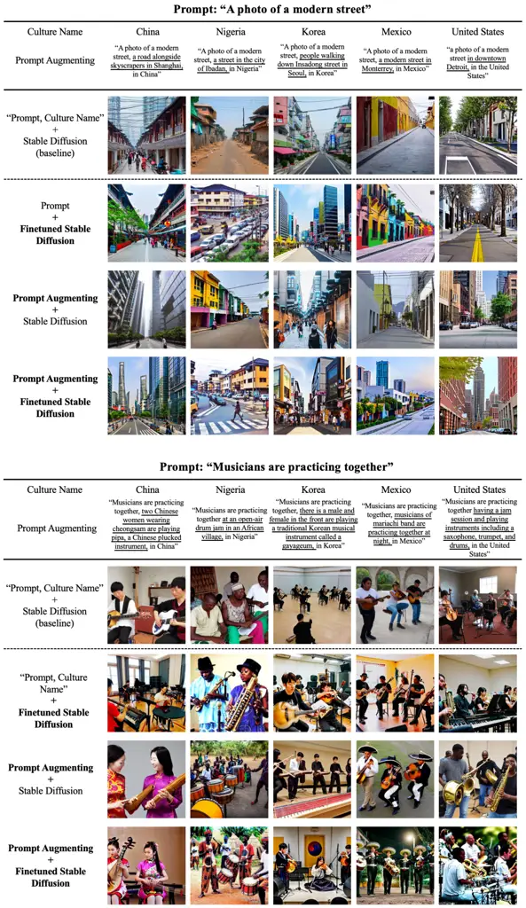
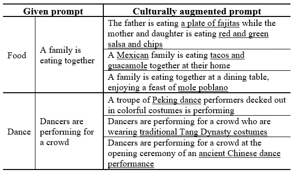
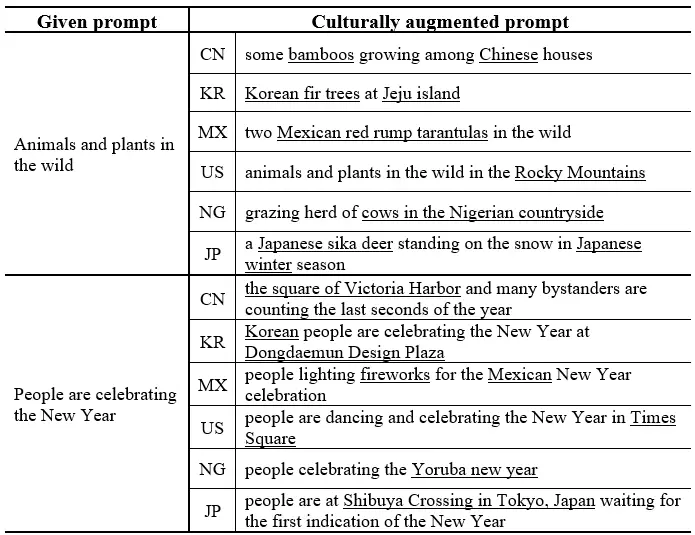
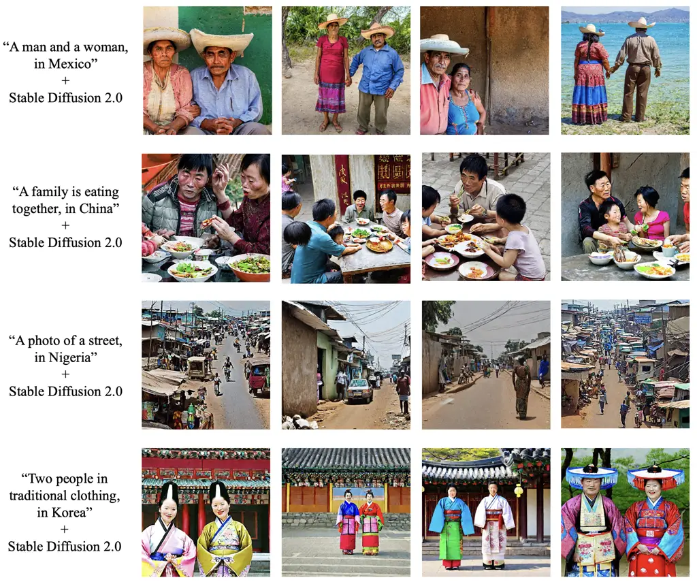
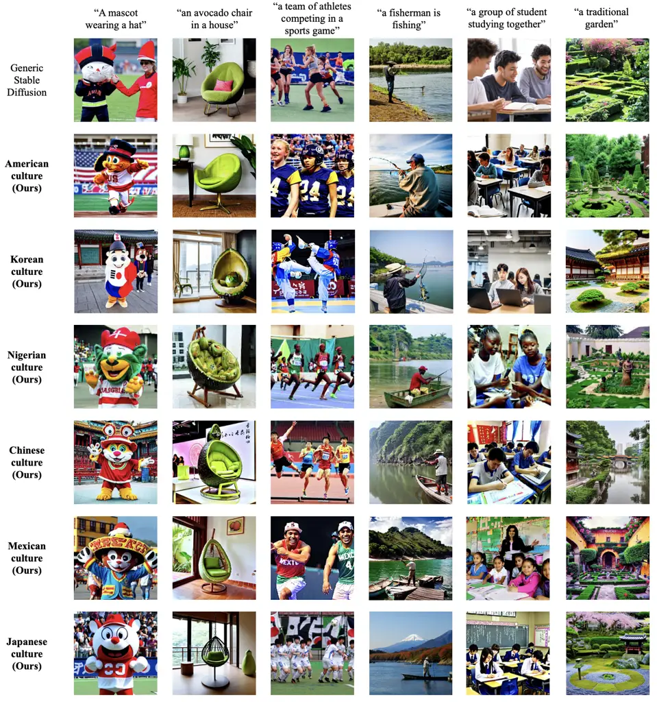

# Towards Equitable Representation in Text-to-Image Synthesis Models with the Cross-Cultural Understanding Benchmark (CCUB) Dataset

Zhixuan Liu ^(†)^(†)thanks: indicates equal contribution. Affiliation: 
The Robotics Institute, Carnegie Mellon University Email: <%7Bzhixuan2>
   Youeun Shin ¹¹footnotemark: 1 Affiliation:  The Robotics Institute,
Carnegie Mellon University Affiliation:  Department of Artificial
Intelligence, Dongguk University Email: <youeuns>    Beverley-Claire
Okogwu Affiliation:  The Robotics Institute, Carnegie Mellon University
Email: <bokogwu>    Youngsik Yun Affiliation:  The Robotics Institute,
Carnegie Mellon University Affiliation:  Department of Artificial
Intelligence, Dongguk University Email: <youngsiy>    Lia Coleman
Affiliation:  The Robotics Institute, Carnegie Mellon University
Email: <liac>    Peter Schaldenbrand ^(†)^(†)thanks: indicates
corresponding authors. Affiliation:  The Robotics Institute, Carnegie
Mellon University Email: <pschalde%7D@andrew.cmu.edu>    Jihie Kim
²²footnotemark: 2 Affiliation:  Department of Artificial Intelligence,
Dongguk University Email: [  
jihie.kim@dgu.edu](mailto:jihie.kim@dgu.edu)    Jean Oh ²²footnotemark:
2 Affiliation:  The Robotics Institute, Carnegie Mellon University
Email: <jeanoh@cmu.edu>

###### Abstract

It has been shown that accurate representation in media improves the
well-being of the people who consume it. By contrast, inaccurate
representations can negatively affect viewers and lead to harmful
perceptions of other cultures. To achieve inclusive representation in
generated images, we propose a culturally-aware priming approach for
text-to-image synthesis using a small but culturally curated dataset
that we collected, known here as Cross-Cultural Understanding Benchmark
(CCUB) Dataset, to fight the bias prevalent in giant datasets. Our
proposed approach is comprised of two fine-tuning techniques: (1) Adding
visual context via fine-tuning a pre-trained text-to-image synthesis
model, Stable Diffusion, on the CCUB text-image pairs, and (2) Adding
semantic context via automated prompt engineering using the fine-tuned
large language model, GPT-3, trained on our CCUB culturally-aware text
data. CCUB dataset is curated and our approach is evaluated by people
who have a personal relationship with that particular culture. Our
experiments indicate that priming using both text and image is effective
in improving the cultural relevance and decreasing the offensiveness of
generated images while maintaining quality. Our CCUB dataset and codes¹¹
1 [https://github.com/cmubig/CCUB](https://github.com/cmubig/CCUB) are
publicly available.

## 1 Introduction



Figure 1: Sample images generated for five different countries by our
proposed culturally-aware text-to-image synthesis approach; the images
in the first row show the results from the generic Stable Diffusion as
references.

Representation matters. In media, studies repeatedly show that
representation affects the well-being of its viewers Shaw (2010);
Caswell et al. (2017); Elbaba (2019). Representation can positively
affect viewers by providing them with role models that they identify
with, but it can also negatively affect viewers by creating harmful,
stereotypical understandings of people and culture Castañeda (2018).
When people are accurately represented in media, it allows people to
properly understand cultures without harmful stereotypes forming Dixon
and Linz (2000); Mastro and Greenberg (2000). Despite the benefits of
representation, many media generating Artificial Intelligence (AI)
models show poor representation in their results Ntoutsi et al. (2020).
Many of these issues stem from their large training datasets which are
gathered by crawling the Internet without filtering supervision and
contain malign stereotypes and ethnic slurs among other problematic
content Birhane et al. (2021).

As AI models are increasingly used to create and aid in the production
of visual content, it is important that the models have a true
understanding of culture such that it can give accurate and proper
representation leading to well-being rewards for its consumers. In this
paper, we aim to address such a representation issue in image generation
and introduce a new task of culturally-aware image synthesis: generating
visual content within a cultural context that is both accurate and
inoffensive. Our overarching goal is to improve the well-being of
consumers of the AI generated images with particular attention to those
consumers from underrepresented groups. Specifically, we formulate the
culturally-aware text-to-image synthesis task to take an additional
input of a country name to specify a cultural context in addition to
language description.

It was found that large datasets such as the LAION-5B Schuhmann et al.
(2021) used to train many text-to-image synthesis models such as Stable
Diffusion Rombach et al. (2021) are Anglo-centric and
Euro-centric Birhane et al. (2021) as shown in the top row of Figure 1.
As a consequence, these powerful models may generate culturally
offensive images due to misrepresentation during training. Our research
question is, how can effective existing text-to-image models be improved
to become more culturally representative and thus less offensive? It may
be infeasible to vet billions of training examples for accurate cultural
content.

We hypothesize that a small dataset that is veritably representative of
a culture can be used to prime pre-trained text-to-image models to guide
the model towards more culturally accurate content creation. To verify
the hypothesis, we collected a dataset of image and caption pairs for 8
cultures. For each culture, data was collected by a few people who are
native of that culture as they are the people who properly understand it
and are most affected by its misrepresentations. We call this the
Cross-Cultural Understanding Benchmark (CCUB) dataset which comprises of
100-200 images each with a manually written caption as shown in
Figure 2.

We propose two techniques for enhancing the text-to-image pipelines
using CCUB. First, we fine-tune a text-to-image synthesis model, Stable
Diffusion, on the CCUB text-image pairs to generate images tailored for
a given cultural context. Second, we create an automatic prompt
augmenting approach using GPT-3 Brown et al. (2020) fine-tuned on CCUB
to include culturally relevant details, e.g., “Two people walking down a
street” can be augmented with “using WeChat Pay to pay a bus ticket, in
Shenzhen, China.”

We evaluate our approach’s two components individually as well as
combined against the baseline of simply specifying the culture in the
text prompt. Our evaluation was performed by native people of each
country. Our survey results based on 2,244 image comparisions conducted
by 72 participants from 5 countries indicate that our proposed approach
is both less offensive and more cultural relevant than simply adding the
country name as a suffix to the prompt. Our contributions are as
follows:

1.  1.  The introduction of culturally-aware text-to-image synthesis as a
        valuable task within text-to-image synthesis;
2.  2.  The Cross-Cultural Understanding Benchmark (CCUB) dataset consisting
        of 1,095 culturally representative image-text pairs across 8
        countries; and
3.  3.  Two techniques for culturally customizing a text-to-image synthesis
        model.

## 2 Related Work

### 2.1 Cultural Datasets

Various efforts have been made to build a dataset that contains a
precise representation of each culture around the world, especially for
the underrepresented groups and smaller populations, to combat the bias
of benchmark datasets. MaRVL dataset Liu et al. (2021) created a set of
cultures and languages, including Indonesian, Swahili, Tamil, Turkish,
and Mandarin Chinese, comprised of diverse cultural concepts to mitigate
existing North American or Western European bias. While sharing the
similar intuition, MaRVL was specifically developed for the reasoning
task covering common, popular concepts only.

Dollar Street Rojas et al. (2022) aimed to capture accurate demographic
information based on socioeconomic features, such as everyday household
items and monthly income, of 63 countries worldwide. However, this
dataset gives less diverse scenarios. Most of the images in this dataset
provide indoor views with limited cultural features.

### 2.2 Culturally Conditioned Machine Learning

Accurately representing culture with Machine Learning is an open
challenge. Many models, such as Craiyon Dayma et al. (2021) fail to
capture certain distinguishing features relating to a country’s dominant
culture Reviriego and Merino-Gómez (2022). One method to address this
involves the inclusion of semantic understanding in a model such as the
ERNIE-ViLG 2.0. Feng et al. (2022). A similar approach can be seen in
Japanese Stable Diffusion Shing and Sawada (2022), which fine tunes the
Stable Diffusion U-Net and retrains the text encoder on the 100 million
images with Japanese caption within the LAION-5B Schuhmann et al. (2021)
dataset.

While these approaches produce better cultural representations of Japan
and China, it is not easy to be used universally. Adapting these
approaches requires millions of training examples which cannot be easily
met for cultures with less internet presence. Also, these datasets are
so large that it is infeasible to vet them for harmful and stereotypical
information. Our approach strives for cultural representation using a
dataset that is smaller (100-200 images) and hand selectable.

### 2.3 Modifying Text-to-Image Diffusion Models

Diffusion-based text-to-image synthesis models have improved incredibly
over the past year in image quality and language understanding; however,
these models are still Anglo-centric and contain gender and racial
biases at least in part due to the lack of supervision in their large
text-image training datasets Birhane et al. (2021). One way to address
this problem while leveraging the knowledge obtained from the large
dataset is to fine-tune the latent diffusion models.  Ruiz et al. (2022)
and  Gal et al. (2022) propose textural inversion methods that allow the
latent diffusion models to generate images with specific visual
concepts. However, these methods restrict the generation to be an object
or a style and cannot generalize on the expression of abstract concepts,
for example, a culture. Inspired by the approaches of  Chambon et al.
(2022) and  Pinkney (2022), the text-to-image diffusion model can
generate domain-specific images by fine-tuning the U-Net of the model
using a batch of data from that domain.

### 2.4 Prompt Engineering

Originating from the field of Natural Language Processing (NLP), prompt
engineering, which can be conceived as programming in natural
language Reynolds and McDonell (2021), is to design the input text
prompt to retrieve user-desired outcomes from language models. Inspired
by the findings in the NLP domain, researchers in computer vision have
been exploring the effects of prompt engineering. In order to present
design guidelines for better outcomes in text-to-image generation
models Liu and Chilton (2022), several permutations of prompt
engineering using a template were conducted in terms of subject and
style in art. To discover some tricks and keywords to boost the quality
of the output image in the image generation models such as DALL-E
2 Ramesh et al. (2022) and Midjourney Midjourney (2022), various
experiments through trial-and-error are ongoing on the Internet as well.
Online community Taylor (2022) has come up with a prompt engineering
template for artwork, consisting of terms regarding styles, artists,
vibes, and perspectives.

## 3 Cross-Cultural Understanding Benchmark (CCUB) Dataset

[TABLE]

Table 1: This table shows the scale of our CCUB dataset. The number of
hand-selected images and their corresponding captions in nine cultural
categories for eight different cultures are listed.



Figure 2: Images and captions in our CCUB dataset for three of the eight
countries whose cultures are represented in CCUB.

Our CCUB dataset provides text-image pairwise data across 8 cultures and
is designed for text-to-image synthesis tasks. For each culture subset,
the proposed dataset contains images among various scenarios. Moreover,
the text data concisely describes the culturally aware content of each
image thus giving the language model a clear guide towards cultural
awareness.

### 3.1 Culturally Representative Data Collection

Following the definition of culture in Halpern (1955) and Key and Comrie
(2021), nine categories are used to represent cultural elements in our
dataset: food & drink, clothing, artwork, dance and music, religion,
architecture, people, city and nature. The categories are further
divided into traditional and modern to reflect a characteristic of the
culture that culture changes over time.

Our CCUB image are collected based on the nine cultural categories. For
collection, we recruited cultural experts who confidently know this
culture well or belong to it. Cultural experts are asked to collect
10-20 relevant images containing different objects for each cultural
category. The images were collected either from Creative Commons
licensed images from Google searches or the collectors own photographs.
Cultural experts were also asked to select images with common or
culturally representative items.

Each image in the CCUB dataset is also captioned by cultural experts
forming paired image-text data. Cultural experts were asked to focus on
the general and specific items in each cultural image, rather than
adding captions to subtle components of the image. The captions
accurately express cultural contents in English as opposed to large
datasets such as LAION Schuhmann et al. (2021) which are scraped from
the internet and not vetted for cultural accuracy.

### 3.2 Properties

Our CCUB dataset contains culturally representative image-text pairs in
eight different cultures. As shown in Table 1, our cultural dataset is
in a minute scale considering that generic Stable Diffusion was trained
on LAION-2B-EN that includes more than 2.3 billion text-image pairs. Our
table Figure 2 shows some selected samples of our CCUB dataset.

## 4 Culturally-aware Text-to-image Synthesis



Figure 3: Figure (a) is the overview of our two fine-tuning techniques
based on our CCUB dataset. Models with cultural biases are marked by sad
faces, while culturally-aware models are marked by smiling faces. Figure
(b) is the workflow for our approach toward culturally-aware
text-to-image synthesis.

### 4.1 Fine-tuning Stable Diffusion

The Stable Diffusion Rombach et al. (2021) pipeline generates natural
images under the condition of text prompts. The input text prompt is
firstly encoded using the CLIP Radford et al. (2021) text encoder. A
U-Net architecture model creates the output image encoding by denoising
from random noise conditioned upon the encoded text. A Variational
Autoencoder (VAE) converts the image encoding into a high-resolution
image.

We alter Stable Diffusion to have a more accurate understanding of a
given culture to address its known bias towards generating
Western-focused imagery. In our approach, following a similar approach
to Ruiz et al. (2022) and  Chambon et al. (2022), the U-Net of the
Stable Diffusion model is further trained on our CCUB image-text pairs
while keeping the text encoder and autoencoder (VAE) frozen. The
fine-tuning of U-Net is equivalent to the training process of original
Latent Diffusion Models (LDMs): by minimizing the LDM loss in several
denoising time steps. The LDM loss is given by:

```math
L_{LDM}:=E_{z\sim\mathcal{E}(x),y,\epsilon\sim\mathcal{N}(0,1),t}\left[\left\|\epsilon-\epsilon_{\theta}\left(z_{t},t,c\right)\right\|_{2}^{2}\right]
```

where $`t`$ is the time step; $`z_{t}`$, the latent noise at time $`t`$;
$`c`$, the text encoding of a text prompt; $`\epsilon`$, the noise
sample; and $`\epsilon_{\theta}`$, the noise estimating U-Net model.

Implementation detail: We set the learning rate to be small (e.g., 1e-5)
to slightly change parameters of the U-Net, and we run 150 epochs on the
culturally representative CCUB image-text data pairs to fine-tune one
Stable Diffusion. This generally leads to convergence of the images
produced by our fine-tuned Stable Diffusion toward our culturally-aware
training data.

### 4.2 Prompt Augmenting

To enhance the richness of cultural representation in the text domain,
we propose an approach to automatically augment the given text prompt
with a fine-tuned large language model, trained further based on our
culturally representative text data. Whereas current prompt augmentation
in text-to-image synthesis is processed in a fixed set of manual
templates, we benefit from the prior knowledge and generative ability of
GPT-3 Brown et al. (2020) to describe the components of a specific
culture in a more detailed way.

First, we prepare the training dataset for fine-tuning GPT-3 with pairs
of a base prompt without culturally specific words and its corresponding
culturally-aware prompt. We use BLIP Li et al. (2022), a unified
vision-language understanding and generation model, to automatically
caption our CCUB images. The four most relevant captions are generated
per image, two based on beam search and the others by nucleus sampling,
respectively. We then choose the best matching caption that shows the
highest CLIP Radford et al. (2021) score. The BLIP captioning had some
errors, such as cultural misinterpretation, meaningless and repetitive
words, or miscounted numbers. Such flaws are manually corrected before
being used as the base prompt in pairs with our CCUB text captions.

We then fine-tune the largest GPT-3, Davinci, to translate between the
BLIP captions and the CCUB captions. During fine-tuning, the model
learns the latent concept of the specific cultural content and text
format that needs to be generated. The base prompt is concatenated with
“`\n\n###\n\n`” as a separator token, and “`\nEND`” is appended to
complete the text as the stop token. During inference, we sample
culturally augmented prompts given new input prompts using
`temperature=0.7`. Examples of augmented prompts are underlined in the
row of prompt augmenting in Figure 6.

## 5 Experiments

We produced surveys to evaluate the effectiveness of our two proposed
techniques for culturally-aware text-to-image synthesis and compare them
to a baseline of simply appending the culture to the prompt, e.g., “A
family eating dinner , China.” and using an existing text-to-image
model.

In setting up our study, we consider a comparative structure between
images: the baseline image versus another image from our results. The
setup of a single question in our survey was as follows: Given two
images, the participant selects which image best fits three given
comparative properties. The properties analyzed were: (1) Text and Image
Alignment: Participants are given a text prompt and consider which of
the two images is more similar to the prompt; (2) Cultural Alignment:
Participants decide which of the two images is a better representation
of the country’s culture; and (3) Offensiveness: Participants consider
which of the two images is more offensive to them.

The participants for the study were selected based on whether they had a
personal understanding of the culture for which the images in the survey
were generated. Participants were recruited among university students,
friends, and family members of the authors. It was ensured that the
participants would not be able to discern the approaches used to
generate the compared images by randomizing the order of questions and
images in the survey.

## 6 Results

### 6.1 Baselines



Figure 4: Compare between our (fine-tuned Stable Diffusion with prompt
augmenting) method with Japanese Stable Diffusion. Top row shows the
language input used to generate images.



Figure 5: Comparison between Stable Diffusion and our approach with
prompt augmentation and fine-tuning of Stable Diffusion method. The top
row shows the language input used to generate images.



Figure 6: An ablation study of our proposed approach to culturally-aware
text-to-image synthesis. The augmented prompts are underlined.

Japanese Stable Diffusion: We compare our approach with Japanese Stable
Diffusion Shing and Sawada (2022) in Figure 4. Both approaches achieve
similar results in terms of image-text alignment and culturally relevant
information such as clothing, architecture, and food. While both
approaches are qualitatively similar, the Japanese Stable Diffusion
model was trained on 100 million Japanese image-text pairs for training
while ours required only 100-200.

Stable Diffusion: As a baseline, we used Stable Diffusion by simply
adding a culture name as a suffix to the text prompt. The results in
Figure 5 show that this approach fails to capture cultural identity and
instead produces many culturally biased images. We qualitatively report
the following three issues: (1) The baseline method generates images
with elements that are still in the Western form as in Figure 5 (a),
where the baseline method generated dancers performing Western ballet
dance when the desired cultural context was Mexican, while ours is able
to generate images with more representative Mexican elements. (2) The
baseline method exhibits cultural misunderstanding, as shown in Figure 5
(b), where images of Japanese style clothing was generated when the
desired cultural context was Korean. (3) The baseline generates images
that incorporate cultural stereotypes and discrimination, as in Figure 5
(c), the image generated by the baseline approach contains cultural
biases and discrimination, failing to represent modern Nigerian culture.
Also, in column (d), the baseline-generated image contains offensive,
stereotypical elements of Chinese culture, especially in the facial
features of the characters. All three of these issues are mitigated in
our culturally-aware text-to-image synthesis approach.

[TABLE]

Table 2: Percentage preference between the two proposed techniques
(individual and combined) versus the baseline in our survey (Section
 5).

### 6.2 Qualitative Results

Qualitative results from our two approaches versus a baseline are in
Figure 6. The augmented prompts are displayed at the top of each example
and add culturally specific information to the prompts such as the city
of Ibadan to a Nigerian prompt. These augmented prompts can generally
help guide Stable Diffusion to generate something more culturally
relevant given a text prompt without specific cultural information.

In general, faces in the fined tuned Stable Diffusion model look more
natural as seen in the musicians examples of Figure 6. Many of the
Stable Diffusion examples appear older photographs, and the fine-tuning
helps give the images a more contemporary appearance. Fine-tuning also
provides Stable Diffusion with additional image synthesis content
capabilities, e.g., the baseline model was unable to produce the Chinese
pipa instrument without the fine-tuning as seen in the lower left of
Figure  6.

Prompt augmentation had the ability to make aspects of the given text
prompt more prevalent. In the top example of Figure 6, the augmented
information added to the prompts all contained clues to guide Stable
Diffusion to create a more modern looking image of a street in the
different cultures.

### 6.3 Quantitative Results

Following our experimental setup detailed in Section 5, we present our
results from our survey in Table 2. We included five countries in our
survey based on the number of evaluators we could recruit: China,
Mexico, Korea, the United States, and Nigeria. Overall, 72 people
participated in the surveys with 2,244 image comparisons made.

Fine-Tuned Stable Diffusion The top row of Table 2 shows our survey
results for our fine-tuned Stable Diffusion model versus the baseline.
This approach greatly improved all three metrics overall; text-image
alignment and cultural alignment were increased and offensiveness
greatly decreased.

Prompt Augmentation Prompt augmentation greatly improved cultural
alignment over the baseline; however, the images were found to be
equally offensiveness to the baseline.

Combined Our combined approach is better than the baseline in all three
metrics. It finds a middle-ground in performance versus its individual
parts for text-image alignment and offensiveness; however, overall it
performs best in cultural-alignment.

## 7 Discussion

In our ablation survey results shown in Table 2, we found that prompt
augmentation decreased text-image alignment. Prompt augmentation makes
alterations to the given prompt as seen in Figure 6 which we believe
contributes to the text-image alignment performance diminishment. The
augmentation is designed to add culturally relevant information to the
prompt, but this added information does not necessarily overlap with the
content that Stable Diffusion is capable of generating. For example, in
Figure 6, the middle column of the bottom example adds the Korean
instrument “gayageum” to the text prompt with augmentation. The
generated images failed to accurately depict a gayageum which hurts the
text-image alignment when compared to to the baseline result which did
not include that instrument.

Combining prompt augmenting with our fine-tuned Stable Diffusion model
performed better in cultural alignment than the two techniques
separately. We hypothesize that the fine-tuned Stable Diffusion learnt
concepts that were relevant to the information that the prompt
augmentation added, therefore, expanding the content that Stable
Diffusion can generate as in the Chinese Pipa instrument example.
Further experiments are needed to thoroughly explain this result.

### 7.1 Limitations

Our two proposed approaches for adapting an existing text-to-image model
to be more culturally relevant were successful versus a baseline and
Japanese Stable Diffusion; however, we believe that there is more
progress to be made. In particular, having guarantees on avoiding
offensive generated images is paramount to having trust in using these
systems in the wild.

Our representation of culture is nation based in this paper. Most
nations have multiple cultures, and culture can exist outside of
geographic borders.

The current version of CCUB dataset was adequate for our experimental
purposes. To further improve the quality of CCUB, the number of cultural
experts would need to be increased to cross-validate the data.

In future work, we look to adapt our method to allow for a more personal
sense of culture where a user of the system can upload their own visual
and textual data according to their own culture to tailor the
text-to-image system to themselves.

## 8 Conclusion

We introduce the task of culturally-aware image synthesis and present
its importance based on literature results demonstrating the importance
of accurate representation in media. As artificial intelligence improves
and is used to produce more visual content, cultural representation
within this generated media is increasingly important.

To support culturally-aware text-to-image synthesis we collected the
Cross-Cultural Understanding Benchmark (CCUB) dataset consisting of
images and captions for 8 different country’s cultures collected by
people who are a part of each of those cultures. We present two
techniques for using this data to alter an existing text-to-image model
to be less offensive and more culturally relevant. Our two techniques
alone and combined outperform a baseline of specifying the culture in
the text prompt.

Towards equitable representation in text-to-image synthesis, we plan to
continue building CCUB to include more cultures in the future.

## Ethical Statement

While our approach to culturally-aware text-to-image synthesis shows
promise in mitigating offensiveness and accurately representing culture,
it can still make mistakes and show harmful stereotypes. Additionally,
the model still carries over other forms of bias such as gender and
racial biases that the large text-to-image models are known to have. For
these reasons, we would not recommend this work to be used for cases
where people could be harmed by the generated images.

## Acknowledgments

This work is in part supported by NSF IIS-2112633. Youeun Shin, Youngsik
Yun, and Jihie Kim were supported by the MSIT (Ministry of Science,
ICT), Korea, under the High-Potential Individuals Global Training
Program (RS-2022-00155054) supervised by the IITP (Institute for
Information & Communications Technology Planning & Evaluation) (50%).

We would like to thank Ingrid Navarro, Nariaki Kitamura, Sindre Stoe
Hobber, Huy Quyen Ngo, Yu Chen, and many others for their help with our
CCUB dataset.

## References

- Birhane et al. \[2021\] Abeba Birhane, Vinay Uday Prabhu, and Emmanuel
  Kahembwe. Multimodal datasets: misogyny, pornography, and malignant
  stereotypes. arXiv preprint arXiv:2110.01963, 2021.
- Brown et al. \[2020\] Tom B. Brown, Benjamin Mann, Nick Ryder, Melanie
  Subbiah, Jared Kaplan, Prafulla Dhariwal, Arvind Neelakantan, Pranav
  Shyam, Girish Sastry, Amanda Askell, Sandhini Agarwal, Ariel
  Herbert-Voss, Gretchen Krueger, T. J. Henighan, Rewon Child, Aditya
  Ramesh, Daniel M. Ziegler, Jeff Wu, Clemens Winter, Christopher Hesse,
  Mark Chen, Eric Sigler, Mateusz Litwin, Scott Gray, Benjamin Chess,
  Jack Clark, Christopher Berner, Sam McCandlish, Alec Radford, Ilya
  Sutskever, and Dario Amodei. Language models are few-shot learners.
  ArXiv, abs/2005.14165, 2020.
- Castañeda \[2018\] Mari Castañeda. The power of (mis) representation:
  Why racial and ethnic stereotypes in the media matter. Challenging
  inequalities: Readings in race, ethnicity, and immigration, 2018.
- Caswell et al. \[2017\] Michelle Caswell, Alda Allina Migoni, Noah
  Geraci, and Marika Cifor. ‘to be able to imagine otherwise’: community
  archives and the importance of representation. Archives and Records,
  38(1):5–26, 2017.
- Chambon et al. \[2022\] Pierre Chambon, Christian Bluethgen, Curtis P
  Langlotz, and Akshay Chaudhari. Adapting pretrained vision-language
  foundational models to medical imaging domains. arXiv preprint
  arXiv:2210.04133, 2022.
- Dayma et al. \[2021\] Boris Dayma, Suraj Patil, Pedro Cuenca, Khalid
  Saifullah, Tanishq Abraham, Phúc Lê Khac, Luke Melas, and Ritobrata
  Ghosh. Dall· e mini. 2021.
- Dixon and Linz \[2000\] Travis L Dixon and Daniel Linz.
  Overrepresentation and underrepresentation of african americans and
  latinos as lawbreakers on television news. Journal of communication,
  50(2):131–154, 2000.
- Elbaba \[2019\] Rawan Elbaba. Why on-screen representation matters,
  according to these teens. PBS NewsHour, 14, 2019.
- Feng et al. \[2022\] Zhida Feng, Zhenyu Zhang, Xintong Yu, Yewei Fang,
  Lanxin Li, Xuyi Chen, Yuxiang Lu, Jiaxiang Liu, Weichong Yin, Shikun
  Feng, et al. Ernie-vilg 2.0: Improving text-to-image diffusion model
  with knowledge-enhanced mixture-of-denoising-experts. arXiv preprint
  arXiv:2210.15257, 2022.
- Gal et al. \[2022\] Rinon Gal, Yuval Alaluf, Yuval Atzmon,
  Or Patashnik, Amit H Bermano, Gal Chechik, and Daniel Cohen-Or. An
  image is worth one word: Personalizing text-to-image generation using
  textual inversion. arXiv preprint arXiv:2208.01618, 2022.
- Halpern \[1955\] Ben Halpern. The dynamic elements of culture. Ethics,
  65(4):235–249, 1955.
- Key and Comrie \[2021\] Mary Ritchie Key and Bernard Comrie, editors.
  IDS. Max Planck Institute for Evolutionary Anthropology,
  Leipzig, 2021.
- Li et al. \[2022\] Junnan Li, Dongxu Li, Caiming Xiong, and Steven
  C. H. Hoi. Blip: Bootstrapping language-image pre-training for unified
  vision-language understanding and generation. In International
  Conference on Machine Learning, 2022.
- Liu and Chilton \[2022\] Vivian Liu and Lydia B. Chilton. Design
  guidelines for prompt engineering text-to-image generative models.
  Proceedings of the 2022 CHI Conference on Human Factors in Computing
  Systems, 2022.
- Liu et al. \[2021\] Fangyu Liu, Emanuele Bugliarello, E. Ponti, Siva
  Reddy, Nigel Collier, and Desmond Elliott. Visually grounded reasoning
  across languages and cultures. ArXiv, abs/2109.13238, 2021.
- Mastro and Greenberg \[2000\] Dana E Mastro and Bradley S Greenberg.
  The portrayal of racial minorities on prime time television. Journal
  of Broadcasting & Electronic Media, 44(4):690–703, 2000.
- Midjourney \[2022\] Midjourney. Midjourney, 2022.
- Ntoutsi et al. \[2020\] Eirini Ntoutsi, Pavlos Fafalios, Ujwal
  Gadiraju, Vasileios Iosifidis, Wolfgang Nejdl, Maria-Esther Vidal,
  Salvatore Ruggieri, Franco Turini, Symeon Papadopoulos, Emmanouil
  Krasanakis, et al. Bias in data-driven artificial intelligence
  systems—an introductory survey. Wiley Interdisciplinary Reviews: Data
  Mining and Knowledge Discovery, 10(3):e1356, 2020.
- Pinkney \[2022\] Justin Pinkney. Text to pokemon generator, 2022.
- Radford et al. \[2021\] Alec Radford, Jong Wook Kim, Chris Hallacy,
  Aditya Ramesh, Gabriel Goh, Sandhini Agarwal, Girish Sastry, Amanda
  Askell, Pamela Mishkin, Jack Clark, Gretchen Krueger, and Ilya
  Sutskever. Learning transferable visual models from natural language
  supervision. CoRR, abs/2103.00020, 2021.
- Ramesh et al. \[2022\] Aditya Ramesh, Prafulla Dhariwal, Alex Nichol,
  Casey Chu, and Mark Chen. Hierarchical text-conditional image
  generation with clip latents. ArXiv, abs/2204.06125, 2022.
- Reviriego and Merino-Gómez \[2022\] Pedro Reviriego and Elena
  Merino-Gómez. Text to image generation: Leaving no language behind.
  arXiv preprint arXiv:2208.09333, 2022.
- Reynolds and McDonell \[2021\] Laria Reynolds and Kyle McDonell.
  Prompt programming for large language models: Beyond the few-shot
  paradigm. In Extended Abstracts of the 2021 CHI Conference on Human
  Factors in Computing Systems. Association for Computing
  Machinery, 2021.
- Rojas et al. \[2022\] William Gaviria Rojas, Sudnya Diamos,
  Keertan Ranjan Kini, David Kanter, and Vijay Janapa Reddi. The dollar
  street dataset: Images representing the geographic and socioeconomic
  diversity of the world. 2022.
- Rombach et al. \[2021\] Robin Rombach, Andreas Blattmann, Dominik
  Lorenz, Patrick Esser, and Björn Ommer. High-resolution image
  synthesis with latent diffusion models, 2021.
- Ruiz et al. \[2022\] Nataniel Ruiz, Yuanzhen Li, Varun Jampani, Yael
  Pritch, Michael Rubinstein, and Kfir Aberman. Dreambooth: Fine tuning
  text-to-image diffusion models for subject-driven generation. arXiv
  preprint arXiv:2208.12242, 2022.
- Schuhmann et al. \[2021\] Christoph Schuhmann, Richard Vencu, Romain
  Beaumont, Robert Kaczmarczyk, Clayton Mullis, Aarush Katta, Theo
  Coombes, Jenia Jitsev, and Aran Komatsuzaki. Laion-400m: Open dataset
  of clip-filtered 400 million image-text pairs. arXiv preprint
  arXiv:2111.02114, 2021.
- Shaw \[2010\] Adrienne Shaw. Identity, identification, and media
  representation in video game play: An audience reception study. PhD
  thesis, University of Pennsylvania, 2010.
- Shing and Sawada \[2022\] Makoto Shing and Kei Sawada. Japanese stable
  diffusion. 2022.
- Taylor \[2022\] Michael Taylor. Prompt engineering: From words to
  art, 2022.

## Appendix

### Prompt Augmenting

In this section, we describe the flexibility of our prompt engineering
approach with several samples of augmentation outputs. We demonstrate
that our approach can augment a given prompt in various ways. Some
examples of food and dance in Mexican and Chinese culture, respectively,
are listed in Figure 7. The augmenting process adds semantic description
in detail as well as the cultural context of the corresponding culture.
It is shown that our approach can supplement the information that is not
in our training data, benefiting from the immense knowledge of GPT-3.



Figure 7: Variety of augmented prompts for Mexican food and Chinese
dance. The cultural-specific words are underlined. The prompt used for
fine-tuned Stable Diffusion is a given prompt plus a culturally
augmented prompt appended by its culture name.

Our fine-tuned large language model is also capable of generating
relevant cultural context beyond the defined nine cultural categories.
As shown in Figure 8, we try two types of new cultural elements, nature
in the wild and a new year celebration, out of the nine categories.
Prompt augmented results for all six cultures we address in our paper
consist of explicit cultural context, such as well-known cultural
landmarks and species originating from those cultures.



Figure 8: Examples of augmented outputs beyond our cultural categories
in the order of China, Korea, Mexico, the United States, Nigeria, and
Japan. The cultural-specific words are underlined.

### Additional Culturally-aware Text-to-image Synthesis Results

In Figure 10, more results of our approach to achieving culturally-aware
images given a text prompt appended by a culture name are shown. We
prove the generalizability of our model conditioned on diverse text
prompts and demonstrate that our approach is able to generate culturally
aligned images within and beyond the nine categories we defined for a
culture.

### Cultural Bias in Stable Diffusion 2

In our approach, we fine-tune Stable Diffusion Rombach et al. \[2021\]
version 1.4. While Stable Diffusion 2.0 has been released recently,
intrinsic cultural biases yet commonly exist. In Figure 9, we show
randomly generated images based on four prompts. We claim that Stable
Diffusion 2.0: 1) generates images containing stereotypes for different
cultures: in the first and second row in Figure 9, the facial
expressions for Chinese and Mexican culture are stereotypical and
offensive; 2) generates discriminative items: given the prompt “A photo
of a street, in Nigeria”, Stable Diffusion 2.0 is also prone to generate
old-looking and discriminative images for Nigerian culture; 3) contains
cultural misrepresentations: in the images with the prompt “Two people
in traditional clothing, in Korea”, the traditional clothing is more in
a Japanese style instead of Korean style.



Figure 9: Random samples generated by generic Stable Diffusion version
2.0. The first column shows the prompts.



Figure 10: More results of our approach to achieving culturally-aware
text-to-image synthesis for six cultures. The first row is the text
prompts used, the first column is the culture condition.
