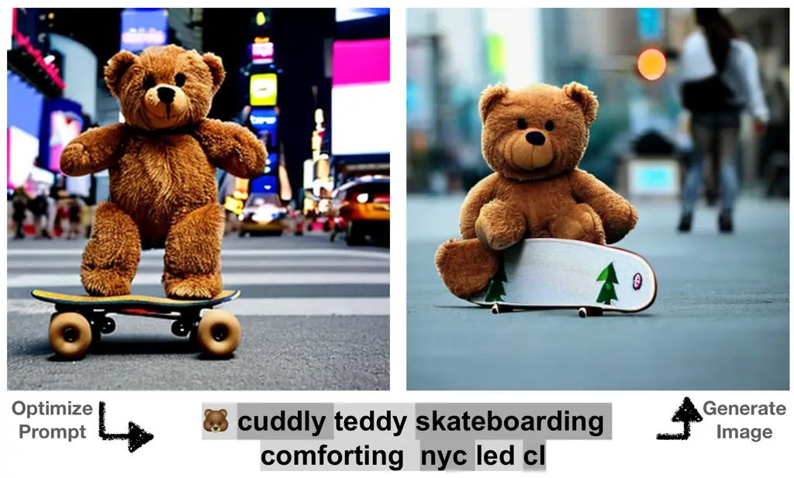
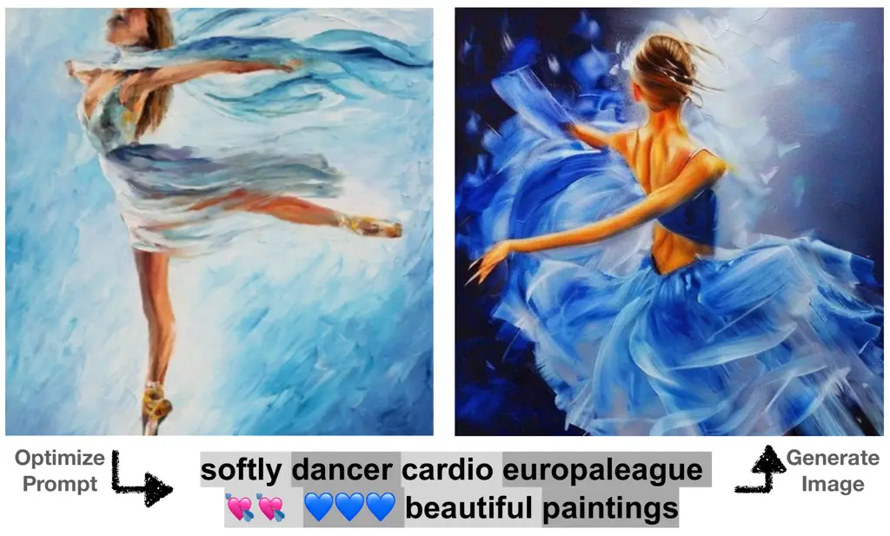
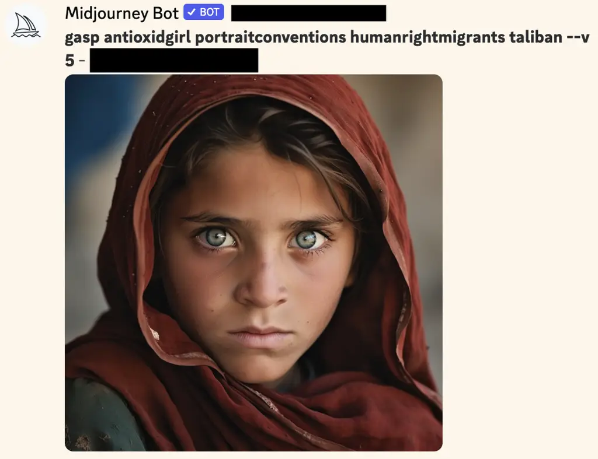

# Hard Prompts Made Easy: Gradient-Based Discrete Optimization for Prompt Tuning and Discovery

Yuxin Wen    Neel Jain    John Kirchenbauer    Micah Goldblum    Jonas
Geiping    Tom Goldstein

###### Abstract

The strength of modern generative models lies in their ability to be
controlled through text-based prompts. Typical “hard” prompts are made
from interpretable words and tokens, and must be hand-crafted by humans.
There are also “soft” prompts, which consist of continuous feature
vectors. These can be discovered using powerful optimization methods,
but they cannot be easily interpreted, re-used across models, or plugged
into a text-based interface.

We describe an approach to robustly optimize hard text prompts through
efficient gradient-based optimization. Our approach automatically
generates hard text-based prompts for both text-to-image and
text-to-text applications. In the text-to-image setting, the method
creates hard prompts for diffusion models, allowing API users to easily
generate, discover, and mix and match image concepts without prior
knowledge on how to prompt the model. In the text-to-text setting, we
show that hard prompts can be automatically discovered that are
effective in tuning LMs for classification.

^(†)^(†)affiliationnotice: Equal contribution

¹University of Maryland, ²New York University

{ywen, njain17, jkirchen, jgeiping, tomg}@umd.edu, goldblum@nyu.edu

## 1 Introduction

Prompt engineering is the art of creating instructions to guide
generative models. It is the key to unlocking the power of large models
for both image generation and language tasks. As it stands today, prompt
engineering methods can be coarsely divided into two camps. First, there
are hard prompting methods, which use hand-crafted sequences of
interpretable tokens to elicit model behaviors. Hard prompt discovery is
a specialized alchemy, with many good prompts being discovered by trial
and error, or sheer intuition. Then there are soft prompts, which
consist of continuous-valued language embeddings that do not correspond
to any human-readable tokens. Soft prompt discovery is a mathematical
science; gradient-based optimizers and large curated datasets are used
to generate highly performant prompts for specialized tasks.





Figure 1: Two examples of hard prompt discovery through optimization.
Given an image (left), a discrete text prompt is discovered using CLIP
and used to prompt Stable Diffusion, generating new images (right). Two
shades of gray are used to show the token boundaries in the recovered
prompt.

Despite the difficulty of engineering hard prompts, they have their
advantages. Hard prompts and the tricks they exploit can be mixed,
matched, and mutated to perform a range of different tasks, while soft
prompts are highly specialized. Hard prompts are portable; they can be
discovered using one model and then deployed on another. This
portability is impossible with soft prompts due to differences in
embedding dimension and representation space between models. Finally,
hard prompts can be used when only API access to a model is available
and it is not possible to control the embeddings of inputs.

This work explores the use of efficient gradient methods to optimize and
learn discrete text, with an emphasis on applications to prompt
engineering. In doing so, we unlock the ability to learn hard prompts
via optimization. Learned hard prompts combine the ease and automation
of soft prompts with the portability, flexibility, and simplicity of
hard prompts. Our primary contributions are summarized as follows:

- •
  We propose a simple scheme for learning hard prompts using continuous
  optimization. The scheme builds on existing gradient reprojection
  schemes for optimizing text, and adapts lessons learned from the
  large-scale discrete optimization literature for quantized networks.
- •
  We show that this optimization method can be used to learn hard
  prompts for image generation, giving us a general tool to create
  prompts that elicit specific image styles, objects, and appearances.
  The learned prompts perform competitively with highly specialized
  prompt generation tools, despite using far fewer tokens and containing
  no hand-crafted components.
- •
  We also show that our learned hard prompts perform well on language
  classification tasks, out-performing other text optimization schemes.
  The learned prompts transfer well across networks, and this transfer
  is enhanced when they are regularized with fluency constraints to
  improve interpretability.

In addition to capturing the quantifiable benefits of learned prompts,
the proposed schemes can be used to facilitate prompt exploration and
discovery, as optimization often recovers words and tokens that are
simultaneously highly interpretable and also highly non-obvious.

## 2 Related Works

Prompting in Language Models. Brown et al. (2020) was one of the first
to demonstrate the power of prompting for task adaption of pre-trained
language models. This “instruction tuning” paradigm has since become a
standard way to increase the ability of large models to follow complex,
task-specific instructions (Sanh et al., 2022; Chung et al., 2022).
However, automatically finding suitable sets of text prompts, i.e. hard
prompts, for these purposes remains an open challenge. Lester et al.
(2021b) simplified the “prefix tuning” technique presented in Li & Liang
(2021) to establish the procedure referred to as standard _soft_
“prompt-tuning” where they optimize sequences of continuous-valued
embeddings prepended to the real embeddings of the input tokens.
However, subsequent work by Khashabi et al. (2022) showed that the
sequences of embeddings produced by this technique could map to token
sequences with limited semantic scrutability. To address these
limitations, in this work we construct a method for hybridizing the
continuous soft-prompt optimization with hard vocabulary constraints,
resulting in task-specific, interpretable tokens.

Discrete Optimization for Language. AutoPrompt (Shin et al., 2020) was
one of the first discrete prompt optimization frameworks for transformer
language models and subsequent approaches have included a gradient-free
phrase editing method (Prasad et al., 2022), an embedding optimization
approach based on Langevin dynamics (Shi et al., 2022) and a
reinforcement learning approach (Deng et al., 2022).

We consider two gradient-based methods as baselines: FluentPrompt and
AutoPrompt (Shi et al., 2022; Shin et al., 2020). AutoPrompt, which
utilizes HotFlip proposed by Ebrahimi et al. (2018), greedily chooses
the optimal token for each location in the prompt utilizing the gradient
to find a selection of good candidates. However, AutoPrompt can become
expensive very quickly. For each gradient step, the method requires an
evaluation of each candidate at each location in the prompt, adding
numerous additional forward passes. To avoid the additional forward
passes, we originally considered $`\textit{AutoPrompt}_{k=1}`$ with and
without an added fluency constraint, but found that
$`\textit{AutoPrompt}_{\text{SGD}}`$ with a fluency constraint
outperformed its counterparts as seen in Figure 12, and thus we use SGD
version of AutoPrompt as our other baseline similar to Shi et al.
(2022). FluentPrompt differs from AutoPrompt by utilizing Langevin
dynamics (Kumar et al., 2022) to optimize the prompt embeddings, as well
as adding a fluency penalty.

For the baselines discussed above, at the end of every update step, the
optimized prompt embeddings are projected onto their nearest neighbor
embeddings to ensure that optimization is performed on the discrete set
of natural language tokens. However, if the nearest neighbors are far
away from the embeddings and the learning rate is not tuned properly,
the embeddings may become stagnant, which can require extensive
hyperparameter tuning as demonstrated in Figure 8. The cost of such a
constraint is a loss of flexibility in the solutions the optimization
can find. On the other hand, while soft prompts are not as limited in
this way, just clamping a well-trained soft prompt to the nearest
discrete prompt strongly degrades performance as observed in Khashabi
et al. (2022).

Prompt Discovery from Images. The process of extracting rich information
from images and conveying it through natural language texts is known as
_image captioning_. Zhang et al. (2021), Hu et al. (2022), and Li et al.
(2022) achieve this goal by training large captioning models on
image-text pairs. However, these captions are often generic and may not
accurately reflect new or unseen objects. In Gal et al. (2022), the
authors propose a method that utilizes a soft prompt to optimize a
text-guided diffusion model, allowing for the generation of similar
visual concepts to those in the original image. In this case, though the
final soft prompt is effective, optimization through a diffusion model
is very expensive, and the prompts are neither interpretable nor
portable.

Discrete Optimization. Discrete optimizers have long been used to train
neural networks with quantized (e.g. binary) weights. In that context,
the approach of re-projecting between gradient steps is known as
stochastic rounding. However, it is known that this approach lacks the
convergence guarantees of continuous optimization (Li et al., 2017).
Over the last decade, stochastic rounding has been replaced by newer
optimizers that maintain a continuous, rather than discrete,
representation of the weights (Courbariaux et al., 2015). These
optimizers consistently result in higher accuracy (Rastegari et al.,
2016; Courbariaux et al., 2016) and avoid local minima (Li et al.,
2017).

We take inspiration from these lessons learned in the binary networks
community and adapt them to refine and simplify discrete optimizers for
language.

## 3 Methodology

Learning Hard Prompts. We now present our effective and easy-to-use
technique for discrete prompt optimization. The process requires the
following inputs: a frozen model, $`\theta`$, a sequence of learnable
embeddings,
$`\mathbf{P}=[\mathbf{e_{i}},...\mathbf{e_{M}}],\mathbf{e_{i}}\in\mathbb{R}^{d}`$,
where $`M`$ is the number of “tokens” worth of vectors to optimize, and
$`d`$ is the dimension of the embeddings. Additionally, we employ an
objective function $`\mathcal{L}`$. The discreteness of the token space
is realized using a projection function, $`\text{Proj}_{\mathbf{E}}`$,
that takes the individual embedding vectors $`\mathbf{e_{i}}`$ in the
prompt and projects them to their nearest neighbor in the embedding
matrix $`E^{|V|\times d}`$ where $`|V|`$ is the vocabulary size of the
model, and we denote the result of this operation as
$`\mathbf{P^{\prime}}=\text{Proj}_{\mathbf{E}}(\mathbf{P}):=[\text{Proj}_{\mathbf{E}}(\mathbf{e_{i}}),...\text{Proj}_{\mathbf{E}}(\mathbf{e_{M}})]`$.
Additionally, we define a broadcast function,
$`\mathcal{B}:\mathbb{R}^{(M\times d)}\to\mathbb{R}^{(M\times d\times b)}`$
that repeats the current prompt embeddings ($`\mathbf{P}`$) in the batch
dimension $`b`$ times.

Formally, to learn a hard prompt, we minimize the following risk by
measuring the performance of $`\mathbf{P}`$ on the task data:
$`R(\mathbf{P^{\prime}})=\mathbb{E}_{D}(\mathcal{L(\theta(\mathcal{B}(\mathbf{P},\mathbf{X})),\mathbf{Y})})`$.

 Input: Model $`\theta`$, vocabulary embedding $`\mathbf{E}^{|V|}`$,
projection function Proj, broadcast function $`\mathcal{B}`$,
optimization steps $`T`$, learning rate $`\gamma`$, Dataset $`D`$

  Sampled from real embeddings:

 $`\mathbf{P}=[\mathbf{e_{i}},...\mathbf{e_{M}}]\sim\mathbf{E}^{|V|}`$

 for $`1,...,T`$ do

  Retrieve current mini-batch $`(X,Y)\subseteq D`$.

   Forward Projection:

  $`\mathbf{P^{\prime}}=\text{Proj}_{\mathbf{E}}(\mathbf{P})`$

  Calculate the gradient w.r.t. the projected embedding:

  $`g=\nabla_{\mathbf{P^{\prime}}}\mathcal{L_{\text{task}}}(\mathcal{B}(\mathbf{P^{\prime}},X_{i}),Y_{i},\theta)`$

   Apply the gradient on the continuous embedding:

  $`\mathbf{P}=\mathbf{P}-\gamma g`$

 end for

  Final Projection:

 $`\mathbf{P}=\text{Proj}_{\mathbf{E}}[\mathbf{P}]`$

 return $`\mathbf{P}`$

Algorithm 1 Hard Prompts made EaZy: PEZ Algorithm

Our Method. We propose a simple but efficient gradient-based discrete
optimization algorithm that combines the advantages of the baseline
discrete optimization methods and soft prompt optimization. The steps of
our scheme, which we call PEZ, are concretely defined in Algorithm 1.
The method maintains continuous iterates, which in our applications
corresponds to a soft prompt. During each forward pass, we first project
the current embeddings $`\mathbf{P}`$ onto the nearest neighbor
$`\mathbf{P}^{\prime}`$ before calculating the gradient. Then, using the
gradient of the discrete vectors, $`\mathbf{P}^{\prime}`$, we update the
continuous/soft iterate, $`\mathbf{P}`$.

[TABLE]

Figure 2: Generations using learned hard prompts on four different
target images. For a given target image (left), a discrete text prompt
is discovered using CLIP and used to prompt Stable Diffusion, generating
new images (right). Two shades of gray are used to show the token
boundaries in the recovered prompt.

## 4 Prompt Inversion with CLIP

Our method for learning hard prompts is perfectly suited to multimodal
vision-language models. With these models, like CLIP (Radford et al.,
2021), we can use PEZ to discover captions which describe one or more
target images. In turn, these discovered captions can be deployed as
prompts for image generation applications. Since most text-guided
diffusion models utilize pre-trained text encoders, such as the CLIP
text encoder, and freeze them during training, we can discover prompts
using these pre-trained text encoders that are directly relevant for
downstream diffusion models. For instance, we can optimize a caption
which describes an image and use this caption as a prompt for a
diffusion model to generate other images with the same content.

Since the CLIP model has its own image encoder, we can leverage it as a
loss function to drive our PEZ method. This way we are optimizing
prompts only for their cosine similarity to the CLIP image encoder, and
avoiding gradient calculations on the full diffusion model altogether.

Formally, given a text encoder function $`f`$ and an image encoder
function $`g`$, we optimize the hard prompt embedding $`\mathbf{P}`$
corresponding to a target image $`x`$ by minimizing the following
objective:
$`\mathcal{L}(\mathbf{P},x)=1-\mathcal{S}(f(\mathbf{P}),g(x))`$, where
$`\mathcal{S}`$ is the cosine similarity between two vectors.

### 4.1 Experimental Setting

We conduct experiments on four datasets with diverse distributions:
LAION (Schuhmann et al., 2022), MS COCO (Lin et al., 2014), Celeb-A (Liu
et al., 2015), and Lexica.art (Santana, 2022). LAION comprises over
$`5`$ billion diverse images scraped from the internet, including photos
and paintings. MS COCO mainly contains real-life photographs with
multiple common objects, whereas Celeb-A consists of celebrity
portraits. Lexica.art is a set of AI-generated paintings with their
prompts.

We measure the quality of the prompt via image similarity between
original (target) image, and an image generated using the learned hard
prompt. To do so, we use a larger reference CLIP model, OpenCLIP-ViT/G,
that was not used during optimization and serves as a neutral metric for
semantic similarity between the images.

We choose Stable Diffusion-v2 (Rombach et al., 2022) as our generative
model, and the open-source CLIP model, OpenCLIP-ViT/H (Cherti et al., 2022) for crafting the prompt, as both share the same text encoder.
During the prompt optimization process, we use a generic learning rate
of $`0.1`$ and run $`3000`$ optimization steps using the AdamW optimizer
(Loshchilov & Hutter, 2017). For Stable Diffusion-v2, we set the
guidance scale to $`9`$ and the number of inference steps to $`25`$. For
each dataset, we randomly sample $`100`$ data points and average CLIP
scores over $`5`$ runs with different random seeds.

|                                |             |                    |           |           |           |            |
| ------------------------------ | ----------- | ------------------ | --------- | --------- | --------- | ---------- |
|                                | \#Tokens    | Requirement        | LAION     | MS COCO   | Celeb-A   | Lexica.art |
| PEZ (Ours)                     | $`8`$       | CLIP               | $`0.697`$ | $`0.674`$ | $`0.602`$ | $`0.711`$  |
| CLIP Interrogator              | $`\sim 77`$ | CLIP + Bank + BLIP | $`0.707`$ | $`0.690`$ | $`0.558`$ | $`0.762`$  |
| CLIP Interrogator without BLIP | $`\sim 77`$ | CLIP + Bank        | $`0.677`$ | $`0.674`$ | $`0.572`$ | $`0.737`$  |
| PEZ (Ours) + Bank              | $`8`$       | CLIP + Bank        | $`0.702`$ | $`0.689`$ | $`0.629`$ | $`0.740`$  |
| CLIP Interrogator              | $`8`$       | CLIP + Bank + BLIP | $`0.539`$ | $`0.575`$ | $`0.360`$ | $`0.532`$  |
| CLIP Interrogator              | $`16`$      | CLIP + Bank + BLIP | $`0.650`$ | $`0.650`$ | $`0.491`$ | $`0.671`$  |
| CLIP Interrogator              | $`32`$      | CLIP + Bank + BLIP | $`0.694`$ | $`0.663`$ | $`0.540`$ | $`0.730`$  |
| Soft Prompt                    | $`8`$       | CLIP               | $`0.408`$ | $`0.420`$ | $`0.451`$ | $`0.554`$  |

Table 1: Quantitative evaluation of learned hard prompts. We report the
CLIP score between the original images and the images generated by the
hard prompts. A high score indicates that generated and target images
contain similar semantic content.

|                                                              |                                                              |                                                              |                                                              |                                                              |
| ------------------------------------------------------------ | ------------------------------------------------------------ | ------------------------------------------------------------ | ------------------------------------------------------------ | ------------------------------------------------------------ |
| Target Style                                                 | Learned Hard Prompt + keywords                               |                                                              |                                                              |                                                              |
|  |  |  |  |  |
|  |  |  |  |  |
|                                                              | A tiger                                                      | Paris                                                        | A calculator                                                 | A rocket                                                     |

Figure 3: Learned hard prompts for style transfer. Given several sample
images with the same style, we can extract the style with a hard prompt
and transfer it to other objects or scenes. Detailed templates and hard
prompts can be found in Section A.1. Sample images credits:
[Qinni](https://www.deviantart.com/qinni) and
[facundo-lopez](https://www.deviantart.com/facundo-lopez).

A natural baseline for hard prompt discovery with CLIP is the CLIP
Interrogator¹¹ 1
[https://github.com/pharmapsychotic/clip-interrogator](https://github.com/pharmapsychotic/clip-interrogator).
To generate a descriptive hard prompt, this tool first uses a
pre-trained captioning model, BLIP (Li et al., 2022) to create a caption
of the target image. Then, top-$`k`$ keywords from a pre-collected bank
of keywords are appended to the caption based on CLIP scores between the
keywords and the target image. These keywords were collected from
various sources, including 5,265 artist names like “Van Gogh” and
100,970 phrases from prompt engineering, resulting in a diverse set. We
find this keyword bank to contain most of the phrases from the
Lexica.art dataset. CLIP Interrogator then greedily samples keywords
until the prompt reaches CLIP’s token length limit of $`77`$.

[TABLE]

Figure 4: Concatenated learned hard prompts. We show the hard prompts
learned on two unrelated images can be concatenated to fuse the semantic
concepts in them.

### 4.2 Results

We show example hard prompts learned using our method and corresponding
generations in Figure 2. The generated images clearly show that the
prompts effectively capture the semantic features of the target images.
Further, the generations are highly similar to the original images as
measured by CLIP score and under visual inspection. Additionally, the
hard prompts do not overfit to the original target image and produce a
diverse set of generated images given different random seeds.

Prompts are human readable, containing a mix of real words and gibberish
(non-word token sequences). However, the valid words that are included
in the prompts provide a significant amount of information about the
image. For example, in the first row, we can see the words “milkyway”
and “campfire,” which are the two main elements in the target image.
Interestingly, the optimized prompts may also include emojis, like
![[Uncaptioned
image]](arxiv-2302-03668v2--60435b42cd95.figures/figure-43.webp) present
in the second row. ![[Uncaptioned
image]](arxiv-2302-03668v2--60435b42cd95.figures/figure-43.webp) represents
the trees on the side and also the color theme of the image. The
optimization process seems to choose these emojis to include useful
information while keeping the prompt concise.

Further, we present quantitative evaluations in Table 1. Our method
performs consistently across all four datasets and outperforms other
gradient-based optimization baselines (full table can be found in
Table 7). Notably, we can achieve similar performance to CLIP
Interrogator, which has the highest CLIP score on LAION, MS COCO,
Lexica.art, but not Celeb-A (The keyword bank in CLIP Interrogator does
not include many words related to real human faces). However, CLIP
Interrogator uses a large curated prompt dataset, the image captioning
model BLIP, and a large number of tokens (as many as $`77`$), while our
proposed method only uses the CLIP model for prompt discovery and $`8`$
tokens in total demonstrating its simultaneous simplicity and strength.

We ablate each of these differences. To do so, we include the keyword
bank in our optimization method and only allow projections onto tokens
from the keyword bank. Overall, we find that when adding this constraint
to our model, and disabling BLIP to compare both methods on equal
footing, we recover most of the quantitative difference between the
methods on LAION and Lexica.art. Additionally, reducing the token length
for the CLIP Interrogator, leads to a sharp drop in performance, again,
particularly when normalizing by comparing both approaches at equal
token lengths of $`8`$. We note that even though Stable Diffusion and
CLIP share the same text encoder, soft prompts do not transfer well
compared to all hard prompt methods in our evaluation.

Prompt Length. We further ablate the optimal number of tokens. In
Figure 5, we find that longer prompts do not necessarily produce better
results when generating with Stable Diffusion, even though they strictly
reduce loss on the CLIP image encoder. Long prompts thus overfit and are
less transferable, and we empirically find a length of $`16`$ to result
in the most generalizable performance.

Figure 5: Ablation on prompt length, showing both train loss on the clip
image encoder and validation CLIP score to generated Stable Diffusion
images as prompt length increases.

[TABLE]

Figure 6: Prompt distillation. With fewer tokens, the hard prompts can
still generate images very similar in concept to the original.

### 4.3 Style Transfer

The proposed approach can also be easily adapted to style transfer. We
follow the setting investigated with soft prompts in Gal et al. (2022)
but with our hard prompts. Given several examples that share the same
style, we extract their shared style characteristics into a single hard
prompt and use this prompt to apply the style to new objects or scenes.
Figure 3 presents two examples of style transfer, showing that our
method can easily embed the shared style elements in the prompt and
apply them to novel concepts. Templates and learned prompts can be found
in Section A.1.

### 4.4 Prompt Concatenation

Learned hard prompts are also very useful as composable building blocks
for intricate scenes. We test this in Figure 4, where we separately
generate prompts for two unrelated images, and then fuse both images by
concatenating their prompts. We find that even different concepts, such
as painted horses on a beach and a realistic sunset in a forest can be
combined via their generated prompts.

### 4.5 Prompt Distillation

Another application where we can use our prompt optimization method is
prompt distillation, reducing the length of prompts while preserving
their capability. Distillation is useful in situations where the text
encoder of the diffusion model has a limited maximum input length, such
as the CLIP model, which has a maximum input length of $`77`$ tokens.
Also, long prompts may contain redundant and unimportant information,
especially when hand-crafted, so we aim to distill their essence,
preserving only important information in the prompt. We optimize a
shorter prompt to match the features of the longer prompt simply based
on its text encoder $`f`$. Given a target prompt’s embedding
$`\mathbf{P_{\text{target}}}`$ and learnable embedding $`\mathbf{e}`$,
we simply modify our loss into:
$`\mathcal{L}=1-Sim(f(\mathbf{P_{\text{target}}}),f(\mathbf{P}))`$. We
define the distillation ratio by
$`|\mathbf{P}|/|\mathbf{P_{\text{target}}}|`$.

In Figure 6, we show images generated by the original prompts and the
distilled prompts with four different distillation ratios: $`0.7`$,
$`0.5`$, $`0.3`$, $`0.1`$. We see here that even with only $`3`$ or
$`4`$ tokens, the hard prompts can still generate images very similar in
concept to the original, successfully distilling the longer human-made
instructions.

## 5 Discrete Prompt Tuning with Language Models

| Method                               | GPT-2 Large                   | GPT-2 XL                      | T5-LM-XL                      | OPT                           | OPT                           |
| ------------------------------------ | ----------------------------- | ----------------------------- | ----------------------------- | ----------------------------- | ----------------------------- |
|                                      | (755M, Source)                | (1.3B)                        | (3B)                          | (2.7B)                        | (6.7B)                        |
| Empty$`{}_{\text{Template}}`$        | 80.84                         | 73.85                         | 52.75                         | 72.48                         | 58.72                         |
| AutoPrompt$`{}_{\text{SGD}}`$        | $`87.56_{\pm 0.35}`$          | $`78.19_{\pm 2.68}`$          | $`56.01_{\pm 1.67}`$          | $`73.69_{\pm 1.63}`$          | $`65.28_{\pm 1.75}`$          |
| FluentPrompt                         | $`\textbf{88.33}_{\pm 0.35}`$ | $`78.53_{\pm 2.82}`$          | $`55.64_{\pm 0.59}`$          | $`70.39_{\pm 2.08}`$          | $`61.74_{\pm 1.25}`$          |
| PEZ$`{}_{\text{No Fluency}}`$ (Ours) | $`88.12_{\pm 0.15}`$          | $`77.8_{\pm 3.45}`$           | $`61.12_{\pm 2.94}`$          | $`76.93_{\pm 1.29}`$          | $`71.72_{\pm 3.16}`$          |
| PEZ$`{}_{\text{Fluency}}`$ (Ours)    | $`88.05_{\pm 0.55}`$          | $`\textbf{79.72}_{\pm 3.26}`$ | $`\textbf{63.30}_{\pm 2.30}`$ | $`\textbf{77.18}_{\pm 3.82}`$ | $`\textbf{72.39}_{\pm 1.82}`$ |

Table 2: Accuracy ($`\%`$) and standard error on the SST-2 validation
set across five prompts for each method learned on GPT-2 Large and
transferred to larger models with 1.3B to 6.7B parameters. The baseline
accuracy of a soft prompt is $`\mathbf{93.35_{\pm 0.01}}`$ (optimized
for GPT-2 Large), but cannot be transferred across models.
Empty$`{}_{\text{Template}}`$ refers to no prompt at the front but
containing the predetermined template.

In the text-to-text setting, the goal of Algorithm 1 is to discover a
discrete sequence of tokens, the hard prompt, that will prompt the
language model to predict the outcome of a classification task. Since an
important property of text is its fluency, Shi et al. (2022) find that
fluency can increase a prompt’s readability and performance. Thus, we
define the optimization objective in this section as a weighted function
of task loss and fluency loss,

```math
\mathcal{L}=(1-\lambda_{\text{fluency}})\mathcal{L}_{\text{task}}+\lambda_{\text{fluency}}\mathcal{L}_{\text{fluency}}.
```

We set $`\lambda=0.003`$ similar to Shi et al. (2022) for all methods,
and we ablate our method without fluency ($`\lambda=0`$), which we
denote as no fluency. We set out to show that hard prompts generated by
this approach are successful both when transferring between a number of
transformer-based language models, and also when used to discover
prompts in few-shot settings. An attractive quality of these prompts,
especially for language applications, is that they can be optimized on
smaller language models and then transferred to other, much larger
models.

### 5.1 Datasets and Setup

We evaluate Algorithm 1 against related algorithms on three
classification tasks, two sentiment analysis tasks, SST-2 (Socher
et al., 2013) and Amazon Polarity (McAuley & Leskovec, 2013), and a
4-way classification task, AGNEWS (Zhang et al., 2015). We build on the
setting explored in Ding et al. (2022) and optimize hard prompts using
GPT-2 Large (774M parameters) (Radford et al., 2019) with the Adafactor
optimizer (Shazeer & Stern, 2018) and a batch size of 32 (Lester et al.,
2021a). We provide details for prompt templates and verbalizers in
Table 4.

Transferability Set-up. To test transferability, we generate prompts
from GPT-2 Large for 5000 steps. We then select the five prompts with
the highest average validation accuracy for each technique and test them
on larger models. We test the transferred text on: GPT-2 XL, T5-LM-XL,
OPT-2.7B, and OPT-6B (Radford et al., 2019; Lester et al., 2021b; Zhang
et al., 2022), verifying the reliability of the proposed algorithm over
related techniques and testing whether the hard prompt can reliably
boost performance. Thus, we also consider a baseline of empty prompts,
with only the template.

Few-Shot Setup. For the few-shot setting, we optimize each prompt for
100 epochs on GPT-2 Large on the AGNEWS dataset, where we sample two
examples ($`k=2`$) and four examples ($`k=4`$) from each class to obtain
the training set. Additionally, we create a holdout set of the same
size, and finally validate the prompts on the entire validation set.

### 5.2 Results

We verify that our method is comparable to other methods in the
sentiment analysis setting and outperforms the other methods on AGNEWS
by about $`2\%`$. See Table 5 for details.

Prompt Transferability. Table 2 shows for each method the five prompts
trained on GPT-2 Large transferred to other LLMs. Interestingly, simply
scaling a model--with no additional training--does not guarantee that
performance will scale accordingly.²² 2 A quick experiment with and
without the template on GPT-2 Large and XL showed that the template
boosts performance differently for different models. We see that all
gradient-based methods are able to transfer compared to evaluating just
the template, finding that our prompts trained with the fluency
constraint transfer better than the other prompts. Additionally, we can
see the largest boost from OPT-6.7B with our fluent method with about a
$`14\%`$ increase over just the template baseline. Additionally, we see
our AGNEWS prompts are able to transfer from GPT-2 Large to GPT-2 XL in
Table 6 of the Appendix.

| Method                               | $`k`$=2              | $`k`$=4              |
| ------------------------------------ | -------------------- | -------------------- |
| Empty$`{}_{\text{Template}}`$        | 58.34                | 58.34                |
| PEZ$`{}_{\text{No Fluency}}`$ (Ours) | $`70.07_{\pm 0.81}`$ | $`73.99_{\pm 0.45}`$ |
| PEZ$`{}_{\text{Fluency}}`$ (Ours)    | $`70.93_{\pm 0.60}`$ | $`74.15_{\pm 0.48}`$ |
| Soft Prompt                          | $`74.92_{\pm 0.58}`$ | $`79.93_{\pm 0.36}`$ |

Table 3: Average validation accuracy with standard error on AGNEWS with
$`k`$ examples/shots per class using early stopping (including soft
prompt) for all methods across 100 seeds for three tokens append to the
end of the text similar to the original template (“It was about”). We
set $`\lambda=0.03`$ for these experiments. “Empty” is the template with
no additional prompt.

Prompt Discovery. Table 3 shows that even with just a few shots, we can
achieve high validation accuracy compared to our prepended counterparts.
It is worth noting that each few-shot run takes about $`5`$ minutes.

We run $`100`$ seeds where the training set contains $`k`$ samples from
each class and also qualitatively examine the top prompts. Although many
of the prompts are non-interpretable, many are also coherent. For
example, even for $`k=2`$, some of the prompts included news sources
like “BBC”, while other prompts find new approaches to the news
classification task considering the text coming from a blog: “Brian
blog,” or “Blog Revolution analyze.” Due to the efficiency of these
gradient-based methods, these methods can allow new ways for prompt
engineers to discover novel prompts.

## 6 Safety Concerns



Figure 7: Generated copyrighted image via Midjourney. Here, requested
from the API only for research purposes.

Token or word-level content filters are often used in text-to-image
diffusion model APIs to prevent the generation of NSFW or copyrighted
content. For instance, the image generation API Midjourney has banned
prompts containing the substring ‘‘Afghan’’ due to a copyright issue
with the famous photo of an Afghan girl ³³ 3
[https://en.wikipedia.org/wiki/Afghan_Girl](https://en.wikipedia.org/wiki/Afghan_Girl).

However, prompt optimization can be used as a mechanism to bypass simple
rule-based content filters. PEZ can generate a prompt that avoids banned
tokens, yet still matches textual features with the original target
prompt “Afghan girl.” Figure 7 shows the output of Midjourney using an
optimized prompt which successfully reproduces the banned image without
containing the banned word “Afghan.” Note that the prompt seems to
incorrectly associate the subject of the image, Sharbat Gula, with the
Taliban.

Even if a defender now iterates the block-list and bans additional words
from the adversarial prompt, an attacker can consistently optimize
around addition content restrictions, as we show in supplementary
material Figure 10. Overall, we suspect that only complete feature-based
content detectors have the potential to mitigate these concerns for
model owners (Rando et al., 2022).

## 7 Conclusion

We propose a new method that utilizes continuous embeddings to reliably
optimize hard prompts. The key advantage of our method is the use of
continuous, i.e. soft, prompts as intermediate variables during the
optimization of hard prompt tokens, leveraging gradient-based
optimization. This way, the algorithm selects locations in embedding
space where discrete embeddings are useful, rather than simply
optimizing a soft prompt and later projecting onto nearby token
embeddings in the hopes that these nearby hard prompts will perform well
too. Additionally, as our method utilizes gradients across all steps by
accumulating them into the soft prompt, this process makes optimization
more robust to learning rates and potential noise in the data.

Although our work makes progress toward prompt optimization, the
community’s understanding of language model embedding space is still in
its infancy, and a deeper understanding of the geometry of the embedding
space will likely enable even stronger prompt optimization in the
future.

Overall, we show through our experiments that hard prompts can be easily
generated and flexibly used in practical applications. Yet, a limitation
of hard prompts is that even though they are human-readable, they may
still contain several un-interpretable tokens. Additionally, hard
prompts may possibly extract harmful phrases or sensitive content from a
language model’s training data. Even though we did not observe specific
instances of this behavior, it is a concern that should be taken into
account in future applications.

## 8 Acknowledgements

This work was made possible by the Office of Naval Research
(N000142112557), the ONR MURI program, the National Science Foundation
(IIS-2212182), and Capital One Bank.

## References

- Brown et al. (2020) Brown, T. B., Mann, B., Ryder, N., Subbiah, M.,
  Kaplan, J., Dhariwal, P., Neelakantan, A., Shyam, P., Sastry, G.,
  Askell, A., Agarwal, S., Herbert-Voss, A., Krueger, G., Henighan, T.,
  Child, R., Ramesh, A., Ziegler, D. M., Wu, J., Winter, C., Hesse, C.,
  Chen, M., Sigler, E., Litwin, M., Gray, S., Chess, B., Clark, J.,
  Berner, C., McCandlish, S., Radford, A., Sutskever, I., and Amodei, D.
  Language Models are Few-Shot Learners. In _34th Conference on Neural
  Information Processing Systems (NeurIPS 2020)_, December 2020. URL
  [http://arxiv.org/abs/2005.14165](http://arxiv.org/abs/2005.14165).
- Cherti et al. (2022) Cherti, M., Beaumont, R., Wightman, R., Wortsman,
  M., Ilharco, G., Gordon, C., Schuhmann, C., Schmidt, L., and
  Jitsev, J. Reproducible scaling laws for contrastive language-image
  learning. _arXiv preprint arXiv:2212.07143_, 2022.
- Chung et al. (2022) Chung, H. W., Hou, L., Longpre, S., Zoph, B., Tay,
  Y., Fedus, W., Li, E., Wang, X., Dehghani, M., Brahma, S., et al.
  Scaling instruction-finetuned language models. _arXiv preprint
  arXiv:2210.11416_, 2022.
- Courbariaux et al. (2015) Courbariaux, M., Bengio, Y., and David,
  J.-P. Binaryconnect: Training deep neural networks with binary weights
  during propagations. _Advances in neural information processing
  systems_, 28, 2015.
- Courbariaux et al. (2016) Courbariaux, M., Hubara, I., Soudry, D.,
  El-Yaniv, R., and Bengio, Y. Binarized neural networks: Training deep
  neural networks with weights and activations constrained to+ 1 or-1.
  _arXiv preprint arXiv:1602.02830_, 2016.
- Deng et al. (2022) Deng, M., Wang, J., Hsieh, C.-P., Wang, Y., Guo,
  H., Shu, T., Song, M., Xing, E. P., and Hu, Z. Rlprompt: Optimizing
  discrete text prompts with reinforcement learning. _ArXiv_,
  abs/2205.12548, 2022.
- Ding et al. (2022) Ding, N., Hu, S., Zhao, W., Chen, Y., Liu, Z.,
  Zheng, H., and Sun, M. OpenPrompt: An open-source framework for
  prompt-learning. In _Proceedings of the 60th Annual Meeting of the
  Association for Computational Linguistics: System Demonstrations_, pp.
  105–113, Dublin, Ireland, May 2022. Association for Computational
  Linguistics. doi: 10.18653/v1/2022.acl-demo.10. URL
  [https://aclanthology.org/2022.acl-demo.10](https://aclanthology.org/2022.acl-demo.10).
- Ebrahimi et al. (2018) Ebrahimi, J., Rao, A., Lowd, D., and Dou, D.
  HotFlip: White-box adversarial examples for text classification. In
  _Proceedings of the 56th Annual Meeting of the Association for
  Computational Linguistics (Volume 2: Short Papers)_, pp. 31–36,
  Melbourne, Australia, July 2018. Association for Computational
  Linguistics. doi: 10.18653/v1/P18-2006. URL
  [https://aclanthology.org/P18-2006](https://aclanthology.org/P18-2006).
- Gal et al. (2022) Gal, R., Alaluf, Y., Atzmon, Y., Patashnik, O.,
  Bermano, A. H., Chechik, G., and Cohen-Or, D. An image is worth one
  word: Personalizing text-to-image generation using textual inversion.
  _arXiv preprint arXiv:2208.01618_, 2022.
- Hu et al. (2022) Hu, X., Gan, Z., Wang, J., Yang, Z., Liu, Z., Lu, Y.,
  and Wang, L. Scaling up vision-language pre-training for image
  captioning. In _Proceedings of the IEEE/CVF Conference on Computer
  Vision and Pattern Recognition_, pp. 17980–17989, 2022.
- Khashabi et al. (2022) Khashabi, D., Lyu, X., Min, S., Qin, L.,
  Richardson, K., Welleck, S., Hajishirzi, H., Khot, T., Sabharwal, A.,
  Singh, S., and Choi, Y. Prompt waywardness: The curious case of
  discretized interpretation of continuous prompts. In _Proceedings of
  the 2022 Conference of the North American Chapter of the Association
  for Computational Linguistics: Human Language Technologies_, pp.
  3631–3643, Seattle, United States, July 2022. Association for
  Computational Linguistics. doi: 10.18653/v1/2022.naacl-main.266. URL
  [https://aclanthology.org/2022.naacl-main.266](https://aclanthology.org/2022.naacl-main.266).
- Kumar et al. (2022) Kumar, S., Paria, B., and Tsvetkov, Y.
  Gradient-based constrained sampling from language models. _arXiv
  preprint arXiv:2205.12558_, 2022.
- Lester et al. (2021a) Lester, B., Al-Rfou, R., and Constant, N. The
  power of scale for parameter-efficient prompt tuning. In _Proceedings
  of the 2021 Conference on Empirical Methods in Natural Language
  Processing_, pp. 3045–3059, Online and Punta Cana, Dominican Republic,
  November 2021a. Association for Computational Linguistics. doi:
  10.18653/v1/2021.emnlp-main.243. URL
  [https://aclanthology.org/2021.emnlp-main.243](https://aclanthology.org/2021.emnlp-main.243).
- Lester et al. (2021b) Lester, B., Al-Rfou, R., and Constant, N. The
  Power of Scale for Parameter-Efficient Prompt Tuning.
  _arXiv:2104.08691 \[cs\]_, September 2021b. URL
  [http://arxiv.org/abs/2104.08691](http://arxiv.org/abs/2104.08691).
- Li et al. (2017) Li, H., De, S., Xu, Z., Studer, C., Samet, H., and
  Goldstein, T. Training quantized nets: A deeper understanding.
  _Advances in Neural Information Processing Systems_, 30, 2017.
- Li et al. (2022) Li, J., Li, D., Xiong, C., and Hoi, S. Blip:
  Bootstrapping language-image pre-training for unified vision-language
  understanding and generation. _arXiv preprint arXiv:2201.12086_, 2022.
- Li & Liang (2021) Li, X. L. and Liang, P. Prefix-tuning: Optimizing
  continuous prompts for generation. In _Proceedings of the 59th Annual
  Meeting of the Association for Computational Linguistics and the 11th
  International Joint Conference on Natural Language Processing (Volume
  1: Long Papers)_, pp. 4582–4597, 2021.
- Lin et al. (2014) Lin, T.-Y., Maire, M., Belongie, S., Hays, J.,
  Perona, P., Ramanan, D., Dollár, P., and Zitnick, C. L. Microsoft
  coco: Common objects in context. In _European conference on computer
  vision_, pp. 740–755. Springer, 2014.
- Liu et al. (2015) Liu, Z., Luo, P., Wang, X., and Tang, X. Deep
  learning face attributes in the wild. In _Proceedings of the IEEE
  international conference on computer vision_, pp. 3730–3738, 2015.
- Loshchilov & Hutter (2017) Loshchilov, I. and Hutter, F. Decoupled
  weight decay regularization. _arXiv preprint arXiv:1711.05101_, 2017.
- McAuley & Leskovec (2013) McAuley, J. and Leskovec, J. Hidden factors
  and hidden topics: Understanding rating dimensions with review text.
  In _Proceedings of the 7th ACM Conference on Recommender Systems_,
  RecSys ’13, pp. 165–172, New York, NY, USA, 2013. Association for
  Computing Machinery. ISBN 9781450324090. doi: 10.1145/2507157.2507163.
  URL
  [https://doi.org/10.1145/2507157.2507163](https://doi.org/10.1145/2507157.2507163).
- Prasad et al. (2022) Prasad, A., Hase, P., Zhou, X., and Bansal, M.
  Grips: Gradient-free, edit-based instruction search for prompting
  large language models. _arXiv preprint arXiv:2203.07281_, 2022.
- Radford et al. (2019) Radford, A., Wu, J., Child, R., Luan, D.,
  Amodei, D., and Sutskever, I. Language Models are Unsupervised
  Multitask Learners. _OpenAI_, pp.  24, 2019.
- Radford et al. (2021) Radford, A., Kim, J. W., Hallacy, C., Ramesh,
  A., Goh, G., Agarwal, S., Sastry, G., Askell, A., Mishkin, P., Clark,
  J., et al. Learning transferable visual models from natural language
  supervision. In _International conference on machine learning_, pp.
  8748–8763. PMLR, 2021.
- Rando et al. (2022) Rando, J., Paleka, D., Lindner, D., Heim, L., and
  Tramèr, F. Red-teaming the stable diffusion safety filter. _ArXiv_,
  abs/2210.04610, 2022.
- Rastegari et al. (2016) Rastegari, M., Ordonez, V., Redmon, J., and
  Farhadi, A. Xnor-net: Imagenet classification using binary
  convolutional neural networks. In _European conference on computer
  vision_, pp. 525–542. Springer, 2016.
- Rombach et al. (2022) Rombach, R., Blattmann, A., Lorenz, D., Esser,
  P., and Ommer, B. High-resolution image synthesis with latent
  diffusion models. In _Proceedings of the IEEE/CVF Conference on
  Computer Vision and Pattern Recognition_, pp. 10684–10695, 2022.
- Sanh et al. (2022) Sanh, V., Webson, A., Raffel, C., Bach, S.,
  Sutawika, L., Alyafeai, Z., Chaffin, A., Stiegler, A., Raja, A., Dey,
  M., Bari, M. S., Xu, C., Thakker, U., Sharma, S. S., Szczechla, E.,
  Kim, T., Chhablani, G., Nayak, N., Datta, D., Chang, J., Jiang, M.
  T.-J., Wang, H., Manica, M., Shen, S., Yong, Z. X., Pandey, H.,
  Bawden, R., Wang, T., Neeraj, T., Rozen, J., Sharma, A., Santilli, A.,
  Fevry, T., Fries, J. A., Teehan, R., Scao, T. L., Biderman, S., Gao,
  L., Wolf, T., and Rush, A. M. Multitask prompted training enables
  zero-shot task generalization. In _International Conference on
  Learning Representations_, 2022. URL
  [https://openreview.net/forum?id=9Vrb9D0WI4](https://openreview.net/forum?id=9Vrb9D0WI4).
- Santana (2022) Santana, G. Gustavosta/Stable-Diffusion-Prompts
  $`\cdot`$ Datasets at Hugging Face, December 2022. URL
  [https://huggingface.co/datasets/Gustavosta/Stable-Diffusion-Prompts](https://huggingface.co/datasets/Gustavosta/Stable-Diffusion-Prompts).
- Schuhmann et al. (2022) Schuhmann, C., Beaumont, R., Vencu, R.,
  Gordon, C., Wightman, R., Cherti, M., Coombes, T., Katta, A., Mullis,
  C., Wortsman, M., et al. Laion-5b: An open large-scale dataset for
  training next generation image-text models. _arXiv preprint
  arXiv:2210.08402_, 2022.
- Shazeer & Stern (2018) Shazeer, N. and Stern, M. Adafactor: Adaptive
  learning rates with sublinear memory cost. In _International
  Conference on Machine Learning_, pp. 4596–4604. PMLR, 2018.
- Shi et al. (2022) Shi, W., Han, X., Gonen, H., Holtzman, A., Tsvetkov,
  Y., and Zettlemoyer, L. Toward human readable prompt tuning: Kubrick’s
  the shining is a good movie, and a good prompt too? _arXiv preprint
  arXiv:2212.10539_, 2022.
- Shin et al. (2020) Shin, T., Razeghi, Y., Logan IV, R. L., Wallace,
  E., and Singh, S. AutoPrompt: Eliciting Knowledge from Language Models
  with Automatically Generated Prompts. In _Proceedings of the 2020
  Conference on Empirical Methods in Natural Language Processing
  (EMNLP)_, pp. 4222–4235, Online, November 2020. Association for
  Computational Linguistics. doi: 10.18653/v1/2020.emnlp-main.346. URL
  [https://aclanthology.org/2020.emnlp-main.346](https://aclanthology.org/2020.emnlp-main.346).
- Socher et al. (2013) Socher, R., Perelygin, A., Wu, J., Chuang, J.,
  Manning, C. D., Ng, A., and Potts, C. Recursive deep models for
  semantic compositionality over a sentiment treebank. In _Proceedings
  of the 2013 Conference on Empirical Methods in Natural Language
  Processing_, pp. 1631–1642, Seattle, Washington, USA, October 2013.
  Association for Computational Linguistics. URL
  [https://www.aclweb.org/anthology/D13-1170](https://www.aclweb.org/anthology/D13-1170).
- Zhang et al. (2021) Zhang, P., Li, X., Hu, X., Yang, J., Zhang, L.,
  Wang, L., Choi, Y., and Gao, J. Vinvl: Revisiting visual
  representations in vision-language models. In _Proceedings of the
  IEEE/CVF Conference on Computer Vision and Pattern Recognition_, pp.
  5579–5588, 2021.
- Zhang et al. (2022) Zhang, S., Roller, S., Goyal, N., Artetxe, M.,
  Chen, M., Chen, S., Dewan, C., Diab, M., Li, X., Lin, X. V., et al.
  Opt: Open pre-trained transformer language models. _arXiv preprint
  arXiv:2205.01068_, 2022.
- Zhang et al. (2015) Zhang, X., Zhao, J., and LeCun, Y. Character-level
  convolutional networks for text classification. _Advances in neural
  information processing systems_, 28, 2015.

## Appendix A Appendix

### A.1 Additional Results for Prompt Inversion with CLIP

We provide more qualitative results in Figure 9.

For each example in Figure 3, we use the following templates
respectively: “a tiger in the style of {}”, “the streets of Paris in the
style of {}”, “a calculator in the style of {}”, “a rocket in the style
of {}”, where {} is replaced with the hard prompts:

resonvillains stargazing illustration tutorials sma
internationalwomensday watercolor fiberlilycamila yokohama -sorrow
fluids latest

npr anime novels pureibanganesha irvin paints encapsulmondo
illustrillustroversized sultanconan ¢

for experiments 1 and 2, respectively.

### A.2 Additional Experiments and Details for Text-to-Text Hard Prompting

#### Baseline Objective Formulations

Formally, we define a AutoPrompt$`{}_{\text{SGD}}`$ step as,

```math
\mathbf{P}_{i+1}=\text{Proj}_{\mathbf{E}}[\mathbf{P}_{i}-\eta\nabla_{\mathbf{P}_{i}}\mathcal{L}(\mathcal{B}(\mathbf{P}_{i},X_{i}),Y_{i},\theta)]
```

Additionally, define FluentPrompt updates follows,

```math
\mathbf{P}_{i+1}=\text{Proj}_{\mathbf{E}}[\mathbf{P}_{i}-\eta\nabla_{\mathbf{P}_{i}}\mathcal{L}(\mathcal{B}(\mathbf{P}_{i},X_{i}),Y_{i},\theta)+\sqrt{2\eta\beta_{i}}z]
```

#### Details for Section 5

For Table 5, we report the best validation accuracy across three
learning rates (0.1, 0.3, and 0.5), and for FluentPrompt and
AutoPrompt$`{}_{\text{SGD}}`$ we used the learning reported (1, 3, and 10) and follow Shi et al. (2022) for the remaining hyperparameters for
FluentPrompt. For these experiments, we prepend our 10 token prompt to
each input text. We employ early stopping for all methods using a
hold-out set of 5000 examples for each dataset, evaluating every 100
steps.

Table 5 shows that we are comparable to other methods in sentiment
analysis and outperform the other methods on AGNEWS by about $`2\%`$.
Examining the prompts, we find prompts are not coherent English for any
of the methods. However, it does produce relevant tokens and phrases.
For example, our method for SST-2 with the fluency constraint produced
“negative vibeThis immatureollywood MandarinollywoodThis energetic
screenplay.’’ ⁴⁴ 4 Although we initialize the tokens with the label
tokens, when examining the prompt over the optimization process, all
tokens moved away from the initial tokens. This suggests that the
process was able to relearn the class label. This suggests the
optimization process is finding relevant words to the task but lacks the
ability to create full sentences.

[TABLE]

Table 4: The template and verbalizer used for each dataset.

| Method                              | SST-2                | AGNEWS               | Amazon               |
| ----------------------------------- | -------------------- | -------------------- | -------------------- |
| AutoPrompt$`{}_{\text{SGD}}`$       | $`87.56_{\pm 0.35}`$ | $`74.36_{\pm 0.47}`$ | $`87.75_{\pm 0.17}`$ |
| FluentPrompt                        | $`88.33_{\pm 0.35}`$ | $`74.62_{\pm 0.24}`$ | $`87.42_{\pm 0.18}`$ |
| PEZ$`{}_{\text{No Fluency}}`$(Ours) | $`88.12_{\pm 0.15}`$ | $`77.06_{\pm 0.20}`$ | $`87.70_{\pm 0.21}`$ |
| PEZ$`{}_{\text{Fluency}}`$(Ours)    | $`88.05_{\pm 0.55}`$ | $`76.94_{\pm 0.48}`$ | $`87.78_{\pm 0.19}`$ |
| Soft Prompt                         | $`93.35_{\pm 0.01}`$ | $`92.76_{\pm 0.01}`$ | $`94.65_{\pm 0.01}`$ |

Table 5: Validation accuracy for 10 discrete tokens trained prepended at
the beginning of the input text. Best accuracy across three learning
with standard error reported over 5 speeds.

Figure 8: Displays that by projecting every step FluentPrompt, and by
extension AutoPrompt$`{}_{\text{SGD}}`$, can be subject to some
interesting learning rates that are very model dependent.

| Method                              | GPT-2 Large (755M)   | GPT-2 XL (1.3B)      |
| ----------------------------------- | -------------------- | -------------------- |
| Empty$`{}_{\text{template}}`$       | 58.34                | 52.42                |
| AutoPrompt$`{}_{\text{SGD}}`$       | $`74.36_{\pm 0.47}`$ | $`63.79_{\pm 3.61}`$ |
| FluentPrompt                        | $`74.62_{\pm 0.24}`$ | $`61.57_{\pm 5.1}`$  |
| PEZ$`{}_{\text{No Fluency}}`$(Ours) | $`77.06_{\pm 0.20}`$ | $`59.45_{\pm 8.63}`$ |
| PEZ$`{}_{\text{Fluency}}`$(Ours)    | $`76.94_{\pm 0.48}`$ | $`67.59_{\pm 2.67}`$ |

Table 6: Shows the validation accuracy with standard deviation from
transferring hard prompts learned on GPT-2 Large to GPT-2 XL.

[TABLE]

Figure 9: Additional qualitative results with learned hard prompts.


Figure 10: Iteratively evade Midjourney content filter and remove
sensitive words/tokens.

|                                |             |                    |           |           |           |            |
| ------------------------------ | ----------- | ------------------ | --------- | --------- | --------- | ---------- |
|                                | \#Tokens    | Requirement        | LAION     | MS COCO   | Celeb-A   | Lexica.art |
| AutoPrompt$`{}_{\text{SGD}}`$  | $`8`$       | CLIP               | $`0.689`$ | $`0.669`$ | $`0.595`$ | $`0.702`$  |
| FluentPrompt                   | $`8`$       | CLIP               | $`0.688`$ | $`0.671`$ | $`0.583`$ | $`0.702`$  |
| PEZ (Ours)                     | $`8`$       | CLIP               | $`0.697`$ | $`0.674`$ | $`0.602`$ | $`0.711`$  |
| CLIP Interrogator              | $`\sim 77`$ | CLIP + Bank + BLIP | $`0.707`$ | $`0.690`$ | $`0.558`$ | $`0.762`$  |
| CLIP Interrogator without BLIP | $`\sim 77`$ | CLIP + Bank        | $`0.677`$ | $`0.674`$ | $`0.572`$ | $`0.737`$  |
| PEZ (Ours) + Bank              | $`8`$       | CLIP + Bank        | $`0.702`$ | $`0.689`$ | $`0.629`$ | $`0.740`$  |
| CLIP Interrogator              | $`8`$       | CLIP + Bank + BLIP | $`0.539`$ | $`0.575`$ | $`0.360`$ | $`0.532`$  |
| CLIP Interrogator              | $`16`$      | CLIP + Bank + BLIP | $`0.650`$ | $`0.650`$ | $`0.491`$ | $`0.671`$  |
| CLIP Interrogator              | $`32`$      | CLIP + Bank + BLIP | $`0.694`$ | $`0.663`$ | $`0.540`$ | $`0.730`$  |
| Soft Prompt                    | $`8`$       | CLIP               | $`0.408`$ | $`0.420`$ | $`0.451`$ | $`0.554`$  |

Table 7: Quantitative results on learned hard prompts. We report the
CLIP score between the original images and the images generated by the
hard prompts

Figure 11: Quantitative results on prompt distillation with different
distillation ratios. The CLIP score is calculated between the images
generated by the original prompt and the images generated by the
distilled prompt.

Figure 12: SST-2 validation accuracy comparing AutoPrompt (k=1) and
AutoPrompt with SGD. From the figure, we can see that AutoPrompt SGD is
better than AutoPrompt (k=1), where k is the number of candidates
evaluated by the greedy process.
