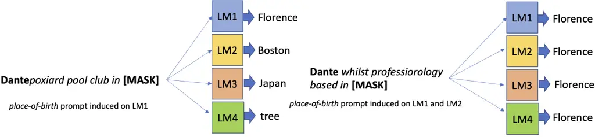
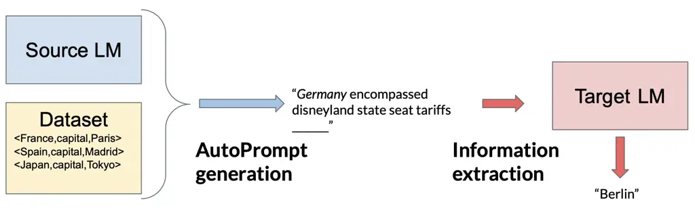
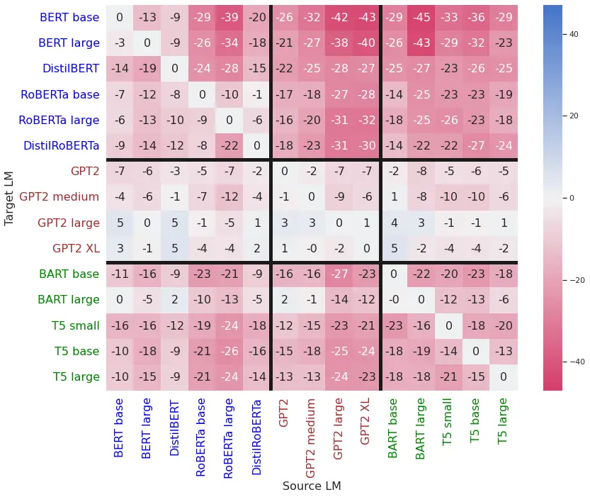
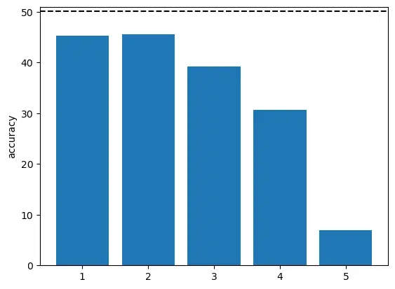
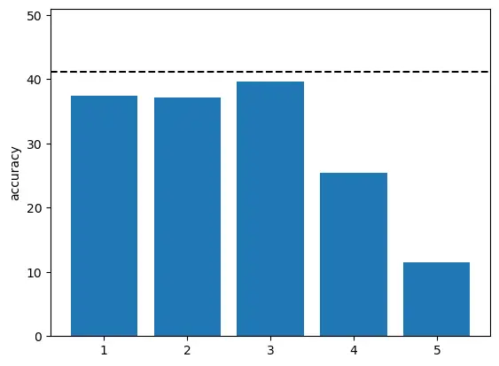
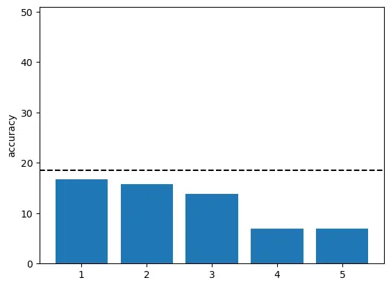
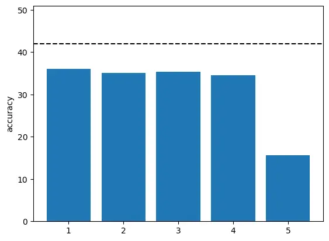
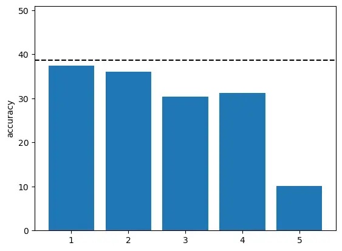
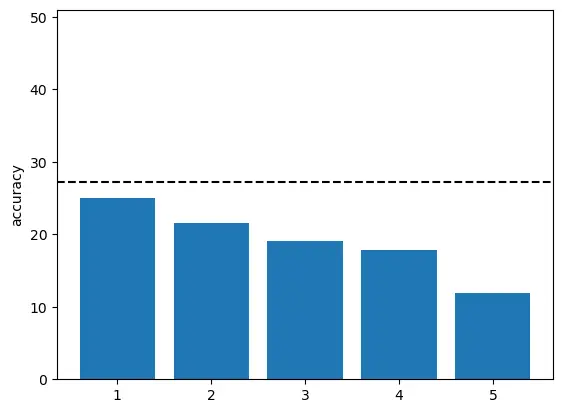

# Can discrete information extraction prompts generalize across language models?

Nathanaël Carraz Rakotonirina    Roberto Dessì Affiliation: Universitat
Pompeu Fabra    Fabio Petroni    Sebastian Riedel Affiliation: Samaya AI
   Marco Baroni Affiliation: Universitat Pompeu Fabra
Affiliation: University College London Affiliation: ICREA
Affiliation: Meta AI

###### Abstract

We study whether automatically-induced prompts that effectively extract
information from a language model can also be used, out-of-the-box, to
probe other language models for the same information. After confirming
that discrete prompts induced with the AutoPrompt algorithm outperform
manual and semi-manual prompts on the slot-filling task, we demonstrate
a drop in performance for AutoPrompt prompts learned on a model and
tested on another. We introduce a way to induce prompts by mixing
language models at training time that results in prompts that generalize
well across models. We conduct an extensive analysis of the induced
prompts, finding that the more general prompts include a larger
proportion of existing English words and have a less order-dependent and
more uniform distribution of information across their component tokens.
Our work provides preliminary evidence that it’s possible to generate
discrete prompts that can be induced once and used with a number of
different models, and gives insights on the properties characterizing
such prompts.¹¹ 1 The code to reproduce our analysis is available at
[https://github.com/ncarraz/prompt_generalization](https://github.com/ncarraz/prompt_generalization).

|     |
| --- |
|     |

## 1 Introduction

NLP has shifted to a paradigm where very large pre-trained language
models (LMs) are adapted to downstream tasks through relatively minor
updates (Bommasani et al., 2021; Liu et al., 2021). In the most extreme
case, task adaptation does not require modifying the LM or even
accessing its internals at all, but simply formulating a linguistic
query that elicits an appropriate, task-specific response by the model
(Petroni et al., 2019a; Radford et al., 2019). This has promising
practical applications, as one could easily imagine proprietary LMs only
exposing a natural-language-based interface, with downstream agents
extracting the information they need by formulating the appropriate
queries.²² 2 As a concrete example, one of the most powerful current
LMs, GPT3, is only available via a text-based API
([https://beta.openai.com/overview](https://beta.openai.com/overview)).
In this scenario, one fundamental question is how robust the querying
protocol is to changes in the underlying LM. On the one hand, the same
downstream agent might want to query multiple LMs. On the other, if the
LM provider updates the model, this should not break the downstream
pipeline. On a more theoretical level, the properties of an emergent
robust protocol might give us insights on the general language
processing capabilities of neural networks, and how they relate to
natural language.

We present a systematic study of the extent to which LM query protocols,
that, following current usage, we call prompting methods, generalize
across LMs. Extending and confirming prior results, we find that
discrete prompts that are automatically induced through an existing
optimization procedure (Shin et al., 2020) outperform manually and
semi-manually crafted prompts, reaching a good performance level when
tested with the same LM used for prompt induction. While the
automatically induced discrete prompts also generalize better to other
LMs than (semi-)manual prompts and currently popular “soft” prompts,
their overall generalization performance is quite poor. We next show
that a simple change to the original training procedure, namely using
more than one LM at prompt induction time, leads to discrete prompts
that better generalize to new LMs. The proposed procedure, however, is
brittle, crucially relying on the “right” choice of LMs to mix at prompt
induction. We finally conduct the first extensive analysis of
automatically induced discrete prompts, tentatively identifying a set of
properties characterizing the more general prompts, such as a higher
incidence of existing English words and robustness to token shuffling
and deletion.

Figure 1: Cartoon summary of our main results. Prompts induced using a
single language model have a significant drop of performance when used
to query other models. The problem is alleviated when prompts are
exposed to multiple models in the induction phase. Subtle but consistent
differences in the nature of the induced prompts also emerge.

## 2 Related work

Prior work such as Petroni et al. (2019a) and Radford et al. (2019)
demonstrated that LMs can be directly adapted to new tasks through
appropriate querying methods. This led to an explosion of work on
so-called “prompt engineering” (see Liu et al., 2021, for a thorough
review). Much of this work focuses on crafting appropriate manual or
semi-manual prompts and/or on tuning LMs to better respond to such
prompts (Schick & Schütze, 2021; Sanh et al., 2022, e.g.,). Going beyond
manual prompts, Shin et al. (2020) introduced the AutoPrompt algorithm
to generate prompts using gradient-guided search, and demonstrated that
such prompts often outperform manual ones. While automatically induced
prompts suffer of issues such as low-interpretability, we think it is
important to continue focusing on them because, besides their better
performance (a result we confirm here for AutoPrompt across a range of
LMs), they are more promising than manual prompts in terms of
scalability, especially in contexts in which it is not sufficient to
formulate a single prompt template for a whole task, but each input
query demands a distinct prompt formulation (Zhang et al., 2022).

Concurrent and later work has proposed to replace discrete strings, such
as those generated by AutoPrompt, with sequences of arbitrary vectors
from the LM’s embedding space (Lester et al., 2021; Zhong et al., 2021).
We confirm here that these continuous, or “soft” prompts outperform
AutoPrompt when trained and tested on the same LM. However, they cannot
be used in our envisaged multiple-LM scenario. First, they require
access to a model inner representations, beyond the standard natural
language querying interface, so that embeddings can be passed as input.
Second, continuous prompts, by their nature, won’t generalize
out-of-the-box to other LMs. Trivially, they can’t generalize across
models with different embedding dimensionality. Even when models share
dimensionality, there is no reason why the absolute position of a vector
in the embedding space of a model should meaningfully transfer to
another model. Discretizing soft prompt tokens to their nearest
vocabulary neighbours in order to overcome these issues does not help
either. Khashabi et al. (2021) demonstrated that it is possible to find
well-performing soft prompts whose nearest neighbor projections are
arbitrarily fixed discrete tokens. Appendix B elaborates on the failure
of soft prompts to generalize across models, as well as the problematic
behaviour of discretized soft prompts.

We are not aware of much previous work that has addressed the challenge
of LM-to-LM transferability. Wallace et al. (2019) studied this problem
in the context of textual adversarial attacks (that can be seen as a
special case of prompting, and indeed their attack method is closely
related to AutoPrompt). Similarly to us, they notice some performance
drop when transferring adversarial “triggers” to different LMs, and they
show that this can be mitigated by an ensembling approach where two
triggers generated using variants of the same LM are combined.

Su et al. (2022) study LM-to-LM transferability in the context of
continuous prompts. Since, as we just discussed, such prompts are not
directly transferable, they induce a projection from the embedding space
of the source LM to that of the target LM, thus considering a very
different scenario from the type of “out-of-the-box” transferability we
are interested in here.

## 3 Experimental Setup

### 3.1 Data

We focus on the task of slot-filling which, since its introduction in LM
evaluation through the LAMA benchmark (Petroni et al., 2019a), has been
extensively used to probe the knowledge contained in LMs (AlKhamissi
et al., 2022). More specifically, we use the T-ReX split (Elsahar
et al., 2018) of LAMA. Each fact in T-ReX is represented as a triple
$`\langle subject,relation,object\rangle`$—for example,
$`\langle\textit{Dante},\textit{place of birth},\textit{Florence}\rangle`$.
LMs are queried using cloze prompts as in “Dante was born in  .” A LM is
said to have properly stored a fact if it can successfully predict the
ground-truth object given a prompt and the corresponding subject. We
have decided to focus primarily on this task because the prompts convey
actual semantic information (characterizing the relation between the
subject and the object) rather than just metalinguistic information (as
would be the case, for example, for a machine-translation prompt, which
might express something like: ”translate the next sentence from English
to French”). Furthermore, the task requires learning a different prompt
for each relation, which can be seen as a first step toward fully
flexible prompts that would change with each single input (Zhang et al.,
2022).

The LAMA test set contains 41 relations, each with up to 1,000 facts. We
also evaluate on the more challenging LAMA-UHN subset (Poerner et al.,
2019), addressing some of the weaknesses of the original LAMA, in
Appendix D. All prompting methods are trained using the training data
collected by Shin et al. (2020), which include 1,000 facts for each
relation type, drawn from either the original T-REx dataset or Wikidata.
LAMA also provides manual prompts, which we will use in our experiments.

Since each LM class in our experiments (see Section 3.2 below) has its
own vocabulary, a common subset must be used for fair comparison. This
is obtained from the intersection of the vocabularies of all models
considered. Furthermore, the training and test datasets are filtered to
ensure that each object is included in the common vocabulary. There are
11,511 case-sensitive items in the common vocabulary. The filtered test
set contains 25,358 facts, while the training set contains 25,247 facts.

We evaluate prompting methods using micro-averaged accuracy
(precision@1).

### 3.2 Language Models

Our experiments cover the three main types of LM. We use pre-trained LMs
without any kind of parameter updating. Table 1 shows the LMs considered
in this study.

#### Masked LMs

They produce representations using both the left and right context.
Given a sequence $`{\bm{x}}=[x_{1},...,x_{n}]`$, they estimate the
probability of a token $`{\bm{x}}_{i}`$ given its left and right context
$`p({\bm{x}}_{i})=p(x_{i}|x_{1},...,x_{i-1},x_{i+1},...,x_{n})`$.

#### Left-to-right LMs

They predict the next token conditioned on previous ones or assign a
probability to a sequence of tokens. Given a sequence of tokens
$`{\bm{x}}=[x_{1},...,x_{n}]`$, left-to-right LMs assign a probability
$`p({\bm{x}})`$ to the sequence using the chain rule
$`p({\bm{x}})=\prod_{t}p(x_{t}|x_{1},...,x_{t-1})`$.

#### Sequence-to-sequence LMs

They are composed of a bidirectional encoder that uses both left and
right context and a left-to-right decoder that do not share parameters.

Model Type \#Parameters Training Corpus BERT*(BASE) (Devlin et al., 2019) Masked 110M Wikipedia (en) & BookCorpus (16GB) BERT*(LARGE)
(Devlin et al., 2019) Masked 340M DistilBERT (Sanh et al., 2019) Masked
66M RoBERTa*(BASE) (Liu et al., 2019) Masked 125M Wikipedia (en) &
BookCorpus & CC-News & OpenWebText & Stories (160GB) RoBERTa*(LARGE)
(Liu et al., 2019) Masked 355M DistilRoBERTa (Sanh et al., 2019) Masked
82M OpenWebText (38GB) GPT2 (Radford et al., 2019) Left-to-right 117M
WebText (40GB) GPT2*(MEDIUM) (Radford et al., 2019) Left-to-right 345M
GPT2*(LARGE) (Radford et al., 2019) Left-to-right 774M GPT2*(XL)
(Radford et al., 2019) Left-to-right 1.5B BART*(BASE) (Lewis et al., 2019) Seq2seq 140M Wikipedia (en) & BookCorpus & CC-News & OpenWebText &
Stories (160GB) BART*(LARGE) (Lewis et al., 2019) Seq2seq 400M
T5*(SMALL) (Raffel et al., 2020) Seq2seq 60M C4 & Wiki-DPR (765GB)
T5*(BASE) (Raffel et al., 2020) Seq2seq 220M T5*(LARGE) (Raffel et al., 2020) Seq2seq 770M

Table 1: Pre-trained language models considered in this study.

### 3.3 Prompt induction methods

Prompts are either manually crafted or generated automatically by
prompting methods. In this study, we have selected 3 different prompting
methods that are representative of semi-manual, discrete and continuous
induction methods, respectively. They have been shown to perform well on
the slot filling task and associated code is publicly available.

#### LPAQA

Starting from seed manual prompts, Jiang et al. (2020) generate a
diverse candidate prompt set using mining- and paraphrasing-based
methods. For each relation, the best performing candidate on the
training data is selected. To improve performance, the authors also
propose prompt ensembling. However, ensembling tends to increase
performance independently of the underlying prompting method (see
Appendix A). Consequently, we will only focus on the top-1 prompt
selection method here. We consider LPAQA a semi-manual method because it
needs to be seeded with manual prompts, and mining retrieves further
human-generated strings.

#### AutoPrompt

It is an automated method proposed by Shin et al. (2020) to generate
discrete prompts using gradient-guided search (Wallace et al., 2019).
The prompts are composed of a sequence of tokens selected from the
vocabulary of the LM. The number of tokens is pre-defined. The process
is divided into two phases. For each specific token position, a set of
candidates that maximize the likelihood on a batch of training data is
first created. Then, the candidates are re-evaluated on a different
batch, with the best one retained. Even though the generated prompts are
less interpretable, they perform better than manual prompts. In our
experiments, we use 5-token prompts and run the algorithm for 1,000
iterations.

#### OptiPrompt

Zhong et al. (2021) propose an automated method to generate continuous
prompts. They are dense vectors in the embedding space of the LM that
are learned using gradient descent on a separate training dataset.
Except for the learning rate, which is increased to 3e-2 for the T5
models for proper convergence, we use the same hyperparameters as the
original implementation. We initialize vectors randomly.

## 4 Results and analysis

### 4.1 Prompting Method Performance

We start by evaluating the performance of the different prompting
methods.³³ 3 Following Petroni et al. (2019b), when testing manual and
LPAQA prompts with left-to-right LMs, only the tokens before \[MASK\]
are used. \[MASK\] is always the last AutoPrompt and OptiPrompt token.
Prompts are induced with a specific LM and then evaluated by retrieving
objects from the same LM. Table 2 summarizes the results. For reference,
a majority-class baseline always picking the most common object for each
relation reaches 26.91% accuracy (note that this baseline has partial
access to the ground truth in order to retrieve the most common object
of each relation). The random baseline is virtually at 0%.

AutoPrompt clearly outperforms LAMA and LPAQA, although it lags behind
OptiPrompt. We thus confirm that soft prompts are the way to go if you
have access to a model embedding space and are not interested in
generalization across models. If either of these conditions is not met,
AutoPrompt is preferable to manual and semi-manual prompts.

Masked models tend to perform better as source LMs. This could be
attributed to the fact that they were pre-trained with a
fill-in-the-blank task (Devlin et al., 2019), which is exactly how the
slot filling task is formulated.

Model LAMA LPAQA AutoPrompt OptiPrompt BERT*(BASE) 34.82 41.18 50.09
48.26 BERT*(LARGE) 35.81 42.15 49.52 50.88 DistilBERT 6.75 13.14 29.79
44.76 RoBERTa*(BASE) 26.36 32.80 39.63 44.73 RoBERTa*(LARGE) 31.63 40.54
44.12 47.39 DistilRoBERTa 23.80 32.43 41.17 44.21 GPT2 7.23 9.63 11.36
39.28 GPT2*(MEDIUM) 13.74 18.29 18.59 38.43 GPT2*(LARGE) 15.50 19.97
12.91 44.14 GPT2*(XL) 16.98 21.31 15.42 47.76 BART*(BASE) 22.95 32.43
39.63 43.05 BART*(LARGE) 27.07 36.78 26.56 45.06 T5*(SMALL) 14.94 20.94
31.44 28.10 T5*(BASE) 24.35 32.70 39.59 40.51 T5*(LARGE) 28.21 36.07
42.00 44.42 average 22.00 28.69 32.62 43.39 st dev 9.17 10.56 13.12 5.40

Table 2: Comparison of different prompting methods using micro-averaged
accuracy (precision@1).

### 4.2 AutoPrompt Generalization

In this section, we investigate AutoPrompt’s ability to generalize
across different LMs.⁴⁴ 4 Appendix B confirms that OptiPrompt prompts do
not generalize well. Appendix C shows that AutoPrompt outperforms LPAQA
also in terms of generalization. Prompts are induced using a Source LM
and then evaluated on a Target LM, which can be the same or different
from the Source (Figure 2).

Figure 2: Prompt generalization. For each relation, a prompt is induced
from the source LM. At test time, the prompt is tested on the target LM.

The results, relative to single-model LM performance, are shown in
Figure 3. AutoPrompt generally performs best when the Source and Target
LMs are the same, as shown by the fact that off-diagonal values are
mostly negative. The performance gap gets bigger as we transfer across
different LM types. Prompts are generally more stable across different
sizes of the same model, such as BERT*(BASE) and BERT*(LARGE). The drop
in generalization performance of left-to-right models is less dramatic
simply because, for these models, the original same-source-and-target
performance is already low.

We also verify the impact of model size on generalization. For each
source model, we define the generalization drop score as the average of
the corresponding column in Figure 3. It measures the average drop in
accuracy when prompts from a source model are tested on a different
target, with respect to the original same-source-and-target accuracy. We
discovered that performance drop and source model size are highly
correlated (0.6). We do not have a clear explanation for this
correlation, but we think it is an intriguing observation that should be
further studied in the prompt analysis literature.

Figure 3: AutoPrompt relative performance across LMs. Each column
represents a Source LM and each row a Target LM. Each value represents
the difference between the accuracy achieved by the Target LM when using
prompts induced with the Source LM and the accuracy obtained when Target
is also used for training.

### 4.3 Mixed-training AutoPrompt Generalization

We propose a simple modification to AutoPrompt training to generate
prompts that generalize better. Recall that the AutoPrompt algorithm
involves two phases: one in which candidate prompts are generated, and
one in which the prompts are evaluated. Rather than relying on the same
model for the two phases, we now use two different LMs. The first model,
which we call the generator, proposes a set of candidates. Then, the
second model, that we call the evaluator, evaluates the candidates and
chooses the best one.

To avoid a combinatorial explosion, we focus on combining the single LMs
of each class that performed best in the same-source-and-target setup
(Table 2 above). For each pair, we arbitrarily use the best of the two
LMs (in the same-source-and-target setup) as generator. We deliberately
avoid picking models based on generalization performance (Figure 3), as
in a realistic settings we might not have advance access to the new
architectures we need to generalize to.

Table 3 compares the performance of standard and mixed AutoPrompt (we
extend these experiments to LAMA-UHN in Appendix D). The
BERT*(BASE)/T5*(LARGE) mix has the highest average accuracy. Although it
does not perform as well as BERT*(BASE) on the BERT models, it transfers
better to all the other models (including the RoBERTa family). This
mixed AutoPrompt variant even outperforms the best seq2seq model
T5*(LARGE) on all sequence-to-sequence models (including T5*(LARGE)
itself). It also outperforms GPT2*(MEDIUM) on two GPT2 variants.

If these results are very encouraging, Table 3 also shows that simply
mixing models does not guarantee good generalization. When we replace
BERT*(BASE) with T5*(LARGE) as generator, generalization performance is
actually worse than when using T5*(LARGE) alone, and combining
BERT*(BASE) as generator with GPT2*(MEDIUM) as evaluator leads to minor
generalization improvements compared to using BERT*(BASE) alone. Some
preliminary insights on the best mixing strategy are offered in Appendix
E.

BERT*(BASE) GPT2*(MEDIUM) T5*(LARGE) BERT*(BASE)/T5*(LARGE)
BERT*(BASE)/GPT2*(MEDIUM) T5*(LARGE)/GPT2*(MEDIUM) BERT*(BASE) 50.09
18.02 20.83 41.13 38.64 16.47 BERT*(LARGE) 47.01 22.54 26.43 40.51 39.6
16.29 DistilBERT 15.75 4.37 4.71 15.08 13.35 3.65 RoBERTa*(BASE) 32.31
21.31 20.28 36.01 30.56 17.24 RoBERTa*(LARGE) 37.79 24.07 26.06 38.63
34.24 21.16 DistilRoBERTa 31.71 18.28 17.24 33.49 28.53 16.58 GPT2 4.70
9.71 6.04 10.19 7.53 8.12 GPT2*(MEDIUM) 14.38 18.59 12.51 16.29 22.49
16.47 GPT2*(LARGE) 17.95 15.68 13.52 22.33 19.95 14.84 GPT2*(XL) 18.34
15.02 13.09 19.74 23.19 18.87 BART*(BASE) 28.98 24.11 21.62 34.57 31.62
18.84 BART*(LARGE) 26.73 25.20 20.32 33.73 29.15 18.94 T5*(SMALL) 15.78
16.23 11.89 19.31 18.28 7.99 T5*(BASE) 29.26 22.04 26.58 36.67 32.06
16.99 T5\_(LARGE) 32.32 28.90 42.00 44.51 35.71 27.22 Average 26.87 18.94
18.88 29.48 26.99 15.98

Table 3: AutoPrompt mixed training. The first three columns report
generalization accuracy for the single best LM in each class; the next
three columns evaluate their combination.

### 4.4 Prompt analysis

We study the prompts generated by AutoPrompt through single-model and
mixed training, looking for differences that might hint at how the
latter generalize better. Since the prompt examples in Table 8 (Appendix
F) suggest that there are no huge differences directly visible to the
“naked eye”, we undertake a quantitative analysis led by the following
hypotheses.

1.  Each LM has its own peculiarities, but they all share English as
    training language. Prompts optimized on a single model might overfit the
    quirks of that model, but mixed-training prompts might capture more
    general properties of English that are shared across models. We thus
    hypothesize that prompts that generalize better will have a larger
    semantic overlap with manually crafted English prompts. 2) Modern LMs
    use sub-word tokenization strategies that differ from model to model.
    AutoPrompt is thus free to combine sub-words into non-word sequences
    (e.g., slalomgraphers, publishedtoon in Table 8) that might in turn be
    tokenized differently by different models, leading to inter-model
    brittleness. We thus conjecture that prompts that generalize better will
    contain a larger proportion of real English words. 3) Natural languages
    rely on word order to express meaning, but it’s less clear that LMs are
    capturing genuine syntactic rules (Sinha et al., 2021). It’s more likely
    that, to the extent that prompts crucially rely on token order, this is
    exploiting statistical co-occurrence quirks of specific LMs. We thus
    conjecture that a “bag-of-token” prompt sequence that does not require
    the tokens to be in any special order will be more general than one
    where order matters and, consequently, generalizing prompts will be more
    robust to token shuffling. 4) On a related point, single-model-optimized
    prompts might concentrate information in the slots the source model is
    most sensitive to, but such slots might vary from model (type) to model
    (type). We thus conjecture that generalizing prompts will distribute
    information more evenly across tokens and thus they will be more robust
    to single-token deletion.

|                           |          |           |                   |            |
| ------------------------- | -------- | --------- | ----------------- | ---------- |
| training LM(s)            | semantic | real-word | shuffled accuracy |            |
|                           | overlap  | ratio     | non-normalized    | ratio      |
| BERT\_(BASE)              | 5.3\*    | 81.7      | 11.5 (3.1)        | 23.0 (6.2) |
| GPT2\_(MEDIUM)            | 0.97     | 68.8      | 6.0 (1.2)         | 32.4 (6.7) |
| T5\_(LARGE)               | 2.43\*   | 71.9      | 15.1 (2.6)        | 36.0 (6.1) |
| BERT*(BASE)/T5*(LARGE)    | 3.29\*   | 86.0      | 11.5 (3.1)        | 27.9 (7.4) |
| BERT*(BASE)/GPT2*(MEDIUM) | 3.51\*   | 88.6      | 9.5 (3.1)         | 24.5 (8.0) |
| T5*(LARGE)/GPT2*(MEDIUM)  | 1.44     | 73.3      | 9.7 (2.4)         | 35.8 (9.0) |

Table 4: AutoPrompt prompt analysis. The semantic overlap column reports
the $`t`$-score for the difference in semantic overlap between matching
and mismatched prompts (see text for explanation), with \* marking
significant scores at $`\alpha\!\!=\!\!0.05`$. The real-word ratio
column reports percentage ratios of corpus-attested English words among
space-/punctuation-mark delimited tokens appearing in a prompt set. The
shuffled accuracy columns report percentage accuracy after token
shuffling, divided by the original accuracy in the ratio column
(averages of 10 random shufflings with standard deviations in
parenthesis).

#### Semantic overlap with English

The manual LAMA prompts are our English reference point. We measure
semantic overlap as the cosine between a vector representing an
AutoPrompt-generated prompt and a LAMA prompt. Specifically, we use
fastText (Bojanowski et al., 2017) to represent prompts, both because it
offers independent representations from those of any of the LMs we are
comparing, and because it relies on vocabulary- and
tokenization-independent n-gram-based sequence representations. Instead
of reporting difficult-to-interpret absolute cosines, we report the
$`t`$-score for the cosine difference between cases where AutoPrompt
prompts are compared to the LAMA prompts for the same T-ReX relation,
and cases where AutoPrompt prompts are compared to different-relation
LAMA prompts. In other words, the larger this value is, the clearer the
difference in semantic overlap is between meaningful and random prompt
comparisons. Results are in the first column of Table 4. There is a
strong correlation ($`>\!\!0.9`$ Pearson) between a prompt semantic
overlap with English and its accuracy when tested on the model used as
source/generator during training. This is encouraging in itself,
suggesting that more effective AutoPrompt prompts are also more
semantically transparent. However, our hypothesis that better
generalization implies higher semantic overlap is disproven: there is a
clear decrease in overlap between BERT*(BASE)-based prompts and the
better generalizing ones obtained through BERT*(BASE)/T5\_(LARGE)
mixed-training.

#### Real-word ratio

We verify whether a space- or punctuation-marked delimited character
sequence in a prompt is an existing English word by checking if it
appears in the list of  56k words occurring at least 1k times in the
ukWaC corpus (Baroni et al., 2009). This corpus was not used for
training any of the models, thus minimizing biases towards any of them.
The minimum occurrence threshold was determined by manual inspection,
observing that rarer strings tend not to be real words but “corpus
detritus” (numbers, dates, code fragments, typos). The second column of
Table 4 reports percentage attested-word ratios among the tokens
produced by AutoPrompt for the whole T-ReX relation set in various
training setups. For reference, this ratio is at 99.4% for the manual
LAMA prompts. The generalizing BERT*(BASE)/T5*(LARGE) setup clearly
outperforms single-model training on BERT*(BASE) on this metric,
tentatively confirming our hypothesis that more word-like strings will
transfer better across models. Note however that
BERT*(BASE)/GPT2*(MEDIUM), a mixed-training setup that does not
generalize better than BERT*(BASE)-based training alone, features
prompts sporting an even higher proportion of existing words. So, the
latter might be a common property of mixed-training-induced prompts, but
not one that automatically entails better generalization.

#### Shuffling

We shuffle the tokens in each prompt, and compute the resulting T-ReX
accuracy when retrieving information from the LM used as
source/generator during AutoPrompt training. To tease the effect of
shuffling apart from the absolute performance of a prompt set, we also
report the ratio of accuracy after shuffling to accuracy with unshuffled
prompts. We repeat the shuffling experiment 10 times, and report
averaged accuracies/ratios and standard deviations in the last two
columns of Table 4. By superficially eyeing AutoPrompt prompts such as
those in Table 8, one could think they are bags of tokens, but the
ratios show that token order matters, as there is always a big drop in
performance after shuffling. Indeed, by closer inspection of the prompts
in Table 8, we notice that some of them do have a sentence flavor
(‘\[X\] teaches modelling frescoes downtown in \[Y\]”). Our hypothesis
that the generalizing BERT*(BASE)/T5*(LARGE) prompts are less
order-sensitive than the BERT*(BASE) ones is confirmed (compare the
ratios of these setups). The extra robustness of BERT*(BASE)/T5*(LARGE)
might be due to the fact that T5*(LARGE) itself is particularly robust
to shuffling, and it remains to be seen if for mixed-training prompts
there is a causal relationship between robustness to shuffling and
generalization. Note that the relatively high ratio of GPT2\_(MEDIUM)
might be due to a flooring effect, as this setup has low accuracy before
and after shuffling.

(a) BERT\_(BASE)

(b) BERT*(BASE)/T5*(LARGE)

Figure 4: Percentage accuracy after dropping the token in each position
of an AutoPrompt-generated 5-token prompt. The dashed horizontal line
marks full-sequence accuracy.

#### Token deletion

To verify if information is equally distributed across the 5 tokens of
an AutoPrompt prompt, for each prompt set we compute T-ReX accuracy
(retrieving information from the matching source/generator model) after
removing a single token, repeating the experiment for each token
position. Figure 4 reveals that BERT*(BASE)-based prompts are
concentrating a lot of information towards the end of the sequence, and
in particular on the last token, with a huge drop in performance if the
latter is deleted. While the same tendency to pack information towards
the end of the sequence is present in the better-generalizing
BERT*(BASE)/T5*(LARGE) prompts, the drop is less dramatic (especially
when taking into account the fact that the latter prompts start from a
lower full-sequence accuracy). Figure 5 in Appendix G shows that all
generated prompts have a tendency to pack more information at the end of
the sequence (which is remarkable, as their encoders are based on the
fully symmetric transformer architecture), but T5*(LARGE) generates
prompts that are less affected by single-token deletion. The higher
robustness of BERT*(BASE)/T5*(LARGE) compared to BERT*(BASE) might thus
be inherited from T5*(LARGE), and further studies should ascertain
whether there is a causal relation between smoother information
distribution and better generalization for mixed-training prompts.

## 5 Discussion

#### Take-home points

Automatically induced discrete prompts, such as those derived with the
AutoPrompt algorithm, strike a good balance between (semi-)manual
prompts, that they outperform in retrieval quality and (potentially)
scalability, and soft prompts, that can only be used out-of-the-box on
the model they were induced from, and require access to inner model
structures to function. However, the standard AutoPrompt method must be
adapted to get good performance across language models. In particular, a
simple modification in which AutoPrompt is trained using two language
models leads to prompts that better generalize to further models.

The better-generalizing prompts induced in this way look quite similar
to prompts induced with the standard method. However, a probing analysis
suggests that there are systematic differences, and in particular that
the generalizing prompts tend to feature a larger proportion of existing
English words, and to be more robust to ablations that probe sensitivity
to token order and asymmetries in information distribution.

In sum, our results suggest that it is viable to use a learning-based
algorithm to generate “universal” discrete prompts that can be employed
to extract information from a variety of pre-trained language models,
only requiring access to their standard discrete-string interface.

#### Limitations and directions for further work

Our results are based on a single task, slot filling, and a single
data-set (T-ReX). We believe this is a good starting point, because in
slot filling a separate, semantically contentful prompt must be learned
for each relation, but future work should extend the investigation to
different tasks, including tasks where successful knowledge retrieval
requires more than recalling a single word, as in the LAMA/T-ReX setup
we used.

We used a single discrete prompt induction algorithm, AutoPrompt,
confirming that it is generating high-quality prompts. However, this
method generates a single fixed prompt for each task or sub-task. True
scalability will only be achieved with prompting methods that can
generate an appropriate query for each different input they receive, and
we intend to design discrete-prompt-induction algorithms matching this
desideratum (see Haviv et al. (2021) for a step in this direction).
Another reason to focus on algorithm development is that the
single-model comparison between AutoPrompt and the OptiPrompt soft
prompts shows there is still large room to improve retrieval quality.

Our analysis revealed systematic differences between the best
model-specific and generalizing prompts. However, it is not clear that
any of these differences is causally connected with generalization
improvement. In future work, we would like to better understand the
relation between properties such as robustness to shuffling and
generalization. A particular exciting direction is to favour the
emergence of such properties through appropriate auxiliary functions at
prompt-induction time, and verify whether they lead to further
improvements in generalization performance.

## Acknowledgments

We thank the reviewers for constructive feedback. We thank the members
of the UPF COLT group for discussion and advice. UPF has received
funding from the European Research Council (ERC) under the European
Union’s Horizon 2020 research and innovation programme (grant agreement
No. 101019291). This paper reflects the authors’ view only, and the
funding agency is not responsible for any use that may be made of the
information it contains. Fabio Petroni conducted work on the project
while at Meta AI.

## Reproducibility Statement

All datasets, pre-trained models and prompting methods used in this
paper are publicly available. We use the same hyperparameters as the
original implementation of the prompting methods unless it is clearly
specified in the text. Code to reproduce the results as well as the
common vocabulary and the filtered datasets will be shared upon
acceptance.

## Ethics Statement

Prompting relies on pre-trained language models, and thus inherits most
ethical risks inherent in such models (Weidinger et al., 2022). As we
are not introducing new models, we are not adding new potential issues
tied to LMs.

As the examples in Table 8 show, automated prompting methods tend to
produce opaque prompts. This characteristic might be exploited for
harmful purposes, such as adversarial attacks in which a model is
“triggered” to produce unwanted information through an apparently
innocuous prompt (Wallace et al., 2019). We believe that this provides
further motivation for our focus on discrete prompts, that are more
directly human-readable than soft prompts. We showed in particular in
Section 4.4 that there is a very high correlation ($`>\!\!.9`$) between
the quality of automatically-induced prompts in the relevant information
retrieval task and the degree of semantic transparency of the prompts.
If this result could be extended, it would constitute very good news on
the interpretability front, suggesting that very high-quality prompts
will also be more human-interpretable, making it harder to exploit
opaque prompts for harmful purposes.

## References

- AlKhamissi et al. (2022) Badr AlKhamissi, Millicent Li, Asli
  Celikyilmaz, Mona Diab, and Marjan Ghazvininejad. A review on language
  models as knowledge bases. _arXiv preprint arXiv:2204.06031_, 2022.
- Baroni et al. (2009) Marco Baroni, Silvia Bernardini, Adriano
  Ferraresi, and Eros Zanchetta. The WaCky wide web: A collection of
  very large linguistically processed web-crawled corpora. _Language
  Resources and Evaluation_, 43(3):209–226, 2009.
- Bojanowski et al. (2017) Piotr Bojanowski, Edouard Grave, Armand
  Joulin, and Tomas Mikolov. Enriching word vectors with subword
  information. _Transactions of the Association for Computational
  Linguistics_, 5:135–146, 2017.
- Bommasani et al. (2021) Rishi Bommasani, Drew Hudson, Ehsan Adeli,
  Russ Altman, Simran Arora, Sydney von Arx, Michael Bernstein,
  Jeannette Bohg, Antoine Bosselut, Emma Brunskill, Erik Brynjolfsson,
  Shyamal Buch, Dallas Card, Rodrigo Castellon, Niladri Chatterji, Annie
  Chen, Kathleen Creel, Jared Davis, Dorottya Demszky, Chris Donahue,
  Moussa Doumbouya, Esin Durmus, Stefano Ermon, John Etchemendy, Kawin
  Ethayarajh, Li Fei-Fei, Chelsea Finn, Trevor Gale, Lauren Gillespie,
  Karan Goel, Noah Goodman, Shelby Grossman, Neel Guha, Tatsunori
  Hashimoto, Peter Henderson, John Hewitt, Daniel Ho, Jenny Hong, Kyle
  Hsu, Jing Huang, Thomas Icard, Saahil Jain, Dan Jurafsky, Pratyusha
  Kalluri, Siddharth Karamcheti, Geoff Keeling, Fereshte Khani, Omar
  Khattab, Pang Wei Koh, Mark Krass, Ranjay Krishna, Rohith Kuditipudi,
  Ananya Kumar, Faisal Ladhak, Mina Lee, Tony Lee, Jure Leskovec,
  Isabelle Levent, Xiang Li, Xuechen Li, Tengyu Ma, Ali Malik,
  Christopher Manning, Suvir Mirchandani, Eric Mitchell, Zanele
  Munyikwa, Suraj Nair, Avanika Narayan, Deepak Narayanan, Ben Newman,
  Allen Nie, Juan Carlos Niebles, Hamed Nilforoshan, Julian Nyarko,
  Giray Ogut, Laurel Orr, Isabel Papadimitriou, Joon Sung Park, Chris
  Piech, Eva Portelance, Christopher Potts, Aditi Raghunathan, Rob
  Reich, Hongyu Ren, Frieda Rong, Yusuf Roohani, Camilo Ruiz, Jack Ryan,
  Christopher Ré, Dorsa Sadigh, Shiori Sagawa, Keshav Santhanam, Andy
  Shih, Krishnan Srinivasan, Alex Tamkin, Rohan Taori, Armin Thomas,
  Florian Tramér, Rose Wang, William Wang, Bohan Wu, Jiajun Wu, Yuhuai
  Wu, Sang Xie, Michihiro Yasunaga, Jiaxuan You, Matei Zaharia, Michael
  Zhang, Tianyi Zhang, Xikun Zhang, Yuhui Zhang, Lucia Zheng, Kaitlyn
  Zhou, and Percy Liang. On the opportunities and risks of foundation
  models.
  [https://arxiv.org/abs/2108.07258](https://arxiv.org/abs/2108.07258), 2021.
- Devlin et al. (2019) Jacob Devlin, Ming-Wei Chang, Kenton Lee, and
  Kristina Toutanova. BERT: Pre-training of deep bidirectional
  transformers for language understanding. In _Proceedings of NAACL_,
  pp. 4171–4186, Minneapolis, MN, 2019.
- Elsahar et al. (2018) Hady Elsahar, Pavlos Vougiouklis, Arslen Remaci,
  Christophe Gravier, Jonathon Hare, Frederique Laforest, and Elena
  Simperl. T-rex: A large scale alignment of natural language with
  knowledge base triples. In _Proceedings of the Eleventh International
  Conference on Language Resources and Evaluation (LREC 2018)_, 2018.
- Hashimoto et al. (2016) Tatsunori B Hashimoto, David Alvarez-Melis,
  and Tommi S Jaakkola. Word embeddings as metric recovery in semantic
  spaces. _Transactions of the Association for Computational
  Linguistics_, 4:273–286, 2016.
- Haviv et al. (2021) Adi Haviv, Jonathan Berant, and Amir Globerson.
  BERTese: Learning to speak to BERT. In _Proceedings of EACL_, pp.
  3618–3623, Online, 2021.
- Jiang et al. (2020) Zhengbao Jiang, Frank F Xu, Jun Araki, and Graham
  Neubig. How can we know what language models know? _Transactions of
  the Association for Computational Linguistics_, 8:423–438, 2020.
- Khashabi et al. (2021) Daniel Khashabi, Shane Lyu, Sewon Min, Lianhui
  Qin, Kyle Richardson, Sameer Singh, Sean Welleck, Hannaneh Hajishirzi,
  Tushar Khot, Ashish Sabharwal, et al. Prompt waywardness: The curious
  case of discretized interpretation of continuous prompts. _arXiv
  preprint arXiv:2112.08348_, 2021.
- Lester et al. (2021) Brian Lester, Rami Al-Rfou, and Noah Constant.
  The power of scale for parameter-efficient prompt tuning. In
  _Proceedings of EMNLP_, pp. 3045–3059, Punta Cana, Dominican
  Republic, 2021.
- Lewis et al. (2019) Mike Lewis, Yinhan Liu, Naman Goyal, Marjan
  Ghazvininejad, Abdelrahman Mohamed, Omer Levy, Ves Stoyanov, and Luke
  Zettlemoyer. Bart: Denoising sequence-to-sequence pre-training for
  natural language generation, translation, and comprehension. _arXiv
  preprint arXiv:1910.13461_, 2019.
- Liu et al. (2021) Pengfei Liu, Weizhe Yuan, Jinlan Fu, Zhengbao Jiang,
  Hiroaki Hayashi, and Graham Neubig. Pre-train, prompt, and predict: A
  systematic survey of prompting methods in natural language processing.
  [https://arxiv.org/abs/2107.13586](https://arxiv.org/abs/2107.13586), 2021.
- Liu et al. (2019) Yinhan Liu, Myle Ott, Naman Goyal, Jingfei Du,
  Mandar Joshi, Danqi Chen, Omer Levy, Mike Lewis, Luke Zettlemoyer, and
  Veselin Stoyanov. Roberta: A robustly optimized bert pretraining
  approach. _arXiv preprint arXiv:1907.11692_, 2019.
- Mikolov et al. (2013) Tomas Mikolov, Ilya Sutskever, Kai Chen, Greg S
  Corrado, and Jeff Dean. Distributed representations of words and
  phrases and their compositionality. _Advances in neural information
  processing systems_, 26, 2013.
- Petroni et al. (2019a) Fabio Petroni, Tim Rocktäschel, Patrick Lewis,
  Anton Bakhtin, Yuxiang Wu, Alexander H Miller, and Sebastian Riedel.
  Language models as knowledge bases? _arXiv preprint arXiv:1909.01066_,
  2019a.
- Petroni et al. (2019b) Fabio Petroni, Tim Rocktäschel, Sebastian
  Riedel, Patrick Lewis, Anton Bakhtin, Yuxiang Wu, and Alexander
  Miller. Language models as knowledge bases? In _Proceedings EMNLP_,
  pp. 2463–2473, Hong Kong, China, 2019b.
- Poerner et al. (2019) Nina Poerner, Ulli Waltinger, and Hinrich
  Schütze. Bert is not a knowledge base (yet): Factual knowledge vs.
  name-based reasoning in unsupervised qa. _arXiv preprint
  arXiv:1911.03681_, 3, 2019.
- Radford et al. (2019) Alec Radford, Jeffrey Wu, Rewon Child, David
  Luan, Dario Amodei, Ilya Sutskever, et al. Language models are
  unsupervised multitask learners. _OpenAI blog_, 1(8):9, 2019.
- Raffel et al. (2020) Colin Raffel, Noam Shazeer, Adam Roberts,
  Katherine Lee, Sharan Narang, Michael Matena, Yanqi Zhou, Wei Li,
  Peter J Liu, et al. Exploring the limits of transfer learning with a
  unified text-to-text transformer. _J. Mach. Learn. Res._,
  21(140):1–67, 2020.
- Sanh et al. (2019) Victor Sanh, Lysandre Debut, Julien Chaumond, and
  Thomas Wolf. Distilbert, a distilled version of bert: smaller, faster,
  cheaper and lighter. _arXiv preprint arXiv:1910.01108_, 2019.
- Sanh et al. (2022) Victor Sanh, Albert Webson, Colin Raffel, Stephen
  Bach, Lintang Sutawika, Zaid Alyafeai, Antoine Chaffin, Arnaud
  Stiegler, Arun Raja, Manan Dey, Saiful Bari, Canwen Xu, Urmish
  Thakker, Shanya Sharma Sharma, Eliza Szczechla, Taewoon Kim, Gunjan
  Chhablani, Nihal Nayak, Debajyoti Datta, Jonathan Chang, Mike
  Tian-Jian Jiang, Han Wang, Matteo Manica, Sheng Shen, Zheng Xin Yong,
  Harshit Pandey, Rachel Bawden, Thomas Wang, Trishala Neeraj, Jos
  Rozen, Abheesht Sharma, Andrea Santilli, Thibault Fevry, Jason Alan
  Fries, Ryan Teehan, Teven Le Scao, Stella Biderman, Leo Gao, Thomas
  Wolf, and Alexander Rush. Multitask prompted training enables
  zero-shot task generalization. In _Proceedings of ICLR_, Online, 2022.
  Published online:
  [https://openreview.net/group?id=ICLR.cc/2022/Conference](https://openreview.net/group?id=ICLR.cc/2022/Conference).
- Schick & Schütze (2021) Timo Schick and Hinrich Schütze. It’s not just
  size that matters: Small language models are also few-shot learners.
  In _Proceedings of NAACL_, pp. 2339–2352, Online, 2021.
- Sellam et al. (2021) Thibault Sellam, Steve Yadlowsky, Jason Wei,
  Naomi Saphra, Alexander D’Amour, Tal Linzen, Jasmijn Bastings, Iulia
  Turc, Jacob Eisenstein, Dipanjan Das, et al. The multiberts: Bert
  reproductions for robustness analysis. _arXiv preprint
  arXiv:2106.16163_, 2021.
- Shin et al. (2020) Taylor Shin, Yasaman Razeghi, Robert Logan IV, Eric
  Wallace, and Sameer Singh. AutoPrompt: Eliciting knowledge from
  language models with automatically generated prompts. In _Proceedings
  of EMNLP_, pp. 4222–4235, virtual conference, 2020.
- Sinha et al. (2021) Koustuv Sinha, Robin Jia, Dieuwke Hupkes, Joelle
  Pineau, Adina Williams, and Douwe Kiela. Masked language modeling and
  the distributional hypothesis: Order word matters pre-training for
  little. In _Proceedings of EMNLP_, pp. 2888–2913, Punta Cana,
  Dominican Republic, 2021.
- Su et al. (2022) Yusheng Su, Xiaozhi Wang, Yujia Qin, Chi-Min Chan,
  Yankai Lin, Huadong Wang, Kaiyue Wen, Zhiyuan Liu, Peng Li, Juanzi Li,
  Lei Hou, Maosong Sun, and Jie Zhou. On transferability of prompt
  tuning for natural language processing. In _Proceedings of NAACL_, pp.
  3949–3969, Seattle, WA, 2022.
- Wallace et al. (2019) Eric Wallace, Shi Feng, Nikhil Kandpal, Matt
  Gardner, and Sameer Singh. Universal adversarial triggers for
  attacking and analyzing NLP. In _Proceedings of EMNLP_, pp. 2153–2162,
  Hong Kong, China, 2019.
- Weidinger et al. (2022) Laura Weidinger, Jonathan Uesato, Maribeth
  Rauh, Conor Griffin, Po-Sen Huang, John Mellor, Amelia Glaese, Myra
  Cheng, Borja Balle, Atoosa Kasirzadeh, Courtney Biles, Sasha Brown,
  Zac Kenton, Will Hawkins, Tom Stepleton, Abeba Birhane, Lisa Anne
  Hendricks, Laura Rimell, William Isaac, Julia Haas, Sean Legassick,
  Geoffrey Irving, and Iason Gabriel. Taxonomy of risks posed by
  language models. In _Proceedings of FAccT_, pp. 214–229, Seoul,
  Korea, 2022.
- Zhang et al. (2022) Yue Zhang, Hongliang Fei, Dingcheng Li, and Ping
  Li. PromptGen: Automatically generate prompts using generative models.
  In _Findings of NAACL_, pp. 30–37, Seattle, WA, 2022.
- Zhong et al. (2021) Zexuan Zhong, Dan Friedman, and Danqi Chen.
  Factual probing is \[mask\]: Learning vs. learning to recall. _arXiv
  preprint arXiv:2104.05240_, 2021.

## Appendix A Prompt ensembling

Discrete prompt ensembling for knowledge extraction was introduced by
Jiang et al. (2020) using LPAQA. Instead of selecting the top-1 prompt
from a set of candidates, multiple prompts are combined in order to
improve performance. The authors argue that ensembling improves the
extraction of knowledge that appeared in different contexts within the
training data. Since the idea of ensembling is distinct from the
specifics of the LPAQA method, in this appendix we check if ensembling
also helps AutoPrompt. Specifically we experiment with the optimized
ensembling approach used with LPAQA by Jiang et al. (2020), which
associates learnable weights to each prompt.

For ensembling purposes, multiple candidate prompts for each relation
are required. One way to obtain these candidate prompts for AutoPrompt
is by inducing prompts from instances of the same model trained with
different seeds. Considering the computational cost of retraining the
models ourselves, we use the already available MultiBERT collection
(Sellam et al., 2021), which contains 25 instances of BERT\_(BASE)
trained with different seeds. Unfortunately, unlike the models in Table
1, the MultiBERTs were trained on uncased data, which means we can only
evaluate on the MultiBERTs themselves. Specifically, we use seed-0
MultiBERT as our target model, and obtain the AutoPrompt prompts from
the remaining MultiBERTs. For LPAQA, we use seed-0 MultiBERT for
training and testing, obtaining the candidate prompts with the standard
LPAQA mining and paraphrasing procedure.

First, we confirm that in this different setup AutoPrompt is still
outperforming LPAQA in top-1 evaluation (39.40% vs. 35.17% T-ReX
accuracies, respectively). Second, ensembling helps both models.
However, ensembled LPAQA barely reaches the performance of top-1
Automprompt (39.21%), whereas ensembled AutoPrompt further improves to
42.43% accuracy.

## Appendix B Soft prompt generalization

Transferring soft prompts across models is not as straightforward as
with discrete prompts. In order to transfer the vectors, the source and
target must have the same embedding dimension. We experiment with the
subset of models that have a common embedding dimension of 768. Table 5
confirms that soft prompts generalize extremely poorly. The only
exception is decent student/teacher transfers for distilled models,
probably because their embeddings were initialized with those of the
corresponding teacher models.

BERT*(BASE) DistilBERT RoBERTa*(BASE) DistilRoBERTa GPT2 BART*(BASE)
T5*(BASE) BERT*(BASE) 48.25 33.71 0.62 1.24 1.02 1.00 0.19 DistilBERT
11.89 46.41 0.97 0.83 1.64 0.81 0.64 RoBERTa*(BASE) 2.27 2.02 46.17
41.04 2.67 3.13 4.90 DistilRoBERTa 2.12 1.88 39.86 45.26 2.48 2.87 3.81
GPT2 0.01 0.04 0.15 0.01 40.57 0.00 0.00 BART*(BASE) 1.20 0.72 1.02 0.05
0.60 44.3 0.27 T5*(BASE) 4.17 4.53 4.89 4.64 2.89 4.92 42.08

Table 5: Direct OptiPrompt transfer across LMs with same embedding
dimension.

A more general approach consists in discretizing the soft prompts to
their nearest vocabulary neighbors (Mikolov et al., 2013; Hashimoto
et al., 2016), and using the resulting vocabulary item sequences as
prompts. OptiPrompt vectors can be initialized with random numbers,
random vocabulary embeddings or manual prompts. When initialized with
random vocabulary embeddings or manual prompts, the nearest neighbor
projections of the resulting vectors are always identical to the
initialization tokens, making the process vacuous. However, when the
vectors are initialized to random numbers, the nearest neighbors of the
optimized vectors are the same for multiple relations.⁵⁵ 5 This might be
related to the “prompt waywardness” phenomenon observed by Khashabi
et al. (2021), who showed that, for any arbitrary embedding, it is
possible to find a well-performing soft prompt that has that embedding
as its nearest neigbhor. As expected, unlike the corresponding soft
prompts, these discretized prompts perform very poorly. For example,
when training on BERT\_(BASE), OptiPrompt soft prompts achieve 48.26%
T-ReX accuracy. The corresponding discretized prompts only achieve 1.21%
accuracy.

## Appendix C LPAQA Generalization

AutoPrompt is better than LPAQA in the same-source-and-target setup, as
demonstrated in Table 2. Table 6 further shows that AutoPrompt also
generalizes better than LPAQA to other target models (we train the
latter on BERT\_(LARGE), since this is the LPAQA setup reaching the best
same-source-and-target accuracy).

LPAQA BERT*(LARGE) AutoPrompt BERT*(BASE) BERT*(BASE) 38.01 50.09
BERT*(LARGE) 42.14 47.01 DistilBERT 7.24 15.75 RoBERTa*(BASE) 27.68
32.31 RoBERTa*(LARGE) 33.68 37.79 DistilRoBERTa 22.21 31.71 GPT2 7.88
4.70 GPT2*(MEDIUM) 14.88 14.38 GPT2*(LARGE) 17.15 17.95 GPT2*(XL) 18.01
18.34 BART*(BASE) 26.74 28.98 BART*(LARGE) 28.47 26.73 T5*(SMALL) 16.38
15.78 T5*(BASE) 27.76 29.26 T5*(LARGE) 31.20 32.32 Average 23.96 26.87

Table 6: Comparison of LPAQA and AutoPrompt across LMs. Each method is
trained on the LM leading to the best same-source-and-target
performance.

## Appendix D LAMA-UHN Results

LAMA-UHN (UnHelpfulNames) (Poerner et al., 2019) is a subset of LAMA
where facts that can be answered based on entity names alone were
removed. The dataset is built using two heuristics. The first one
filters facts whose object is a case-insensitive substring of the
subject entity name. The second heuristic deletes a triple if a given
model can infer information such as native language, nationality or
place of birth using the subject’s surface form only. We use the
original dataset with BERT\_(BASE) as filtering model.

Table 7 shows that the generalization results still hold. The difference
between BERT*(BASE) and BERT*(BASE)/T5*(LARGE) is smaller, possibly due
to a ceiling effect with this harder data-set, but (once we exclude the
non-generalizing same-source-and-target BERT*(BASE) case), it is
statistically significant (paired t-test, $`\alpha\!\!=\!\!0.05`$).

BERT*(BASE) GPT2*(MEDIUM) T5*(LARGE) BERT*(BASE)/T5*(LARGE)
BERT*(BASE)/GPT2*(MEDIUM) T5*(LARGE)/GPT2*(MEDIUM) BERT*(BASE) 39.80
13.69 15.00 31.03 28.61 13.98 BERT*(LARGE) 37.91 17.88 20.73 32.00 32.25
13.81 DistilBERT 13.51 3.02 3.54 13.11 11.64 2.88 RoBERTa*(BASE) 25.35
16.57 14.82 28.23 23.52 13.99 RoBERTa*(LARGE) 30.82 18.91 20.14 31.62
28.18 18.14 DistilRoBERTa 24.98 14.17 11.71 24.61 21.03 13.01 GPT2 2.54
6.65 3.68 6.48 3.83 5.22 GPT2*(MEDIUM) 9.28 14.19 9.43 10.09 15.02 11.96
GPT2*(LARGE) 11.63 10.88 9.78 15.06 13.30 10.87 GPT2*(XL) 11.02 9.78
9.57 12.54 16.36 13.48 BART*(BASE) 22.25 18.81 15.18 26.21 23.19 14.63
BART*(LARGE) 19.62 18.74 13.80 25.07 21.24 14.53 T5*(SMALL) 6.04 7.79
3.83 9.55 7.86 3.30 T5*(BASE) 20.36 13.71 15.19 25.98 21.19 11.74
T5\_(LARGE) 23.46 20.70 31.48 34.25 25.84 19.37 Average 19.90 13.70 13.19
21.72 19.54 12.06

Table 7: AutoPrompt generalization evaluated on LAMA-UHN.

## Appendix E Choosing models for mixed-training

We study to what extent same-target-same-source accuracies of component
models are good predictors of mixture generalization accuracy. To avoid
a combinatorial explosion, we fix BERT*(BASE) (the best model in the
same-target-same-source setup) as either generator or evaluator, and
pair it with 15 different LMs. The correlation across 15 mixtures is at
0.22 when BERT*(BASE) is fixed as generator, and at 0.49 when it is
fixed as evaluator. Overall, this suggests that single-model setup
performance is a good predictor of mixture quality. We attribute the
lower score with BERT-as-generator to a mild ceiling effect in this
case.

Indeed, we observe that, on average, performance is better when using
BERT\_(BASE) as generator than as evaluator. This is likely due to the
fact that the generator model does most of the “heavy lifting” in the
mixture, as it is the one finding candidate prompts, that are then
simply reranked by the evaluator. It thus makes sense to use the best
single-model-setup system used as the generator in a mixture.

Finally, when fixing BERT*(BASE) as generator, we observe that, in the
majority of cases, we obtain better generalization results by using a
different evaluator than BERT*(BASE) itself, suggesting that
mixed-training generalizes better compared to single model training even
when randomly selecting one of the two models.

## Appendix F Prompt examples

Table 8 shows manual (LAMA) and AutoPrompt prompts for a randomly picked
set of T-ReX relations. We present examples for AutoPrompt trained on
BERT*(BASE), the best choice in the same-source-and-target setup, and
for mixed training using BERT*(BASE) as generator model and T5*(LARGE)
as evaluator (BERT*(BASE)/T5*(LARGE)), since this combination results in
the best generalization performance. For comparison, we also present
prompts obtained using GPT2*(MEDIUM) as source model, since this is a
setup with relatively low performance in both the same-source-and-target
and generalization evaluations.

We note that the two better models generally produce prompts that have
at least some degree of semantic/lexical relevance to the relation. This
might be to some degree the case for GPT2*(MEDIUM) as well, but much
more opaquely so. Interestingly, for the two better models at least, the
most transparent information is concentrated towards the end of the
string. For example, the BERT*(BASE) location prompt ends with
headquartered in, and the corresponding BERT*(BASE)/T5*(LARGE) prompt
ends with headquarters in. The BERT*(BASE) manufacturer prompt ends with
marketed by, and the corresponding BERT*(BASE)/T5\_(LARGE) prompt ends
with maker. Both these observations (higher semantic relevance of
better-performing prompts and higher information concentration at the
end of the prompt string) are confirmed by the quantitative analyses
reported in Section 4.4 of the main text.

By qualitative inspection, the only noticeable difference between the
BERT*(BASE) prompts (better in the non-generalizing setup) and the
BERT*(BASE)/T5\_(LARGE) ones (better at generalization) is that the
latter contain a higher proportion of well-formed English words (as
opposed to concatenations of word pieces that do not result in existing
words). Again, this is quantitatively confirmed by the analysis in
Section 4.4

|                   |                            |                                        |                                         |                                   |
| ----------------- | -------------------------- | -------------------------------------- | --------------------------------------- | --------------------------------- |
| relation          | Manual                     | BERT\_(BASE)                           | GPT2\_(MEDIUM)                          | BERT*(BASE)/T5*(LARGE)            |
| place of death    | \[X\] died in \[Y\]        | \[X\]lland flees exilelessly           | \[X\] pseudonym dual (Paris and \[Y\]   | \[X\] teaches modelling frescoes  |
|                   |                            | downtown \[Y\]                         |                                         | downtown in \[Y\]                 |
| religion          | \[X\] is affiliated with   | \[X\] believe unidentified fundamental | \[X\]”:”/gnu\u9f8d\ufffd constitutes    | \[X\] dynasty mosques helped      |
|                   | the \[Y\] religion         | religion opposite \[Y\]                | orthodox \[Y\]                          | peacefully spread \[Y\]           |
| location          | \[X\] is located in \[Y\]  | \[X\] contrasts slalomgraphers         | \[X\] infographic biking &              | \[X\] specialisedingly based      |
|                   |                            | headquartered in \[Y\]                 | accommodation in \[Y\]                  | headquarters in \[Y\]             |
| country of origin | \[X\] was created in \[Y\] | \[X\] comes versa publishedtoon        | \[X\]estyle rivalry\[Germany and \[Y\]  | \[X\] streamed world semifinal    |
|                   |                            | outside \[Y\]                          |                                         | badminton representing \[Y\]      |
| manufacturer      | \[X\] is produced by \[Y\] | \[X\] isn altitudes binary             | \[X\] 650wagenJohnsonasakiphabet \[Y\]. | \[X\] devised by billion fielding |
|                   |                            | marketed by \[Y\]                      |                                         | maker \[Y\]                       |

Table 8: Example prompts for a random T-ReX relation subset. The Manual
column shows manually-crafted LAMA prompts. The following two columns
show prompts generated by AutoPrompt using as source models BERT*(BASE)
and GPT2*(MEDIUM), respectively. The last column shows prompt generated
through AutoPrompt mixed training, using BERT*(BASE) as generator model
and T5*(LARGE) as evaluator model. In all cases, \[X\] and \[Y\] stand
for the subject and object slots.

## Appendix G Token deletion full results

Figure 5 reports the T-ReX accuracy for AutoPrompt prompt sets obtained
using different LMs or LM combinations, always tested on the LM used for
AutoPrompt training (the generator LM in mixed-training setups), when
one token at a time is removed from the full prompt sequence.

(a) BERT\_(BASE)

(b) GPT2\_(MEDIUM)

(c) T5\_(LARGE)

(d) BERT*(BASE)/T5*(LARGE)

(e) BERT*(BASE)/GPT2*(MEDIUM)

(f) T5*(LARGE)/GPT2*(MEDIUM)

Figure 5: Percentage accuracy after dropping the token in each position
of an AutoPrompt-generated 5-token prompt. The dashed horizontal line
marks full-sequence accuracy.
