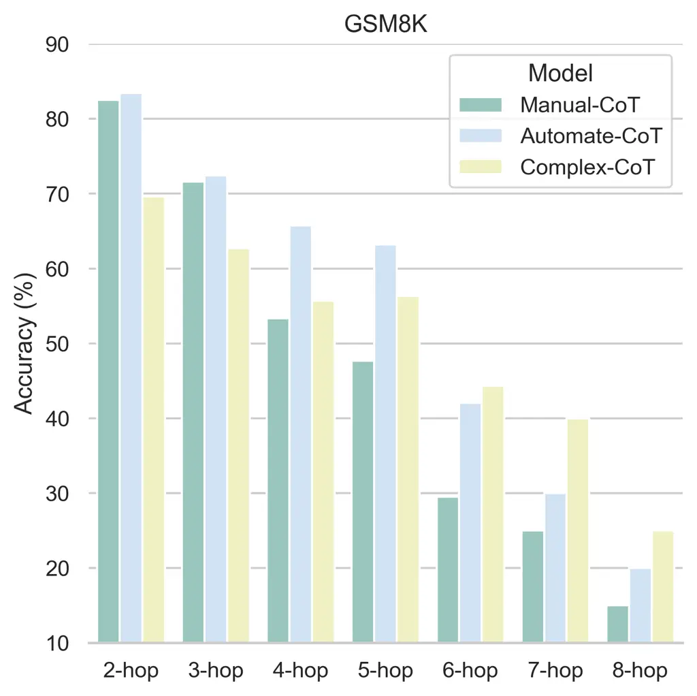
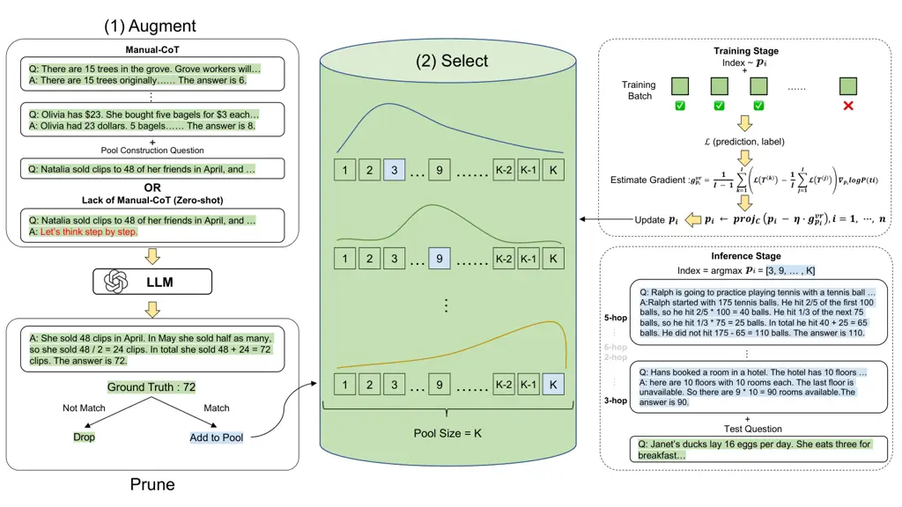
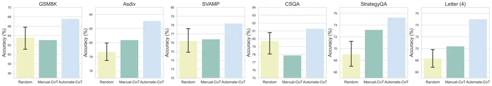
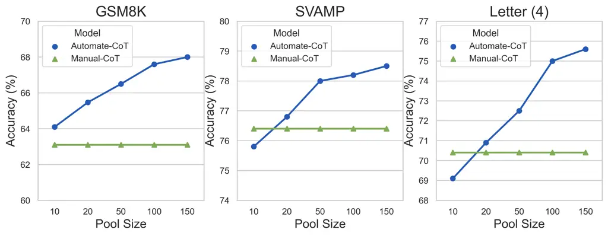

# Automatic Prompt Augmentation and Selection with Chain-of-Thought from Labeled Data

Kashun Shum Email: [ksshumab@ust.hk](mailto:)    Shizhe Diao Email:
[sdiaoaa@ust.hk](mailto:)    Tong Zhang Affiliation: The Hong Kong
University of Science and Technology Email: [tongzhang@ust.hk](mailto:)

###### Abstract

Chain-of-thought (CoT) advances the reasoning abilities of large
language models (LLMs) and achieves superior performance in complex
reasoning tasks. However, most CoT studies rely on carefully designed
human-annotated rational chains to prompt LLMs, posing challenges for
real-world applications where labeled data is available without rational
chains. This paper proposes a new strategy, Automate-CoT (Automatic
Prompt Augmentation and Selection with Chain-of-Thought), that can
bypass human engineering of CoT by automatically augmenting rational
chains from a small labeled dataset, and then pruning low-quality chains
to construct a candidate pool of machine-generated rationale chains
based on the labels. Finally, it selects the optimal combination of
several rationale chains from the pool for CoT prompting by employing a
variance-reduced policy gradient strategy to estimate the significance
of each example. Automate-CoT enables a quick adaptation of the CoT
technique to different tasks. Experimental results demonstrate the
effectiveness of our method, where competitive results are achieved on
arithmetic reasoning (+2.7%), commonsense reasoning (+3.4%), symbolic
reasoning (+3.2%), and non-reasoning tasks (+2.5%).¹¹ 1 The code is
available at
[https://github.com/SHUMKASHUN/Automate-CoT](https://github.com/SHUMKASHUN/Automate-CoT).

^(\*)^(\*)footnotetext: Equal Contribution.

## 1 Introduction

The recent success in large language models (LLMs) has shown that
properly prompted LLMs demonstrate emergent capabilities on complex
understanding and question-answering tasks (Wei et al., 2022a).
Especially, with the recently proposed chain-of-thought (CoT) prompting
(Wei et al., 2022b), LLMs are capable of solving reasoning tasks
including arithmetic reasoning, commonsense reasoning, and symbolic
reasoning. The basic idea of CoT prompting is adding a few rationale
chains to the answer as exemplars to illustrate the intermediate
reasoning steps. Following CoT, several recent studies improve it by
leveraging self-consistency (Wang et al., 2023), explanation learning
(Lampinen et al., 2022), complexity-based prompting (Fu et al., 2023),
self-training (Huang et al., 2022), voting verifier (Li et al., 2022a),
and bootstrapping (Zelikman et al., 2022).

However, most of them are constrained to a few fixed human-written
exemplars, which require significant human efforts to create and adapt
to new datasets. The annotation process is nontrivial because humans
need to not only select the questions but also carefully design the
reasoning steps for each question. In the process of searching for the
perfect exemplars, we identify four critical factors that affect the
performance of chain-of-thought prompting and require large human effort
to deal with: (1) order sensitivity (Zhao et al., 2021): the order
combination of the exemplars; (2) complexity (Sugawara et al., 2018; Lai
et al., 2021; Fu et al., 2023): the number of reasoning steps of the
rationale chains; (3) diversity: the combination of different
complex-level exemplars; (4) style sensitivity (Papadopoulos et al.,
2010): the writing/linguistic style of the rationale chains. Detailed
analysis of the four factors is covered in Section 2. All of these
sensitivities make human-based prompt engineering costly and motivate us
to find an automatic and task-agnostic way to adapt chain-of-thought
exemplars to any downstream tasks.

In this paper, we solve these problems by a CoT augmentation and
selection process to find suitable exemplars automatically. This can be
divided into three steps: (1) Augment: The language model generates
multiple pseudo-chains for query questions automatically. (2) Prune:
Based on an assumption: Generating correct reasoning is a necessary
condition for generating correct answers. This assumption is natural
because the answer is generated after several reasoning steps. When a
correct answer is generated, the rationale chain of these steps is most
likely correct, contributing to the final correctness. As a result, We
prune the pseudo-chains according to the consistency between generated
and ground-truth answers to reduce the noise. (3) Select: Given that all
the data have been annotated with rationale paths, we propose to apply a
variance-reduced policy gradient strategy (Williams, 1992; Dong et al.,
2020; Zhou et al., 2021; Diao et al., 2022) to estimate the gradients
and optimize the selection process to find the most helpful
chain-of-thought for each task. Compared to prior manually written CoT,
Automate-CoT could find the optimal and diverse CoT automatically,
adaptable to any task without human effort. Compared with Auto-CoT
(Zhang et al., 2023), which samples diverse questions by clustering and
generates rationale chains, Automate-CoT considers and mitigates the
aforementioned sensitivity issues, while achieving a greater performance
boost for each task. Automate-CoT is a fully automatic pipeline for
finding better chain-of-thought prompts, mitigating the sensitivity
issues of manually written exemplars, and further improving the
performance by a large margin. Experimental results demonstrate the
effectiveness of Automate-CoT on arithmetic reasoning (+2.7%),
commonsense reasoning (+3.4%), symbolic reasoning (+3.2%), and
non-reasoning tasks (+2.5%).

## 2 Motivation

Recent studies observed sensitivity issues of GPT-3’s few-shot learning
caused by different selections of in-context examples such as order
instability (Zhao et al., 2021; Zhang et al., 2022; Liu et al., 2022; Lu
et al., 2022). Based on their findings, we first investigate whether
these sensitivities still exist in chain-of-thought methods. Then we
further explore other factors that would not only affect the performance
but require human efforts to deal with. We conclude with the following
four factors:



Figure 1: The performance across different numbers of hops (reasoning
steps of rationale chains) on GSM8K. Manual-CoT refers to the
human-written chain-of-thought by Wei et al. (2022b). Complex-CoT refers
to the chain-of-thought using 9-hop rationale chains.



Figure 2: Illustrations of our proposed approach. The left and middle
parts of the figure contain two steps of our method: (1) Augment and
Prune and (2) Select. The right part illustrates the training stage
(right top) and the inference stage (right bottom), respectively.

$`\bullet`$ Order Sensitivity: Different orders of few-shot exemplars
may cause a huge impact on the performance in traditional few-shot
prompting (Lu et al., 2022). Thus we conduct experiments on GPT-3 to
test if there is such sensitivity in chain-of-thought methods. Although
Manual-CoT (Wei et al., 2022b) reports that the human-written CoT is
robust to order changes ($`<`$2%) with the LaMDA model, we observed that
the performance of GPT-3 fluctuates with different orders of
chain-of-though exemplars. For the GSM8K dataset, we simply randomly
shuffle the order of the exemplars in Manual-CoT 10 times and the lowest
accuracy can be 59.8% which is 3.3% lower than the average accuracy
(63.1%) they report, suggesting that order sensitivity still exists.

$`\bullet`$ Complexity: We first define complexity as the number of hops
(reasoning steps) in an exemplar where more steps indicate greater
complexity. It is observed that human-written CoT tends to be simple
($`\leq`$3 hops), achieving good accuracy in simple math questions while
suffering from complex questions, as shown in Figure 1. In addition, a
previous study (Fu et al., 2023) suggested that using all complex
exemplars can improve CoT performance. However, in our experiments
(Figure 1), we found that Complex-CoT can improve the accuracy of
complex questions, but perform poorly in simple questions. Therefore, we
conjecture that the inconsistency between the hops of provided exemplars
and the required hops of the real question causes the performance drop,
suggesting that determining the appropriate complexity level of
exemplars is crucial.

$`\bullet`$ Diversity: Based on the above discovery about complexity, a
natural question is what combination of different complex-level
exemplars is most effective. However, testing various combinations is a
challenging task for humans and requires significant effort to determine
the optimal one. In our experiments (Figure 1), we found that a
combination of different complex-level exemplars outperforms CoT with
all complex exemplars, suggesting a complexity-diversity trade-off.

$`\bullet`$ Style Sensitivity: Previous research in educational
psychology found that different learning styles would limit the
cognitive benefit for students from the prompting (Papadopoulos et al.,
2010). We further argue that students with specific learning styles
benefit to varying degrees from different styles of prompting. In
addition, the empirical evidence from Manual-CoT (Wei et al., 2022b)
shows that different annotators can cause up to 28.2% accuracy
difference in a symbolic reasoning task, verifying our conjecture. As a
result, some bad styles may lead to a huge performance drop. However,
humans cannot determine the performance of a particular style
beforehand, so it requires trial and error by checking on the validation
set, which further increases the effort of writing chain-of-thought
exemplars.

In light of this empirical evidence, we are motivated to design a
framework not only to augment rationale chains but also to select
helpful chains adaptively. With this framework, it is expected to bypass
the order and style sensitivities and reach a better
complexity-diversity trade-off without human effort, finally boosting
performance.

## 3 Approach

Our approach receives a training dataset $`D`$ containing $`n`$
questions $`Q=\{q_{1},q_{2},...,q_{n}\}`$, and $`n`$ answers
$`A=\{a_{1},a_{2},...,a_{n}\}`$. The overall architecture of our
approach is shown in Figure 2. In this section, we start with a detailed
description of augment and prune operation and end with an illustration
of select operation.

### 3.1 Augment and Prune

Inspired by Wang et al. (2022), which shows that the generated rationale
chains are of comparable quality to the human-annotated ones, we aim to
automatically generate the rationale chains to augment the candidate
exemplars. Given $`m`$ fixed rationale chains
$`C=\{c_{1},c_{2},...,c_{m}\}`$, a question $`q`$, we ask the large
language model $`\mathcal{G}`$ to generate $`k`$ rationale chains for
each $`q`$. A larger k can form a larger pool and some post-processes
can be done to improve the quality of the pool. Considering the cost and
efficiency, we choose $`k=1`$ for our experiments. Our method works well
even without $`C`$ (i.e., $`m=0`$), which is based on zero-shot
prompting. Then we prune those incorrect ones out and only keep those
with the correct final answer. In other words, the final answer should
be consistent with the ground-truth answer. After pruning, we obtain a
pool of $`K`$ high-quality exemplars.

### 3.2 Select

With a large pool of high-quality exemplars, we cannot directly apply
all of them due to four considerations: (1) context length limit: the
maximum length is 2,048 for GPT-3, so we cannot feed too many exemplars
into the model. (2) fair comparison: existing studies usually take 4-8
question-answer pairs as exemplars following Wei et al. (2022b). (3)
sensitivity: the model performance may be sensitive to the contexts
(Jiang et al., 2020), orders (Lu et al., 2022) and lengths (Lester et
al., 2021) from the observation of prompt learning literature. (4)
adaptation: different downstream tasks may require different exemplars.
Therefore, a natural idea is to select the most suitable 4-8 exemplars
automatically.

The process can be deemed as optimizing a supervised model with latent
variables. For each chain-of-thought index $`i`$, we initialize a latent
variable $`j_{i}\sim\operatorname{Cat}(\bm{p}_{i})`$. The random
variable $`j_{i}`$ is sampled with the probability distribution
$`\bm{p}_{i}=[p_{i,1},\cdots,p_{i,N}]`$ over the $`N`$ candidate
demonstration indexes, where $`\bm{p}_{i}\in\mathcal{C}`$ and
$`\mathcal{C}=\{\bm{p}:\|\bm{p}\|_{1}=1,0\preceq\bm{p}\preceq 1\}`$.
Since $`\bm{p}_{i}`$ is independent of each other, the joint probability
of the whole input exemplars is
$`P(T)=\Pi_{i=1}^{n}P(t_{i})=\Pi_{i=1}^{n}p_{i,j_{i}}`$. The loss is
formulated as $`\mathcal{L}(\mathcal{G}([T,S],y))`$, where $`T`$
represents the full few-shot exemplars, $`t_{i}`$ denotes the i-th
exemplar, and $`S`$ is the current question (user’s query). However,
directly updating the prompts by back-propagating through
$`\nabla_{\bm{p}_{i}}\mathcal{L}(\mathcal{G}([T,S],y))`$ is not possible
because of the inaccessible gradients, where $`y`$ is the label. We
resort to the variance-reduced policy gradient estimator (VR-PGE)
(Williams, 1992; Dong et al., 2020; Zhou et al., 2021; Diao et al.,
2022), a kind of reinforcement learning method to optimize the loss
function via forward propagation with:

```math
\mathbb{E}_{T}\left[\mathcal{L}(T)\right]=\int\mathcal{L}(T)P(T)\mathop{}\!\mathrm{d}T, \tag{1}
```

and estimate the gradient of $`\bm{p}_{i}`$ by:

```math
\bm{g}^{vr}_{\bm{p}_{i}}=\frac{1}{I-1}\sum_{k=1}^{I}\left(\mathcal{L}(T^{(k)})-\frac{1}{I}\sum_{j=1}^{I}\mathcal{L}(T^{(j)})\right)\nabla_{\bm{p}_{i}}\log P(t_{i}) \tag{2}
```

where $`T^{(k)},k=1,\cdots,I`$ are sampled independently from $`P(T)`$.
Therefore, the exemplar distribution $`\bm{p}_{i}`$ can be updated by a
projected stochastic gradient descent algorithm:

```math
\bm{p}_{i}\leftarrow\operatorname{proj}_{\mathcal{C}}(\bm{p}_{i}-\eta\cdot\bm{g}^{vr}_{\bm{p}_{i}}),i=1,\cdots,n \tag{3}
```

where $`\eta`$ is the learning rate, $`I`$ is the sample size, and
$`\operatorname{proj}_{\mathcal{C}}`$ is the projection calculation
(details are presented in the Appendix A).

## 4 Experimental Settings

In this section, we first introduce the setting of eleven datasets and
their corresponding evaluation metrics (§ 4.1). Then the baseline models
(§ 4.2) and implementation details (§ 4.3) are presented in the
following two subsections, respectively. Full details about the
experimental setting are illustrated in Appendix B.

### 4.1 Datasets and Evaluation Metrics

Following Wei et al. (2022b), we conduct our experiments on eight
reasoning tasks, including five math word problem datasets: GSM8K,
ASDiv, SVAMP, AQuA, and SingleOp; two commonsense reasoning datasets:
CommonsenseQA (CSQA) and StrategyQA, and one symbolic reasoning task:
Last Letter Concatenation (Letter (4)). We also generalize our method to
non-reasoning tasks including one question-answering task (OpenBookQA),
one natural language inference task (e-SNLI), and one sentiment analysis
task (SST-2). The detailed statistics of the datasets are listed in
Table 5. The evaluation metric for all tasks is the exact match
accuracy. First, we conduct pre-processing for predictions to remove all
the special symbols. For example, "\$100,000" will be processed to
"100000". Then we check if it has the same value as the ground truth to
calculate the exact match accuracy.

### 4.2 Baselines

We compare our method with the following baseline methods:
chain-of-thought (Manual-CoT) (Wei et al., 2022b), self-consistency (SC)
(Wang et al., 2023), and Auto-CoT (Zhang et al., 2023). And we utilize
the public APIs from OpenAI’s services²² 2
[https://openai.com/api/](https://openai.com/api/) and test with
text-davinci-002 and code-davinci-002.

|                  |                                            |                                            |                                            |                                            |                                            |                                            |                                            |                                            |                                            |                                            |                                            |                                            |
| ---------------- | ------------------------------------------ | ------------------------------------------ | ------------------------------------------ | ------------------------------------------ | ------------------------------------------ | ------------------------------------------ | ------------------------------------------ | ------------------------------------------ | ------------------------------------------ | ------------------------------------------ | ------------------------------------------ | ------------------------------------------ |
| Method           | GSM8K                                      | ASDiv                                      | SVAMP                                      | AQuA                                       | SingleOp                                   | CSQA                                       | STQA                                       | Letter (4)                                 | OBQA                                       | e-SNLI                                     | SST-2                                      | Avg.                                       |
| Prior Best\*     | 55.0^(a)                                   | 75.3^(b)                                   | 57.4^(c)                                   | 37.9^(d)                                   | \-                                         | 91.2^(e)                                   | 73.9^(f)                                   | \-                                         | \-                                         | \-                                         | 97.5^(g)                                   | \-                                         |
| text-davinci-002 |                                            |                                            |                                            |                                            |                                            |                                            |                                            |                                            |                                            |                                            |                                            |                                            |
| Auto-CoT         | 47.9                                       | \-                                         | 69.5                                       | 36.5                                       | \-                                         | 74.4                                       | 65.4                                       | 59.7                                       | \-                                         | \-                                         | \-                                         | \-                                         |
| Manual-CoT       | 46.9                                       | 71.3                                       | 68.9                                       | 35.8                                       | 88.8                                       | 73.5                                       | 65.4                                       | 56.6                                       | 75.5                                       | 79.1                                       | 86.2                                       | 68.0                                       |
| + Automate-CoT   | 49.7$`{\color[rgb]{1,0,0}\uparrow_{2.8}}`$ | 74.2$`{\color[rgb]{1,0,0}\uparrow_{2.9}}`$ | 73.3$`{\color[rgb]{1,0,0}\uparrow_{4.4}}`$ | 37.9$`{\color[rgb]{1,0,0}\uparrow_{2.1}}`$ | 90.0$`{\color[rgb]{1,0,0}\uparrow_{1.2}}`$ | 76.1$`{\color[rgb]{1,0,0}\uparrow_{2.6}}`$ | 67.9$`{\color[rgb]{1,0,0}\uparrow_{2.5}}`$ | 58.9$`{\color[rgb]{1,0,0}\uparrow_{2.3}}`$ | 79.1$`{\color[rgb]{1,0,0}\uparrow_{3.6}}`$ | 82.3$`{\color[rgb]{1,0,0}\uparrow_{3.2}}`$ | 87.5$`{\color[rgb]{1,0,0}\uparrow_{1.3}}`$ | 70.6$`{\color[rgb]{1,0,0}\uparrow_{2.6}}`$ |
| SC               | 58.2                                       | 76.9                                       | 78.2                                       | 41.8                                       | 90.8                                       | 72.9                                       | 70.7                                       | 57.6                                       | 81.5                                       | 83.4                                       | 89.2                                       | 72.8                                       |
| + Automate-CoT   | 67.8$`{\color[rgb]{1,0,0}\uparrow_{9.6}}`$ | 78.9$`{\color[rgb]{1,0,0}\uparrow_{2.0}}`$ | 80.5$`{\color[rgb]{1,0,0}\uparrow_{2.3}}`$ | 43.4$`{\color[rgb]{1,0,0}\uparrow_{1.6}}`$ | 91.9$`{\color[rgb]{1,0,0}\uparrow_{1.1}}`$ | 80.2$`{\color[rgb]{1,0,0}\uparrow_{7.3}}`$ | 76.3$`{\color[rgb]{1,0,0}\uparrow_{5.6}}`$ | 60.8$`{\color[rgb]{1,0,0}\uparrow_{3.2}}`$ | 84.8$`{\color[rgb]{1,0,0}\uparrow_{3.3}}`$ | 86.4$`{\color[rgb]{1,0,0}\uparrow_{3.0}}`$ | 90.6$`{\color[rgb]{1,0,0}\uparrow_{1.4}}`$ | 76.5$`{\color[rgb]{1,0,0}\uparrow_{3.7}}`$ |
| code-davinci-002 |                                            |                                            |                                            |                                            |                                            |                                            |                                            |                                            |                                            |                                            |                                            |                                            |
| Auto-CoT         | 62.8                                       | \-                                         | \-                                         | \-                                         | \-                                         | \-                                         | \-                                         | \-                                         | \-                                         | \-                                         | \-                                         | \-                                         |
| Manual-CoT       | 63.1                                       | 80.4                                       | 76.4                                       | 45.3                                       | 91.8                                       | 77.9                                       | 73.2                                       | 70.4                                       | 80.4                                       | 67.5                                       | 89.7                                       | 74.2                                       |
| + Automate-CoT   | 67.6$`{\color[rgb]{1,0,0}\uparrow_{4.5}}`$ | 83.1$`{\color[rgb]{1,0,0}\uparrow_{2.7}}`$ | 78.2$`{\color[rgb]{1,0,0}\uparrow_{1.8}}`$ | 47.8$`{\color[rgb]{1,0,0}\uparrow_{2.5}}`$ | 92.4$`{\color[rgb]{1,0,0}\uparrow_{0.6}}`$ | 81.3$`{\color[rgb]{1,0,0}\uparrow_{3.4}}`$ | 75.3$`{\color[rgb]{1,0,0}\uparrow_{2.1}}`$ | 75.0$`{\color[rgb]{1,0,0}\uparrow_{4.6}}`$ | 83.2$`{\color[rgb]{1,0,0}\uparrow_{2.8}}`$ | 71.2$`{\color[rgb]{1,0,0}\uparrow_{3.7}}`$ | 90.8$`{\color[rgb]{1,0,0}\uparrow_{1.1}}`$ | 76.9$`{\color[rgb]{1,0,0}\uparrow_{2.7}}`$ |
| SC               | 78.0                                       | 87.8                                       | 86.8                                       | 52.0                                       | 92.8                                       | 81.5                                       | 79.8                                       | 73.4                                       | 88.4                                       | 74.8                                       | 91.5                                       | 80.6                                       |
| + Automate-CoT   | 82.4$`{\color[rgb]{1,0,0}\uparrow_{4.4}}`$ | 88.9$`{\color[rgb]{1,0,0}\uparrow_{1.1}}`$ | 87.8$`{\color[rgb]{1,0,0}\uparrow_{1.0}}`$ | 55.6$`{\color[rgb]{1,0,0}\uparrow_{3.6}}`$ | 94.0$`{\color[rgb]{1,0,0}\uparrow_{1.2}}`$ | 84.0$`{\color[rgb]{1,0,0}\uparrow_{2.5}}`$ | 80.6$`{\color[rgb]{1,0,0}\uparrow_{0.8}}`$ | 76.2$`{\color[rgb]{1,0,0}\uparrow_{2.8}}`$ | 89.7$`{\color[rgb]{1,0,0}\uparrow_{1.3}}`$ | 78.3$`{\color[rgb]{1,0,0}\uparrow_{3.5}}`$ | 92.8$`{\color[rgb]{1,0,0}\uparrow_{1.3}}`$ | 82.8$`{\color[rgb]{1,0,0}\uparrow_{2.2}}`$ |

Table 1: The overall performance of Automate-CoT and the comparison
against existing models on eleven downstream tasks. Manual-CoT and SC
represent chain-of-thought (Wei et al., 2022b) and self-consistency
(Wang et al., 2023) methods. Bold denotes the best in
code-davinci-002-based methods and Underline denotes the best in
text-davinci-002-based methods. \*: Prior Best is the best performance
before CoT comes out. $`a`$: Cobbe et al. (2021), $`b`$: Lan et al.
(2022), $`c`$: Pi et al. (2022), $`d`$: Amini et al. (2019), $`e`$: Xu
et al. (2022), $`f`$: Chowdhery et al. (2022), $`g`$: Raffel et al.
(2020). Most statistics of Manual-CoT and SC have been obtained directly
from their latest version. For some entries they did not report, we
obtain the result from DiVerSe (Li et al., 2022b).

### 4.3 Implementation

#### Augment and Prune:

Following Wei et al. (2022b) and Wang et al. (2022), we keep the same
number of exemplars (4-8) listed in Table 5. For main experiments, we
augment and prune a pool of 100 high-quality exemplars for all datasets.

#### Select:

Both the training and validation sets have a size of 100 to reach a
performance and cost trade-off. Then by utilizing the log probability
returned by API calls, we calculate the cross-entropy loss of the answer
token. Finally, we optimize the latent variables by AdamW (Loshchilov
and Hutter, 2019) for 5 epochs with a learning rate of
$`1\times 10^{-3}`$ and batch size of 10. After optimization, we choose
the exemplars combination ($`\mathop{\arg\max}\;\bm{p}_{i}`$) with the
highest validation accuracy to be further evaluated on the test set. By
default, we query the language model once to get the answer. Under the
self-consistency setting, similar to Wang et al. (2023), we query the
language model 40 times and choose the most consistent one as the final
answer.

#### Hyper-parameter Setting:

Under few-shot setting, we set max_tokens = 256 for all augmentation,
selection and inference. In addition, we set logprobs = 5 when training.
Moreover, we set temperature = 0.7 for evaluation under self-consistency
while temperature = 0 for all other cases.

## 5 Experimental Results

The experimental results are shown in Table 1. We discuss our results in
three sections based on the task categories. Automate-CoT are averaged
over three runs, and the variance over different runs is reported in
Appendix Table 7. Overall, Automate-CoT achieves superior results on all
tasks. With text-davinci-002, Automate-CoT outperforms Manual-CoT and SC
by 2.6% and 3.7% on average. With code-davinci-002, Automate-CoT also
outperforms Manual-CoT and SC by 2.7% and 2.2%, respectively.



Figure 3: Comparisons between Random Selection, Manual-CoT and
Automate-CoT on six datasets.

#### Arithmetic Reasoning:

For text-davinci-002, Automate-CoT improves Manual-CoT by 2.7% over five
arithmetic reasoning tasks. In addition, under the self-consistency
setting, Automate-CoT improves SC by a large margin by an average of
3.3%. Moreover, compared to Auto-CoT, Automate-CoT also outperforms it
on all three arithmetic tasks (GSM8K, SVAMP, and AQuA). While for
code-davinci-002, Automate-CoT achieves an average of 2.4% improvement
across all five arithmetic reasoning tasks, illustrating the
effectiveness of our proposed approach with different language models.
Additionally, Automate-CoT outperforms Auto-CoT in GSM8K by 4.8%, since
Auto-CoT only constructs experiments on GSM8K under code-davinci-002.
Automate-CoT demonstrates consistent improvement over arithmetic tasks,
especially on GSM8K, where it can outperform Manual-CoT by a large
margin. Finally, under the self-consistency setting, Automate-CoT also
shows similar trends to improve the SC baseline, demonstrating the
synergistic effects of our proposed method and self-consistency method.

#### Commonsense and Symbolic Reasoning

Similarly, on commonsense and symbolic reasoning tasks, Automate-CoT
demonstrates significant improvement over Manual-CoT, SC, and Auto-CoT.
It achieves an average of 2.5% and 3.4% improvement on text-davinci-002
and code-davinci-002 respectively, demonstrating that our method is
effective on different task types. More surprisingly, the improvement in
the Letter (4) is significant, demonstrating our method’s robustness to
deal with out-of-distribution data.

#### Non-Reasoning Tasks

Automate-CoT has also reached great success on question answering
(OpenBookQA), natural language inference (e-SNLI), and sentiment
analysis (SST-2) tasks by an improvement of 2.8%, 3.4% and 1.3%,
respectively. The results show that our method can be generalized to
various task types and is not limited to reasoning tasks.

## 6 Additional Experiments and Analysis

We further conduct several experiments to evaluate the effectiveness of
Automate-CoT and analyze the contributions of each module. Since queries
to text-davinci-002 are limited and expensive, most additional
experiments are conducted with code-davinci-002.

### 6.1 Effects of Selection Algorithm

After obtaining a large pool of exemplars, a natural question would be
what is the performance if we randomly select from the pool regardless
of order. In Figure 3, we compare the accuracy obtained by random
selection, human-written (Manual-CoT), and our Automate-CoT. For random
selection, we randomly sample exemplars from the pool and combine them
regardless of order to form the prompts. We repeat this process five
times and report the accuracy with an error bar. The results show that
random selection suffers from high variance and relatively low accuracy
compared to Manual-CoT and Automate-CoT. Surprisingly, we observed the
average performance of a random selection from model-generated exemplars
can outperform Manual-CoT in some datasets (e.g. GSM8K, CSQA). This also
suggests that manual prompt engineering needs to take efforts to design
carefully in terms of difficulty, diversity, and style. In conclusion,
if we simply randomly select the exemplars from the pool, it is very
likely to obtain a much lower accuracy than the manually written method.
However, our Automate-CoT can consistently outperform random selection
and Manual-CoT which shows the effectiveness of our method.

### 6.2 Effects of Pool Size

We further conduct a set of experiments to test different pool sizes. As
shown in Figure 4, if the pool size is limited to only 10, the
performance of Automate-CoT is worse than Manual-CoT or comparable with
Manual-CoT. It turns out that if the pool size is small, Automate-CoT is
unable to select a good combination to beat carefully designed
Manual-CoT. However, Automate-CoT can outperform Manual-CoT when the
pool size reaches 20 or larger. The trends show that the performance
would be better as pool size keeps increasing. This is intuitive and
matches our hypothesis because as pool size increases, there would be
more complex, diverse exemplars to choose from. It is expected that the
performance would keep increasing, but since more queries for GPT-3 are
time-consuming and expensive, we limited these additional experiments to
have a max pool size of 150.



Figure 4: The performance across different pool sizes of Automate-CoT
compare with Manual-CoT. Pool size refers to the number of exemplars in
the pool.

### 6.3 Effects of Chain Complexity

It is observed that exemplars written by human are rather simple, so we
further explore how chain complexity affect performance. We randomly
pick 8 exemplars with complex rationale chains (each has 9 hops) and
refer to them as Complex-CoT. For human-written exemplars (Manual-CoT)
Wei et al. (2022b), exemplars are all 2-3 hops. We compare them with our
Automate-CoT which has an average hop of 4 and ranges from 2-hop to
6-hop on GSM8K dataset. From Figure 1, Manual-CoT has an overall
accuracy of 62%, achieving good results on simple questions. However, it
suffers from complex math questions, especially 7-hop and 8-hop
questions. Complex-CoT can improve the accuracy on complex questions by
a large margin but it performs poorly on simple questions, which only
has an overall accuracy of 60%. In contrast, our Automate-CoT can select
a combination of different complex-level exemplars automatically. It
achieves good results on simple questions and reasonable results on
complex questions at the same time, outperforming both Manual-CoT and
Complex-CoT by a large margin. The result shows the superiority of our
method because it can automatically achieve a complexity-diversity
trade-off.

### 6.4 Effects of Training Example Selection

Since training examples to construct CoT are randomly chosen, we also
measure the performance vary regarding this random selection. Three
different randomly chosen training sets are used to train Automate-CoT
and the results are reported in Table 2. According to the result,
Automate-CoT shows its robustness to training examples. Randomly chosen
training examples have quite a small impact on the result.

| Runs                | GSM8K | SVAMP | Letter(4) |
| ------------------- | ----- | ----- | --------- |
| Rand(Training Set)₁ | 67.55 | 78.2  | 75.0      |
| Rand(Training Set)₂ | 67.93 | 77.8  | 76.6      |
| Rand(Training Set)₃ | 67.25 | 77.6  | 75.8      |
| Variance            | 0.077 | 0.062 | 0.426     |

Table 2: The effect of different randomly chosen training set on
performance over three datasets.

### 6.5 Bypass Manual Effort by Zero-shot-CoT

Starting with 4-8 manually constructed chain-of-thought exemplars, our
methods show great success in automatically generating, pruning, and
selecting suitable exemplars for each task. After that, we raise a new
question: Can we further bypass the effort of writing the initial
chain-of-thought exemplars? Based on current research of Zero-Shot-CoT
(Kojima et al., 2022), we found it is possible. Instead of using 4-8
manual-written exemplars to generate the chains, we simply add "Let’s
think step by step." and let LLMs generate the chains. We test the
result under text-davinci-002 model on GSM8K, SVAMP, and Letter (4) and
compare it with Zero-shot-CoT, Manual-CoT and Auto-CoT. Surprisingly, we
observe the result can be comparable and even outperform Manual-CoT and
Auto-CoT a bit as shown in Table 3. The results further demonstrate that
our method can effectively select a suitable combination of exemplars
even from a pool that may contain low-quality chains. In conclusion, if
a dataset already has manually written chains, our method can be applied
to boost the performance. If a dataset does not have manually written
chains, our method can still be used to achieve higher accuracy than if
it had manually written chains, demonstrating the superiority of our
method.

| Method                 | GSM8K | SVAMP | Letter (4) |
| ---------------------- | ----- | ----- | ---------- |
| Zero-Shot-CoT          | 40.7  | 62.1  | 57.6       |
| Manual-CoT             | 46.9  | 73.5  | 56.6       |
| Auto-CoT               | 48.9  | 69.5  | 59.7       |
| Zero-Shot-Automate-CoT | 49.1  | 74.3  | 59.3       |
| Automate-CoT           | 49.7  | 76.1  | 58.9       |

Table 3: The performance of Automate-CoT in zero-shot setting compared
with other baselines. Lightgray highlights our main model which uses a
manually constructed chain-of-thought and is not intended for
comparison. We list it here only for reference.

## 7 Ablation Study

In this section, we further conduct ablation experiments to verify the
advantage of the generated prompts on four factors, respectively.

#### Advantage over Order Factor

The advantages of Automate-CoT on order factor can be viewed in two
ways. Firstly, it requires a large human effort to determine a good
order by trying many different orders on validation sets. However,
Automate-CoT can automatically construct the exemplars without further
adjustment to have a good result. Secondly, Automate-CoT is less
affected by the order sensitivity. We further conduct an experiment to
compare selected exemplars and random permutations of Automate-CoT’s
selected exemplars as shown in Table 4. We randomly permutate the
selected exemplars to see how performance varies compared to the
selected order by Automate-CoT. It is observed that the order
sensitivity still exists and our selected exemplars have better
performance than that of all 5 random permutation runs, demonstrating
Automate-CoT can automatically choose a good order without any human
effort.

|                     |               |               |               |
| ------------------- | ------------- | ------------- | ------------- |
| Runs                | GSM8K         | SVAMP         | Letter(4)     |
| perm(Automate-CoT)₁ | 66.7          | 77.2          | 73.0          |
| perm(Automate-CoT)₂ | 66.6          | 78.4          | 72.6          |
| perm(Automate-CoT)₃ | 66.9          | 78.0          | 72.0          |
| perm(Automate-CoT)₄ | 67.8          | 78.2          | 74.2          |
| perm(Automate-CoT)₅ | 67.5          | 78.1          | 75.0          |
| Automate-CoT        | 68.4          | 78.7          | 75.2          |
| Mean\_(±std)        | 67.3\_(±0.64) | 78.2\_(±0.46) | 73.7\_(±1.21) |

Table 4: Comparison of different permutations orders of Automate-CoT’s
selected examplars.

#### Advantage over Complexity Factor

As discussed in the complexity factor of Section 2, we show that the
complexity of manually written chains is quite simple (less than or
equal to 3 hops). It would require more human effort to design complex
rationales. However, Automate-CoT can automatically augment and select
examples with different complexity, reaching a better trade-off accuracy
between simple questions and complex questions (Appendix Table 9).

#### Advantage over Diversity Factor

The diversity of Manual-CoT or Complexity-CoT is limited. For example,
every exemplar of Complexity-CoT has the same complexity and every
exemplar of Manual-CoT ranges from 1-3 hops as illustrated in the
motivation section. However, Automate-CoT can automatically select an
optimal combination of complexity that best suits the dataset. For
example, our selected exemplars on GSM8K have an average hop of 5.4 and
range from 3 hops to 8 hops as shown in Appendix G. It contains both
simple exemplars and complex exemplars which reach the best performance.

#### Advantage over Style Factor

Our extensive experience with multiple experiments indicates that a good
linguistic style is typically formal and detailed. This style entails
the use of (1) explicit and logical connection words (e.g., "so", "that
means"), (2) detailed reasoning steps within a single sentence, (3)
symbols when appropriate (e.g., using the \$ symbol to denote monetary
values), and (4) minimizing the use of abbreviations. We further conduct
an ablation experiment to test how our method can choose the examples
with better style. Firstly, we use Automate-CoT to select 8 rationale
exemplars
$`S_{1}=\left[A_{1},B_{1},C_{1},D_{1},E_{1},F_{1},G_{1},H_{1}\right]`$
for GSM8K. Then we copy this set and edit its written / linguistic style
manually to be worse while keeping the order, complexity, and diversity
the same which gives
$`S_{2}=\left[A_{2},B_{2},C_{2},D_{2},E_{2},F_{2},G_{2},H_{2}\right]`$.
Now we have 16 examplars says
$`S=\left[A_{1},A_{2},B_{1},B_{2},...,H_{1},H_{2}\right]`$. A-H
represents the No.1-8 exemplars. Subscript 1 represents the originally
selected exemplars and 2 represents the edited ones. Then, Automate-CoT
selects 8 exemplars from the previous 16 exemplars. Note that we limit
Automate-CoT to select exactly one of $`\left[A_{1},A_{2}\right]`$ and
$`\left[B_{1},B_{2}\right]`$ … and keep the same order A-H.
Subsequently, when we perform Automate-CoT algorithm , we observe that
Automate-CoT is able to successfully select the original exemplars
$`S_{1}`$. Furthermore, we find that the selected exemplars can
outperform the non-selected exemplars by 2%.

## 8 Related Work

In this section, we first review the recent progress of prompt-based
learning (§8.1) and chain-of-thought prompting (§8.2), and then discuss
the black-box optimization methods (§8.3).

### 8.1 Prompt-based Learning

Prompt-based Learning (Prompting) aims to leverage large language models
(LLMs) (Devlin et al., 2018; Liu et al., 2019; He et al., 2021; Diao et
al., 2020; Diao et al., 2021) to trigger helpful knowledge for
downstream tasks. Existing prompting methods can be categorized into two
types based on their nature: 1) discrete prompts (Wallace et al., 2019;
Shin et al., 2020; Jiang et al., 2020; Yuan et al., 2021; Haviv et al.,
2021; Gao et al., 2021; Ben-David et al., 2022; Davison et al., 2019; Su
et al., 2022; Diao et al., 2022; Guo et al., 2023) and continuous
prompts (Zhong et al., 2021; Qin and Eisner, 2021; Hambardzumyan et al.,
2021; Liu et al., 2021; Han et al., 2021; Li and Liang, 2021; Yang et
al., 2023). Discrete prompts optimize a sequence of discrete tokens,
while continuous prompts optimize a sequence of vectors. One of the most
important advantages of prompting is saving fine-tuning costs by
refraining from the parameter changes of large language models, and we
only need to optimize a small set of parameters.

### 8.2 Chain-of-thought Prompting

Chain-of-thought (Wei et al., 2022b) introduces a chain of rationale
steps for each exemplar of in-context learning and significantly
improves the performance on several complex tasks like arithmetic
reasoning, commonsense reasoning, and symbolic reasoning. Based on this
simple yet effective idea, many following works propose different
strategies to improve it: self-consistency (Wang et al., 2023),
explanation learning (Lampinen et al., 2022), complexity-based prompting
(Fu et al., 2023), self-training (Huang et al., 2022), voting verifier
(Li et al., 2022a), zero-shot prompting (Kojima et al., 2022; Fung et
al., 2022), and bootstrapping (Zelikman et al., 2022).

### 8.3 Black-box Optimization

Nowadays, large language models provide services as commercial APIs
deployed in the cloud, such as OpenAI’s GPT-3 (Brown et al., 2020) and
ChatGPT³³ 3
[https://openai.com/blog/chatgpt/](https://openai.com/blog/chatgpt/). It
usually accepts query inputs and outputs the predictions with a web
interface. Their model parameters and gradients are not accessible,
causing difficulties in optimization with gradients. Previous research
on black-box optimization mainly focuses on score-based black-box
adversarial attack (Ilyas et al., 2018; Ilyas et al., 2019; Huang and
Zhang, 2020; Andriushchenko et al., 2020; Cheng et al., 2019). Most
recently, black-box prompt learning (Diao et al., 2022; Sun et al.,
2022; Prasad et al., 2022) is introduced, aiming to optimize the prompts
without accessing gradients, but their models suffer from limited
reasoning abilities and are limited to zero-shot settings with
classification task.

## 9 Conclusion

In this paper, we proposed a chain-of-thought optimization method
consisting of three steps: augment, prune, and select. Automate-CoT
first generates rationale chains according to the standard CoT process
with several exemplars, and then prunes those incorrect ones according
to the consistency of the predicted answer and ground-truth answer.
Finally, we apply a variance-reduced policy gradient strategy to
estimate the gradients and optimize the latent variables to select
better CoTs. Experimental results demonstrate the effectiveness of our
method on arithmetic reasoning, commonsense reasoning, symbolic
reasoning tasks, and non-reasoning tasks.

## 10 Limitations

It is shown that Automate-CoT demonstrates superior performance over
previous chain-of-thought prompting methods. However, despite these
exciting results, there are still some limitations to our current work,
as well as potential opportunities for future research.

#### Comparision with Fine-tuning

: Our main baselines include original chain-of-thought (Wei et al.,
2022b), self-consistency (Wang et al., 2023) which are manual-written
based prompt method. In addition, we also compare the clustering-based
and retrieval-based methods to select the prompt exemplars like Auto-CoT
(Zhang et al., 2023), BM25 (Robertson, 2009), PromptPG (Lu et al.,
2023). As large language models are dominating the field, the
performance of training the large language models by using these labeled
data might be interesting. However, it is not covered in this study due
to the prompt setting of this study and limited resources.

#### Prompt Style Definition

: Another limitation of this work is that it does not provide a rigorous
definition of what constitutes good versus bad linguistic style. While
we have observed several patterns of good and bad style during numerous
experiments, and the results show that Automate-CoT is able to mitigate
style sensitivity in Manual-CoT, we cannot determine what perfect style
entails. As such, we acknowledge that defining what constitutes good
versus bad linguistic style can be a challenging task and an important
area for further exploration and development.

## Acknowledgments

We thank the anonymous reviewers for their valuable suggestions. This
work was supported by the General Research Fund (GRF) of Hong Kong (No.
16310222). Shizhe Diao was supported by the Hong Kong Ph.D. Fellowship
Scheme (HKPFS).

## References

- Amini et al. (2019) Aida Amini, Saadia Gabriel, Shanchuan Lin, Rik
  Koncel-Kedziorski, Yejin Choi, and Hannaneh Hajishirzi. 2019. [MathQA:
  Towards interpretable math word problem solving with operation-based
  formalisms](https://doi.org/10.18653/v1/N19-1245). In _Proceedings of
  the 2019 Conference of the North American Chapter of the Association
  for Computational Linguistics: Human Language Technologies, Volume 1
  (Long and Short Papers)_, pages 2357–2367, Minneapolis, Minnesota.
  Association for Computational Linguistics.
- Andriushchenko et al. (2020) Maksym Andriushchenko, Francesco Croce,
  Nicolas Flammarion, and Matthias Hein. 2020. Square attack: a
  query-efficient black-box adversarial attack via random search. In
  _Computer Vision–ECCV 2020: 16th European Conference, Glasgow, UK,
  August 23–28, 2020, Proceedings, Part XXIII_, pages 484–501. Springer.
- Ben-David et al. (2022) Eyal Ben-David, Nadav Oved, and Roi
  Reichart. 2022. [PADA: Example-based prompt learning for on-the-fly
  adaptation to unseen domains](https://doi.org/10.1162/tacl_a_00468).
  _Transactions of the Association for Computational Linguistics_,
  10:414–433.
- Brown et al. (2020) Tom B. Brown, Benjamin Mann, Nick Ryder, Melanie
  Subbiah, Jared Kaplan, Prafulla Dhariwal, Arvind Neelakantan, Pranav
  Shyam, Girish Sastry, Amanda Askell, Sandhini Agarwal, Ariel
  Herbert-Voss, Gretchen Krueger, Tom Henighan, Rewon Child, Aditya
  Ramesh, Daniel M. Ziegler, Jeffrey Wu, Clemens Winter, Christopher
  Hesse, Mark Chen, Eric Sigler, Mateusz Litwin, Scott Gray, Benjamin
  Chess, Jack Clark, Christopher Berner, Sam McCandlish, Alec Radford,
  Ilya Sutskever, and Dario Amodei. 2020. [Language models are few-shot
  learners](https://proceedings.neurips.cc/paper/2020/hash/1457c0d6bfcb4967418bfb8ac142f64a-Abstract.html).
  In _Advances in Neural Information Processing Systems 33: Annual
  Conference on Neural Information Processing Systems 2020, NeurIPS
  2020, December 6-12, 2020, virtual_.
- Camburu et al. (2018) Oana-Maria Camburu, Tim Rocktäschel, Thomas
  Lukasiewicz, and Phil Blunsom. 2018. [e-snli: Natural language
  inference with natural language
  explanations](https://proceedings.neurips.cc/paper/2018/hash/4c7a167bb329bd92580a99ce422d6fa6-Abstract.html).
  In _Advances in Neural Information Processing Systems 31: Annual
  Conference on Neural Information Processing Systems 2018, NeurIPS
  2018, December 3-8, 2018, Montréal, Canada_, pages 9560–9572.
- Chen et al. (2021) Mark Chen, Jerry Tworek, Heewoo Jun, Qiming Yuan,
  Henrique Ponde de Oliveira Pinto, Jared Kaplan, Harri Edwards, Yuri
  Burda, Nicholas Joseph, Greg Brockman, et al. 2021. [Evaluating large
  language models trained on code](https://arxiv.org/abs/2107.03374).
  _ArXiv preprint_, abs/2107.03374.
- Cheng et al. (2019) Shuyu Cheng, Yinpeng Dong, Tianyu Pang, Hang Su,
  and Jun Zhu. 2019. [Improving black-box adversarial attacks with a
  transfer-based
  prior](https://proceedings.neurips.cc/paper/2019/hash/32508f53f24c46f685870a075eaaa29c-Abstract.html).
  In _Advances in Neural Information Processing Systems 32: Annual
  Conference on Neural Information Processing Systems 2019, NeurIPS
  2019, December 8-14, 2019, Vancouver, BC, Canada_, pages 10932–10942.
- Chowdhery et al. (2022) Aakanksha Chowdhery, Sharan Narang, Jacob
  Devlin, Maarten Bosma, Gaurav Mishra, Adam Roberts, Paul Barham, Hyung
  Won Chung, Charles Sutton, Sebastian Gehrmann, et al. 2022. [Palm:
  Scaling language modeling with
  pathways](https://arxiv.org/abs/2204.02311). _ArXiv preprint_,
  abs/2204.02311.
- Cobbe et al. (2021) Karl Cobbe, Vineet Kosaraju, Mohammad Bavarian,
  Jacob Hilton, Reiichiro Nakano, Christopher Hesse, and John
  Schulman. 2021. [Training verifiers to solve math word
  problems](https://arxiv.org/abs/2110.14168). _ArXiv preprint_,
  abs/2110.14168.
- Davison et al. (2019) Joe Davison, Joshua Feldman, and Alexander
  Rush. 2019. [Commonsense knowledge mining from pretrained
  models](https://doi.org/10.18653/v1/D19-1109). In _Proceedings of the
  2019 Conference on Empirical Methods in Natural Language Processing
  and the 9th International Joint Conference on Natural Language
  Processing (EMNLP-IJCNLP)_, pages 1173–1178, Hong Kong, China.
  Association for Computational Linguistics.
- Devlin et al. (2018) Jacob Devlin, Ming-Wei Chang, Kenton Lee, and
  Kristina Toutanova. 2018. [BERT: Pre-training of Deep Bidirectional
  Transformers for Language
  Understanding](https://doi.org/10.48550/arXiv.1810.04805). _arXiv_.
- Diao et al. (2020) Shizhe Diao, Jiaxin Bai, Yan Song, Tong Zhang, and
  Yonggang Wang. 2020. Zen: Pre-training chinese text encoder enhanced
  by n-gram representations. In _Findings of the Association for
  Computational Linguistics: EMNLP 2020_, pages 4729–4740.
- Diao et al. (2022) Shizhe Diao, Zhichao Huang, Ruijia Xu, Xuechun Li,
  Yong Lin, and Tong Zhang. 2022. [Black-box prompt learning for
  pre-trained language models](https://arxiv.org/abs/2201.08531). _ArXiv
  preprint_, abs/2201.08531.
- Diao et al. (2021) Shizhe Diao, Ruijia Xu, Hongjin Su, Yilei Jiang,
  Yan Song, and Tong Zhang. 2021. Taming pre-trained language models
  with n-gram representations for low-resource domain adaptation. In
  _Proceedings of the 59th Annual Meeting of the Association for
  Computational Linguistics and the 11th International Joint Conference
  on Natural Language Processing (Volume 1: Long Papers)_, pages
  3336–3349.
- Dong et al. (2020) Zhe Dong, Andriy Mnih, and George Tucker. 2020.
  [Disarm: An antithetic gradient estimator for binary latent
  variables](https://proceedings.neurips.cc/paper/2020/hash/d880e783834172e5ebd1868d84463d93-Abstract.html).
  In _Advances in Neural Information Processing Systems 33: Annual
  Conference on Neural Information Processing Systems 2020, NeurIPS
  2020, December 6-12, 2020, virtual_.
- Fu et al. (2023) Yao Fu, Hao Peng, Ashish Sabharwal, Peter Clark, and
  Tushar Khot. 2023. [Complexity-based prompting for multi-step
  reasoning](https://openreview.net/forum?id=yf1icZHC-l9). In
  _International Conference on Learning Representations_.
- Fung et al. (2022) Yi R Fung, Tuhin Chakraborty, Hao Guo, Owen Rambow,
  Smaranda Muresan, and Heng Ji. 2022. Normsage: Multi-lingual
  multi-cultural norm discovery from conversations on-the-fly. _arXiv
  preprint arXiv:2210.08604_.
- Gao et al. (2021) Tianyu Gao, Adam Fisch, and Danqi Chen. 2021.
  [Making pre-trained language models better few-shot
  learners](https://doi.org/10.18653/v1/2021.acl-long.295). In
  _Proceedings of the 59th Annual Meeting of the Association for
  Computational Linguistics and the 11th International Joint Conference
  on Natural Language Processing (Volume 1: Long Papers)_, pages
  3816–3830, Online. Association for Computational Linguistics.
- Geva et al. (2021) Mor Geva, Daniel Khashabi, Elad Segal, Tushar Khot,
  Dan Roth, and Jonathan Berant. 2021. [Did aristotle use a laptop? a
  question answering benchmark with implicit reasoning
  strategies](https://doi.org/10.1162/tacl_a_00370). _Transactions of
  the Association for Computational Linguistics_, 9:346–361.
- Guo et al. (2023) Chunxi Guo, Zhiliang Tian, Jintao Tang, Shasha Li,
  Zhihua Wen, Kaixuan Wang, and Ting Wang. 2023. Retrieval-augmented
  gpt-3.5-based text-to-sql framework with sample-aware prompting and
  dynamic revision chain. _arXiv preprint arXiv:2307.05074_.
- Hambardzumyan et al. (2021) Karen Hambardzumyan, Hrant Khachatrian,
  and Jonathan May. 2021. [WARP: Word-level Adversarial
  ReProgramming](https://doi.org/10.18653/v1/2021.acl-long.381). In
  _Proceedings of the 59th Annual Meeting of the Association for
  Computational Linguistics and the 11th International Joint Conference
  on Natural Language Processing (Volume 1: Long Papers)_, pages
  4921–4933, Online. Association for Computational Linguistics.
- Han et al. (2021) Xu Han, Weilin Zhao, Ning Ding, Zhiyuan Liu, and
  Maosong Sun. 2021. [PTR: Prompt Tuning with Rules for Text
  Classification](https://arxiv.org/abs/2105.11259). _ArXiv preprint_,
  abs/2105.11259.
- Haviv et al. (2021) Adi Haviv, Jonathan Berant, and Amir
  Globerson. 2021. [BERTese: Learning to speak to
  BERT](https://doi.org/10.18653/v1/2021.eacl-main.316). In _Proceedings
  of the 16th Conference of the European Chapter of the Association for
  Computational Linguistics: Main Volume_, pages 3618–3623, Online.
  Association for Computational Linguistics.
- He et al. (2021) Pengcheng He, Xiaodong Liu, Jianfeng Gao, and Weizhu
  Chen. 2021. [DEBERTA: Decoding-enhanced bert with disentangled
  attention](https://openreview.net/forum?id=XPZIaotutsD). In
  _International Conference on Learning Representations_.
- Huang et al. (2022) Jiaxin Huang, Shixiang Shane Gu, Le Hou, Yuexin
  Wu, Xuezhi Wang, Hongkun Yu, and Jiawei Han. 2022. [Large language
  models can self-improve](https://arxiv.org/abs/2210.11610). _ArXiv
  preprint_, abs/2210.11610.
- Huang and Zhang (2020) Zhichao Huang and Tong Zhang. 2020. [Black-box
  adversarial attack with transferable model-based
  embedding](https://openreview.net/forum?id=SJxhNTNYwB). In _8th
  International Conference on Learning Representations, ICLR 2020, Addis
  Ababa, Ethiopia, April 26-30, 2020_. OpenReview.net.
- Ilyas et al. (2018) Andrew Ilyas, Logan Engstrom, Anish Athalye, and
  Jessy Lin. 2018. [Black-box adversarial attacks with limited queries
  and information](http://proceedings.mlr.press/v80/ilyas18a.html). In
  _Proceedings of the 35th International Conference on Machine Learning,
  ICML 2018, Stockholmsmässan, Stockholm, Sweden, July 10-15, 2018_,
  volume 80 of _Proceedings of Machine Learning Research_, pages
  2142–2151. PMLR.
- Ilyas et al. (2019) Andrew Ilyas, Logan Engstrom, and Aleksander
  Madry. 2019. [Prior convictions: Black-box adversarial attacks with
  bandits and priors](https://openreview.net/forum?id=BkMiWhR5K7). In
  _7th International Conference on Learning Representations, ICLR 2019,
  New Orleans, LA, USA, May 6-9, 2019_. OpenReview.net.
- Jiang et al. (2020) Zhengbao Jiang, Frank F. Xu, Jun Araki, and Graham
  Neubig. 2020. [How can we know what language models
  know?](https://doi.org/10.1162/tacl_a_00324) _Transactions of the
  Association for Computational Linguistics_, 8:423–438.
- Kojima et al. (2022) Takeshi Kojima, Shixiang Shane Gu, Machel Reid,
  Yutaka Matsuo, and Yusuke Iwasawa. 2022. [Large language models are
  zero-shot reasoners](https://openreview.net/forum?id=e2TBb5y0yFf). In
  _Advances in Neural Information Processing Systems_.
- Koncel-Kedziorski et al. (2016) Rik Koncel-Kedziorski, Subhro Roy,
  Aida Amini, Nate Kushman, and Hannaneh Hajishirzi. 2016. [MAWPS: A
  math word problem repository](https://doi.org/10.18653/v1/N16-1136).
  In _Proceedings of the 2016 Conference of the North American Chapter
  of the Association for Computational Linguistics: Human Language
  Technologies_, pages 1152–1157, San Diego, California. Association for
  Computational Linguistics.
- Lai et al. (2021) Yuxuan Lai, Chen Zhang, Yansong Feng, Quzhe Huang,
  and Dongyan Zhao. 2021. [Why machine reading comprehension models
  learn shortcuts?](https://doi.org/10.18653/v1/2021.findings-acl.85) In
  _Findings of the Association for Computational Linguistics: ACL-IJCNLP
  2021_, pages 989–1002, Online. Association for Computational
  Linguistics.
- Lampinen et al. (2022) Andrew Lampinen, Ishita Dasgupta, Stephanie
  Chan, Kory Mathewson, Mh Tessler, Antonia Creswell, James McClelland,
  Jane Wang, and Felix Hill. 2022. [Can language models learn from
  explanations in
  context?](https://aclanthology.org/2022.findings-emnlp.38) In
  _Findings of the Association for Computational Linguistics: EMNLP
  2022_. Association for Computational Linguistics.
- Lan et al. (2022) Yihuai Lan, Lei Wang, Qiyuan Zhang, Yunshi Lan, Bing
  Tian Dai, Yan Wang, Dongxiang Zhang, and Ee-Peng Lim. 2022.
  Mwptoolkit: an open-source framework for deep learning-based math word
  problem solvers. In _Proceedings of the AAAI Conference on Artificial
  Intelligence_, volume 36, pages 13188–13190.
- Lester et al. (2021) Brian Lester, Rami Al-Rfou, and Noah
  Constant. 2021. [The power of scale for parameter-efficient prompt
  tuning](https://doi.org/10.18653/v1/2021.emnlp-main.243). In
  _Proceedings of the 2021 Conference on Empirical Methods in Natural
  Language Processing_, pages 3045–3059, Online and Punta Cana,
  Dominican Republic. Association for Computational Linguistics.
- Li and Liang (2021) Xiang Lisa Li and Percy Liang. 2021.
  [Prefix-tuning: Optimizing continuous prompts for
  generation](https://doi.org/10.18653/v1/2021.acl-long.353). In
  _Proceedings of the 59th Annual Meeting of the Association for
  Computational Linguistics and the 11th International Joint Conference
  on Natural Language Processing (Volume 1: Long Papers)_, pages
  4582–4597, Online. Association for Computational Linguistics.
- Li et al. (2022a) Yifei Li, Zeqi Lin, Shizhuo Zhang, Qiang Fu, Bei
  Chen, Jian-Guang Lou, and Weizhu Chen. 2022a. [On the advance of
  making language models better
  reasoners](https://arxiv.org/abs/2206.02336). _ArXiv preprint_,
  abs/2206.02336.
- Li et al. (2022b) Yifei Li, Zeqi Lin, Shizhuo Zhang, Qiang Fu, Bei
  Chen, Jian-Guang Lou, and Weizhu Chen. 2022b. [On the advance of
  making language models better
  reasoners](https://arxiv.org/abs/2206.02336).
- Ling et al. (2017) Wang Ling, Dani Yogatama, Chris Dyer, and Phil
  Blunsom. 2017. [Program induction by rationale generation: Learning to
  solve and explain algebraic word
  problems](https://doi.org/10.18653/v1/P17-1015). In _Proceedings of
  the 55th Annual Meeting of the Association for Computational
  Linguistics (Volume 1: Long Papers)_, pages 158–167, Vancouver,
  Canada. Association for Computational Linguistics.
- Liu et al. (2022) Jiachang Liu, Dinghan Shen, Yizhe Zhang, Bill Dolan,
  Lawrence Carin, and Weizhu Chen. 2022. [What makes good in-context
  examples for GPT-3?](https://doi.org/10.18653/v1/2022.deelio-1.10) In
  _Proceedings of Deep Learning Inside Out (DeeLIO 2022): The 3rd
  Workshop on Knowledge Extraction and Integration for Deep Learning
  Architectures_, pages 100–114, Dublin, Ireland and Online. Association
  for Computational Linguistics.
- Liu et al. (2021) Xiao Liu, Yanan Zheng, Zhengxiao Du, Ming Ding,
  Yujie Qian, Zhilin Yang, and Jie Tang. 2021. [GPT Understands,
  Too](https://arxiv.org/abs/2103.10385). _ArXiv preprint_,
  abs/2103.10385.
- Liu et al. (2019) Yinhan Liu, Myle Ott, Naman Goyal, Jingfei Du,
  Mandar Joshi, Danqi Chen, Omer Levy, Mike Lewis, Luke Zettlemoyer, and
  Veselin Stoyanov. 2019. [RoBERTa: A Robustly Optimized BERT
  Pretraining Approach](https://doi.org/10.48550/arXiv.1907.11692).
  _arXiv_.
- Loshchilov and Hutter (2019) Ilya Loshchilov and Frank Hutter. 2019.
  [Decoupled weight decay
  regularization](https://openreview.net/forum?id=Bkg6RiCqY7). In _7th
  International Conference on Learning Representations, ICLR 2019, New
  Orleans, LA, USA, May 6-9, 2019_. OpenReview.net.
- Lu et al. (2023) Pan Lu, Liang Qiu, Kai-Wei Chang, Ying Nian Wu,
  Song-Chun Zhu, Tanmay Rajpurohit, Peter Clark, and Ashwin
  Kalyan. 2023. Dynamic prompt learning via policy gradient for
  semi-structured mathematical reasoning. In _International Conference
  on Learning Representations (ICLR)_.
- Lu et al. (2022) Yao Lu, Max Bartolo, Alastair Moore, Sebastian
  Riedel, and Pontus Stenetorp. 2022. [Fantastically ordered prompts and
  where to find them: Overcoming few-shot prompt order
  sensitivity](https://doi.org/10.18653/v1/2022.acl-long.556). In
  _Proceedings of the 60th Annual Meeting of the Association for
  Computational Linguistics (Volume 1: Long Papers)_, pages 8086–8098,
  Dublin, Ireland. Association for Computational Linguistics.
- Miao et al. (2020) Shen-yun Miao, Chao-Chun Liang, and Keh-Yih
  Su. 2020. [A diverse corpus for evaluating and developing English math
  word problem solvers](https://doi.org/10.18653/v1/2020.acl-main.92).
  In _Proceedings of the 58th Annual Meeting of the Association for
  Computational Linguistics_, pages 975–984, Online. Association for
  Computational Linguistics.
- Mihaylov et al. (2018) Todor Mihaylov, Peter Clark, Tushar Khot, and
  Ashish Sabharwal. 2018. [Can a suit of armor conduct electricity? a
  new dataset for open book question
  answering](https://doi.org/10.18653/v1/D18-1260). In _Proceedings of
  the 2018 Conference on Empirical Methods in Natural Language
  Processing_, pages 2381–2391, Brussels, Belgium. Association for
  Computational Linguistics.
- Ouyang et al. (2022) Long Ouyang, Jeff Wu, Xu Jiang, Diogo Almeida,
  Carroll L Wainwright, Pamela Mishkin, Chong Zhang, Sandhini Agarwal,
  Katarina Slama, Alex Ray, et al. 2022. [Training language models to
  follow instructions with human
  feedback](https://arxiv.org/abs/2203.02155). _ArXiv preprint_,
  abs/2203.02155.
- Papadopoulos et al. (2010) Pantelis Papadopoulos, Stavros Demetriadis,
  Ioannis Stamelos, and Ioannis Tsoukalas. 2010. [The effect of
  prompting to students with different learning
  styles](https://doi.org/10.1108/17504971011075192). _Multicultural
  Education and Technology Journal_, 4:198–213.
- Patel et al. (2021) Arkil Patel, Satwik Bhattamishra, and Navin
  Goyal. 2021. [Are NLP models really able to solve simple math word
  problems?](https://doi.org/10.18653/v1/2021.naacl-main.168) In
  _Proceedings of the 2021 Conference of the North American Chapter of
  the Association for Computational Linguistics: Human Language
  Technologies_, pages 2080–2094, Online. Association for Computational
  Linguistics.
- Pi et al. (2022) Xinyu Pi, Qian Liu, Bei Chen, Morteza Ziyadi, Zeqi
  Lin, Qiang Fu, Yan Gao, Jian-Guang Lou, and Weizhu Chen. 2022.
  [Reasoning like program
  executors](https://aclanthology.org/2022.emnlp-main.48). In
  _Proceedings of the 2022 Conference on Empirical Methods in Natural
  Language Processing_, pages 761–779. Association for Computational
  Linguistics.
- Prasad et al. (2022) Archiki Prasad, Peter Hase, Xiang Zhou, and Mohit
  Bansal. 2022. [Grips: Gradient-free, edit-based instruction search for
  prompting large language models](https://arxiv.org/abs/2203.07281).
  _ArXiv preprint_, abs/2203.07281.
- Qin and Eisner (2021) Guanghui Qin and Jason Eisner. 2021. [Learning
  how to ask: Querying LMs with mixtures of soft
  prompts](https://doi.org/10.18653/v1/2021.naacl-main.410). In
  _Proceedings of the 2021 Conference of the North American Chapter of
  the Association for Computational Linguistics: Human Language
  Technologies_, pages 5203–5212, Online. Association for Computational
  Linguistics.
- Raffel et al. (2020) Colin Raffel, Noam Shazeer, Adam Roberts,
  Katherine Lee, Sharan Narang, Michael Matena, Yanqi Zhou, Wei Li, and
  Peter J. Liu. 2020. [Exploring the limits of transfer learning with a
  unified text-to-text
  transformer](http://jmlr.org/papers/v21/20-074.html). _Journal of
  Machine Learning Research_, 21(140):1–67.
- Robertson (2009) S. Robertson. 2009. The Probabilistic Relevance
  Framework: BM25 and Beyond. _Foundations and Trends® in Information
  Retrieval_, 3(4):333–389.
- Shin et al. (2020) Taylor Shin, Yasaman Razeghi, Robert L. Logan IV,
  Eric Wallace, and Sameer Singh. 2020. [AutoPrompt: Eliciting Knowledge
  from Language Models with Automatically Generated
  Prompts](https://doi.org/10.18653/v1/2020.emnlp-main.346). In
  _Proceedings of the 2020 Conference on Empirical Methods in Natural
  Language Processing (EMNLP)_, pages 4222–4235, Online. Association for
  Computational Linguistics.
- Socher et al. (2013) Richard Socher, Alex Perelygin, Jean Wu, Jason
  Chuang, Christopher D. Manning, Andrew Ng, and Christopher
  Potts. 2013. [Recursive deep models for semantic compositionality over
  a sentiment treebank](https://aclanthology.org/D13-1170). In
  _Proceedings of the 2013 Conference on Empirical Methods in Natural
  Language Processing_, pages 1631–1642, Seattle, Washington, USA.
  Association for Computational Linguistics.
- Srivastava et al. (2022) Aarohi Srivastava, Abhinav Rastogi, Abhishek
  Rao, Abu Awal Md Shoeb, Abubakar Abid, Adam Fisch, Adam R Brown, Adam
  Santoro, Aditya Gupta, Adrià Garriga-Alonso, et al. 2022. [Beyond the
  imitation game: Quantifying and extrapolating the capabilities of
  language models](https://arxiv.org/abs/2206.04615). _ArXiv preprint_,
  abs/2206.04615.
- Su et al. (2022) Hongjin Su, Jungo Kasai, Chen Henry Wu, Weijia Shi,
  Tianlu Wang, Jiayi Xin, Rui Zhang, Mari Ostendorf, Luke Zettlemoyer,
  Noah A Smith, et al. 2022. [Selective annotation makes language models
  better few-shot learners](https://arxiv.org/abs/2209.01975). _ArXiv
  preprint_, abs/2209.01975.
- Sugawara et al. (2018) Saku Sugawara, Kentaro Inui, Satoshi Sekine,
  and Akiko Aizawa. 2018. [What makes reading comprehension questions
  easier?](https://doi.org/10.18653/v1/D18-1453) In _Proceedings of the
  2018 Conference on Empirical Methods in Natural Language Processing_,
  pages 4208–4219, Brussels, Belgium. Association for Computational
  Linguistics.
- Sun et al. (2022) Tianxiang Sun, Yunfan Shao, Hong Qian, Xuanjing
  Huang, and Xipeng Qiu. 2022. [Black-box tuning for
  language-model-as-a-service](https://proceedings.mlr.press/v162/sun22e.html).
  In _Proceedings of the 39th International Conference on Machine
  Learning_, volume 162 of _Proceedings of Machine Learning Research_,
  pages 20841–20855. PMLR.
- Talmor et al. (2019) Alon Talmor, Jonathan Herzig, Nicholas Lourie,
  and Jonathan Berant. 2019. [CommonsenseQA: A question answering
  challenge targeting commonsense
  knowledge](https://doi.org/10.18653/v1/N19-1421). In _Proceedings of
  the 2019 Conference of the North American Chapter of the Association
  for Computational Linguistics: Human Language Technologies, Volume 1
  (Long and Short Papers)_, pages 4149–4158, Minneapolis, Minnesota.
  Association for Computational Linguistics.
- Wallace et al. (2019) Eric Wallace, Shi Feng, Nikhil Kandpal, Matt
  Gardner, and Sameer Singh. 2019. [Universal adversarial triggers for
  attacking and analyzing NLP](https://doi.org/10.18653/v1/D19-1221). In
  _Proceedings of the 2019 Conference on Empirical Methods in Natural
  Language Processing and the 9th International Joint Conference on
  Natural Language Processing (EMNLP-IJCNLP)_, pages 2153–2162, Hong
  Kong, China. Association for Computational Linguistics.
- Wang et al. (2022) Xuezhi Wang, Jason Wei, Dale Schuurmans, Quoc Le,
  Ed Chi, and Denny Zhou. 2022. [Rationale-augmented ensembles in
  language models](https://arxiv.org/abs/2207.00747). _ArXiv preprint_,
  abs/2207.00747.
- Wang et al. (2023) Xuezhi Wang, Jason Wei, Dale Schuurmans, Quoc V Le,
  Ed H. Chi, Sharan Narang, Aakanksha Chowdhery, and Denny Zhou. 2023.
  [Self-consistency improves chain of thought reasoning in language
  models](https://openreview.net/forum?id=1PL1NIMMrw). In _International
  Conference on Learning Representations_.
- Wei et al. (2022a) Jason Wei, Yi Tay, Rishi Bommasani, Colin Raffel,
  Barret Zoph, Sebastian Borgeaud, Dani Yogatama, Maarten Bosma, Denny
  Zhou, Donald Metzler, Ed H. Chi, Tatsunori Hashimoto, Oriol Vinyals,
  Percy Liang, Jeff Dean, and William Fedus. 2022a. [Emergent abilities
  of large language models](https://openreview.net/forum?id=yzkSU5zdwD).
  _Transactions on Machine Learning Research_. Survey Certification.
- Wei et al. (2022b) Jason Wei, Xuezhi Wang, Dale Schuurmans, Maarten
  Bosma, brian ichter, Fei Xia, Ed H. Chi, Quoc V Le, and Denny Zhou.
  2022b. [Chain of thought prompting elicits reasoning in large language
  models](https://openreview.net/forum?id=_VjQlMeSB_J). In _Advances in
  Neural Information Processing Systems_.
- Williams (1992) Ronald J Williams. 1992. Simple statistical
  gradient-following algorithms for connectionist reinforcement
  learning. _Machine learning_, 8(3):229–256.
- Xu et al. (2022) Yichong Xu, Chenguang Zhu, Shuohang Wang, Siqi Sun,
  Hao Cheng, Xiaodong Liu, Jianfeng Gao, Pengcheng He, Michael Zeng, and
  Xuedong Huang. 2022. [Human parity on commonsenseqa: Augmenting
  self-attention with external
  attention](https://doi.org/10.24963/ijcai.2022/383). In _Proceedings
  of the Thirty-First International Joint Conference on Artificial
  Intelligence, IJCAI-22_, pages 2762–2768. Main Track.
- Yang et al. (2023) Ke Yang, Charles Yu, Yi R Fung, Manling Li, and
  Heng Ji. 2023. Adept: A debiasing prompt framework. In _Proceedings of
  the AAAI Conference on Artificial Intelligence_, volume 37, pages
  10780–10788.
- Yuan et al. (2021) Weizhe Yuan, Graham Neubig, and Pengfei Liu. 2021.
  [BARTScore: Evaluating generated text as text
  generation](https://openreview.net/forum?id=5Ya8PbvpZ9). In _Advances
  in Neural Information Processing Systems_.
- Zelikman et al. (2022) Eric Zelikman, Yuhuai Wu, Jesse Mu, and Noah
  Goodman. 2022. [STar: Bootstrapping reasoning with
  reasoning](https://openreview.net/forum?id=_3ELRdg2sgI). In _Advances
  in Neural Information Processing Systems_.
- Zhang et al. (2022) Yiming Zhang, Shi Feng, and Chenhao Tan. 2022.
  [Active example selection for in-context
  learning](https://aclanthology.org/2022.emnlp-main.622). In
  _Proceedings of the 2022 Conference on Empirical Methods in Natural
  Language Processing_, pages 9134–9148.
- Zhang et al. (2023) Zhuosheng Zhang, Aston Zhang, Mu Li, and Alex
  Smola. 2023. [Automatic chain of thought prompting in large language
  models](https://openreview.net/forum?id=5NTt8GFjUHkr). In
  _International Conference on Learning Representations_.
- Zhao et al. (2021) Zihao Zhao, Eric Wallace, Shi Feng, Dan Klein, and
  Sameer Singh. 2021. [Calibrate before use: Improving few-shot
  performance of language
  models](http://proceedings.mlr.press/v139/zhao21c.html). In
  _Proceedings of the 38th International Conference on Machine Learning,
  ICML 2021, 18-24 July 2021, Virtual Event_, volume 139 of _Proceedings
  of Machine Learning Research_, pages 12697–12706. PMLR.
- Zhong et al. (2021) Zexuan Zhong, Dan Friedman, and Danqi Chen. 2021.
  [Factual probing is \[MASK\]: Learning vs. learning to
  recall](https://doi.org/10.18653/v1/2021.naacl-main.398). In
  _Proceedings of the 2021 Conference of the North American Chapter of
  the Association for Computational Linguistics: Human Language
  Technologies_, pages 5017–5033, Online. Association for Computational
  Linguistics.
- Zhou et al. (2021) Xiao Zhou, Weizhong Zhang, Zonghao Chen, Shizhe
  Diao, and Tong Zhang. 2021. [Efficient neural network training via
  forward and backward propagation
  sparsification](https://proceedings.neurips.cc/paper/2021/file/80f2f15983422987ea30d77bb531be86-Paper.pdf).
  In _Advances in Neural Information Processing Systems_, volume 34,
  pages 15216–15229.

0:  Input batch $`S`$, Label batch $`Y`$, Parameter of categorical
distribution $`\bm{p}_{1},\cdots,\bm{p}_{n}`$, Prediction model
$`\mathcal{G}`$, Loss function $`\mathcal{L}`$.

1:  for $`k\leq I`$ do

2:   Sample
$`j_{1}^{(k)}\sim\operatorname{Cat}(\bm{p}_{1}),\cdots,j_{n}^{(k)}\sim\operatorname{Cat}(\bm{p}_{n})`$

3:
  $`T^{(k)}=t_{1}^{(k)}\cdots t_{n}^{(k)}=\mathcal{V}[j_{1}^{(k)}]\cdots\mathcal{V}[j_{n}^{(k)}]`$

4:  end for

5:
 $`\mathcal{L}_{\text{avg}}=\frac{1}{I}\sum_{k=1}^{I}\mathcal{L}(\mathcal{G}[T^{(k)},S],Y)`$

6:  for $`i\leq n`$ do

7:
  $`\bm{g}^{vr}_{\bm{p}_{i}}=\frac{1}{I-1}\sum_{k=1}^{I}\nabla_{\bm{p}_{i}}\log P(t_{i}^{(k)})(\mathcal{L}(\mathcal{G}[T^{(k)},S],Y)-\mathcal{L}_{\text{avg}})`$

8:
  $`\bm{p}_{i}\leftarrow\operatorname{proj}_{\mathcal{C}}(\bm{p}_{i}-\eta\cdot\bm{g}^{vr}_{\bm{p}_{i}})`$

9:  end for

10:  return $`\bm{p}_{1},\cdots\bm{p}_{n}`$

Algorithm 1 The black-box optimization procedures.

## Appendix A Algorithm Details

In this section, we provide more details about the derivation of the
equation (1) in Section 3.2. Given the loss function:

```math
\mathbb{E}_{T}\left[\mathcal{L}(T)\right]=\int\mathcal{L}(T)P(T)\mathop{}\!\mathrm{d}T \tag{4}
```

We can estimate the gradient of $`\bm{p}_{i}`$ by:

```math
\displaystyle\nabla_{\bm{p}_{i}}\mathbb{E}_{T}\left[\mathcal{L}(T)\right]= \displaystyle\int\mathcal{L}(T)\nabla_{\bm{p}_{i}}P(T)\mathop{}\!\mathrm{d}T \tag{5}
```

```math
\displaystyle= \displaystyle\int\mathcal{L}(T)\frac{P(T)}{P(T)}\nabla_{\bm{p}_{i}}P(T)\mathop{}\!\mathrm{d}T
```

```math
\displaystyle= \displaystyle\int P(T)\mathcal{L}(T)\nabla_{\bm{p}_{i}}\log P(T)\mathop{}\!\mathrm{d}T
```

```math
\displaystyle= \displaystyle\mathbb{E}_{P(T)}\left[\mathcal{L}(T)\nabla_{\bm{p}_{i}}\log\Pi_{j=1}^{n}P(t_{j})\right]
```

```math
\displaystyle= \displaystyle\mathbb{E}_{P(T)}\left[\mathcal{L}(T)\nabla_{\bm{p}_{i}}\sum_{j=1}^{n}\log P(t_{j})\right]
```

```math
\displaystyle= \displaystyle\mathbb{E}_{P(T)}\left[\mathcal{L}(T)\nabla_{\bm{p}_{i}}\log P(t_{i})\right]
```

The $`j`$-th component of $`\nabla_{\bm{p}_{i}}\log P(t_{i})`$ could be
solved explicitly by:

```math
\displaystyle\nabla_{p_{i,j}}\log P(t_{i})=\nabla_{p_{i,j}}\log p_{i,j_{i}} \tag{6}
```

When $`j=j_{i}`$, it is obvious that
$`\nabla_{p_{i,j}}\log P(t_{i})=\frac{1}{p_{i,j_{i}}}`$. When
$`j\neq j_{i}`$, equation (6) is calculated by:

```math
\displaystyle\nabla_{p_{i,j}}\log P(t_{i})= \displaystyle\nabla_{p_{i,j}}\log(1-\sum_{k=1,k\neq j_{i}}^{N}p_{i,k}) \tag{7}
```

```math
\displaystyle= \displaystyle-\frac{1}{1-\sum_{k=1,k\neq j_{i}}^{N}p_{i,k}}
```

```math
\displaystyle= \displaystyle-\frac{1}{p_{i,j_{i}}}
```

Therefore, we adopted a variance-reduced policy gradient estimator
(VR-PGE) as described in Williams (1992); Dong et al. (2020); Zhou et
al. (2021) to mitigate the high-variance issue of PGE. The estimated
gradient is calculated by:

```math
\bm{g}^{vr}_{\bm{p}_{i}}=\frac{1}{I-1}\sum_{k=1}^{I}\left(\mathcal{L}(T^{(k)})-\frac{1}{I}\sum_{j=1}^{I}\mathcal{L}(T^{(j)})\right)\nabla_{\bm{p}_{i}}\log P(t_{i}) \tag{8}
```

where $`T^{(k)},k=1,\cdots,I`$ are sampled independently from $`P(T)`$.

Thus, the prompt token distribution $`\bm{p}_{i}`$ can be updated by a
projected stochastic gradient descent algorithm:

```math
\bm{p}_{i}\leftarrow\operatorname{proj}_{\mathcal{C}}(\bm{p}_{i}-\eta\cdot\bm{g}^{vr}_{\bm{p}_{i}}),i=1,\cdots,n \tag{9}
```

where $`\eta`$ is the learning rate of prompt learning, $`I`$ is the
sample size, and $`\operatorname{proj}_{\mathcal{C}}`$ is the projection
calculation. The detailed training procedure of our VR-PGE algorithm is
displayed in Algorithm 1.

## Appendix B Detailed Experimental Setting

| Dataset                                            | Task Type                  | \# Ex. | \# Eval. | Eval. Split | Transferred |
| -------------------------------------------------- | -------------------------- | ------ | -------- | ----------- | ----------- |
| GSM8K (Cobbe et al., 2021)                         | Arithmetic                 | 8      | 1319     | Test        | ✗           |
| ASDiv (Miao et al., 2020)                          | Arithmetic                 | 8      | 2096     | Test        | ✓           |
| SVAMP (Patel et al., 2021)                         | Arithmetic                 | 8      | 1000     | Test        | ✓           |
| AQuA (Ling et al., 2017)                           | Arithmetic                 | 4      | 254      | Test        | ✗           |
| SingleOp$`{}^{\textrm{♣}}`$                       | Arithmetic                 | 8      | 562      | Test        | ✓           |
| CSQA$`{}^{\textrm{♠}}`$ (Talmor et al., 2019)     | Commonsense                | 7      | 1221     | Validation  | ✗           |
| StrategyQA$`{}^{\textrm{♠}}`$ (Geva et al., 2021) | Commonsense                | 6      | 1880     | Validation  | ✗           |
| Letter (4) (Wei et al., 2022b)                     | Symbolic                   | 4      | 500      | Test (OOD)  | ✗           |
| OpenBookQA (Mihaylov et al., 2018)                 | Question Answering         | 4      | 500      | Test        | ✗           |
| e-SNLI$`{}^{\textrm{♥}}`$ (Camburu et al., 2018)  | Narural Language Inference | 6      | 1000     | Test        | ✗           |
| SST-2$`{}^{\textrm{♠}}`$ (Socher et al., 2013)    | Sentiment Analysis         | 6      | 872      | Validation  | ✗           |

Table 5: The overall statistics of the datasets. \# Ex.: the number of
few-shot chain-of-thought exemplars used to prompt each task. \# Eval.:
the number of evaluation data. Eval. split: evaluation split.
Transferred: a checkmark means that the exemplars are generated and
trained from other datasets and then applied to this task.
$`{}^{\textrm{♣}}`$: SingleOp is a subset of MAWPS (Koncel-Kedziorski et
al., 2016). $`{}^{\textrm{♠}}`$: CSQA, StrategyQA, and SST-2 do not have
publicly available test set labels, so we simply follow the setting by
Wei et al. (2022b) and Wang et al. (2022) to evaluate the performance of
the validation set. $`{}^{\textrm{♥}}`$: Following Wang et al. (2022),
we evaluate the first 1,000 data points for a fair comparison.

### B.1 Datasets and Evaluation Metrics

Following Wei et al. (2022b), we conduct our experiments on eight
reasoning tasks, including five math word problem datasets: GSM8K,
ASDiv, SVAMP, AQuA, and SingleOp; two commonsense reasoning datasets:
CommonsenseQA (CSQA) and StrategyQA, and one symbolic reasoning task:
Last Letter Concatenation (Letter (4)). We also generalize our method to
non-reasoning tasks including one question-answering task (OpenBookQA),
one natural language inference task (e-SNLI), and one sentiment analysis
task (SST-2). The detailed statistics of the datasets are listed in
Table 5.  
To make a fair comparison with our baselines, we use the same number of
exemplars as Wei et al. (2022b) and Wang et al. (2022), as shown in
Table 5. We keep the same setting for the evaluation split as well. By
default, we use the test split for evaluation, and for datasets that do
not have publicly available test set labels, we evaluate the validation
set instead. In addition, for last letter concatenation, since the model
has already achieved almost 100% accuracy under the in-distribution
setting, we only test the out-of-distribution (OOD) setting, Letter (4),
where prompts are 2-letters, and test examples are 4-letters.  
The evaluation metric for all tasks is the exact match accuracy. First,
we conduct pre-processing for predictions to remove all the special
symbols. For example, "\$100,000" will be processed to "100000". Then we
check if it has the same value as the ground truth to calculate the
exact match accuracy.

### B.2 Baselines

In our experiments, the following three methods serve as the main
baselines:

- $`\bullet`$
  chain-of-thought (Manual-CoT) (Wei et al., 2022b): standard
  chain-of-thought prompting which provides manual-written intermediate
  reasoning steps.
- $`\bullet`$
  self-consistency (SC) (Wang et al., 2023): an improved version of CoT.
  Instead of greedy decoding, it samples a diverse set of reasoning
  paths and chooses the most common answer.
- $`\bullet`$
  Auto-CoT (Zhang et al., 2023): an automatic exemplars construction
  method that applies clustering techniques to sample questions and then
  generates chains.

Our experiments are conducted with two popular large language models:

- $`\bullet`$
  GPT-3 (Brown et al., 2020): we test an advanced version of GPT-3,
  text-davinci-002, which corresponds to InstructGPT (Ouyang et al., 2022) model.
- $`\bullet`$
  CodeX (Chen et al., 2021): we test code-davinci-002 which has better
  code representation ability.

We utilize the public APIs directly from OpenAI’s services⁴⁴ 4
[https://openai.com/api/](https://openai.com/api/). In our main
experiments, we test on both text-davinci-002 and code-davinci-002
engines. However, in additional experiments, we mainly test on
code-davinci-002 for two reasons : (1) It is the most capable model
available at the time we were conducting our experiments, consistent
with the observations in previous studies (Wei et al., 2022b; Wang et
al., 2023; Miao et al., 2020). (2) Compared to costly text-davinci-002,
it is free of charge because we are in the initial limited beta period
during our experiments process.

### B.3 Implementation

Augment and Prune: Following Wei et al. (2022b) and Wang et al. (2022),
we keep the same number of exemplars (4-8) listed in Table 5. For main
experiments, we augment and prune a pool of 100 high-quality exemplars
for all datasets. Firstly, pool construction questions are randomly
sampled and then fed to LLMs to construct model-generated answers with
rationale chains. Given that some datasets only have the test split, we
use the pool result of GSM8K and transferred it to these datasets for
further inference. Here for arithmetic reasoning tasks, pool
construction questions are randomly sampled from the training split of
GSM8K and AQuA. For CSQA and StrategyQA, exemplars are randomly sampled
from the official training split (Talmor et al., 2019) and question-only
set from BIG-bench collaboration (Srivastava et al., 2022). For letter
concatenation, exemplars are randomly sampled from the 2-letter set.
After the pool is constructed, we use labels to prune the incorrect
model-generated exemplars and retain 100 high-quality exemplars.

Select: The train set and validation set are also randomly sampled
following the same rule as above except Letter (4) dataset. Since LLM
has already reached almost 100% accuracy on the 2-letter set, we choose
to optimize the model based on the 3-letter OOD set. Thus the train set
and validation set are randomly sampled from the 3-letter set. Both the
train and validation sets have a size of 100 to reach a performance and
cost trade-off. Then by utilizing the log probability returned by API
calls, we calculate the cross-entropy loss of the answer token. Finally,
we optimize the latent variables by AdamW (Loshchilov and Hutter, 2019)
for 5 epochs with a learning rate of $`1\times 10^{-3}`$ and batch size
of 10. After optimization, as shown in Figure 2 inference stage, we
choose the exemplars combination ($`\mathop{\arg\max}\;\bm{p}_{i}`$)
with the highest validation accuracy to be further evaluated on the test
set. By default, we query the language model once to get the answer.
Under the self-consistency setting, similar to Wang et al. (2023), we
query the language model 40 times and choose the most consistent one as
the final answer.

Hyper-parameter Setting: Under few-shot setting, we set max_tokens = 256
for all augmentation, selection and inference. In addition, we set
logprobs = 5 when training. Moreover, we set temperature = 0.7 for
evaluation under self-consistency while temperature = 0 for all other
cases. Under zero-shot setting (§6.5), we keep the same hyper-parameters
as Kojima et al. (2022) which first uses max_tokens = 128 for generating
the rationale chains and then uses max_tokens = 32 for generating the
answers to construct the pool. The hyper-parameters for selecting and
evaluating are the same as the few-shot setting above.

## Appendix C More Experiment Results

### C.1 Experiments under ChatGPT

To further verify the effectiveness of Automate-CoT, we further conduct
the experiments on gpt-3.5-turbo. Automate-CoT also shows consistent
improvement on each task with 2.8% improvement on arithmetic reasoning,
3.9% improvement on commonsense reasoning, 3.2% on symbolic reasoning,
and 2.8% improvement overall as shown in Table 6.

### C.2 Comparison with Retrieval Methods

We also compare Automate-CoT with simple retrieval method BM25 Robertson
(2009) and reinforcement learning-based retrieval method PromptPG (Lu et
al., 2023). We first implemented a BM25 selection method and tested the
performance on all the datasets. The results are shown in Table 6. It
indicates that retrieval-based methods can only select examples with
similar meaning to the query question while the diversity is overlooked.
As shown in the table, the average performance of the BM25
retrieval-based method even has a 1% degradation compared to Manual-CoT,
and 3.8% lower than Automate-CoT. A similar phenomenon is observed in
Auto-CoT (Zhang et al., 2023), which indicates that with similar
questions being sampled for test questions, Retrieval-Q-CoT is
negatively affected by misleading by similarity.

In addition, we also compare with PromptPG (Lu et al., 2023), a dynamic
example-selection baseline. We adopt the same setting as ours for
PomptPG, where the number of training examples is 100, the size of the
candidate pool is 100, and the backbone model is gpt-3.5-turbo. Further,
we keep the same prompt format as the original chain-of-thought and
ours. The other settings we use are consistent with the settings
provided by their original code. The results are shown in Table 6. It
indicates that Automate-CoT outperforms PromptPG.

### C.3 Comparison with Clustering Methods

We further conduct additional experiments to compare Automate-CoT with
methods selecting demonstration exemplars through clustering. We use
K-Means as the clustering method and create k clusters according to the
number of exemplars specified in Table 5. Then we use these $`k`$
representative exemplars as the demonstration exemplars to prompt the
language models. The results are shown in Table 6. It indicates that
clustering-based methods can select examples with different semantic
meanings and generally perform better than Manual-CoT. However, the
complexity and diversity are overlooked. For example, most of the
selected few-shot exemplars in GSM8K have around 3-4 hops where complex
questions and moderately difficult questions are overlooked. As a
result, it generally performs worse than Automate-CoT with a 2.6% gap.

| Method         | GSM8K                                      | ASDiv                                       | SVAMP                                      | AQuA                                       | SingleOp                                   | CSQA                                       | STQA                                       | Letter (4)                                 | OBQA                                       | e-SNLI                                     | SST-2                                      | Avg.                                       |
| -------------- | ------------------------------------------ | ------------------------------------------- | ------------------------------------------ | ------------------------------------------ | ------------------------------------------ | ------------------------------------------ | ------------------------------------------ | ------------------------------------------ | ------------------------------------------ | ------------------------------------------ | ------------------------------------------ | ------------------------------------------ |
| Manual-CoT     | 63.1                                       | 77.1                                        | 78.1                                       | 44.9                                       | 90.0                                       | 77.5                                       | 59.7                                       | 73.0                                       | 80.0                                       | 80.9                                       | 85.3                                       | 73.6                                       |
| \+ BM25        | 64.2                                       | 73.7                                        | 73.8                                       | 45.3                                       | 87.9                                       | 76.1                                       | 58.9                                       | 73.4                                       | 81.4                                       | 76.3                                       | 87.2                                       | 72.6                                       |
| \+ PromptPG    | 66.6                                       | 76.7                                        | 75.6                                       | 46.1                                       | 89.1                                       | 77.8                                       | 60.2                                       | 74.8                                       | 81.8                                       | 77.8                                       | 87.8                                       | 74.0                                       |
| \+ K-Means     | 66.4                                       | 76.6                                        | 77.6                                       | 45.7                                       | 89.7                                       | 79.0                                       | 60.0                                       | 73.6                                       | 80.4                                       | 78.4                                       | 84.1                                       | 73.8                                       |
| + Automate-CoT | 68.0$`{\color[rgb]{1,0,0}\uparrow_{4.9}}`$ | 81.7 $`{\color[rgb]{1,0,0}\uparrow_{4.6}}`$ | 79.1$`{\color[rgb]{1,0,0}\uparrow_{1.0}}`$ | 46.9$`{\color[rgb]{1,0,0}\uparrow_{2.0}}`$ | 91.5$`{\color[rgb]{1,0,0}\uparrow_{1.5}}`$ | 80.5$`{\color[rgb]{1,0,0}\uparrow_{3.0}}`$ | 64.5$`{\color[rgb]{1,0,0}\uparrow_{4.8}}`$ | 76.2$`{\color[rgb]{1,0,0}\uparrow_{3.2}}`$ | 83.0$`{\color[rgb]{1,0,0}\uparrow_{3.0}}`$ | 81.4$`{\color[rgb]{1,0,0}\uparrow_{0.5}}`$ | 87.7$`{\color[rgb]{1,0,0}\uparrow_{2.4}}`$ | 76.4$`{\color[rgb]{1,0,0}\uparrow_{2.8}}`$ |

Table 6: The overall performance of Automate-CoT under gpt-3.5-turbo and
the comparison with retrieval-based and clustering-based exemplars
selection methods.

### C.4 Variance Report

Since Automate-CoT’s results in Table 1 are averaged over three runs, we
also report the variance in Table 7 here. It is observed that
Automate-CoT achieves quite a low variance, especially compared to the
large variance of Manual-CoT as shown in § 2 Motivation.

|                  |       |       |       |      |          |      |      |            |
| ---------------- | ----- | ----- | ----- | ---- | -------- | ---- | ---- | ---------- |
| Method           | GSM8K | ASDiv | SVAMP | AQuA | SingleOp | CSQA | STQA | Letter (4) |
| text-davinci-002 |       |       |       |      |          |      |      |            |
| Automate-CoT     | 0.14  | 0.29  | 0.17  | 0.21 | 0.08     | 0.06 | 0.26 | 0.04       |
| Automate-CoT(SC) | 0.02  | 0.18  | 0.06  | 0.14 | 0.04     | 0.01 | 0.07 | 0.04       |
| code-davinci-002 |       |       |       |      |          |      |      |            |
| Automate-CoT     | 0.19  | 0.78  | 0.33  | 0.09 | 0.05     | 0.17 | 0.95 | 0.02       |
| Automate-CoT(SC) | 0.09  | 0.09  | 0.13  | 0.01 | 0.06     | 0.03 | 0.09 | 0.08       |

Table 7: The variance of the results in Table 1 over 3 runs. (SC)
denotes under self-consistency setting.

## Appendix D Additional Comparison with Fine-tuning

Since our method uses a training-based pipeline, we also compare it with
fine-tuning large language models in terms of the number of parameters,
training cost, estimated total training cost, and required training set
size. As shown in the study of Cobbe et al. (2021), fine-tuning on gpt-3
requires thousands (e.g., 8000) of training examples to be effective
while Automate-CoT only needs 100 training examples. In addition,
fine-tuning has a larger training and inference cost than Automate-CoT
because it not only requires a one-off fine-tuning cost but also has a
higher unit price on subsequent usage.

For Automate-CoT, under the setting of gpt-3.5-turbo, the direct usage
is \$ 0.0015 / 1k tokens for input and \$ 0.002 / 1k tokens for output.
With the training epochs of 3, a training set size of 100 and a
validation set size of 100, an input length of around 750 tokens and an
average output length of 150 tokens, it takes about
$`(750/1000\cdot 0.0015+150/1000\cdot 0.002)\cdot 100\cdot 10\cdot 3+(750/1000\cdot 0.0015+150/1000\cdot 0.002)\cdot 100\cdot 3`$=
\$ 4.7. However, for fine-tuneing, given the training price of
gpt-3.5-turbo is \$ 0.008 / 1K tokens, the usage of finetuned
gpt-3.5-turbo is \$ 0.0015 / 1K tokens for input and \$ 0.002 / 1K
tokens for output tokens. Under the finetuning setting, suppose the
average length of training examples is 300 tokens, and training a whole
training set of 8000 examples for 3 epochs takes about
$`300/1000\cdot 8000\cdot 3\cdot 0.008`$= \$ 57.6, which costs 12x more
than Automate-CoT.

It is also worth noting that the further usage of finetuned
gpt-3.5-turbo is \$ 0.012 / 1K tokens for input and \$ 0.016 / 1K tokens
for output while Automate-CoT remains the normal cost, which is 8x less
cost than fine-tuning.

|              |                                      |                                  |                 |                |
| ------------ | ------------------------------------ | -------------------------------- | --------------- | -------------- |
| Method       | \# of Training Params                | Cost                             | Est. Total Cost | Train Set Size |
| Fine-tuning  |                                      |                                  | \$ 9.1          | 500            |
|              | Unknown                              | \$0.008/1K tokens (Train)        | \$ 12.7         | 1000           |
|              |                                      |                                  | \$ 20.0         | 2000           |
|              | but should $`\geq`$ 175B             | \$0.012/1K tokens (Input Usage)  | \$ 34.3         | 4000           |
|              |                                      | \$0.016/1K tokens (Output Usage) | \$ 63.1         | 8000           |
| Automate-CoT | \# of exemplars $`\times`$ Pool Size | \$0.0015/1K tokens (Input Usage) | \$ 6.6          | 100            |
|              |                                      | \$0.002/1K tokens (Output Usage) |                 |                |

Table 8: Comparison between Fine-tuning and Automate-CoT on GSM8K. The
cost is copied from the OpenAI official website. ⁶⁶ 6
[https://openai.com/pricing](https://openai.com/pricing)

⁶⁶footnotetext: [https://openai.com/pricing](https://openai.com/pricing)

## Appendix E Additional Analysis

We list some additional analysis here that cannot be put in the main
section because of the page limit.

### E.1 Effects of Several Tricks

Previous studies have found some tricks like add "Let’s think step by
step." before each rationale chain and replace "Q:" with "Question:" (Fu
et al., 2023; Kojima et al., 2022) can boost the performance on top of
Manual-CoT. Following their settings, we also test Automate-CoT with
tricks on GSM8K as an additional experiment. By adding tricks,
Automate-CoT can further boost the accuracy to 69.8% (+2.2%) under the
normal setting and 83.0% (+0.6%) under the self-consistency setting,
respectively.

## Appendix F Exact Match Number over Each Hop

The exact match number over each hop of Figure 1 is reported in Table 9.

|         |              |              |              |              |
| ------- | ------------ | ------------ | ------------ | ------------ |
| Hop     | Total Number | Manual-CoT   | Automate-CoT | Complex-CoT  |
| 2       | 326          | 269 = 82.52% | 272 = 83.44% | 227 = 69.63% |
| 3       | 370          | 265 = 71.62% | 268 = 72.44% | 232 = 62.70% |
| 4       | 298          | 159 = 53.35% | 196 = 65.77% | 166 = 55.70% |
| 5       | 174          | 83 = 47.70%  | 110 = 63.21% | 98 = 56.32%  |
| 6       | 88           | 26 = 29.54%  | 37 = 42.05%  | 39 = 44.32%  |
| 7       | 40           | 10 = 25%     | 12 = 30%     | 16 = 40%     |
| 8       | 20           | 3 = 15%      | 4 = 20%      | 5 = 25%      |
| 9       | 2            | 0            | 0            | 0            |
| 11      | 1            | 0            | 0            | 1            |
| Overall | 1319         | 815 = 61.8%  | 899 = 68.2%  | 784 = 59.4%  |

Table 9: The exact match number across the different numbers of hops on
GSM8K. Bold represents the best among each hop. The percentage accuracy
is calculated for each hop.

## Appendix G Full Exemplars generated by Automate-CoT

| Dataset | Exemplars                                                                                                                                                                                                                                                                                                                                                                                                                                                                                                      | Hops  |
| ------- | -------------------------------------------------------------------------------------------------------------------------------------------------------------------------------------------------------------------------------------------------------------------------------------------------------------------------------------------------------------------------------------------------------------------------------------------------------------------------------------------------------------- | ----- |
| GSM8K   | Q: Ralph is going to practice playing tennis with a tennis ball machine that shoots out tennis balls for Ralph to hit. He loads up the machine with 175 tennis balls to start with. Out of the first 100 balls, he manages to hit 2/5 of them. Of the next 75 tennis balls, he manages to hit 1/3 of them. Out of all the tennis balls, how many did Ralph not hit?                                                                                                                                            | 4-hop |
|         | A: Ralph started with 175 tennis balls. He hit 2/5 of the first 100 balls, so he hit 2/5 \* 100 = 40 balls. He hit 1/3 of the next 75 balls, so he hit 1/3 \* 75 = 25 balls. In total he hit 40 + 25 = 65 balls. He did not hit 175 - 65 = 110 balls. The answer is 110.                                                                                                                                                                                                                                       |       |
|         |                                                                                                                                                                                                                                                                                                                                                                                                                                                                                                                |       |
|         | Q: Hans booked a room in a hotel. The hotel has 10 floors with 10 identical rooms on each floor. Because of an accident, the last floor is unavailable for the guests. Considering there are no other guests, in how many different rooms could Hans be checked in?                                                                                                                                                                                                                                            | 3-hop |
|         | A: There are 10 floors with 10 rooms each. The last floor is unavailable. So there are 9 \* 10 = 90 rooms available. The answer is 90.                                                                                                                                                                                                                                                                                                                                                                         |       |
|         |                                                                                                                                                                                                                                                                                                                                                                                                                                                                                                                |       |
|         | Q: James earns \$20 an hour while working at his main job. He earns 20% less while working his second job. He works 30 hours at his main job and half that much at his second job. How much does he earn per week?                                                                                                                                                                                                                                                                                             | 8-hop |
|         | A: James earns \$20 an hour at his main job. He earns 20% less at his second job. That means he earns \$20 - 20% of \$20 = \$20 - \$4 = \$16 an hour at his second job. He works 30 hours at his main job and half that much at his second job. That means he works 30 / 2 = 15 hours at his second job. In total he works 30 + 15 = 45 hours. He earns \$20 an hour at his main job and \$16 an hour at his second job. In total he earns \$20 \* 30 + \$16 \* 15 = \$600 + \$240 = \$840. The answer is 840. |       |
|         |                                                                                                                                                                                                                                                                                                                                                                                                                                                                                                                |       |
|         | Q: Leah earned \$28 working odd jobs around the neighborhood. She spent a seventh of it on a milkshake and put half of the rest in her savings account. She left the remaining money in her wallet. Her dog got ahold of her wallet and shredded all the money inside but \$1. How many dollars did Leah lose?                                                                                                                                                                                                 | 6-hop |
|         | A: Leah earned \$28. She spent a seventh of it on a milkshake, so she spent \$28 / 7 = \$4 on the milkshake. She put half of the rest in her savings account, so she put \$28 - \$4 / 2 = \$12 in her savings account. She left the remaining money in her wallet. She lost all the money in her wallet except \$1. So she lost \$28 - \$4 - \$12 - \$1 =\$11. The answer is 11.                                                                                                                               |       |
|         |                                                                                                                                                                                                                                                                                                                                                                                                                                                                                                                |       |
|         | Q: Sam and Jeff had a skipping competition at recess. The competition was split into four rounds. Sam completed 1 more skip than Jeff in the first round. Jeff skipped 3 fewer times than Sam in the second round. Jeff skipped 4 more times than Sam in the third round. Jeff got tired and only completed half the number of skips as Sam in the last round. If Sam skipped 16 times in each round, what is the average number of skips per round completed by Jeff?                                         | 6-hop |
|         | A: Sam skipped 16 times in each round. In the first round, Jeff skipped 16 - 1 = 15 times. In the second round, Jeff skipped 16 - 3 = 13 times. In the third round, Jeff skipped 16 + 4 = 20 times. In the last round, Jeff skipped 16 / 2 = 8 times. The average number of skips per round completed by Jeff is (15 + 13 + 20 + 8) / 4 = 56 / 4 = 14. The answer is 14.                                                                                                                                       |       |
|         |                                                                                                                                                                                                                                                                                                                                                                                                                                                                                                                |       |
|         | Q: A Statistics student wants to find out the average daily allowance of the middle school students. According to his survey, 2/3 of the students receive an average of \$6 allowance per day while the rest gets an average of \$4 a day. If he surveyed 60 students, what is the total amount of money those 60 students get in a day?                                                                                                                                                                       | 6-hop |
|         | A: 2/3 of the students receive \$6 a day. The rest receive \$4 a day. The total number of students is 60. So, 2/3 of 60 students receive \$6 a day. The rest of the students, which is 60 - 2/3 \* 60 = 20 students, receive \$4 a day. The total amount of money those 60 students get in a day is 2/3 \* 60 \* \$6 + 20 \* \$4 = \$240 + \$80 = \$320. The answer is 320.                                                                                                                                    |       |
|         |                                                                                                                                                                                                                                                                                                                                                                                                                                                                                                                |       |
|         | Q: Ali had a collection of seashells. He started with 180 seashells. He then gave away 40 seashells to his friends. He also gave 30 seashells to his brothers. If he sold half of the remaining seashells, how many seashells did he have left?                                                                                                                                                                                                                                                                | 5-hop |
|         | A: He started with 180 seashells. He gave away 40 to his friends and 30 to his brothers. That means he gave away 40 + 30 = 70 seashells. He has 180 - 70 = 110 seashells left. He sold half of them, so he has 110 / 2 = 55 seashells left. The answer is 55.                                                                                                                                                                                                                                                  |       |
|         |                                                                                                                                                                                                                                                                                                                                                                                                                                                                                                                |       |
|         | Q: Marvin and Tina were selling candy bars to help fund their class trip. The candy bars cost \$2 each. Marvin sold 35 candy bars total. Tina sold three times the number of candy bars as Marvin. How much more money did Tina make for the class trip selling candy bars compared to Marvin?                                                                                                                                                                                                                 | 5-hop |
|         | A: Marvin sold 35 candy bars. Tina sold 3 times as many, so she sold 35 \* 3 = 105 candy bars. Each candy bar cost \$2, so Marvin made 35 \* \$2 = \$70. Tina made 105 \* \$2 = \$210. The difference is \$210 - \$70 = \$140. The answer is 140.                                                                                                                                                                                                                                                              |       |
|         |                                                                                                                                                                                                                                                                                                                                                                                                                                                                                                                |       |

Table 10: One example of selected model-generated exemplars with
rationale chains of average hops = 5.4. This set of exemplars is trained
and selected on GSM8K and transferred to other arithmetic reasoning
tasks.

| Dataset | Exemplars                                                                                                                                                                                                                                                                                                                                                                                                                                                                                                                                                                                                  |
| ------- | ---------------------------------------------------------------------------------------------------------------------------------------------------------------------------------------------------------------------------------------------------------------------------------------------------------------------------------------------------------------------------------------------------------------------------------------------------------------------------------------------------------------------------------------------------------------------------------------------------------- |
| AQuA    | Q: If Tim had lunch at \$50 and he gave 20% tip, how much did he spend? Answer Choices: (a) \$60.00 (b) \$35.42 (c) \$60.60 (d) \$21.56 (e) \$78.45                                                                                                                                                                                                                                                                                                                                                                                                                                                        |
|         | A: The tip is 20% of what he paid for lunch. tip = 20% of 50.00 = (20/100)\*50.00 = = \$10.00. Total spent 50.00 + 10.00 = \$60.00. The answer is (a).                                                                                                                                                                                                                                                                                                                                                                                                                                                     |
|         |                                                                                                                                                                                                                                                                                                                                                                                                                                                                                                                                                                                                            |
|         | Q: A person can walk at a constant rate of 8mph and can bike at a rate of 16mph. If he wants to travel 64 miles in 8 hours using bike and walking at their constant rates, how much distance would he require to walk? Answer Choices: (a) 20 (b) 30 (c) 48 (d) 64 (e) 72                                                                                                                                                                                                                                                                                                                                  |
|         | A: Total distance = 64. Distance = Speed \* Time. Walking speed = s1 = 8. Walking time = t1. Bike speed = s2 = 16. Time traveled in bike = t2. d1 + d2 = 64. s1t1 + s2t2 = 64. 8\*t1 + 16\*t2 = 64. t1 + 2\*t2 = 8 —– (1). Given: t1 + t2 = 8 —– (2). (1) - (2) $`-->`$ t2 = 0 and t1 = 8 - 0 = 8. Walking distance = s1\*t1 = 8\*8 = 64. The answer is (d).                                                                                                                                                                                                                                               |
|         |                                                                                                                                                                                                                                                                                                                                                                                                                                                                                                                                                                                                            |
|         | Q: The output of a factory was increased by 10% to keep up with rising demand. To handle the holiday rush, this new output was increased by 20%. By approximately what percent would the output now have to be decreased in order to restore the original output? Answer Choices: (a) 20% (b) 24% (c) 30% (d) 32% (e) 79%                                                                                                                                                                                                                                                                                  |
|         | A: Let initial output is O then after 10% increase it will be 1.1O and after 20% increase on this new output the latest output will be 1.1O \* 1.20 = 1.32O. Now we have to decrease the output by some percentage so that the new output is same as the starting output (O). so, 1.32O \* (1-x/100) = O. =$`>`$ x = 24.24%. So, answer will be B. The answer is (b).                                                                                                                                                                                                                                      |
|         |                                                                                                                                                                                                                                                                                                                                                                                                                                                                                                                                                                                                            |
|         | In a graduate physics course, 70 percent of the students are male and 30 percent of the students are married. If two-sevenths of the male students are married, what fraction of the male students is single? Answer Choices: (a) 2/7 (b) 1/3 (c) 1/2 (d) 2/3 (e) 5/7                                                                                                                                                                                                                                                                                                                                      |
|         | A: let assume there are 100 students of which 70 are male and 30 are females. if 30 are married then 70 will be single. now its given that two-sevenths of the male students are married that means 2/7 of 70 = 20 males are married. if 30 is the total number of students who are married and out of that 20 are males then the remaining 10 will be females who are married. total females = 70. married males = 20. then single males = 70-20 = 50. we need to find the fraction of male students who are single i.e single male students / total male student = 50/70 = 5/7 \[E\]. The answer is (e). |
|         |                                                                                                                                                                                                                                                                                                                                                                                                                                                                                                                                                                                                            |

Table 11: One example of selected model-generated exemplars with
rationale chains. Note that there are newlines between the answer
choices which are omitted in the table to save space.

| Dataset | Exemplars                                                                                                                                                                                                                                                              |
| ------- | ---------------------------------------------------------------------------------------------------------------------------------------------------------------------------------------------------------------------------------------------------------------------- |
| CSQA    | Q: John was punching and punching at the wall but succeeded only in bloodying his knuckles. This was bad. He would be unable to hold his tools if he injured what? Answer Choices: (a) hostility (b) anger (c) nose (d) fists (e) hands                                |
|         | A: The answer should be something that John would be unable to hold his tools if he injured it. Of the above choices, only hands make sense. So the answer is (e).                                                                                                     |
|         |                                                                                                                                                                                                                                                                        |
|         | Q: What is required to be good at playing tennis? Answer Choices: (a) tennis racket (b) skill (c) competition (d) tennis court (e) legs                                                                                                                                |
|         | A: The answer must be something that is required to be good at playing tennis. Of the above choices, only skill is required to be good at playing tennis. So the answer is (b).                                                                                        |
|         |                                                                                                                                                                                                                                                                        |
|         | Q: What is someone who gets angry after getting drunk likely to participate in? Answer Choices: (a) violence (b) falling down (c) vomiting (d) vomiting (e) lower standards                                                                                            |
|         | A: The answer should be something that someone who gets angry after getting drunk is likely to do. Of the above choices, the closest answer is violence. So the answer is (a).                                                                                         |
|         |                                                                                                                                                                                                                                                                        |
|         | Q: James felt himself losing consciousness. He was frightened. He didn’t want this. He was scared of what? Answer Choices: (a) death (b) coma (c) peace (d) forgetfulness (e) loss of life                                                                             |
|         | A: The answer should be something that James would be scared of. Of the above choices, the closest thing is death. So the answer is (a).                                                                                                                               |
|         |                                                                                                                                                                                                                                                                        |
|         | Q: Sally lost her kite because she wasn’t careful. She thought that there was more string on the spool, but it slipped out of her fingers when she reached the what?. Answer Choices: (a) child’s hand (b) the last straw (c) hobby shop (d) end of line (e) toy store |
|         | A: The answer should be the end of the string. Of the above choices, the end of the line makes the most sense. So the answer is (d).                                                                                                                                   |
|         |                                                                                                                                                                                                                                                                        |
|         | Q: The sensor would just the distance then set off an alarm, the installation expert explained it was called a what kind of sensor? Answer Choices: (a) near (b) closeness (c) here (d) proximity (e) this                                                             |
|         | A: The answer must be a type of sensor that would set off an alarm when something is near. Of the above choices, only proximity sensor makes sense. So the answer is (d).                                                                                              |
|         |                                                                                                                                                                                                                                                                        |
|         | Q: The student needed to get some new pencils, where did he go? Answer Choices: (a) store (b) classroom (c) backpack (d) cabinet (e) teacher                                                                                                                           |
|         | A: The answer should be the place where pencils are sold. Of the above choices, only store makes sense. So the answer is (a).                                                                                                                                          |
|         |                                                                                                                                                                                                                                                                        |

Table 12: One example of selected model-generated exemplars with
rationale chains. This set of exemplars is trained and selected on
CommonsenseQA. Note that there are newlines between the answer choices
which are omitted in the table to save space.

| Dataset    | Exemplars                                                                                                                                                                                                                        |
| ---------- | -------------------------------------------------------------------------------------------------------------------------------------------------------------------------------------------------------------------------------- |
| StrategyQA | Q: Did the death of Helen Palmer have a significant effect on Dr. Seuss?                                                                                                                                                         |
|            | A: Helen Palmer was Dr. Seuss’s wife. The death of a spouse can have a significant effect on a person. Thus, the death of Helen Palmer could have a significant effect on Dr. Seuss. So the answer is yes.                       |
|            |                                                                                                                                                                                                                                  |
|            | Q: Would a moose hypothetically be too much for a minotaur to devour whole?                                                                                                                                                      |
|            | A: A moose is about 1,000 pounds. A minotaur is about 1,000 pounds. Thus, a moose would be too much for a minotaur to devour whole. So the answer is yes.                                                                        |
|            |                                                                                                                                                                                                                                  |
|            | Q: Yes or no: Is H’s most common two letter pair partner a freebie in Wheel of Fortune bonus round?                                                                                                                              |
|            | A: The most common two letter pair partner for H is E. E is a freebie in the Wheel of Fortune bonus round. Thus, H’s most common two letter pair partner is a freebie in the Wheel of Fortune bonus round. So the answer is yes. |
|            |                                                                                                                                                                                                                                  |
|            | Q: Yes or no: Would bald eagle deliver an urgent message before B-52?                                                                                                                                                            |
|            | A: The top speed of a bald eagle is about 80 mph. The top speed of a B-52 is about 650 mph. Thus, a B-52 would be faster than a bald eagle. So the answer is no.                                                                 |
|            |                                                                                                                                                                                                                                  |
|            | Q: Yes or no: Does an individual oceanographer study many sciences?                                                                                                                                                              |
|            | A: Oceanography is the study of the ocean. The ocean is a complex system. Thus, oceanography is a multidisciplinary science. So the answer is yes.                                                                               |
|            |                                                                                                                                                                                                                                  |
|            | Q: Yes or no: Could Steven Spielberg send emails as a child?                                                                                                                                                                     |
|            | A: Steven Spielberg was born in 1946. Email was invented in 1971. Thus, Steven Spielberg could not send emails as a child. So the answer is no.                                                                                  |
|            |                                                                                                                                                                                                                                  |

Table 13: One example of selected model-generated exemplars with
rationale chains. This set of exemplars is trained and selected on
StrategyQA. Note that there are newlines between the answer choices
which are omitted in the table to save space.

| Dataset    | Exemplars                                                                                                                     |
| ---------- | ----------------------------------------------------------------------------------------------------------------------------- |
| Letter (4) | Q: Take the last letters of the words in "Delmer Andersen" and concatenate them.                                              |
|            | A: The last letter of "Delmer" is "r". The last letter of "Andersen" is "n". Concatenating them is "rn". So the answer is rn. |
|            |                                                                                                                               |
|            | Q: Take the last letters of the words in "Jason Gonzalez" and concatenate them.                                               |
|            | A: The last letter of "Jason" is "n". The last letter of "Gonzalez" is "z". Concatenating them is "nz". So the answer is nz.  |
|            |                                                                                                                               |
|            | Q: Take the last letters of the words in "Ulysses Brown" and concatenate them.                                                |
|            | A: The last letter of "Ulysses" is "s". The last letter of "Brown" is "n". Concatenating them is "sn". So the answer is sn.   |
|            |                                                                                                                               |
|            | Q: Take the last letters of the words in "Frank Ortiz" and concatenate them.                                                  |
|            | A: The last letter of "Frank" is "k". The last letter of "Ortiz" is "z". Concatenating them is "kz". So the answer is kz.     |
|            |                                                                                                                               |

Table 14: One example of selected model-generated exemplars with
rationale chains. This set of exemplars is trained on Letter (3) and
selected on Letter (2).

| Dataset    | Exemplars                                                                                                                                                                                                                                                                   |
| ---------- | --------------------------------------------------------------------------------------------------------------------------------------------------------------------------------------------------------------------------------------------------------------------------- |
| OpenBookQA | Q: As a car approaches you in the night (a) the headlights become more intense (b) the headlights recede into the dark (c) the headlights remain at a constant (d) the headlights turn off                                                                                  |
|            | A: The headlights become more intense as the car approaches. The answer is (a).                                                                                                                                                                                             |
|            |                                                                                                                                                                                                                                                                             |
|            | Q: Many animals that give birth to live young have (a) gills (b) scales (c) exoskeletons (d) legs                                                                                                                                                                           |
|            | A: Animals that give birth to live young are mammals. Mammals have hair and give milk to their young. The answer is (a).                                                                                                                                                    |
|            |                                                                                                                                                                                                                                                                             |
|            | Q: A person is lost in a dense forest, and needs to find their home. They know their home is to the south, and they are headed north. They can find home by using a (a) northern-directing device (b) northern light reader (c) northeastern winds (d) north central credit |
|            | A: he person needs to find south, so they need a northern-directing device. The answer is (a).                                                                                                                                                                              |
|            |                                                                                                                                                                                                                                                                             |
|            | Q: When the weather changes as it does from Christmas to Easter, (a) the air may chill (b) the ground may freeze (c) the plants may die (d) the ground may warm                                                                                                             |
|            | A: The weather changes from Christmas to Easter, the ground may warm. The answer is (d).                                                                                                                                                                                    |
|            |                                                                                                                                                                                                                                                                             |

Table 15: One example of selected exemplars with rationale chains. This
set of exemplars is trained and selected on OpenBookQA.

| Dataset | Exemplars                                                                                                                                                                                   |
| ------- | ------------------------------------------------------------------------------------------------------------------------------------------------------------------------------------------- |
| e-SNLI  | Premise:                                                                                                                                                                                    |
|         | "A woman wearing all white and eating, walks next to a man holding a briefcase."                                                                                                            |
|         | Based on this premise,can we conclude the hypothesis "A female is next to a man." is true?                                                                                                  |
|         | OPTIONS:                                                                                                                                                                                    |
|         | - yes                                                                                                                                                                                       |
|         | - no                                                                                                                                                                                        |
|         | - it is not possible to tell                                                                                                                                                                |
|         | A: A woman is another word for a female. The answer is yes.                                                                                                                                 |
|         |                                                                                                                                                                                             |
|         | Premise:                                                                                                                                                                                    |
|         | "A couple play in the tide with their young son."                                                                                                                                           |
|         | Based on this premise,can we conclude the hypothesis "The family is sitting down for dinner." is true?                                                                                      |
|         | OPTIONS:                                                                                                                                                                                    |
|         | - yes                                                                                                                                                                                       |
|         | - no                                                                                                                                                                                        |
|         | - it is not possible to tell                                                                                                                                                                |
|         | A: The family cannot simultaneously be playing in the tide and sitting down to dinner The answer is no.                                                                                     |
|         |                                                                                                                                                                                             |
|         | Premise:                                                                                                                                                                                    |
|         | "A man, woman, and child enjoying themselves on a beach."                                                                                                                                   |
|         | Based on this premise,can we conclude the hypothesis "A child with mom and dad, on summer vacation at the beach." is true?                                                                  |
|         | OPTIONS:                                                                                                                                                                                    |
|         | - yes                                                                                                                                                                                       |
|         | - no                                                                                                                                                                                        |
|         | - it is not possible to tell                                                                                                                                                                |
|         | A: A man and a woman with a child are not necessarily its mom and dad. A man, woman, and child at a beach are not necessarily on summer vacation. The answer is it is not possible to tell. |
|         |                                                                                                                                                                                             |
|         | Premise:                                                                                                                                                                                    |
|         | "Two women, holding food carryout containers, hug."                                                                                                                                         |
|         | Based on this premise,can we conclude the hypothesis "The two sisters saw each other across the crowded diner and shared a hug, both clutching their doggie bags." is true?                 |
|         | OPTIONS:                                                                                                                                                                                    |
|         | - yes                                                                                                                                                                                       |
|         | - no                                                                                                                                                                                        |
|         | - it is not possible to tell                                                                                                                                                                |
|         | A: Just because two women are hugging does not mean they are sisters or they are in a crowded diner. The answer is it is not possible to tell.                                              |
|         |                                                                                                                                                                                             |
|         | Premise:                                                                                                                                                                                    |
|         | "A few people in a restaurant setting, one of them is drinking orange juice."                                                                                                               |
|         | Based on this premise,can we conclude the hypothesis "The people are eating omelettes." is true?                                                                                            |
|         | OPTIONS:                                                                                                                                                                                    |
|         | - yes                                                                                                                                                                                       |
|         | - no                                                                                                                                                                                        |
|         | - it is not possible to tell                                                                                                                                                                |
|         | A: We only know that someone is drinking orange juice, we do not know that they are eating omelettes The answer is it is not possible to tell.                                              |
|         |                                                                                                                                                                                             |
|         | Premise:                                                                                                                                                                                    |
|         | "A man and a woman cross the street in front of a pizza and gyro restaurant."                                                                                                               |
|         | Based on this premise,can we conclude the hypothesis "Near a couple of restaurants, two people walk across the street." is true?                                                            |
|         | OPTIONS:                                                                                                                                                                                    |
|         | - yes                                                                                                                                                                                       |
|         | - no                                                                                                                                                                                        |
|         | - it is not possible to tell                                                                                                                                                                |
|         | A: man and woman are people. The answer is yes.                                                                                                                                             |
|         |                                                                                                                                                                                             |

Table 16: One example of selected exemplars with rationale chains. This
set of exemplars is trained and selected on e-SNLI.

| Dataset | Exemplars                                                                                                            |
| ------- | -------------------------------------------------------------------------------------------------------------------- |
| SST-2   | What is the sentiment of the following sentence?                                                                     |
|         | "more than another " best man " clone by weaving a theme throughout this funny film"                                 |
|         | A: "weaving a theme throughout this funny film" indicates positive sentiment. The answer is positive.                |
|         |                                                                                                                      |
|         | What is the sentiment of the following sentence?                                                                     |
|         | "that ’s far too tragic to merit such superficial treatment"                                                         |
|         | A: "far too tragic" and "to merit such superficial treatment" both mean negative sentiments. The answer is negative. |
|         |                                                                                                                      |
|         | What is the sentiment of the following sentence?                                                                     |
|         | "are more deeply thought through than in most ’ right-thinking ’ films"                                              |
|         | A: "more deeply thought through" indicates positive sentiment. The answer is positive.                               |
|         |                                                                                                                      |
|         | What is the sentiment of the following sentence?                                                                     |
|         | "excruciatingly unfunny and pitifully unromantic"                                                                    |
|         | A: "excruciatingly unfunny" and "pitifully unromantic" both mean negative sentiments. The answer is negative..       |
|         |                                                                                                                      |
|         | What is the sentiment of the following sentence?                                                                     |
|         | "with his usual intelligence and subtlety"                                                                           |
|         | A: "with his usual intelligence and subtlety" indicates positive sentiment. The answer is positive.                  |
|         |                                                                                                                      |
|         | What is the sentiment of the following sentence?                                                                     |
|         | "goes to absurd lengths"                                                                                             |
|         | A: "goes to absurd lengths" is a negative sentiment. The answer is negative.                                         |

Table 17: One example of selected exemplars with rationale chains. This
set of exemplars is trained and selected on SST-2.
