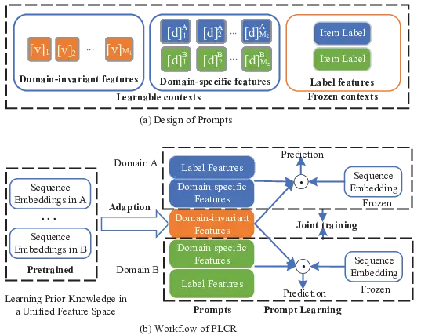
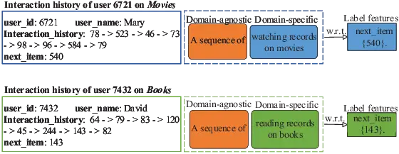
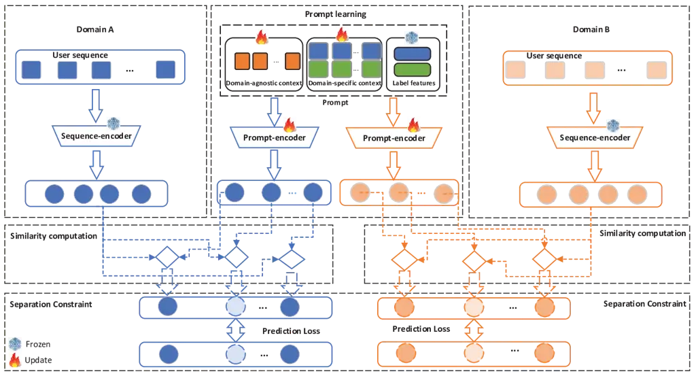
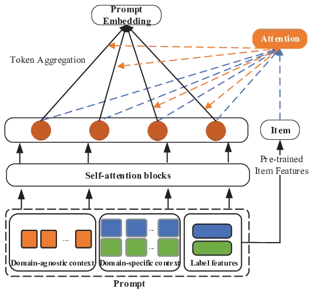
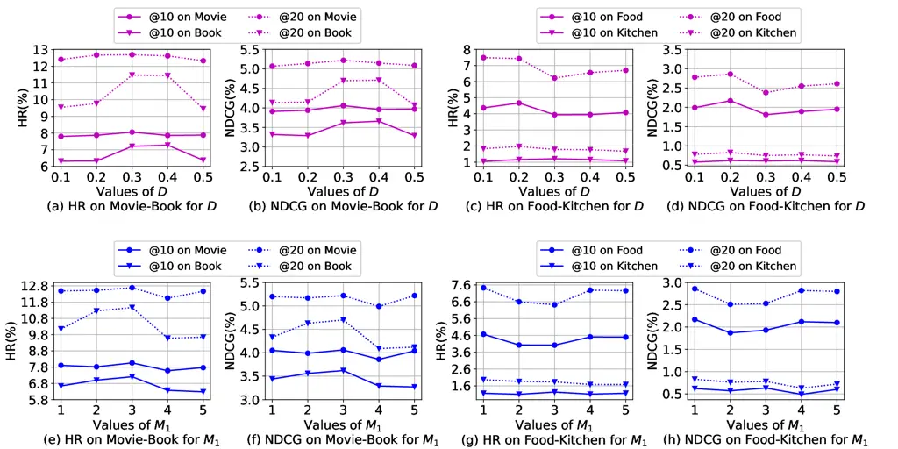
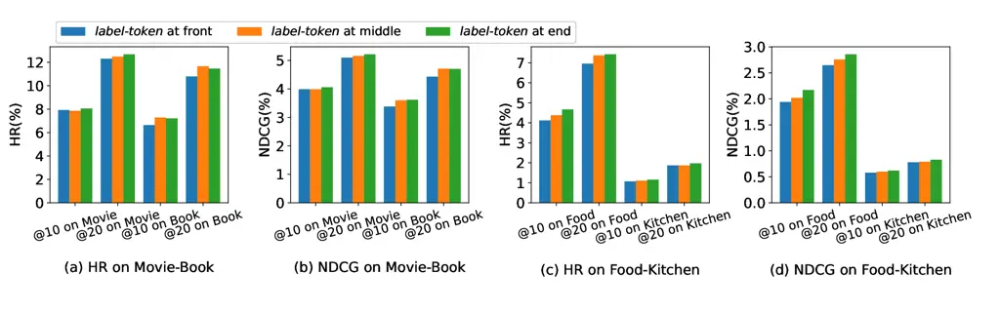

# Automated Prompting for Non-overlapping Cross-domain Sequential Recommendation

Lei Guo    Chunxiao Wang    Xinhua Wang    Lei Zhu    Hongzhi Yin
^(†)^(†)thanks: L. Guo, C. Wang, X. Wang, and L. Zhu are with the School
of Computer Science and Technology, Shandong Normal University, Jinan
250014, China.  
E-mail: leiguo.cs@gmail.com, wangchunxiao0217@163.com,
wangxinhua@sdnu.edu.cn, leizhu0608@gmail.com H. Yin is with the School
of Information Technology & Electric Engineering, The University of
Queensland, St Lucia, QLD 4072, Australia.  
E-mail: h.yin1@uq.edu.au ^(†)^(†)thanks: Manuscript received XX XX,
2023; revised XX XX, 2023.  
(Corresponding author: Hongzhi Yin.)

###### Abstract

CR (CR) has been extensively studied in recent years to alleviate the
data sparsity issue in recommender systems by utilizing different domain
information. In this work, we focus on the more general NCSR (NCSR)
scenario. NCSR is challenging because there are no overlapped entities
(e.g., users and items) between domains, and there is only users’
implicit feedback and no content information. Previous CR methods cannot
solve NCSR well, since (1) they either need extra content to align
domains or need explicit domain alignment constraints to reduce the
domain discrepancy from domain-invariant features, (2) they pay more
attention to users’ explicit feedback (i.e., users’ rating data) and
cannot well capture their sequential interaction patterns, (3) they
usually do a single-target cross-domain recommendation task and seldom
investigate the dual-target ones. Considering the above challenges, we
propose PLCR (PLCR), an automated prompting-based recommendation
framework for the NCSR task. Specifically, to address the challenge (1),
PLCR resorts to learning domain-invariant and domain-specific
representations via its prompt learning component, where the domain
alignment constraint is discarded. For challenges (2) and (3), PLCR
introduces a pre-trained sequence encoder to learn users’ sequential
interaction patterns, and conducts a dual-learning target with a
separation constraint to enhance recommendations in both domains. Our
empirical study on two sub-collections of Amazon demonstrates the
advance of PLCR compared with some related SOTA methods.

###### Index Terms: 

prompt learning, domain adaption, sequential recommendation,
cross-domain recommendation

## I Introduction

Due to the effectiveness of the cross-domain information in alleviating
the sparsity issue in recommender systems \[1, 2, 3\], the CR (CR) task
that aims at improving cross-domain recommendations is gaining immense
attention. Moreover, because of the solid temporal relationship between
user interactions \[4, 5\], the CSR (CSR) task that can model users’
sequential interests becomes increasingly attractive. One typical
assumption of these methods is that there are totally or partially
overlapped entities between domains \[6, 7, 8, 9\], by which they can
make more effortless knowledge transfer across domains.

In this paper, we study CSR in a particularly challenging scenario, NCSR
(NCSR), where users and items are entirely disconnected between domains,
and only users’ positive interactions can be observed (no extra content
information is available). We consider the non-overlapping
characteristic because it is a common phenomenon in practice. For
example, the items are entirely disjointed in movie-watching and
book-reading services, and because of the business privacy policies, it
is impractical to have overlapped users from different
platforms/systems. The non-existence of overlapped entities and extra
auxiliary information makes it harder to transfer helpful information
across domains, since there is no direct connection between them.



Fig. 1: The design of our prompts and the workflow of PLCR, which first
models the prior knowledge under a unified feature space by a joint
pre-training on both domains, and then adapts the prior knowledge to
specific domains via prompt learning. The learned prompts are shared
within the source/target domains between sequences, representing the
common interaction patterns between users and items. These can also be
interpreted as users’ cluster-level interests. We achieve knowledge
transfer without domain alignment by mapping prior knowledge in a
unified feature space, and sharing the domain-invariant contexts of
prompts across domains.

Previous works on NCR (NCR) mainly focus on distilling domain
information from rating data, and their performance on users’ sequential
data is largely unexplored. In addition, current solutions on NCR mainly
focus on learning domain-invariant features across domains, with which
the domain information can be shared between domains to enhance
recommendations in each domain \[10, 11, 12, 13, 14\]. One common
practice of such methods is based on the adversarial training \[12, 15,
16\], which tends to narrow the gap between source and target domains by
confusing the domain discriminators. However, reducing the discrepancy
by conducting domain alignment could result in the missing of some
semantic information (i.e., the user preferences/intents that a sequence
contains), due to the entangled nature of semantic and domain
information. This situation may get worse when the data distributions
have complex manifold structures. To repair this, recent methods
advocate preserving the semantic information to maintain the
recommender’s prediction capability \[17\]. But as the objectives of
domain alignment and holding semantic features could be adversarial,
these methods often suffer from a subtle trade-off between these two
objectives. An alternative solution to such an issue could be learning
disentangled semantic and domain representations \[18, 19\], where the
domain alignment constraint is discarded. But existing studies either
ignore the non-overlapped characteristic \[18\] or need extra content to
bridge domains \[19\]. Furthermore, existing studies on NCR mainly focus
on single-target tasks that aim to transfer domain knowledge from the
dense source domain to the sparse target domain. In contrast, the
dual-target tasks that tend to enhance recommendations in both domains
are seldom investigated.



Fig. 2: Examples of our designed prompts. Domain-agnostic contexts
represent the general features independent of domains (shared by both
domains), and domain-specific contexts denote the features related to
specific domains (shared by the users within the same domain).

To address the above challenges, in this work, we target NCSR and
propose a PLCR (PLCR) via leveraging the power of automated prompt
engineering paradigm \[20\]. The workflow of PLCR is shown in Fig. 1,
which firstly embeds the prior knowledge within domains into pre-trained
models, and then dynamically adapts them to specific domains via sharing
the prompts across domains to conduct recommendations on disconnected
domains. Compared with existing works, our approach exploits the
pre-trained sequential models with prompt optimization and adaption,
avoiding the domain alignment constraint and the need of extra content
with only a few parameters to be optimized. Specifically, we design each
prompt into three components (Fig. 1 shows our design on prompts):
domain-independent, domain-specific, and label context, where the
domain-independent context denotes domain-invariant/semantic features
and is shared among all sequences with the same label. The
domain-specific context represents the common information across
domains. The item label refers to features of the ground truth item,
which will be frozen during optimization. Examples of our designed
prompts are shown in Fig. 2.

Then, to conduct a dual-target cross-domain recommendation, and ensure
the learned semantic and domain representations are disentangled in such
a continuous feature space (we do not exploit the discrete prompts due
to they are by no means guaranteed to be optimal for downstream tasks),
we leverage a separation constraint for optimization (as shown in
Fig. 3). Concretely, we design two optimization objectives on the basis
of the compound prompts by sharing the domain-independent features
between domains, and then make a duel-target cross-domain recommendation
with compound learning objectives. In our learning paradigm, the
domain-agnostic features are shared between domains, and expected to
help reconstruct users’ common interests in both domains, while the
domain-specific features are expected to model domain-independent
aspects that are disentangled from domain-specific features.

We summarize our main contributions as follows:

- •
  We study CSR in a more general yet challenging scenario, i.e., NCSR.
  To overcome the limitations of previous studies, we explore NCSR by
  proposing an automated prompting paradigm to model the non-overlapping
  characteristic.
- •
  We design an automated prompt engineering paradigm to adapt the
  pre-trained sequential model to specific domains. With shared prompt
  contexts, we can transfer information across disjoint domains.
- •
  We develop a separation constraint to facilitate the learned
  domain-invariant and domain-specific features capturing different
  aspects of domains to support the dual-target cross-domain
  recommendation.
- •
  We evaluate our method by conducting extensive experiments on two
  sub-collections of Amazon, and the experimental results show the
  advance of our proposal compared with the SOTA baselines.

## II Related Work

In this section, we consider cross-domain recommendation with
overlapped/non-overlapped entities, and prompt learning-based
recommendation as our related works.

### II-A Cross-domain Recommendation with Overlapped Entities

Existing studies on transferring domain knowledge across domains have
been focused on developing domain alignment methods via overlapped
users, items, or part of them. Among these methods, few of them tend to
assume both users and items are totally overlapped between domains, and
enhance the recommendations by leveraging the users’ common interests on
the same item set \[21, 22, 23, 24\]. For example, Pan et al. \[22\]
target to reduce the data sparsity issue in CF domains, and solve it by
proposing a collective factorization method, where a shared latent space
is collectively constructed. To enhance cross-domain recommendations,
Zhu et al. \[23\] first learn users’ and items’ embeddings via
separating heterogeneous graphs and then devise an element-wise network
to join the embeddings of shared entities between domains. As it is too
ideal to assume that both domains have identical users and items, recent
works have focused on studying the scenarios in that only users are
overlapped \[9, 25, 26, 27, 28, 29, 30, 6, 7, 31, 32, 33, 34\]. For
instance, Guo et al. \[6\] investigate the cross-domain sequential
recommendation task with overlapped users by proposing a network-based
solution, where they enhance the representations of users by combining
them with users’ preferences in the other domain with a graph
convolutional network. Li et al. \[25\] propose a dual-transfer
cross-domain recommender to conduct cross-domain recommendations by
investigating the user interests in both domains. Considering the
privacy issue of aligning users, Gao et al. \[14\] only view the
overlapped items as bridges to connect domains, and distill helpful
information from transferred item embeddings by leveraging the power of
neural networks in learning high-dimensional representations.

However, as the above methods need overlapped entities to connect
domains, their application may be limited when entities are entirely
non-overlapping. To remedy this, we target the non-overlapping
cross-domain recommendation task and aim to solve the knowledge transfer
issue by proposing a prompt learning-based method.

### II-B Cross-domain Recommendation with Non-overlapped Entities

Compared with overlapped or partially overlapped methods, the
non-overlapping cross-domain recommendation task is more challenging,
since the direct connections between domains are missing. According to
different recommendation targets, recent works in this category can be
divided into single-target, dual-target, or multi-target, and
one-to-many cross-domain recommendation methods. Single-target
cross-domain recommendation task tends to exploit useful knowledge from
source domain to enhance the recommendations in the target domain,
aiming at alleviating the cold-start and sparsity issues within the
target domain \[35, 12, 10, 11, 13, 36, 15\]. For example, Liu et
al. \[10\] study the review-based NCR task by proposing an attribution
alignment-based collaborative filtering method. But their work needs
extra review and attribution information, which may not be available in
real-world scenarios, to align domains, limiting its application to real
systems. Dual-target or multi-target cross-domain recommendation task
tends to conduct a two-way or multi-way cross-domain recommendation that
two or multiple domains can benefit from knowledge exchanges \[16, 37,
38\]. For example, Zhang et al. \[16\] match the feature spaces of both
users and items between domains by learning the shared encoders with a
domain discriminator under a dual-adversarial learning framework. Li et
al. \[38\] investigate the multi-target cross-domain recommendation task
by proposing a rating-matrix generative model, where an implicit
cluster-level rating matrix is established to find the relatedness
across multiple domains. Studies on one-to-many cross-domain
recommendation tasks mainly focus on transferring helpful domain
information from the dense source domain to new sparse target
domains \[39, 11, 35, 40\]. For instance, Krishnan et al. \[39\] study
the non-overlapping cross-domain recommendation task via sharing the
domain-independent component across the dense and sparse domains.

But existing works on disjoint domains mainly focus on the single-target
cross-domain recommendation task, and only a few consider enhancing the
recommendation in both domains. Moreover, the above works mainly explore
the domain knowledge from the rating data, and their performance on the
sequential data is still unproven. Furthermore, none of the existing
works study knowledge transfer by leveraging the prompt learning
technique, which is the main task of this work.

### II-C Prompt Learning-based Recommendation

Prompting is a kind of prepending instructions to the inputs and
pre-trained language models \[41\] that aims at prompting the downstream
tasks. Due to its effectiveness in tuning pre-trained models, recent
studies have successfully applied it to NLP tasks \[42, 43, 44, 45, 41,
46\], and several of them have also investigated the application of it
to the recommendation tasks \[47, 48, 49, 50, 51, 52, 53, 54\]. For
example, Li et al. \[47\] introduce prompt learning to the explainable
recommendation task. They tend to enhance the explanation generation
performance of recommender systems by bridging the gap between
continuous prompts and the pre-trained model. To give users the
flexibility in choosing the sensitive attributes, Wu et al. \[51\]
devise a prompt-based fairness-aware recommender by introducing the
prompting technique from NLP to the recommender systems. Geng et
al. \[48\] study the knowledge transfer issue between tasks by treating
recommendation as language processing, and propose a unified and
flexible text-to-text paradigm named P5 for recommendations. But their
work needs the same dataset for training and testing, which is different
from ours, as we focus on learning models for totally non-overlapped
datasets.

However, existing studies leveraging prompting techniques in improving
recommendations are still in their infancy, and none considers the
information transferring issue across disjoint domains.

## III Methodologies

In this section, we first detail the definition of the NCSR task, and
then show how we implement PLCR to conduct cross-domain recommendations
based on prompt learning.

### III-A Preliminaries

Suppose we have two domains, A and B, and we have access to obtain
users’ sequential behaviours in both domains. The target of NCSR is to
recommend the next item a user will interact with in source or target
domains based on her historical interactions. But different from
traditional CSR, NCSR pays more attention to the non-overlapping
scenario, where users and items are totally disjoint between domains.
NCSR is a more challenging task due to the missing of the bridging
entities, which can be directly leveraged for domain alignment. To meet
this challenge, we bring a new take on NCSR via the prompt learning
technique. In our setting, a prompt is a kind of prepending instructions
to the pre-trained sequence and item encoders. They are designed to
prompt these pre-trained models to guide the recommendations in both
domains. We tend to automatically find optimal prompts to provide
accurate guidance rather than exploiting the manually designed ones.

More formally, let
$`\mathcal{V}_{A}=\{A_{1},A_{2},...,A_{m},...,A_{M}\}`$ be the item set
in domain A, and $`\mathcal{V}_{B}=\{B_{1},B_{2},...,B_{n},...,B_{N}\}`$
be the item set in domain B (suppose the items in A and B do not
overlap). Then, from users’ interaction logs on these items, we can
achieve their sequential behaviors in domains A and B, respectively
denoted by $`(A_{1},A_{2},...,A_{m},...)`$ and
$`(B_{1},B_{2},...,B_{n},...)`$, where $`A_{m}\in\mathcal{V}_{A}`$ and
$`B_{n}\in\mathcal{V}_{B}`$ are the interacted items in A and B. Due to
the non-overlapping characteristic of domains, the user set and items
are totally disjoint between domains. That is, we cannot obtain a user’s
sequential behaviours in both domains to directly leverage her
interactions in one domain to enhance her interest modeling in the
other. Then, the target of conducting NCSR can be defined as building a
mapping function $`f(\mathcal{x})`$ that predicts a probability
distribution over the item set $`\mathcal{V}_{A}`$ (or
$`\mathcal{V}_{B}`$) by exploring the non-overlapping cross-domain
sequential data, aiming at enhancing the recommendations in both
domains.



Fig. 3: The system architecture of PLCR, which consists of the
pre-trained sequence and item encoders, prompt optimization module, and
separation constraint component. The sequence and item encoders are
pre-trained in a unified feature space. Only the prompt-encoders and
prompts will be updated during prompt learning, while the pre-trained
models are kept fixed.

### III-B Overview of PLCR

In this work, we devise PLCR to address the domain adaption issue in
NCSR by taking the power of prompt learning.

Motivation. Due to the lack of common entities across domains, aligning
two domains to make cross-domain recommendations is infeasible. One
typical line of previous methods in aligning two domains tends to impose
adversarial training constraints. Still, they may result in the
distortion of the domain-agnostic feature structure within domains,
which can be seen as a kind of semantic-related feature unrelated to any
specific domain. Though studies have been conducted to preserve it, they
still suffer from a subtle trade-off between the objectives of semantic
information preservation and domain alignment. To remedy this, we
propose to learn disentangled domain-agnostic and domain-specific
representations via devising a prompt learning paradigm, where the
domain alignment is discarded. The main task of this work is to embed
domain information into pre-trained models, and then dynamically adapt
them by learning shared prompts to enhance the cross-domain
recommendations.

The overall system architecture of PLCR is presented in Fig. 3, which is
mainly composed of three components: pre-trained session-item encoder,
prompt learning, and separation constraint. 1) Session-item encoders are
the pre-trained sequence and item encoding models that our method is
built upon. In particular, we introduce the Transformer blocks in \[55\]
to build the encoders for sessions and items in both domains in a
unified feature space. That is, we pre-train the encoders by the data in
two domains simultaneously. Moreover, all the pre-trained encoders are
kept fixed when conducting prompt optimization (the details of
pre-training them are shown in Section III-C). 2) The prompt learning
component targets transferring domain knowledge across domains by
learning shared prompts in a continuous feature space, with which we can
enhance cross-domain recommendations. To capture different aspects of
domain information, we tend to exploit domain-specific context to model
unique domain features, and domain-invariant context to learn the common
features between domains (the details of our design can be seen in
Section III-D). 3) To ensure the learned prompt contexts are
disentangled, we devise a separation constraint by sharing the
domain-invariant context across domains in a dual-target learning
schema. By this, the domain-invariant and domain-specific contexts can
model different aspects of domains, as they have different optimization
objectives (the details can be seen in Section III-E).

### III-C Sequence and item Encoders Pre-training

We adopt the self-attention blocks in \[55\], namely SASRec (SASRec), as
the backbone of our solution, which is specially devised for sequential
recommendation \[56\] and able to draw contexts from users’ all past
actions. SASRec takes a user’s interaction sequence
$`\mathcal{S}^{A}_{u}=(A_{u,1},A_{u,2},...,A_{u,t-1})`$ as input (take
domain A as an example), and seeks to predict the next item at time step
$`t`$ by exploring the previous $`t-1`$ items within the current
sequence. The SASRec model comprises an embedding layer, several
self-attention blocks, and a prediction layer, where the embedding layer
encodes the items and their positions within the given sequence. The
self-attention block undertakes the given sequences’ modeling by
hierarchically extracting high-level features from all previously
interacted items. The prediction layer predicts the next item depending
on the learned item and sequence embeddings. We respectively take the
self-attention block and embedding layer as the sequence-encoder and
item-encoder, which will be pre-trained and helps us learn disentangled
domain-specific and domain-agnostic representations.

To embed the domain information in a unified feature space, we pre-train
SASRec by training it jointly, i.e., we use the method of merging data
to train the same model. Specifically, we train SASRec by optimizing it
to align the embedding spaces learned for sequences and items, and
define its learning objective as a binary cross entropy loss \[55\]:

```math
\displaystyle-\sum_{\mathcal{S}_{u}\in\mathcal{S}}\sum_{t\in[1,2,...,l_{n}]}\left[\text{log}(\sigma(\hat{y}_{o_{t},t}))+\sum_{j\notin\mathcal{S}_{u}}\text{log}(1-\sigma(\hat{y}_{j,t}))\right], \tag{1}
```

where $`\mathcal{S}_{u}\in\mathcal{S}`$ is the user sequence in domain A
or B, $`l_{n}`$ is the length of $`\mathcal{S}_{u}`$,
$`\hat{y}_{o_{t},t}`$ is the prediction probability for the expected
item $`o_{t}`$ at time step $`t`$. $`j`$ is the negative item that is
generated for each sequence at each time step.

As the core component (i.e., the self-attention block) of SASRec can be
accelerated through parallel training, it is one order of magnitude
faster than RNN/CNN-based alternatives. That is, SASRec is scalable to
extensive training data. However, due to the non-overlapping
characteristic of NCSR and the lack of common entities that can bridge
two domains, SASRec cannot be directly applied to NCSR, making us unable
to adjust this pre-embedded domain knowledge across domains.

### III-D Domain Adaption via Prompt Optimization

One typical solution for adapting the domain knowledge from one to the
other is to learn domain-invariant features, with which the recommender
can further make cross-domain recommendations. In previous studies,
adversarial training is one frequently used method, which can generate
domain-independent features by reducing the discrepancy between target
and source domains with domain alignment. However, as the two objectives
could be adversarial, these methods often suffer from a trade-off
between them. To overcome this challenge, we resort to the prompt
learning paradigm, which tends to adapt the pre-embedded domain
knowledge via learning shared prompts across domains.

#### III-D1 Design of Prompts

As shown in Fig. 1, our prompts are composed of three contexts, a
domain-independent context, a domain-specific context, and the label
features of the ground truth item. To avoid manual prompt tuning, we
model the contexts in a continuous feature space with automate prompt
engineering. During prompt optimization, only the parameters in prompts
are updated, and the pre-trained models are kept fixed. To be more
specific, we use $`[\boldsymbol{v}]_{m_{1}},m_{1}\in\{1,2,...,M_{1}\}`$
to denote the token embeddings within the domain-independent context
$`\boldsymbol{t}_{k}^{A}`$ (take domain A as an example). Its definition
is shown as follows:

```math
\boldsymbol{t}_{k}^{A}=[\boldsymbol{v}]_{1}[\boldsymbol{v}]_{2}...[\boldsymbol{v}]_{M_{1}}[\boldsymbol{Item}]^{A}_{k}, \tag{2}
```

where $`[\boldsymbol{v}]_{m_{1}}`$ is the vector of the $`m_{1}`$-th
context token in domain A, $`M_{1}`$ is the number of the context
tokens, $`\boldsymbol{t}_{k}^{A}`$ is the domain-independent context for
item $`k`$. $`[\boldsymbol{Item}]_{k}^{A}`$ is the embedding of item
$`k`$, which is pre-trained with the backbone network (i.e., the SASRec
model) and will be frozen during prompt learning. The token embeddings
$`[\boldsymbol{v}]_{m_{1}}`$ within the domain-independent context are
shared by all the items in both domains, and aim at modeling the
invariant information that is irrelevant to a specific domain, such as
the users’ shared interests in different domains. The domain-independent
context $`\boldsymbol{t}_{k}^{B}`$ in domain B can be similarly defined
as:

```math
\boldsymbol{t}_{k}^{B}=[\boldsymbol{v}]_{1}[\boldsymbol{v}]_{2}...[\boldsymbol{v}]_{M_{1}}[\boldsymbol{Item}]^{B}_{k}. \tag{3}
```

However, as the above token embeddings tend to be shared across domains,
they cannot handle the distribution shift between domains. To repair
this, we further devise a domain-specific context to model the unique
features in each domain, and use
$`[\boldsymbol{d}]_{m_{2}}^{A},\{m_{2}\in 1,2,...,M_{2}\}`$ to denote
the token embeddings within it. Then, the prompt in domain A can be
re-defined as:

```math
\boldsymbol{t}_{k}^{A}=[\boldsymbol{v}]_{1}[\boldsymbol{v}]_{2}...[\boldsymbol{v}]_{M_{1}}[\boldsymbol{d}]_{1}^{A}[\boldsymbol{d}]_{2}^{A}...[\boldsymbol{d}]_{M_{2}}^{A}[\boldsymbol{Item}]^{A}_{k}, \tag{4}
```

where $`M_{2}`$ is the number of the domain-specific tokens,
$`[\boldsymbol{d}]_{m_{2}}^{A}\in\mathbb{R}^{d}`$ is the vector of the
$`m_{2}`$-th context token, and will be optimized during prompt
learning. Both $`[\boldsymbol{v}]_{m_{1}}`$ and
$`[\boldsymbol{d}]_{m_{2}}^{A}`$ have the exact dimensions as the
embeddings in the pre-trained sequence and item encoders. The tokens
within the domain-specific context are shared among all items but
specifically designed for each domain. By this, we can model domain
shifts and capture users’ unique interests in domains.

Other than placing the label features at the end of the prompt, we can
also put them in the middle or at the front (similar definitions can
also be achieved in domain B):

```math
\boldsymbol{t}_{k}^{A}=[\boldsymbol{v}]_{1}[\boldsymbol{v}]_{2}...[\boldsymbol{v}]_{M_{1}}[\boldsymbol{Item}]^{A}_{k}[\boldsymbol{d}]_{1}^{A}[\boldsymbol{d}]_{2}^{A}...[\boldsymbol{d}]_{M_{2}}^{A}, \tag{5}
```

```math
\boldsymbol{t}_{k}^{A}=[\boldsymbol{Item}]^{A}_{k}[\boldsymbol{v}]_{1}[\boldsymbol{v}]_{2}...[\boldsymbol{v}]_{M_{1}}[\boldsymbol{d}]_{1}^{A}[\boldsymbol{d}]_{2}^{A}...[\boldsymbol{d}]_{M_{2}}^{A}. \tag{6}
```

By this, we can increase the flexibility of prompt learning by allowing
the prompt to either fill the later cells or cut off the sentence
earlier. In experiments, we leave it as a hyper-parameter, and report
the results in Section VI-B.



Fig. 4: The design of the prompt encoder, which consists of the
self-attention blocks and a token aggregation network.

#### III-D2 Prompt Encoder

To generate high-dimensional features for prompts, we further pass them
to the prompt encoder $`g(\cdot)`$, which is composed by several
self-attention blocks and a token aggregation network to attentively
aggregate the context tokens that are related to the target item (the
architecture of $`g(\cdot)`$ is shown in Fig. 4). Similar to
SASRec \[55\], we model the given prompt $`\boldsymbol{t}_{k}^{A}`$
through extracting high-level information from all the context tokens
(with the head number and block number as hyper-parameters), and outputs
the representations for every context word within
$`\boldsymbol{t}_{k}^{A}`$ (take domain A as an example).

Suppose the output of the self-attention layer is denoted as:

```math
\boldsymbol{s}_{k}^{A}=\text{Att}(\boldsymbol{t}_{k}^{A}W^{Q},\boldsymbol{t}_{k}^{A}W^{K},\boldsymbol{t}_{k}^{A}W^{V}), \tag{7}
```

where Att is the scaled dot-product attention as defined in \[56\],
$`W^{Q},W^{K},W^{V}\in\mathbb{R}^{d\times d}`$ are the projection
matrices. Then, to endow the extraction with nonlinearity, we further
apply a point-wise two-layer feed-forward neural network to
$`\boldsymbol{s}_{k}^{A}`$:

```math
\boldsymbol{f}_{k}^{A}=\text{ReLU}(\boldsymbol{s}_{k}^{A}\boldsymbol{W}^{(1)}+\boldsymbol{b}^{(1)})\boldsymbol{W}^{(2)}+\boldsymbol{b}^{(2)}, \tag{8}
```

where $`\boldsymbol{b}^{(1)},\boldsymbol{b}^{(2)}`$ are
$`d`$-dimensional vectors, and
$`\boldsymbol{W}^{(1)},\boldsymbol{W}^{(2)}`$ are $`d\times d`$
matrices. Then, we apply the layer norm operation to each block, and
denote the final output of the self-attention blocks for
$`\boldsymbol{t}_{k}^{A}`$ as $`\boldsymbol{x}_{k}^{A}`$.

Token Aggregation. To get the prompt features in the sequence level, we
further aggregate the tokens within $`\boldsymbol{x}_{k}^{A}`$ by
devising an attention mechanism with the pre-trained label features
$`\boldsymbol{Item}_{k}^{A}`$ as the guiding signal:

```math
\boldsymbol{z}_{k}^{A}=Aggre(\left\{\boldsymbol{x}_{k,i}^{A},\forall i\in\mathcal{C}(k)\right\})=\sum_{i\in\mathcal{C}(k)}\gamma_{k,i}\boldsymbol{x}_{k,i}^{A}, \tag{9}
```

where $`\mathcal{C}(k)`$ is the token set within
$`\boldsymbol{x}_{k}^{A}`$, $`\gamma_{k,i}`$ implies the necessity of
the $`i`$-th token concerning the label features, which is parameterized
by a two-layer neural network:

```math
\displaystyle\gamma^{*}_{k,i}=\boldsymbol{w}_{2}^{T}\cdot\sigma(\boldsymbol{W}_{1}\cdot[\boldsymbol{Item}^{A}_{k}\oplus\boldsymbol{x}^{A}_{k,i}]+\boldsymbol{b}_{1})+\boldsymbol{b}_{2} \tag{10}
```

```math
\displaystyle\gamma_{k,i}=\frac{exp(\gamma^{*}_{k,i})}{\sum_{i\in\mathcal{C}(k)}exp(\gamma^{*}_{k,i})} \tag{11}
```

where $`\sigma(\cdot)`$ is a non-linear activation function,
$`\boldsymbol{W}`$ and $`\boldsymbol{b}`$ are the weight and bias
parameters, $`\oplus`$ is the concatenation operation,
$`\boldsymbol{Item}_{k}^{A}`$ is the pre-trained label features of item
$`A_{k}`$, and will be frozen during optimization.

#### III-D3 Prompt Optimization

Given the training samples in both source and target domains, we could
obtain the probability that recommends item $`A_{k}`$ to the given
sequence $`\mathcal{S}_{i}^{A}`$ (take the domain A as an example):

```math
p(\hat{y}^{A}_{i}=A_{k}|\mathcal{S}_{i}^{A})=\frac{\text{exp}\left(\left<g(\boldsymbol{t}_{i}^{A}),f(\mathcal{S}_{i}^{A})\right>\right)}{\sum_{j=1}^{N_{A}}exp\left(\left<g(\boldsymbol{t}_{j}^{A}),f(\mathcal{S}_{i}^{A})\right>\right)} \tag{12}
```

where $`N_{A}`$ is the number of items in domain A,
$`p(\hat{y}_{i}^{A}=A_{k})`$ indicates the matching probability of the
training sample with item $`A_{k}`$, $`\left<x,y\right>`$ measures the
correlation between the sequence embeddings and prompt representations.

Then, we can learn prompts by optimizing a standard cross-entropy loss
function on all training sequences:

```math
\mathcal{L}_{A}=-\frac{1}{|\mathcal{S}_{A}|}\sum_{i=1}^{|\mathcal{S}_{A}|}\text{log}\;p(\hat{y}^{A}_{i}=y_{i}^{A}), \tag{13}
```

where $`|\mathcal{S}_{A}|`$ is the number of the training sequences in
the domain A, $`y_{i}^{A}`$ is the ground truth of the current training
sample. Similarly, we can also get the optimization loss for the prompts
in domain B:

```math
\mathcal{L}_{B}=-\frac{1}{|\mathcal{S}_{B}|}\sum_{i=1}^{|\mathcal{S}_{B}|}\text{log}\;p(\hat{y}^{B}_{i}=y_{i}^{B}), \tag{14}
```

where $`p(\hat{y}^{B}_{i}=y_{i}^{B})`$ denotes the probability of our
method in retrieving the right item based on the given sequence.

### III-E Separation Constraint

To let the learned domain-independent and domain-specific prompt
contexts can learn different aspects of the domain information, we
further conduct a dual-target learning objective with the shared
domain-agnostic context in both domains. The learning objective can be
intuitively defined as:

```math
\mathcal{L}=\mathcal{L}^{A}+\mathcal{L}^{B}. \tag{15}
```

However, due to the non-overlapping characteristic in NCSR, the training
samples in different domains are variant, and we cannot match them one
by one, which is one of the main assumptions in traditional cross-domain
methods. As thus, instead of learning the joint loss $`\mathcal{L}`$, we
jointly optimize $`\mathcal{L}_{A}`$ and $`\mathcal{L}_{B}`$ by devising
a two-stage training method. Specifically, we first optimize
$`\mathcal{L}_{A}`$ by using the training sequences in domain A to learn
domain-specific and domain-independent contexts in prompts, where the
domain-independent contexts are shared across domains. Then, besides
learning domain-specific features by using the training samples in
domain B, the domain-independent context within it will be further
fine-tuned according to $`\mathcal{L}_{B}`$. As $`\mathcal{L}_{A}`$ and
$`\mathcal{L}_{B}`$ have different learning objectives, the
domain-specific prompt contexts tend to model the features specific to
each domain. In contrast, the domain-agnostic prompt context tends to
learn the common features across domains. The Stochastic Gradient
Descent (SGD) algorithm is applied in our optimizing method.

## IV Experimental Setup

In this section, we first introduce the research questions that we tend
to answer in experiments, and then provide the details of the datasets,
evaluation metrics, baselines, and implementations of PLCR.

### IV-A Research Questions

The investigated research questions in experiments are shown as follows:

- RQ1
  How does our proposed PLCR method perform compared with other
  state-of-the-art cross-domain recommenders?
- RQ2
  What are the performances of PLCR on different domains? Can PLCR
  effectively leverage the cross-domain information via the prompt
  tuning technique?
- RQ3
  How do the key components of PLCR, i.e., domain-specific context,
  domain-independent context, the attention mechanism in prompt encoder,
  and the separation constraint strategy, contribute to the
  recommendation performance?
- RQ4
  How do the hyper-parameters in PLCR affect its performance?

|                       | Movie-Book | Food-Kitchen |
| --------------------- | ---------- | ------------ |
|                       | M-domain   | F-domain     |
| \#Items               | 12,669     | 24,434       |
| \#Interactions        | 1,052,443  | 217,409      |
| \#Avg.sequence length | 9.68       | 6.37         |
|                       | B-domain   | K-domain     |
| \#Items               | 36,776     | 24,658       |
| \#Interactions        | 1,060,974  | 180,657      |
| \#Avg.sequence length | 9.75       | 5.29         |
| \#Sequences           | 108,770    | 34,143       |
| \#Train-sequence      | 81,578     | 25,608       |
| \#Test-sequence       | 10,876     | 5,121        |
| \#Val-sequence        | 16,316     | 3,414        |

TABLE I: The statistics of our HAMAZON datasets.

|                       |          |         |        |        |          |         |        |        |          |        |        |        |          |        |        |        |
| --------------------- | -------- | ------- | ------ | ------ | -------- | ------- | ------ | ------ | -------- | ------ | ------ | ------ | -------- | ------ | ------ | ------ |
| Methods               | M-domain |         |        |        | B-domain |         |        |        | F-domain |        |        |        | K-domain |        |        |        |
|                       | HR       |         | NDCG   |        | HR       |         | NDCG   |        | HR       |        | NDCG   |        | HR       |        | NDCG   |        |
|                       | @10      | @20     | @10    | @20    | @10      | @20     | @10    | @20    | @10      | @20    | @10    | @20    | @10      | @20    | @10    | @20    |
| Session-POP \[57\]    | 0.55     | 1.60    | 0.20   | 0.47   | 0.45     | 1.25    | 0.17   | 0.37   | 1.12     | 2.76   | 0.42   | 0.84   | 0.75     | 1.68   | 0.29   | 0.53   |
| BPR-MF \[58\]         | 0.80     | 1.61    | 0.40   | 0.61   | 0.90     | 1.53    | 0.44   | 0.60   | 2.04     | 3.64   | 0.83   | 1.25   | 0.09     | 0.21   | 0.04   | 0.07   |
| GRU4REC \[59\]        | 2.75     | 3.80    | 1.46   | 1.72   | 0.81     | 1.51    | 0.54   | 0.71   | 2.11     | 3.05   | 1.01   | 1.25   | 0.13     | 0.49   | 0.10   | 0.19   |
| HRNN \[60\]           | 2.17     | 3.24    | 1.36   | 1.63   | 1.13     | 2.08    | 0.59   | 0.82   | 2.04     | 2.75   | 0.99   | 1.18   | 0.16     | 0.26   | 0.07   | 0.09   |
| NARM \[61\]           | 2.16     | 3.37    | 0.93   | 1.23   | 1.18     | 1.80    | 0.51   | 0.67   | 1.59     | 2.55   | 0.66   | 0.90   | 0.64     | 1.10   | 0.27   | 0.38   |
| Caser \[62\]          | 0.66     | 1.21    | 0.37   | 0.45   | 0.30     | 0.52    | 0.17   | 0.20   | 1.15     | 1.94   | 0.67   | 0.76   | 0.75     | 1.39   | 0.37   | 0.52   |
| SRGNN \[63\]          | 4.26     | 6.62    | 2.27   | 2.87   | 2.34     | 3.19    | 1.36   | 1.57   | 3.35     | 5.47   | 1.67   | 2.19   | 0.95     | 1.51   | 0.58   | 0.80   |
| SASRec \[55\]         | 5.71     | 9.62    | 2.72   | 3.70   | 3.85     | 6.37    | 1.82   | 2.46   | 3.23     | 5.67   | 1.53   | 2.15   | 1.15     | 1.77   | 0.57   | 0.72   |
| CoOp \[64\]           | 6.84     | 11.08   | 3.32   | 4.38   | 4.76     | 7.58    | 2.45   | 3.15   | 3.15     | 5.51   | 1.53   | 2.12   | 0.81     | 1.45   | 0.37   | 0.53   |
| $`\pi`$-net \[65\]    | 4.04     | 6.00    | 2.29   | 2.78   | 1.62     | 2.35    | 1.04   | 1.23   | 2.27     | 3.75   | 1.14   | 1.51   | 0.34     | 0.61   | 0.17   | 0.24   |
| PSJ-net \[31\]        | 4.31     | 6.43    | 2.56   | 3.09   | 1.68     | 2.33    | 1.02   | 1.18   | 2.79     | 4.12   | 1.42   | 1.75   | 0.37     | 0.79   | 0.20   | 0.30   |
| DA-GCN \[6\]          | 1.72     | 2.45    | 0.98   | 1.16   | 1.84     | 2.52    | 1.13   | 1.28   | 2.61     | 4.26   | 1.44   | 1.85   | 0.84     | 1.32   | 0.41   | 0.53   |
| SASRec (joint) \[55\] | 5.17     | 8.75    | 2.56   | 3.48   | 3.62     | 6.24    | 1.79   | 2.45   | 2.87     | 4.53   | 1.38   | 1.80   | 1.08     | 1.86   | 0.52   | 0.72   |
| PLCR (single)         | 7.09     | 11.05   | 3.52   | 4.51   | 5.23     | 8.22    | 2.59   | 3.34   | 3.54     | 5.75   | 1.76   | 2.31   | 1.15     | 1.77   | 0.59   | 0.75   |
| PLCR                  | 8.06\*   | 12.69\* | 4.06\* | 5.22\* | 7.21\*   | 11.47\* | 3.62\* | 4.70\* | 4.67\*   | 7.43\* | 2.17\* | 2.86\* | 1.16     | 1.97\* | 0.62\* | 0.83\* |

- •
  Significant improvements over the best baseline results are marked
  with \* (t-test, $`p<`$.05).

TABLE II: Comparison results (%) on the Movie-Book and Food-Kitchen
datasets, where M and B stand for the Movie and Book domain, F and K
stand for the Food and Kitchen domain, respectively.

### IV-B Datasets and Evaluation Metrics

We evaluate our proposal and baselines on two sub-collections of
Amazon¹¹ 1 https://jmcauley.ucsd.edu/data/amazon, which is a review
dataset that collects users’ review behaviours on products in different
domains, including userid, itemid, ratings, timestamp, and descriptions
about the items, etc. To investigate the performance of our proposed
PLCR method on NCSR, we pick two pairs of complementary domains, i.e.,
“Movie-Book” and “Food-Kitchen”, as our evaluation datasets.

To be more specific, the “Movie-Book” dataset records the amazon users’
watching and reading behaviours on the “Movie” and “Book” domains,
respectively. The “Food-Kitchen” dataset collects the purchase records
of the amazon users on the “Food” domain and “Kitchen” domain. As we
target the non-overlapping cross-domain recommendation, we do not need
to identify the users in both domains, and organize the training samples
one-to-one across domains. To filter out the invalid and noisy data, we
only keep the users with more than 5 interactions, and the items whose
interaction frequency is larger than 5. We show the statistics of our
resulting datasets in Table I.

Our experiments take the last item in each sequence as the ground truth
label. We formulate our training dataset by randomly selecting 75% of
the whole sequences, chosing 10% as the validation set, and defining the
remaining as the test set. As the test sequences are relatively small in
the Food-Kitchen dataset, we combine the validation and test set
together for testing. For evaluation, we exploit two widely used
metrics, HR@$`K`$ and NDCG@$`K`$, as our evaluation metrics to
investigate the performance of our method and baselines in predicting
top-$`K`$ items for each test sequence (10 and 20 are applied).

### IV-C Baselines

We compare PLCR with two types of baselines, i.e., single-domain SR (SR)
methods, and CSR (CSR) methods.

1\) SR methods on single domains:

- •
  Session-POP \[57\]: This is a basic yet effective recommendation
  method that tends to predict the most popular items in each sequence
  as the next item to be interacted with.
- •
  BPR-MF \[58\]: This is a commonly used matrix factorization-based
  recommendation method, and utilizes a pair-wise ranking objective. We
  apply it to SR by encoding a sequence with the average latent factors
  of the items within it.
- •
  GRU4REC \[59\]: This method applies GRU for the SR task, which uses a
  session-parallel mini-batch training process and optimizes a
  ranking-based loss function.
- •
  HRNN \[60\]: This is an improved version of GRU4REC by further
  devising a hierarchical RNN structure, where the sequential
  relationships among sessions are further considered.
- •
  NARM \[61\]: In this method, the authors take the attention mechanism
  into session modeling to capture users’ main purpose from their
  historical behaviours.
- •
  Caser \[62\]: This is a convolutional neural network-based sequential
  recommendation method.
- •
  SRGNN \[63\]: This method models the sequences as graph-structured
  data, and leverages a graph neural network to catch the complex
  transitions among items.
- •
  SASRec \[55\]: This method proposes a self-attention based sequential
  model for SR. We use this method as the backbone of our proposal,
  which is first pre-trained, and frozen during prompt optimization.
- •
  CoOp \[64\]: This method is proposed for prompting the pre-trained
  vision-language models to the image recognition tasks. We adapt this
  method to our task by treating sequences as images, and utilizing
  SASRec as its backbone network.

| Methods               | M-domain |       |      |      | B-domain |       |      |      | F-domain |      |      |      | K-domain |      |      |      |
| --------------------- | -------- | ----- | ---- | ---- | -------- | ----- | ---- | ---- | -------- | ---- | ---- | ---- | -------- | ---- | ---- | ---- |
|                       | HR       |       | NDCG |      | HR       |       | NDCG |      | HR       |      | NDCG |      | HR       |      | NDCG |      |
|                       | @10      | @20   | @10  | @20  | @10      | @20   | @10  | @20  | @10      | @20  | @10  | @20  | @10      | @20  | @10  | @20  |
| SASRec (joint)        | 5.17     | 8.75  | 2.56 | 3.48 | 3.62     | 6.24  | 1.79 | 2.45 | 2.87     | 4.53 | 1.38 | 1.80 | 1.08     | 1.86 | 0.52 | 0.72 |
| PLCR (no specific)    | 7.83     | 12.52 | 3.99 | 5.17 | 7.19     | 11.53 | 3.59 | 4.67 | 4.28     | 6.96 | 1.97 | 2.64 | 1.14     | 1.70 | 0.55 | 0.69 |
| PLCR (no independent) | 7.97     | 12.67 | 3.98 | 5.15 | 6.49     | 10.03 | 3.36 | 4.25 | 4.64     | 7.21 | 2.10 | 2.75 | 1.18     | 1.64 | 0.58 | 0.70 |
| PLCR (no separation)  | 7.62     | 12.47 | 3.97 | 5.18 | 6.45     | 9.95  | 3.42 | 4.30 | 4.53     | 7.09 | 2.11 | 2.76 | 1.03     | 1.80 | 0.48 | 0.68 |
| PLCR (no attention)   | 7.81     | 12.27 | 3.94 | 5.06 | 6.56     | 9.80  | 3.42 | 4.24 | 4.37     | 7.28 | 2.04 | 2.77 | 1.14     | 1.80 | 0.58 | 0.74 |
| PLCR                  | 8.06     | 12.69 | 4.06 | 5.22 | 7.21     | 11.47 | 3.62 | 4.70 | 4.67     | 7.43 | 2.17 | 2.86 | 1.16     | 1.97 | 0.62 | 0.83 |

TABLE III: Results of ablation studies on the Movie-Book and
Food-Kitchen datasets (%).

2\) CSR methods. For the methods proposed for the overlapping CSR task,
we adapt them to NCSR by aligning the cross-domain training samples
through random replication operations. And, to simulate the
non-overlapping scenario, the shuffle operation is also applied.

- •
  $`\pi`$-net \[65\]: This is a SOTA cross-domain sequential
  recommendation method that exploits a parallel information-sharing
  network to enhance recommendations simultaneously in both domains.
- •
  PSJ-net \[31\]: This method proposes a split-join network by first
  splitting the mixed representations to get role-specific
  representations, and then joining them to get cross-domain
  representations.
- •
  DA-GCN \[6\]: This is a graph-based cross-domain recommendation method
  that develops a domain-aware attentive graph neural network for CSR.
- •
  SASRec (joint) \[55\]: This is the cross-domain version of SASRec,
  which is jointly trained by the data in both domains.
- •
  PLCR (single): This is a variant of PLCR that takes the SASRec trained
  on each every domain as the backbone network.

### IV-D Implementation Details

We implement PLCR depending on the PyTorch platform, and accelerate the
training processes via a GeForce GTX TitanX GPU. We pre-train
SASRec \[55\] on both datasets and take the self-attention blocks and
the embedding layer within it as the sequence and item encoders,
respectively. We freeze the parameters in the pre-trained encoders and
learn prompts with the mini-batch SGD optimizer in 200 epochs, where the
learning rate is initialized as 0.0001, and the batch size is set as 128. For all the sequences, we constrain the maximum length of sequences
as 77 for the ”Movie-Book” dataset, and 64 for the ”Food-Kitchen”
dataset. As for the hyper-parameters, we set the block number as 2, the
head number of the self-attention network as 1, and the length of the
prompt contexts $`M_{2}`$ as 5. We search the length of the prompt
contexts $`M_{1}`$ within \[1, 5\]. We leave the chosen of the label
token positions as hyper-parameters, and discuss the results of picking
them in Section VI-B. For the dimension of all the latent factors, we
set its value as 50. For the hyper-parameters in baselines, we set their
values according to the papers and further fine-tune them on both
datasets.

For fair comparisons, all the baselines are trained with no
pre-training. Note that, although we pre-train the SASRec as our
backbone network, we do not further update them during our prompt
learning. Instead, they are regarded as a fixed external knowledge to
train the prompts, which also does not undergo the pre-training process.



Fig. 5: Impact of the hyper-parameters on Movie-Book and Food-Kitchen.

## V Experimental Results (RQ1 & RQ2)

The experimental results are reported in Table II, from which we can
observe that: 1) Our PLCR method outperforms all the baselines on both
datasets, demonstrating the superiority of leveraging the prompt
learning technique in solving the NCSR task, which can effectively
transfer the domain knowledge across domains by sharing the same prompt
contexts. 2) PLCR achieves the best performance over all the baselines
on both domains, showing its capability in conducting dual-target
cross-domain recommendations. That is, it can effectively leverage the
cross-domain information and enhance the recommendations in both
domains. 3) PLCR performs better than single-domain methods (e.g.,
GUR4REC, NARM, Caser, SRGNN, and SASRec), again demonstrating the
benefit of utilizing the cross-domain information, which enables us to
make better recommendations. The gap between PLCR and SASRec, indicating
the effectiveness of conducting cross-domain recommendations. 4) The
improvement of PLCR over other recent SOTA cross-domain recommendation
methods (i.e., $`\pi`$-net, PSJ-net, and DA-GCN) demonstrates the
superiority of the prompt learning technique in solving the cross-domain
recommendation task for non-overlapped users. Due to the cross-domain
recommendation methods (i.e., $`\pi`$-net, PSJ-net, and DA-GCN) are not
specially devised for non-overlapped users, they cannot outperform all
the single-domain methods (e.g., SRGNN, and SASRec), which may be caused
by the incorrect domain matching. 5) We also notice that though we use
the data in both domains to train the SASRec model (i.e., SASRec
(joint)), it has worse performance than training SASRec separately,
demonstrating the necessity of designing prompt learning-based
cross-domain recommender, and we cannot transfer domain knowledge by
simply putting the domain data together. 6) The performance of PLCR
(single) is worse than PLCR, indicating the importance of learning
prompts in a unified feature space, which is one of the key points
enabling us to transfer knowledge across domains successfully. PLCR
(single) can achieve better results than CoOp, demonstrating the advance
of our prompts in sharing domain knowledge.

## VI Experimental Analysis

In this section, we tend to answer RQ3 and RQ4 by first conducting
ablation studies to evaluate the necessity of different model
components, and then investigating the the key hyper-parameters’ impact
on PLCR.

### VI-A Ablation Studies (RQ3)

To explore the necessity of different model components, we compare PLCR
with four variants of it:

- •
  PLCR (no specific): This is a variant of PLCR that removes the
  domain-specific context from the prompt. This is to demonstrate the
  necessity of the domain-specific contexts in adapting the pre-trained
  models.
- •
  PLCR (no independent): This variant removes the domain-independent
  context from PLCR, which tends to demonstrate the importance of
  domain-independent context in modeling the domain information.
- •
  PLCR (no separation): This variant of PLCR disables the separation
  constraint within it, and trains our recommendation objective
  separately.
- •
  PLCR (no attention): This version of PLCR tends to evaluate the impact
  of the token aggregation mechanism by removing the attention network
  from the prompt encoder.



Fig. 6: Impact of the location of the label token at prompts on both
datasets.

The experimental results of conducting ablation studies are shown in
Table III, from which we observe that: 1) PLCR outperforms PLCR (no
specific) and PLCR (no independent) on both datasets, indicating the
effectiveness of the domain-specific and domain-independent contexts in
prompting the pre-trained model to the non-overlapping cross-domain
recommendation task. PLCR and all its variants perform better than
SASRec (joint), indicating the effectiveness of our design in model
users’ cross-domain preferences, and the domain information cannot be
effectively utilized to enhance cross-domain recommendations by just
combining data in different domains. 2) PLCR achieves better results
than PLCR (no separation), showing the improvement of adding the
separation constraint to the learning objective, which forces the
domain-independent and domain-specific contexts to learn different
aspects of the domain information. Moreover, this result also indicates
that our prompt learning strategy can capture users’ common interests
across domains that can be leveraged in enhancing recommendations in
both domains. 3) The gap between PLCR and PLCR (no attention), showing
the importance of the token aggregation module in learning the
high-dimensional features of the prompts.

### VI-B Hyper-parameter Analysis (RQ4)

We further explore the impact of the key hyper-parameters to PLCR on
both datasets, and report their results in Figs. 5 and 6. We explore
three kinds of hyper-parameters, i.e., the dropout ratio $`D`$ in the
prompt encoder, length of the domain-invariant contexts $`M_{1}`$, and
location of the label token. Fig. 5 shows the experimental results for
tuning $`D`$ and $`M_{1}`$, from which we can observe that the
performance of PLCR changes significantly. According to our results, we
set $`D=0.3`$ for the Movie-Book data, and $`D=0.2`$ for the
Food-Kitchen data. A small value of $`M_{1}`$ means we will model the
domain-invariant features by only a few contexts. Its impact is varied
on different datasets, and the best performance is achieved on
Movie-Book when $`M_{1}=3`$, and Food-Kitchen when $`M_{1}=1`$.

To explore the impact of the label token’s location, we further conduct
experiments by placing the label token at the front, middle, or end of
the prompts. From the results in Fig. 6, we can see that when we cut off
the sentence earlier by the label features, the performance of PLCR will
have a slight decrease. Hence, we put the label token at the end of the
prompts.

## VII Conclusions

In this work, we focus on NCSR and solve it by proposing a PLCR (PLCR).
Specifically, to transfer the domain knowledge between domains without
any overlapped entities, we leverage the power of prompt tuning, which
uses the pre-trained models on both domains, and adapts the external
knowledge within it to different domains by learning prompt contexts
composed by domain-specific and domain-invariant features. Prompts can
also be viewed as the cluster-level interests shared by all the users
within the same domain, and the domain transfer is reached by sharing
the domain-invariant features across domains. To ensure the learned
domain-independent and domain-specific contexts can model different
aspects of the domain information, we further add a separation
constraint to the learning objective via a dual-learning target. We
conduct experiments on two sub-collections of Amazon, and from the
experimental results, we can demonstrate the advance of our solution in
conducting cross-domain recommendations.

In this work, we mainly target developing pre-trained model-based
cross-domain recommenders for the tasks with a single recommendation
type, while their performance to multiple types of recommendation tasks
is not explored. We will leave the cross-domain recommendation with
various types as one of our future works.

## Acknowledgments

This work was supported by the Natural Science Foundation of Shandong
Province (No. ZR2022MF257), and the Australian Research Council (Nos.
DP190101985, FT210100624).

## References

- \[1\] H. Yin, Q. Wang, K. Zheng, Z. Li, J. Yang, and X. Zhou, “Social
  influence-based group representation learning for group
  recommendation,” in _2019 IEEE 35th International Conference on Data
  Engineering (ICDE)_, 2019, pp. 566–577.
- \[2\] T. Chen, H. Yin, G. Ye, Z. Huang, Y. Wang, and M. Wang, “Try
  this instead: Personalized and interpretable substitute
  recommendation,” in _Proceedings of the 43rd International ACM SIGIR
  Conference on Research and Development in Information Retrieval_,
  2020, p. 891–900.
- \[3\] Q. Wang, H. Yin, T. Chen, Z. Huang, H. Wang, Y. Zhao, and N. Q.
  Viet Hung, “Next point-of-interest recommendation on
  resource-constrained mobile devices,” in _Proceedings of the Web
  conference 2020_, 2020, pp. 906–916.
- \[4\] H. Yin and B. Cui, _Spatio-temporal recommendation in social
  media_. Springer, 2016.
- \[5\] H. Yin, B. Cui, Z. Huang, W. Wang, X. Wu, and X. Zhou, “Joint
  modeling of users’ interests and mobility patterns for
  point-of-interest recommendation,” in _Proceedings of the 23rd ACM
  International Conference on Multimedia_, 2015, p. 819–822.
- \[6\] L. Guo, L. Tang, T. Chen, L. Zhu, Q. V. H. Nguyen, and H. Yin,
  “Da-gcn: a domain-aware attentive graph convolution network for
  shared-account cross-domain sequential recommendation.” in _IJCAI_,
  2021, pp. 2483–2489.
- \[7\] L. Guo, J. Zhang, T. Chen, X. Wang, and H. Yin, “Reinforcement
  learning-enhanced shared-account cross-domain sequential
  recommendation,” _IEEE Transactions on Knowledge and Data
  Engineering_, 2022.
- \[8\] S. Jiang, Z. Ding, and Y. Fu, “Heterogeneous recommendation via
  deep low-rank sparse collective factorization,” _IEEE transactions on
  pattern analysis and machine intelligence_, vol. 42, no. 5, pp.
  1097–1111, 2019.
- \[9\] W. Liu, J. Su, C. Chen, and X. Zheng, “Leveraging distribution
  alignment via stein path for cross-domain cold-start recommendation,”
  _Advances in Neural Information Processing Systems_, vol. 34, pp.
  19 223–19 234, 2021.
- \[10\] W. Liu, X. Zheng, M. Hu, and C. Chen, “Collaborative filtering
  with attribution alignment for review-based non-overlapped cross
  domain recommendation,” in _Proceedings of the ACM Web Conference
  2022_, 2022, pp. 1181–1190.
- \[11\] B. Li, Q. Yang, and X. Xue, “Can movies and books collaborate?
  cross-domain collaborative filtering for sparsity reduction,” in
  _Twenty-First international joint conference on artificial
  intelligence_, 2009.
- \[12\] C. Wang, M. Niepert, and H. Li, “Recsys-dan: discriminative
  adversarial networks for cross-domain recommender systems,” _IEEE
  transactions on neural networks and learning systems_, vol. 31, no. 8,
  pp. 2731–2740, 2019.
- \[13\] H. Zhang, X. Kong, and Y. Zhang, “Cross-domain collaborative
  recommendation without overlapping entities based on domain
  adaptation,” _Multimedia Systems_, pp. 1–17, 2022.
- \[14\] C. Gao, X. Chen, F. Feng, K. Zhao, X. He, Y. Li, and D. Jin,
  “Cross-domain recommendation without sharing user-relevant data,” in
  _The world wide web conference_, 2019, pp. 491–502.
- \[15\] D. Perera and R. Zimmermann, “Cngan: Generative adversarial
  networks for cross-network user preference generation for
  non-overlapped users,” in _The World Wide Web Conference_, 2019, pp.
  3144–3150.
- \[16\] Q. Zhang, W. Liao, G. Zhang, B. Yuan, and J. Lu, “A deep dual
  adversarial network for cross-domain recommendation,” _IEEE
  Transactions on Knowledge and Data Engineering_, 2021.
- \[17\] H. Kanagawa, H. Kobayashi, N. Shimizu, Y. Tagami, and
  T. Suzuki, “Cross-domain recommendation via deep domain adaptation,”
  in _Advances in Information Retrieval_, Cham, 2019, pp. 20–29.
- \[18\] J. Cao, X. Lin, X. Cong, J. Ya, T. Liu, and B. Wang, “Disencdr:
  Learning disentangled representations for cross-domain
  recommendation,” in _Proceedings of the 45th International ACM SIGIR
  Conference on Research and Development in Information Retrieval_,
  2022, p. 267–277.
- \[19\] Y. Choi, J. Choi, T. Ko, H. Byun, and C.-K. Kim, “Review-based
  domain disentanglement without duplicate users or contexts for
  cross-domain recommendation,” in _Proceedings of the 31st ACM
  International Conference on Information &amp; Knowledge Management_,
  2022, p. 293–303.
- \[20\] C. Ge, R. Huang, M. Xie, Z. Lai, S. Song, S. Li, and G. Huang,
  “Domain adaptation via prompt learning,” _arXiv preprint
  arXiv:2202.06687_, 2022.
- \[21\] W. Pan, E. Xiang, N. Liu, and Q. Yang, “Transfer learning in
  collaborative filtering for sparsity reduction,” in _Proceedings of
  the AAAI conference on artificial intelligence_, vol. 24, no. 1, 2010,
  pp. 230–235.
- \[22\] W. Pan and Q. Yang, “Transfer learning in heterogeneous
  collaborative filtering domains,” _Artificial intelligence_, vol. 197,
  pp. 39–55, 2013.
- \[23\] F. Zhu, Y. Wang, J. Zhou, C. Chen, L. Li, and G. Liu, “A
  unified framework for cross-domain and cross-system recommendations,”
  _IEEE Transactions on Knowledge and Data Engineering_, 2021.
- \[24\] Y.-F. Liu, C.-Y. Hsu, and S.-H. Wu, “Non-linear cross-domain
  collaborative filtering via hyper-structure transfer,” in
  _International Conference on Machine Learning_, 2015, pp. 1190–1198.
- \[25\] P. Li and A. Tuzhilin, “Ddtcdr: Deep dual transfer cross domain
  recommendation,” in _Proceedings of the 13th International Conference
  on Web Search and Data Mining_, 2020, pp. 331–339.
- \[26\] M. Liu, J. Li, G. Li, and P. Pan, “Cross domain recommendation
  via bi-directional transfer graph collaborative filtering networks,”
  in _Proceedings of the 29th ACM International Conference on
  Information & Knowledge Management_, 2020, pp. 885–894.
- \[27\] F. Yuan, L. Yao, and B. Benatallah, “Darec: Deep domain
  adaptation for cross-domain recommendation via transferring rating
  patterns,” in _IJCAI_, 2019.
- \[28\] F. Zhu, C. Chen, Y. Wang, G. Liu, and X. Zheng, “Dtcdr: A
  framework for dual-target cross-domain recommendation,” in
  _Proceedings of the 28th ACM International Conference on Information
  and Knowledge Management_, 2019, pp. 1533–1542.
- \[29\] F. Zhu, Y. Wang, C. Chen, G. Liu, and X. Zheng, “A graphical
  and attentional framework for dual-target cross-domain
  recommendation.” in _IJCAI_, 2020, pp. 3001–3008.
- \[30\] Q. Cui, T. Wei, Y. Zhang, and Q. Zhang, “Herograph: A
  heterogeneous graph framework for multi-target cross-domain
  recommendation.” in _ORSUM@ RecSys_, 2020.
- \[31\] W. Sun, M. Ma, P. Ren, Y. Lin, Z. Chen, Z. Ren, J. Ma, and
  M. De Rijke, “Parallel split-join networks for shared account
  cross-domain sequential recommendations,” _IEEE Transactions on
  Knowledge and Data Engineering_, 2021.
- \[32\] L. Guo, J. Zhang, L. Tang, T. Chen, L. Zhu, and H. Yin, “Time
  interval-enhanced graph neural network for shared-account cross-domain
  sequential recommendation,” _IEEE Transactions on Neural Networks and
  Learning Systems_, 2022.
- \[33\] J. Cao, X. Cong, J. Sheng, T. Liu, and B. Wang, “Contrastive
  cross-domain sequential recommendation,” in _Proceedings of the 31st
  ACM International Conference on Information & Knowledge Management_,
  2022, pp. 138–147.
- \[34\] M. Ma, P. Ren, Z. Chen, Z. Ren, L. Zhao, P. Liu, J. Ma, and
  M. de Rijke, “Mixed information flow for cross-domain sequential
  recommendations,” _ACM Transactions on Knowledge Discovery from Data
  (TKDD)_, vol. 16, no. 4, pp. 1–32, 2022.
- \[35\] P. Cremonesi and M. Quadrana, “Cross-domain recommendations
  without overlapping data: Myth or reality?” in _Proceedings of the 8th
  ACM Conference on Recommender systems_, 2014, pp. 297–300.
- \[36\] J. Manotumruksa, D. Rafailidis, C. Macdonald, and I. Ounis, “On
  cross-domain transfer in venue recommendation,” in _European
  Conference on Information Retrieval_, 2019, pp. 443–456.
- \[37\] C. Li, M. Zhao, H. Zhang, C. Yu, L. Cheng, G. Shu, B. Kong, and
  D. Niu, “Recguru: Adversarial learning of generalized user
  representations for cross-domain recommendation,” in _Proceedings of
  the fifteenth ACM international conference on web search and data
  mining_, 2022, pp. 571–581.
- \[38\] B. Li, Q. Yang, and X. Xue, “Transfer learning for
  collaborative filtering via a rating-matrix generative model,” in
  _Proceedings of the 26th annual international conference on machine
  learning_, 2009, pp. 617–624.
- \[39\] A. Krishnan, M. Das, M. Bendre, H. Yang, and H. Sundaram,
  “Transfer learning via contextual invariants for one-to-many
  cross-domain recommendation,” in _Proceedings of the 43rd
  International ACM SIGIR Conference on Research and Development in
  Information Retrieval_, 2020, pp. 1081–1090.
- \[40\] W. Yu, X. Lin, J. Ge, W. Ou, and Z. Qin, “Semi-supervised
  collaborative filtering by text-enhanced domain adaptation,” in
  _Proceedings of the 26th ACM SIGKDD International Conference on
  Knowledge Discovery & Data Mining_, 2020, pp. 2136–2144.
- \[41\] F. Petroni, T. Rocktäschel, S. Riedel, P. Lewis, A. Bakhtin,
  Y. Wu, and A. Miller, “Language models as knowledge bases?” in
  _Proceedings of the 2019 Conference on Empirical Methods in Natural
  Language Processing and the 9th International Joint Conference on
  Natural Language Processing (EMNLP-IJCNLP)_, Nov. 2019, pp. 2463–2473.
- \[42\] Z. Jiang, F. F. Xu, J. Araki, and G. Neubig, “How can we know
  what language models know?” _Transactions of the Association for
  Computational Linguistics_, vol. 8, pp. 423–438, 2020.
- \[43\] B. Lester, R. Al-Rfou, and N. Constant, “The power of scale for
  parameter-efficient prompt tuning,” in _Proceedings of the 2021
  Conference on Empirical Methods in Natural Language Processing_, Nov.
  2021, pp. 3045–3059.
- \[44\] X. L. Li and P. Liang, “Prefix-tuning: Optimizing continuous
  prompts for generation,” in _Proceedings of the 59th Annual Meeting of
  the Association for Computational Linguistics and the 11th
  International Joint Conference on Natural Language Processing (Volume
  1: Long Papers)_, Aug. 2021, pp. 4582–4597.
- \[45\] P. Liu, W. Yuan, J. Fu, Z. Jiang, H. Hayashi, and G. Neubig,
  “Pre-train, prompt, and predict: A systematic survey of prompting
  methods in natural language processing,” _ACM Comput. Surv._, vol. 55,
  no. 9, pp. 195:1–195:35, 2023.
- \[46\] T. Shin, Y. Razeghi, R. L. L. IV, E. Wallace, and S. Singh,
  “Autoprompt: Eliciting knowledge from language models with
  automatically generated prompts,” in _Proceedings of the 2020
  Conference on Empirical Methods in Natural Language Processing, EMNLP
  2020, Online, November 16-20, 2020_, 2020, pp. 4222–4235.
- \[47\] L. Li, Y. Zhang, and L. Chen, “Personalized prompt learning for
  explainable recommendation,” _ACM Transactions on Information Systems
  (TOIS)_, 2023.
- \[48\] S. Geng, S. Liu, Z. Fu, Y. Ge, and Y. Zhang, “Recommendation as
  language processing (rlp): A unified pretrain, personalized prompt &
  predict paradigm (p5),” in _Proceedings of the 16th ACM Conference on
  Recommender Systems_, 2022, pp. 299–315.
- \[49\] Z. Cui, J. Ma, C. Zhou, J. Zhou, and H. Yang, “M6-rec:
  Generative pretrained language models are open-ended recommender
  systems,” _arXiv preprint arXiv:2205.08084_, 2022.
- \[50\] Y. Wu, R. Xie, Y. Zhu, F. Zhuang, X. Zhang, L. Lin, and Q. He,
  “Personalized prompts for sequential recommendation,” _arXiv preprint
  arXiv:2205.09666_, 2022.
- \[51\] Y. Wu, R. Xie, Y. Zhu, F. Zhuang, A. Xiang, X. Zhang, L. Lin,
  and Q. He, “Selective fairness in recommendation via prompts,” in
  _Proceedings of the 45th International ACM SIGIR Conference on
  Research and Development in Information Retrieval_, 2022, pp.
  2657–2662.
- \[52\] X. Xin, T. Pimentel, A. Karatzoglou, P. Ren,
  K. Christakopoulou, and Z. Ren, “Rethinking reinforcement learning for
  recommendation: A prompt perspective,” in _Proceedings of the 45th
  International ACM SIGIR Conference on Research and Development in
  Information Retrieval_, 2022, pp. 1347–1357.
- \[53\] P. Liu, L. Zhang, and J. A. Gulla, “Pre-train, prompt and
  recommendation: A comprehensive survey of language modelling paradigm
  adaptations in recommender systems,” _arXiv preprint
  arXiv:2302.03735_, 2023.
- \[54\] H.-C. Kuo and Y.-N. Chen, “Zero-shot prompting for implicit
  intent prediction and recommendation with commonsense reasoning,”
  _arXiv preprint arXiv:2210.05901_, 2022.
- \[55\] W.-C. Kang and J. McAuley, “Self-attentive sequential
  recommendation,” in _2018 IEEE international conference on data mining
  (ICDM)_, 2018, pp. 197–206.
- \[56\] A. Vaswani, N. Shazeer, N. Parmar, J. Uszkoreit, L. Jones,
  A. N. Gomez, Ł. Kaiser, and I. Polosukhin, “Attention is all you
  need,” _Advances in neural information processing systems_,
  vol. 30, 2017.
- \[57\] X. He, L. Liao, H. Zhang, L. Nie, X. Hu, and T.-S. Chua,
  “Neural collaborative filtering,” in _Proceedings of the 26th
  international conference on world wide web_, 2017, pp. 173–182.
- \[58\] S. Rendle, C. Freudenthaler, Z. Gantner, and L. B.
  Schmidt-Thieme, “Bayesian personalized ranking from implicit
  feedback,” in _Proc. of Uncertainty in Artificial Intelligence_, 2014,
  pp. 452–461.
- \[59\] B. Hidasi, A. Karatzoglou, L. Baltrunas, and D. Tikk,
  “Session-based recommendations with recurrent neural networks,” in
  _4th International Conference on Learning Representations, ICLR 2016,
  San Juan, Puerto Rico, May 2-4, 2016, Conference Track
  Proceedings_, 2016.
- \[60\] M. Quadrana, A. Karatzoglou, B. Hidasi, and P. Cremonesi,
  “Personalizing session-based recommendations with hierarchical
  recurrent neural networks,” in _proceedings of the Eleventh ACM
  Conference on Recommender Systems_, 2017, pp. 130–137.
- \[61\] J. Li, P. Ren, Z. Chen, Z. Ren, T. Lian, and J. Ma, “Neural
  attentive session-based recommendation,” in _Proceedings of the 2017
  ACM on Conference on Information and Knowledge Management_, 2017, pp.
  1419–1428.
- \[62\] J. Tang and K. Wang, “Personalized top-n sequential
  recommendation via convolutional sequence embedding,” in _Proceedings
  of the eleventh ACM international conference on web search and data
  mining_, 2018, pp. 565–573.
- \[63\] S. Wu, Y. Tang, Y. Zhu, L. Wang, X. Xie, and T. Tan,
  “Session-based recommendation with graph neural networks,” in
  _Proceedings of the AAAI conference on artificial intelligence_,
  vol. 33, no. 01, 2019, pp. 346–353.
- \[64\] K. Zhou, J. Yang, C. C. Loy, and Z. Liu, “Learning to prompt
  for vision-language models,” _International Journal of Computer
  Vision_, vol. 130, no. 9, pp. 2337–2348, 2022.
- \[65\] M. Ma, P. Ren, Y. Lin, Z. Chen, J. Ma, and M. d. Rijke,
  “$`\pi`$-net: A parallel information-sharing network for
  shared-account cross-domain sequential recommendations,” in
  _Proceedings of the 42nd International ACM SIGIR Conference on
  Research and Development in Information Retrieval_, 2019, pp. 685–694.

|                                                                                |                                                                                                                                                                                                                                                                                                                                                                                                                                                                                       |
| ------------------------------------------------------------------------------ | ------------------------------------------------------------------------------------------------------------------------------------------------------------------------------------------------------------------------------------------------------------------------------------------------------------------------------------------------------------------------------------------------------------------------------------------------------------------------------------- |
| ![[Uncaptioned image]](arxiv-2304-04218v1--866a4ee098a3.figures/figure-7.webp) | Lei Guo received his Ph.D. degree in computer science from Shandong University, China, in 2015. He was a Visiting Scholar with the University of Queensland from 2018 to 2019. He is currently an Associate Professor and a Master Supervisor with Shandong Normal University, China. He is a member of the Social Media Processing Committee of the Chinese Information Society. His research interests include information retrieval, social media mining, and recommender systems. |

|                                                                                |                                                                                                                                                                                                                                                    |
| ------------------------------------------------------------------------------ | -------------------------------------------------------------------------------------------------------------------------------------------------------------------------------------------------------------------------------------------------- |
| ![[Uncaptioned image]](arxiv-2304-04218v1--866a4ee098a3.figures/figure-8.webp) | Chunxiao Wang is a Master candidate in computer science and technology at the School of information science and Engineering, Shandong Normal University. Her research interests include sequential recommendation and cross-domain recommendation. |

|                                                                                |                                                                                                                                                                                                                                                                                                                                                                                                                               |
| ------------------------------------------------------------------------------ | ----------------------------------------------------------------------------------------------------------------------------------------------------------------------------------------------------------------------------------------------------------------------------------------------------------------------------------------------------------------------------------------------------------------------------- |
| ![[Uncaptioned image]](arxiv-2304-04218v1--866a4ee098a3.figures/figure-9.webp) | Xinhua Wang received the Ph.D. degree in management science and engineering from Shandong Normal University, China, in 2008. He was a Senior Visiting Scholar with Peking University, from 2008 to 2009. He is currently a Professor and a Master Supervisor with the School of Information Science and Engineering, Shandong Normal University. His research interests include distributed networks and recommender systems. |

|                                                                                 |                                                                                                                                                                                                                                                                                                                                                                                                                                                                                                                                                                                      |
| ------------------------------------------------------------------------------- | ------------------------------------------------------------------------------------------------------------------------------------------------------------------------------------------------------------------------------------------------------------------------------------------------------------------------------------------------------------------------------------------------------------------------------------------------------------------------------------------------------------------------------------------------------------------------------------ |
| ![[Uncaptioned image]](arxiv-2304-04218v1--866a4ee098a3.figures/figure-10.webp) | Lei Zhu received his PH.D. degree in computer science from Huazhong University Science. He is a professor with the School of Information Science and Engineering, Shandong Normal University. He won ACM SIGIR 2019 Best Paper Honorable Mention Award, ADMA 2020 Best Paper Award, ChinaMM 2022 Best Student Paper Award, ACM China SIGMM Rising Star Award, Shandong Provincial Entrepreneurship Award for Returned Students, and Shandong Provincial AI Outstanding Youth Award. His research interests are in the area of large-scale multimedia content analysis and retrieval. |

|                                                                                 |                                                                                                                                                                                                                                                                                                                                                                                                                                                                            |
| ------------------------------------------------------------------------------- | -------------------------------------------------------------------------------------------------------------------------------------------------------------------------------------------------------------------------------------------------------------------------------------------------------------------------------------------------------------------------------------------------------------------------------------------------------------------------- |
| ![[Uncaptioned image]](arxiv-2304-04218v1--866a4ee098a3.figures/figure-11.webp) | Hongzhi Yin received his Ph.D. degree in computer science from Peking University in 2014. He is an Associate Professor and Future Fellow with the University of Queensland. He received the Australian Research Council Future Fellowship and Discovery Early-Career Researcher Award in 2016 and 2021, respectively. His research interests include recommendation system, user profiling, topic models, deep learning, social media mining, and location-based services. |
