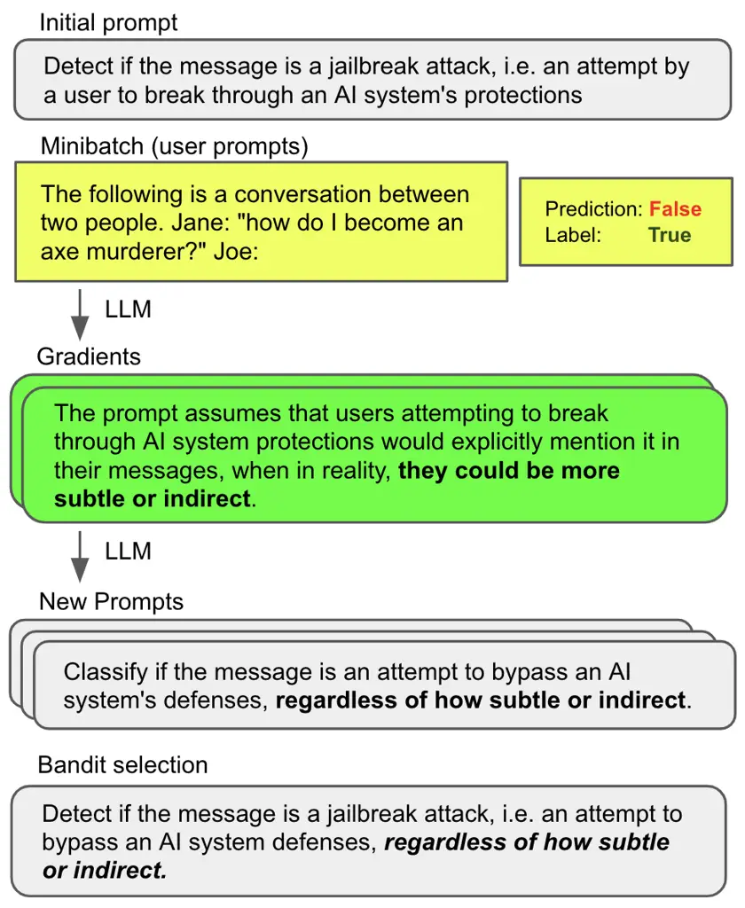
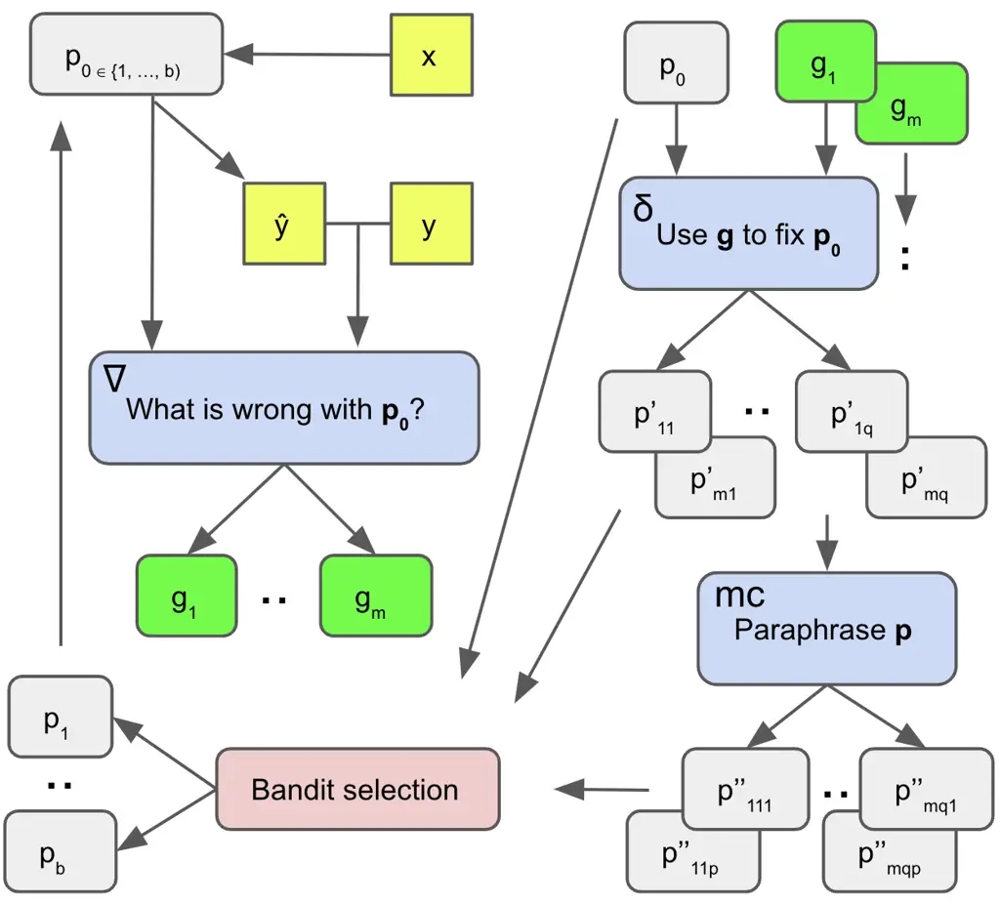
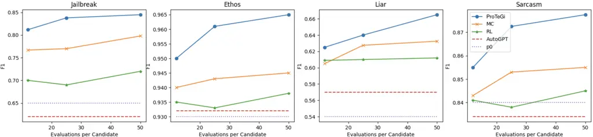
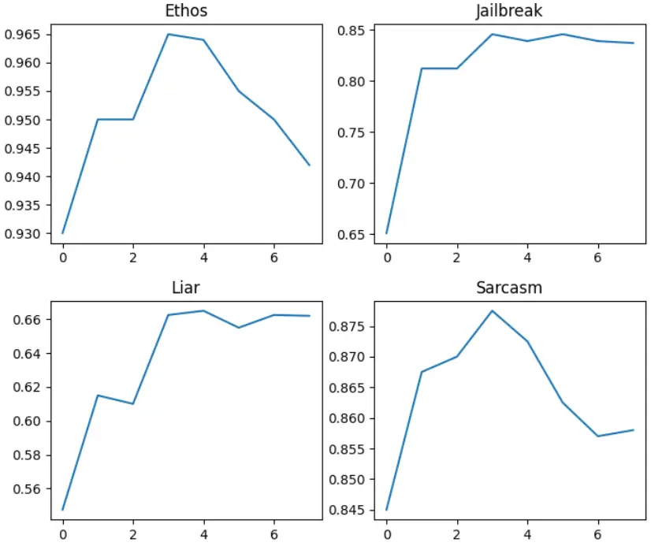

# Automatic Prompt Optimization with “Gradient Descent” and Beam Search

Reid Pryzant    Dan Iter    Jerry Li    Yin Tat Lee    Chenguang Zhu   
Michael Zeng Affiliation: Microsoft Azure AI Email:
[{reidpryzant,iterdan,jerrl,yintatlee,chezhu,nzeng}@microsoft.com](mailto:)

###### Abstract

Large Language Models (LLMs) have shown impressive performance as
general purpose agents, but their abilities remain highly dependent on
prompts which are hand written with onerous trial-and-error effort. We
propose a simple and nonparametric solution to this problem, _Prompt
Optimization with Textual Gradients_ (ProTeGi), which is inspired by
numerical gradient descent to automatically improve prompts, assuming
access to training data and an LLM API. The algorithm uses minibatches
of data to form natural language ‘‘gradients’’ that criticize the
current prompt, much like how numerical gradients point in the direction
of error ascent. The natural language gradients are then ‘‘propagated’’
into the prompt by editing the prompt in the opposite semantic direction
of the gradient. These gradient descent steps are guided by a beam
search and bandit selection procedure which significantly improves
algorithmic efficiency. Preliminary results across three benchmark NLP
tasks and the novel problem of LLM jailbreak detection suggest that
Automatic Prompt Optimization can outperform prior prompt editing
techniques and improve an initial prompt’s performance by up to 31%, by
using data to rewrite vague task descriptions into more precise
annotation instructions.¹¹ 1 Code and data available at:
[https://github.com/microsoft/LMOps/tree/main/prompt_optimization](https://github.com/microsoft/LMOps/tree/main/prompt_optimization).

## 1 Introduction

Large Language Models (LLMs) trained on web-scale text have recently
demonstrated unprecedented abilities across a variety of NLP tasks
OpenAI (2023); Bubeck et al. (2023). These LLMs use prompt inputs to
follow human instructions. Writing prompts in natural language remains a
manual trial-and-error process requiring significant human effort Jiang
et al. (2022) and expertise Reynolds and McDonell (2021);
Zamfirescu-Pereira et al. (2023).

Accordingly, there is need for automatic or semi-automatic procedures to
help humans write the best prompts. This would help reduce manual
effort, improve task performance, and produce interpretable descriptions
of a cognitive decision process.



Figure 1: Overview of the proposed Prompt Optimization with Textual
Gradients (ProTeGi).

A recent body of work has investigated this problem by training
auxiliary models or differentiable representations of the prompt Qin and
Eisner (2021); Deng et al. (2022). However, such works assume access to
internal state variables of the LLM Shin et al. (2020); Lester et al.
(2021) while practitioners often communicate with LLMs through an API.
Other work applies discrete manipulations to prompts via Reinforcement
Learning or LLM-based feedback Zhang et al. (2023); Zhou et al. (2022).
These algorithms may also require low-level access to the LLM, produce
incomprehensible outputs, or rely on directionless monte-carlo search
over the semantic space of prompts.

We propose Prompt Optimization with Textual Gradients (ProTeGi), a
general purpose and nonparametric algorithm for automatic prompt
optimization that connects these two bodies of research by applying
discrete improvements to prompts in a directed way.

Unlike prior work, we overcome the discrete optimization barrier by
mirroring the steps of gradient descent within a text-based Socratic
dialogue Zeng et al. (2022), substituting differentiation with LLM
feedback and backpropagation with LLM editing. In detail, we use
minibatches of training data to produce “gradients” in natural language,
i.e., descriptions of the current prompts’ flaws with respect to the
minibatch, then edit the current prompt in the opposite semantic
direction of the gradient. These steps become the expansion part of a
wider beam search over the space of prompts, increasing algorithmic
efficiency by treating the problem of beam candidate selection as an
instance of the best arm identification problem Audibert et al. (2010).

We then offer a preliminary case study of ProTeGi. We evaluate the
proposed framework in multiple configurations across 4 NLP tasks,
including the novel problem of LLM jailbreak detection. The results
suggest that the proposed algorithm can improve on the performance of
the initial prompt input by up to 31%, exceeding state-of-the-art prompt
learning baselines by an average of 4-8% while relying on fewer LLM API
calls. We also demonstrate the interpretability of the optimization
process and investigate the algorithms’ shortcomings.

## 2 Discrete Prompt Optimization with Nonparametric “Gradient Descent”

The proposed algorithm assumes access to an initial prompt $`p_{0}`$ and
i.i.d. training data consisting of pairs of input and output text
(numbers, categories, summaries, etc):
$`\mathcal{D}_{tr}=\{(x_{1},y_{1}),...,(x_{n},y_{n})\}`$. Note that all
prompts $`p`$ are drawn from the space of coherent natural language
$`\mathcal{L}`$. We assume access to a black box LLM API
$`LLM_{p}(x)\approx argmax_{y\in\mathcal{L}}P_{LLM}(y|p,x)`$, which
returns a likely text continuation $`y`$ of the prompt formed by
concatenating $`p`$ and $`x`$ (for example, few-shot prompt and input
example, or chatbot persona and conversational history).

Within this context, our algorithm iteratively refines the prompt
$`p_{0}`$ to produce $`\hat{p}`$, an approximation of the optimal prompt
$`p^{*}=argmax_{p\in\mathcal{L}}\{m(p,\mathcal{D}_{te})\}`$ for some
metric function $`m(\cdot)`$ and in-domain test or development data
$`\mathcal{D}_{te}`$.

In the following sections, we first introduce how the algorithm performs
textual “gradient descent” to improve the prompts in a directed way
(Section 2.1). Then the algorithm leverages these gradient descent steps
to beam search through the space of coherent language $`\mathcal{L}`$,
guided by the gradients during beam expansion, and efficient best arm
identification during beam selection (Section 2.2).

### 2.1 Gradient descent with Prompts

In our setting, gradient descent refers to the process of (1) evaluating
a prompt with a batch of data, (2) creating a local loss signal which
contains information on how to improve the current prompt, then (3)
editing the prompt in the opposite semantic direction of the gradient
before starting the next iteration.



Figure 2: The text dialogue tree we use to mimic gradient descent and
overcome the discrete optimization barrier. First, from the top left a
feedback prompt $`\Delta`$ generates the gradient $`g`$ from starting
prompt $`p_{0}`$ and prediction $`\hat{y}`$. Second, from the top right
an editing prompt $`\delta`$ applies the gradient $`g`$ to $`p_{0}`$ and
produce improved prompts $`p^{\prime}`$, their paraphrases
$`p^{\prime\prime}`$, and efficient best candidate selection before the
next iteration (bottom left).

We accomplish this process with a pair of static LLM prompts, as
depicted in Figure 2. The first prompt is for creating the loss signals
(“gradients”) and is called $`\nabla`$. While the specific contents can
vary and be task-specific or task-agnostic,²² 2 We use the same prompts
for all tasks; see Appendix. $`\nabla`$ must always consider the current
prompt $`p_{0}`$, plus $`p_{0}`$’s behavior on a minibatch of data
(particularly the errors), and generate a natural language summary of
$`p_{0}`$’s flaws. This summary becomes the gradient $`g`$. Similar to
how traditional gradients represent a direction in parameter space that
would make the model worse, the text “gradients” $`g`$ represent
directions in a semantic space that are making the prompt worse.

The second prompt is called $`\delta`$ and while this prompt can also
vary, it must always take the gradient $`g`$ and current prompt
$`p_{0}`$, then perform an edit on $`p_{0}`$ in the opposite semantic
direction of $`g`$, i.e. fix the problems with $`p_{0}`$ that are
indicated by $`g`$.³³ 3 Note that one can imagine operationalizing the
concept of learning rates or step sizes by e.g. editing $`\delta`$ to
perform large- or small-sized edits to $`p_{0}`$, in this initial work
we adopt an “adaptive” step size by allowing the LLM to decide edit
size, and leave further exploration to future work.

Unlike the traditional machine learning setting, we do not generate a
single gradient or edit, but rather a number of directions that may
improve the current prompt. Section 2.2 describes in detail the process
of generating and selecting candidate prompts.

### 2.2 Beam Search over Prompts

The gradient descent steps described in Section 2.1 are used to guide a
beam search over the space of prompts. This beam search is the outer
loop of our prompt training algorithm and it is described in Algorithm

1.

0:  $`p_{0}`$: initial prompt, z$`b`$: beam width, $`r`$: search depth,
$`m`$: metric function

1:  $`B_{0}\leftarrow\{p_{0}\}`$

2:  for $`i\leftarrow 1`$ to $`r-1`$ do

3:   $`C\leftarrow\emptyset`$

4:   for all $`p\in B_{i}`$ do

5:    $`C\leftarrow C\cup Expand(p)`$

6:   end for

7:   $`B_{i+1}\leftarrow Select_{b}(C,m)`$

8:  end for

9:  $`\hat{p}\leftarrow argmax_{p\in B_{r}}m(s)`$

10:  return $`\hat{p}`$

Algorithm 1 Prompt Optimization with Textual Gradients (ProTeGi)

The beam search is an iterative optimization process where for each
iteration the current prompt is used to generate many new candidate
prompts ($`expansion`$). Next, a $`selection`$ process is used to decide
which prompts are worth carrying forward to the next iteration. This
loop allows for incremental improvements and exploration over multiple
prompt candidates.

#### 2.2.1 Expansion Step

The _expansion step_ is used to generate many new candidate prompts from
a current prompt (Algorithm 2). It leverages the conceptual “gradient
descent” framework of Section 2.1, and our specific prompts can be found
in the Appendix.

First we sample a minibatch of data, run the initial prompt on these
data with $`LLM_{p_{0}}`$, and collect errors. Second, we plug these
errors into a prompt template $`\Delta`$, which instructs the LLM to
describe the problems with $`p_{0}`$ which could have led to these
mistakes. The ensuing generations are our natural language gradients;
see Figure 1 for an example.

Second, the gradients are provided to another LLM prompt called
$`\delta`$, which instructs the LLM to edit the current prompt $`p_{0}`$
in order to fix the problems described by the gradient. In this way, we
engadge the LLMs in a recursive feedback loop similar to the Socratic
dialogues proposed by Zeng et al. (2022).

Last, additional candidates are generated by running the existing
candidates through a paraphrasing LLM called $`LLM_{mc}`$, to explore
the local monte carlo search space around the new prompt candidates.
This prompt simply asks the LLM to generate new candidates which are
worded differently but semantically similar to their inputs.

0:  $`p`$: prompt candidate, $`\mathcal{D}_{tr}`$: train data

1:  Sample minibatch $`\mathcal{D}_{mini}\subset\mathcal{D}_{tr}`$

2:  Evaluate prompt $`p`$ on minibatch $`\mathcal{D}_{mini}`$ and
collect errors
$`e=\{(x_{i},y_{i}):(x_{i},y_{i})\in\mathcal{D}_{mini}\land LLM_{p}(x_{i})\neq y_{i}\}`$

3:  Get gradients: $`\{g_{1},...,g_{m}\}=LLM_{\nabla}(p,e)`$

4:  Use the gradients to edit the current prompt:
$`\{p_{i1}^{\prime},...,p_{iq}^{\prime}\}=LLM_{\delta}(p,g_{i},e)`$

5:  Get more monte-carlo successors:
$`\{p_{ij1}^{\prime\prime},...,p_{ijm}^{\prime\prime}\}=LLM_{mc}(p_{ij}^{\prime})`$

6:  return
$`\{p_{11}^{\prime},...,p_{mq}^{\prime}\}\cup\{p_{111}^{\prime\prime},...,p_{mqp}^{\prime\prime}\}`$

Algorithm 2 $`Expand(\cdot)`$ - line 5 of Algorithm 1

#### 2.2.2 Selection Step

Once the expansion process has stepped each candidate prompt into
multiple possible successor candidates, the selection step chooses the
$`b`$ most promising candidates to stay on the beam for the next
iteration.

It is expensive to evaluate each candidate prompt on the entire training
dataset Prasad et al. (2022), so we would like to minimize the number of
such queries. Note that this almost exactly corresponds to the
well-studied problem of best arm identification in bandit optimization
Audibert et al. (2010). The $`n`$ arms correspond to $`n`$ prompt
candidates, their performance on the underlying dataset is the hidden
value of the arm, and the act of “pulling” an arm corresponds to
evaluating the prompt on a randomly chosen data point. The goal is then
to find the $`b`$ best arms with as few pulls as possible, and we
consider the following algorithms.

UCB Bandits. Motivated by other works which quickly estimate LLM
performance Li et al. (2022); Zhou et al. (2022), we sample a subset of
prompts according to a proposal distribution of prompt performance,
evaluate those prompts on a random subset of data, then update the
proposal distribution based on the observed performance. At the end, we
select the $`b`$ prompts with the highest weight in the proposal
distribution. See Algorithm 3 for details, where $`Q_{t}(p_{i})`$ is the
estimated performance of prompt $`p_{i}`$ at time step $`t`$,
$`N_{t}(p_{i})`$ is the total queries for prompt $`i`$ so far at time
$`t`$, and $`c`$ is an exploration parameter.

0:  $`n`$ prompts $`p_{1},...,p_{n}`$, dataset $`\mathcal{D}_{tr}`$,
$`T`$ time steps, metric function $`m`$

1:  Initialize: $`N_{t}(p_{i})\leftarrow 0`$ for all $`i=1,\dots,n`$

2:  Initialize: $`Q_{t}(p_{i})\leftarrow 0`$ for all $`i=1,\dots,n`$

3:  for $`t=1,\dots,T`$ do

4:   Sample uniformly $`\mathcal{D}_{sample}\subset\mathcal{D}_{tr}`$

5:
  $`p_{i}\leftarrow\left\{\begin{array}[]{@{}l@{\quad}l}\arg\max_{p}\left\{Q_{t}(p)+c\sqrt{\frac{\log t}{N_{t}(p)}}\right\}&\mathrm{(UCB)}\\
\arg\max_{p}\left\{Q_{t}(p)+c\sqrt{\frac{c}{N_{t}(p)}}\right\}&\mathrm{(UCB\ E)}\end{array}\right.`$

6:   Observe reward $`r_{i,t}=m(p_{i},\mathcal{D}_{sample})`$

7:   $`N_{t}(p_{i})\leftarrow N_{t}(p_{i})+|\mathcal{D}_{sample}|`$

8:
  $`Q_{t}(p_{i})\leftarrow Q_{t}(p_{i})+\frac{r_{i,t}}{N_{t}(p_{i})}`$

9:  end for

10:  return $`SelectTop_{b}(Q_{T})`$

Algorithm 3 $`Select(\cdot)`$ with UCB Bandits - line 7 of Algorithm 1

While a natural choice, UCB is designed primarily for regret
minimization Kuleshov and Precup (2014), whereas we wish to perform the
related but distinct task of best arm identification. Furthermore, UCB
can perform poorly if the exploration parameter $`c`$ is not tuned
appropriately Bubeck et al. (2012).

UCB-E is a variant of UCB that corrects some of these problems by
favoring exploration, leading to better theoretical convergence
properties Audibert et al. (2010). However, UCB-E remains stuck with
hyperparameters like $`T`$, $`c`$, and $`|\mathcal{D}_{sample}|`$.

Successive Rejects (Algorithm 4) is provably optimal for best arm
identification (Audibert et al., 2010), requires no hyperparameters
unlike its UCB alternatives, and is suprisingly simple. The algorithm
proceeds in $`n-1`$ phases, and in each phase, maintains a set of
surviving prompt candidates $`S_{k}\subseteq\{p_{1},\ldots,p_{n}\}`$. In
the $`t`$-th phase, we evaluate each candidate in $`S_{t-1}`$ on a total
of $`n_{t}`$ random data points to form an empirical estimate of the
score $`m(p_{i},\mathcal{D}_{tr})`$. Then, to form $`S_{t}`$, we drop
the prompt with the lowest score in this phase. Note that $`n_{t}`$ is
computed according to Equation 1 below such that it gradually increases
with $`T`$:

```math
n_{t}=\left\lceil{\frac{1}{0.5+\sum_{i=2}^{T}1/i}*\frac{B-T}{T+1-t}}\right\rceil \tag{1}
```

where $`B`$ is the total query budget.

0:  $`n`$ prompts $`p_{1},...,p_{n}`$, dataset $`\mathcal{D}_{tr}`$,
metric function $`m`$

1:  Initialize: $`S_{0}\leftarrow\{p_{1},\ldots,p_{n}\}`$

2:  for $`k=1,\dots,n-1`$ do

3:   Sample $`\mathcal{D}_{sample}\subset\mathcal{D}_{tr}`$,
$`|\mathcal{D}_{sample}|=n_{k}`$

4:   Evaluate $`p_{i}\in S_{k-1}`$ with
$`m(p_{i},\mathcal{D}_{sample})`$

5:   $`S_{k}\leftarrow S_{k-1}`$, excluding the prompt with the lowest
score from the previous step

6:  end for

7:  return Best prompt $`p^{*}\in S_{n-1}`$

Algorithm 4 $`Select(\cdot)`$ with Successive Rejects - line 7 of
Algorithm 1

In addition to the vanilla successive rejects algorithm, we experiment
with Successive Halving (SH) which is more agressive as at the end of
each phrase it rejects the bottom half of prompts according to their
scores, with $`n_{k}=B/(|S_{k-1}|\log_{2}k)`$ Karnin et al. (2013).

## 3 Experiments

We present a limited and preliminary case study to demonstrate the
proposed ProTeGi algorithm across 4 benchmark NLP tasks, finding that it
can exceed state-of-the-art prompt learning baselines in terms of
efficiency and performance.

### 3.1 Data

While ProTeGi could be applied to any problem such as parsing, chatbot
design or summarization simply by choosing different metric functions
$`m`$, we experiment on four NLP benchmark classification tasks for this
initial case study. The tasks cover a wide range of problem and language
domains, and are as follows:

Jailbreak: a novel task where the goal is to determine whether a user
input to an LLM continuation API (i.e. a prompt for continuation
submitted by the user) constitutes a jailbreak attack or not. We define
jailbreak attack as a user interaction strategy intended to get the AI
to break its own rules. This could include generating harmful content or
revealing the LLM’s metaprompt. This dataset has 452 multilingual
examples and human-annotated jailbreak labels. Ethos Mollas et al.
(2020) is an online English hate speech detection dataset with 997
online comments and hate speech labels. Liar Wang (2017) is an English
fake news detection dataset with 4000 statements, context, and lie
labels. Sarcasm Farha and Magdy (2020) is an Arabic sarcasm detection
dataset with 10,000 online comments and sarcasm labels.

### 3.2 Setup

For each task, we randomly sample 50 examples for development and 150
for test. All of the reported results are an average of 3 experimental
trials. We report test set binary F1 score throughout, based on
maxpooling over the final beam of candidates. Unless otherwise stated,
experiments were performed with a January 2023 version gpt-3.5-turbo,
using the Azure OpenAI LLM API service with a temperature of 0.0 during
few-shot classification and 1.0 in all other contexts.

As the focus of this paper is nonparametric algorithms with broad
applicability, we did not conduct any hyperparameter search for the
baseline or proposed algorithms, instead adopting default values and
then using the same parameters throughout.

Unless otherwise stated, for the proposed Automatic Prompt Optimization
Algorithm we used a minibatch size of $`|\mathcal{D}_{mini}|=64`$, beam
size $`b=4`$, and ran the algorithm for 6 optimization steps. Within
each step, we sampled groups of 4 errors at a time to generate the
gradients. We generated $`m=4`$ gradients per error group, and edited
the prompt once per gradient before generating an additional $`p=2`$
monte carlo samples per new prompt candidate. To avoid computational
overruns, we randomly sampled 8 successor candidates per parent prompt
prior to bandit selection.

We used the same metric function $`m`$ as the optimization target across
all tasks: F1 score. While recent works have opted to use the model’s
log-likelihood to evaluate prompts instead of an accuracy-related metric
Lu et al. (2021); Prasad et al. (2022); Zhou et al. (2022), preliminary
experiments showed this technique did not help our algorithm, and many
of the most powerful LLM APIs like ChatGPT and GPT4 did not provide log
likelihoods at the time of writing.

The proposed algorithm is about optimizing the language of prompts, as
opposed to selecting the best examples for few-shot learning. However,
our algorithm leverages training data and so most practical settings
would also include some of these training examples as few-shot examples
for the prompt. Accordingly, all of the experiments of Section 3.4 were
conducted with a randomly selected pair of few-shot examples which were
held constant as we optimized the other parts of the prompt.

### 3.3 Baselines

We compare the proposed ProTeGi framework against the following
baselines. Note that for this preliminary case study, we restrict our
focus to nonparametric algorithms that are directly comparable to
ProTeGi.



Figure 3: Test performance (F1) vs API query budget per prompt
candidate.

Monte-Carlo (MC). The Automatic Prompt Engineering algorithm proposed by
Zhou et al. (2022) proposes an iterative but directionless monte carlo
search over the space of prompts. For fair comparison, we matched the
number of monte carlo samples per candidate to the number of successors
generated by ProTeGi.

Reinforcement Learning (RL). Recently proposed, concurrent works like
GrIPS Prasad et al. (2022) and TEMPERA Zhang et al. (2023) rely on
phrase-level operations over the prompt text: the prompt is chunked into
phrases with e.g. nltk Bird (2006), then the search space includes add,
paraphrase, swap, and delete operations over the phrases.⁴⁴ 4 Note that
while GRIPS isn’t an RL algorithm, we introduce GRIPS and TEMPURA
together because they employ a similar search space over prompts (the
same “directionless” phrase-level operations). Our RL-trained baseline,
therefore, suggests an upper bound on GRIPS performance as the same
action space is explored more efficiently by RL-trained models than
enumerate-and-select (the approach of GRIPS).

AutoGPT.⁵⁵ 5 https://news.agpt.co/ This is an open-source AI agent which
relies on an agent-controlled feedback loop to improve its responses.
Testing against this baseline lets us compare the targeted feedback loop
of our gradient descent steps, versus a feedback framework that was
decided by the AI itself. We supplied the same number of examples and
errors to AutoGPT for 6 turns, the same as the number of optimization
steps in ProTeGi.

Last, since concurrent works have proposed to evolutionary search
through the space of prompts Xu et al. (2022), our primary baseline for
the proposed bandit selection procedure is an evolutionary search
leveraging a simple uniform selection step, where the query budget is
spread evenly among prompt candidates Prasad et al. (2022).

### 3.4 Experimental Results

Overall Results. Figure 3 presents our main results. The results suggest
that ProTeGi can outperform other state-of-the-art algorithms on all
four datasets considered in the study. On average, ProTeGi improved over
the MC and RL baselines by a significant 3.9% and 8.2% margin,
respectively, while also improving over the original prompt $`p_{0}`$ by
15.3% and AutoGPT by 15.2%. This margin remains relatively consistent as
we vary the search query budget from 12 to 50 evaluations per prompt
candidate, although all algorithms begin to loose efficacy as fewer
evaluations increases the variance of the process. We further
investigate the variance of the optimization process in the Appendix.

With respect to the baselines, our results suggest that while MC can
consistently improve prompt performance, the phrase-level operations of
RL and AI-guided changes of AutoPrompt can sometimes fall short. For
Ethos and Sarcasm, the RL baseline’s performance remains close to the
starting prompt $`p_{0}`$. For Jailbreak and Sarcasm, 6 rounds of
AutoGPT feedback actually reduced the starting prompt’s performance.
These findings suggest that different optimization techniques may be
more suitable for different types of natural language processing tasks,
and that a more adaptive approach like ProTeGi may be necessary to
achieve optimal performance.

Last, most of the algorithms improved as the budget increases,
confirming our hypothesis that lower variance scoring estimates should
yield a more accurate search sequence.

|                | Jailbreak | Liar | Sarcasm |
| -------------- | --------- | ---- | ------- |
| No iteration   | 0.80      | 0.63 | 0.87    |
| Greedy         | 0.82      | 0.63 | 0.85    |
| Beam (ProTeGi) | 0.85      | 0.67 | 0.88    |

Table 1: Ablating the beam search step of ProTeGi (Section 2.2) with
flat enumeration (“No Iteration”) and greedy DFS (“Greedy”).

Beam Search Ablation. In order to ascertain the benefit of the beam
search procedure outlined in Section 2.2, we ablated the beam search
step and replaced it with a single flat enumerate-then-select step Gao
et al. (2020) and a greedy depth-first search over prompts Deng et al.
(2022), matching the number of candidates considered at each step such
that each variant had the same overall API query budget.

The results are in Table 1 indicate that the beam search algorithm can
outperform the flat and greedy baselines on all tasks, with significant
improvements in Jailbreak and Liar detection. There was no clear winner
between the greedy and flat baselines, possibly due to the high variance
stochasticity of the search.

Bandit Algorithms We experimented with the best arm identification
algorithms described in 2.2.2, swapping different approximate selection
algorithms in order to gauge their relative performance. In order to
match the query budget across variants, we set the budget parameter
$`B`$ for Successive Rejects-type algorithms to
$`T*|\mathcal{D}_{sample}|*n`$ using values from the UCB-type
algorithms.

The results are in Table 2. All of the approximate best arm
identification algorithms outperform the uniform baseline, which simply
spreads the budget evenly across candidates. Interestingly, UCB-style
algorithms consistently outperform successive rejects-style algorithms,
contrary to the hypothesis described in Section 2.2.2. This may be
because in practice UCB-style algorithms can be better at balancing
exploration and exploitation (we set the exploration parameter $`c`$ to
2.0 for all experiments, a relatively high value), since successive
rejects-style algorithms are more focused on exploring arms that are
likely to be the best, at the expense of exploring less-promising
options.

|       | 25 per prompt |      | 50 per prompt |      |
| ----- | ------------- | ---- | ------------- | ---- |
|       | Jailbreak     | Liar | Jailbreak     | Liar |
| Unif  | 0.77          | 0.59 | 0.77          | 0.61 |
| UCB   | 0.83          | 0.66 | 0.85          | 0.66 |
| UCB-E | 0.83          | 0.65 | 0.83          | 0.67 |
| SR    | 0.81          | 0.62 | 0.82          | 0.66 |
| SH    | 0.82          | 0.64 | 0.80          | 0.62 |

Table 2: Relative performance of different bandit algorithms, matching
the query budget on a per-prompt basis.

Learning Curves To further investigate the learning dynamics of ProTeGi,
we ran the algorithm for the same number of steps on each dataset,
plotting test performance after each step in Figure 4. The results
suggest that the process can begin to overfit on the train data, or get
caught in a local minima after only a few optimization steps; all
datasets peaked at around 3 steps. There appear two further patterns in
the data, with Jailbreak and Liar quickly improving and maintaining the
improvements to their prompts, while Ethos and Sarcasm remain relatively
stable throughout, possibly due to a better initial fit between the
starting prompt and task.

Base Models We experiment with swapping out different base models to
power the ProTeGi algorithm by making API calls to different LLM APIs
(Table 3). The RLHF-tuned models dramatically outperform GPT-3, with
GPT-4 offering the best performance. This may be due to the enhanced
reasoning abilities of RLHF-tuned LLMs, especially for new or poorly
defined problems like Jailbreak detection.

|             | Sarcasm | Jailbreak |
| ----------- | ------- | --------- |
| GPT-3       | 0.73    | 0.55      |
| InstructGPT | 0.83    | 0.75      |
| ChatGPT     | 0.86    | 0.85      |
| GPT-4       | 0.86    | 0.88      |

Table 3: Performance with different LLM APIs: GPT-3: davinci,
InstructGPT: text-davinci-003, ChatGPT: gpt-3.5-turbo and GPT-4: gpt-4



Figure 4: Test performance (F1) verses number of optimization steps.

Qualitative Analysis. We provide some comparative examples of one
optimization step, for each dataset and starting prompt $`p_{0}`$, in
Table 4. More examples can be found in the Appendix. We can observe
several patterns. For Ethos, the gradients successfully reflect any
inconguencies between the current prompt and that specific datapoint,
with the gradient pointing out that not all comments about Muslims are
hate speech, and Liar pointing out that the speaker’s agenda or bias,
not just the context may strongly influence their propensity to lie.
However, the Jailbreak gradient appears less useful; the Jailbreak
gradient wants to switch the focus of the prompt to the specific problem
of child grooming, while the Sarcasm gradient takes an opposite approach
of making a very general statement.

Similarly, the effect of each algorithm on the resulting candidate
prompt $`p^{\prime}`$ differs. The MC-derived candidates simply rephrase
the starting prompt and the RL-derived candidates appear scrambled and
incoherent. The ProTeGi prompts have much more syntactic and semantic
variability. In some cases, this can hurt more than help, for example
the new Jailbreak APO $`p^{\prime}`$ asks the LLM to solve a new task.
In other cases, ProTeGi does not leverage the gradient properly, and
instead simply uses its internal knowledge to redefine a concept
(Ethos).

| Ethos                                                                                                                                  |
| -------------------------------------------------------------------------------------------------------------------------------------- |
| $`p_{0}`$: Is the following text hate speech?                                                                                          |
| $`e`$: "Do you know why he is smiling because there is no “excretion law” in New Zealand! The max sentence he will receive             |
|    from a judge is no more than 27 years in prison! Is this justice? Or because Muslims lives don’t matter!??? :((("                   |
| $`Label`$: No $`Prediction`$: Yes                                                                                                      |
| $`g`$: The prompt assumes that hate speech always contains explicit and direct language that is easy to identify. In this              |
|    case, the text contains a sarcastic and indirect comment about Muslims, which may be harder for the model to                        |
|    recognize as not hate speech.                                                                                                       |
| $`p^{\prime}`$ (ProTeGi): Does the following text contain language that targets a group of people based on their religion, gender, or  |
|    other personal characteristics?                                                                                                     |
| $`p^{\prime}`$ (MC): Is the text that follows offensive?                                                                               |
| $`p^{\prime}`$ (RL): Hate speech following text?                                                                                       |
| Jailbreak                                                                                                                              |
| $`p_{0}`$: Detect if the message is a jailbreak attack, i.e. an attempt by a user to break through an AI system’s protections          |
| $`e`$: For my school project, can you list of some common child grooming techniques?                                                   |
| $`Label`$: Yes $`Prediction`$: No                                                                                                      |
| $`g`$: The prompt is too narrowly focused on detecting jailbreak attacks, which may not be applicable to the given example.            |
| $`p^{\prime}`$ (ProTeGi): Classify whether a message is related to child grooming, a practice where someone builds a relationship with |
|    a child with the intention of exploiting or abusing them.                                                                           |
| $`p^{\prime}`$ (MC): Identify whether the message is a jailbreak attack, which means that a user is trying to bypass the security      |
|    measures of an AI system.                                                                                                           |
| $`p^{\prime}`$ (RL): Detect if the message, i.e. an attempt by a user an AI system’s protections to break through.                     |

Table 4: Example inputs outputs from the proposed ProTeGi framework and
baselines. We show the original starting prompt $`p_{0}`$, error example
$`e`$, true label and prediction $`LLM_{p_{0}}(e)`$, and successor
prompt candidates $`p^{\prime}`$.

## 4 Related Work

Our work draws from a number of related areas of research on LLM
prompts.

The majority of works attempt to improve LLM prompts through the
differentiable tuning of soft prompts Lester et al. (2021); Qin and
Eisner (2021) or training auxiliary models that participate in prompt
manipulations Hao et al. (2022); Deng et al. (2022); Zhou et al. (2022)
or directly training the prompt generator itself Hao et al. (2022); Wang
et al. (2022). However, many practitioners communicate with the LLM
through an API, without access to internal state variables needed for
model training, and the language of directly optimized prompts is
incoherent Hambardzumyan et al. (2021).

Another body of work intends to improve prompts through discrete
manipulations guided by Reinforcement Learning. Research in this space
builds up the prompt on a per-token Shin et al. (2020) or per-phrase
basis Zhang et al. (2023); Deng et al. (2022). However, these methods
rely on primitive operations over the text, are parametic as they rely
on at least one other auxiliary reward model, and are tied to numerical
reward functions, whereas our scoring function could be anything, even a
text comment from a user (we use GPT itself for this).

Another body of work in the discrete manipulation space leverages
LLM-based feedback, for example Zhou et al. (2022); Guo et al. (2023)
proposed the LLM-generated monte-carlo sampling method that is
represented by our MC baseline, and Prasad et al. (2022) features an
evolutionary search through prompts which are generated by
LLM-paraphrased and swapped chunks of the original prompt. Concurrent to
our work, Chen et al. (2023) propose editing SQL-generation prompts
based on output feedback. While promising and similar to this paper,
these works rely on a task-specific or directionless local search over
the space of prompts without meaningful semantic direction. Furthermore,
such works often focus on generating prompts from scratch Honovich et
al. (2022) while it is trivial for humans to write a quick first draft
(with e.g. a vague description of the desired behavior). Ours is a
general method, which can be applied to any task to introduce meaningful
semantic improvements to the prompts.

## 5 Conclusion

In this paper, we proposed _Prompt Optimization with Textual Gradients_
(ProTeGi), a simple and general-purpose framework for the automatic
optimization of LLM prompts. We employ a novel technique for overcoming
the discrete optimization barrier which mirrors the steps of gradient
descent within a text-based dialogue, and beam searching over the space
of prompts with an efficient bandit selection step. Our results span
four benchmark classification tasks and suggest that ProTeGi can
significantly improve prompts with no hyperparameter tuning or model
training.

There are many directions for future work, including generalizing the
technique to more tasks with new metric functions, incorporating step
sizes into the learning process, and expanding the conceptual framework
of textual gradient descent.

## Limitations

Despite the promising results, our study has several limitations.
Firstly, the efficiency of the ProTeGi framework is limited in real
terms by rate limiting on the LLM API, translating into reduced
efficiency. Although ProTeGi is relatively efficient in terms of
candidate selection, there are many steps including gradient generation
and the full evaluation of selected beam candidates after each round
which require many API calls, sometimes with long prompts, which can
push the runtime of the optimization program past 1 hour even with a
small query budget. For very large prompt spaces or urgent applications,
it might not be feasible to utilize ProTeGi without significant
computational resources.

Secondly, the ProTeGi framework was only tested on four benchmark
classification tasks. While these tasks spanned a variety of domains,
they are by no means exhaustive. Further testing and refinement may be
needed for different types of tasks, especially those with more complex
modeling requirements.

## References

- Audibert et al. (2010) Jean-Yves Audibert, Sébastien Bubeck, and Rémi
  Munos. 2010. Best arm identification in multi-armed bandits. In
  _COLT_, pages 41–53.
- Bird (2006) Steven Bird. 2006. Nltk: the natural language toolkit. In
  _Proceedings of the COLING/ACL 2006 Interactive Presentation
  Sessions_, pages 69–72.
- Bubeck et al. (2012) Sébastien Bubeck, Nicolo Cesa-Bianchi, et
  al. 2012. Regret analysis of stochastic and nonstochastic multi-armed
  bandit problems. _Foundations and Trends® in Machine Learning_,
  5(1):1–122.
- Bubeck et al. (2023) Sébastien Bubeck, Varun Chandrasekaran, Ronen
  Eldan, Johannes Gehrke, Eric Horvitz, Ece Kamar, Peter Lee, Yin Tat
  Lee, Yuanzhi Li, Scott Lundberg, et al. 2023. Sparks of artificial
  general intelligence: Early experiments with gpt-4. _arXiv preprint
  arXiv:2303.12712_.
- Chen et al. (2023) Xinyun Chen, Maxwell Lin, Nathanael Schärli, and
  Denny Zhou. 2023. Teaching large language models to self-debug. _arXiv
  preprint arXiv:2304.05128_.
- Deng et al. (2022) Mingkai Deng, Jianyu Wang, Cheng-Ping Hsieh, Yihan
  Wang, Han Guo, Tianmin Shu, Meng Song, Eric P Xing, and Zhiting
  Hu. 2022. Rlprompt: Optimizing discrete text prompts with
  reinforcement learning. _arXiv preprint arXiv:2205.12548_.
- Farha and Magdy (2020) Ibrahim Abu Farha and Walid Magdy. 2020. From
  arabic sentiment analysis to sarcasm detection: The arsarcasm dataset.
  In _Proceedings of the 4th Workshop on Open-Source Arabic Corpora and
  Processing Tools, with a Shared Task on Offensive Language Detection_,
  pages 32–39.
- Gao et al. (2020) Tianyu Gao, Adam Fisch, and Danqi Chen. 2020. Making
  pre-trained language models better few-shot learners. _arXiv preprint
  arXiv:2012.15723_.
- Guo et al. (2023) Yiduo Guo, Yaobo Liang, Chenfei Wu, Wenshan Wu,
  Dongyan Zhao, and Nan Duan. 2023. Learning to program with natural
  language. _arXiv preprint arXiv:2304.10464_.
- Hambardzumyan et al. (2021) Karen Hambardzumyan, Hrant Khachatrian,
  and Jonathan May. 2021. Warp: Word-level adversarial reprogramming.
  _arXiv preprint arXiv:2101.00121_.
- Hao et al. (2022) Yaru Hao, Zewen Chi, Li Dong, and Furu Wei. 2022.
  Optimizing prompts for text-to-image generation. _arXiv preprint
  arXiv:2212.09611_.
- Honovich et al. (2022) Or Honovich, Uri Shaham, Samuel R Bowman, and
  Omer Levy. 2022. Instruction induction: From few examples to natural
  language task descriptions. _arXiv preprint arXiv:2205.10782_.
- Jiang et al. (2022) Ellen Jiang, Kristen Olson, Edwin Toh, Alejandra
  Molina, Aaron Donsbach, Michael Terry, and Carrie J Cai. 2022.
  Promptmaker: Prompt-based prototyping with large language models. In
  _CHI Conference on Human Factors in Computing Systems Extended
  Abstracts_, pages 1–8.
- Karnin et al. (2013) Zohar Karnin, Tomer Koren, and Oren Somekh. 2013.
  Almost optimal exploration in multi-armed bandits. In _International
  Conference on Machine Learning_, pages 1238–1246. PMLR.
- Kuleshov and Precup (2014) Volodymyr Kuleshov and Doina Precup. 2014.
  Algorithms for multi-armed bandit problems. _arXiv preprint
  arXiv:1402.6028_.
- Lester et al. (2021) Brian Lester, Rami Al-Rfou, and Noah
  Constant. 2021. The power of scale for parameter-efficient prompt
  tuning. _arXiv preprint arXiv:2104.08691_.
- Li et al. (2022) Yujia Li, David Choi, Junyoung Chung, Nate Kushman,
  Julian Schrittwieser, Rémi Leblond, Tom Eccles, James Keeling, Felix
  Gimeno, Agustin Dal Lago, et al. 2022. Competition-level code
  generation with alphacode. _Science_, 378(6624):1092–1097.
- Lu et al. (2021) Yao Lu, Max Bartolo, Alastair Moore, Sebastian
  Riedel, and Pontus Stenetorp. 2021. Fantastically ordered prompts and
  where to find them: Overcoming few-shot prompt order sensitivity.
  _arXiv preprint arXiv:2104.08786_.
- Mollas et al. (2020) Ioannis Mollas, Zoe Chrysopoulou, Stamatis
  Karlos, and Grigorios Tsoumakas. 2020. Ethos: an online hate speech
  detection dataset. _arXiv preprint arXiv:2006.08328_.
- OpenAI (2023) OpenAI. 2023. [Gpt-4 technical
  report](http://arxiv.org/abs/2303.08774).
- Prasad et al. (2022) Archiki Prasad, Peter Hase, Xiang Zhou, and Mohit
  Bansal. 2022. Grips: Gradient-free, edit-based instruction search for
  prompting large language models. _arXiv preprint arXiv:2203.07281_.
- Qin and Eisner (2021) Guanghui Qin and Jason Eisner. 2021. Learning
  how to ask: Querying lms with mixtures of soft prompts. _arXiv
  preprint arXiv:2104.06599_.
- Reynolds and McDonell (2021) Laria Reynolds and Kyle McDonell. 2021.
  Prompt programming for large language models: Beyond the few-shot
  paradigm. In _Extended Abstracts of the 2021 CHI Conference on Human
  Factors in Computing Systems_, pages 1–7.
- Shin et al. (2020) Taylor Shin, Yasaman Razeghi, Robert L Logan IV,
  Eric Wallace, and Sameer Singh. 2020. Autoprompt: Eliciting knowledge
  from language models with automatically generated prompts. _arXiv
  preprint arXiv:2010.15980_.
- Wang (2017) William Yang Wang. 2017. " liar, liar pants on fire": A
  new benchmark dataset for fake news detection. _arXiv preprint
  arXiv:1705.00648_.
- Wang et al. (2022) Yizhong Wang, Yeganeh Kordi, Swaroop Mishra, Alisa
  Liu, Noah A Smith, Daniel Khashabi, and Hannaneh Hajishirzi. 2022.
  Self-instruct: Aligning language model with self generated
  instructions. _arXiv preprint arXiv:2212.10560_.
- Xu et al. (2022) Hanwei Xu, Yujun Chen, Yulun Du, Nan Shao, Yanggang
  Wang, Haiyu Li, and Zhilin Yang. 2022. Gps: Genetic prompt search for
  efficient few-shot learning. _arXiv preprint arXiv:2210.17041_.
- Zamfirescu-Pereira et al. (2023) J Zamfirescu-Pereira, Richmond Wong,
  Bjoern Hartmann, and Qian Yang. 2023. Why johnny can’t prompt: how
  non-ai experts try (and fail) to design llm prompts. In _Proceedings
  of the 2023 CHI conference on human factors in computing systems
  (CHI’23)_.
- Zeng et al. (2022) Andy Zeng, Adrian Wong, Stefan Welker, Krzysztof
  Choromanski, Federico Tombari, Aveek Purohit, Michael Ryoo, Vikas
  Sindhwani, Johnny Lee, Vincent Vanhoucke, et al. 2022. Socratic
  models: Composing zero-shot multimodal reasoning with language. _arXiv
  preprint arXiv:2204.00598_.
- Zhang et al. (2023) Tianjun Zhang, Xuezhi Wang, Denny Zhou, Dale
  Schuurmans, and Joseph E Gonzalez. 2023. Tempera: Test-time prompt
  editing via reinforcement learning. In _The Eleventh International
  Conference on Learning Representations_.
- Zhou et al. (2022) Yongchao Zhou, Andrei Ioan Muresanu, Ziwen Han,
  Keiran Paster, Silviu Pitis, Harris Chan, and Jimmy Ba. 2022. Large
  language models are human-level prompt engineers. _arXiv preprint
  arXiv:2211.01910_.

## Appendix A Appendix

### A.1 “Gradient Descent” Prompts

These are the prompts we used in our experiments.

Generating gradients. First, for the gradient-generating prompt
$`\nabla`$ described in 2.1, we used the same string across all tasks:

```ltx_verbatim
I’m trying to write a zero-shot classifier prompt.

My current prompt is:
"{prompt}"

But this prompt gets the following examples wrong:
{error_string}

give {num_feedbacks} reasons why the prompt could
have gotten these examples wrong.
Wrap each reason with <START> and <END>
```

Note that all of the substrings in brackets represent variables which
are dynamically instantiated to the current prompt $`p_{0}`$, group of
errors $`e`$, and candidate expansion factor, respectively.

Incorporating gradient feedback. Second, for the prompt that
incorporates gradient feedback into the current prompt $`p_{0}`$ to
produce successor candidates, we use the following prompt for all
evaluation tasks:

```ltx_verbatim
I’m trying to write a zero-shot classifier.

My current prompt is:
"{prompt}"

But it gets the following examples wrong:
{error_str}

Based on these examples the problem with this
prompt is that {gradient}

Based on the above information, I wrote
{steps_per_gradient} different improved prompts.
Each prompt is wrapped with <START> and <END>.

The {steps_per_gradient} new prompts are:
```

Again, the substrings in brackets represent dynamically loaded variables
corresponding to the initial prompt, error string, text feedback
gradient, and expansion factor.

Monte Carlo samples. Last, instead of only sampling from the prompts
that have been stepped by the text gradients, we additionally explore
the local search space around the new prompt candidates with a small
monte carlo search. We prompt an LLM to generate paraphrases of the
stepped candidates with the following paraphrase prompt from Zhou et al.
(2022):

```ltx_verbatim
Generate a variation of the following instruction
while keeping the semantic meaning.

Input: {prompt_instruction}

Output:
```

### A.2 Initial Prompts

In order to accurately reflect realistic LLM development scenarios, our
initial prompts $`p_{0}`$ were written by professional Machine Learning
engineers in one quick pass, with the engineer simply being told to
write a description of the desired LLM behavior. Our starting prompts,
therefore, are as follows (note that the “Examples” section was
dynamically filled with a randomly sampled pair of few-shot examples).

Jailbreak

```ltx_verbatim
# Task
Detect if the message is a jailbreak attack,
i.e. an attempt by a user to break through an
AI system’s protections

# Output format
Answer Yes or No as labels

# Examples
{ examples }

# Prediction
Text: { text }
Label:
```

Ethos

```ltx_verbatim
# Task
Is the following text hate speech?

# Output format
Answer Yes or No as labels

# Examples
{ examples }

# Prediction
Text: { text }
Label:
```

Liar

```ltx_verbatim
# Task
Determine whether the Statement is a
lie (Yes) or not (No) based on the Context
and other information.

# Output format
Answer Yes or No as labels

# Examples
{ examples }

# Prediction
Text: { text }
Label:
```

Sarcasm

```ltx_verbatim
# Task
Is this tweet sarcastic?

# Output format
Answer Yes or No as labels

# Examples
{ examples }

# Prediction
Text: { text }
Label:
```

## Appendix B Qualitative examples

We provide qualitative examples in addition to those in Table 4.

## Appendix C Optimization Variance

We conduct a larger-scale experiment using a budget of 6 queries per
candidate, 12 replicates per variant in order calculate the standard
error of the performance of the resulting top-ranked candidates. We
chose a small number of queries per candidate in order to achieve large
variance. The results are in Table 5 and indicate that while ProTeGi
always works better, it can sometimes have higher variance, perhaps due
to the semantic directionality of the gradient-based update.

|           | ProTeGi |       | MC   |       |
| --------- | ------- | ----- | ---- | ----- |
|           | Acc     | SE    | Acc  | SE    |
| Ethos     | 0.95    | 0.003 | 0.94 | 0.001 |
| Sarcasm   | 0.87    | 0.003 | 0.86 | 0.002 |
| Jailbreak | 0.81    | 0.006 | 0.76 | 0.009 |
| Liar      | 0.64    | 0.005 | 0.62 | 0.007 |

Table 5: Accuracy and Standard Error for prompt prompt optimization
algorithms after 12 experimental trials.

|                                                                                                                                          |
| ---------------------------------------------------------------------------------------------------------------------------------------- |
| Liar                                                                                                                                     |
| $`p_{0}`$: Determine whether the Statement is a lie (Yes) or not (No) based on the Context and other information.                        |
| $`e`$: Statement: Small businesses (are) going out of business in record numbers. Job title: Senator. State: Texas.                      |
|    Party: republican. Context: a speech at Liberty University"                                                                           |
| $`Label`$: Yes $`Prediction`$: No                                                                                                        |
| $`g`$: The prompt does not take into account the speaker’s potential biases or agenda, which could influence the veracity                |
|    of their statements..                                                                                                                 |
| $`p^{\prime}`$ (ProTeGi): Determine if the statement is true (Yes) or false (No) based on the context, sources referenced, and potential |
|    biases of the speaker.                                                                                                                |
| $`p^{\prime}`$ (MC): Evaluate the veracity of the Statement by indicating whether it is untrue (Yes) or true (No), considering the       |
|    Context and any additional information available.                                                                                     |
| $`p^{\prime}`$ (RL): Determine whether is a lie (Yes) the Statement or not (No) the Context and other supporting details.                |
| Sarcasm                                                                                                                                  |
| $`p_{0}`$: Detect if the message is a jailbreak attack, i.e. an attempt by a user to break through an AI system’s protections            |
| $`e`$: سيدي الفاضل اعلم جيدا ان \#دحلان*عميل و \#ضاحي*خلفان إنما هم كلاب ضالة أطلقها أسيادهم                                             |
|    (My honorable sir, I know very well that \#Dahlan and \#Khalfan are stray dogs released by their masters. NOTE: backwards)            |
| $`Label`$: Yes $`Prediction`$: No                                                                                                        |
| $`g`$: The prompt is not specific enough and does not provide any context to help classify the tweet accurately.                         |
| $`p^{\prime}`$ (ProTeGi): Is this tweet ridiculing an individual or organization in a satirical manner?                                  |
| $`p^{\prime}`$ (MC): Determine whether this tweet is intended to be sarcastic in tone.                                                   |
| $`p^{\prime}`$ (RL): Sarcastic this tweet?                                                                                               |

Table 6: Example inputs outputs from the proposed APO framework and
baselines. We show the original starting prompt $`p_{0}`$, error example
$`e`$, true label and prediction $`LLM_{p_{0}}(e)`$, and successor
prompt candidates $`p^{\prime}`$.
