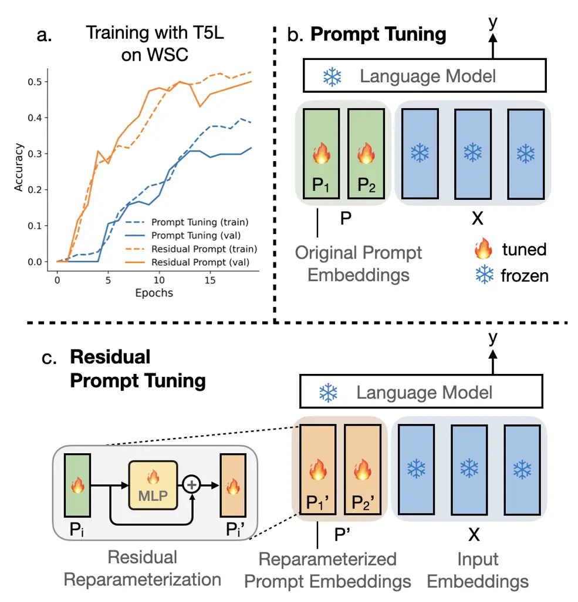
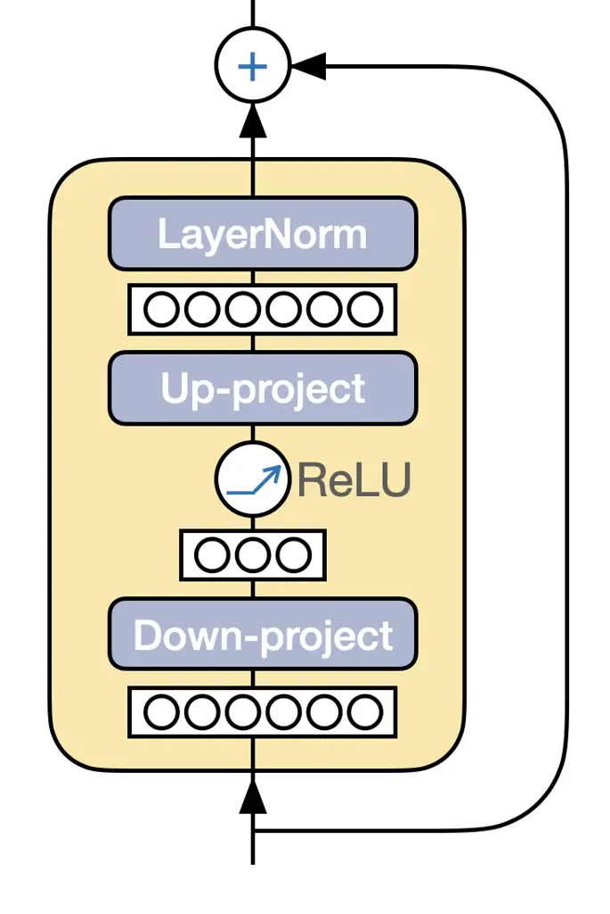
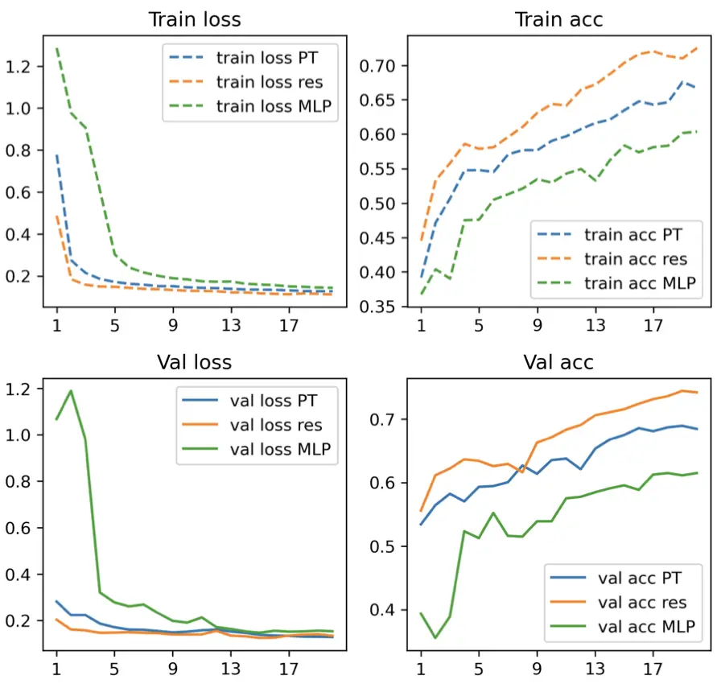
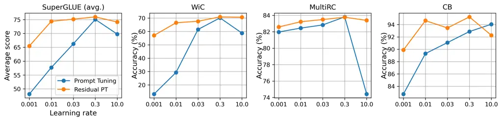
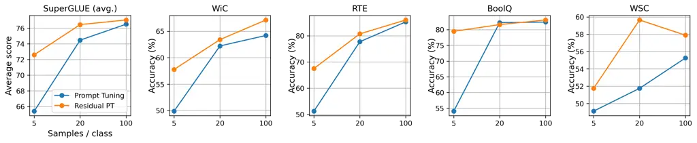
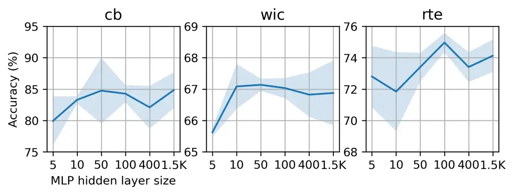
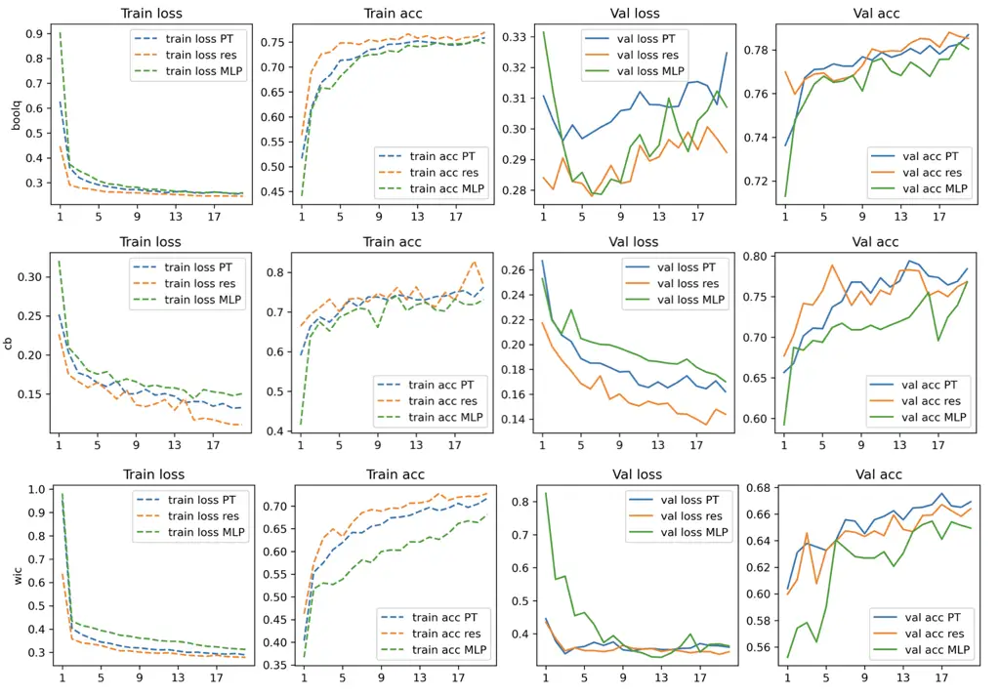
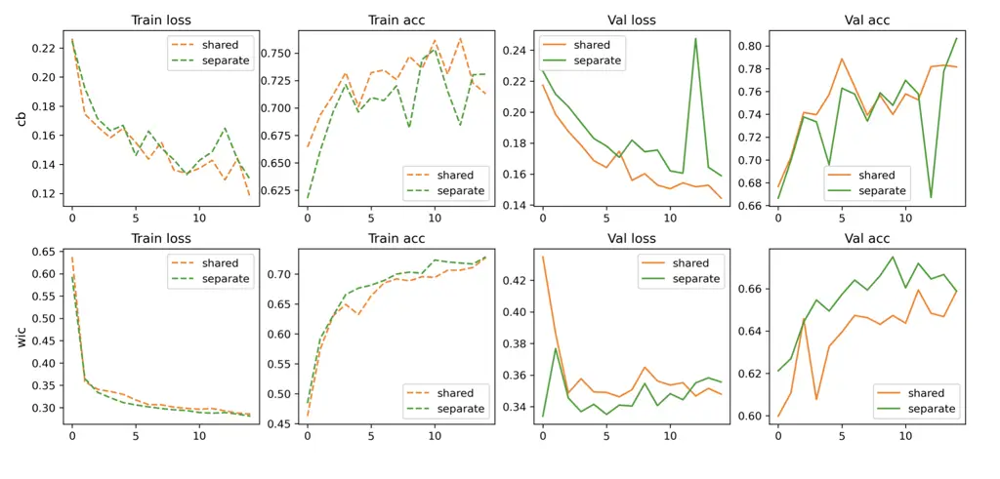

# Residual Prompt Tuning: Improving Prompt Tuning with Residual Reparameterization

Anastasia Razdaibiedina Yuning Mao Madian Khabsa Affiliation: University
of Toronto & Vector Institute   Meta AI
Email: [sadalsuud@cs.toronto.edu](mailto:)    Mike Lewis Rui Hou Jimmy
Ba Amjad Almahairi Email: [{yuningm, rayhou, mkhabsa, mikelewis,
aalmah}@meta.com](mailto:) Affiliation: University of Toronto & Vector
Institute   Meta AI Email: [jba@cs.toronto.edu](mailto:)

###### Abstract

Prompt tuning is one of the successful approaches for
parameter-efficient tuning of pre-trained language models. Despite being
arguably the most parameter-efficient (tuned soft prompts constitute
$`<0.1\%`$ of total parameters), it typically performs worse than other
efficient tuning methods and is quite sensitive to hyper-parameters. In
this work, we introduce Residual Prompt Tuning – a simple and efficient
method that significantly improves the performance and stability of
prompt tuning. We propose to reparameterize soft prompt embeddings using
a shallow network with a residual connection. Our experiments show that
Residual Prompt Tuning significantly outperforms prompt tuning on
SuperGLUE benchmark across T5-Large, T5-Base and BERT-Base models.
Notably, our method reaches $`+7`$ points improvement over prompt tuning
with T5-Base and allows to reduce the prompt length by $`\times 10`$
without hurting performance. In addition, we show that our approach is
robust to the choice of learning rate and prompt initialization, and is
effective in few-shot settings.¹¹ 1 Our code is available at
[https://github.com/  
arazd/ResidualPrompts](https://github.com/arazd/ResidualPrompts).

## 1 Introduction

Pre-trained language models have achieved remarkable performance on a
variety of natural language understanding tasks (Devlin et al., 2018;
Liu et al., 2019; Raffel et al., 2020). Recent studies have shown that
scaling up model size consistently leads to performance gains (Kaplan
et al., 2020; Raffel et al., 2020; Zhang et al., 2022), and larger scale
models are becoming increasingly more common, e.g. GPT-3, 175B
parameters (Brown et al., 2020), MT-NLG, 530B parameters (Smith et al.,
2022). Despite the significant performance improvement achieved with
larger-scale models, their applicability is limited due to their size.
The standard practice of fine-tuning becomes prohibitively expensive
since it requires storing gradients and optimizer states for all model
parameters. Additionally, storing a separate copy of a fine-tuned model
for each task is infeasible for billion-parameter models.



Figure 1: Illustration of Residual Prompt Tuning and comparison with
prompt tuning by Lester et al. (2021). a. Residual Prompt Tuning reaches
stronger performance than prompt tuning (performance with T5-Large model
on WSC task is shown). b. Prompt Tuning tunes prompt embeddings $`P`$,
which are concatenated with input embeddings $`X`$ and fed into the
frozen language model. c. Residual Prompt Tuning passes the original
prompt embeddings $`P`$ through a shallow network (e.g. MLP) with a
residual connection and then prepends them to the input. Embeddings
$`P`$ and MLP parameters are jointly tuned.

To address the challenges associated with full model tuning, a line of
research has focused on prompt design, where natural language prompts
are used to query a frozen model (Brown et al., 2020). In this setup,
all tasks are cast as language modeling tasks (e.g. 0/1 classes could be
encoded as “True“/“False“), and manually selected prompts condition the
frozen model to generate the desired output. Despite the fact that
prompt design can achieve strong few-shot performance, manually finding
optimal prompts remains challenging and time-consuming (Zhao et al.,
2021). Additionally, different prompt choices often lead to large
variances in the final performance (Zhao et al., 2021; Vu et al., 2021).

Recently, Lester et al. (2021) proposed prompt tuning – a method of
learning soft prompts through gradient descent instead of designing the
prompts manually. Soft prompts are a series of continuous embeddings
prepended to the input, which are updated throughout training, and
typically constitute $`<0.1\%`$ of the total parameters. Notably, prompt
tuning has been shown to perform close to full model tuning when model
size increases, closing the performance gap when the model contains over
11B parameters (Lester et al., 2021). Nevertheless, prompt tuning still
underperforms with smaller models, and its performance can vary
significantly depending on the choice of hyperparameters, such as prompt
initialization and learning rate (Vu et al., 2021). Furthermore, prompt
tuning generally requires long training and a large number of prompt
tokens (over 100) to achieve stable performance (Lester et al., 2021).
This becomes a major bottleneck when prompts are learned sequentially in
a continual learning setup Razdaibiedina et al. (2023) or context length
is limited.

In this work, we present Residual Prompt Tuning, a method that can
significantly improve and stabilize prompt tuning performance through
residual reparameterization of prompt embeddings (Figure 1). Residual
Prompt Tuning passes soft prompt embeddings through a shallow network
with a residual connection, and subsequently prepends reparameterized
prompt to the input and feeds to the language model. This
reparameterization gives the model more flexibility to decide between
using a separate embedding for each prompt token versus the
representation obtained from the shared reparameterization network.
After training is completed, the reparameterization network can be
discarded and original prompt embeddings can be replaced with their
projections.

We conduct extensive experiments on SuperGLUE tasks with T5-Large,
T5-Base and BERT-Base models (Raffel et al., 2020; Devlin et al., 2018)
and demonstrate that Residual Prompt Tuning outperforms previous prompt
tuning-based methods by a large margin, achieving $`+7`$ points
improvement over prompt tuning on SuperGLUE with T5-Base. We also show
that Residual Prompt Tuning reduces performance variance under different
learning rates or prompt initializations, and achieves strong
performance with fewer training iterations. Finally, we show that
Residual Prompt Tuning significantly improves over prompt tuning in
few-shot settings.

## 2 Background

Fine-tuning. The predominant approach for adapting a pre-trained
language model to a downstream task is to fine-tune all its parameters
$`\Theta`$ (Devlin et al., 2018; Raffel et al., 2020). Consider a
classification task $`T`$ with input text $`x`$, and output scalar label
$`y`$, where $`p_{\Theta}`$ is a probability distribution of output
classes parameterized by the full model weights $`\Theta`$. The training
objective is simply:

```math
\max_{\Theta}\sum_{x,y\in T}\log p_{\Theta}(y|x). \tag{1}
```

Despite its effectiveness, fine-tuning updates all model parameters,
which can be prohibitively expensive for large language models.

Prompt Tuning. Lester et al. (2021) proposed prompt tuning as a
lightweight alternative to fine-tuning. The main idea is to prepend a
sequence of virtual token embeddings, or a soft prompt $`P`$, to the
input text $`x`$, and learn only them on the downstream task while
keeping other model parameters fixed. The model parameters $`\Theta`$
are now composed of the frozen pre-trained language model parameters,
and the additional soft prompt parameters $`\theta_{P}`$, which are
tuned on the downstream task. The training objective becomes:

```math
\max_{\theta_{P}}\sum_{x,y\in T}\log p_{\Theta}(y|[P;x]). \tag{2}
```

Prompt tuning offers an attractive parameter-efficient solution to
repurpose pre-trained models for many real-world applications. However,
training soft prompts often requires extensive hyperparameter tuning and
longer training time to achieve the desired performance (Lester et al.,
2021).

## 3 Method

### 3.1 Residual Prompt Tuning

We propose to use a more flexible parameterization of soft prompts using
a shallow network with a skip connection (Figure 1). Specifically, we
project the sequence of prompt embeddings $`P`$ consisting of $`n`$
virtual tokens $`[P_{1},...,P_{n}]`$ into a reparameterized sequence
$`P^{\prime}`$ as follows:

```math
P^{\prime}=[P^{\prime}_{1},...,P^{\prime}_{n}]=[\Phi(P_{1}),...,\Phi(P_{n})], \tag{3}
```

where $`\Phi(\cdot)`$ is a reparameterization function composed of a
shallow network $`\phi(\cdot)`$ with a residual connection.
$`\Phi(\cdot)`$ is applied independently to each prompt token:

```math
\Phi(P_{i})=\phi(P_{i})+P_{i},\;i\in\{1...n\} \tag{4}
```

Our $`\phi(\cdot)`$ network is a multi-layer perceptron (MLP) that
follows a "bottleneck" design, as in commonly used ResNet building
blocks (He et al., 2016) and adapter modules (Houlsby et al., 2019). It
consists of down-projection
$`\mathbf{W}_{\text{down}}\in\mathbb{R}^{d\times m}`$ and up-projection
$`\mathbf{W}_{\text{up}}\in\mathbb{R}^{m\times d}`$ layers (as shown in
Figure 2), a combination of which has been thoroughly explored in
literature (He et al., 2016; Houlsby et al., 2019). Here, $`d`$ is the
dimensionality of model embeddings and $`m`$ is the bottleneck size of
the MLP (hyperparameter of our approach). We train only the prompt
embeddings $`\theta_{P}`$ and the repremeterization parameters
$`\theta_{\phi}`$ on the downstream task, while keeping all other
parameters frozen. The training objective is to maximize the
log-likelihood of correct output $`y`$ given the input text $`x`$
concatenated with the reparameterized soft prompt $`P^{\prime}`$:

```math
\max_{\theta_{P},\theta_{\phi}}\sum_{x,y\in T}\log p_{\Theta}(y|[P^{\prime};x]). \tag{5}
```

### 3.2 Design choices

We discuss here several important design choices for the
reparameterization network $`\Phi`$.

Residual connection. We find that residual connection plays a key role
in boosting performance and speeding up the convergence in Residual
Prompt Tuning (Section 5.1, Appendix B.2). Similar to ResNets (He
et al., 2016), we hypothesize that residual learning gives the model
more flexibility to decide between using a separate embedding for each
prompt token versus the representation obtained from the shared network.
We discuss further benefits of residual connection in Appendix B.2.

Depth and width of MLP. We use two-layer MLP, whose up- and
down-projection matrices $`\mathbf{W}_{\text{up}}`$ and
$`\mathbf{W}_{\text{down}}`$ constitute the additional trainable
parameters. Increasing the dimensionality $`m`$ of the hidden layer
results in higher performance (see Section 5.6), suggesting that the
overparameterization (Allen-Zhu et al., 2019) of prompt tokens is
important for the performance improvement. More details on
parameter-efficiency are in Appendix A.6.

Non-linearity and normalization. We select LayerNorm (Ba et al., 2016)
as our normalization layer and ReLU as our non-linearity. We find that
LayerNorm helps to stabilize the performance, while the effect of the
specific choice of the non-linear layer is of lesser importance.

Parameter sharing. In our setup, we apply a shared reparameterization
network $`\Phi`$ to each virtual token embedding. Another design choice
is to apply a separate network to each prompt embedding. We compare both
variants in Section 5.6. Overall, a shared MLP is significantly more
parameter-efficient and offers the benefit of knowledge sharing in
limited data settings.



Figure 2: Illustration of reparameterization network $`\Phi`$ used in
Residual Prompt Tuning. Each virtual token $`P_{i}`$ is passed through
the down-projection layer, followed by the non-linearity, then the
up-projection layer, and the normalization layer, and then summed with
the unprojected embedding via skip connection.

### 3.3 Training and Inference

During training, we jointly optimize prompt embeddings $`P`$ and
parameters of the reparameterization network $`\Phi(\cdot)`$, while
keeping the backbone model frozen. The reparameterized prompt is
inserted before the input text embeddings and fed into the language
model (see details in Section 4.2). Importantly, we use task-specific
prompts, meaning that reparameterized prompt embeddings are not
dependent on the input.

After training is complete, we project prompt embeddings through the
learned reparameterization network $`\Phi(\cdot)`$, and replace the
original prompt embeddings with their corresponding projections
$`P^{\prime}=\Phi(P)`$. During inference, we discard the
reparameterization network and solely use the projected prompt
embeddings $`P^{\prime}`$. Specifically, we insert $`P^{\prime}`$ in
front of the input text embeddings, and feed them together to the frozen
pre-trained model.

## 4 Experiments

### 4.1 Datasets

Following previous works on prompt tuning (Lester et al., 2021; Vu
et al., 2021), we use NLU tasks from the SuperGLUE benchmark to assess
the performance of the language model (Wang et al., 2019). Specifically,
we use the following 8 datasets: BoolQ (Clark et al., 2019), CB
(De Marneffe et al., 2019), COPA (Roemmele et al., 2011), MultiRC
(Khashabi et al., 2018), ReCoRD (Zhang et al., 2018), RTE (Giampiccolo
et al., 2007), WiC (Pilehvar and Camacho-Collados, 2018) and WSC
(Levesque et al., 2012). More details on are discussed in Appendix A.1,
 A.2.

### 4.2 Architectures

Residual Prompt Tuning is a model-agnostic approach that can be used
with any transformer architecture – similarly to the original prompt
tuning (Lester et al., 2021). In our experiments, we explore the
performance of our method with encoder-decoder T5 model²² 2 While Lester
et al. (2021) reports better performance with T5 v1.1 compared to T5,
several works find version v1.1 less stable for prompt tuning compared
to the original T5 and report worse performance (Karimi Mahabadi et al.,
2021; Asai et al., 2022). Thus, in this work we use the original T5
model. (Raffel et al., 2020) and encoder-only BERT model (Devlin et al.,
2018). Specifically, we focus on BERT-Base (110M parameters), T5-Base
(220M parameters) and T5-Large (770M parameters) model variants.

BERT. For BERT experiments, we insert the trainable prompt in front of
the input sequence, but before the $`\mathtt{[CLS]}`$ token, resulting
in the following input $`\hat{x}`$ to the language model:
$`\hat{x}=\mathtt{concat[}\mathbf{E}(\mathtt{[CLS]}),P^{\prime},\mathbf{E}(S\mathtt{[EOS]})\mathtt{]},`$
where $`P^{\prime}`$ is the embeddings matrix of the reparameterized
soft prompt, $`S`$ is the input sentence, $`\mathtt{[CLS]}`$ and
$`\mathtt{[EOS]}`$ denote special tokens (for sentence classification
and marking end-of-sentence), and $`\mathbf{E}`$ denotes tokenization
and extraction of embeddings.

To predict the class of input text $`\hat{x}`$, we follow the original
(Devlin et al., 2018) setup and use encoder representation of the
$`\mathtt{[CLS]}`$ token, $`h_{\mathtt{[CLS]}}`$, and add a linear
transformation parameterized by $`\mathbf{w}`$ and a softmax layer to
predict the class of $`\hat{x}`$:

```math
p(y=c|h)=\frac{e^{\mathbf{w_{c}}h_{\mathtt{[CLS]}}}}{\sum_{k\in\mathcal{C}}{e^{\mathbf{w_{k}}h_{\mathtt{[CLS]}}}}}
```

After that, we apply cross-entropy loss to perform gradient updates on
the prompt embeddings, linear head, and reparameterization network.

T5. For T5 experiments we cast all tasks as language modeling tasks,
following Raffel et al. (2020); Lester et al. (2021). In this setup, we
model the classification task as conditional generation, where output is
a sequence of tokens that represent a class label. We prepend
reparameterized prompt embeddings $`P^{\prime}`$ in front of the input
text embeddings, hence total input
$`\hat{x}=\mathtt{concat}[P^{\prime},\mathbf{E}(S)]`$ is passed into the
pre-trained language model. T5 model applies a multi-headed
self-attention over the input tokens followed by position-wise
feed-forward layers to output a distribution over target tokens. We
train prompt embeddings and parameters of the reparameterization network
with cross-entropy loss. More details on input preprocessing and prompt
initialization are in Appendix A.3,  A.4.

### 4.3 Baselines

We compare Residual Prompt Tuning (Res PT) with approaches from two
different categories: methods for prompt reparameterization and
parameter-efficient tuning (PEFT) methods.

In our first set of experiments, we study how much residual
reparameterization can improve prompt tuning performance and evaluate it
against other reparameterization techniques. In sum, we compare our
approach with the original prompt tuning (PT; no reparameterization
Lester et al. 2021), prompt tuning with MLP reparameterization (PT w/
MLP; Li and Liang 2021), prompt tuning with LSTM reparameterization (PT
w/ LSTM; Liu et al. 2021b) and fine-tuning.

|                       |       |         |      |         |        |      |      |      |      |
| --------------------- | ----- | ------- | ---- | ------- | ------ | ---- | ---- | ---- | ---- |
| Task $`\rightarrow`$  | BoolQ | CB      | COPA | MultiRC | ReCoRD | RTE  | WiC  | WSC  | Avg. |
| Method $`\downarrow`$ | Acc.  | F1/Acc. | Acc. | F1/EM   | F1/EM  | Acc. | Acc. | Acc. | -    |
| T5-Large              |       |         |      |         |        |      |      |      |      |
| Prompt Tuning         | 83.4  | 86.4    | 54.0 | 67.9    | 73.3   | 86.4 | 67.5 | 31.0 | 68.7 |
| PT w/ MLP             | 83.4  | 82.1    | 37.0 | 67.9    | 68.8   | 77.4 | 66.2 | 7.0  | 61.2 |
| PT w/ LSTM            | 53.8  | 78.9    | 0.0  | 66.4    | 82.1   | 49.5 | 15.2 | 0.0  | 43.2 |
| Residual PT           | 83.5  | 86.9    | 56.3 | 68.6    | 68.1   | 86.2 | 70.8 | 50.4 | 71.4 |
| Fine-tuning^(†)       | 85.4  | 93.2    | 83.4 | 67      | 86.3   | 87.8 | 69.3 | 86.3 | 82.3 |
| T5-Base               |       |         |      |         |        |      |      |      |      |
| Prompt Tuning         | 78.0  | 77.4    | 58.3 | 59.2    | 59.5   | 63.7 | 66.2 | 37.7 | 62.5 |
| PT w/ MLP             | 77.5  | 74.8    | 57.7 | 59.5    | 60.8   | 56.0 | 65.2 | 39.5 | 61.4 |
| PT w/ LSTM            | 51.1  | 5.0     | 3.5  | 12.5    | 32.3   | 43.3 | 54.9 | 43.1 | 30.7 |
| Residual PT           | 77.9  | 79.2    | 58.3 | 59.3    | 60.2   | 70.4 | 66.8 | 49.1 | 65.2 |
| Fine-tuning^(†)       | 81.4  | 86.2    | 94.0 | 71.2    | 61.4   | 74.6 | 68.3 | 80.8 | 76.2 |
| BERT-Base             |       |         |      |         |        |      |      |      |      |
| Prompt Tuning         | 62.2  | 60.7    | 51.6 | 57.5    | 60.0   | 53.1 | 54.3 | 61.9 | 57.7 |
| PT w/ MLP             | 62.0  | 61.3    | 53.2 | 58.3    | 62.8   | 48.0 | 54.6 | 64.1 | 58.0 |
| PT w/ LSTM            | 62.2  | 65.2    | 52.0 | 53.1    | 62.7   | 44.6 | 59.9 | 63.5 | 57.9 |
| Residual PT           | 62.7  | 67.9    | 63.5 | 59.0    | 61.1   | 54.9 | 57.1 | 63.5 | 61.2 |
| Fine-tuning           | 73.2  | 89.9    | 65.7 | 66.9    | 62.8   | 65.1 | 67.8 | 63.8 | 69.4 |

Table 1: Results on SuperGLUE development set with 10-token prompt. All
scores are averaged over 3 runs. ^(†)denotes results reported by Raffel
et al. (2020). For tasks with two metrics, the average score is
reported.

In our second set of experiments, we assess the benefits of Residual
Prompt Tuning method versus existing PEFT approaches. In addition to
prompt tuning, we include a set of PEFT baselines: Adapter (Houlsby
et al., 2019), AdapterDrop (Rücklé et al., 2020), SPoT (Vu et al.,
2021), ATTEMPT (Asai et al., 2022). Adapter and AdapterDrop approaches
are based on adapters by Houlsby et al. (2019), whereas SPoT and ATTEMPT
are tranfer learning-based methods for prompt tuning, which find optimal
prompt initializations by pre-training prompts on informative source
tasks.

### 4.4 Experimental setup

For all experiments with prompt tuning-based methods, we follow standard
protocol by Lester et al. (2021) and report results on the validation
set. Unless otherwise specified, we use standard metrics associated with
each task to report final performance (see Table 7). For experiments
where we compare Residual Prompt Tuning with PEFT methods
(Section 5.1.2), we follow PEFT training protocol (Asai et al., 2022;
Karimi Mahabadi et al., 2021). More experimental details are in
Appendix A.5.

| Prompt len. $`\rightarrow`$ | 10 tokens |          |      | 100 tokens |          |      |
| --------------------------- | --------- | -------- | ---- | ---------- | -------- | ---- |
| Method $`\downarrow`$       | T5L       | T5B      | BERT | T5L        | T5B      | BERT |
| Prompt Tuning               | 68.7      | 62.5     | 57.7 | 74.5^(‡)   | 63.1^(‡) | 59.2 |
| PT w/ MLP                   | 61.2      | 61.4     | 58.0 | 67.8       | 62.4     | 60.8 |
| PT w/ LSTM                  | 43.2      | 30.7     | 57.9 | 60.1       | 55.2     | 58.8 |
| Residual PT                 | 71.4      | 65.2     | 61.2 | 74.5       | 70.5     | 61.6 |
| Fine-tuning                 | 82.3^(†)  | 76.2^(†) | 69.4 | 82.3^(†)   | 76.2^(†) | 69.4 |

Table 2: Residual Prompt Tuning outperforms other prompt tuning
variations across three architectures (T5-Large, T5-Base and BERT-Base)
and different prompt sizes (10 and 100 tokens). Average performance
across all SuperGLUE tasks is reported. All our results are averaged
over 3 runs. ^(†)denotes results reported by Raffel et al. (2020);
^(‡)denotes results reported by Lester et al. (2021); Vu et al. (2021).

## 5 Results

We describe our main results showing the effectiveness of Residual
Prompt Tuning compared to other prompt tuning-based methods and
parameter-efficient methods in Section 5.1. We study the robustness of
our method to the choice of hyperparameters in Sections 5.2 and 5.3.
Then, we explore the performance of Residual Prompt Tuning in more
extreme settings, including smaller prompt sizes (Section 5.5) and
few-shot data regime (Section 5.4).

### 5.1 Main results

#### 5.1.1 Comparison with prompt tuning

We compare Residual Prompt Tuning with the original prompt tuning, as
well as two different reparameterization methods (via MLP and LSTM).
Table 1 shows results for each task with 10-token prompts, and results
for 100-token prompts are presented in Appendix B.1. We perform
experiments with T5-Large, T5-Base, and BERT-Base model architectures,
and with two different prompt sizes: 10 and 100 tokens. Additionally, we
include full model tuning results as an upper-bound performance.

Table 2 summarizes the average performance on SuperGLUE with 10-token
and 100-token prompts across three model variants. Residual Prompt
Tuning outperforms other methods, gaining $`+3`$ points improvement with
10-token prompts on both T5B and T5L models, and over $`+7`$ points
improvement with 100-token prompts on T5B.

Table 1 dissects the performance with 10-token prompts, showing per-task
results for all SuperGLUE tasks across three model variants. Residual
Prompt Tuning leads to consistent improvement over prompt tuning across
different tasks. LSTM-based reparameterization shows worse performance
compared to our approach. Prompt tuning with MLP reparameterization
experiences significant fluctuations depending on the task – with
stronger performance on ReCoRD ($`+0.6`$ points), but substantially
lower score on WiC ($`-9.6`$ points) compared to our approach. Overall,
Residual Prompt Tuning shows strong improvement over prompt tuning and
other reparameterization methods across all model architectures.



Figure 3: Residual Prompt Tuning (orange) speeds up the optimization
process of prompt embeddings compared to prompt tuning (blue) and prompt
tuning with MLP (green). The x-axis shows the number of training epochs,
the y-axis shows loss or accuracy on the train/development sets of RTE.
Each point represents an average of 3 runs of T5B model with 10-token
prompt.

As shown in Figure 3, Residual Prompt Tuning leads to faster convergence
compared to other methods. The residual connection in the
reparameterization network plays a key role in boosting performance –
MLP-based reparameterization without skip connection leads to slower
converge than prompt tuning. We hypothesize that skip connection allows
to bypass learning the identity function, and learns projections "on
top" of the original embeddings (similar observations by He et al.
(2016). We discuss convergence in more detail in Appendix B.2.

#### 5.1.2 Other parameter-efficient methods

We compare the performance of different PEFT methods on SuperGLUE
benchmark. Here, for all the experiments, we follow Asai et al. (2022)
setup and train T5-Base model with a 100-token prompt on a selection of
5 SuperGLUE tasks (details in Appendix A.5). Our results are shown in
Table 3(b).

Notably, Residual Prompt Tuning achieves significant performance gains
over prompt tuning, achieving over $`+10`$ points improvement in average
score. A major benefit of our method is that it does not require
transfer learning on source tasks to achieve strong results, contrary to
two other prompt tuning-based methods: SPoT and ATTEMPT. Residual Prompt
Tuning substantially outperforms SPoT ($`+6.1`$ points), and reaches
close performance to ATTEMPT ($`1.5`$ points difference) without being
pre-trained on any source tasks.

| Task $`\rightarrow`$  | CB   | Bool | Multi | WiC  | WSC  | Avg. |
| --------------------- | ---- | ---- | ----- | ---- | ---- | ---- |
| Method $`\downarrow`$ | F1   | Acc. | F1    | Acc. | Acc. | Avg. |
| Fine-tune^($`\ast`$)  | 85.7 | 81.1 | 72.8  | 70.2 | 59.6 | 73.9 |
| Adapter^($`\ast`$)    | 85.7 | 82.5 | 75.9  | 67.1 | 67.3 | 75.7 |
| AdaptDrop^($`\ast`$)  | 85.7 | 82.3 | 72.9  | 68.3 | 67.3 | 75.3 |
| ATTEMPT^($`\ast`$)    | 78.6 | 78.8 | 74.4  | 66.8 | 78.6 | 70.5 |
| SPoT^($`\ast`$)       | 46.4 | 77.2 | 74.0  | 67.0 | 50.0 | 62.9 |
| PT^($`\ast`$)         | 67.9 | 61.7 | 58.7  | 48.9 | 51.9 | 57.8 |
| Res-PT                | 86.0 | 79.0 | 58.9  | 68.4 | 52.6 | 69.0 |

| Method    | Extra params | Train. params | Pre-train. |
| --------- | ------------ | ------------- | ---------- |
| Fine-tune | \-           | 220M          | No         |
| Adapter   | 1.9M         | 1.9M          | No         |
| AdaptDrop | 1.1M         | 1.1M          | No         |
| ATTEMPT   | 223K         | 223K          | Yes        |
| SPoT      | 77K          | 77K           | Yes        |
| PT        | 77K          | 77K           | No         |
| Res-PT    | 77K          | 462K          | No         |

(a) Performance comparison across five SuperGLUE tasks averaged over 3
runs. ^($`\ast`$) denotes results reported by Asai et al. (2022).

(b) Comparison of parameter-efficiency. Train. params denotes total
number of trainable parameters, Add. params denotes number of additional
parameters that would be injected into the language model during
inference, Pre-train denotes if the method requires pre-training on
source tasks.

Table 3: Comparison of Residual Prompt Tuning (Res-PT) with other
parameter-efficient tuning methods.



Figure 4: Robustness of Residual Prompt Tuning to the choice of learning
rate. Experiments are performed with T5L model and 100-token prompt. The
x-axis shows different learning rates, the y-axis represents the
corresponding performance on the development set. First plot shows
average performance on SuperGLUE with respect to the learning rate;
other figures show performance on three SuperGLUE tasks (WiC, MultiRC
and CB).

Table 3(b) shows details on the parameter and training efficiency of the
explored PEFT methods. Since parameters of the reparameterization
network are discarded after training, our method requires the same
number of additional parameters at inference as the original prompt
tuning. Notably, Residual Prompt Tuning requires 25 times fewer extra
parameters during inference compared to adapter-based methods. Finally,
our methods does not require pre-training on any source tasks. For more
details on parameter-efficiency of Residual Prompt Tuning, see
Appendix A.6.

### 5.2 Robustness to the choice of learning rate

We study the performance of Residual Prompt Tuning across a wide range
of learning rates (Figure 4). Previous works report that prompt tuning
is very sensitive to the learning rate and requires extensive
hyperparameter search to reach optimal performance (Lester et al., 2021;
Vu et al., 2021).

We evaluate the performance of our proposed approach and prompt tuning
(Lester et al., 2021) with learning rates from
$`\{0.001,0.01,0.03,0.3,10\}`$ on SuperGLUE benchmark. For fair
comparison, we use the most stable model variant: T5-Large model with
100-token prompt. Our results are shown in Figure 4. Notably, residual
reparameterization allows stabilizing prompt tuning performance across a
wide range of learning rates. Original prompt tuning often experiences
fluctuations in its performance, with some tasks favoring lower learning
rates (e.g. MultiRC), other tasks performing better with higher learning
rates (e.g. CB), and yet other tasks achieving peak performance at a
specific learning rate (e.g. WiC). In contrast to prompt tuning,
Residual Prompt Tuning is robust to the choice of learning rate – it
achieves strong performance with minimal fluctuations (less than $`2`$
points on average SuperGLUE score) with learning rates between 0.01 and
10 (over 100-fold variation).

### 5.3 Robustness to the prompt initialization

Lester et al. (2021) finds that initialization of prompt parameters
plays a major role in the final performance. Specifically, initializing
prompt embeddings from sampled vocabulary embeddings can boost average
SuperGLUE performance by up to $`+10`$ points compared to random uniform
initialization (Lester et al., 2021). Here, we asked if Residual Prompt
Tuning performance would depend on the choice of initialization.

Table 4 shows our results (initialization details are in Appendix A.4;
we use T5B model with 10-token prompt). We can see that Residual Prompt
Tuning is robust to the prompt initialization method, reaching
comparable results with both initialization choices: $`0.8`$ points
average performance difference between random uniform initialization and
sampled vocabulary initialization. Of note, the initialization effect is
more pronounced for smaller-scale dataset CB (250 samples) – random
initialization attributes to $`-0.3`$ performance drop for Residual
Prompt Tuning versus $`-4.5`$ score difference for the original prompt
tuning.

| Task $`\rightarrow`$  |                      | CB     | WiC  | Multi  | RTE  | Avg. |
| --------------------- | -------------------- | ------ | ---- | ------ | ---- | ---- |
| Method $`\downarrow`$ | Init. $`\downarrow`$ | F1/Acc | Acc  | F1/Acc | Acc  | -    |
| Prompt tune           | Rand.                | 72.9   | 65.0 | 59.1   | 63.7 | 65.2 |
| Prompt tune           | Vocab.               | 77.4   | 66.2 | 59.2   | 63.7 | 66.6 |
| delta                 | \-                   | 4.5    | 1.2  | 0.1    | 0.0  | 1.5  |
| Res-PT                | Rand.                | 78.9   | 66.8 | 59.4   | 67.3 | 68.1 |
| Res-PT                | Vocab.               | 79.2   | 66.8 | 59.3   | 70.4 | 68.9 |
| delta                 | \-                   | 0.3    | 0.0  | -0.1   | 3.1  | 0.8  |

Table 4: Robustness of Residual Prompt Tuning the prompt initialization
method. We show results for two prompt initialization methods: sampled
uniformly from the range $`[-0.5,0.5]`$ (Rand.), and initializing from
the sampled vocabulary (Vocab.). We use T5B model and 10-token prompt.
Delta denotes the performance difference between two initialization
choices.



Figure 5: Comparison of Residual Prompt Tuning to the prompt tuning in
few-shot setting (5, 20, and 100 samples/class) using T5L model and
100-token prompt. The x-axis shows the number of samples per class, the
y-axis represents the corresponding performance on the development set.
Left corner shows average performance on SuperGLUE with respect to the
$`k`$-shot training setup; other figures show performance on specific
SuperGLUE tasks (WiC, RTE, BoolQ, and WSC).

### 5.4 Prompt tuning in few-shot setting

We perform further experiments in few-shot settings (Figure 5).
Specifically, we sample 5, 20, and 100 samples per class. To avoid
variance due to selected samples, we fix the same training subset across
all runs for each task; we use T5-Large model and 100-token prompt (as
it reaches strongest performance for prompt tuning baseline). Residual
Prompt Tuning is very effective in few-shot setup, boosting prompt
tuning performance by $`+7`$ and $`+2`$ points on SuperGLUE benchmark
with 5 and 20 samples per class.

### 5.5 Performance and prompt length

We evaluate the Residual Prompt Tuning performance with smaller prompt
sizes, and compare it to the original prompt tuning by Lester et al.
(2021). Specifically, we explore the performance with prompts of lengths
2, 10, and 100 tokens with T5-Large model. Our results are shown in
Table 5. In sum, Residual Prompt Tuning improves performance across all
prompt lengths over prompt tuning, achieving average improvement of
$`+2.6`$, $`+1.1`$ and $`+0.8`$ points with 2, 10, and 100-token prompts
correspondingly.

| Prompt              |                       | CB   | WiC  | Multi  | RTE  | Avg. |
| ------------------- | --------------------- | ---- | ---- | ------ | ---- | ---- |
| Len. $`\downarrow`$ | Method $`\downarrow`$ | Acc  | Acc  | F1/Acc | Acc  | -    |
| 2                   | PT                    | 91.7 | 67.4 | 84.8   | 81.0 | 81.2 |
| 2                   | Res-PT                | 94.0 | 70.7 | 84.9   | 85.6 | 83.8 |
| 10                  | PT                    | 92.9 | 67.7 | 85.0   | 86.4 | 83.0 |
| 10                  | Res-PT                | 94.0 | 71.0 | 85.1   | 86.2 | 84.1 |
| 100                 | PT                    | 92.9 | 70.2 | 83.8   | 87.5 | 83.6 |
| 100                 | Res-PT                | 95.2 | 71.3 | 83.8   | 87.0 | 84.4 |

Table 5: Comparison of Residual Prompt Tuning and prompt tuning by
Lester et al. (2021) across different prompt lengths (2, 10, 100 tokens)
with T5L model.

### 5.6 Ablation studies

Parameter sharing. We ablate the effect of a shared reparameterization
network by assessing the performance when each prompt is reparameterized
through a separate MLP with a skip connection (Table 6).

|               | CB   | COPA | WiC  | RTE  | Avg. |
| ------------- | ---- | ---- | ---- | ---- | ---- |
|               | Acc. | Acc. | Acc. | Acc. | -    |
| shared MLP    | 83.1 | 58.7 | 66.7 | 71.6 | 70.0 |
| separate MLPs | 81.1 | 60.3 | 67.8 | 74.5 | 70.9 |

Table 6: Performance of Residual Prompt Tuning with shared and separate
embedding reparameterization networks on four SuperGLUE tasks with T5B.

We select four SuperGLUE tasks of different sizes: small-scale CB and
COPA (250 and 400 training examples), and larger-scale WiC and RTE
(6,000 and 2,500 training examples). Interestingly, shared
reparameterization network is beneficial in the low data regime,
outperforming separate networks by $`+2`$ points on CB dataset. However,
on larger datasets separate networks achieve slightly better performance
at the expense of more trained parameters. We show more detailed results
in Appendix C.1.

Overparameterization. To study the effect of overparameterization on the
final performance, we ablate MLP width by varying the dimension of MLP
hidden layer in the following range: $`\{5,10,50,100,400,1500\}`$
(Figure  6). Overall, we find that increase in dimensionality leads to
performance gains, with performance saturating when the dimension
reaches over 50 units.



Figure 6: The effect of MLP hidden layer size on the performance of
Residual Prompt Tuning with T5B. The x-axis shows the hidden layer size,
the y-axis shows the maximal validation performance. Each result is
averaged over 3 runs, shadow depicts the standard deviation.

## 6 Related work

Parameter-efficient tuning methods. Recent approaches have explored
parameter-efficient tuning (PEFT) of language models, where only a
subset of parameters is trained while the rest of the model is kept
frozen. Houlsby et al. (2019) proposed adapters – small modules injected
between each transformer layer. To improve over original adapter tuning,
several works proposed to remove adapter modules from lower transformer
layers (Rücklé et al., 2020), or use a composition of adapter modules
(Pfeiffer et al., 2020). Other works focused on low-rank adaptations
(LoRA) (Hu et al., 2021), and prefix tuning (Li and Liang, 2021).
Similarly to adapters, LoRA injects additional trainable weight matrices
into each transformer layer, requiring changes to the intrinsic model
structure and adding a high number of extra parameters.

Prompt tuning methods. To overcome the drawbacks of traditional PEFT
methods, Lester et al. (2021) introduced prompt tuning as a highly
parameter-efficient approach, where tuned soft prompts constitute
$`<0.1\%`$ of the total parameters and can be easily appended to the
input without modifying the model. Several methods were recently
introduced to improve over prompt tuning. Liu et al. (2021a) proposed
adding soft prompts at every transformer layer. While their method
improves performance, it requires much more trainable parameters (10x in
some cases). Other works explored transfer learning-based methods to
find better prompt initialization through pre-training (Vu et al., 2021;
Asai et al., 2022). These methods pre-train soft prompts on a collection
of source tasks and subsequently use the learned prompt embeddings to
initialize prompts for target tasks.

Reparameterization methods. Although reparameterization has not been
traditionally used with prompt tuning, Li and Liang (2021) explored
reparameterization of embeddings as a way to improve the performance of
prefix tuning, and Liu et al. (2021b) explored reparameterizing
injectable embeddings together full model tuning. With these approaches,
prefix embeddings are passed through a shallow neural network, such as
MLP (in prefix tuning) or LSTM (in GPT2 tuning by Liu et al. (2021b)),
before being concatenated to the input embeddings (or representations)
and passed into a subsequent layer of the language model. Liu et al.
(2021a) explores MLP-based reparameterization for P-tuning v2. Despite
improvements on some tasks, Liu et al. (2021a) finds that the
reparameterization effect is not consistent across datasets and can
hinder the performance of certain tasks.

## 7 Conclusion

We propose Residual Prompt Tuning, a new method for learning soft
prompts under a frozen language model using residual reparameterization
of prompt embeddings. Our method enables efficient learning of soft
prompts, without the need for extensive hyperparameter search, long
training times, or pre-training on source tasks.

Our experiments show that Residual Prompt Tuning significantly
outperforms prompt tuning by Lester et al. (2021) and its two variations
across three model architectures (T5-Large, T5-Base and BERT-Base) on
SuperGLUE benchmark. Furthermore, our method is robust to the
hyperparameter choice (learning rate and prompt initialization), speeds
up convergence and is highly effective in few-shot settings.

## Limitations

Despite the simplicity and strong empirical results, Residual Prompt
Tuning still has few limitations. First, its performance is still not on
par with fine-tuning on (e.g. $`7.8`$ points difference with T5L model
and 100-token prompt on SuperGLUE average score). Also, our method uses
slightly more parameters than prompt tuning to train the
reparameterization network. However, this is not a significant
limitation given the full language model size. We have tried to cover
several model architectures, but so far we have focused on
encoder-decoder (T5) and encoder-only (BERT) models. In future work, we
would like to investigate decoder-only methods (e.g. GPT). Another
limitation is that our method (similarly to other prompt tuning-based
methods) strives to reduce the number of trainable parameters, but uses
a longer sequence than the original input text (due to the injected
prompt).

## Ethics Statement

The main objective of Residual Prompt Tuning is to improve
parameter-efficient tuning of large language models, which makes
state-of-the-art models more accessible to groups with limited
computational and data-labeling resources. We do not believe there is
any potential risk in the published code or models in this work, as all
of our experiments are based on public data that is widely used in the
research community.

## Acknowledgement

We would like to thank Victoria Lin and extended FAIR team for their
helpful feedback and comments. We also thank Akari Asai and Xiang Lisa
Li for our discussions on the prompt tuning methodologies.

## References

- Allen-Zhu et al. (2019) Zeyuan Allen-Zhu, Yuanzhi Li, and Zhao
  Song. 2019. A convergence theory for deep learning via
  over-parameterization. In _International Conference on Machine
  Learning_, pages 242–252. PMLR.
- Asai et al. (2022) Akari Asai, Mohammadreza Salehi, Matthew E Peters,
  and Hannaneh Hajishirzi. 2022. Attentional mixtures of soft prompt
  tuning for parameter-efficient multi-task knowledge sharing. _arXiv
  preprint arXiv:2205.11961_.
- Ba et al. (2016) Jimmy Lei Ba, Jamie Ryan Kiros, and Geoffrey E
  Hinton. 2016. Layer normalization. _arXiv preprint arXiv:1607.06450_.
- Brown et al. (2020) Tom Brown, Benjamin Mann, Nick Ryder, Melanie
  Subbiah, Jared D Kaplan, Prafulla Dhariwal, Arvind Neelakantan, Pranav
  Shyam, Girish Sastry, Amanda Askell, et al. 2020. Language models are
  few-shot learners. _Advances in neural information processing
  systems_, 33:1877–1901.
- Clark et al. (2019) Christopher Clark, Kenton Lee, Ming-Wei Chang, Tom
  Kwiatkowski, Michael Collins, and Kristina Toutanova. 2019. Boolq:
  Exploring the surprising difficulty of natural yes/no questions.
  _arXiv preprint arXiv:1905.10044_.
- De Marneffe et al. (2019) Marie-Catherine De Marneffe, Mandy Simons,
  and Judith Tonhauser. 2019. The commitmentbank: Investigating
  projection in naturally occurring discourse. In _proceedings of Sinn
  und Bedeutung_, volume 23, pages 107–124.
- Devlin et al. (2018) Jacob Devlin, Ming-Wei Chang, Kenton Lee, and
  Kristina Toutanova. 2018. Bert: Pre-training of deep bidirectional
  transformers for language understanding. _arXiv preprint
  arXiv:1810.04805_.
- Giampiccolo et al. (2007) Danilo Giampiccolo, Bernardo Magnini, Ido
  Dagan, and William B Dolan. 2007. The third pascal recognizing textual
  entailment challenge. In _Proceedings of the ACL-PASCAL workshop on
  textual entailment and paraphrasing_, pages 1–9.
- He et al. (2016) Kaiming He, Xiangyu Zhang, Shaoqing Ren, and Jian
  Sun. 2016. Deep residual learning for image recognition. In
  _Proceedings of the IEEE conference on computer vision and pattern
  recognition_, pages 770–778.
- Houlsby et al. (2019) Neil Houlsby, Andrei Giurgiu, Stanislaw
  Jastrzebski, Bruna Morrone, Quentin De Laroussilhe, Andrea Gesmundo,
  Mona Attariyan, and Sylvain Gelly. 2019. Parameter-efficient transfer
  learning for nlp. In _International Conference on Machine Learning_,
  pages 2790–2799. PMLR.
- Hu et al. (2021) Edward J Hu, Yelong Shen, Phillip Wallis, Zeyuan
  Allen-Zhu, Yuanzhi Li, Shean Wang, Lu Wang, and Weizhu Chen. 2021.
  Lora: Low-rank adaptation of large language models. _arXiv preprint
  arXiv:2106.09685_.
- Kaplan et al. (2020) Jared Kaplan, Sam McCandlish, Tom Henighan, Tom B
  Brown, Benjamin Chess, Rewon Child, Scott Gray, Alec Radford, Jeffrey
  Wu, and Dario Amodei. 2020. Scaling laws for neural language models.
  _arXiv preprint arXiv:2001.08361_.
- Karimi Mahabadi et al. (2021) Rabeeh Karimi Mahabadi, James Henderson,
  and Sebastian Ruder. 2021. Compacter: Efficient low-rank hypercomplex
  adapter layers. _Advances in Neural Information Processing Systems_,
  34:1022–1035.
- Khashabi et al. (2018) Daniel Khashabi, Snigdha Chaturvedi, Michael
  Roth, Shyam Upadhyay, and Dan Roth. 2018. Looking beyond the surface:
  A challenge set for reading comprehension over multiple sentences. In
  _Proceedings of the 2018 Conference of the North American Chapter of
  the Association for Computational Linguistics: Human Language
  Technologies, Volume 1 (Long Papers)_, pages 252–262.
- Lester et al. (2021) Brian Lester, Rami Al-Rfou, and Noah
  Constant. 2021. The power of scale for parameter-efficient prompt
  tuning. _arXiv preprint arXiv:2104.08691_.
- Levesque et al. (2012) Hector Levesque, Ernest Davis, and Leora
  Morgenstern. 2012. The winograd schema challenge. In _Thirteenth
  international conference on the principles of knowledge representation
  and reasoning_.
- Li and Liang (2021) Xiang Lisa Li and Percy Liang. 2021.
  Prefix-tuning: Optimizing continuous prompts for generation. _arXiv
  preprint arXiv:2101.00190_.
- Liu et al. (2021a) Xiao Liu, Kaixuan Ji, Yicheng Fu, Zhengxiao Du,
  Zhilin Yang, and Jie Tang. 2021a. P-tuning v2: Prompt tuning can be
  comparable to fine-tuning universally across scales and tasks. _arXiv
  preprint arXiv:2110.07602_.
- Liu et al. (2021b) Xiao Liu, Yanan Zheng, Zhengxiao Du, Ming Ding,
  Yujie Qian, Zhilin Yang, and Jie Tang. 2021b. Gpt understands, too.
  _arXiv preprint arXiv:2103.10385_.
- Liu et al. (2019) Yinhan Liu, Myle Ott, Naman Goyal, Jingfei Du,
  Mandar Joshi, Danqi Chen, Omer Levy, Mike Lewis, Luke Zettlemoyer, and
  Veselin Stoyanov. 2019. Roberta: A robustly optimized bert pretraining
  approach. _arXiv preprint arXiv:1907.11692_.
- Loshchilov and Hutter (2018) Ilya Loshchilov and Frank Hutter. 2018.
  Fixing weight decay regularization in adam.
- Paszke et al. (2019) Adam Paszke, Sam Gross, Francisco Massa, Adam
  Lerer, James Bradbury, Gregory Chanan, Trevor Killeen, Zeming Lin,
  Natalia Gimelshein, Luca Antiga, et al. 2019. Pytorch: An imperative
  style, high-performance deep learning library. _Advances in neural
  information processing systems_, 32.
- Pfeiffer et al. (2020) Jonas Pfeiffer, Aishwarya Kamath, Andreas
  Rücklé, Kyunghyun Cho, and Iryna Gurevych. 2020. Adapterfusion:
  Non-destructive task composition for transfer learning. _arXiv
  preprint arXiv:2005.00247_.
- Pilehvar and Camacho-Collados (2018) Mohammad Taher Pilehvar and Jose
  Camacho-Collados. 2018. Wic: the word-in-context dataset for
  evaluating context-sensitive meaning representations. _arXiv preprint
  arXiv:1808.09121_.
- Raffel et al. (2020) Colin Raffel, Noam Shazeer, Adam Roberts,
  Katherine Lee, Sharan Narang, Michael Matena, Yanqi Zhou, Wei Li,
  Peter J Liu, et al. 2020. Exploring the limits of transfer learning
  with a unified text-to-text transformer. _J. Mach. Learn. Res._,
  21(140):1–67.
- Razdaibiedina et al. (2023) Anastasia Razdaibiedina, Yuning Mao, Rui
  Hou, Madian Khabsa, Mike Lewis, and Amjad Almahairi. 2023. Progressive
  prompts: Continual learning for language models. In _International
  Conference on Learning Representations_.
- Roemmele et al. (2011) Melissa Roemmele, Cosmin Adrian Bejan, and
  Andrew S Gordon. 2011. Choice of plausible alternatives: An evaluation
  of commonsense causal reasoning. In _AAAI spring symposium: logical
  formalizations of commonsense reasoning_, pages 90–95.
- Rücklé et al. (2020) Andreas Rücklé, Gregor Geigle, Max Glockner,
  Tilman Beck, Jonas Pfeiffer, Nils Reimers, and Iryna Gurevych. 2020.
  Adapterdrop: On the efficiency of adapters in transformers. _arXiv
  preprint arXiv:2010.11918_.
- Smith et al. (2022) Shaden Smith, Mostofa Patwary, Brandon Norick,
  Patrick LeGresley, Samyam Rajbhandari, Jared Casper, Zhun Liu, Shrimai
  Prabhumoye, George Zerveas, Vijay Korthikanti, et al. 2022. Using
  deepspeed and megatron to train megatron-turing nlg 530b, a
  large-scale generative language model. _arXiv preprint
  arXiv:2201.11990_.
- Vu et al. (2021) Tu Vu, Brian Lester, Noah Constant, Rami Al-Rfou, and
  Daniel Cer. 2021. Spot: Better frozen model adaptation through soft
  prompt transfer. _arXiv preprint arXiv:2110.07904_.
- Wang et al. (2019) Alex Wang, Yada Pruksachatkun, Nikita Nangia,
  Amanpreet Singh, Julian Michael, Felix Hill, Omer Levy, and Samuel
  Bowman. 2019. Superglue: A stickier benchmark for general-purpose
  language understanding systems. _Advances in neural information
  processing systems_, 32.
- Wolf et al. (2019) Thomas Wolf, Lysandre Debut, Victor Sanh, Julien
  Chaumond, Clement Delangue, Anthony Moi, Pierric Cistac, Tim Rault,
  Rémi Louf, Morgan Funtowicz, et al. 2019. Huggingface’s transformers:
  State-of-the-art natural language processing. _arXiv preprint
  arXiv:1910.03771_.
- Zhang et al. (2018) Sheng Zhang, Xiaodong Liu, Jingjing Liu, Jianfeng
  Gao, Kevin Duh, and Benjamin Van Durme. 2018. Record: Bridging the gap
  between human and machine commonsense reading comprehension. _arXiv
  preprint arXiv:1810.12885_.
- Zhang et al. (2022) Susan Zhang, Stephen Roller, Naman Goyal, Mikel
  Artetxe, Moya Chen, Shuohui Chen, Christopher Dewan, Mona Diab, Xian
  Li, Xi Victoria Lin, et al. 2022. Opt: Open pre-trained transformer
  language models. _arXiv preprint arXiv:2205.01068_.
- Zhao et al. (2021) Zihao Zhao, Eric Wallace, Shi Feng, Dan Klein, and
  Sameer Singh. 2021. Calibrate before use: Improving few-shot
  performance of language models. In _International Conference on
  Machine Learning_, pages 12697–12706. PMLR.

Appendix

## Appendix A Implementation and Training

### A.1 Implementation details

We use PyTorch (Paszke et al., 2019) and HuggingFace Transformers
library (Wolf et al., 2019) for our implementation. To download data for
SuperGLUE tasks, we use HuggingFace datasets
([https://github.com/huggingface/datasets](https://github.com/huggingface/datasets))
(Wang et al., 2019).

In our prompt tuning and reparameterization experiments, we follow setup
from the previous works on prompt tuning (Lester et al., 2021; Vu
et al., 2021), and use the available validation set for each task to
report the highest performance.

### A.2 Datasets

Table 7 shows details of the eight datasets from SuperGLUE benchmark
(Wang et al., 2019) that we used for our experiments, along with their
training sizes and evaluation metrics. Following Raffel et al. (2020)
and Lester et al. (2021), for tasks that have two evaluation metrics we
use the average of both scores as the final performance metric.

| Dataset name | Train        | Task   | Domain            | Metric    |
| ------------ | ------------ | ------ | ----------------- | --------- |
| 1\. BoolQ    | 9,427        | QA     | Wikipedia         | acc.      |
| 2\. CB       | 250          | NLI    | various           | F1 & acc. |
| 3\. COPA     | 400          | QA     | blogs, encyclop.  | acc.      |
| 4\. MultiRC  | 5,100        | QA     | various           | F1 & EM   |
| 5\. ReCoRD   | 101K         | QA     | various           | F1 & EM   |
| 6\. RTE      | 2,500        | NLI    | news, Wiki        | acc.      |
| 7\. WiC      | 6,000        | WSD    | lexical databases | acc.      |
| 8\. WSC      | 554/259^(\*) | coref. | fiction books     | acc.      |

Table 7: The details of 8 SuperGLUE tasks used in our experiments. NLI
denotes natural language inference, QA denotes questions and answers
task, WSD denotes word sense disambiguation, EM denotes exact match
scoring, acc. denotes accuracy. ^(\*)For T5 model variants we follow
Raffel et al. (2020) setup, casting WSC as a text generation task and
limit our training set to the positive examples only, where the supplied
referent is correct (resulting in a total of 259 examples). For BERT we
use the full WSC training set (554 examples) and train the model for
binary classification, following Wang et al. (2019).

### A.3 Tokenization and Preprocessing

Following common practice (Lester et al., 2021; Vu et al., 2021; Asai
et al., 2022), for all our experiments, we set the maximum input length
(including the prepended prompt) to 512 tokens. We use padding to
maximum length and mask out the padded tokens. In case of input
exceeding 512 tokens, we truncate the input. We do not perform any
specific text preprocessing (e.g. removing punctuation) but instead
directly tokenize the raw text from SuperGLUE datasets using the
corresponding model tokenizer from HuggingFace (Wolf et al., 2019).

For BERT experiments, we follow Devlin et al. (2018) formatting – the
input sequence begins with $`\mathtt{[CLS]}`$ token, and ends with
$`\mathtt{[EOS]}`$ token. For tasks with sentence pairs (e.g. RTE), we
only insert our soft prompt before the first sentence, and concatenate
both sentences with $`\mathtt{[SEP]}`$ token in between.

For T5 experiments, we follow Raffel et al. (2020) formatting. We feed
input examples along with their descriptors (e.g. "sentence1" and
"sentence2"), and cast all classification tasks into text-to-text format
(e.g. 0 and 1 classes in BoolQ task are cast into "True" and "False")
replicating guidelines from Raffel et al. (2020).

### A.4 Prompt initialization

In all our experiments, unless otherwise specified, we initialize prompt
virtual tokens using randomly sampled vocabulary embeddings (Lester
et al., 2021). We sample uniformly across the whole vocabulary, without
limiting to top-$`k`$ most common tokens. For our studies on performance
robustness to the prompt initialization (Section 5.3), we also explore
random initialization, where embedding values are sampled uniformly from
$`[-0.5,0.5]`$ following Lester et al. (2021).

### A.5 Training details

#### A.5.1 Infrastucture

All of our experiments were conducted with 12 GPUs, with 32 GB memory
each. On each task, training took between 20 minutes and 26 hours.

#### A.5.2 Hyperparameters

Following Lester et al. (2021); Vu et al. (2021), we tune each method
with a flat learning rate (LR) determined by hyperparameter search.
Hyperparameter search was done via manual tuning and settings were
selected based on the best SuperGLUE score (we use a subset of 5 tasks
as in Asai et al. (2022)).

For T5 models, we search LRs from $`\{0.01,0.1,0.3,0.7,1.0\}`$; based on
the search use the following LRs: $`0.7`$ for Residual Prompt Tuning,
MLP and LSTM-reparameterized prompt tunings, $`0.3`$ for the original
prompt tuning (this also agrees with Vu et al. (2021)).

For BERT model, we search LRs from
$`\{10^{-6},5\times 10^{-6},10^{-5},2\times 10^{-5},5\times 10^{-5},10^{-4}\}`$;
we find LR of $`2\times 10^{-5}`$ to achieve the best performance with
Residual Prompt Tuning and all prompt tuning variations, and use LR of
$`10^{-6}`$ for fine-tuning according to Wang et al. (2019).

In all our experiments, we use batch size of 8 and AdamW optimizer
(Loshchilov and Hutter, 2018) with the following hyperparameters:
$`\beta_{1}`$ of 0.9, $`\beta_{2}`$ of 0.999, weight decay of 0.01,
$`\epsilon`$ of $`10^{-8}`$ and bias correction turned on.

#### A.5.3 MLP and LSTM design

For Residual Prompt Tuning and prompt tuning w/ MLP we use two-layer MLP
as shown in Figure 2. The only design difference between Residual Prompt
Tuning and prompt tuning w/ MLP is the residual connection. We set the
hidden layer dimension of MLP to 250 in parameter-efficient experiments
(Section 5.1.2), and to 400 in all other experiments. We use ReLU
non-linearity and apply LayerNorm normalization.

For prompt tuning w/ LSTM we use one-layer bidirectional LSTM with
embedding dimension of 300, and dropout of 0.05, following Liu et al.
(2021b).

#### A.5.4 Training and evaluation

We train all prompt tuning-based methods for 15 epochs in case of
10-token prompts and for 20 epochs in case of 100-token prompts. We run
fine-tuning experiments for 30 epochs.

In Section 5.1.2, where we compare parameter-efficient methods, we
replicate training setup from Asai et al. (2022), and trained our method
for 20 epochs (since explored datasets are small-sized and contained
less than 10k examples)

Since SuperGLUE tasks that we used in our study do not have a test set,
we used validation set performance as a final performance metric,
following previously used prompt tuning protocols by Lester et al.
(2021) and Vu et al. (2021). We checkpoint the models every epoch, and
report the highest validation performance. Similarly to Lester et al.
(2021), for each task we used its recommended metric by Wang et al.
(2019) (see Table 7); for tasks with two corresponding metrics we report
the average of both scores.

### A.6 Parameter-efficiency of Residual Prompt Tuning

The total number of trainable parameters in Residual Prompt Tuning
consists of 1) trainable prompt embeddings, and 2) reparameterization
network, which tunes down-projection
$`\mathbf{W}_{\text{down}}\in\mathbb{R}^{d\times m}`$ and up-projection
$`\mathbf{W}_{\text{up}}\in\mathbb{R}^{m\times d}`$ layers, as well as
LayerNorm parameters (as shown in Figure 2). We assume that $`d`$ is the
dimensionality of model embeddings, $`m`$ is MLP bottleneck size and
$`N`$ is the number of prompt tokens. Hence, we have $`d\times N`$ soft
prompt parameters, and $`m\times d+d\times m+2d=2dm+2d`$ parameters in
the reparameterization network. Thus, Residual Prompt Tuning has
$`2dm+2d+dN`$ trainable parameters. Importantly, the reparameterization
network can be discarded after training, hence we only have $`dN`$
task-specific parameters.

## Appendix B Performance on SuperGLUE

### B.1 Performance with 100-token prompts

Table 8 shows the performance of different approaches for prompt tuning
(w/ and w/o reparameterization) with 100-token prompts, presenting
per-task results for all SuperGLUE tasks across three model variants
(T5-Large, T5-Base, BERT-Base). We see that our method, Residual Prompt
Tuning, leads to consistent performance improvement over prompt tuning
and two reparameterization methods across different tasks.

### B.2 Convergence of different prompt tuning approaches

Here, we study the convergence of Residual Prompt Tuning, prompt tuning,
and prompt tuning with MLP reparameterization. We show the evolution of
accuracy and loss over the course of training on several SuperGLUE tasks
in Figure 7. We observe that Residual Prompt Tuning substantially speeds
up convergence over the original prompt tuning by Lester et al. (2021).
Notably, the residual connection in the reparameterization network plays
a key role in boosting performance – MLP-based reparameterization
without skip connection is actually slower to converge than the standard
prompt tuning (Figure 7). We hypothesize that this is explained by skip
connection making it easier to optimize prompt embeddings. Specifically,
skip connection allows to bypass learning the identity function, and
learns projections "on top" of the original embeddings instead of
learning them from scratch (similar observations by (He et al., 2016)).
Thus, residual prompt repameterization allows to flexibly combine the
original prompt embeddings with embeddings projections, resulting in
faster convergence and improved performance.

## Appendix C Extended ablation studies

### C.1 Effect of shared reparameterization network

Figure 8 shows performance of Residual Prompt Tuning with shared and
separate MLP for reparameterization. Interestingly, shared MLP offers
better performance on small datasets (e.g. CB) due to knowledge sharing
between prompt tokens. At the same time, separate MLPs offer more
flexibility and perform better on larger-scale datasets (e.g. WiC).
Overall, their performance is similar and shared MLP is a significantly
more parameter-efficient variant. Hence, we choose to use shared MLP in
our work.

|                       |       |         |      |         |        |      |      |      |      |
| --------------------- | ----- | ------- | ---- | ------- | ------ | ---- | ---- | ---- | ---- |
| Task $`\rightarrow`$  | BoolQ | CB      | COPA | MultiRC | ReCoRD | RTE  | WiC  | WSC  | Avg. |
| Method $`\downarrow`$ | Acc.  | F1/Acc. | Acc. | F1/EM   | F1/EM  | Acc. | Acc. | Acc. | -    |
| T5-Large              |       |         |      |         |        |      |      |      |      |
| Prompt Tuning^(‡)     | \-    | \-      | \-   | \-      | \-     | \-   | \-   | \-   | 74.5 |
| PT w/ MLP             | 83.7  | 87.1    | 52.7 | 65.3    | 77.4   | 85.7 | 68.5 | 21.9 | 67.8 |
| Residual PT           | 84.2  | 93.3    | 54.3 | 83.9    | 65.9   | 87.7 | 71.1 | 55.3 | 74.5 |
| Fine-tuning^(†)       | 85.4  | 93.2    | 83.4 | 67      | 86.3   | 87.8 | 69.3 | 86.3 | 82.3 |
| T5-Base               |       |         |      |         |        |      |      |      |      |
| Prompt Tuning^(‡)     | \-    | \-      | \-   | \-      | \-     | \-   | \-   | \-   | 63.1 |
| PT w/ MLP             | 72.7  | 78.7    | 56.3 | 58.1    | 63.0   | 61.4 | 66.1 | 43.0 | 62.4 |
| Residual PT           | 79.0  | 86.0    | 60.0 | 79.6    | 56.7   | 81.5 | 68.4 | 52.6 | 70.5 |
| Fine-tuning^(†)       | 81.4  | 86.2    | 94.0 | 71.2    | 61.4   | 74.6 | 68.3 | 80.8 | 76.2 |
| BERT-Base             |       |         |      |         |        |      |      |      |      |
| Prompt Tuning         | 62.2  | 62.5    | 54.6 | 57.4    | 64.8   | 52.5 | 55.4 | 64.1 | 59.2 |
| PT w/ MLP             | 62.3  | 63.7    | 64.0 | 58.3    | 65.2   | 51.5 | 57.1 | 64.4 | 60.8 |
| Residual PT           | 62.3  | 72.6    | 64.2 | 57.8    | 65.2   | 52.7 | 54.2 | 63.8 | 61.6 |
| Fine-tuning           | 73.2  | 89.9    | 65.7 | 66.9    | 62.8   | 65.1 | 67.8 | 63.8 | 69.4 |

Table 8: Results on SuperGLUE development set with 100-token prompt. All
scores are averaged over 3 runs. ^(‡)denotes results reported by Vu
et al. (2021); Lester et al. (2021) (only average SuperGLUE performance
is reported). ^(†)denotes results reported by Raffel et al. (2020). For
tasks with two corresponding scores the average of both scores is
reported.



Figure 7: Comparison of convergence of Residual Prompt Tuning (in
orange), prompt tuning (in blue) and prompt tuning with MLP
reparameterization (in green). Experiments are performed with T5-Base
model and 10-token prompt. We show accuracy and loss on train and
development sets over the course of training (20 epochs); each point on
the plot is an average of 3 runs. Results are shown for BoolQ task (top
plot), CB task (middle plot) and WiC task (bottom plot).



Figure 8: Effect of shared (in orange) versus separate (in green)
reparameterization network on the performance of Residual Prompt Tuning.
Experiments are performed with T5-Base model and 10-token prompt. We
show accuracy and loss on train and development sets over the course of
training (20 epochs); each point on the plot is an average of 3 runs.
Results are shown for CB task (top plot) and WiC task (bottom plot).
