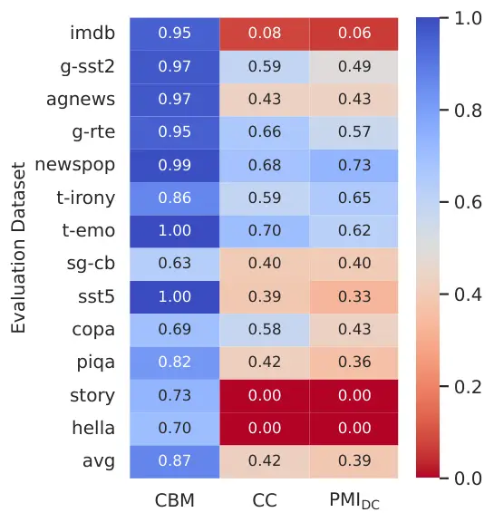
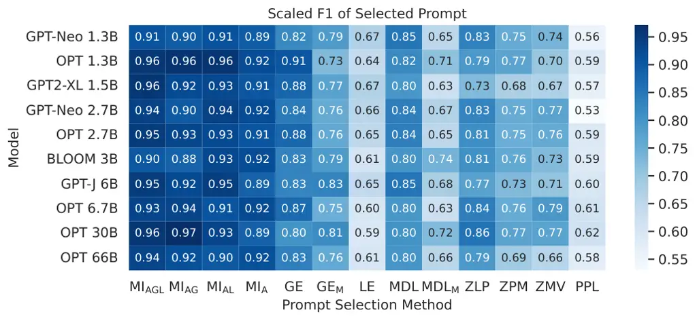
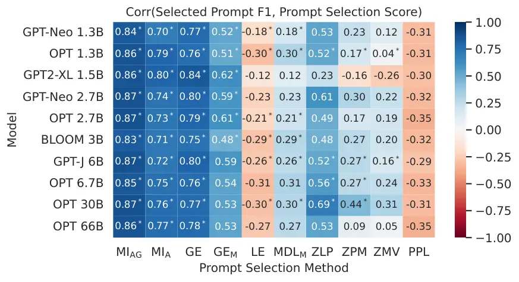

# Improving Probability-based Prompt Selection Through Unified Evaluation and Analysis

Sohee Yang Email: [sohee.yang.22@ucl.ac.uk](mailto:)    Jonghyeon Kim   
Joel Jang Affiliation: University of Washington    Seonghyeon Ye
  Hyunji Lee   Minjoon Seo Affiliation: KAIST Affiliation: UCL
Affiliation: Dongguk University

###### Abstract

Previous works in prompt engineering for large language models have
introduced different gradient-free probability-based prompt selection
methods that aim to choose the optimal prompt among the candidates for a
given task but have failed to provide a comprehensive and fair
comparison between each other. In this paper, we propose a unified
framework to interpret and evaluate the existing probability-based
prompt selection methods by performing extensive experiments on 13
common and diverse NLP tasks. We find that each of the existing methods
can be interpreted as some variant of the method that maximizes mutual
information between the input and the predicted output (MI). Utilizing
this finding, we develop several other combinatorial variants of MI and
increase the effectiveness of the oracle prompt selection method from
87.79% to 94.98%, measured as the ratio of the performance of the
selected prompt to that of the optimal oracle prompt. Furthermore,
considering that all the methods rely on the output probability
distribution of the model that might be biased, we propose a novel
calibration method called Calibration by Marginalization (CBM) that is
orthogonal to the existing methods and helps increase the prompt
selection effectiveness of the best method to 96.85%, achieving 99.44%
of the oracle prompt F1 without calibration.¹¹ 1 The code and datasets
used in our work are available at
[https://github.com/soheeyang/unified-prompt-selection](https://github.com/soheeyang/unified-prompt-selection).

^(\*)^(\*)footnotetext: This project was initiated while the first
author was a Master’s student at KAIST (Nov 2022 - Feb
2023).^(\$\dagger\$)^(\$\dagger\$)footnotetext: Work done as an intern
at KAIST.

## 1 Introduction

Large Language Models (LLMs) have demonstrated remarkable performance in
solving various natural language processing tasks through prompt-based
learning without requiring additional task-specific training (Brown
et al., 2020; Dong et al., 2023). However, the performance of LLMs can
heavily fluctuate according to the choice of prompts (Zhao et al., 2021;
Holtzman et al., 2021; Lu et al., 2022). While various prompt
engineering approaches have been proposed to mitigate this issue, the
nontrivial prerequisites of many of these methods, such as training an
additional model and/or using an additional component, have been a
bottleneck to their real application (Liu et al., 2023; Li and Liang,
2021; Jiang et al., 2020; Prasad et al., 2023; Liu et al., 2022; Rubin
et al., 2022).

On the other hand, probability-based prompt selection methods do not
require any additional parameter updates or additional components²² 2
While the prerequisite is a set of candidate prompts to select from,
this data is relatively small in size and can be easily obtained from
the research community (Bach et al., 2022) or via machine
generation (OpenAI, 2023). and thus provide a promising and easily
applicable solution; these methods aim to select the prompt from a set
of prompts that is expected to be most effective in helping a language
model to make correct predictions solely based on the probability
distribution of the model (Sorensen et al., 2022; Lu et al., 2022; Wu
et al., 2023; Liao et al., 2022; Gonen et al., 2023). However, despite
their ease of utilization, there has been a lack of comprehensive
comparative evaluation between existing probability-based prompt
selection methods, as each method is proposed in different setups and
evaluated on different datasets, evaluation instances, sets of prompts,
and models.

In this paper, we first carefully design a unified evaluation setup to
facilitate a fair comparison between different prompt selection methods.
Our unified evaluation reveals that no single method consistently
outperforms other methods across all datasets and that all existing
probability-based prompt selection methods roughly correspond to a
sub-term of the equation of Mutual Information (MI) (Sorensen et al.,
2022). We utilize this discovery to propose several variants of MI that
use different combinations of the components of existing methods, and
the best combinational variant MI$`{}_{\textnormal{AGL}}`$ increases the
scaled F1 (F1 divided by that of the oracle prompt, showing the
effectiveness of the prompt selection method) from 87.79% to 94.98%
(MI$`{}_{\textnormal{AGL}}`$ of Figure 1(a)).

Furthermore, we find the need for a better approximation of the LLM’s
output probability distribution, considering that all probability-based
prompt selection methods rely on the probabilistic estimates from the
model that might be biased. Therefore, by drawing a connection between
the existing model output probability calibration methods (Zhao et al.,
2021; Holtzman et al., 2021), we propose an enhanced calibration method,
Calibration By Marginalization (CBM). CBM significantly improves the
prompt selection performance of several methods when applied to
calibrate the output probability of LLMs, increasing the best-scaled F1
to 96.85% (MI$`{}_{\text{A}}^{\text{(PA)}}`$of Figure 1(a)), achieving
99.44% of the oracle prompt F1 under the uncalibrated scenario. CBM also
proves to show the most robust answer selection enhancement across
multiple datasets compared to the existing calibration methods
(Figure 1(b)).

(a) Prompt Selection



(b) Answer Selection

Figure 1: (a) F1 of the prompts selected by different probability-based
prompt selection methods, averaged across 13 datasets. Per-dataset F1
and accuracy are shown in Figure 9. The methods without super/subscripts
are the existing methods (Table 1), while those with super/subscripts
are our proposed methods (Table 4 & Equation 1). (b) Ratio of the
prompts (out of 100) whose F1 on each dataset improves by applying
probability calibration for answer selection, averaged across 10 models.
Our proposed calibration method, CBM (Equation 1), is considerably more
effective than CC and PMI$`{}_{\text{DC}}`$ (Table 5) in enhancing the
answer selection performance of the prompts.

## 2 Probability-based Prompt Selection

In this section, we perform a unified evaluation of existing
probability-based prompt selection methods. First, we describe the task
of probability-based prompt selection in Section 2.1. Next, we briefly
introduce each of the existing methods in Section 2.2. Then, we describe
our experimental setup for unified evaluation in Section 2.3 and present
the evaluation results in Section 2.4.

### 2.1 Task Description

|                                                 |       |                                                                                 |
| ----------------------------------------------- | ----- | ------------------------------------------------------------------------------- | ---------------------------------------------------------- | -------------------------------------- | --------------------- | --- | ------------------------- | ------------ |
| Existing Method                                 | Abbr. | Selected Prompt: $`\argmax_{t\in T}\cdots`$                                     |
| Mutual Information (Sorensen et al., 2022)      | MI    | $`\text{H}\left(\frac{1}{                                                       | X                                                          | }\sum\_{x}p(\mathbf{y}                 | x,t)\right)-\frac{1}{ | X   | }\sum\_{x}\text{H}\left(Y | x,t\right)`$ |
| Entropy (Lu et al., 2022)                       |       |                                                                                 |
|    Global Entropy                               | GE    | $`\text{H}\left(\frac{1}{                                                       | X                                                          | }\sum\_{x}\text{one\ hot}(p(\mathbf{y} | x,t))\right)`$        |
|    Local Entropy                                | LE    | $`\frac{1}{                                                                     | X                                                          | }\sum\_{x}\text{H}\left(Y              | x,t\right)`$          |
| Minimum Description Length (Wu et al., 2023)    | MDL   | $`-\text{H}(Y                                                                   | x,t)`$                                                     |
| Zero-Label Prompt Selection (Liao et al., 2022) |       | $`\sum*{x}\left[\mathbbm{1}\left\{\argmax*{y}p(\mathbf{y}                       | x,t)=\argmax\_{y}\mathbf{s}(x,\mathbf{y})\right\}\right]`$ |
|    Log-probability Mean                         | ZLP   |    $`\mathbf{s}(x,\mathbf{y})=\frac{1}{                                         | T                                                          | }\sum\_{t}\log p(\mathbf{y}            | x,t)`$                |
|    Probability Mean                             | ZPM   |    $`\mathbf{s}(x,\mathbf{y})=\frac{1}{                                         | T                                                          | }\sum\_{t}p(\mathbf{y}                 | x,t)`$                |
|    Majority Vote                                | ZMV   |    $`\mathbf{s}(x,\mathbf{y})=\sum*{t}\mathbbm{1}\{\argmax*{v\in Y}p(\mathbf{y} | x,t)=v\}`$                                                 |
| Perplexity (Gonen et al., 2023)                 | PPL   | $`-\frac{1}{                                                                    | X                                                          | }\sum\_{x}\frac{1}{p(x,t)}`$           |

Table 1: Summary of the existing probability-based prompt selection
methods. Notations used in the equations are explained at the end of
Section 2.1.

Probability-based prompt selection is the task of selecting one or more
prompts from a list of prompts $`T`$, which are expected to help the
language model $`\theta`$ make the most accurate prediction for the
evaluation dataset $`X`$ where the evaluation instances are drawn from
the data distribution, $`x\sim P_{X}`$, utilizing only the output
probability distributions of the model on $`X`$,³³ 3 Note that one can
perform a computation-efficient prompt selection or transfer of prompt
selection by (1) selecting one prompt using a subset of $`X`$ or a
separate development set $`X^{\prime}`$ and then (2) use the selected
prompt for the target evaluation dataset $`X`$ to instantiate all
$`x\sim P_{X}`$. However, following the conventional setup of the
previous works and for comparison with instance-wise prompt selection
methods where such an approach is not applicable by design, we do not
use a separate $`X^{\prime}`$. without knowing the ground truth labels
and using neither additional gradient-based updates nor other trained
components. The performance of a probability-based prompt selection
method is evaluated by how high the score of the evaluation metric
obtained with the selected prompt(s) is.

When one prompt is selected for the whole dataset, the performance is
upper bounded by the performance obtained with the prompt with which the
model achieves the best metric score; we call such a prompt the optimal
oracle prompt.⁴⁴ 4 The number of oracle prompts can be greater than one,
but we use the singular form for a more concise presentation. When one
prompt is selected for each $`x\sim P_{X}`$, different $`t\in T`$ can be
chosen for each $`x`$; we call such a prompt selection approach as
instance-wise prompt selection.

Note that the definition of prompt can vary according to the setup for
which prompt selection is performed. When prompt selection is applied to
zero-shot learning, prompts are defined as various formats of text
templates that are filled by evaluation instances $`x\sim P_{X}`$ to
facilitate. On the other hand, for few-shot (in-context) learning,
prompts are often defined as the demonstrations sampled from a
training/development set or texts of permutations of such
demonstrations. In our work, in order to enable comparison between all
the methods proposed either in zero-shot and few-shot setup, we perform
prompt selection in a zero-shot setup with the former definition of
prompt.⁵⁵ 5 We have performed additional experiments in a few-shot
learning setup using the texts of permutations of varying numbers of
in-context learning demonstrations as the prompts. However, we do not
include these results in the paper due to space limitations; also, the
overall trend of the results stays similar to that of the zero-shot
learning setup.

#### Concrete Example

Examples of prompts $`t\in T`$ include “Which category does the
following news article fall into? {text}”, “The following news article,
{text}, covers the topic of”, and “{text} belongs in which category:
Politics, Sports, Business, Science and Technology”. We say that $`x`$
instantiates the prompt $`t`$ when $`x`$ is inserted into the
placeholder {text} of the prompt template and let $`\iota(x,t)`$ denote
the instantiated prompt. Each of the answer categories represents the
concept of politics, sports, business, and science/technology, and uses
“Politics,” “Sports,” “Business,” and “Science and Technology” as the
verbalizer (the actual text evaluated to score the answer choices),
respectively.

For instance, given OPT 2.7B (Zhang et al., 2022a) as the language
model, “King Charles III’s Coronation watched by more than 18 million
viewers” as $`x`$, and the three prompts shown as examples in the
previous paragraph, a prompt selection method should choose the prompt
that is most likely to help OPT 2.7B correctly predict the answer $`y`$
among the possible answer choices $`Y`$ which represent the concepts of
politics, sports, business, and science/technology. To select such a
prompt, the method must rely solely on the output probability of the
model given the instantiated prompts as input, e.g.,
$`p(\text{``Politics''}|\text{``Which category \ldots\ King \ldots''})`$.

### 2.2 Existing Approaches

Table 1 provides the summary of the existing approaches for
probability-based prompt selection. In the equations, we use
$`p(\mathbf{y}|x,t)\in\mathbb{R}^{|Y|}`$ to express the output
probability distribution of the model over the answer choices,
$`P_{\theta}(Y|X=x,T=t)`$, when the instantiated prompt $`\iota(x,t)`$
is given as the input. The probability for each $`y\in Y`$ is calculated
as

```math
p(y|x,t)=\frac{\exp(\log\tilde{p}(y|x,t))}{\sum_{y^{\prime}\in Y}\exp(\log\tilde{p}(y^{\prime}|x,t))},
```

where $`\log\tilde{p}(y|x,t)`$ is the unnormalized logit that the model
outputs. When $`y`$’s verbalizer is tokenized into more than one token,
we calculate $`\log\tilde{p}(y|x,t)`$ as the mean of log-probability
over the tokens of the verbalizer for datasets with fixed answer
choices, and as the sum of log-probability for datasets with dynamically
changing sentence-type answer choices, except for the method proposed by
Sorensen et al. (2022) which explicitly specifies that the calculation
of $`p(\mathbf{y}|x,t)`$ uses only the logits of the first token (dubbed
as One-Token Response (OTR) in their work). We use
$`\text{H}(q(\mathbf{y}))`$ to denote the entropy of an arbitrary
probability distribution $`q(\mathbf{y})\in\mathbb{R}^{|Y|}`$,
$`-\sum_{y\in Y}q(y)\log q(y)`$. When
$`q(\mathbf{y})=p(\mathbf{y}|x,t)`$, we use $`\text{H}(Y|x,t)`$ to
represent its entropy $`\text{H}(Y|X=x,T=t)`$.

#### Mutual Information (MI)

Sorensen et al. (2022) propose to select one prompt for the evaluation
dataset that maximizes the mutual information between the evaluation
instances $`X`$ and their corresponding model predictions $`Y`$ given
prompt $`t`$,
$`\text{I}(Y;X|t)=\left[\text{H}(Y|t)-\text{H}(Y|X,t)\right]`$. Since
they use the assumption that $`p(x|t)=P_{X}(X=x)=\frac{1}{|X|}`$, the
equation becomes as shown in the first row of Table 1. The intuition of
the method is to select the prompt that guides the model to make less
biased predictions on average (high $`\text{H}(Y|t)`$) and confident
predictions about the input data (low H(Y\|X, t)).

#### Entropy (GE, LE)

Lu et al. (2022) propose to select the prompt (finding the best ordering
of few-shot demonstrations for in-context learning in their setup) using
entropy-based metrics. While their proposed methods are intended
specifically for in-context learning, viewing prompts as texts of
permutations of demonstrations⁶⁶ 6 They generate a probing set with
demonstrations from the training set and use the probing set to find the
best order., we adopt the methods for our zero-shot setup of selecting
among text template prompts and thus do not use an additional training
set or construct a probing set. Global Entropy (GE) or Local Entropy
(LE) shown in the second row of Table 1 are used to select a single
prompt among the prompt candidates for the evaluation dataset.

#### Minimum Description Length (MDL)

Wu et al. (2023) propose to select the prompt (a permutation of few-shot
demonstrations in their setup) that requires minimum codelength to
compress and transmit testing label $`y`$ given the testing input $`x`$.
With several assumptions and approximations presented in Section 4.3 of
the work of Wu et al. (2023), the equation boils down to finding
different $`t`$ for each $`x\in X`$, $`\argmin_{t}\text{H}(Y|x,t)`$,
performing instance-wise prompt selection. As their original setup for
prompt selection is few-shot learning, they perform demonstration
sampling as a set selection and then rank the texts of different
permutations of the demonstrations. Here, we describe only the ranking
part of their approach that we employ for our zero-shot learning setup.

#### Zero-Label Prompt Selection (ZLP, ZPM, ZMV)

Liao et al. (2022) propose to make a pseudo-label for each $`x`$ by
ensembling the outputs for all prompts to make a score $`s(x,y)`$ for
each $`x`$, and then choosing one prompt $`t`$ for the evaluation
dataset whose cases of
$`\argmax_{y\in Y}p(y|x,t)=\argmax_{y\in Y}s(x,y)`$ is the maximum. As
shown in Table 1, they propose three ways to calculate $`s(x,y)`$: using
the ensemble of log-probability mean, probability mean, and majority
vote. We refer to them as ZLP, ZPM, and ZMV, respectively. While the
authors of the original work applied filtering of prompts, we observed
from our preliminary experiments that filtering does not have a
significant effect.

#### Perplexity (PPL)

Gonen et al. (2023) propose to select one prompt for the evaluation
dataset with which the language model exhibits the lowest average
perplexity of the instantiated prompt $`\iota(x,t)`$ as shown in the
last row of Table 1. $`p(x,t)`$ is calculated as
$`\left[\Pi_{i=1}^{|\iota(x,t)|}p(\iota(x,t)_{i}|\iota(x,t)_{<i})\right]^{\frac{1}{|\iota(x,t)|}}`$,
where $`\iota(x,t)_{i}`$ represents the $`i`$-th token of the
instantiated prompt $`\iota(x,t)`$. We include the geometric mean to the
definition of $`p(x,t)`$ because the averaged probability is often used
to approximate the probability of a sequence.

### 2.3 Experimental Setup

#### Evaluation Datasets

Our dataset selection, aimed at fair measurement of various
probability-based prompt selection methods, is guided by several
factors. We favor the datasets previously used in research, those
encompassing diverse domains, and datasets where prompt selection is
meaningful. We exclude the datasets where all prompts underperform a
random baseline or where a naive baseline of selecting the mode label
could excel due to high imbalance. By excluding the datasets with high
imbalance, we aim to avoid the false positive cases where a failed
algorithm that collapses to select one label regardless of the input is
evaluated as a competitive method by chance.

| Dataset | Full Name                                                                                    | Split | \# Used (# Orig.) | Category   | Label Ratio |      |      |      |      |
| ------- | -------------------------------------------------------------------------------------------- | ----- | ----------------- | ---------- | ----------- | ---- | ---- | ---- | ---- |
|         |                                                                                              |       |                   |            | 0           | 1    | 2    | 3    | 4    |
| imdb    | [imdb](https://huggingface.co/datasets/imdb/viewer/plain_text/test)                          | test  | 1000 (25000)      | balanced   | 0.51        | 0.49 |      |      |      |
| g-sst2  | [glue-sst2](https://huggingface.co/datasets/glue/viewer/sst2/validation)                     | valid | 872               | balanced   | 0.49        | 0.51 |      |      |      |
| agnews  | [ag_news](https://huggingface.co/datasets/ag_news/viewer/default/test)                       | test  | 1000 (7600)       | balanced   | 0.27        | 0.25 | 0.25 | 0.24 |      |
| g-rte   | [glue-rte](https://huggingface.co/datasets/glue/viewer/rte/validation)                       | valid | 277               | balanced   | 0.53        | 0.47 |      |      |      |
| newspop | [newspop](https://huggingface.co/datasets/newspop)                                           | train | 1000 (93239)      | unbalanced | 0.36        | 0.23 | 0.33 | 0.09 |      |
| t-irony | [tweet_eval-irony](https://huggingface.co/datasets/tweet_eval/viewer/irony/validation)       | valid | 955               | unbalanced | 0.60        | 0.40 |      |      |      |
| t-emo   | [tweet_eval-emotion](https://huggingface.co/datasets/tweet_eval/viewer/emotion/validation)   | valid | 374               | unbalanced | 0.39        | 0.25 | 0.09 | 0.27 |      |
| sg-cb   | [super_glue-cb](https://huggingface.co/datasets/super_glue/viewer/cb/validation)             | valid | 56                | unbalanced | 0.41        | 0.50 | 0.09 |      |      |
| sst5    | [SetFit/sst5](https://huggingface.co/datasets/SetFit/sst5/viewer/default/test)               | test  | 1000 (1101)       | unbalanced | 0.13        | 0.29 | 0.18 | 0.23 | 0.18 |
| copa    | [super_glue-copa](https://huggingface.co/datasets/super_glue/viewer/copa/validation)         | valid | 100               | dynamic    | 0.55        | 0.45 |      |      |      |
| piqa    | [piqa](https://huggingface.co/datasets/piqa/viewer/plain_text/validation)                    | valid | 1000 (1838)       | dynamic    | 0.49        | 0.51 |      |      |      |
| story   | [story_cloze-2016](https://huggingface.co/datasets/story_cloze/viewer/2016/test)             | test  | 1000 (1871)       | dynamic    | 0.51        | 0.49 |      |      |      |
| hella   | [Rowan/hellaswag](https://huggingface.co/datasets/Rowan/hellaswag/viewer/default/validation) | valid | 1000 (10003)      | dynamic    | 0.22        | 0.25 | 0.26 | 0.26 |      |

Table 2: Datasets chosen to evaluate various probability-based prompt
selection methods.

The selected datasets have diverse label types and distributions, and we
categorize them based on their label distributions into balanced (label
distribution is about 1:1), unbalanced (otherwise), and dynamic⁷⁷ 7 The
answer choices are sentences and vary dynamically for each evaluation
instance. In these datasets, the label index is not connected to some
concept, unlike the datasets with static choices (e.g., 0 is negative
and 1 is positive in sst2), so the ratio of labels is not meaningful.
However, all the datasets of dynamic categories that we use have
balanced label distribution. categories. The 13 datasets selected
through this process are shown in Table 2.⁸⁸ 8 Maas et al. (2011); Wang
et al. (2019b); Zhang et al. (2015); Moniz and Torgo (2018); Barbieri
et al. (2020); Mohammad et al. (2018); Van Hee et al. (2018); Wang
et al. (2019a); Socher et al. (2013); Bisk et al. (2020); Mostafazadeh
et al. (2017); Zellers et al. (2019)

#### Prompts

We create a diverse range of 100 prompts for each of the 13 evaluation
datasets, which results in 1,300 prompts in total. For each dataset, a
few of the 100 prompts are taken from PromptSource (Bach et al., 2022),
and the rest are generated using GPT 3.5 (OpenAI, 2023) to speed up the
prompt generation process and then manually reviewed and corrected⁹⁹ 9
The generation, review, and correction are done by the first two authors
of the paper.. The prompts are designed to encompass various formats,
with the evaluation instance and sometimes the answer choices appearing
at different positions within the prompt, to ensure that the prompt
selection task is meaningful. Table 3 shows a few examples of the
prompts. We use one-token words as the verbalizers for the answer
choices in most prompts, except for the prompts for the datasets of the
dynamic category.

#### Models

We conduct the majority of our experiments with ten different models of
varying sizes ranging from 1.3B to 66B¹⁰¹⁰ 10 GPT-Neo (Black et al., 2021) 1.3B, OPT (Zhang et al., 2022a) 1.3B, GPT2-XL (Radford et al.,
2019), GPT-Neo 2.7B, OPT 2.7B, BLOOM 3B (Workshop et al., 2023), GPT-J
6B, OPT 6.7B, OPT 30B, and OPT 66B. However, to present the experimental
results and analysis more clearly, we only display the results of OPT
2.7B throughout the paper since the overall trend remains mostly
identical (shown in Section 5).

| Dataset | Prompt                                                                                                                                        | Verbalizers for $`Y`$                            |
| ------- | --------------------------------------------------------------------------------------------------------------------------------------------- | ------------------------------------------------ |
| imdb    | From the following review, can you tell whether the sentiment is positive or negative?                                                        | negative, positive                               |
| agnews  | Which category among Politics, Sports, Business, Scienc would this news article fall under?                                                   | Politics, Sports, Business, Science              |
| g-rte   | Given the statement "{{sentence1}}", does it necessarily follow that "{{sentence2}}" is true?                                                 | yes, no                                          |
| sg-cb   | If the above statement is true, can we conclude that "{{hypothesis}}" is also true? Yes, no, or maybe?                                        | Yes, no, maybe                                   |
| sst5    | What is the sentiment expressed in the following sentence? It’s either terrible or negative or neutral or positive or excellent. "{{ text }}" | terrible, negative, neutral, positive, excellent |
| piqa    | Your task is to achieve: {{goal}}\n\nWhich of the following options is the most appropriate?\n\n- {{sol1}}\n- {{sol2}} \n\nAnswer:            | {{sol1}}, {{sol2}}                               |

Table 3: Examples of the created prompts. The prompts are written in
Jinja for the use of PromptSource (Bach et al., 2022) APIs.

#### Evaluation Metrics

Prompt selection performance is assessed using macro F1 of the selected
prompts. To compare the effectiveness of the prompt selection methods
across different datasets or models, we normalize the value by the
performance of the oracle prompt (upper bound) and present it as scaled
F1.

#### Implementation Details

We use a modified version of the codebase of Sanh et al. (2022)¹¹¹¹ 11
[https://github.com/bigscience-workshop/t-zero](https://github.com/bigscience-workshop/t-zero)
and PromptSource (Bach et al., 2022)¹²¹² 12
[https://github.com/bigscience-workshop/promptsource](https://github.com/bigscience-workshop/promptsource)
to run model inference and add custom prompts, respectively. The
inference is performed using one to four NVIDIA V100 32GB GPUs.

### 2.4 Experimental Results

We find that there is no single probability-based prompt selection
method that consistently outperforms one another across all 13 datasets
and evaluation categories. While PPL and LE do not rank first in any
dataset, every other method ranks first in a few datasets. Figure 2
illustrates the selected prompt performance averaged by category, along
with the performance of the best (oracle) and worst prompts and the
average performance of all prompts. In the balanced category, GE and MDL
outperform others, with MI closely following. In the unbalanced
category, MI stands out, while in the dynamic category, GE, MDL, and ZLP
perform the best. LE and PPL generally underperform in all of the
datasets; their task average does not even exceed the average
performance of all prompts.¹³¹³ 13 Interpretations of these results are
provided in Section 3.2. We conclude that no single existing approach is
significantly better than others, especially when dividing the
evaluation dimensions into balanced, unbalanced, and dynamic labels.

Figure 2: F1 of the prompts selected by the existing probability-based
prompt selection methods, averaged for each dataset category, with the
task average also shown.

## 3 Improving MI via Unified Analysis

In this section, we first derive a unified view of prompt selection
methods in Section 3.1 and show that each method other than MI roughly
corresponds to a sub-term of the equation of MI and revisit the previous
experimental results for a unified analysis in Section 3.2. Then, from
the unified view and analysis, we identify the differences between
methods, particularly MI, GE, and MDL, and derive a few combinational
variants by transferring design elements across methods which improves
the prompt selection performance of MI.

### 3.1 Unified View: Identifying Connections Between Methods

#### Prompt Selection Score (PSS)

Figure 3 offers a unified view of existing probability-based prompt
selection methods, highlighting that each method except for MI
approximately corresponds to a sub-term in the equation of MI. We denote
the highlighted parts as the Prompt Selection Score of each method
($`\text{PSS}_{\text{method}}`$); the score of which the prompt with the
maximum value is chosen by the prompt selection method.

#### MI vs. GE and LE

MI selects a prompt that maximizes the first term of
$`\text{PSS}_{\text{MI}}`$,
$`\argmax_{t}\text{H}\left(\frac{1}{|X|}\sum_{x}p(\mathbf{y}|x,t)\right)`$,
and minimizes the second term,
$`\frac{1}{|X|}\sum_{x}\text{H}\left(Y|x,t\right)`$. This means that MI
favors prompts that provide balanced predictions without label bias
(interpretation of the first term) and sharp answer prediction
distribution across all instances in the dataset (interpretation of the
second term). These terms roughly correspond to
$`\text{PSS}_{\text{GE}}`$ and $`-`$$`\text{PSS}_{\text{LE}}`$,
respectively. The difference between $`\text{PSS}_{\text{GE}}`$ and the
first term of $`\text{PSS}_{\text{MI}}`$ is that the former converts
$`p(\mathbf{y}|x,t)`$ to one-hot before taking the entropy of the mean.
In sum, the prompts selected by GE and MI align, while those chosen by
LE and MI tend to be opposite. Note that one expected caveat of GE is
that it will be less effective when the dataset itself has a label
imbalance.

Figure 3: The highlighted parts of the equation are rough estimations of
the Prompt Selection Score (PSS) of each method, i.e., the score of
which the prompt with the maximum value is chosen by the prompt
selection method. They show the connection between different
probability-based prompt selection methods.

#### MI vs. MDL

MDL is the only method among the presented probability-based prompt
selection methods that selects a different prompt for each evaluation
instance $`x`$, i.e., performs instance-wise prompt selection.
Essentially, MDL is an instance-wise version of the second term of
$`\text{PSS}_{\text{MI}}`$, choosing prompts whose output probability
distribution $`p(\mathbf{y}|x,t)`$ has the lowest entropy, and thus
aligns with MI. Since MDL favors the prompt that makes the model output
a sharp probability distribution, one expected caveat of MDL is that it
will not work well when the model fails to solve the given task and
collapses to a single prediction regardless of the input with overly
high confidence.

#### MI vs. ZPM

Zero-label prompt selection methods ensemble the results of all prompts
to calculate $`s(x,y)`$, create pseudo labels by converting $`s(x,y)`$
to one-hot, and then choose the prompt with predictions most similar to
the pseudo labels. Applying this view to $`\text{PSS}_{\text{ZPM}}`$
with an assumption of $`p(t|x)=\frac{1}{|T|}`$ results in an alternative
form,

```math
\displaystyle\text{PSS}_{\text{ZPM}}= \displaystyle\sum_{x\in X}\text{one\ hot}\left(p(\mathbf{y}|x,t)\right)^{\top}\text{one\ hot}\left(\mathbf{s}(x,y)\right)
```

```math
\displaystyle\text{s.t.}\ \mathbf{s}(x,y)=\frac{1}{|T|}\sum_{t\in T}p(\mathbf{y}|x,t)\approx p(\mathbf{y}|x)
```

```math
\displaystyle\therefore\text{PSS}_{\text{ZPM}}\approx \displaystyle\sum_{x\in X}\text{one\ hot}\left(p(\mathbf{y}|x,t)\right)^{\top}\text{one\ hot}\left(p(\mathbf{y}|x)\right)
```

```math
\displaystyle\approx \displaystyle\frac{1}{|X|}\sum_{x\in X}p(\mathbf{y}|x,t)^{\top}\log p(\mathbf{y}|x),
```

which roughly corresponds to the negation of the second term of
$`\text{PSS}_{\text{MI}}`$, well-aligning the two methods.¹⁴¹⁴ 14 One
expected caveat of the methods of zero-label prompt selection is that it
might not work well when a large portion of the prompts fail to solve
the given task. Therefore, Liao et al. (2022) propose a way to filter
out low-quality prompts in advance, but the filtering algorithm does not
benefit their proposed methods in our experimental setup.

#### MI vs. PPL

$`\text{PSS}_{\text{PPL}}`$ is the most dissimilar from
$`\text{PSS}_{\text{MI}}`$, along with $`\text{PSS}_{\text{LE}}`$. Since
$`\argmin_{t}\frac{1}{|X|}\sum_{x}\frac{1}{p(x,t)}=\argmax_{t}\sum_{x}p(x,t)`$,
$`\text{PSS}_{\text{PPL}}`$ can be expressed as $`\sum_{x}p(x,t)`$. It
is clear that $`\text{PSS}_{\text{PPL}}`$ differs from
$`\text{PSS}_{\text{MI}}`$ because it considers the probability of $`x`$
and $`t`$ that $`\text{PSS}_{\text{MI}}`$ neglects. Applying the
probabilistic assumption of MI
$`\left(p(x|t)=p(x)=\frac{1}{|X|}\right)`$ to
$`\text{PSS}_{\text{PPL}}`$ converts the equation to
$`\sum_{x}\frac{p(t)}{|X|}`$, causing PPL to select the prompt with the
lowest perplexity irrespective of the input. Since Gonen et al. (2023)
even restrict their prompt format for the input $`x`$ to appear at the
beginning so that $`p(x,t)`$ is calculated only as the form of
$`p(t|x)p(x)`$, i.e., the probability of prompt is always conditioned on
$`x`$, the probabilistic assumption of MI is incompatible with the
motivation of PPL.¹⁵¹⁵ 15 Note that our experimental setup also differs
with the setup of Gonen et al. (2023); we generated the prompts in an
unrestricted manner that $`x`$ can appear anywhere in the prompt.

### 3.2 Unified Analysis: Revisiting Experimental Results

Revisiting the unified evaluation in Section 2.4, the results align with
our analysis from Section 3.1. GE performs well in balanced datasets but
poorly in unbalanced ones due to its preference for prompts that create
balanced predictions. GE also performs well in dynamic datasets since
the label distribution is balanced by chance (Table 2). MDL performs
comparably to GE due to similar entropy calculations. LE’s performance,
however, is less satisfactory, given its optimization contradicts MDL.
The underperformance of PPL compared to that by Gonen et al. (2023)
might be due to our use of diverse prompt formats¹⁶¹⁶ 16 We allow the
input $`x`$ to appear anywhere in the prompt, unlike their restricted
setup where $`x`$ always comes at the beginning..

Note that in dynamic datasets, MI’s best, worst, and average prompt
performances differ due to its distinct calculation of
$`p(\mathbf{y}|x,t)`$ that uses only the first token logits; for other
methods, $`p(\mathbf{y}|x,t)`$ is calculated using all tokens
(Section 2.2).¹⁷¹⁷ 17 In balanced and unbalanced cases, the number of
tokens of most verbalizers is 1, so the best, worst, and average prompt
performances of the prompts whose performance is calculated using only
the first token are identical to the other methods; on the other hand,
the verbalizer is a sentence for dynamic datasets and makes the
difference. This leads to a question: Is the difference in the
calculation of $`p(\mathbf{y}|x,t)`$ the reason that MI performs well in
balanced and unbalanced cases but poorly in dynamic cases? In addition,
despite GE and MDL maximizing MI’s sub-term, they outperform MI in
balanced datasets. This observation leads to another question: Is their
higher performance due to their one-hot $`p(\mathbf{y}|x,t)`$ and
instance-wise prompt selection?

In the following subsection, we show that the answers to both questions
are yes, demonstrating that using all tokens to calculate
$`p(\mathbf{y}|x,t)`$, one-hot $`p(\mathbf{y}|x,t)`$, and instance-wise
prompt selection improves the prompt selection performance of MI.

### 3.3 Experimental Results: Transferring Design Choices from Unified Analysis

#### $`p(\mathbf{y}|x,t)`$ calculation using all tokens helps MI.

Figure 4: F1 of the prompts selected by MI$`{}_{\textnormal{A}}`$ and
MI, averaged for each setup of a different number of tokens of
verbalizers and evaluation dataset category. $`|v|`$ denotes the number
of tokens of the verbalizers.

|                                                               |     |                       |     |     |                        |                                                |
| ------------------------------------------------------------- | --- | --------------------- | --- | --- | ---------------------- | ---------------------------------------------- | ------ | -------------------------------------- | -------------- |
|                                                               |     | A                     | G   | L   | Prompt Selection Score |                                                |
| Existing Methods                                              |     |                       |     |     |                        |                                                |
| \\thisrulewidth=\\setrulekerninglr \\gtempa\futurenonspacelet |     | GE                    | ✓   | ✓   | \-                     | $`\text{H}\left(\frac{1}{                      | X      | }\sum\_{x}\text{one\ hot}(p(\mathbf{y} | x,t))\right)`$ |
| \\thisrulewidth=\\setrulekerninglr \\gtempa\futurenonspacelet |     | MDL                   | ✓   | \-  | ✓                      | $`-\text{H}(Y                                  | x,t)`$ |
| \\thisrulewidth=\\setrulekerninglr \\gtempa\futurenonspacelet |     | MI                    | ✗   | ✗   | ✗                      | $`\text{GE}_{\text{M}}+\text{MDL}_{\text{M}}`$ |
| Explored Variants                                             |     |                       |     |     |                        |                                                |
| \\thisrulewidth=\\setrulekerninglr \\gtempa\futurenonspacelet |     | GE$`{}_{\text{M}}`$   | ✓   | ✗   | \-                     | $`\text{H}\left(\frac{1}{                      | X      | }\sum\_{x}p(\mathbf{y}                 | x,t)\right)`$  |
| \\thisrulewidth=\\setrulekerninglr \\gtempa\futurenonspacelet |     | MDL$`{}_{\text{M}}`$  | ✓   | \-  | ✗                      | $`-\frac{1}{                                   | X      | }\sum\_{x}\text{H}\left(Y              | x,t\right)`$   |
| \\thisrulewidth=\\setrulekerninglr \\gtempa\futurenonspacelet |     | MI$`{}_{\text{A}}`$   | ✓   | ✗   | ✗                      | $`\text{GE}_{\text{M}}+\text{MDL}_{\text{M}}`$ |
| \\thisrulewidth=\\setrulekerninglr \\gtempa\futurenonspacelet |     | MI$`{}_{\text{AG}}`$  | ✓   | ✓   | ✗                      | $`\text{GE}+\text{MDL}_{\text{M}}`$            |
| \\thisrulewidth=\\setrulekerninglr \\gtempa\futurenonspacelet |     | MI$`{}_{\text{AL}}`$  | ✓   | ✗   | ✓                      | $`\text{GE}_{\text{M}}+\text{MDL}`$            |
| \\thisrulewidth=\\setrulekerninglr \\gtempa\futurenonspacelet |     | MI$`{}_{\text{AGL}}`$ | ✓   | ✓   | ✓                      | $`\text{GE}+\text{MDL}`$                       |

Table 4: Top: differences among GE, MDL, and MI. Bottom: new variations
created by transferring design choices from existing probability-based
prompt selection methods. A represents $`p(\mathbf{y}|x,t)`$ using All
tokens, G represents one-hot $`p(\mathbf{y}|x,t)`$ like GE, and L
represents instance-wise selection (select for each $`x`$) like MDL.

To investigate the difference between using only the first token
probability and the mean/sum of all tokens to calculate
$`\text{PSS}_{\text{MI}}`$, we develop a variant of MI called
MI$`{}_{\textnormal{A}}`$ (A of All). Unlike MI and like other methods,
MI$`{}_{\textnormal{A}}`$ calculates $`p(\mathbf{y}|x,t)`$ by taking the
mean of all token logits for balanced and unbalanced datasets, and the
sum for dynamic datasets. Since the balanced and unbalanced datasets in
our experimental setup (Section 2.4) mostly use one-token verbalizers
which result in the same result of MI and MI$`{}_{\textnormal{A}}`$, we
utilize new sets of verbalizers of 1-2 tokens ($`1\leq|v|\leq 2`$) or 2
tokens ($`|v|=2`$) for all the prompts of our evaluation datasets and
compare the two methods. Our results in Figure 4 show that using all
tokens is more effective in all configurations except for the 1-2
token-balanced tasks.

#### One-hot $`p(\mathbf{y}|x,t)`$ and instance-wise prompt selection benefits MI.

We create combinational variants of GE, MDL, and MI (outlined in
Table 4) to study whether their differences contribute to MI’s lower
performance in balanced datasets. For instance,
$`\text{PSS}_{\text{{GE}${}_{\textnormal{M}}$ }}`$ is an MI-like version
of GE employing $`p(\mathbf{y}|x,t)`$ without one-hot encoding, while
$`\text{PSS}_{\text{{MDL}${}_{\textnormal{M}}$ }}`$ is an MI-like MDL
version using the average of $`\text{H}(Y|x,t)`$ for all $`x`$ to select
a single prompt. Contrarily, MI$`{}_{\textnormal{AG}}`$ and
MI$`{}_{\textnormal{AL}}`$ are variants of MI, with the former emulating
GE and the latter mirroring MDL, on top of MI$`{}_{\textnormal{A}}`$.
MI$`{}_{\textnormal{AGL}}`$ is another MI variant employing the sum of
$`\text{PSS}_{\text{GE}}`$ and $`\text{PSS}_{\text{MDL}}`$ as PSS, using
one-hot $`p(\mathbf{y}|x,t)`$ for the first term calculation and
instance-wise selection.

Figure 5: F1 of the prompts selected by different probability-based
prompt selection methods, averaged for each dataset category, with the
task average also shown. The methods with subscripts are the
combinational variants proposed in this subsection, whose Prompt
Selection Scores are shown in Table 4 . The methods with subscript M are
combinational variants that use the component of MI; the methods with L
perform instance-wise prompt selection like MDL; the methods with G
utilize one-hot $`p(\mathbf{y}|x,t)`$ like GE. The methods with A use
All tokens to calculate $`p(\mathbf{y}|x,t)`$.

Figure 5 compares these variants with existing methods. The variants
that use instance-wise prompt selection (MI$`{}_{\textnormal{AGL}}`$,
MI$`{}_{\textnormal{AL}}`$, MDL) perform better in balanced and
unbalanced datasets but underperform in dynamic ones. Particularly in
balanced datasets, MI$`{}_{\textnormal{AGL}}`$,
MI$`{}_{\textnormal{AL}}`$, and MI$`{}_{\textnormal{A}}`$ show
significant improvement. While no method is consistently superior across
all datasets (as observed in Section 2.4), MI$`{}_{\textnormal{AGL}}`$
significantly improves scaled F1 to 94.98% (0.6454/0.6795) compared to
that of the best existing method (GE), which is 87.79% (0.5965/0.6795).

## 4 Improving Prompt Selection Through Enhanced Probability Calibration

While the previous section enhances prompt selection performance using
combinatorial variants, in this section, we explore an orthogonal
approach to further improve prompt selection: model output probability
calibration.

Since all the prompt selection methods except for PPL depend on the
model output probability $`p(\mathbf{y}|x,t)`$ to calculate Prompt
Selection Score (PSS), the stability and reliability of
$`p(\mathbf{y}|x,t)`$ affect their prompt selection performance.
However, previous works have pointed out that $`p(\mathbf{y}|x,t)`$ is
unstable without calibration.¹⁸¹⁸ 18 Zhao et al. (2021) find that the
probability in few-shot learning tends to favor certain answer choices
appearing at the end of the prompt or common in pretraining data.
Holtzman et al. (2021) note that ranking based on string probability can
be probabilistic due to surface form competition. To address the issue,
Zhao et al. (2021) suggest Contextual Calibration (CC), which reduces
bias towards each answer choice by employing content-free inputs (“N/A”,
“\[MASK\]”, “”), while Holtzman et al. (2021) present Domain Conditional
Pointwise Mutual Information (PMI$`{}_{\text{DC}}`$) by reweighting each
answer choice based on its task-specific prior likelihood. We summarize
the two methods for answer selection in Table 5; $`\argmax_{y}`$
$`\tilde{q}(\mathbf{y}|x,t)`$ is selected as the answer, where
$`\tilde{q}(\mathbf{y}|x,t)`$ is the calibrated score.

One might assume that these existing calibration methods would
effectively calibrate $`p(\mathbf{y}|x,t)`$ for PSS. However, through
the experiments described in Section 4.1, we reveal in Section 4.2 the
results that these methods have limitations for prompt selection and
even answer selection across numerous datasets. In response, we propose
an enhanced calibration method, Calibration By Marginalization (CBM), in
Section 4.3. Section 4.4 shows that CBM notably improves prompt
selection for most methods, particularly MI and
MDL$`{}_{\textnormal{M}}`$, enabling them to achieve the highest prompt
selection performance compared to all other methods. Furthermore, CBM’s
answer selection enhancement is the most robust across various datasets
when compared to existing calibration methods.

### 4.1 Experimental Setup for Probability Calibration

|                                                                                                                                           |                                                                                       |                             |
| ----------------------------------------------------------------------------------------------------------------------------------------- | ------------------------------------------------------------------------------------- | --------------------------- | -------------------------------------------------------- | -------------------------- | ------------------------ |
| Existing Method                                                                                                                           | Equation for Answer Selection                                                         |                             |
| Contextual Calibration (CC) (Zhao et al., 2021)                                                                                           | $`\mathfrak{C}=\{\text{"N/A"},\text{"[MASK]"},\text{""}\}`$                           |                             |
|                                                                                                                                           | $`{\tilde{\mathbf{p}}}\_{\text{cf}}=\frac{1}{                                         | \mathfrak{C}                | }\sum\_{\mathfrak{c}\in\mathfrak{C}}\tilde{p}(\mathbf{y} | \mathfrak{c},t)`$          |                          |
|                                                                                                                                           | $`\mathbf{W}=\text{diag}(\tilde{\mathbf{p}}_{\text{cf}})^{-1},\mathbf{b}=\mathbf{0}`$ |                             |
|                                                                                                                                           | $`\tilde{q}(\mathbf{y}                                                                | x,t)=\mathbf{W}p(\mathbf{y} | x,t)+\mathbf{b}`$                                        |                            |
| \\thisrulewidth=\\setrulekerninglr \\gtempa\futurenonspacelet      Domain Conditional PMI (PMI$`{}_{\text{DC}}`$) (Holtzman et al., 2021) |                                                                                       | $`\tilde{q}(\mathbf{y}      | x,t)=\log\dfrac{\tilde{p}(\mathbf{y}                     | x,t)}{\tilde{p}(\mathbf{y} | x\_{\text{domain}},t)}`$ |

Table 5: Existing calibration methods proposed for answer selection.
$`\argmax_{y}\tilde{q}(\mathbf{y}|x,t)`$ is selected as the answer for
the prompt $`t`$ instantiated by input instance $`x`$. Note that the
actual calculation of CC in the official code uses
$`\mathbf{p}_{\text{cf}}`$, mean-normalized
$`\tilde{\mathbf{p}}_{\text{cf}}`$; thus, we also use it in our
experiments.

We compare the prompt selection performance with four different
scenarios of calibration: without applying any calibration; (A) applying
calibration only for Answer selection, computing
$`\tilde{q}(\mathbf{y}|x,t)`$ where $`\argmax_{y}`$
$`\tilde{q}(\mathbf{y}|x,t)`$ is selected as the answer; (P) applying
calibration only for Prompt selection; and (PA) applying calibration for
both Prompt selection and Answer selection.

Normalization of $`\tilde{q}(\mathbf{y}|x,t)`$ is not required for
answer selection, as it does not affect the $`\argmax`$ of the scores.
However, to obtain PSS, it is essential to normalize
$`\tilde{q}(\mathbf{y}|x,t)`$ so that the sum equals one, thereby
preserving the original probabilistic motivation of different methods.
Consequently, we apply the softmax function to convert
$`\tilde{q}(\mathbf{y}|x,t)`$ into a proper probability distribution
$`q(\mathbf{y}|x,t)`$.¹⁹¹⁹ 19 To calculate PMI$`{}_{\text{DC}}`$, it is
necessary to manually select $`x_{\text{domain}}`$ for each prompt in
every dataset. Nonetheless, our experiments involve a total of 1,300
unique prompts, making a manual determination of different
$`x_{\text{domain}}`$ for each prompt a tedious task. Therefore, we use
the prompt instantiated with an empty input
($`x_{\text{domain}}=\iota(\text{``''},t)`$) for each prompt.

### 4.2 Experimental Results: Underperformance of Existing Calibration Methods

We check the prompt selection performance of each method across the four
calibration scenarios. Surprisingly, for both CC and
PMI$`{}_{\text{DC}}`$, we find that all three calibration scenarios show
degraded performance compared to the scenario of no calibration. Not
only does the prompt selection performance degrade, but the best, worst,
and average prompt performance also drops in the case of A (only answer
selection). This is unexpected, as CC and PMI$`{}_{\text{DC}}`$ have
been reported to improve performance in slightly different setups (our
results are in a zero-shot setting, while the main setup of Zhao et al.
(2021) is few-shot, and the choice of $`x_{\text{domain}}`$ differs for
PMI$`{}_{\text{DC}}`$).

To further investigate the subpar performance in case A, we analyze the
proportion of prompts (out of 100) that exhibit improved performance
after applying calibration for answer selection across ten different
models and 13 datasets. Figure 1(b) displays the average ratio for all
models. The figure indicates that the existing calibration methods do
not result in better answer selection for the majority of our evaluation
datasets. For instance, more than half of the prompts displayed
decreased performance after applying CC in 7 out of 13 datasets. A
similar pattern holds when applying PMI$`{}_{\text{DC}}`$.

### 4.3 Enhanced Calibration Method: Calibration By Marginalization (CBM)

Table 5 shows that the equation for CC can be alternatively expressed as
follows:

```math
\displaystyle\tilde{q}(\mathbf{y}|x,t)= \displaystyle\text{diag}({\tilde{\mathbf{p}}}_{\text{cf}})^{-1}p(\mathbf{y}|x,t)+\mathbf{0}=\frac{p(\mathbf{y}|x,t)}{{\tilde{\mathbf{p}}}_{\text{cf}}}
```

```math
\displaystyle= \displaystyle\frac{p(\mathbf{y}|x,t)}{\frac{1}{|\mathfrak{C}|}\sum_{\mathfrak{c}\in\mathfrak{C}}\tilde{p}(\mathbf{y}|\mathfrak{c},t)},
```

which turns CC into a special case of PMI$`{}_{\text{DC}}`$²⁰²⁰ 20 We
can ignore the lack of $`\log`$ because it does not change the result of
$`\argmax`$., where
$`\tilde{p}(\mathbf{y}|x_{\text{domain}},t)=\frac{1}{|\mathfrak{C}|}\sum_{\mathfrak{c}\in\mathfrak{C}}\tilde{p}(\mathbf{y}|\mathfrak{c},t)`$.
Additionally, upon revisiting the motivation of PMI$`{}_{\text{DC}}`$
and considering the equation of pointwise mutual information
$`\text{PMI}(x,y)=\log\frac{p(y|x)}{p(y)}`$, it becomes evident that
$`\tilde{p}(\mathbf{y}|x_{\text{domain}},t)`$ approximates
$`{p}(\mathbf{y}|t)`$. Therefore, the distinction between CC and
PMI$`{}_{\text{DC}}`$ lies solely in how they approximate
$`p(\mathbf{y}|t)`$. However, since the approximation for CC relies on
three inputs and PMI$`{}_{\text{DC}}`$ on just one, both methods fall
short of providing a stable approximation. This limitation naturally
leads to the following question: Could there be a way to approximate
$`p(\mathbf{y}|x,t)`$ in a more stable manner?

Encouragingly, the answer to the question is yes. A better approximation
of $`p(\mathbf{y}|x,t)`$ can be calculated using the law of marginal
probability:
$`p(\mathbf{y}|t)=\sum_{x\in X}p(\mathbf{y},x|t)=\sum_{x\in X}p(\mathbf{y}|x,t)p(x|t)`$.
With this more stable approximation of $`p(\mathbf{y}|t)`$ and the
probabilistic assumption of MI that $`p(x|t)=\frac{1}{|X|}`$, we
introduce a new calibration method called Calibration By Marginalization
(CBM) that employs the following equation for answer selection:

```math
\displaystyle\tilde{q}(\mathbf{y}|x,t)=\frac{p(\mathbf{y}|x,t)}{p(\mathbf{y}|t)}=\frac{p(\mathbf{y}|x,t)}{\frac{1}{|X|}\sum_{x^{\prime}\in X}p(\mathbf{y}|x^{\prime},t)}. \tag{1}
```

Since the calculation of $`p(\mathbf{y}|x,t)`$ for all $`t\in T`$ and
$`x\in X`$ is already done to perform prompt selection, CBM does not
introduce any additional computational cost for calibration, unlike CC
or PMI$`{}_{\text{DC}}`$ that require inference on additional inputs
such as “N/A”, “\[MASK\]”, “”, and $`x_{\text{domain}}`$.

### 4.4 Experimental Results: Improvement with CBM Calibration

Figure 6: F1 of the prompts selected by different probability-based
prompt selection methods, averaged across 13 datasets, for each scenario
of CBM calibration.



(a) Scaled F1



(b) Correlation of F1 of the selected prompts

Figure 7: Scaled F1 and correlation of F1 of the selected prompts and
Prompt Selection Score of different probability-based prompt selection
methods for different models, averaged across 13 datasets.

Figure 6 presents the prompt selection performance of each
probability-based prompt selection method across the four calibration
scenarios of applying CBM. Applying CBM calibration for answer selection
(A) enhances prompt selection performance across all methods. Scenarios
involving calibration for prompt selection (PA, P) mostly result in
unchanged or decreased prompt selection performance compared to the
cases without calibration, and applying calibration solely for prompt
selection (P) consistently results in diminished performance.

The methods displaying the most significant performance improvements in
the PA scenario are MI$`{}_{\textnormal{AG}}`$,
MI$`{}_{\textnormal{A}}`$, MI, and MDL$`{}_{\textnormal{M}}`$,
particularly with the prompt selection performance of
MI$`{}_{\text{A}}^{\text{(PA)}}`$and
MDL$`{}_{\text{M}}^{\text{(PA)}}`$being the highest among different
methods. On average, MI$`{}_{\text{A}}^{\text{(PA)}}`$increases the
scaled F1 from 87.79% (0.5965/0.6795) to 99.44% (0.6757/0.6795) compared
to the best existing method (GE) when the oracle prompt without
calibration is used as the target of comparison. The scaled F1 of
MI$`{}_{\text{A}}^{\text{(PA)}}`$calculated with respect to the oracle
prompt with calibration is 96.85% (0.6757/0.6977).

Next, we assess the effectiveness of CBM calibration for answer
selection by examining the proportion of prompts (out of 100) that show
improved performance after applying calibration for answer selection.
Figure 1(b) indicates that CBM is considerably more effective than CC
and PMI$`{}_{\text{DC}}`$ in enhancing the performance of the prompts.
The performance of more than half of the prompts increases after
applying CBM in all 13 datasets. Additionally, the performance of nearly
100% of prompts improves with CBM calibration in 7 datasets. While CC
and PMI$`{}_{\text{DC}}`$ improved almost none of the F1 of the prompts
in story and hella, the performance of approximately 70% of the prompts
increased with CBM calibration, possibly due to the more accurate
calculation of $`p(\mathbf{y}|t)`$ as discussed in Section 4.3.

## 5 Discussion

Figure 8: Mean and standard deviation of prompt selection among five
sets of 50 prompts, sampled from the full set of 100 prompts.

Figure 9: F1 (top) and accuracy (bottom) of the prompts selected by the
different probability-based prompt selection methods, shown for each
dataset.

In this section, we discuss various findings that are relevant to our
main experiments.

Figure 7(a) shows that the effectiveness of a probability-based prompt
selection method remains consistent across models of different types and
numbers of parameters, justifying our choice of using a single model
(OPT 2.7B) as the representative for all experiments. Figure 7(b) shows
that the trend of correlation between Prompt Selection Score and
performance of the selected prompt is also quite consistent between
different models.

Figure 9 shows the mean and standard deviation of the result of prompt
selection among five different subsets of 50 prompts randomly sampled
from the full set of 100 prompts, using the mainly discussed methods.
The result shows that the performance of instance-wise prompt selection
methods (MI$`{}_{\textnormal{AGL}}`$, MI$`{}_{\textnormal{AL}}`$, MDL)
is not stable, likely due to the noisy nature of selecting one prompt
for each instance. However, the performance of
MI$`{}_{\text{A}}^{\text{(PA)}}`$ and MDL$`{}_{\text{M}}^{\text{(PA)}}`$
still achieves the highest performance and also shows the lowest
standard deviation, proving the effectiveness of CBM.

Through additional analysis, we find that (1) while strong performance
in prompt selection does not consistently correlate with Prompt
Selection Score, a broadly positive correlation is observed when
averaged across most methods; (2) CBM improves the performance of
MDL$`{}_{\text{M}}`$ by mitigating overconfidence; (3) MI, GE, and CBM
methods face limitations when applied to dynamic datasets with extreme
label imbalance; (4) top-performing prompt selection methods from the
zero-shot setting, like MI$`{}_{\text{A}}^{\text{(PA)}}`$and
MDL$`{}_{\text{M}}^{\text{(PA)}}`$, retain their effectiveness in the
few-shot setting, further validating their robustness across different
conditions.

## 6 Related Works

Recent advances in large language models (LLMs) have created the
paradigm of prompt-based learning, which gives the benefit that a single
pretrained LLM can be used to solve a great number of tasks with
task-specific prompts. However, the performance of LLMs can heavily
fluctuate according to the choice of prompts (Zhao et al., 2021;
Holtzman et al., 2021; Lu et al., 2022). To mitigate this issue, prompt
engineering attempts to find the prompt that results in the most
effective performance on the downstream task (Liu et al., 2023).

Automatic prompt engineering methods can be largely divided into two
groups: the methods that use discrete prompts where the prompts are
human-understandable actual text strings, and the methods that optimize
continuous prompts where the prompts lie in the embedding space of the
model (Li and Liang, 2021; Shin et al., 2020). Probability-based prompt
selection methods that we study in this work 2.2 fall into the former
group; most of the methods of the latter group require gradient-based
training, while probability-based prompt selection does not perform any
gradient-based update.

Prompt engineering methods using discrete prompts include prompt
paraphrasing, prompt generation, and prompt selection. Among these,
prompt paraphrasing or generation approaches can be used together with
probability-based selection methods; prompt selection can be performed
on the prompts generated through prompt paraphrasing or
generation (Jiang et al., 2020; Mishra et al., 2022; Gao et al., 2021;
Wang et al., 2023; Prasad et al., 2023; Kim et al., 2022; Deng et al.,
2022). Among prompt selection methods other than the probability-based
approaches, a large portion of the methods are not easily utilizable
since they require training an additional model and/or the use of an
additional component. (Zhang et al., 2022b) use reinforcement learning
for demonstration selection of in-context learning; Chang and Jia (2023)
train a scorer and estimator for demonstration selection; Kumar and
Talukdar (2021); Xu et al. (2022) use a genetic algorithm; Liu et al.
(2022); Lyu et al. (2023); Rubin et al. (2022) use retrieval from a
corpus to select the prompts.

On the other hand, probability-based prompt selection offers the
advantage of prompt selection requiring only the output probabilities of
the LLM. While the prerequisite is a set of candidate prompts to select
from, this data is relatively small in size and can be easily obtained
from the research community (Bach et al., 2022) or via machine
generation (OpenAI, 2023). One limitation of these methods, though, is
that one cannot use them for closed-source LLMs that are only available
via proprietary LLM APIs that do not provide output probability
distributions. Also, when the number of candidate prompts $`|T|`$ and
the size of the dataset used to select the prompt $`|X|`$ is large, the
calculation for prompt selection becomes computationally heavy; using a
smaller set $`X^{\prime}\in X`$ to choose the prompt for $`X`$ can be
helpful in such a case.

## 7 Conclusion

In this paper, we address the need for a comprehensive evaluation to
compare the existing probability-based prompt selection methods, which
have been proposed and evaluated under varying conditions and datasets.
To achieve this, we introduce a unified evaluation setup to compare
these methods, conduct a thorough evaluation, and develop a unified
framework of the existing probability-based prompt selection methods.
Our analysis within this unified framework has provided insights into
the relationship among existing methods, enabling the development of
several combinational variants that improve performance. Furthermore,
our research on probability calibration has revealed the limitations of
existing calibration methods and led to the proposal of an enhanced
calibration method, Calibration By Marginalization (CBM). CBM not only
significantly improves prompt selection performance but also
demonstrates robust answer selection enhancement across multiple
datasets. We hope that our unified setup provides a foundation for fair
evaluation between various prompt selection methods and that our
findings yield deeper insights into probability-based prompt selection.

## Acknowledgements

The authors would like to extend their sincere gratitude to the
anonymous reviewers and Action Editor for their highly detailed and
insightful comments and feedback. The authors would also like to thank
Sang-Woo Lee for valuable feedback and discussions on the project. This
work was partly supported by KT grant (2021, A study on a conversational
language model that uses long external text as a prompt, 80%) and
Institute of Information & communications Technology Planning &
Evaluation (IITP) grant funded by the Korea government (MSIT)
(No.2021-0-02068, Artificial Intelligence Innovation Hub, 20%).

## References

- Bach et al. (2022) Stephen H. Bach, Victor Sanh, Zheng-Xin Yong,
  Albert Webson, Colin Raffel, Nihal V. Nayak, Abheesht Sharma, Taewoon
  Kim, M Saiful Bari, Thibault Fevry, Zaid Alyafeai, Manan Dey, Andrea
  Santilli, Zhiqing Sun, Srulik Ben-David, Canwen Xu, Gunjan Chhablani,
  Han Wang, Jason Alan Fries, Maged S. Al-shaibani, Shanya Sharma,
  Urmish Thakker, Khalid Almubarak, Xiangru Tang, Dragomir Radev, Mike
  Tian-Jian Jiang, and Alexander M. Rush. 2022. Promptsource: An
  integrated development environment and repository for natural language
  prompts. In _ACL System Demonstrations_.
- Barbieri et al. (2020) Francesco Barbieri, Jose Camacho-Collados, Luis
  Espinosa-Anke, and Leonardo Neves. 2020. TweetEval:Unified Benchmark
  and Comparative Evaluation for Tweet Classification. In _Findings of
  EMNLP_.
- Bisk et al. (2020) Yonatan Bisk, Rowan Zellers, Ronan Le Bras,
  Jianfeng Gao, and Yejin Choi. 2020. Piqa: Reasoning about physical
  commonsense in natural language. In _AAAI_.
- Black et al. (2021) Sid Black, Leo Gao, Phil Wang, Connor Leahy, and
  Stella Biderman. 2021. GPT-Neo: Large Scale Autoregressive Language
  Modeling with Mesh-Tensorflow.
- Brown et al. (2020) Tom B. Brown, Benjamin Mann, Nick Ryder, Melanie
  Subbiah, Jared Kaplan, Prafulla Dhariwal, Arvind Neelakantan, Pranav
  Shyam, Girish Sastry, Amanda Askell, Sandhini Agarwal, Ariel
  Herbert-Voss, Gretchen Krueger, Tom Henighan, Rewon Child, Aditya
  Ramesh, Daniel M. Ziegler, Jeffrey Wu, Clemens Winter, Christopher
  Hesse, Mark Chen, Eric Sigler, Mateusz Litwin, Scott Gray, Benjamin
  Chess, Jack Clark, Christopher Berner, Sam McCandlish, Alec Radford,
  Ilya Sutskever, and Dario Amodei. 2020. Language models are few-shot
  learners. In _NeurIPS_.
- Chang and Jia (2023) Ting-Yun Chang and Robin Jia. 2023. Data curation
  alone can stabilize in-context learning. In _ACL_.
- Deng et al. (2022) Mingkai Deng, Jianyu Wang, Cheng-Ping Hsieh, Yihan
  Wang, Han Guo, Tianmin Shu, Meng Song, Eric P Xing, and Zhiting
  Hu. 2022. RLPrompt: Optimizing discrete text prompts with
  reinforcement learning. In _EMNLP_.
- Dong et al. (2023) Qingxiu Dong, Lei Li, Damai Dai, Ce Zheng, Zhiyong
  Wu, Baobao Chang, Xu Sun, Jingjing Xu, Lei Li, and Zhifang Sui. 2023.
  A survey on in-context learning. _arXiv preprint arXiv:2301.00234v3_.
- Gao et al. (2021) Tianyu Gao, Adam Fisch, and Danqi Chen. 2021. Making
  pre-trained language models better few-shot learners. In _ACL_.
- Gonen et al. (2023) Hila Gonen, Srini Iyer, Terra Blevins, Noah A
  Smith, and Luke Zettlemoyer. 2023. Demystifying prompts in language
  models via perplexity estimation. In _EMNLP_.
- Holtzman et al. (2021) Ari Holtzman, Peter West, Vered Shwartz, Yejin
  Choi, and Luke Zettlemoyer. 2021. Surface form competition: Why the
  highest probability answer isn’t always right. In _EMNLP_.
- Jiang et al. (2020) Zhengbao Jiang, Frank F Xu, Jun Araki, and Graham
  Neubig. 2020. How can we know what language models know? _TACL_.
- Kim et al. (2022) Hyuhng Joon Kim, Hyunsoo Cho, Junyeob Kim, Taeuk
  Kim, Kang Min Yoo, and Sang-Goo Lee. 2022. Self-Generated In-Context
  learning: Leveraging auto-regressive language models as a
  demonstration generator. In _NAACL Workshop on Large-scale Pre-trained
  Language Models_.
- Kumar and Talukdar (2021) Sawan Kumar and Partha Talukdar. 2021.
  Reordering examples helps during priming-based Few-Shot learning. In
  _Findings of ACL_.
- Li and Liang (2021) Xiang Lisa Li and Percy Liang. 2021.
  Prefix-tuning: Optimizing continuous prompts for generation. In _ACL_.
- Liao et al. (2022) Chonghua Liao, Yanan Zheng, and Zhilin Yang. 2022.
  Zero-Label prompt selection. _arXiv preprint arXiv:2211.04668v1_.
- Liu et al. (2022) Jiachang Liu, Dinghan Shen, Yizhe Zhang, Bill Dolan,
  Lawrence Carin, and Weizhu Chen. 2022. What makes good In-Context
  examples for GPT-3? In _ACL Workshop on Deep Learning Inside Out
  (DeeLIO)_.
- Liu et al. (2023) Pengfei Liu, Weizhe Yuan, Jinlan Fu, Zhengbao Jiang,
  Hiroaki Hayashi, and Graham Neubig. 2023. Pre-train, prompt, and
  predict: A systematic survey of prompting methods in natural language
  processing. _ACM Computing Surveys_.
- Lu et al. (2022) Yao Lu, Max Bartolo, Alastair Moore, Sebastian
  Riedel, and Pontus Stenetorp. 2022. Fantastically ordered prompts and
  where to find them: Overcoming Few-Shot prompt order sensitivity. In
  _ACL_.
- Lyu et al. (2023) Xinxi Lyu, Sewon Min, Iz Beltagy, Luke Zettlemoyer,
  and Hannaneh Hajishirzi. 2023. Z-icl: Zero-shot in-context learning
  with pseudo-demonstrations. _ACL_.
- Maas et al. (2011) Andrew L. Maas, Raymond E. Daly, Peter T. Pham, Dan
  Huang, Andrew Y. Ng, and Christopher Potts. 2011. Learning word
  vectors for sentiment analysis. In _ACL_.
- Mishra et al. (2022) Swaroop Mishra, Daniel Khashabi, Chitta Baral,
  Yejin Choi, and Hannaneh Hajishirzi. 2022. Reframing instructional
  prompts to GPTk’s language. In _Findings of ACL_.
- Mohammad et al. (2018) Saif Mohammad, Felipe Bravo-Marquez, Mohammad
  Salameh, and Svetlana Kiritchenko. 2018. Semeval-2018 task 1: Affect
  in tweets. In _SemEval_.
- Moniz and Torgo (2018) N. Moniz and L. Torgo. 2018. Multi-source
  social feedback of online news feeds. _arXiv preprint
  arXiv:1801.07055v1_.
- Mostafazadeh et al. (2017) Nasrin Mostafazadeh, Michael Roth, Annie
  Louis, Nathanael Chambers, and James Allen. 2017. Lsdsem 2017 shared
  task: The story cloze test. In _Workshop on Linking Computational
  Models of Lexical, Sentential and Discourse-level Semantics (LSDSem)_.
- OpenAI (2023) OpenAI. 2023. Gpt-4 technical report. _arXiv preprint
  arXiv:2303.08774v3_.
- Prasad et al. (2023) Archiki Prasad, Peter Hase, Xiang Zhou, and Mohit
  Bansal. 2023. GrIPS: Gradient-free, edit-based instruction search for
  prompting large language models. In _EACL_.
- Radford et al. (2019) Alec Radford, Jeff Wu, Rewon Child, David Luan,
  Dario Amodei, and Ilya Sutskever. 2019. Language models are
  unsupervised multitask learners.
- Rubin et al. (2022) Ohad Rubin, Jonathan Herzig, and Jonathan
  Berant. 2022. Learning to retrieve prompts for In-Context learning. In
  _NAACL_.
- Sanh et al. (2022) Victor Sanh, Albert Webson, Colin Raffel,
  Stephen H. Bach, Lintang Sutawika, Zaid Alyafeai, Antoine Chaffin,
  Arnaud Stiegler, Teven Le Scao, Arun Raja, Manan Dey, M Saiful Bari,
  Canwen Xu, Urmish Thakker, Shanya Sharma Sharma, Eliza Szczechla,
  Taewoon Kim, Gunjan Chhablani, Nihal Nayak, Debajyoti Datta, Jonathan
  Chang, Mike Tian-Jian Jiang, Han Wang, Matteo Manica, Sheng Shen,
  Zheng Xin Yong, Harshit Pandey, Rachel Bawden, Thomas Wang, Trishala
  Neeraj, Jos Rozen, Abheesht Sharma, Andrea Santilli, Thibault Fevry,
  Jason Alan Fries, Ryan Teehan, Tali Bers, Stella Biderman, Leo Gao,
  Thomas Wolf, and Alexander M. Rush. 2022. Multitask prompted training
  enables zero-shot task generalization. In _ICLR_.
- Shin et al. (2020) Taylor Shin, Yasaman Razeghi, Robert L Logan, IV,
  Eric Wallace, and Sameer Singh. 2020. AutoPrompt: Eliciting knowledge
  from language models with automatically generated prompts. In _EMNLP_.
- Socher et al. (2013) Richard Socher, Alex Perelygin, Jean Wu, Jason
  Chuang, Christopher D Manning, Andrew Y Ng, and Christopher
  Potts. 2013. Recursive deep models for semantic compositionality over
  a sentiment treebank. In _EMNLP_.
- Sorensen et al. (2022) Taylor Sorensen, Joshua Robinson,
  Christopher Michael Rytting, Alexander Glenn Shaw, Kyle Jeffrey
  Rogers, Alexia Pauline Delorey, Mahmoud Khalil, Nancy Fulda, and David
  Wingate. 2022. An information-theoretic approach to prompt engineering
  without ground truth labels. In _ACL_.
- Van Hee et al. (2018) Cynthia Van Hee, Els Lefever, and Véronique
  Hoste. 2018. Semeval-2018 task 3: Irony detection in english tweets.
  In _SemEval_.
- Wang et al. (2019a) Alex Wang, Yada Pruksachatkun, Nikita Nangia,
  Amanpreet Singh, Julian Michael, Felix Hill, Omer Levy, and Samuel R
  Bowman. 2019a. Superglue: A stickier benchmark for general-purpose
  language understanding systems. _arXiv preprint arXiv:1905.00537v3_.
- Wang et al. (2019b) Alex Wang, Amanpreet Singh, Julian Michael, Felix
  Hill, Omer Levy, and Samuel R. Bowman. 2019b. GLUE: A multi-task
  benchmark and analysis platform for natural language understanding. In
  _ICLR_.
- Wang et al. (2023) Yizhong Wang, Yeganeh Kordi, Swaroop Mishra, Alisa
  Liu, Noah A Smith, Daniel Khashabi, and Hannaneh Hajishirzi. 2023.
  Self-instruct: Aligning language model with self generated
  instructions. In _ACL_.
- Workshop et al. (2023) BigScience Workshop, Teven Le Scao, Angela Fan,
  Christopher Akiki, Ellie Pavlick, Suzana Ilić, Daniel Hesslow, Roman
  Castagné, Alexandra Sasha Luccioni, François Yvon, Matthias Gallé,
  Jonathan Tow, Alexander M. Rush, Stella Biderman, Albert Webson,
  Pawan Sasanka Ammanamanchi, Thomas Wang, Benoît Sagot, Niklas
  Muennighoff, Albert Villanova del Moral, Olatunji Ruwase, Rachel
  Bawden, Stas Bekman, Angelina McMillan-Major, Iz Beltagy, Huu Nguyen,
  Lucile Saulnier, Samson Tan, Pedro Ortiz Suarez, Victor Sanh, Hugo
  Laurençon, Yacine Jernite, Julien Launay, Margaret Mitchell, Colin
  Raffel, Aaron Gokaslan, Adi Simhi, Aitor Soroa, Alham Fikri Aji, Amit
  Alfassy, Anna Rogers, Ariel Kreisberg Nitzav, Canwen Xu, Chenghao Mou,
  Chris Emezue, Christopher Klamm, Colin Leong, Daniel van Strien,
  David Ifeoluwa Adelani, Dragomir Radev, Eduardo González Ponferrada,
  Efrat Levkovizh, Ethan Kim, Eyal Bar Natan, Francesco De Toni, Gérard
  Dupont, Germán Kruszewski, Giada Pistilli, Hady Elsahar, Hamza
  Benyamina, Hieu Tran, Ian Yu, Idris Abdulmumin, Isaac Johnson, Itziar
  Gonzalez-Dios, Javier de la Rosa, Jenny Chim, Jesse Dodge, Jian Zhu,
  Jonathan Chang, Jörg Frohberg, Joseph Tobing, Joydeep Bhattacharjee,
  Khalid Almubarak, Kimbo Chen, Kyle Lo, Leandro Von Werra, Leon Weber,
  Long Phan, Loubna Ben allal, Ludovic Tanguy, Manan Dey, Manuel Romero
  Muñoz, Maraim Masoud, María Grandury, Mario Šaško, Max Huang, Maximin
  Coavoux, Mayank Singh, Mike Tian-Jian Jiang, Minh Chien Vu,
  Mohammad A. Jauhar, Mustafa Ghaleb, Nishant Subramani, Nora Kassner,
  Nurulaqilla Khamis, Olivier Nguyen, Omar Espejel, Ona de Gibert, Paulo
  Villegas, Peter Henderson, Pierre Colombo, Priscilla Amuok, Quentin
  Lhoest, Rheza Harliman, Rishi Bommasani, Roberto Luis López, Rui
  Ribeiro, Salomey Osei, Sampo Pyysalo, Sebastian Nagel, Shamik Bose,
  Shamsuddeen Hassan Muhammad, Shanya Sharma, Shayne Longpre, Somaieh
  Nikpoor, Stanislav Silberberg, Suhas Pai, Sydney Zink, Tiago Timponi
  Torrent, Timo Schick, Tristan Thrush, Valentin Danchev, Vassilina
  Nikoulina, Veronika Laippala, Violette Lepercq, Vrinda Prabhu, Zaid
  Alyafeai, Zeerak Talat, Arun Raja, Benjamin Heinzerling, Chenglei Si,
  Davut Emre Taşar, Elizabeth Salesky, Sabrina J. Mielke, Wilson Y. Lee,
  Abheesht Sharma, Andrea Santilli, Antoine Chaffin, Arnaud Stiegler,
  Debajyoti Datta, Eliza Szczechla, Gunjan Chhablani, Han Wang, Harshit
  Pandey, Hendrik Strobelt, Jason Alan Fries, Jos Rozen, Leo Gao,
  Lintang Sutawika, M Saiful Bari, Maged S. Al-shaibani, Matteo Manica,
  Nihal Nayak, Ryan Teehan, Samuel Albanie, Sheng Shen, Srulik
  Ben-David, Stephen H. Bach, Taewoon Kim, Tali Bers, Thibault Fevry,
  Trishala Neeraj, Urmish Thakker, Vikas Raunak, Xiangru Tang, Zheng-Xin
  Yong, Zhiqing Sun, Shaked Brody, Yallow Uri, Hadar Tojarieh, Adam
  Roberts, Hyung Won Chung, Jaesung Tae, Jason Phang, Ofir Press,
  Conglong Li, Deepak Narayanan, Hatim Bourfoune, Jared Casper, Jeff
  Rasley, Max Ryabinin, Mayank Mishra, Minjia Zhang, Mohammad Shoeybi,
  Myriam Peyrounette, Nicolas Patry, Nouamane Tazi, Omar Sanseviero,
  Patrick von Platen, Pierre Cornette, Pierre François Lavallée, Rémi
  Lacroix, Samyam Rajbhandari, Sanchit Gandhi, Shaden Smith, Stéphane
  Requena, Suraj Patil, Tim Dettmers, Ahmed Baruwa, Amanpreet Singh,
  Anastasia Cheveleva, Anne-Laure Ligozat, Arjun Subramonian, Aurélie
  Névéol, Charles Lovering, Dan Garrette, Deepak Tunuguntla, Ehud
  Reiter, Ekaterina Taktasheva, Ekaterina Voloshina, Eli Bogdanov,
  Genta Indra Winata, Hailey Schoelkopf, Jan-Christoph Kalo, Jekaterina
  Novikova, Jessica Zosa Forde, Jordan Clive, Jungo Kasai, Ken Kawamura,
  Liam Hazan, Marine Carpuat, Miruna Clinciu, Najoung Kim, Newton Cheng,
  Oleg Serikov, Omer Antverg, Oskar van der Wal, Rui Zhang, Ruochen
  Zhang, Sebastian Gehrmann, Shachar Mirkin, Shani Pais, Tatiana
  Shavrina, Thomas Scialom, Tian Yun, Tomasz Limisiewicz, Verena Rieser,
  Vitaly Protasov, Vladislav Mikhailov, Yada Pruksachatkun, Yonatan
  Belinkov, Zachary Bamberger, Zdeněk Kasner, Alice Rueda, Amanda
  Pestana, Amir Feizpour, Ammar Khan, Amy Faranak, Ana Santos, Anthony
  Hevia, Antigona Unldreaj, Arash Aghagol, Arezoo Abdollahi, Aycha
  Tammour, Azadeh HajiHosseini, Bahareh Behroozi, Benjamin Ajibade,
  Bharat Saxena, Carlos Muñoz Ferrandis, Daniel McDuff, Danish
  Contractor, David Lansky, Davis David, Douwe Kiela, Duong A. Nguyen,
  Edward Tan, Emi Baylor, Ezinwanne Ozoani, Fatima Mirza, Frankline
  Ononiwu, Habib Rezanejad, Hessie Jones, Indrani Bhattacharya, Irene
  Solaiman, Irina Sedenko, Isar Nejadgholi, Jesse Passmore, Josh
  Seltzer, Julio Bonis Sanz, Livia Dutra, Mairon Samagaio, Maraim
  Elbadri, Margot Mieskes, Marissa Gerchick, Martha Akinlolu, Michael
  McKenna, Mike Qiu, Muhammed Ghauri, Mykola Burynok, Nafis Abrar,
  Nazneen Rajani, Nour Elkott, Nour Fahmy, Olanrewaju Samuel, Ran An,
  Rasmus Kromann, Ryan Hao, Samira Alizadeh, Sarmad Shubber, Silas Wang,
  Sourav Roy, Sylvain Viguier, Thanh Le, Tobi Oyebade, Trieu Le, Yoyo
  Yang, Zach Nguyen, Abhinav Ramesh Kashyap, Alfredo Palasciano, Alison
  Callahan, Anima Shukla, Antonio Miranda-Escalada, Ayush Singh,
  Benjamin Beilharz, Bo Wang, Caio Brito, Chenxi Zhou, Chirag Jain,
  Chuxin Xu, Clémentine Fourrier, Daniel León Periñán, Daniel Molano,
  Dian Yu, Enrique Manjavacas, Fabio Barth, Florian Fuhrimann, Gabriel
  Altay, Giyaseddin Bayrak, Gully Burns, Helena U. Vrabec, Imane Bello,
  Ishani Dash, Jihyun Kang, John Giorgi, Jonas Golde, Jose David Posada,
  Karthik Rangasai Sivaraman, Lokesh Bulchandani, Lu Liu, Luisa
  Shinzato, Madeleine Hahn de Bykhovetz, Maiko Takeuchi, Marc Pàmies,
  Maria A Castillo, Marianna Nezhurina, Mario Sänger, Matthias Samwald,
  Michael Cullan, Michael Weinberg, Michiel De Wolf, Mina Mihaljcic,
  Minna Liu, Moritz Freidank, Myungsun Kang, Natasha Seelam, Nathan
  Dahlberg, Nicholas Michio Broad, Nikolaus Muellner, Pascale Fung,
  Patrick Haller, Ramya Chandrasekhar, Renata Eisenberg, Robert Martin,
  Rodrigo Canalli, Rosaline Su, Ruisi Su, Samuel Cahyawijaya, Samuele
  Garda, Shlok S Deshmukh, Shubhanshu Mishra, Sid Kiblawi, Simon Ott,
  Sinee Sang-aroonsiri, Srishti Kumar, Stefan Schweter, Sushil Bharati,
  Tanmay Laud, Théo Gigant, Tomoya Kainuma, Wojciech Kusa, Yanis Labrak,
  Yash Shailesh Bajaj, Yash Venkatraman, Yifan Xu, Yingxin Xu, Yu Xu,
  Zhe Tan, Zhongli Xie, Zifan Ye, Mathilde Bras, Younes Belkada, and
  Thomas Wolf. 2023. Bloom: A 176b-parameter open-access multilingual
  language model. _arXiv preprint arXiv:2211.05100v4_.
- Wu et al. (2023) Zhiyong Wu, Yaoxiang Wang, Jiacheng Ye, and Lingpeng
  Kong. 2023. Self-adaptive in-context learning: An information
  compression perspective for in-context example selection and ordering.
  In _ACL_.
- Xu et al. (2022) Hanwei Xu, Yujun Chen, Yulun Du, Nan Shao, Yanggang
  Wang, Haiyu Li, and Zhilin Yang. 2022. GPS: Genetic prompt search for
  efficient few-shot learning. In _EMNLP_.
- Zellers et al. (2019) Rowan Zellers, Ari Holtzman, Yonatan Bisk, Ali
  Farhadi, and Yejin Choi. 2019. Hellaswag: Can a machine really finish
  your sentence? In _ACL_.
- Zhang et al. (2022a) Susan Zhang, Stephen Roller, Naman Goyal, Mikel
  Artetxe, Moya Chen, Shuohui Chen, Christopher Dewan, Mona Diab, Xian
  Li, Xi Victoria Lin, Todor Mihaylov, Myle Ott, Sam Shleifer, Kurt
  Shuster, Daniel Simig, Punit Singh Koura, Anjali Sridhar, Tianlu Wang,
  and Luke Zettlemoyer. 2022a. Opt: Open pre-trained transformer
  language models. _arXiv preprint arXiv:2205.01068v4_.
- Zhang et al. (2015) Xiang Zhang, Junbo Jake Zhao, and Yann
  LeCun. 2015. Character-level convolutional networks for text
  classification. In _NeurIPS_.
- Zhang et al. (2022b) Yiming Zhang, Shi Feng, and Chenhao Tan. 2022b.
  Active example selection for In-Context learning. In _EMNLP_.
- Zhao et al. (2021) Tony Z Zhao, Eric Wallace, Shi Feng, Dan Klein, and
  Sameer Singh. 2021. Calibrate before use: Improving Few-Shot
  performance of language models. In _ICML_.
