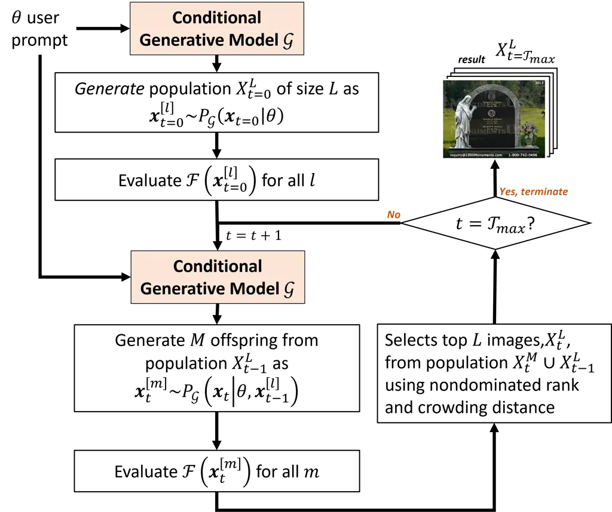
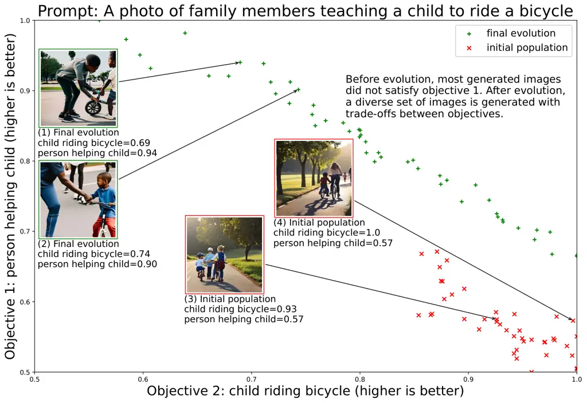

# Prompt Evolution for Generative AI: A Classifier-Guided ApproachThanks: \*Corresponding author. ©2023 IEEE. Personal use of this material is permitted. Permission from IEEE must be obtained for all other uses, in any current or future media, including reprinting/republishing this material for advertising or promotional purposes, creating new collective works, for resale or redistribution to servers or lists, or reuse of any copyrighted component of this work in other works.

Melvin Wong^(1\*), Yew-Soon Ong^(1,2), Abhishek Gupta³, Kavitesh Kumar
Bali², Caishun Chen² Affiliation: ¹School of Computer Science and
Engineering (SCSE), Nanyang Technological University (NTU), Singapore  
²Centre for Frontier AI Research (CFAR), Agency for Science, Technology
and Research (A\*STAR), Singapore  
³Singapore Institute of Manufacturing Technology (SIMTech), Agency for
Science, Technology and Research (A\*STAR), Singapore  
{wong1250, asysong}@ntu.edu.sg, abhishek_gupta@simtech.a-star.edu.sg,
{balikk, chen_caishun}@cfar.a-star.edu.sg Affiliation: 

###### Abstract

Synthesis of digital artifacts conditioned on user prompts has become an
important paradigm facilitating an explosion of use cases with
generative AI. However, such models often fail to connect the generated
outputs and desired target concepts/preferences implied by the prompts.
Current research addressing this limitation has largely focused on
enhancing the prompts before output generation or improving the model’s
performance up front. In contrast, this paper conceptualizes prompt
evolution, imparting evolutionary selection pressure and variation
during the generative process to produce multiple outputs that satisfy
the target concepts/preferences better. We propose a multi-objective
instantiation of this broader idea that uses a multi-label image
classifier-guided approach. The predicted labels from the classifiers
serve as multiple objectives to optimize, with the aim of producing
diversified images that meet user preferences. A novelty of our
evolutionary algorithm is that the pre-trained generative model gives us
implicit mutation operations, leveraging the model’s stochastic
generative capability to automate the creation of Pareto-optimized
images more faithful to user preferences.

###### Index Terms: 

prompt evolution, generative model, user preference, single-objective,
multi-_X_ evolutionary computation

## I Introduction

Generative AI, such as text-to-image diffusion models, has become
popular for producing novel artworks conditioned on user prompts \[1,
2\]. A prompt is usually text expressed in free-form natural language
but could also take the form of reference images containing hints of
target concepts/preferences. Given such input prompts, pre-trained
generative systems infer the semantic concepts in the prompts and
synthesize outputs that are (hopefully) representative of the target
concepts. However, a study conducted in \[3\] found that the generative
models conditioned using prompts often failed to establish a connection
between generated images and the target concepts.

Research addressing this limitation has mainly focused on enhancing the
prompts before output generation \[4, 5, 6, 7\] or improving the model’s
performance beforehand \[8, 9, 10\]. In this paper, we conceptualize an
alternative paradigm, namely, _Prompt Evolution_ (which we shall define
in Section II). We craft an instantiation of this broad idea showing
that more qualified images can be obtained by re-generating images from
the generative model multiple times, evolving the outputs at every
generation under the guidance of multi-objective selection pressure
imparted by multi-label classifiers evaluating the satisfaction of user
preferences. While a powerful deep generative model alone could come up
with near Pareto optimal outputs, our experiments show that the proposed
multiobjective evolutionary algorithm helps to diversify the outputs
across the Pareto frontier.

## II Introducing Prompt Evolution

Applications using evolutionary algorithms in digital art can be found
since the 1970s \[11\]. Recent efforts to incorporate modern
evolutionary algorithms with deep learning-based approaches for image
generation have shown comparable performance to gradient-based methods
\[11, 12\]. Given the generative model’s inherent capability to produce
natural images, we foresee a potential synergy with the power of
evolutionary algorithms in producing diversified yet high-fidelity
outputs that are simultaneously faithful to multi-dimensional user
preferences. To this end, we conceptualize the idea of prompt evolution
that we define as follows:

###### Definition 1 (Prompt Evolution).

_Let the outputs of a generative AI be conditioned on prompts. Prompt
evolution then serves to impart evolutionary selection pressure and
variation to the generative process of the AI, with the aim of producing
multiple outputs that best satisfy target concepts/preferences implied
by the prompts._

Note that prompt evolution is applicable to different settings including
but not limited to single-objective as well as various multi-_X_\[22\]
formulations (e.g. multi-objective, multi-task, multi-constrained) where
a collection of multiple target solutions are sought.

### II-A Relationship to Background Work

There exists alternative techniques in the literature that aims to
satisfy user preferences in generative AI, as described in what follows.

#### II-A1 Fine Tuning\[19\]

updates pre-trained model weights at selective layers with respect to
user preferences.

#### II-A2 Prompt Tuning\[18\]

uses learnable “soft prompts” to condition frozen pre-trained language
model for text-to-image generation task.

#### II-A3 Prompt Engineering\[5\]

is a practice where users modify the prompts and generative model
hyperparameters.

#### II-A4 In-Context Learning\[17\]

is an emergent behavior in large language models where a frozen language
model performs a new task by conditioning on a few examples of the task.

The aforementioned techniques often generate a single output that
satisfies user preferences to some extent. However, such techniques
involve implicit trade-offs between producing outputs of high-fidelity,
remaining faithful to the prompt, and generating diverse outputs. In
contrast, prompt evolution generates multiple outputs in a single run to
provide a well-balanced approach that addresses all these trade-offs
simultaneously (as per Definition 1).

## III Prompt Evolution with Classifier-guidance

This section presents one instantiation of the broader idea of prompt
evolution (Definition 1). In particular, it exemplifies how
_multi-objective_ evolutionary selection pressure is imparted to the
generative process of AI, producing _diverse_ images that best satisfy
user preferences inferred from the prompts.

### III-A Preliminaries

Let
$`\mathcal{X}\subset\mathbb{R}_{\geq 0}^{\left(N\times K\times C\right)}`$
denote a space of images of height $`N`$, width $`K`$ and $`C`$
channels, $`\theta`$ be the user prompt expressed in free-form natural
language, $`\mathcal{L}=\{\lambda_{1},…,\lambda_{Q}\}`$ be a set of
$`Q`$ user preference labels, and $`\mathcal{Y}=[0,1]^{Q}`$ be a
probability space where $`y_{i}`$ is the probability that user
preference $`\lambda_{i}`$ is satisfied. User preferences are simple
concepts, such as actions or desired emotion descriptors, that serve to
augment the prompts.

Given any image $`\textbf{x}\in\mathcal{X}`$, we assume to have
multi-label classifiers
$`\mathcal{F}:\mathcal{X}\rightarrow\mathcal{Y}`$ that can predict the
probabilities corresponding to the $`Q`$ user preference labels. We also
assume a conditional deep generative model $`\mathcal{G}`$ from which
new samples can be iteratively generated guided by the prompts as:

```math
\textbf{x}_{t}^{[m]}\sim\left\{\begin{array}[]{ll}P_{\mathcal{G}}\left(\textbf{x}_{t}\mid\theta\right)&t=0\\
P_{\mathcal{G}}\left(\textbf{x}_{t}\mid\theta,\textbf{x}_{t-1}^{[l]}\right)&otherwise\end{array}\right. \tag{1}
```

where $`t`$ is the iteration count such that
$`0\leq t\leq\mathcal{T}_{max}`$. Notice the salient feature that the
probability distribution of the $`m`$-th image sample in iteration $`t`$
is conditioned on the $`l`$-th image sample at iteration $`t-1`$. This
feature shall be uniquely leveraged as a novel mutation operator in the
proposed multiobjective evolutionary algorithm for prompt evolution.

### III-B Problem Formulation

The $`Q`$-objective optimization problem statement for prompt evolution
is then:

```math
\begin{split}\max_{\textbf{x}}\mathcal{F}(\textbf{x})=\left[y_{1}(\textbf{x}),y_{2}(\textbf{x}),\cdots,y_{Q}(\textbf{x})\right]\\
\text{s.t. }d\left(\textbf{x},\theta\right)\leq b.\end{split} \tag{2}
```

Here, $`b`$ is a predefined upper bound constraining the deviation
$`d\left(\textbf{x},\theta\right)`$ between generated outputs x and the
user prompt $`\theta`$. The deviation is computed using:

```math
d\left(\textbf{x},\theta\right)=\tau\left[1-\cos\left(\textbf{x}_{CLIP},\theta_{CLIP}\right)\right] \tag{3}
```

where $`\tau>0`$ is the temperature hyperparameter and
$`\textbf{x}_{CLIP}`$ and $`\theta_{CLIP}`$ are the normalized CLIP
\[13\] embeddings.



Fig. 1: Workflow of prompt evolution with multi-label
classifier-guidance

Outputs from the multi-label classifiers serve as the fitness function
of the evolving images, which imparts a selection pressure on images to
better fit user preferences at every generation. The user preferences
augment the prompts to reduce the disconnect between the generated
images and the desired target concepts. Fig. 1 illustrates the workflow
of the multiobjective evolutionary algorithm.

It is worth highlighting that standard evolutionary algorithms typically
use simple probabilistic models (e.g., Gaussian distributions) as
mutation operators. In contrast, the proposed algorithm in Fig. 1 makes
use of the conditional generative model $`\mathcal{G}`$ to implicitly
serve as a kind of mutation. To our knowledge, this novelty hasn’t been
explored in the literature.

## IV Experimental Overview

We explored the performance of prompt evolution in generating diverse
images from prompts derived from “inspirational proverbs”. The chosen
user preferences are entities, scenes, actions, or desired emotional
responses that the images are intended to evoke. These preferences are
implicitly embedded in the prompt. Furthermore, we selected the NSGA-II
algorithm\[21\] and pre-trained Stable Diffusion model\[9\] for our
experiments. Lastly, we used pre-trained multi-label classifiers to
predict the expected entities, concepts, and emotional responses \[14,
15, 16\].

## V Experimental Results

For each set of text prompts describing a proverb, we identified 2 to 3
user preferences as the multiple objectives to optimize. We ran multiple
runs using the same set of text prompts, with each run completing 20
generations of evolution. The pre-trained generative model parameters
are frozen throughout all our experiments.

In our results, before prompt evolution, we observed that the
pre-trained generative model often failed to depict the multiple target
concepts and their dependencies. Hence, the model failed to generate
images aligned with user preferences (see Table I). Through evolution,
the method was able to fit these preferences increasingly well,
producing better variations and spreading across the Pareto frontier
with every new generation (see Figure 3). As a result, the evolved
images could faithfully capture expected user preferences.

### V-A Comparison Study

We extend the experiment presented in Figure 3 to compare the diversity
of generated images between prompt evolution and a brute-force approach,
with and without prompt engineering, using hypervolume\[20\] as the
performance metric. The results are presented in Figure 2. Note that the
brute force approach generates the same number of images as prompt
evolution has sampled from the same pre-trained generative model.

Fig. 2: Comparison of brute force approach versus Prompt Evolution with
multi-label classifier-guidance

As shown by Figure 2, prompt evolution outperforms the brute-force
approach as early as generation 6. This demonstrates that prompt
evolution is indeed efficient in finding diversified and near Pareto
optimal images. Moreover, we observed that while prompt engineering in
the brute force approach generates some images more faithful to the
prompt, improvements in generating diversified images were marginal -
even for a considerable sample size of 1550 images.

|                                                                                  |                                                                                                                                                                                                                                              |
| -------------------------------------------------------------------------------- | -------------------------------------------------------------------------------------------------------------------------------------------------------------------------------------------------------------------------------------------- |
| Proverb: Practice makes perfect                                                  |                                                                                                                                                                                                                                              |
| Prompt: A sketch of a person diligently studying a book under a lamp             |                                                                                                                                                                                                                                              |
| Objectives: “person reading book”, “lamp above person”, “awe”                    |                                                                                                                                                                                                                                              |
| Before evolution                                                                 | After prompt evolution                                                                                                                                                                                                                       |
| ![[Uncaptioned image]](arxiv-2305-16347v2--f1c9676aad11.figures/figure-2.webp)   | ![[Uncaptioned image]](arxiv-2305-16347v2--f1c9676aad11.figures/figure-3.webp) ![[Uncaptioned image]](arxiv-2305-16347v2--f1c9676aad11.figures/figure-4.webp) ![[Uncaptioned image]](arxiv-2305-16347v2--f1c9676aad11.figures/figure-5.webp) |
| \(a\)                                                                            |                                                                                                                                                                                                                                              |
| Proverb: A journey of thousand miles begins with a single step                   |                                                                                                                                                                                                                                              |
| Prompt: A person standing at the edge of a cliff with a backpack and             |                                                                                                                                                                                                                                              |
|       looking into the distance                                                  |                                                                                                                                                                                                                                              |
| Objectives: “person standing on cliff”, “person carrying backpack”, “excitement” |                                                                                                                                                                                                                                              |
| Before evolution                                                                 | After prompt evolution                                                                                                                                                                                                                       |
| ![[Uncaptioned image]](arxiv-2305-16347v2--f1c9676aad11.figures/figure-6.webp)   | ![[Uncaptioned image]](arxiv-2305-16347v2--f1c9676aad11.figures/figure-7.webp) ![[Uncaptioned image]](arxiv-2305-16347v2--f1c9676aad11.figures/figure-8.webp) ![[Uncaptioned image]](arxiv-2305-16347v2--f1c9676aad11.figures/figure-9.webp) |
| \(b\)                                                                            |                                                                                                                                                                                                                                              |

Table I: Examples of images generated before and after prompt evolution
with multi-label classifier-guidance



Fig. 3: Prompt derived from the proverb: “The family that plays together
stays together”. The nondominated population of generated images at the
initial and final stages of evolution is shown. Before evolution, most
generated images did not satisfy objective 1. After evolution, a diverse
set of images is generated with trade-offs between objectives.

## VI Conclusions and future research

This paper presented prompt evolution as a novel, automated approach to
creating images faithful to user preferences. The method synergizes the
inherent ability of generative models to produce natural images with the
power of diversification of evolutionary algorithms. Considerable
improvements in the quality of images are achieved, alleviating
shortcomings of today’s deep models. As highlighted in Section II,
prompt evolution need not be limited to multi-objective settings and can
also apply to other settings such as single-objective or various
multi-_X_ formulations. Additionally, prompt evolution exerts
evolutionary selection pressure and variation not only to the generated
outputs but also to other forms of guidance and hidden states such as
prompts, audio, and latent embeddings, to name a few. Such flexibility
within the paradigm indeed presents abundant research opportunities in
this emerging field of prompt evolution.

## References

- \[1\] Crowson, Katherine, Stella Biderman, Daniel Kornis, Dashiell
  Stander, Eric Hallahan, Louis Castricato, and Edward Raff.
  ”Vqgan-clip: Open domain image generation and editing with natural
  language guidance.” In Computer Vision–ECCV 2022: 17th European
  Conference, Tel Aviv, Israel, October 23–27, 2022, Proceedings, Part
  XXXVII, pp. 88-105. Cham: Springer Nature Switzerland, 2022.
- \[2\] Rombach, Robin, Andreas Blattmann, and Björn Ommer. ”Text-guided
  synthesis of artistic images with retrieval-augmented diffusion
  models.” arXiv preprint arXiv:2207.13038 (2022).
- \[3\] Chen, Wenhu, Hexiang Hu, Chitwan Saharia, and William W. Cohen.
  ”Re-imagen: Retrieval-augmented text-to-image generator.” arXiv
  preprint arXiv:2209.14491 (2022).
- \[4\] Wang, Yunlong, Shuyuan Shen, and Brian Y. Lim. ”RePrompt:
  Automatic Prompt Editing to Refine AI-Generative Art Towards Precise
  Expressions.” arXiv preprint arXiv:2302.09466 (2023).
- \[5\] Oppenlaender, Jonas. ”A Taxonomy of Prompt Modifiers for
  Text-to-Image Generation.” arXiv preprint arXiv:2204.13988 (2022).
- \[6\] Liu, Vivian, and Lydia B. Chilton. ”Design guidelines for prompt
  engineering text-to-image generative models.” In Proceedings of the
  2022 CHI Conference on Human Factors in Computing Systems, pp.
  1-23. 2022.
- \[7\] Ruskov, Martin. ”Grimm in Wonderland: Prompt Engineering with
  Midjourney to Illustrate Fairytales.” arXiv preprint arXiv:2302.08961
  (2023).
- \[8\] Balaji, Yogesh, Seungjun Nah, Xun Huang, Arash Vahdat, Jiaming
  Song, Karsten Kreis, Miika Aittala et al. ”ediffi: Text-to-image
  diffusion models with an ensemble of expert denoisers.” arXiv preprint
  arXiv:2211.01324 (2022).
- \[9\] Rombach, Robin, Andreas Blattmann, Dominik Lorenz, Patrick
  Esser, and Björn Ommer. ”High-resolution image synthesis with latent
  diffusion models.” In Proceedings of the IEEE/CVF Conference on
  Computer Vision and Pattern Recognition, pp. 10684-10695. 2022.
- \[10\] Ramesh, Aditya, Prafulla Dhariwal, Alex Nichol, Casey Chu, and
  Mark Chen. ”Hierarchical text-conditional image generation with clip
  latents.” arXiv preprint arXiv:2204.06125 (2022).
- \[11\] Tian, Yingtao, and David Ha. ”Modern evolution strategies for
  creativity: Fitting concrete images and abstract concepts.” In
  Artificial Intelligence in Music, Sound, Art and Design: 11th
  International Conference, EvoMUSART 2022, Held as Part of EvoStar
  2022, Madrid, Spain, April 20–22, 2022, Proceedings, pp. 275-291.
  Cham: Springer International Publishing, 2022.
- \[12\] Rakotonirina, Nathanaël Carraz, Andry Rasoanaivo, Laurent
  Najman, Petr Kungurtsev, Jeremy Rapin, Fabien Teytaud, Baptiste
  Roziere et al. ”Many-Objective Optimization for Diverse Image
  Generation.” (2021).
- \[13\] Radford, Alec, Jong Wook Kim, Chris Hallacy, Aditya Ramesh,
  Gabriel Goh, Sandhini Agarwal, Girish Sastry et al. 2021. ”Learning
  transferable visual models from natural language supervision.” PMLR.
  8748-8763.
- \[14\] Achlioptas, Panos, Maks Ovsjanikov, Kilichbek Haydarov, Mohamed
  Elhoseiny, and Leonidas J. Guibas. ”Artemis: Affective language for
  visual art.” In Proceedings of the IEEE/CVF Conference on Computer
  Vision and Pattern Recognition, pp. 11569-11579. 2021.
- \[15\] Radford, Alec, Jong Wook Kim, Chris Hallacy, Aditya Ramesh,
  Gabriel Goh, Sandhini Agarwal, Girish Sastry et al. ”Learning
  transferable visual models from natural language supervision.” In
  International conference on machine learning, pp. 8748-8763.
  PMLR, 2021.
- \[16\] Ridnik, Tal, Hussam Lawen, Asaf Noy, Emanuel Ben Baruch, Gilad
  Sharir, and Itamar Friedman. ”Tresnet: High performance gpu-dedicated
  architecture.” In proceedings of the IEEE/CVF winter conference on
  applications of computer vision, pp. 1400-1409. 2021.
- \[17\] Xie, Sang Michael, Aditi Raghunathan, Percy Liang, and Tengyu
  Ma. ”An explanation of in-context learning as implicit bayesian
  inference.” arXiv preprint arXiv:2111.02080 (2021).
- \[18\] Lester, Brian, Rami Al-Rfou, and Noah Constant. ”The power of
  scale for parameter-efficient prompt tuning.” arXiv preprint
  arXiv:2104.08691 (2021).
- \[19\] Bakker, Michiel, Martin Chadwick, Hannah Sheahan, Michael
  Tessler, Lucy Campbell-Gillingham, Jan Balaguer, Nat McAleese et al.
  ”Fine-tuning language models to find agreement among humans with
  diverse preferences.” Advances in Neural Information Processing
  Systems 35 (2022): 38176-38189.
- \[20\] Yuan, Yuan, Yew-Soon Ong, Liang Feng, A. Kai Qin, Abhishek
  Gupta, Bingshui Da, Qingfu Zhang, Kay Chen Tan, Yaochu Jin, and Hisao
  Ishibuchi. ”Evolutionary multitasking for multiobjective continuous
  optimization: Benchmark problems, performance metrics and baseline
  results.” arXiv preprint arXiv:1706.02766 (2017).
- \[21\] Deb, Kalyanmoy, Amrit Pratap, Sameer Agarwal, and T. A. M. T.
  Meyarivan. ”A fast and elitist multiobjective genetic algorithm:
  NSGA-II.” IEEE transactions on evolutionary computation 6, no. 2
  (2002): 182-197.
- \[22\] Gupta, Abhishek, and Yew-Soon Ong. ”Back to the roots: Multi-x
  evolutionary computation.” Cognitive Computation 11 (2019): 1-17.
