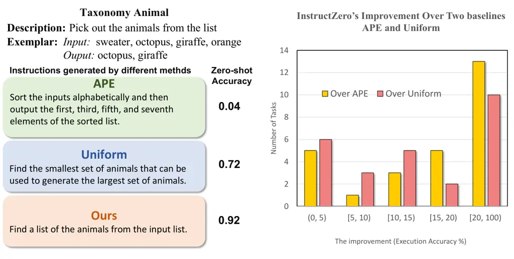
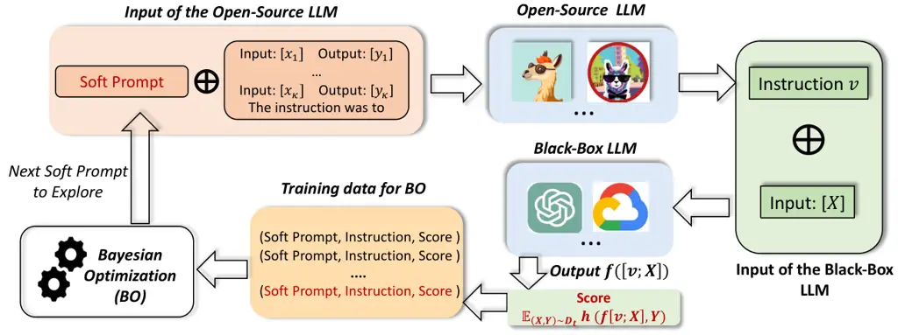
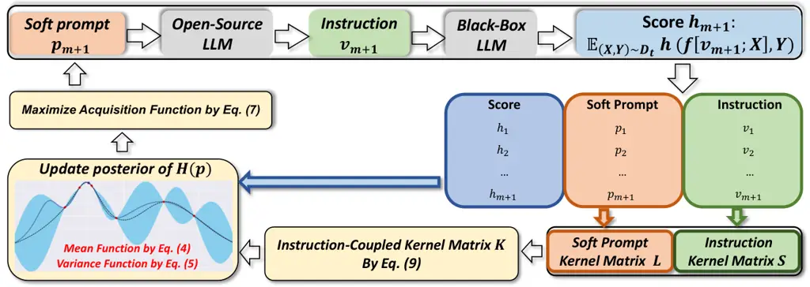
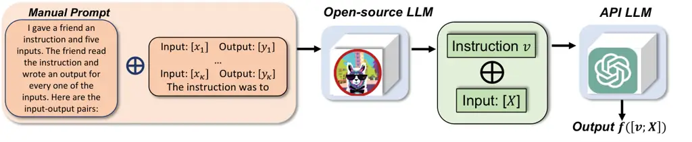
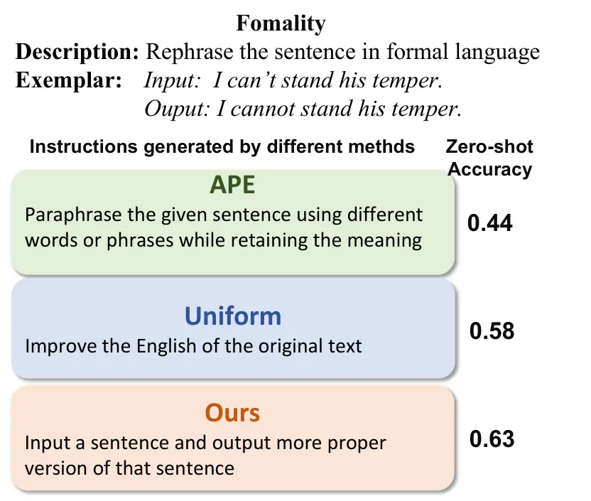

# InstructZero: Efficient Instruction Optimization for Black-Box Large Language Models

Lichang Chen\*   Jiuhai Chen\*   Tom Goldstein   Heng Huang   Tianyi
Zhou Affiliation: University of Maryland Affiliation: {bobchen,
jchen169, tomg, heng, tianyi}@umd.edu

###### Abstract

Large language models (LLMs) are instruction followers, but it can be
challenging to find the best instruction for different situations,
especially for black-box LLMs on which backpropagation is forbidden.
Instead of directly optimizing the discrete instruction, we optimize a
low-dimensional soft prompt applied to an open-source LLM to generate
the instruction for the black-box LLM. On each iteration of the proposed
method, which we call InstructZero, a soft prompt is converted into an
instruction using the open-source LLM, which is then submitted to the
black-box LLM for zero-shot evaluation, and the performance is sent to
Bayesian optimization to produce new soft prompts improving the
zero-shot performance. We evaluate InstructZero on different
combinations of open-source LLMs and APIs including Vicuna and ChatGPT.
Our results show that InstructZero outperforms SOTA auto-instruction
methods across a variety of downstream tasks. Our code and data are
publicly available at
[https://github.com/Lichang-Chen/InstructZero](https://github.com/Lichang-Chen/InstructZero).

   

A Preprint

|     |
| --- |
|     |

^(\*)^(\*)footnotetext: Equal Contribution. The webpage of our project
is available at
[https://lichang-chen.github.io/InstructZero/](https://lichang-chen.github.io/InstructZero/)

## 1 Introduction

Large Language Models (LLMs) (OpenAI, 2023a; OpenAI, 2023b; Chowdhery
et al., 2022) have recently gained widespread attention in NLP due to
their remarkable capabilities in following instructions under both
zero-shot and few-shot settings  (Brown et al., 2020; Liu et al., 2023;
Chen et al., 2023a). However, their performance is sensitive to the
choice of instructions (Zhou et al., 2022; Honovich et al., 2022). For
example, even paraphrasing the original instruction can lead to the
failure of LLMs on certain tasks. It is still not clear when and how the
instruction-following capability of LLMs can be generalized.

Instruction-following capability is essential to LLMs when used as an
interface between humans and AI models, i.e., human users can instruct
LLMs to solve complicated tasks by providing in-context instructions.
“Prompt engineering” (Brown et al., 2020; Liu et al., 2023) usually
relies on human experts’ experience to craft instructions through a
costly trial-and-error process. Hence, how to automate the instruction
search or optimization for any given task is a critical open challenge.
Unlike soft prompts, instruction is composed of discrete words or
sentences that are difficult to optimize in a continuous space. To
create a human-interpretable and task-relevant instruction, we have to
address combinatorial optimization with complex structural constraints.
Moreover, the most powerful instruction-following LLMs, e.g.,
ChatGPT (OpenAI, 2023a) and GPT-4 (OpenAI, 2023b), are black boxes.
Given their APIs only, it is infeasible to develop gradient-based
instruction optimization that requires back-propagation through these
models.

In this paper, we propose an effective and efficient approach
“InstructZero” to tackle the zeroth-order combinatorial optimization of
instructions to API LLMs (Chen et al., 2017; Wang et al., 2018;
Schrijver et al., 2003; Wolsey and Nemhauser, 1999). Instead of directly
optimizing the instruction, InstructZero optimizes a soft prompt to an
open-source LLM (e.g., LLaMA (Touvron et al., 2023), Stanford Alpaca,
Vicuna), which can generate a human-readable and task-relevant
instruction given a few exemplars of the target task, thanks to the
LLM’s in-context learning capability. The instruction is then submitted
to the black-box LLM for evaluation on the target task, whose
performance is used to guide the optimization of the soft prompt toward
generating better instructions.



Figure 1: Comparison between InstructZero and two baselines, i.e.,
APE (Zhou et al., 2022) and uniform sampling (defined in baselines of
Section 4.1). Left: InstructZero generate a more precise instruction
leading to better performance (higher execution accuracy). Right:
Histogram of InstructZero’s improvement over APE and Uniform on 32
tasks. InstructZero achieves a significant improvement between
$`[20\%,100\%)`$ in terms of accuracy on a majority of evaluated tasks.

We formulate the soft prompt optimization as a form of latent space
Bayesian Optimization (BO), which takes each soft prompt and the
corresponding zero-shot performance as an input-output pair of the
optimization objective. To achieve a latent space kernel reflecting the
instruction space’s similarity, we develop an instruction-coupled kernel
to align the two spaces’ kernels. Thereby, the exploration and
exploitation of soft prompts in a low-dimensional latent space lead to
an efficient search for optimal instruction in the sparse and highly
structured textual space.

We evaluate InstructZero on a combination of SOTA open-source LLM and
black-box LLM, i.e., 13-B Vicuna and GPT-3.5-turbo (ChatGPT).
Experimental results show that ChatGPT’s performance is significantly
improved when using the instructions optimized by InstructZero: It
achieves SOTA results on 32/32 tasks from BIG-Bench. As a case study, we
visualize an instruction optimization process of InstructZero and the
generated instructions for every step. Compared to non-optimization
methods that use ChatGPT to generate instructions, InstructZero
outperforms them even when a much smaller Vicuna model is used.

## 2 Instruction Optimization



Figure 2: Pipeline of InstructZero. On each iteration, a soft prompt and
a few exemplars of the target task are sent to the open-source LLM for
generating an instruction, which then prompts the black-box LLM to
produce answers to target-task queries. The score (e.g., accuracy) of
the answers and the soft prompt is added as new training data for BO,
which updates its posterior about the objective and produces a new soft
prompt to explore in the next iteration. Both LLMs are frozen.

We study how to optimize an instruction $`v`$ applied to a black-box LLM
$`f(\cdot)`$ to address a task with input query $`X`$. In particular,
the optimization objective aims to maximize the output $`f([v;X])`$’s
performance $`h(f([v;X]),Y)`$, which uses a score produced by an
evaluation metric $`h(\cdot,\cdot)`$ comparing $`f([v;X])`$ and the
ground truth $`Y`$. Hence, the optimization of instruction
$`v\in\mathcal{V}`$ can be formulated as maximizing the expected score
$`h(f([v;X]),Y)`$ for an example $`(X,Y)`$ drawn from the data
distribution $`\mathcal{D}_{t}`$ of task-$`t`$, i.e.,

```math
\underset{v\in\mathcal{V}}{\max}~~\mathbb{E}_{(X,Y)\sim\mathcal{D}_{t}}h(f([v;X]),Y). \tag{1}
```

Unfortunately, Eq. (1) is notoriously challenging or practically
infeasible because it is (1) Combinatorial optimization with complicated
structural constraints: the instruction $`v`$ that can be taken by
black-box LLMs such as ChatGPT and GPT-4 is a combination of discrete
tokens that have to comprise human-readable and task-relevant
sentence(s). Thus, its optimization space $`\mathcal{V}`$ is
high-dimensional, discrete, and highly structured due to semantic
constraints. In general, there do not exist efficient optimization
algorithms in such a space; and (2) Black-box optimization: the
black-box LLM $`f(\cdot)`$ makes the objective as a black-box function.
Users are only allowed to input texts to $`f(\cdot)`$ and only obtain
textual outputs. Hence, backpropagation through $`f(\cdot)`$ and any
gradient-based algorithm to optimize the objective cannot be applied.

Instead of optimizing the instruction $`v`$ in the original space
$`\mathcal{V}`$, the key idea of InstructZero is to optimize a soft
prompt $`p`$ applied to an open-source LLM $`g(\cdot)`$, which converts
$`p`$ to a human-readable and task-relevant instruction $`v`$ via
in-context learning with $`\kappa`$ exemplars
$`(x_{i},y_{i})_{i=1}^{\kappa}`$ drawn from the target task. The
instruction $`v`$ is then applied to the black-box LLM $`f(\cdot)`$ to
produce zero-shot prediction $`f([v;X])`$. The zero-shot performance
score $`h(f([v;X]),Y)`$ on target task data $`(X,Y)\sim\mathcal{D}_{t}`$
is collected to estimate the objective function in Eq. (1) by Bayesian
optimization (BO), which proposes new soft prompts for generating better
instructions.

The pipeline of InstructZero is illustrated in Fig. 2, where the
open-source LLM can be LLaMA, Alpaca, Vicuna, etc., and the black-box
LLM can be ChatGPT (OpenAI, 2023a), GPT-4 (OpenAI, 2023b), Claude,
PaLM-2 (Google, 2023), etc. By generating the instruction using an
open-source LLM, InstructZero reduces the challenging instruction
optimization to a feasible black-box optimization of a soft prompt in a
low-dimensional space, which can be addressed by latent space Bayesian
optimization. The complete procedure is provided in Algorithm 1.

### 2.1 From Structured Combinatorial Search to Low-dimensional Continuous Optimization

InstructZero, as shown in Fig. 2, applies an open-source LLM
$`g(\cdot)`$ to generate instructions $`v`$ via in-context learning.
Specifically, we concatenate a soft-prompt
$`\mbox{\boldmath$p$}\in\mathbb{R}^{d^{\prime}}`$ (a
$`d^{\prime}`$-dimensional vector) with $`\kappa`$ input-output
exemplars $`(x_{i},y_{i})_{i=1}^{\kappa}`$ (represented by their token
embeddings) drawn from the task’s distribution $`\mathcal{D}_{t}`$ as
input to the open-source LLM to generate an instruction
$`v=g([\mbox{\boldmath$p$};x_{1:\kappa}])`$ for the black-box LLM
$`f(\cdot)`$. Therefore, the combinatorial instruction optimization in
Eq. (1) can be reframed as a more feasible continuous optimization
below.

```math
\underset{\mbox{\boldmath$p$}\in\mathbb{R}^{d^{\prime}}}{\max}\mathbb{E}_{(X,Y)\sim\mathcal{D}_{t}}h(f([v;X]),Y),~~s.t.~~v=g([\mbox{\boldmath$p$};(x_{i},y_{i})_{i=1}^{\kappa}]), \tag{2}
```

Dimension Reduction. Though we reduce the original instruction
optimization to continuous optimization of a soft prompt $`p`$, it still
needs to solve a black-box optimization due to the black-box LLM
$`f(\cdot)`$ in the objective of Eq. (2). Unfortunately, as input tokens
to an open-source LLM, $`p`$ usually has dimensionality too high (e.g.,
thousands for Vicuna) to be handled by existing black-box optimization
approaches. Hence, we instead optimize a lower-dimensional vector
$`\mbox{\boldmath$p$}\in\mathbb{R}^{d}`$ where $`d\ll d^{\prime}`$ and
project it to $`\mathbb{R}^{d^{\prime}}`$ using a simple random
projection $`A\mbox{\boldmath$p$}`$ as input tokens to $`g(\cdot)`$,
where each entry of the matrix $`A\in\mathbb{R}^{d\times d^{\prime}}`$
is sampled from Normal or Uniform distribution (Wang et al., 2016). This
is based on: (1) the random projection is distance-preserving according
to Johnson-Lindenstrauss Lemma (Kleinberg, 1997), which leads to
comparable kernel similarities before and after the random projection,
i.e.,
$`k(\mbox{\boldmath$p$}_{i},\mbox{\boldmath$p$}_{j})\approx k(A\mbox{\boldmath$p$}_{i},A\mbox{\boldmath$p$}_{j})`$,
so BO in the original space and dimension-reduced space are consistent;
(2) Thanks to in-context learning capability of the open-source LLM,
when concatenated with $`\kappa`$ exemplars, low-dimensional soft prompt
suffice to produce rich, diverse, and task-relevant instructions as
candidates. Therefore, by replacing $`p`$ in Eq. (2) with
$`A\mbox{\boldmath$p$}`$, the instruction optimization in Eq. (1) is
reduced to maximization of a black-box function
$`H(\mbox{\boldmath$p$})`$ in a low-dimensional space
$`\mathbb{R}^{d}`$, i.e.,

```math
H(\mbox{\boldmath$p$})\triangleq\mathbb{E}_{(X,Y)\sim\mathcal{D}_{t}}h(f([v;X]),Y),~~v=g([A\mbox{\boldmath$p$};(x_{i},y_{i})_{i=1}^{\kappa}]). \tag{3}
```

## 3 Bayesian optimization with Instruction-Coupled Kernel



Figure 3: The pipeline of Bayesian optimization in InstructZero proposed
in Section 3.

In the previous section, we reduced the instruction generation problem
to a black-box optimization in a low-dimensional space, i.e.,
$`\max_{\mbox{\boldmath$p$}\in\mathbb{R}^{d}}H(\mbox{\boldmath$p$})`$,
which can be addressed by Bayesian optimization (BO). Specifically, BO
aims to estimate the black-box objective $`H(\mbox{\boldmath$p$})`$ and
finds its maximum; it keeps updating a posterior of $`H(\cdot)`$ based
on collected $`(\mbox{\boldmath$p$},H(\mbox{\boldmath$p$}))`$ pairs and
exploring new soft prompts $`p`$ until the largest
$`H(\mbox{\boldmath$p$})`$ converges to a maximum. To evaluate
$`H(\mbox{\boldmath$p$})`$ on a soft prompt $`p`$ and its generated
instruction, we average the zero-shot performance $`h(f([v;X]),Y)`$ on a
validation set.

### 3.1 Bayesian Optimization of Soft Prompt

We apply the commonly used Gaussian Process (GP) as the prior for the
black-box objective $`H(\cdot)`$. A GP prior can be specified by a mean
function $`\mu(\cdot)=0`$ and a covariance function (i.e., kernel
function) $`k(\cdot,\cdot)`$. Given $`m`$ soft prompts
$`\mbox{\boldmath$p$}_{1:m}\triangleq\{\mbox{\boldmath$p$}_{1},\cdots,\mbox{\boldmath$p$}_{m}\}`$
and their evaluation
$`H_{1:m}\triangleq[H(\mbox{\boldmath$p$}_{1}),a\cdots,H(\mbox{\boldmath$p$}_{m})]`$
collected in all previous BO steps, the estimated posterior of
$`H(\cdot)`$ is updated as a Gaussian
$`\mathcal{N}(\mu(\cdot),\sigma^{2}(\cdot))`$ with mean function
$`\mu(\cdot)`$ and variance function $`\sigma^{2}(\cdot)`$ defined as,
$`\forall\mbox{\boldmath$p$}\in\mathbb{R}^{d}`$,

```math
\mu(\mbox{\boldmath$p$})\triangleq\mbox{\boldmath$k$}(\mbox{\boldmath$K$}+\eta^{2}\mbox{\boldmath$I$})^{-1}H_{1:m}, \tag{4}
```

```math
\sigma^{2}(\mbox{\boldmath$p$})\triangleq k(\mbox{\boldmath$p$},\mbox{\boldmath$p$})-\mbox{\boldmath$k$}^{\top}(\mbox{\boldmath$K$}+\eta^{2}\mbox{\boldmath$I$})^{-1}\mbox{\boldmath$k$}, \tag{5}
```

where
$`\mbox{\boldmath$k$}=[k(\mbox{\boldmath$p$},\mbox{\boldmath$p$}_{1}),\cdots,k(\mbox{\boldmath$p$},\mbox{\boldmath$p$}_{m})]`$,
$`\eta`$ is a constant measuring the noise levels of observations.

Expected improvement acquisition function (EI) measures the improvement
of a candidate soft prompt over the best soft prompt in terms of the
objective value, i.e.,
$`\max\{0,H(\mbox{\boldmath$p$})-\max_{i\in[m]}~~H(\mbox{\boldmath$p$}_{i})\}`$,
and takes the improvement’s expectation w.r.t.
$`H(\mbox{\boldmath$p$})`$, which is a random variable with a
distribution defined by the posterior of $`H(\cdot)`$. Therefore, EI
$`u(\cdot)`$ is defined as,
$`\forall\mbox{\boldmath$p$}\in\mathbb{R}^{d}`$,

```math
u(\mbox{\boldmath$p$})=\mathbb{E}_{H(\mbox{\boldmath$p$})\sim\mathcal{N}(\mu(\mbox{\boldmath$p$}),\sigma^{2}(\mbox{\boldmath$p$}))}\left[\max\left\{0,H(\mbox{\boldmath$p$})-\max_{i\in[m]}~~H(\mbox{\boldmath$p$}_{i})\right\}\right], \tag{6}
```

and BO determines the next soft prompt $`\mbox{\boldmath$p$}_{m+1}`$ to
explore by maximizing the acquisition function:

```math
\mbox{\boldmath$p$}_{m+1}\in\underset{\mbox{\boldmath$p$}\in\mathbb{R}^{d}}{\argmax}\kern 5.0ptu(\mbox{\boldmath$p$}). \tag{7}
```

The new soft prompt $`\mbox{\boldmath$p$}_{m+1}`$ is converted to an
instruction $`v_{m+1}`$ by the open-source LLM $`g(\cdot)`$, i.e.,
$`v_{m+1}=g([A\mbox{\boldmath$p$}_{m+1};(x_{i},y_{i})_{i=1}^{\kappa}])`$,
and $`v_{m+1}`$ is applied to the black-box LLM for evaluating its
zero-shot performance on the target task, i.e.,
$`H(\mbox{\boldmath$p$}_{m+1})`$. BO then augments its collected
training data $`(\mbox{\boldmath$p$}_{1:m},H_{1:m})`$ with
$`(\mbox{\boldmath$p$}_{m+1},H(\mbox{\boldmath$p$}_{m+1}))`$ and the
procedure in Eq. (4)-(7) is repeated until convergence. The BO pipeline
in InstructZero is illustrated in Fig. 3.

### 3.2 Instruction-Coupled Kernel

The choice of kernel $`k(\cdot,\cdot)`$ in BO is critical to the
performance of black-box optimization since it defines both the mean and
variance of the posterior and thus guides the whole optimization
process. In InstructZero, although we conduct BO in the latent space of
soft prompts, the goal is to optimize instructions in the instruction
space $`\mathcal{V}`$. Hence, the kernel applied in the latent space
should reflect the similarity of the generated instructions in the
target task. In other words, we need to align the latent space kernel
with the instruction similarity. To this end, we develop a novel
instruction-coupled kernel inspired by (Deshwal and Doppa, 2021a).

Without loss of generality, we assume that BO in all previous steps has
already explored $`m`$ soft prompts $`\mbox{\boldmath$p$}_{1:m}`$, which
were converted to $`m`$ instructions
$`\mbox{\boldmath$v$}_{1:m}=\{v_{1},v_{2},...,v_{m}\}`$ via the
open-source LLM. To measure the correlation between two soft prompts in
the latent space $`\mathbb{R}^{d}`$, we choose a kernel function
$`l(\cdot,\cdot):\mathbb{R}^{d}\times\mathbb{R}^{d}\rightarrow\mathbb{R}`$,
whose common options include Matern or Squared Exponential kernels.
Applying $`l(\cdot,\cdot)`$ to $`\mbox{\boldmath$p$}_{1:m}`$ produces a
kernel matrix $`\mbox{\boldmath$L$}\in\mathbb{R}^{m\times m}`$. To
measure the similarity between two instructions in the target task, we
define another kernel function
$`s(\cdot,\cdot):\mathcal{V}\times\mathcal{V}\rightarrow\mathbb{R}`$,
for example, the similarity between their zero-shot predictions on
target task data, i.e.,

```math
s(v_{i},v_{j})=\mathbb{E}_{X\sim\mathcal{D}_{t}}\left[\mathrm{sim}(f([v_{i};X]),f([v_{j};X]))\right], \tag{8}
```

where $`\mathrm{sim}(\cdot,\cdot)`$ is a similarity of the predictions
for the tasks, e.g., exact match, F1, or BLEU score. Applying
$`s(\cdot,\cdot)`$ to $`\mbox{\boldmath$v$}_{1:m}`$ produces a kernel
matrix $`\mbox{\boldmath$S$}\in\mathbb{R}^{m\times m}`$. We propose an
instruction-coupled kernel function by combining the two kernels
$`l(\cdot,\cdot)`$ and $`s(\cdot,\cdot)`$ in the following manner.

```math
\mbox{\boldmath$K$}_{i,j}=k(\mbox{\boldmath$p$}_{i},\mbox{\boldmath$p$}_{j})=\mbox{\boldmath$l$}_{i}^{\top}\mbox{\boldmath$L$}^{-1}\mbox{\boldmath$S$}\mbox{\boldmath$L$}^{-1}\mbox{\boldmath$l$}_{j} \tag{9}
```

where
$`\mbox{\boldmath$l$}_{i}\triangleq[l(\mbox{\boldmath$p$}_{i},\mbox{\boldmath$p$}_{1}),\cdots,l(\mbox{\boldmath$p$}_{i},\mbox{\boldmath$p$}_{m})]`$
and
$`\mbox{\boldmath$l$}_{j}\triangleq[l(\mbox{\boldmath$p$}_{j},\mbox{\boldmath$p$}_{1}),\cdots,l(\mbox{\boldmath$p$}_{j},\mbox{\boldmath$p$}_{m})]`$.
The proposed kernel preserves the instruction similarity in the soft
prompt space: when applied to soft prompts
$`\mbox{\boldmath$p$}_{1:m}`$, the resulted kernel matrix $`K`$ exactly
recovers the instruction matrix $`S`$ because
$`\mbox{\boldmath$K$}=\mbox{\boldmath$L$}\mbox{\boldmath$L$}^{-1}S\mbox{\boldmath$L$}^{-1}\mbox{\boldmath$L$}=\mbox{\boldmath$S$}`$
according to Eq. (9). For new soft prompts
$`\mbox{\boldmath$p$}\notin\mbox{\boldmath$p$}_{1:m}`$, the
instruction-coupled kernel in Eq. (9) operates as a smooth extrapolation
kernel. Therefore, by combining the two spaces’ kernels, the proposed
kernel aligns BO in the latent space $`\mathbb{R}^{d}`$ of soft prompts
(Eq. (3)) with the instruction optimization (Eq. (1)) in the
combinatorial and structured space $`\mathcal{V}`$. Fig. 3 shows when
the kernel matrices are computed in the BO pipeline of InstructZero.

input : Exemplars $`(x_{i},y_{i})_{i=1}^{\kappa}`$ and a validation set
$`D_{t}`$ of target task-$`t`$; open-source LLM $`g(\cdot)`$, black-box
LLM $`f(\cdot)`$, maximal steps $`T`$; random matrix
$`A\in\mathbb{R}^{d\times d^{\prime}}`$

initialize
: $`\mbox{\boldmath$p$}_{1}\sim\mathrm{uniform}(-\tau,\tau)^{d}`$ in
$`\mathbb{R}^{d}`$; $`m\leftarrow 1`$,
$`\mbox{\boldmath$p$}_{1:0}\leftarrow\emptyset`$,
$`v_{1:0}\leftarrow\emptyset`$, $`h_{1:0}\leftarrow\emptyset`$

1 while _not converge and $`m\leq T`$_ do

    2 Compute input prompt $`A\mbox{\boldmath$p$}_{m}`$ from
low-dimensional soft prompt $`\mbox{\boldmath$p$}_{m}`$;

    3 Generate instruction
$`v_{m}=g([A\mbox{\boldmath$p$}_{m};(x_{i},y_{i})_{i=1}^{\kappa}])`$ by
the open-source LLM $`g(\cdot)`$;

    4 Evaluate zero-shot score
$`h_{m}=\sum_{(X,Y)\in D_{t}}h(f([v_{m};X]),Y)`$ on the black-box LLM
$`f(\cdot)`$;

    5 Save data:
$`\mbox{\boldmath$p$}_{1:m}\leftarrow\mbox{\boldmath$p$}_{1:m-1}\cup\{\mbox{\boldmath$p$}_{m}\}`$,
$`v_{1:m}\leftarrow v_{1:m-1}\cup\{v_{m}\}`$,
$`h_{1:m}\leftarrow h_{1:m-1}\cup\{h_{m}\}`$;

    6 Update the instruction-coupled kernel function $`k(\cdot,\cdot)`$
and matrix $`K`$ for $`\mbox{\boldmath$p$}_{1:m}`$ by Eq. (9);

    7 Update the mean and variance function of BO in Eq. (4)-(5) using
$`k(\cdot,\cdot)`$ and $`K`$;

    8 Find the next prompt $`\mbox{\boldmath$p$}_{m+1}`$ maximizing the
acquisition function $`u(\mbox{\boldmath$p$})`$ in Eq. (6);

    9 $`m\leftarrow m+1`$;

10 end while

output : The best instruction $`v_{i^{*}}`$ so far with
$`i^{*}\in\argmax_{i\in[m]}~~h_{i}`$

Algorithm 1 InstructZero

Figure 4: Zero-shot test accuracy on 32 tasks from (Honovich et al.,
2022). InstructZero achieves the best performance on all 32 out of 32
tasks among the three evaluated approaches.

## 4 Experiments

In this section, we evaluate InstructZero as a tool to find an
instruction that steers a black-box LLM towards a desired downstream
behavior on a target task. Extensive experiments demonstrate that our
method could effectively generate instructions that enhance task
performance while achieving predictions on par with or even superior to
those created by previous methods. Moreover, InstructZero produces
instructions that sometimes reveal valuable tricks for optimal prompting
that could be subsequently applied to new tasks.

### 4.1 Tasks, Datasets, Baselines, and Implementation

#### Tasks.

We assess the effectiveness of zero-shot in-context learning on
instruction tasks proposed in (Honovich et al., 2022), including all 24
tasks used in previous auto-instruction work (Zhou et al., 2022). We
further add 8 extra tasks to enrich the benchmark for evaluating all
methods in more comprehensive scenarios spanning many facets of language
understanding. We provide detailed descriptions of each task in the
Appendix. Training-set examples can be used for instruction optimization
but the final instruction $`\mbox{\boldmath$p$}^{*}`$ is evaluated on a
held-out test set. Zero-shot performance $`H(\mbox{\boldmath$p$})`$ on
the test set is reported.

#### Baselines.

We compare InstructZero with two baseline methods: (1) APE (Zhou et al.,
2022), which generates instructions using a more powerful LLM (i.e,
ChatGPT¹¹ 1 GPT-3 was used in the original APE model but we re-evaluated
it using the more powerful ChatGPT.) than the open-source LLM in
InstructZero; and (2) Uniform (pure exploration), which uses the same
models as InstructZero and draws the same total number of soft prompts
by uniform sampling without iterative BO procedure.

#### Score Function.

In the experiments, we use a simple 0-1 loss as the score function
$`h(\cdot,\cdot)`$, i.e, $`h(f([v;X]),Y)=1`$ if $`f([v;X])=Y`$,
otherwise $`h(f([v;X]),Y)=0`$. So the score $`h_{1:m}`$ in Algorithm 1
computes execution accuracy by averaging $`h(f([v;X]),Y)`$ over all
validation examples $`(X,Y)\in D_{t}`$. A more fine-grained score can be
the log-likelihood of the ground-truth answer under instruction $`v`$
and input $`X`$. It is worth noting that the choice of score function
depends on the outputs provided by the black-box LLM, e.g., GPT3 returns
the log probabilities of the most likely tokens ²² 2
https://platform.openai.com/docs/api-reference/completions/create while
ChatGPT only offers access to the generated answer ³³ 3
https://platform.openai.com/docs/api-reference/chat/create. Since we use
ChatGPT as the black-box LLM, $`h_{1:m}`$ represents execution accuracy
in our experiments.

#### Implementation Details.

We implement InstructZero as illustrated in Fig. 2 with Vicuna and
ChatGPT as the open-source LLM and API LLM, respectively. For each task,
we draw $`\tau=5`$ and $`20`$ samples from the training set as the
exemplars and validation set $`D_{t}`$, respectively. For the number of
tokens in soft prompts, we search for the best value among
$`\{3,5,10\}`$ based on the validation set performance. We draw entries
of the random projection matrix $`A`$ from a uniform distribution
between $`[-1,1]`$. The dimensionality $`d`$ of $`p`$ is set to $`10`$.
In experiments, we apply a mini-batch version of InstructZero that
explores $`25`$ soft prompts in every iteration. The only major change
required is to select the top-$`25`$ soft prompts with the largest
$`u(\mbox{\boldmath$p$})`$ instead of maximizing Eq. (7) in Line 8 of
Algorithm 1. We utilized an evolutionary search algorithm CMA-ES
 (Hansen, 2016) as the optimizer to find the top soft prompts. All the
training and tests are conducted on a single NVIDIA RTX A6000 GPU card.

### 4.2 Main Results

Figure 5: Top-15% instructions after every iteration (1-5) of
InstructZero on five tasks.

Fig. 4 reports the zero-shot test accuracy of ChatGPT when using
instructions generated by APE, Uniform, and InstructZero for 32 tasks.
On easy tasks such as “Letters List” and “Sum”, InstructZero is
comparable to APE which has already achieved perfect execution accuracy
(i.e., 1.0). On the other hand, InstructZero exhibits superior
performance on challenging tasks such as “Unscrambling” and “Taxonomy
Animal” where APE struggles. Fig. 1 (right) reports the histograms for
the improvement of InstructZero over the two baselines on all tasks
except those easy ones on which both baseline and InstructZero achieve
$`(100\%)`$ test accuracy. Overall, the results demonstrate that
instructions generated by InstructZero significantly outperform those
produced by the other two baselines by a large margin. We also summarize
the best instruction created by InstructZero for each task in Appendix.

Fig. 5 shows the zero-shot accuracy of the top-15% instructions after
each iteration of InstructZero. On most tasks, the accuracy consistently
improves over iterations, indicating an effective optimization process.
Nonetheless, on easy tasks such as “Sum”, the best instruction was
identified in the very first iteration and thus further optimization was
unnecessary.

Figure 6: Left: Soft prompts selected by InstructZero in three
consecutive iterations (2D embedding by t-SNE). Colors denote different
iterations and a larger circle refers to a higher objective value
(zero-shot validation accuracy). Numbers highlight the best soft prompt
per iteration. Right: instructions generated by the best soft prompt per
iteration and the associated validation accuracy.

### 4.3 Ablation Study

| Task              | Manual | w/o Manual | InstructZero |
| ----------------- | ------ | ---------- | ------------ |
| Cause_and_effect  | 0.36   | 0.56       | 0.91         |
| Negation          | 0.27   | 0.01       | 0.80         |
| Translation_en-fr | 0.02   | 0.47       | 0.89         |
| Sum               | 0.00   | 0.00       | 1.00         |
| Formality         | 0.59   | 0.31       | 0.63         |
| Letters_list      | 0.00   | 0.15       | 1.00         |
| Larger_Animal     | 0.49   | 0.81       | 0.91         |

Table 1: Ablation study. Execution accuracy (higher is better) of the
instructions obtained by InstructZero and two baselines: (1) Manual:
input to open-source LLM is exemplars $`(x_{i},y_{i})_{i}^{\kappa}`$
with the manual prompt; (2) w/o Manual: input to open-source LLM is
exemplars $`(x_{i},y_{i})_{i}^{\kappa}`$ only.

To verify the effectiveness of optimization in InstructZero, we compare
it against two alternatives: (1) Manual. As illustrated in Fig. 7 shows,
we replace the InstructZero-optimized $`\mbox{\boldmath$p$}^{*}`$ with a
meta-prompt handcrafted by humans (used in APE (Zhou et al., 2022)) for
instruction generation but keeps all the other parts the same in the
test-setting for InstructZero; and (2) w/o Manual. we further remove any
prompt and solely use the $`\kappa`$ exemplars as input to generate
instruction $`v`$. The comparison results are reported in Tab. 1, which
shows a large improvement when using the soft prompt optimized by
InstructZero when compared to the two baselines. For example, on task
“Letters List”, InstructZero achieves 100% accuracy while Manual Prompt
is 0%. The improvement indicates that the optimized soft prompt plays a
substantial role in instruction generation for better zero-shot
performance on downstream tasks and BO in InstructZero is effective in
finding the optimal soft prompt.



Figure 7: Ablation study baseline. Manual prompt in APE (Zhou et al., 2022) replaces the InstructZero-optimized soft prompt used to generate
instructions.

### 4.4 Case Study



Figure 8: Comparison of the best instructions in Formality task.

Fig. 6 visualizes the soft prompts explored by InstructZero over three
BO iterations. It shows how the score of the best soft prompt improves
over time and the efficient exploration-exploitation conducted by the
latent space BO. The instructions generated using the best soft prompt
in each iteration are given in the right of Fig. (6), which shows a
progressive improvement of the instruction quality in terms of clarity,
details, and task relevance. In Fig. 1 and 8, we compare the
instructions generated by the three methods, i.e., Uniform, APE, and
InstructZero, for the same set of tasks. While both APE and Uniform can
produce reasonable instructions, they exhibit notable drift from the
task description. For instance, in Fig. 1, APE selects “Sort the inputs
alphabetically and then output the first, third, fifth, and seventh
elements of the sorted list.” as its top instruction, which is not
precise at all. In contrast, InstructZero optimized instruction “Find a
list of the animals from the input list” is clearer. Another example of
the “Formality” task in Fig. 8 also demonstrates that InstructZero can
better comprehend the exemplars and yield more precise instructions.

## 5 Related Work

Large Language Models. The scaling up of transformer-based language
models (Vaswani et al., 2017; Devlin et al., 2018) has consistently
improved performance across various downstream NLP tasks. As a
consequence, numerous capabilities of large language models (LLMs) have
been uncovered, encompassing few-shot in-context learning (Brown et al.,
2020), zero-shot/few-shot sequential reasoning (Kojima et al., 2022; Wei
et al., 2022), and the automatic generation of intructions (Honovich
et al., 2022). In this paper, we study how to guide open-source LLMs to
generate and improve instructions for subsequent API LLMs. Experiments
demonstrate that InstructZero has the potential to break the scaling law
of LLMs: a $`10\times`$ smaller open-source model (Vicuna) can be used
to optimize an instruction with superior performance compared to a much
larger LLM (ChatGPT used in APE).

Instruction-following and instruction-finetuning. LLMs are able to
follow instructions, a capability that can be reinforced by instruction
tuning (Chung et al., 2022; Iyer et al., 2022; Sanh et al., 2021), e.g.,
finetuning the model on a wide range of tasks using human-annotated
prompts and feedbacks (Ouyang et al., 2022), or supervised finetuning
using public benchmarks and datasets (Wang et al., 2022). ChatGPT is
well-known as an instruction follower but is a black-box model.
Vicuna ⁴⁴ 4 https://vicuna.lmsys.org/ finetunes the open-source
LLaMA (Touvron et al., 2023) using only 700K instruction-following
examples from user-shared ChatGPT data (OpenAI, 2023), which exhibits
similar instruction-following capability as ChatGPT. Zero-shot learning
does not allow finetuning the LLM or training an adapter (Hu et al.,
2021). Moreover, for black-box LLMs, any model training is infeasible.
In these cases, we can only improve the downstream task performance by
optimizing the instruction, which is exactly the problem addressed by
InstructZero and is a challenge complementary to instruction finetuning.

Prompting and Auto-Prompt. Prompting prepends some soft token
embeddings, textual instruction, or/and input-output exemplars of a
target task to the original input query as context information to guide
the reasoning of LLMs. Soft prompts as differentiable are learnable and
can be optimized by backpropagation (Li and Liang, 2021; Lester et al.,
2021; Liu et al., 2021; Chen et al., 2023b; Chen et al., 2023c; Chen
et al., 2023d; Bao et al., 2023). However, API LLMs are black boxes that
only allow hard prompts in natural languages, whose optimization is
challenging due to the combinatorial and highly structured search space.
(Deng et al., 2022) relies on reinforcement learning (RL) to optimize
hard prompts while InstructZero optimizes an instruction in the output
space of an open-source model $`g(\cdot)`$ without RL by applying BO of
a soft prompt to $`g(\cdot)`$. Another line of works of prompting (Brown
et al., 2020) relies on the generative power of LLMs and asks them for
self-debugging (Chen et al., 2023e) or self-improve (Huang et al.,
2022). Auto-prompt (Shin et al., 2020) conducts a gradient-guided search
in a pre-defined set of triggers to build up prompt automatically.
APE (Zhou et al., 2022) adopts a black-box LLM such as GPT-3 to generate
instructions and select better ones but its search in the instruction
space can be inefficient without exploiting the correlation between the
evaluated instructions, which may lead to sub-optimal results. Compared
to them, InstructZero leverages open-source models to generate
instructions to explore and thus does not need a predefined set of
triggers.

Black-box tuning for LLMs. BBT (Sun et al., 2022b) and BBTv2 (Sun
et al., 2022a) are pioneering works exploring black-box prompt
optimization for LLMs. Instead of optimizing textual instructions like
InstructZero, which is a challenging combinatorial problem, they focus
on optimizing soft prompts sent to API LLMs. Moreover, they require API
LLMs to take soft embedding as input and output soft probabilities,
while InstructZero focuses on more realistic API LLMs that only allow
textual inputs and textual outputs. So they cannot be applied to SOTA
LLMs such as ChatGPT, GPT-4, or Claude, while InstructZero can.
Furthermore, their black-box optimization is based on CMA, which does
not perform exploration-exploitation as efficient and effective as BO in
InstructZero.

Bayesian Optimization. Over the last decade, Bayesian optimization
(BO) (Frazier, 2018) has emerged as a highly effective black-box
optimization approach in various domains such as drug and molecule
design (Gómez-Bombarelli et al., 2018; Jin et al., 2018; Kajino, 2019).
Since our goal is to optimize instructions for a black-box LLM, it is
akin to the BO in combinatorial spaces (Gómez-Bombarelli et al., 2018),
which is challenging especially when the space is highly structured.
Recent approaches (Kajino, 2019; Jin et al., 2018; Lu et al., 2018)
study to reduce the combinatorial black-box optimization to BO in a
latent space, given a mapping from the latent space to the combinatorial
space learned by deep generative models (DGMs). LADDER (Deshwal and
Doppa, 2021b) introduces structure-coupled kernels to align the abundant
information of each structure in the combinatorial space with its
corresponding representation in the latent space. In a similar vein, our
instruction-coupled kernel aims to align the soft prompt kernel with the
similarity between instructions. However, our kernel has a different
form and aims to guide the open-source LLM to explore different soft
prompts and generate better instructions.

## 6 Discussion, Conclusions, and Limitations

In this paper, we propose InstructZero, an efficient zeroth-order
instruction optimization method that can improve the zero-shot learning
and instruction-following of black-box LLMs with only API access.
InstructZero addresses the crucial challenge of prompt engineering,
which is a combinatorial black-box optimization that currently still
relies on human expertise and costly experience. In contrast,
InstructZero can automatically optimize and generate human-readable and
task-relevant instructions for arbitrary tasks by leveraging the
in-context learning and generative power of recent open-source LLMs. Its
key idea is to optimize a soft prompt that guides an open-source LLM to
generate instructions for the black-box LLM to address the task. The
zero-shot performance on the task using different soft prompts is
collected by a Bayesian optimizer to improve the soft prompt
progressively. In this way, InstructZero overcomes the combinatorial
challenge and reduces the original instruction optimization to an
efficient latent space BO.

We provided visualizations of the optimization trajectories, optimized
instructions, an ablation study, and extensive comparison to other
auto-instruction approaches on 32 tasks. InstructZero using a small
Vicuna model outperforms non-optimization methods that utilize a much
larger and more powerful LLM for instruction generation. As a general
instruction optimization tool, InstructZero can be used to improve the
efficiency of human-AI interactions through APIs of black-box models and
enhance the downstream task performance of these models without any
model finetuning.

There are two limitations of the current method that we are going to
address in our future work: (1) We only tried Vicuna-13B as the
open-source LLM in the experiments. It is important to study different
choices of open-source LLMs and their impact on the optimization, e.g.,
BLOOM-175B (Scao et al., 2022); (2) The application of InstructZero in
current experiments does not include more complicated tasks requiring
refinement, multi-step planning, or human interactions, e.g., cooking
recipe, website design, trip planning, and booking, etc. Improving the
efficiency of solving these tasks by instruction optimization can
potentially save more costs.

## References

- Bao et al. \[2023\] Wentao Bao, Lichang Chen, Heng Huang, and Yu Kong.
  Prompting language-informed distribution for compositional zero-shot
  learning. _arXiv preprint arXiv:2305.14428_, 2023.
- Brown et al. \[2020\] Tom Brown, Benjamin Mann, Nick Ryder, Melanie
  Subbiah, Jared D Kaplan, Prafulla Dhariwal, Arvind Neelakantan, Pranav
  Shyam, Girish Sastry, Amanda Askell, et al. Language models are
  few-shot learners. _Advances in neural information processing
  systems_, 33:1877–1901, 2020.
- Chen et al. \[2023a\] Jiuhai Chen, Lichang Chen, Heng Huang, and
  Tianyi Zhou. When do you need chain-of-thought prompting for chatgpt?
  _arXiv preprint arXiv:2304.03262_, 2023a.
- Chen et al. \[2023b\] Jiuhai Chen, Lichang Chen, and Tianyi Zhou. It
  takes one to tango but more make trouble? in-context training with
  different number of demonstrations. _arXiv preprint arXiv:2303.08119_,
  2023b.
- Chen et al. \[2023c\] Lichang Chen, Minhao Cheng, and Heng Huang.
  Backdoor learning on sequence to sequence models. _arXiv preprint
  arXiv:2305.02424_, 2023c.
- Chen et al. \[2023d\] Lichang Chen, Heng Huang, and Minhao Cheng. Ptp:
  Boosting stability and performance of prompt tuning with
  perturbation-based regularizer. _arXiv preprint arXiv:2305.02423_,
  2023d.
- Chen et al. \[2017\] Pin-Yu Chen, Huan Zhang, Yash Sharma, Jinfeng Yi,
  and Cho-Jui Hsieh. Zoo: Zeroth order optimization based black-box
  attacks to deep neural networks without training substitute models. In
  _Proceedings of the 10th ACM workshop on artificial intelligence and
  security_, pages 15–26, 2017.
- Chen et al. \[2023e\] Xinyun Chen, Maxwell Lin, Nathanael Schärli, and
  Denny Zhou. Teaching large language models to self-debug. _arXiv
  preprint arXiv:2304.05128_, 2023e.
- Chowdhery et al. \[2022\] Aakanksha Chowdhery, Sharan Narang, Jacob
  Devlin, Maarten Bosma, Gaurav Mishra, Adam Roberts, Paul Barham,
  Hyung Won Chung, Charles Sutton, Sebastian Gehrmann, et al. Palm:
  Scaling language modeling with pathways. _arXiv preprint
  arXiv:2204.02311_, 2022.
- Chung et al. \[2022\] Hyung Won Chung, Le Hou, Shayne Longpre, Barret
  Zoph, Yi Tay, William Fedus, Eric Li, Xuezhi Wang, Mostafa Dehghani,
  Siddhartha Brahma, et al. Scaling instruction-finetuned language
  models. _arXiv preprint arXiv:2210.11416_, 2022.
- Deng et al. \[2022\] Mingkai Deng, Jianyu Wang, Cheng-Ping Hsieh,
  Yihan Wang, Han Guo, Tianmin Shu, Meng Song, Eric P Xing, and Zhiting
  Hu. Rlprompt: Optimizing discrete text prompts with reinforcement
  learning. _arXiv preprint arXiv:2205.12548_, 2022.
- Deshwal and Doppa \[2021a\] Aryan Deshwal and Jana Doppa. Combining
  latent space and structured kernels for bayesian optimization over
  combinatorial spaces. _Advances in Neural Information Processing
  Systems_, 34:8185–8200, 2021a.
- Deshwal and Doppa \[2021b\] Aryan Deshwal and Jana Doppa. Combining
  latent space and structured kernels for bayesian optimization over
  combinatorial spaces. _Advances in Neural Information Processing
  Systems_, 34:8185–8200, 2021b.
- Devlin et al. \[2018\] Jacob Devlin, Ming-Wei Chang, Kenton Lee, and
  Kristina Toutanova. Bert: Pre-training of deep bidirectional
  transformers for language understanding. _arXiv preprint
  arXiv:1810.04805_, 2018.
- Frazier \[2018\] Peter I Frazier. A tutorial on bayesian optimization.
  _arXiv preprint arXiv:1807.02811_, 2018.
- Gómez-Bombarelli et al. \[2018\] Rafael Gómez-Bombarelli, Jennifer N
  Wei, David Duvenaud, José Miguel Hernández-Lobato, Benjamín
  Sánchez-Lengeling, Dennis Sheberla, Jorge Aguilera-Iparraguirre,
  Timothy D Hirzel, Ryan P Adams, and Alán Aspuru-Guzik. Automatic
  chemical design using a data-driven continuous representation of
  molecules. _ACS central science_, 4(2):268–276, 2018.
- Google \[2023\] Google. Palm-2-llm.
  *https://blog.google/technology/ai/google-palm-2-ai-large-language-model/*, 2023.
- Hansen \[2016\] Nikolaus Hansen. The CMA evolution strategy: A
  tutorial. _CoRR_, abs/1604.00772, 2016. URL
  [http://arxiv.org/abs/1604.00772](http://arxiv.org/abs/1604.00772).
- Honovich et al. \[2022\] Or Honovich, Uri Shaham, Samuel R Bowman, and
  Omer Levy. Instruction induction: From few examples to natural
  language task descriptions. _arXiv preprint arXiv:2205.10782_, 2022.
- Hu et al. \[2021\] Edward J Hu, Yelong Shen, Phillip Wallis, Zeyuan
  Allen-Zhu, Yuanzhi Li, Shean Wang, Lu Wang, and Weizhu Chen. Lora:
  Low-rank adaptation of large language models. _arXiv preprint
  arXiv:2106.09685_, 2021.
- Huang et al. \[2022\] Jiaxin Huang, Shixiang Shane Gu, Le Hou, Yuexin
  Wu, Xuezhi Wang, Hongkun Yu, and Jiawei Han. Large language models can
  self-improve. _arXiv preprint arXiv:2210.11610_, 2022.
- Iyer et al. \[2022\] Srinivasan Iyer, Xi Victoria Lin, Ramakanth
  Pasunuru, Todor Mihaylov, Dániel Simig, Ping Yu, Kurt Shuster, Tianlu
  Wang, Qing Liu, Punit Singh Koura, et al. Opt-iml: Scaling language
  model instruction meta learning through the lens of generalization.
  _arXiv preprint arXiv:2212.12017_, 2022.
- Jin et al. \[2018\] Wengong Jin, Regina Barzilay, and Tommi Jaakkola.
  Junction tree variational autoencoder for molecular graph generation.
  In _International conference on machine learning_, pages 2323–2332.
  PMLR, 2018.
- Kajino \[2019\] Hiroshi Kajino. Molecular hypergraph grammar with its
  application to molecular optimization. In _International Conference on
  Machine Learning_, pages 3183–3191. PMLR, 2019.
- Kleinberg \[1997\] Jon M Kleinberg. Two algorithms for
  nearest-neighbor search in high dimensions. In _Proceedings of the
  twenty-ninth annual ACM symposium on Theory of computing_, pages
  599–608, 1997.
- Kojima et al. \[2022\] Takeshi Kojima, Shixiang Shane Gu, Machel Reid,
  Yutaka Matsuo, and Yusuke Iwasawa. Large language models are zero-shot
  reasoners. _arXiv preprint arXiv:2205.11916_, 2022.
- Lester et al. \[2021\] Brian Lester, Rami Al-Rfou, and Noah Constant.
  The power of scale for parameter-efficient prompt tuning. In
  _Proceedings of the 2021 Conference on Empirical Methods in Natural
  Language Processing_, pages 3045–3059, Online and Punta Cana,
  Dominican Republic, November 2021. Association for Computational
  Linguistics.
  doi:[10.18653/v1/2021.emnlp-main.243](https://doi.org/10.18653/v1/2021.emnlp-main.243).
  URL
  [https://aclanthology.org/2021.emnlp-main.243](https://aclanthology.org/2021.emnlp-main.243).
- Li and Liang \[2021\] Xiang Lisa Li and Percy Liang. Prefix-tuning:
  Optimizing continuous prompts for generation. In _ACL 2021_, pages
  4582–4597. Association for Computational Linguistics, 2021. URL
  [https://doi.org/10.18653/v1/2021.acl-long.353](https://doi.org/10.18653/v1/2021.acl-long.353).
- Liu et al. \[2023\] Pengfei Liu, Weizhe Yuan, Jinlan Fu, Zhengbao
  Jiang, Hiroaki Hayashi, and Graham Neubig. Pre-train, prompt, and
  predict: A systematic survey of prompting methods in natural language
  processing. _ACM Computing Surveys_, 55(9):1–35, 2023.
- Liu et al. \[2021\] Xiao Liu, Yanan Zheng, Zhengxiao Du, Ming Ding,
  Yujie Qian, Zhilin Yang, and Jie Tang. GPT understands, too. _CoRR_,
  abs/2103.10385, 2021. URL
  [https://arxiv.org/abs/2103.10385](https://arxiv.org/abs/2103.10385).
- Lu et al. \[2018\] Xiaoyu Lu, Javier Gonzalez, Zhenwen Dai, and Neil D
  Lawrence. Structured variationally auto-encoded optimization. In
  _International conference on machine learning_, pages 3267–3275.
  PMLR, 2018.
- OpenAI \[2023\] OpenAI. Sharegpt. *https://sharegpt.com*, 2023.
- OpenAI \[2023a\] OpenAI. Chatgpt. *https://openai.com/blog/chatgpt*,
  2023a.
- OpenAI \[2023b\] OpenAI. Gpt-4 technical report. _arXiv_, 2023b.
- Ouyang et al. \[2022\] Long Ouyang, Jeffrey Wu, Xu Jiang, Diogo
  Almeida, Carroll Wainwright, Pamela Mishkin, Chong Zhang, Sandhini
  Agarwal, Katarina Slama, Alex Ray, et al. Training language models to
  follow instructions with human feedback. _Advances in Neural
  Information Processing Systems_, 35:27730–27744, 2022.
- Sanh et al. \[2021\] Victor Sanh, Albert Webson, Colin Raffel,
  Stephen H Bach, Lintang Sutawika, Zaid Alyafeai, Antoine Chaffin,
  Arnaud Stiegler, Teven Le Scao, Arun Raja, et al. Multitask prompted
  training enables zero-shot task generalization. _arXiv preprint
  arXiv:2110.08207_, 2021.
- Scao et al. \[2022\] Teven Le Scao, Angela Fan, Christopher Akiki,
  Ellie Pavlick, Suzana Ilić, Daniel Hesslow, Roman Castagné,
  Alexandra Sasha Luccioni, François Yvon, Matthias Gallé, et al. Bloom:
  A 176b-parameter open-access multilingual language model. _arXiv
  preprint arXiv:2211.05100_, 2022.
- Schrijver et al. \[2003\] Alexander Schrijver et al. _Combinatorial
  optimization: polyhedra and efficiency_, volume 24. Springer, 2003.
- Shin et al. \[2020\] Taylor Shin, Yasaman Razeghi, Robert L Logan IV,
  Eric Wallace, and Sameer Singh. Autoprompt: Eliciting knowledge from
  language models with automatically generated prompts. _arXiv preprint
  arXiv:2010.15980_, 2020.
- Sun et al. \[2022a\] Tianxiang Sun, Zhengfu He, Hong Qian, Xuanjing
  Huang, and Xipeng Qiu. Bbtv2: Pure black-box optimization can be
  comparable to gradient descent for few-shot learning. _arXiv preprint
  arXiv:2205.11200_, 2022a.
- Sun et al. \[2022b\] Tianxiang Sun, Yunfan Shao, Hong Qian, Xuanjing
  Huang, and Xipeng Qiu. Black-box tuning for
  language-model-as-a-service. In Kamalika Chaudhuri, Stefanie Jegelka,
  Le Song, Csaba Szepesvari, Gang Niu, and Sivan Sabato, editors,
  _Proceedings of the 39th International Conference on Machine
  Learning_, volume 162 of _Proceedings of Machine Learning Research_,
  pages 20841–20855. PMLR, 17–23 Jul 2022b. URL
  [https://proceedings.mlr.press/v162/sun22e.html](https://proceedings.mlr.press/v162/sun22e.html).
- Touvron et al. \[2023\] Hugo Touvron, Thibaut Lavril, Gautier Izacard,
  Xavier Martinet, Marie-Anne Lachaux, Timothée Lacroix, Baptiste
  Rozière, Naman Goyal, Eric Hambro, Faisal Azhar, et al. Llama: Open
  and efficient foundation language models. _arXiv preprint
  arXiv:2302.13971_, 2023.
- Vaswani et al. \[2017\] Ashish Vaswani, Noam Shazeer, Niki Parmar,
  Jakob Uszkoreit, Llion Jones, Aidan N Gomez, Łukasz Kaiser, and Illia
  Polosukhin. Attention is all you need. _Advances in neural information
  processing systems_, 30, 2017.
- Wang et al. \[2018\] Yining Wang, Simon Du, Sivaraman Balakrishnan,
  and Aarti Singh. Stochastic zeroth-order optimization in high
  dimensions. In _International conference on artificial intelligence
  and statistics_, pages 1356–1365. PMLR, 2018.
- Wang et al. \[2022\] Yizhong Wang, Swaroop Mishra, Pegah
  Alipoormolabashi, Yeganeh Kordi, Amirreza Mirzaei, Anjana Arunkumar,
  Arjun Ashok, Arut Selvan Dhanasekaran, Atharva Naik, David Stap,
  et al. Benchmarking generalization via in-context instructions on
  1,600+ language tasks. _arXiv preprint arXiv:2204.07705_, 2022.
- Wang et al. \[2016\] Ziyu Wang, Frank Hutter, Masrour Zoghi, David
  Matheson, and Nando De Feitas. Bayesian optimization in a billion
  dimensions via random embeddings. _Journal of Artificial Intelligence
  Research_, 55:361–387, 2016.
- Wei et al. \[2022\] Jason Wei, Xuezhi Wang, Dale Schuurmans, Maarten
  Bosma, Ed Chi, Quoc Le, and Denny Zhou. Chain of thought prompting
  elicits reasoning in large language models. _arXiv preprint
  arXiv:2201.11903_, 2022.
- Wolsey and Nemhauser \[1999\] Laurence A Wolsey and George L
  Nemhauser. _Integer and combinatorial optimization_, volume 55. John
  Wiley & Sons, 1999.
- Zhou et al. \[2022\] Yongchao Zhou, Andrei Ioan Muresanu, Ziwen Han,
  Keiran Paster, Silviu Pitis, Harris Chan, and Jimmy Ba. Large language
  models are human-level prompt engineers. _Arxiv_, 2022.

## Appendix A Supplementary Material

In Table 2, we report the best instruction generated by InstructZero for
each task and the associated performance (execution accuracy). In
Table 3, we report the task description and demos for the 8 new tasks
used in our paper. (the other 24 tasks are the same as the ones used in
APE Zhou et al. (2022)).

| Dataset                                                                                | Best Instruction                                                                                  | Performance |
| -------------------------------------------------------------------------------------- | ------------------------------------------------------------------------------------------------- | ----------- |
| Unscrambling                                                                           | $`\begin{array}[]{l}\text{Find words that are anagrams of each other}\\                           |
| \end{array}`$                                                                          | 0.67                                                                                              |
| Letters List                                                                           | $`\begin{array}[]{l}\text{Input 'matter' and get 'm a t t e r' as output}\end{array}`$            | 1.0         |
| Debugging                                                                              | $`\begin{array}[]{l}\text{Input the code and the output would be shown}\end{array}`$              | 0.50        |
| Word Sorting                                                                           | $`\begin{array}[]{l}\text{make a code that takes an input of a list and produces an output }\\    |
| \text{that is the list with each word in the list in alphabetical order.}\end{array}`$ | 0.64                                                                                              |
| Cause Selection                                                                        | $`\begin{array}[]{l}\text{Give a positive or negative output depending on the input}\end{array}`$ | 0.86        |
| Antonyms                                                                               | $`\begin{array}[]{l}\text{Make the pairs of words opposite.}\end{array}`$                         | 0.89        |
| Categorization                                                                         | $`\begin{array}[]{l}\text{Create a system which could understand what the inputs and outputs}\\   |

\text{were, and then use that knowledge to fill in the blanks in the following}\\
\text{sentence: Input: Togo, Eritrea, and Burundi Output: African countries.}\\
\text{The system would then use this knowledge to fill.}\end{array}`$ | 0.35 |
| Larger Animal | $`\begin{array}[]{l}\text{Remove the input that has the smaller
animal and}\\
\text{keep the larger animal}\end{array}`$ | 0.91 |
| Sum | $`\begin{array}[]{l}\text{Find the sum of the two input numbers}\end{array}`$ | 1.0 |
| Periodic | $`\begin{array}[]{l}\text{Create a new element using the periodic table. }\end{array}`$ | 1.0 |
| Passivation | $`\begin{array}[]{l}\text{Make the sentences more natural by flipping }\\
\text{the subject and verb}\end{array}`$ | 1.0 |
| Common | $`\begin{array}[]{l}\text{Make the output related to the input in some way }\end{array}`$ | 0.15 |
| Odd one out | $`\begin{array}[]{l}\text{ Determine the word that is different. }\end{array}`$ | 0.92 |
| Diff | $`\begin{array}[]{l}\text{Find the difference between the two numbers}\end{array}`$ | 1.0 |
| Ascii | $`\begin{array}[]{l}\text{Make the letters appear in the correct order.}\end{array}`$ | 0.33 |
| Object Counting | $`\begin{array}[]{l}\text{create a program that takes an input (a list of things)}\\
\text{and outputs the number of things in the list}\end{array}`$ | 0.48 |
| Negation | $`\begin{array}[]{l}\text{Swap the truth value of the input statements}\\
\text{with the opposite of the truth value}\end{array}`$ | 0.80 |
| First Letter | $`\begin{array}[]{l}\text{Find the first letter of each word in the list}\end{array}`$ | 1.0 |
| Second Letter | $`\begin{array}[]{l}\text{Create a function that takes a string as input and }\\
\text{returns the first character that is a vowel.}\end{array}`$ | 0.62 |
| Formality | $`\begin{array}[]{l}\text{Input a sentence and the output would be}\\
\text{a more proper version of that sentence.}\end{array}`$ | 0.63 |
| CS algorithm | $`\begin{array}[]{l}\text{Generate a string which is the input to the function above, }\\
\text{which when processed will give the output below.}\end{array}`$ | 0.38 |
| Negation | $`\begin{array}[]{l}\text{Swap the truth value of the input}\\
\text{statements with the opposite of the truth value}\end{array}`$ | 0.80 |
| Pluralization | $`\begin{array}[]{l}\text{Make plural words from the input words}\end{array}`$ | 1.0 |
| Rhymes | $`\begin{array}[]{l}\text{Write a function that takes a word as}\\
\text{input and returns the output word}\end{array}`$ | 0.46 |
| Num2Verbal | $`\begin{array}[]{l}\text{Write a function that takes an integer}\\
\text{as input and returns the number in words}\end{array}`$ | 1.0 |
| Similarity | $`\begin{array}[]{l}\text{Find the difference between the two}\\
\text{sentences and the output was 4 - almost perfectly}\end{array}`$ | 0.19 |
| Taxonomy | $`\begin{array}[]{l}\text{Create a program that generates a list of}\\
\text{animals based on the input provided}\end{array}`$ | 0.82 |
| Sentiment | $`\begin{array}[]{l}\text{Generate a short review based on the sentiment of the user}\\
\text{but the output was always positive or negative }\end{array}`$ | 0.93 |
| Orthography | $`\begin{array}[]{l}\text{Input a sentence and the output would be a word from}\\
\text{the sentence}\end{array}`$ | 0.51 |
| Synonyms | $`\begin{array}[]{l}\text{Create a list of words that have a similar meaning}\end{array}`$ | 0.38 |
| Translation EN-DE | $`\begin{array}[]{l}\text{Translate the English words to German}\end{array}`$ | 0.84 |
| Translation EN-ES | $`\begin{array}[]{l}\text{Take the input text and translate it into Spanish.}\end{array}`$ | 0.87 |
| Translation EN-FR | $`\begin{array}[]{l}\text{Convert all of the words in the input column to}\\
\text{their French translations.}\end{array}`$ | 0.89 |

Table 2: The best instruction found by InstructZero.

| Name                                                  | Demos                                                                           | Description |
| ----------------------------------------------------- | ------------------------------------------------------------------------------- | ----------- | --- | ---------------------------- |
| CS Algorithm                                          | $`\begin{array}[]{l}\text{ Input: XDWO XDWOHDGYT}\\                             |
| \text{ Output: 4}\end{array}`$                        | $`\begin{array}[]{l}\text{ Given two strings, determine the}\\                  |
| \text{ length of the longest substrings}\end{array}`$ |
| Unscrambling                                          | $`\begin{array}[]{l}\text{Input: ilpf}\\                                        |
| \text{Output: flip}\end{array}`$                      | $`\begin{array}[]{l}\text{ common sense, gender bias, many-shot }\\             |
| \text{ multiple choice }\end{array}`$                 |
| Categorization                                        | $`\begin{array}[]{l}\text{ Input: Shaymin, Chatot, and Reshiram}\\              |
| \text{ Output: Pokeman }\end{array}`$                 | $`\begin{array}[]{l}\text{ Categorize the input list.}\\                        |
| \text{ }\end{array}`$                                 |
| Periodic                                              | $`\begin{array}[]{l}\text{ Input: 42 }\\                                        |
| \text{ Output: molybdenum }\end{array}`$              | $`\begin{array}[]{l}\text{ Write the periodic element based }\\                 |
| \text{ on the input number. }\end{array}`$            |
| Odd one out                                           | $`\begin{array}[]{l}\text{ Input:Monday, spring, summer, winter }\\             |
| \text{ Output:Monday }\end{array}`$                   | $`\begin{array}[]{l}\text{ common sense, gender bias, many-shot }\\             |
| \text{ multiple choice }\end{array}`$                 |
| Ascii                                                 | $`\begin{array}[]{l}\text{Input: ..\_...\_...\_...\_...\_.. ./../../../../..}\\ |
| \text{(.b.                                            | .r.                                                                             | .o.         | .k. | .e.) .\_/.\_/.\_/.\_/.\_/}\\ |
| \text{Output: broke}\end{array}`$                     | $`\begin{array}[]{l}\text{ What word is displayed}\\                            |
| \text{ in the ASCII art below? }\end{array}`$         |
| Object Counting                                       | $`\begin{array}[]{l}\text{Input: I have a duck, a mouse, three}\\               |

\text{pigs, two fish, and a donkey.}\\
\text{Output: 8}\end{array}`$ | $`\begin{array}[]{l}\text{ Count the objects in the input. }\\
\text{ multiple choice }\end{array}`$ |
| Debugging | $`\begin{array}[]{l}\text{Input: print('1' + 2) }\\
\text{Output: TypeError: must be str, not int}\end{array}`$ | $`\begin{array}[]{l}\text{ Debug the input program. }\\
\text{ }\end{array}`$ |

Table 3: The description, demos of the 8 new tasks. The other 24 tasks
are the same as APE Zhou et al. (2022).

## Appendix B Frequently Asked Questions

### B.1 Why is the performance of APE quite poor on ChatGPT?

In the practical setting, we only have access to the textual output from
the black-box LLM, e.g., ChatGPT. So we could not calculate the log
probability as the score function in InstructZero (ours) as original
APE Zhou et al. (2022). We provide our code for reproducing the
experimental results using ChatGPT as black-box LLM.

### B.2 Choices of Kernel in Bayesian Optimization

We investigate how the Instruction-Coupled Kernel affects the final
performance of InstructZero. We ablate the effective of
Instruction-Coupled Kernel by removing the instruction component, namely
Standard Kernel. Specially, we only consider the structure of latent
space, kernel 9 can be rewritten:

```math
\mbox{\boldmath$K$}_{i,j}=k(\mbox{\boldmath$p$}_{i},\mbox{\boldmath$p$}_{j})=\mbox{\boldmath$l$}_{i}^{\top}\mbox{\boldmath$L$}\mbox{\boldmath$l$}_{j}. \tag{10}
```

Table 4 shows the Instruction-Coupled Kernel outperforms the Standard
Kernel, indicating the effectiveness of Instruction-Coupled Kernel in
our method.

| Task          | Instruction-Coupled Kernel | Standard Kernel |
| ------------- | -------------------------- | --------------- |
| Sentiment     | 0.93                       | 0.83            |
| Negation      | 0.80                       | 0.39            |
| Larger Animal | 0.91                       | 0.81            |
| Second Letter | 0.62                       | 0.33            |
| Formality     | 0.63                       | 0.44            |
| Debugging     | 0.50                       | 0.25            |
| Unscrambling  | 0.58                       | 0.67            |
| Odd one out   | 0.92                       | 0.9             |
| Ascii         | 0.33                       | 0.13            |
| CS algorithm  | 0.38                       | 0.26            |

Table 4: Ablation study. Performance (higher is better) of different
kernels (1) Instruction-Coupled Kernel proposed in our paper (2)
Standard Kernel only using the structure of latent space.

### B.3 Optimization process on more Tasks

Fig. 9, as a supplementary of Fig. 5, presents how the zero-shot
accuracy (for the top 15% of instructions facilitated by our algorithm)
is improved over the instruction optimization iterations of
InstructZero. For the majority of evaluated tasks, InstructZero achieves
a consistent uptick in accuracy, indicating an effective and efficient
optimization process by our black-box instruction optimization approach.

Figure 9: Supplementary results: Top-15% instructions after every
iteration (1-5) of InstructZero on different tasks.

## Appendix C Evaluation Metrics

Exact Match (EM): When evaluating each question and answer pair, if the
model’s predicted response precisely aligns with any of the correct
responses, $`EM=1`$. If it doesn’t align perfectly, $`EM=0`$.

Tasks using metric “EM”: Passivation, Antonyms, Diff, First letter,
Letters List, Negation, Num2Verbal, Rhymes, Second Letter, Similarity,
Sentiment, Pluralization, Sum, Translation-En_De, Translation-En_Es,
Translation-En_Fr, Second Word.

Exact Set (ES): When evaluating each question and answer pair, if the
model’s predicted response precisely aligns with the correct responses
set, $`ES=1`$. If it doesn’t align perfectly, $`ES=0`$.

Tasks using metric “ES”: Orthography, Taxonomy.

Contain: If the characters in the model’s predicted answer are part of
the characters in the correct responses, $`Contain=1`$. If it doesn’t
align perfectly, $`Contain=0`$.

Tasks using metric “Contain”: Ascii, Debugging, CS Algorithm, Object
Counting, Synonyms, Unscrambling, Word Sorting.

F1: The F1 score is calculated by comparing individual words in the
predicted response to those in the actual or True Answer. The common
words between the predicted and actual answers form the basis for the F1
score. Precision is determined by the proportion of common words to the
total words in the predicted response, while recall is calculated as the
proportion of common words to the total words in the actual answer.

Tasks using metric “F1”: Common, Formality.

## Appendix D Broader Impacts

Like any powerful generative method, InstructZero could have negative
applications and unintended consequences. For example, its ability to
improve the quality of instructions for SOTA API LLMs, such as ChatGPT,
could be leveraged inappropriately to generate deceptive and harmful
content, such as highly convincing disinformation campaigns, misleading
narratives, and deceptive marketing content.

In situations where InstructZero is used as intended but provides
incorrect results, there may have possible implications. For example, in
high-stakes decision-making scenarios (such as medical or legal advice),
incorrect instruction optimization could lead to serious consequences,
including incorrect diagnoses, inappropriate legal advice, or other
harmful outcomes.

In conclusion, while the ability of InstructZero to optimize and
generate human-readable and task-relevant instructions offers promise
for enhancing the efficiency we interact with LLMs, it is crucial to
implement safeguards and ethical guidelines to prevent its misuse,
mitigate potential harms, and ensure its deployment aligns with the
broader societal good.
