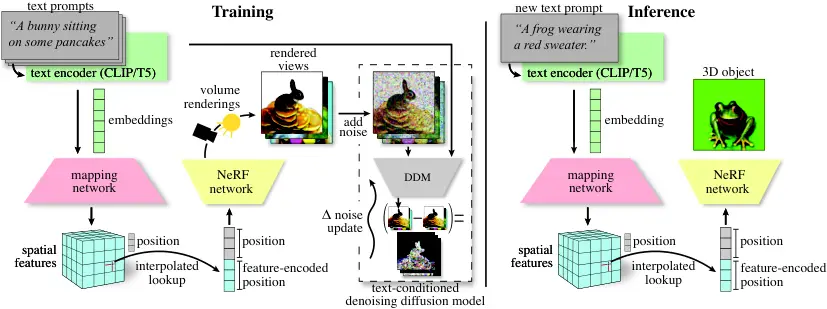

# ATT3D: Amortized Text-to-3D Object Synthesis

Jonathan Lorraine    Kevin Xie    Xiaohui Zeng    Chen-Hsuan Lin   
Towaki Takikawa Affiliation: Nicholas Sharp    Tsung-Yi Lin    Ming-Yu
Liu    Sanja Fidler    James Lucas Affiliation: NVIDIA Corporation

###### Abstract

Text-to-3D modelling has seen exciting progress by combining generative
text-to-image models with image-to-3D methods like Neural Radiance
Fields. DreamFusion recently achieved high-quality results but requires
a lengthy, per-prompt optimization to create 3D objects. To address
this, we amortize optimization over text prompts by training on many
prompts simultaneously with a unified model, instead of separately. With
this, we share computation across a prompt set, training in less time
than per-prompt optimization. Our framework – Amortized text-to-3D
(ATT3D) – enables knowledge sharing between prompts to generalize to
unseen setups and smooth interpolations between text for novel assets
and simple animations.


Figure 1: Our method initially trains one network to output 3D objects
consistent with various text prompts. After, when we receive an unseen
prompt, we produce an accurate object in $`<$1$`$ second, with $`1`$
GPU. Existing methods re-train the entire network for every prompt,
requiring a long delay for the optimization to complete. Further, we can
interpolate between prompts for user-guided asset generation (Fig. 3).
We include a [project
webpage](https://research.nvidia.com/labs/toronto-ai/ATT3D/) with an
overview and videos.

## 1 Introduction

3D content creation is important because it allows for more immersive
and engaging experiences in industries such as entertainment, education,
and marketing. However, 3D design is challenging due to technical
complexity of the 3D modeling software, and the artistic skills required
to create high-quality models and animations. Text-to-3D (TT3D)
generative tools have the potential to democratize 3D content creation
by relieving these limitations. To make this technology successful, we
desire tools that provide fast responses to users while being
inexpensive for the operator.

Recent TT3D methods \[1, 2\] allow users to generate high-quality 3D
models from text-prompts but use a lengthy ($`\sim\!\!$15$`$ minute to
$`>\!\!$1$`$ hour \[2, 1\]) per-prompt optimization. Having users wait
between each iteration of prompt engineering results in a sporadic and
time-consuming design process. Further, generation for a new prompt
requires multiple GPUs and uses large text-to-image models \[3, 4, 5\],
creating a prohibitive cost for the pipeline operator.

We split the TT3D process into two stages. First, we optimize one model
offline to generate 3D objects for many different text prompts
simultaneously. This _amortizes optimization_ over the prompts, by
sharing work between similar instances. The second, user-facing stage
uses our amortized model in a simple feed-forward pass to quickly
generate an object given text, with no further optimization required.

Our method, Amortized text-to-3D (ATT3D), produces a model which can
generate an accurate 3D object in $`<$1$`$ second, with only $`1`$
consumer-grade GPU. This TT3D pipeline can be deployed more cheaply,
with a real-time user experience. Our offline stage trains the ATT3D
model significantly faster than optimizing prompts individually while
retaining or even surpassing quality, by leveraging compositionality in
the parts underlying each 3D object. We also gain a new user-interaction
ability to interpolate between prompts for novel asset generation and
animations.


Figure 2: We show results on a compositional prompt set. Each row has a
different activity, while each column has a theme, which we combine into
the prompt “_a pig_ {activity} {theme}.” while we evaluate
generalization on a held-out set of unseen testing prompts in red on the
diagonal. _Left:_ Our method. Interestingly, the amortized objects have
a unified orientation. _Right:_ The per-prompt training baseline \[1\],
with a random initialization for unseen prompts to align compute
budgets. Takeaway: Our model performs comparably to per-prompt training
on the seen prompts, with a far smaller compute budget (Fig. 6).
Importantly, we perform strongly on unseen prompts with no extra
training, unlike per-prompt training.


Figure 3: We show renders of our model’s output on interpolated text
embeddings $`(1-\alpha)\boldsymbol{c}_{1}+\alpha\boldsymbol{c}_{2}`$. We
generate a continuum of landscape, clothing, building, and vehicle
assets, and use chains of prompts for animations, like seasonality in a
tree.

### 1.1 Contributions

We present a method to synthesize 3D objects from text prompts
immediately. By using amortized optimization we can:

- •
  Generalize to new prompts – Fig. 2.
- •
  Interpolate between prompts – Fig. 3.
- •
  Amortize over settings other than text prompts – Sec. 3.2.2.
- •
  Reduce overall training time – Fig. 6.

## 2 Background

This section contains concepts and prior work relevant to our method,
with notation in App. Table 1.

### 2.1 NeRFs for Image-to-3D

NeRFs \[6\] represent 3D scenes via a radiance field parameterized by a
neural network. We denote 3D coordinates with
$`\boldsymbol{x}\!=\![x,y,z]\in\mathcal{X}`$ and the radiance values
with $`\boldsymbol{r}\!=\![\sigma,r,g,b]\in\mathcal{R}`$. NeRFs are
trained to output radiance fields to render frames similar to multi-view
images with camera information. Simple NeRFs map locations
$`\boldsymbol{x}`$ to radiances $`\boldsymbol{r}`$ via an
MLP-parameterized function. Recent NeRFs use spatial grids storing
parameters queried per location \[7, 8, 9\], integrating spatial
inductive biases. We view this as a _point-encoder_ function
$`\boldsymbol{\gamma}_{{\boldsymbol{w}}}\!\!:\!\mathcal{X}\!\to\!\boldsymbol{\Gamma}`$
with parameters $`{\boldsymbol{w}}`$ encoding a location
$`\boldsymbol{x}`$ before the final MLP
$`\boldsymbol{\nu}\!:\!\boldsymbol{\Gamma}\!\to\!\mathcal{R}`$.

```math
\boldsymbol{r}=\boldsymbol{\nu}\left(\boldsymbol{\gamma}_{{\boldsymbol{w}}}\left(\boldsymbol{x}\right)\right) \tag{1}
```

### 2.2 Text-to-Image Generation

The wide availability of captioned image datasets has enabled the
development of powerful text-to-image generative models. We use a DDM
with comparable architecture to recent large-scale methods \[3, 4, 5\].
We train for score-matching, where (roughly) input images have noise
added to them \[10, 11\] that the DDM predicts. Critically, these models
can be conditioned on text to generate matching images via
classifier-free guidance\[12\]. We use pre-trained T5-XXL \[13\] and
CLIP \[14\] encoders to generate text embeddings, which the DDM
conditions on via cross-attention with latent image features. Crucially,
we reuse the text token embeddings – denoted $`\boldsymbol{c}`$ – for
modulating our NeRF.

### 2.3 Text-to-3D (TT3D) Generation

Prior works rely on per-prompt optimization to generate 3D scenes.
Recent TT3D methods \[1, 15\] use text-to-image generative models to
train NeRFs. To do so, they render a view and add noise. The DDM,
conditioned on a text prompt, approximates $`\boldsymbol{\epsilon}`$
with $`\hat{\boldsymbol{\epsilon}}`$, using the difference
$`\hat{\boldsymbol{\epsilon}}-\boldsymbol{\epsilon}`$ to update NeRF
parameters. We outline this method in Alg. 1 and Fig. 4 and refer to
DreamFusion Sec. 3 for more details.

### 2.4 Amortized Optimization

Amortized optimization methods use learning to predict solutions when we
repeatedly solve similar instances of the same problem \[16\]. Current
TT3D independently optimizes prompts, whereas, in Sec. 3, we use
amortized methods.

A typical amortization strategy is to find a problem context – denoted
$`\boldsymbol{z}`$ – to change our optimization, with some strategies
specialized for NeRFs \[17\]. For example, concatenating the context to
the NeRF’s MLP:
$`\boldsymbol{r}(\boldsymbol{x},\boldsymbol{z})=\boldsymbol{\nu}(\boldsymbol{\gamma}(\boldsymbol{x}),\boldsymbol{z})`$
Or, having a _mapping network_ $`\boldsymbol{m}`$ outputting modulations
to the weights or hidden units:

```math
\boldsymbol{r}\left(\boldsymbol{x},\boldsymbol{z}\right)=\boldsymbol{\nu}\left(\smash{\boldsymbol{\gamma}_{\boldsymbol{m}\left(\boldsymbol{z}\right)}}\left(\boldsymbol{x}\right)\right) \tag{2}
```

But, designing useful contexts, $`\boldsymbol{z}`$, can be non-trivial.



Figure 4: We show a schematic of our text-to-3D pipeline with changes
from DreamFusion’s pipeline \[1\] shown in red and pseudocode in Alg. 1.
The text encoder (in green) provides its – potentially cached – text
embedding $`{\color[rgb]{0,1,0}\boldsymbol{c}}`$ to the text-to-image
DDM and now also to the mapping network
$`{\color[rgb]{1,0,0}\boldsymbol{m}}`$ (in red). We use a spatial
point-encoder
$`{\color[rgb]{0,0,1}\boldsymbol{\gamma}}_{{\color[rgb]{1,0,0}\boldsymbol{m}(}{\color[rgb]{0,1,0}\boldsymbol{c}}{\color[rgb]{1,0,0})}}`$
(in blue) for our position $`\boldsymbol{x}`$, whose parameters are
modulations from the mapping network
$`{\color[rgb]{1,0,0}\boldsymbol{m}(}{\color[rgb]{0,1,0}\boldsymbol{c}}{\color[rgb]{1,0,0})}`$.
The final NeRF MLP $`\boldsymbol{\nu}`$ outputs a radiance
$`\boldsymbol{r}`$ given the point encoding:
$`\boldsymbol{r}=\boldsymbol{\nu}({\color[rgb]{0,0,1}\boldsymbol{\gamma}}_{{\color[rgb]{1,0,0}\boldsymbol{m}(}{\color[rgb]{0,1,0}\boldsymbol{c}}{\color[rgb]{1,0,0})}}(\boldsymbol{x}))`$,
which we render into views. _Left:_ At training time, the rendered views
are input to the DDM to provide a training update. The NeRF network
$`\boldsymbol{\nu}`$, mapping network
$`{\color[rgb]{1,0,0}\boldsymbol{m}}`$, and (effectively) the spatial
point encoding
$`{\color[rgb]{0,0,1}\boldsymbol{\gamma}}_{{\color[rgb]{1,0,0}\boldsymbol{m}(}{\color[rgb]{0,1,0}\boldsymbol{c}}{\color[rgb]{1,0,0})}}`$
are optimized. _Right_: At inference time, we use the pipeline up to the
NeRF for representing the 3D object.


Figure 5: Here we qualitatively assess our method relative to the
baseline per-prompt training – i.e., DreamFusion’s method. A public
DreamFusion implementation is not available. Takeaway: Our
re-implementation achieves similar quality to the original. Also, our
amortized method performs comparably to per-prompt training.

## 3 Our Method: Amortized Text-to-3D

Our method has an initial training stage using amortized optimization,
after which we perform cheap inference on new prompts. We first describe
the ATT3D architecture and its use during inference, then the training
procedure.

### 3.1 The Amortized Model used at Inference

At inference, our model consists of a _mapping network_
$`\boldsymbol{m}`$, a NeRF $`\boldsymbol{\nu}`$, and a spatial grid of
features $`\boldsymbol{\gamma}_{{\boldsymbol{w}}}`$ with parameters
$`{\boldsymbol{w}}`$ (Fig. 4). The mapping network takes in an (encoded)
text prompt $`\boldsymbol{c}`$ and produces feature grid _modulations_:
$`\boldsymbol{\gamma}_{\boldsymbol{m}(\boldsymbol{c})}`$. Our final NeRF
module $`\boldsymbol{\nu}`$ is a small MLP acting on encoded points
$`\boldsymbol{\gamma}_{\boldsymbol{m}(\boldsymbol{c})}(\boldsymbol{x})`$
– Eq. 1 – representing a 3D object for the text prompt with the
modulated feature grid. Full details are in App. Sec. B.1 and summarized
here.

Architectural details: We followed Instant NGP \[7\] for our NeRF,
notably using multi-resolution voxel/hash grids for our point-encoder
$`\boldsymbol{\gamma}`$. We use hypernetwork modulations for
implementation and computational simplicity, with alternatives of
concatenation and attention considered in App. B.1.3. Hypernetwork
approaches output the point-encoder parameters $`{\boldsymbol{w}}`$ from
a text embedding $`\boldsymbol{c}`$:

```math
{\boldsymbol{w}}=\textnormal{Hypernetwork}(\boldsymbol{c}) \tag{3}
```

We simply output via a vector $`\boldsymbol{v}`$ from the text
embeddings, which is used to output the parameters via linear maps.

```math
\boldsymbol{v}=\textnormal{SiLU}(\smash{\textnormal{linear}^{\textnormal{spec.norm}}_{\textnormal{w/ bias}}}(\textnormal{flatten}(\boldsymbol{c}))) \tag{4}
```

```math
{\boldsymbol{w}}=\textnormal{reshape}(\smash{\textnormal{linear}^{\textnormal{spec.norm}}_{\textnormal{no bias}}}(\boldsymbol{v})) \tag{5}
```

This $`{\boldsymbol{w}}`$ parameterizes the point-encoder
$`\boldsymbol{\gamma}_{{\boldsymbol{w}}}`$, which is used to evaluate
radiances per-point as per Eq. 1. This simple approach solved our prompt
sets, so we used it in all results. Using more sophisticated
hypernetworks performed comparably but was slower. However, this may be
necessary for scaling to more complicated sets of prompts.

Designing larger prompt sets was challenging because the per-prompt
baselines could not effectively handle open-domain text prompts. We
partially overcame this limitation by creating compositional prompt sets
using prompt components that the underlying model effectively handled.

### 3.2 Amortized Text-to-3D Training

Alg. 1 overviews our training procedure. In each optimization step, we
sample several prompts and produce their – potentially cached – text
embeddings $`\boldsymbol{z}`$, which we use to compute the modulations
$`\boldsymbol{m}(\boldsymbol{c})`$. We also sample camera poses and
rendering conditions. These are combined with the NeRF module to render
our images. We then use the Score Distillation Sampling loss \[1\] to
update the NeRF.

As in prior work, we augment text prompts depending on camera position –
_“…, front/side/rear view”_. We provide the text embeddings (without
augmentation) to the mapping network to modulate the NeRF.

#### 3.2.1 Stabilizing Optimization

The NeRF’s loss is specified by a denoising diffusion model (DDM) and
thus changes during training akin to bilevel setups like GANs \[18, 19,
20\] and actor-critic models \[21\]. We use techniques from nested
optimization to stabilize training motivated by observing similar
failure modes. Specifically, we required spectral normalization \[19\] –
crucial for large-scale GANs \[20\] – to mitigate numerical instability.

Removing optimization momentum helped minimize oscillations from complex
dynamics as in nested optimization \[22, 23\]. Unlike DreamFusion, we
did not benefit from Distributed Shampoo \[24\] and, instead, use
Adam \[25\].

#### 3.2.2 Amortizing Over Other Settings

So far, we described amortizing optimization over many prompts. More
generally, we can amortize over other variables like the choice of
guidance weight, regularizers, data augmentation, or other aspects of
the loss function. We use this to explore techniques for allowing
semantically meaningful prompt interpolations, which is a valuable
property of generative models like GANs \[18\] and VAEs \[26\].

There are various prompt interpolation strategies we can amortize over,
like, between text embeddings, guidance weights, or loss functions; see
App. Fig. 18 for specifics. To sample an interpolated setup, we sample
prompt (embedding) pairs $`\boldsymbol{c}_{1},\boldsymbol{c}_{2}`$ and
an interpolant weight $`\alpha\in[0,1]`$. We must give this information
to our mapping network - ex., by making it an input
$`\boldsymbol{m}(\boldsymbol{c}_{1},\boldsymbol{c}_{2},\alpha)`$.
Instead, we input interpolated embeddings, allowing an unmodified
architecture and incorporating prompt permutation invariance:¹¹ 1 By
invariance we actually mean
$`\boldsymbol{m}(\!\boldsymbol{c}_{1}\!,\!\boldsymbol{c}_{2},\!\alpha\!)=\boldsymbol{m}(\!\boldsymbol{c}_{2},\!\boldsymbol{c}_{1}\!,\!1-\alpha\!)`$.

```math
\boldsymbol{m}\left(\left(1-\alpha\right)\boldsymbol{c}_{1}+\alpha\boldsymbol{c}_{2}\right) \tag{6}
```

In addition to the text prompts distribution, we must choose the
interpolant weights $`\alpha`$’s distribution. For example, we could
sample uniform $`\alpha\in[0,1]`$, or a binary $`\alpha\in\{0,1\}`$ –
i.e., training without interpolants – which are both special cases of a
Dirichlet distribution. The Dirichlet concentration coefficient is
another user choice to change results qualitatively – see App. Fig. 19.
We show examples of various loss interpolations in Figs. 3 and 20. The
interpolation setup is further details in App. Sec. B.1.14.

### 3.3 Why We Amortize

Reduce training cost (Fig. 6): We train on text prompts for a fraction
of the per-prompt cost.

Generalize to unseen prompts (Fig. 2, 8): We seek strong performance
when evaluating our model on unseen prompts during the amortized
training without extra optimization.

Prompt interpolations (Fig. 3): Unlike current TT3D, we can interpolate
between prompts, allowing: (a) generating a continuum of novel assets,
or (b) creating 3D animations.

1: for each loss term in batch do

2:   sample a text and it’s embedding $`\boldsymbol{c}`$

3:    compute the modulation
$`\boldsymbol{m}^{\prime}=\boldsymbol{m}(\boldsymbol{c})`$

4:   sample camera position

5:   add front/side/back to text, given camera

6:   sample textureless/shadeless/full render

7:   perform the render:

8:    create a ray for each pixel in the frame

9:    at each ray, sample multiple points $`\boldsymbol{x}`$

10:    at each point, compute encoding
$`\boldsymbol{\gamma}^{\prime}\!=\!\boldsymbol{\gamma}_{\!{\color[rgb]{1,0,0}\boldsymbol{m}^{\prime}}}(\boldsymbol{x})\!`$

11:    at each point, compute the radiance
$`\boldsymbol{\nu}(\boldsymbol{\gamma}^{\prime})`$

12:    composite radiance into a frame

13:   add noise to frame

14:   compute denoised frame with the DDM via
$`\hat{\boldsymbol{\epsilon}}`$

15:   compute gradient using
$`\hat{\boldsymbol{\epsilon}}-\boldsymbol{\epsilon}`$ as per SDS

Algorithm 1 ATT3D Pseudocode for each update  
Changes from DreamFusion Sec. 3 shown in red


Figure 6: We display the quality against compute budget for a split of
seen & unseen (dashed) prompts with our method (in blue and green) &
existing work’s per-prompt optimization baseline (in red). Our method is
only trained on the seen split of the prompts. At a given training
iteration, the amortized model is evaluated zero-shot on unseen prompts.
Takeaway: For any compute budget, we achieve a higher quality on both
the seen and unseen prompts. Our benefits grow for larger, compositional
prompt sets. _Left_: The $`27`$ prompts from DreamFusion (Fig. 11).
_Middle_: The $`64`$ compositional pig prompts (Fig. 2). Per-prompt
optimization cannot perform zero-shot generation for unseen prompts, so
we report the performance of a random initialization baseline. _Right_:
The $`2400`$ compositional animal prompts (Fig. 8), with varying prompt
proportions used in training. The generalization gap is small when
training on $`{\color[rgb]{0,0,1}50\%}`$ of the prompts. Notably, the
cheap testing performance is better than the expensive per-prompt method
with only $`{\color[rgb]{0,1,0}12.5\%}`$ of the prompts.

## 4 Results and Discussion

Here, we investigate our method’s potential benefits. We refer to the
baseline as “per-prompt optimization”, which follows existing works
using separate optimization for each prompt. The specific NeRF rendering
and SDS loss implementation are equivalent between the baseline and our
method – see Fig. 5. App. Sec. C contains additional experiments,
ablations, and visualizations.

### 4.1 How We Evaluate ATT3D

We first describe the datasets we use, then our metrics for quality and
cost.

#### 4.1.1 Our Text Prompt Datasets

DreamFusion (DF): The DF$`27`$ dataset consists of the $`27`$ prompts
from DreamFusion’s main paper, while DF$`411`$ has $`411`$ prompts from
the project page. We explore memorizing these datasets but find them
unsuitable for generalization.

Compositional: To test generalization, we design a compositional prompt
set by composing fragments with the template “_a_ {animal} {activity}
{theme}” and hold out a subset of “unseen” prompts. Our model must
generalize to unseen compositions that require nontrivial changes to
geometry. Using this template, we created a small pig-prompts and a
larger animal-prompts dataset detailed in App. Sec. B.1.12 and shown in
Figs. 2 and 8. We hold out $`8`$ out of the $`64`$ pig prompts, as shown
in Fig. 2. For the animals, the held-out prompts are sampled
homogeneously and we investigate holding out larger fractions of the
prompts.

#### 4.1.2 Our Evaluation Metrics

Cost: We measure the computational cost of training per-prompt models
versus our amortized approach. Wall-clock time and number of iterations
are insufficient because we train with varying compute setups and
numbers of GPUs – see App. Sec. B.2. To account for this difference, we
measure the number of rendered frames used for training (normalized by
the number of prompts). Specifically, this is the number of optimization
iterations times batch size divided by the total number of prompts in
the dataset.

Quality: _CLIP R-(prec.)ision_ is a text-to-3D correspondence metric
introduced in Dream Fields \[27\], defined as the CLIP model’s accuracy
at classifying the correct text input of a rendered image from amongst a
set of distractor prompts (i.e., the _query set_). _CLIP
R-(prob.)ability_ is the probability assigned to the correct prompt
instead of the binary accuracy, preserving information about confidence,
and reducing noise. We found that R- metrics track each other (App.
Fig. 12), so we focus on R-prob. We evaluate R-prob. averaged over the
input prompt dataset and four distinct rendered views as in
DreamFusion \[1\], using the entire dataset as our query set. The
queries in DF$`27`$ are highly dissimilar, so we make the metric harder
by adding the DF$`411`$ prompts to the query set.

### 4.2 Can We Reduce Training Cost?

Before evaluating generalization, we see if our method can optimize a
diverse prompt collection faster than optimizing individually. Fig. 6
gives the R-probability against compute budget for our method &
per-prompt optimization, showing we achieved higher quality for any
budget. App. Figs. 11 and 14, qualitatively show we accurately memorize
all prompts in DreamFusion’s main paper and extended prompt set for a
reduced cost – perhaps from component re-use as in App. Fig. 15. So, we
have a powerful optimization method that quickly memorizes training
data.

But does the performance generalize to unseen prompts? Current TT3D
methods optimize $`1`$ prompt, so any generalization is a valuable
contribution. App. Fig. 16 shows unseen composed and interpolated
prompts, with promising results, which we improve in Secs. 4.3 and 4.4
respectively.

### 4.3 Can We Generalize to Unseen Prompts?

Next, we investigate generalizing to unseen prompts with no extra
optimization. We used compositional prompt datasets to evaluate
(compositional) generalization in the smaller pig and larger animal
prompt datasets. Fig. 6 shows R-probability against compute budget on
both seen & unseen prompts for our method & per-prompt optimization
showing that we achieved higher quality for any compute budget on both
prompt sets. Our generalization is especially evident in the larger
prompt set, where we held out a significant fraction of the training
prompts. With $`50\%`$ of prompts withheld, we have a minimal
generalization gap. With only $`12.5\%`$ ($`300`$) prompts seen during
training, generalization to _unseen prompts_ was better than per-prompt
optimization on _seen prompts_ with only $`\nicefrac{{1}}{{4}}`$ the
per-prompt compute budget.

To understand the superior performance, we visually compare a subset of
pig prompts with the “_holding a blue balloon_” activity in Fig. 7.
ATT3D produced more consistent results than per-prompt optimization,
potentially explaining our higher R-probability. Visualizations for the
pig and animal experiments are in Figs. 2 and 8, respectively. This
confirms we can achieve strong generalization performance with a
sufficient prompt set. Further, quality can be improved with fine-tuning
strategies (App. Fig. 17).


Figure 7: We compare amortized and per-prompt optimization on the
prompts of the form “_…holding a blue balloon_.” Amortization discovers
a canonical orientation and always makes the balloon blue, while
per-prompt training may only make the background blue or fail
altogether, potentially explaining performance improvements in Fig. 6.

### 4.4 Can We Make Useful Interpolations?

Next, we investigate our method’s ability to create objects as we
interpolate between text prompts with no additional test-time
optimization. In Fig. 3, we show rendered outputs as we interpolate
between different prompts. The output remains realistic with smooth
transitions.

For Fig. 3, top right, we _did not_ use loss amortization and generalize
to interpolants while only training on the $`3`$ rock prompts. But, some
prompts gave suboptimal results without interpolant training (App.
Fig. 16) which we improved by interpolant amortization (Sec. 3.2.2). We
evaluated several prompt interpolation approaches. App. Fig. 18 compares
$`3`$ interpolant amortization types: loss weightings, interpolated
embeddings, and guidance weightings, showing various ways to control
results. App. Fig. 19 compares different interpolant sampling strategies
during training, providing qualitatively different ways to generate
assets.


Figure 8: We show quantitative results for the $`2400`$ animal prompts
in Fig. 6, where we achieve a higher quality for any compute budget on
seen & unseen prompts. Notably, when training on only
$`{\color[rgb]{0,0,1}50\%}`$ or $`{\color[rgb]{0,1,0}12.5\%}`$ of the
prompts, the unseen prompts – which cost no optimization – perform
stronger than the per-prompt method, which must optimize on the data.
Takeaway: By training a single model on many text prompts we generalize
to unseen prompts without extra optimization.

## 5 Related Work

We cover the various fields our method combines: (a) text-to-image
generation, then (b) image-to-3D models, which lead to (c) text-to-3D
models, which we augment with (d) amortized optimization.

##### Text-to-image Generation:

(A)TT3D methods \[1, 2, 15\] use large-scale text-conditional DDMs \[28,
29, 4, 3, 30\], which train using classifier-free guidance to sample
images matching text prompts \[12\]. While these models generate diverse
and high-fidelity images for many prompts, they cannot provide
view-consistent renderings of a single object and are thus incapable of
making 3D assets directly.

##### Image-to-3D Models:

Beyond using 3D assets to train 3D generative models, prior work has
also used image datasets. Most of these methods use NeRFs \[6, 31, 17,
32, 33, 34\] as a differentiable renderer optimized to produce image
datasets. Differentiable mesh rendering is an alternative \[35, 36, 37,
38\]. Chan et al. \[9\] are closely related in this category, using a
StyleGAN generator modulated with a learned latent code to produce a
triplanar grid that is spatially interpolated and fed through a NeRF
producing a static image dataset. We also modulate spatially oriented
feature grids, without relying on memory-intensive pre-trained generator
backbones. These techniques may prove valuable in future work scaling to
ultra-large prompt sets.

##### Text-to-3D Generation:

Recent advances include CLIP-forge \[39\], CLIP-mesh \[40\],
Latent-NeRF \[41\], Dream Field \[27\], Score-Jacobian-Chaining \[15\],
& DreamFusion \[1\]. In CLIP-forge \[39\], the model is trained for
shapes conditioned on CLIP text embeddings from rendered images. During
inference, the embedding is provided for the generative model to
synthesize new shapes based on the text. CLIP-mesh \[40\] and Dream
Field \[27\] optimized the underlying 3D representation with the
CLIP-based loss. Magic3D adds a finetuning phase with a textured-mesh
model \[42\], allowing high resolutions. Future advances may arise by
combining with techniques from unconditional 3D generation \[43, 44,
45\]. Notable open-source contributions are Stable-Dreamfusion \[46\]
and threestudio \[47\]. Other concurrent works include
Zero-1-to-3 \[48\], Fantasia3D \[49\], Dream3D \[50\],
DreamAvatar \[51\], and ProlificDreamer \[52\]. However, we differ from
all of these text-to-3D works, because we amortize over the text
prompts.

##### Amortized Optimization:

Amortized optimization \[16\] is a tool of blossoming importance in
learning to optimize \[53\] and machine learning, with applications to
meta-learning \[54\], hyperparameter optimization \[55, 56\], and
generative modeling \[26, 57, 58, 59\]. Hypernetworks \[60\] are a
popular tool for amortization \[55, 56, 61, 62\] and have also been used
to modulate NeRFs \[63, 17, 64\], inspiring our strategy. Our method
differs from prior works by modulating spatially oriented parameters,
and our objective is from a (dynamic) DDM instead of a (static) dataset.

##### Text-to-3D Animation:

Text-to-4D \[65\] is an approach for directly making 3D animations from
text, instead of our interpolation strategy. This is done by
generalizing TT3D to use a text-to-video model \[66, 28, 67\], instead
of a text-to-image model. However, unlike us, this requires
text-to-video, which can require video data.


Figure 9: Results for amortized training on DreamFusion’s extended set
of $`411`$ text prompts, DF$`411`$. See Fig. 14 for the full set.
Takeaway: We scale to diverse prompt sets $`>\!\!10\times`$ larger than
DF27 (Fig. 11) with minor quality drop.

## 6 Conclusion

We presented ATT3D, a method for amortized optimization of text-to-3D
(TT3D) models. We use a mapping network from text to NERFs, enabling a
single model to represent 3D objects of many different prompts. We
experimentally validate our method on existing and new compositional
prompt sets. We are faster at training than current TT3D methods by
sharing the optimization cost across a prompt set. Once trained, our
model generalizes by directly outputting objects for prompts unseen
during training in a single forward pass. Furthermore, by amortizing
over interpolation weights, we quickly generate a continuum of
interpolations between prompts, enhancing user control.

Although ATT3D only represents a small step towards general and fast
text-to-3D generation, we believe that the ideas presented are a
promising avenue toward this future.

##### Limitations:

Our method builds on the existing text-to-3D optimization paradigm, so
we share several limitations with these works: More powerful
text-to-image DDMs may be required for higher quality and robustness in
results. The objective has high variance, and the system can be
sensitive to prompt engineering. We also suffer from a lack of
diversity, as in prior work. We found that similar prompts can collapse
to the same scene when amortizing. Finally, larger object-centric prompt
sets are required to further test the scaling of amortized training.

##### Ethics Statement:

Text-to-image models carry ethical concerns for synthesizing images,
which text-to-3D models like this share. For example, we may inherit any
biases in our underlying text-to-image model. These models could
displace creative jobs or enable the growth and accessibility of 3D
asset generation. Alternatively, 3D synthesis models could be used to
generate misinformation by bad actors.

##### Reproducibility Statement:

Our instant-NGP NeRF backbone is publicly available through the
“instant-ngp” repository \[7\]. While our diffusion model is not
publicly available (as in DreamFusion \[1\]), other available models may
be used to produce similar results. To aid reproducibility, we include a
method schematic in Fig. 4 and pseudocode in Alg. 1. Our evaluation
setup is in Sec. 4.1 along with hyperparameters and other details in
App. Sec. B.

## Acknowledgements

We thank Weiwei Sun, Matan Atzmon, and Or Perel for helpful feedback.
The Python community  \[68, 69\] made underlying tools, including
PyTorch \[70\] & Matplotlib \[71\].

## Disclosure of Funding

NVIDIA funded this work. Jonathan Lorraine, Kevin Xie, Xiaohui Zeng, and
Towaki Takikawa had funding from student scholarships at the University
of Toronto and the Vector Institute, which are not in direct support of
this work.

## References

- \[1\] Ben Poole, Ajay Jain, Jonathan T Barron, and Ben Mildenhall.
  Dreamfusion: Text-to-3d using 2d diffusion. _arXiv:2209.14988_, 2022.
- \[2\] Chen-Hsuan Lin, Jun Gao, Luming Tang, Towaki Takikawa, Xiaohui
  Zeng, Xun Huang, Karsten Kreis, Sanja Fidler, Ming-Yu Liu, and
  Tsung-Yi Lin. Magic3d: High-resolution text-to-3d content creation.
  _arXiv:2211.10440_, 2022.
- \[3\] Yogesh Balaji, Seungjun Nah, Xun Huang, Arash Vahdat, Jiaming
  Song, Karsten Kreis, Miika Aittala, Timo Aila, Samuli Laine, Bryan
  Catanzaro, et al. ediffi: Text-to-image diffusion models with an
  ensemble of expert denoisers. _arXiv:2211.01324_, 2022.
- \[4\] Robin Rombach, Andreas Blattmann, Dominik Lorenz, Patrick Esser,
  and Björn Ommer. High-resolution image synthesis with latent diffusion
  models. In _IEEE/CVF Conference on Computer Vision and Pattern
  Recognition_, 2022.
- \[5\] Chitwan Saharia, William Chan, Saurabh Saxena, Lala Li, Jay
  Whang, Emily Denton, Seyed Kamyar Seyed Ghasemipour, Burcu Karagol
  Ayan, S Sara Mahdavi, Rapha Gontijo Lopes, et al. Photorealistic
  text-to-image diffusion models with deep language understanding.
  _arXiv:2205.11487_, 2022.
- \[6\] Ben Mildenhall, Pratul P Srinivasan, Matthew Tancik, Jonathan T
  Barron, Ravi Ramamoorthi, and Ren Ng. Nerf: Representing scenes as
  neural radiance fields for view synthesis. _Communications of the
  ACM_, 2021.
- \[7\] Thomas Müller, Alex Evans, Christoph Schied, and Alexander
  Keller. Instant neural graphics primitives with a multiresolution hash
  encoding. _arXiv:2201.05989_, 2022.
- \[8\] Towaki Takikawa, Alex Evans, Jonathan Tremblay, Thomas Müller,
  Morgan McGuire, Alec Jacobson, and Sanja Fidler. Variable bitrate
  neural fields. In _ACM SIGGRAPH 2022 Conference Proceedings_, 2022.
- \[9\] Eric R Chan, Connor Z Lin, Matthew A Chan, Koki Nagano, Boxiao
  Pan, Shalini De Mello, Orazio Gallo, Leonidas J Guibas, Jonathan
  Tremblay, Sameh Khamis, et al. Efficient geometry-aware 3d generative
  adversarial networks. In _IEEE/CVF Conference on Computer Vision and
  Pattern Recognition_, 2022.
- \[10\] Jonathan Ho, Ajay Jain, and Pieter Abbeel. Denoising diffusion
  probabilistic models. _Advances in Neural Information Processing
  Systems_, 2020.
- \[11\] Yang Song, Jascha Sohl-Dickstein, Diederik P Kingma, Abhishek
  Kumar, Stefano Ermon, and Ben Poole. Score-based generative modeling
  through stochastic differential equations. _arXiv:2011.13456_, 2020.
- \[12\] Jonathan Ho and Tim Salimans. Classifier-free diffusion
  guidance. _arXiv:2207.12598_, 2022.
- \[13\] Colin Raffel, Noam Shazeer, Adam Roberts, Katherine Lee, Sharan
  Narang, Michael Matena, Yanqi Zhou, Wei Li, and Peter J. Liu.
  Exploring the limits of transfer learning with a unified text-to-text
  transformer. _JMLR_, 2020.
- \[14\] Alec Radford, Jong Wook Kim, Chris Hallacy, Aditya Ramesh,
  Gabriel Goh, Sandhini Agarwal, Girish Sastry, Amanda Askell, Pamela
  Mishkin, Jack Clark, Gretchen Krueger, and Ilya Sutskever. Learning
  transferable visual models from natural language supervision. 2021.
- \[15\] Haochen Wang, Xiaodan Du, Jiahao Li, Raymond A Yeh, and Greg
  Shakhnarovich. Score jacobian chaining: Lifting pretrained 2d
  diffusion models for 3d generation. _arXiv:2212.00774_, 2022.
- \[16\] Brandon Amos. Tutorial on amortized optimization for learning
  to optimize over continuous domains. _arXiv:2202.00665_, 2022.
- \[17\] Daniel Rebain, Mark J Matthews, Kwang Moo Yi, Gopal Sharma,
  Dmitry Lagun, and Andrea Tagliasacchi. Attention beats concatenation
  for conditioning neural fields. _arXiv:2209.10684_, 2022a.
- \[18\] Ian Goodfellow, Jean Pouget-Abadie, Mehdi Mirza, Bing Xu, David
  Warde-Farley, Sherjil Ozair, Aaron Courville, and Yoshua Bengio.
  Generative adversarial networks. _Communications of the ACM_, 2020.
- \[19\] Takeru Miyato, Toshiki Kataoka, Masanori Koyama, and Yuichi
  Yoshida. Spectral normalization for generative adversarial networks.
  _arXiv:1802.05957_, 2018.
- \[20\] Andrew Brock, Jeff Donahue, and Karen Simonyan. Large scale gan
  training for high fidelity natural image synthesis.
  _arXiv:1809.11096_, 2018.
- \[21\] David Pfau and Oriol Vinyals. Connecting generative adversarial
  networks and actor-critic methods. _arXiv:1610.01945_, 2016.
- \[22\] Gauthier Gidel, Reyhane Askari Hemmat, Mohammad Pezeshki, Rémi
  Le Priol, Gabriel Huang, Simon Lacoste-Julien, and Ioannis Mitliagkas.
  Negative momentum for improved game dynamics. In _The 22nd
  International Conference on Artificial Intelligence and
  Statistics_, 2019.
- \[23\] Jonathan P Lorraine, David Acuna, Paul Vicol, and David
  Duvenaud. Complex momentum for optimization in games. In
  _International Conference on Artificial Intelligence and Statistics_,
  pages 7742–7765. PMLR, 2022.
- \[24\] Rohan Anil, Vineet Gupta, Tomer Koren, Kevin Regan, and Yoram
  Singer. Scalable second order optimization for deep learning.
  _arXiv:2002.09018_, 2020.
- \[25\] Diederik P Kingma and Jimmy Ba. Adam: A method for stochastic
  optimization. _arXiv:1412.6980_, 2014.
- \[26\] Diederik P Kingma and Max Welling. Auto-encoding variational
  bayes. _arXiv:1312.6114_, 2013.
- \[27\] Ajay Jain, Ben Mildenhall, Jonathan T Barron, Pieter Abbeel,
  and Ben Poole. Zero-shot text-guided object generation with dream
  fields. In _CVF Conference on Computer Vision and Pattern Recognition
  Proceedings_, 2022.
- \[28\] Jonathan Ho, William Chan, Chitwan Saharia, Jay Whang, Ruiqi
  Gao, Alexey Gritsenko, Diederik P Kingma, Ben Poole, Mohammad Norouzi,
  David J Fleet, et al. Imagen video: High definition video generation
  with diffusion models. _arXiv:2210.02303_, 2022.
- \[29\] Aditya Ramesh, Prafulla Dhariwal, Alex Nichol, Casey Chu, and
  Mark Chen. Hierarchical text-conditional image generation with clip
  latents. _arXiv:2204.06125_, 2022.
- \[30\] Alex Shonenkov, Misha Konstantinov, Daria Bakshandaeva,
  Christoph Schuhmann, Ksenia Ivanova, and Nadiia Klokova. If by
  deepfloyd lab at stabilityai, 2023.
  [github.com/deep-floyd/IF](https://github.com/deep-floyd/IF).
- \[31\] Daniel Rebain, Mark Matthews, Kwang Moo Yi, Dmitry Lagun, and
  Andrea Tagliasacchi. Lolnerf: Learn from one look. In _IEEE/CVF
  Conference on Computer Vision and Pattern Recognition_, 2022b.
- \[32\] Eric R Chan, Marco Monteiro, Petr Kellnhofer, Jiajun Wu, and
  Gordon Wetzstein. pi-gan: Periodic implicit generative adversarial
  networks for 3d-aware image synthesis. In _IEEE/CVF conference on
  computer vision and pattern recognition_, 2021.
- \[33\] Luke Melas-Kyriazi, Iro Laina, Christian Rupprecht, and Andrea
  Vedaldi. Realfusion: 360deg reconstruction of any object from a single
  image. In _IEEE/CVF Conference on Computer Vision and Pattern
  Recognition_, 2023.
- \[34\] Junshu Tang, Tengfei Wang, Bo Zhang, Ting Zhang, Ran Yi,
  Lizhuang Ma, and Dong Chen. Make-it-3d: High-fidelity 3d creation from
  a single image with diffusion prior. _arXiv:2303.14184_, 2023.
- \[35\] Dario Pavllo, Jonas Kohler, Thomas Hofmann, and Aurelien
  Lucchi. Learning generative models of textured 3d meshes from
  real-world images. In _IEEE/CVF International Conference on Computer
  Vision_, 2021.
- \[36\] Jun Gao, Tianchang Shen, Zian Wang, Wenzheng Chen, Kangxue Yin,
  Daiqing Li, Or Litany, Zan Gojcic, and Sanja Fidler. Get3d: A
  generative model of high quality 3d textured shapes learned from
  images. _arXiv:2209.11163_, 2022.
- \[37\] Dario Pavllo, Graham Spinks, Thomas Hofmann, Marie-Francine
  Moens, and Aurelien Lucchi. Convolutional generation of textured 3d
  meshes. _Advances in Neural Information Processing Systems_, 2020.
- \[38\] Wenzheng Chen, Huan Ling, Jun Gao, Edward Smith, Jaakko
  Lehtinen, Alec Jacobson, and Sanja Fidler. Learning to predict 3d
  objects with an interpolation-based differentiable renderer. _Advances
  in Neural Information Processing Systems_, 32, 2019.
- \[39\] Aditya Sanghi, Hang Chu, Joseph Lambourne, Ye Wang, Chin-Yi
  Cheng, and Marco Fumero. Clip-forge: Towards zero-shot text-to-shape
  generation. _arXiv:2110.02624_, 2021.
- \[40\] Nasir Khalid, Tianhao Xie, Eugene Belilovsky, and Tiberiu Popa.
  Clip-mesh: Generating textured meshes from text using pretrained
  image-text models. _ACM Transactions on Graphics (TOG), Proc. SIGGRAPH
  Asia_, 2022.
- \[41\] Gal Metzer, Elad Richardson, Or Patashnik, Raja Giryes, and
  Daniel Cohen-Or. Latent-nerf for shape-guided generation of 3d shapes
  and textures. In _IEEE/CVF Conference on Computer Vision and Pattern
  Recognition_, 2023.
- \[42\] Tianchang Shen, Jun Gao, Kangxue Yin, Ming-Yu Liu, and Sanja
  Fidler. Deep marching tetrahedra: a hybrid representation for
  high-resolution 3d shape synthesis. _Advances in Neural Information
  Processing Systems_, 2021.
- \[43\] Miguel Angel Bautista, Pengsheng Guo, Samira Abnar, Walter
  Talbott, Alexander Toshev, Zhuoyuan Chen, Laurent Dinh, Shuangfei
  Zhai, Hanlin Goh, Daniel Ulbricht, et al. Gaudi: A neural architect
  for immersive 3d scene generation. _arXiv:2207.13751_, 2022.
- \[44\] Xiaohui Zeng, Arash Vahdat, Francis Williams, Zan Gojcic,
  Or Litany, Sanja Fidler, and Karsten Kreis. Lion: Latent point
  diffusion models for 3d shape generation. In _Advances in Neural
  Information Processing Systems (NeurIPS)_, 2022.
- \[45\] Linqi Zhou, Yilun Du, and Jiajun Wu. 3d shape generation and
  completion through point-voxel diffusion. In _IEEE/CVF International
  Conference on Computer Vision_, 2021.
- \[46\] Jiaxiang Tang. Stable-dreamfusion: Text-to-3d with
  stable-diffusion, 2022.
  [github.com/ashawkey/stable-dreamfusion](https://github.com/ashawkey/stable-dreamfusion).
- \[47\] Yuan-Chen Guo, Ying-Tian Liu, Chen Wang, Zi-Xin Zou, Guan Luo,
  Chia-Hao Chen, Yan-Pei Cao, and Song-Hai Zhang. threestudio: A unified
  framework for 3d content generation.
  [github.com/threestudio-project/threestudio](https://github.com/threestudio-project/threestudio), 2023.
- \[48\] Ruoshi Liu, Rundi Wu, Basile Van Hoorick, Pavel Tokmakov,
  Sergey Zakharov, and Carl Vondrick. Zero-1-to-3: Zero-shot one image
  to 3d object. _arXiv:2303.11328_, 2023.
- \[49\] Rui Chen, Yongwei Chen, Ningxin Jiao, and Kui Jia. Fantasia3d:
  Disentangling geometry and appearance for high-quality text-to-3d
  content creation. _arXiv:2303.13873_, 2023.
- \[50\] Jiale Xu, Xintao Wang, Weihao Cheng, Yan-Pei Cao, Ying Shan,
  Xiaohu Qie, and Shenghua Gao. Dream3d: Zero-shot text-to-3d synthesis
  using 3d shape prior and text-to-image diffusion models. In _IEEE/CVF
  Conference on Computer Vision and Pattern Recognition_, 2023.
- \[51\] Yukang Cao, Yan-Pei Cao, Kai Han, Ying Shan, and Kwan-Yee K
  Wong. Dreamavatar: Text-and-shape guided 3d human avatar generation
  via diffusion models. _arXiv:2304.00916_, 2023.
- \[52\] Zhengyi Wang, Cheng Lu, Yikai Wang, Fan Bao, Chongxuan Li, Hang
  Su, and Jun Zhu. Prolificdreamer: High-fidelity and diverse text-to-3d
  generation with variational score distillation.
  _arXiv:2305.16213_, 2023.
- \[53\] Tianlong Chen, Xiaohan Chen, Wuyang Chen, Howard Heaton, Jialin
  Liu, Zhangyang Wang, and Wotao Yin. Learning to optimize: A primer and
  a benchmark. _arXiv:2103.12828_, 2021.
- \[54\] Timothy Hospedales, Antreas Antoniou, Paul Micaelli, and Amos
  Storkey. Meta-learning in neural networks: A survey. _IEEE
  transactions on pattern analysis and machine intelligence_, 2021.
- \[55\] Jonathan Lorraine and David Duvenaud. Stochastic hyperparameter
  optimization through hypernetworks. _arXiv:1802.09419_, 2018.
- \[56\] Matthew Mackay, Paul Vicol, Jonathan Lorraine, David Duvenaud,
  and Roger Grosse. Self-tuning networks: Bilevel optimization of
  hyperparameters using structured best-response functions. In
  _International Conference on Learning Representations_, 2018.
- \[57\] Danilo Jimenez Rezende, Shakir Mohamed, and Daan Wierstra.
  Stochastic backpropagation and approximate inference in deep
  generative models. In _ICML_, 2014.
- \[58\] Chris Cremer, Xuechen Li, and David Duvenaud. Inference
  suboptimality in variational autoencoders. In _International
  Conference on Machine Learning_, 2018.
- \[59\] Mike Wu, Kristy Choi, Noah Goodman, and Stefano Ermon.
  Meta-amortized variational inference and learning. In _AAAI Conference
  on Artificial Intelligence_, 2020.
- \[60\] David Ha, Andrew Dai, and Quoc V Le. Hypernetworks.
  _arXiv:1609.09106_, 2016.
- \[61\] Chris Zhang, Mengye Ren, and Raquel Urtasun. Graph
  hypernetworks for neural architecture search.
  _arXiv:1810.05749_, 2018.
- \[62\] Boris Knyazev, Michal Drozdzal, Graham W Taylor, and Adriana
  Romero Soriano. Parameter prediction for unseen deep architectures.
  _Advances in Neural Information Processing Systems_, 2021.
- \[63\] Vincent Sitzmann, Eric Chan, Richard Tucker, Noah Snavely, and
  Gordon Wetzstein. Metasdf: Meta-learning signed distance functions.
  _Advances in Neural Information Processing Systems_, 2020.
- \[64\] Emilien Dupont, Hyunjik Kim, SM Ali Eslami, Danilo Jimenez
  Rezende, and Dan Rosenbaum. From data to functa: Your data point is a
  function and you can treat it like one. In _ICML_, 2022.
- \[65\] Uriel Singer, Shelly Sheynin, Adam Polyak, Oron Ashual, Iurii
  Makarov, Filippos Kokkinos, Naman Goyal, Andrea Vedaldi, Devi Parikh,
  Justin Johnson, et al. Text-to-4d dynamic scene generation.
  _arXiv:2301.11280_, 2023.
- \[66\] Uriel Singer, Adam Polyak, Thomas Hayes, Xi Yin, Jie An,
  Songyang Zhang, Qiyuan Hu, Harry Yang, Oron Ashual, Oran Gafni, et al.
  Make-a-video: Text-to-video generation without text-video data.
  _arXiv:2209.14792_, 2022.
- \[67\] Andreas Blattmann, Robin Rombach, Huan Ling, Tim Dockhorn,
  Seung Wook Kim, Sanja Fidler, and Karsten Kreis. Align your latents:
  High-resolution video synthesis with latent diffusion models. In
  _IEEE/CVF Conference on Computer Vision and Pattern
  Recognition_, 2023.
- \[68\] Guido Van Rossum and Fred L Drake Jr. _Python reference
  manual_. Centrum voor Wiskunde en Informatica Amsterdam, 1995.
- \[69\] Travis E Oliphant. Python for scientific computing. _Computing
  in Science & Engineering_, 2007.
- \[70\] Adam Paszke, Sam Gross, Soumith Chintala, Gregory Chanan,
  Edward Yang, Zachary DeVito, Zeming Lin, Alban Desmaison, Luca Antiga,
  and Adam Lerer. Automatic differentiation in PyTorch.
  _Openreview_, 2017.
- \[71\] John D Hunter. Matplotlib: A 2D graphics environment.
  _Computing in Science & Engineering_, 2007.
- \[72\] Dan Hendrycks and Kevin Gimpel. Gaussian error linear units
  (gelus). _arXiv:1606.08415_, 2016.
- \[73\] Ashish Vaswani, Noam Shazeer, Niki Parmar, Jakob Uszkoreit,
  Llion Jones, Aidan N Gomez, Łukasz Kaiser, and Illia Polosukhin.
  Attention is all you need. _Advances in neural information processing
  systems_, 2017.
- \[74\] Dor Verbin, Peter Hedman, Ben Mildenhall, Todd Zickler,
  Jonathan T Barron, and Pratul P Srinivasan. Ref-nerf: structured
  view-dependent appearance for neural radiance fields. In _IEEE/CVF
  Conference on Computer Vision and Pattern Recognition (CVPR)_, 2022.

|                                                                            |                                                                                     |
| -------------------------------------------------------------------------- | ----------------------------------------------------------------------------------- |
| (A)TT3D                                                                    | (Amortized) Text-to-3D                                                              |
| NeRF                                                                       | Neural Radiance Field \[6\]                                                         |
| DDM                                                                        | Denoising Diffusion Model                                                           |
| MLP                                                                        | Multi-layer Perceptron                                                              |
| DF$`27`$, DF$`411`$                                                        | DreamFusion’s  \[1\] $`27`$ main text prompts & the extended $`411`$ prompts        |
| $`n,m\in\mathbb{N}`$                                                       | The size of different objects                                                       |
| $`x,y,z,\dots\in\mathbb{R}`$                                               | Scalar coordinates                                                                  |
| $`\boldsymbol{x},\boldsymbol{y},\boldsymbol{z},\dots\in\mathbb{R}^{n}`$    | Vectors                                                                             |
| $`\mathcal{X},\mathcal{Y},\mathcal{Z},\dots`$                              | The domain of $`\boldsymbol{x},\boldsymbol{y},\boldsymbol{z},\dots`$                |
| $`\boldsymbol{x}=[x,y,z]\in\mathcal{X}`$                                   | A point                                                                             |
| $`\boldsymbol{r}=[\sigma,r,g,b]\in\mathcal{R}`$                            | The density and color values                                                        |
| $`{\boldsymbol{w}}\in{\mathcal{W}}`$                                       | The parameters of the point encoder function                                        |
| $`\boldsymbol{\gamma}_{\boldsymbol{w}}:\mathcal{X}\to\boldsymbol{\Gamma}`$ | The point encoder function                                                          |
| $`\boldsymbol{\nu}:\boldsymbol{\Gamma}\to\mathcal{R}`$                     | The final MLP mapping point encodings to radiance                                   |
| $`\boldsymbol{z}`$                                                         | The problem context for amortization                                                |
| $`\boldsymbol{c}\in\mathcal{C}`$                                           | A text embedding used to condition the DDM and as problem context                   |
| $`\boldsymbol{m}:\mathcal{C}\to{\mathcal{W}}`$                             | The mapping network from problem context to modulations                             |
| $`\boldsymbol{v}\in\mathbb{R}^{n}`$                                        | The intermediary vector-embedding of $`\boldsymbol{c}`$ in $`\boldsymbol{m}`$       |
| $`\mathcal{N},\mathcal{U},\textnormal{Dir},\textnormal{Bern}`$             | Normal, uniform, Dirichlet, and Bernoulli distributions respectively                |
| $`\boldsymbol{\epsilon},\hat{\boldsymbol{\epsilon}}`$                      | Noise added to rendered frames, or as predicted by the DDM                          |
| $`\kappa\in\mathbb{R}^{+}`$                                                | The concentration parameter of the Dirichlet distribution                           |
| $`\alpha\in[0,1]`$                                                         | An interpolation coefficient, sampled from $`\textnormal{Dir}(\kappa)`$ in training |
| $`\mathcal{L}`$                                                            | A loss function                                                                     |
| $`\omega`$                                                                 | A guidance weight                                                                   |
| $`\beta_{1},\beta_{2}`$                                                    | Parameters of the Adam optimizer \[26\]                                             |

Table 1: Glossary and notation

## Appendix A Glossary

## Appendix B Experimental Setup

### B.1 Implementation Details

We replicate DreamFusion \[1\] and Magic3D’s \[2\] setup where possible
and list key details here. We recommend reading these papers for
additional context.

#### B.1.1 Point-encoder $`\boldsymbol{\gamma}`$

We followed Instant NGP \[7\] to parameterize our NeRF, consisting of
dense, multi-resolution voxel grids and dictionaries. We only use dense
voxel layers unless specified, which trained faster with negligible
quality drop. For our multi-resolution voxel grid, we use resolutions of
$`[$9$,$14$,$22$,$36$,$58$]`$, with $`4`$ features per level. When
active, we use a further three levels of hash grid parameters. Each
level’s features are linearly interpolated according to spatial location
and concatenated, leading to a final output feature size of $`20`$ with
dense voxel grids and $`32`$ with the full INGP.

#### B.1.2 Final NeRF MLP $`\boldsymbol{\nu}`$

We select a minimal final MLP to maintain evaluation speed, with a
single hidden layer with 32 units and a SiLU activation \[72\]. The
majority of our model’s capacity comes from the point-encoder. We use a
softplus activation for the density output and sigmoid activations on
the color.

#### B.1.3 Mapping Network $`\boldsymbol{m}`$

The mapping network computes a fixed-size vector representation
$`\boldsymbol{v}`$ of the task from the text embedding. We only use the
CLIP embedding for feature grid modulation because it was sufficient and
including the T5 embedding increases network size. We apply spectral
normalization to all linear layers. We considered concatenation,
hypernetwork, and attention approaches for modulation \[17\]:

Concatenation: The simple strategy of naiv̈ely concatenating (a
vector-representation $`f`$ of) the text to the point-encoding – i.e.,
$`\boldsymbol{\nu}(\boldsymbol{\gamma}_{{\boldsymbol{w}}}(\boldsymbol{x}),f(\boldsymbol{c}))`$
was prohibitively expensive. This is because we require the cost of the
final per-point NeRF MLP $`\boldsymbol{\nu}`$ to be minimal for cheap
rendering. The concatenation approach of
$`\boldsymbol{\nu}(\boldsymbol{\gamma}_{{\boldsymbol{w}}}(\boldsymbol{x}),\boldsymbol{v})`$
introduces overhead by increasing per-iteration training time by
$`37\%`$ but doesn’t significantly impact quality. In inference, the
hypernet method is superior, reducing cost by $`\sim 20-75\%`$, as we
only generate the grid parameters $`{\boldsymbol{w}}`$ once when
rendering multiple views of $`1`$ object, bypassing the use of a single,
larger NeRF $`\boldsymbol{\nu}`$ with concatenation.

Hypernetwork: We first flatten the token and pass it through an MLP to
produce a vector-embedding, which is used by a linear layer to output
the point-encoder’s voxel grid parameters. As the CLIP embedding was
already a strong representation, we found that a simple linear layer for
the text-embedding to vector-embedding was sufficient.

We converged with deeper hypernetworks – by using spectral normalization
on all linear layers – but this offered no quality benefit while taking
longer to train. We also found removing the bias on the final linear
layer decreased noise by forcing the result to depend on the prompt.

We vary the vector embedding $`\boldsymbol{v}`$’s size in our
experiments, which largely dictates our amortized model’s capacity. The
mapping network $`\boldsymbol{m}`$ dominates the model’s memory cost,
while the text’s vector-embedding largely dictates the mapping network
size. Our memory cost scales linearly with the vector-embedding size. We
use a vector embedding $`\boldsymbol{v}`$ size of $`32`$ for all
experiments except interpolation, where we use $`2`$. We have
experiments where the number of text prompts is both smaller (DF$`27`$)
and larger (DF$`411`$, compositional prompts) than the vector-embedding.

Attention: We also investigated using an attention-based mapping network
with a series of self-attention layers to process text embeddings before
feeding into the hypernetworks for each multi-resolution grid level. Our
attention performed with comparable quality but trained more slowly.
However, we expect modifications to be necessary on more complex prompt
sets.

#### B.1.4 Environment Mapping Network

In our experiments, we use a background, a function mapping ray
directions – and text embeddings – to colors, which we denote as the
environment map. Specifically, we encode the ray directions, concatenate
them with the vector-embedding $`\boldsymbol{v}`$ from the mapping
network, and feed them into a final MLP. We use a sigmoid activation on
the output color and spectral norm on all linear layers. We encode the
ray directions with a sinusoidal positional encoding \[73\] (frequencies
$`2^{0},2^{1},\dots,2^{L-1},L=8`$), and no hidden layers — i.e., a
linear layer — for our final MLP.

#### B.1.5 Spectral Normalization

We found spectral normalization – which can be implemented trivially in
PyTorch on linear layers – to be critical for mapping net training, but
non-essential on other parts. In the mapping network, we must use
spectral normalization on all linear layers for the hypernetwork and
attention approaches or we suffer from numerical instability. Using
spectral normalization on the linear layers in the environment map, or
final NeRF module was unnecessary.

#### B.1.6 Sampling Text Prompts

We cache the CLIP (and T5) embeddings for all experiments to avoid
repeated computation and the memory overhead of the large text encoders.
We use multiple text prompts in each batched update.

Interpolations: We sample interpolated embeddings during training in
interpolation experiments (Section 4.4). See Section B.1.14 or Figure 18
for more interpolation setup details. When interpolating between prompts
with text-embeddings $`\boldsymbol{c}_{1}`$ and $`\boldsymbol{c}_{2}`$,
we sample a weight $`\alpha\in[0,1]`$ and input
$`\boldsymbol{c}^{\prime}\!=\!(1-\alpha)\boldsymbol{c}_{1}+\alpha\boldsymbol{c}_{2}`$
to the mapping network.

#### B.1.7 Sampling Rendering Conditions

As in DreamFusion \[1\], we randomly sample rendering conditions,
including the camera position and lighting conditions. We use a bounding
sphere of radius $`2`$ in all experiments. We sample the point light
location with distance from $`\mathcal{U}($1$,$3$)`$ and angle relative
to the random camera position of
$`\mathcal{U}($0$,\nicefrac{{\pi}}{{4}})`$. We sample “soft” textureless
and albedo-only augmentations to allow varying shades during training.
Also, we sample the camera distance from $`\mathcal{U}($2$,$3$)`$ and
the focal length from $`\mathcal{U}($0.7$,$1.35$)`$.

#### B.1.8 Score Distillation Sampling

For the DDM’s sampling, we sample the time-step from
$`\mathcal{U}($0.002$,$1.0$)`$ and use a guidance weight of $`100`$.

#### B.1.9 The Objective

The regularizers: The orientation loss \[74\] (as in DreamFusion \[1\])
encourages normal vectors of the density field to face the camera when
visible, preventing the model from changing colors to be darker during
textureless renders by making geometry face “backward” when shaded.
Also, DreamFusion regularizes accumulated alpha value along each ray,
encouraging not unnecessarily filling space and aiding in
foreground/background separation. We do not use these regularizers for
all experiments, as we did not observe failure modes they fixed, and
they made no significant change in results over the interval
$`[10^{-3},10^{-1}]`$. Larger opacity regularization values resulted in
empty scenes, while larger orientation values did not change the
initialization from a sphere.

The image fidelity: We train with $`32`$ points sampled uniformly along
each ray for all experiments except interpolations. For interpolations
only, we sample $`128`$ points and reduced batch size to improve
quality. Our underlying text-to-image model generates $`$64$\times$64$`$
images, leading to $`4096`$ rays per rendered frame. At inference time
we render with higher points per ray to improve quality for negligible
cost.

The initialization: As in DreamFusion, we add an initial spatial density
bias to prevent collapsing to an empty scene, shown in Figure 10, left.
Our density bias on the NeRF MLP output before the softplus activation
takes the form:

```math
\textnormal{densityBias}(\boldsymbol{x})=10\left(1-2\|x\|_{2}\right) \tag{7}
```

#### B.1.10 The Optimization

We use Adam with a learning rate of $`$1$\times 10^{-1}`$ and
$`\beta*{2}=$0.999$`$. A wide range momentum $`\beta*{1}`$ (up to .95)
can yield similar qualities if the step size is jointly tuned, while the
quickest convergence occurs at $`0`$. We do not use the linear learning
rate warmup or cosine decay from DreamFusion.

#### B.1.11 Memorization Experiments

Our experiments use the same architecture for per-prompt and amortized
training settings to ensure a fair comparison. We train models using a
batch size of 32 times the number of GPUs used. Amortized training uses
8 GPUs while per-prompt uses a single GPU (due to resource constraints),
with more details in Section B.2. The complete set of DreamFusion
prompts is located here:
[https://dreamfusion3d.github.io/gallery.html](https://dreamfusion3d.github.io/gallery.html)

#### B.1.12 Generalization Experiments

Our prompt selections are motivated by the compositional experiment in
DreamFusion’s Figure 4 \[1\]. Our experiments with pig prompts with the
template “_a pig {activity} {theme}_, where the activities and themes
are any combination of the following:

The activities: \[ “_riding a bicycle_”, “_sitting on a chair_”,
“_playing the guitar_”, “_holding a shovel_”, “_holding a blue
balloon_”, “_holding a book_”, “_wielding a katana_”, “_riding a
bike_”\]

The themes: \[ “_made out of gold_”, “_carved out of wood_”, “_wearing a
leather jacket_”, “_wearing a tophat_”, “_wearing a party hat_”,
“_wearing a sombrero_”, “_wearing medieval armor_”\]

Our pig holdout, unseen, testing prompts are pairing the $`i^{th}`$
activity and theme.

Our experiments with animal prompts with the template “_{animal}
{activity} {theme} {hat}_, where the activities, themes and hats are any
combination of the following:

The animals: \[ “_a squirrel_”, “_a raccoon_”, “_a pig_”, “_a monkey_”,
“_a robot_”, “_a lion_”, “_a rabbit_”, “_a tiger_”, “_an orangutan_”,
“_a bear_”\]

The activities: \[ “_riding a motorcycle_”, “_sitting on a chair_”,
“_playing the guitar_”, “_holding a shovel_”, “_holding a blue
balloon_”, “_holding a book_”, “_wielding a katana_”\]

The themes: \[ “_wearing a leather jacket_”, “_wearing a sweater_”,
“_wearing a cape_”, “_wearing medieval armor_”, “_wearing a backpack_”,
“_wearing a suit_”\]

The hats: \[ “_wearing a party hat_”, “_wearing a sombrero_”, “_wearing
a helmet_”, “_wearing a tophat_”, “_wearing a backpack_”, “_wearing a
baseball cap_”\]

Our holdout, unseen, animal testing prompts are selected homogeneously
for each training set size.

#### B.1.13 Finetuning Experiments

We resume training from an amortized training checkpoint while
re-initializing the optimizer state. For the finetuning experiments, in
our mapping network, we only finetune an offset to the output and detach
all prior weights that only embed text tokens (because we finetune with
one prompt). Other training details are kept equal to per-prompt
training.

#### B.1.14 Interpolation Experiments

In interpolations we use $`128`$ ray samples and batch size $`16`$.

Interpolant concentration: We sample the interpolation coefficient
$`\alpha\sim\textnormal{Dir}(\kappa)`$ from a Dirichlet distribution
with concentration parameter $`\kappa`$. The Dirichlet distribution
allows us to smoothly interpolate from sampling the original text tokens
(with concentration $`\kappa\approx 0`$, to uniformly sampling
$`\alpha`$ (with concentration $`\kappa\approx 1`$) to focusing on
difficult midpoints (with concentration $`\kappa>1`$) – see Figure 19.
Specifically, in Figures 3 & 20 we use $`\kappa=$2.0$`$ for $`5000`$
steps to stabilize the midpoint, followed by $`\kappa=$0.5$`$ to focus
on the original prompts.

Interpolation types: We provide multiple examples of interpolation types
to amortize over that provide qualitatively different results – see
Figure 18.

A simple strategy is to interpolate over the text embedding used to
condition the text-to-image model:

```math
\boldsymbol{c}^{\prime}=(1-\alpha)\boldsymbol{c}_{1}+\alpha\boldsymbol{c}_{2} \tag{8}
```

Another strategy is to interpolate the loss function used between the
two prompts. We could evaluate the loss at both prompts and weight the
loss:

```math
\mathcal{L}_{\textnormal{final}}=(1-\alpha)\mathcal{L}_{\textnormal{prompt 1}}+\alpha\mathcal{L}_{\textnormal{prompt 2}} \tag{9}
```

Instead, to interpolate in the loss, we sample the loss for each prompt
with probability $`\alpha`$, which we equate to training with embedding:

```math
\boldsymbol{c}^{\prime}=(1-Z)\boldsymbol{c}_{1}+Z\boldsymbol{c}_{2}\textnormal{ where }Z\sim\textnormal{Bern}(\alpha) \tag{10}
```

A third strategy, suggested for images in Magic3D \[2\], interpolates
the DDM’s guidance weight. Unlike Magic3D, we amortize over guidance
weights, reducing cost while providing continuous interpolation (not
allowed via re-training on each weight). Specifically, we guide with:

```math
\hat{\epsilon}=\epsilon_{\textnormal{uncond.}}+(1-\alpha)\omega_{1}\epsilon_{\textnormal{prompt 1}}+\alpha\omega_{2}\epsilon_{\textnormal{prompt 2}} \tag{11}
```

Here, the $`\omega_{1}`$ and $`\omega_{2}`$ are notations for the
guidance weights for the predicted noise on the $`1^{st}`$ and
$`2^{nd}`$ prompts respectively, which are fixed and equal in all
experiments. This interpolates between using guidance on the first
prompt, to guidance on the second prompt.


Figure 10: We show assorted training trajectories of the rendered
objects during compositional training from Figures 6 and 2. _Left:_ We
visualize the initialization strategy described in Section B.1.9.

### B.2 Compute Requirements

We implement our experiments in PyTorch \[70\].

#### B.2.1 Per-prompt Optimization

We do all per-prompt training runs on an NVIDIA A40 GPU, with a batch
size of $`32`$ for up to $`8000`$ steps or $`\sim\!$4$`$ hours. DF$`27`$
(Figure 6, left) use $`27`$ runs, while the compositional prompts
(Figure 8) use $`50`$ or $`300`$ subsampled runs respectively. Each
training step costs $`\sim\!$1$`$ second.

#### B.2.2 Amortized Training

Memorization & generalization: When amortizing many prompts, we use
multiple GPUs to train with a larger batch size, causing amortized and
per-prompt training to have different update costs. So we report the
total rendered frames to compare compute accurately. Updates are roughly
$`1`$ second in each setup.

We perform the DF27 (Figures 6, 11) and DF$`411`$ (Figures 9, 14) runs
on $`8`$ NVIDIA A40 GPUs, each with a batch size of $`32`$. We train
DF$`27`$ for $`13\,000`$ steps ($`\sim 4`$ hours) and DF$`411`$ for
$`100\,000`$ steps (about a day).

The compositional runs (Figures 2, 6, 8) were performed on $`4`$ NVIDIA
A100 GPUs, with a batch size of $`32`$ per GPU, for $`40\,000`$ steps or
about $`10`$ hours.

Interpolations (Figure 3): We use a single NVIDIA A40 GPU as in
per-prompt training.

Finetuning (Figure 17): We use a single NVIDIA A40 GPU as in per-prompt
training.

#### B.2.3 Inference

At inference – delineated from training in Figure 4 – we generate grid
parameters in $`<$1$`$ second and render frames in real-time due to our
small final NeRF $`\boldsymbol{\nu}`$ and efficient point-encoding
$`\boldsymbol{\gamma}`$. We use more ray samples at inference than
training due to negligible cost and enhanced fidelity. Modulation
generation occurs once and is reused for each view & location query,
creating negligible overhead with many views or high-resolution images.
During training with $`1`$ view and image size $`64`$ (batch size
$`8`$), hypernet modulations introduced an overhead of $`24\%`$ more
time per iteration, which could be avoided if our weights do not need to
be generated. With $`1`$ view and image size $`256`$ (batch size $`1`$)
in inference, the modulation introduced an $`11\%`$ overhead in
rendering time, dropping to $`<1\%`$ with $`30`$ views.

## Appendix C Results

### C.1 Additional Experiments & Visualizations


Figure 11: Our method, ATT3D, uses a single model to produce 3D scenes
with varying geometric and texture details from the set of $`27`$
prompts in the main DreamFusion paper \[1\]. The quality is comparable
to existing single prompt training and requires far fewer training
resources (Fig. 6).


Figure 12: We show the same plot as Figure 6 with the addition of
R-precision. Takeaway: Results with R-precision are similar to –- but
noisier than – R-probability when we have few prompts.


Figure 13: We qualitatively compare the unseen “testing” results from
the various training strategies in Figures 6 and 2, with our method in
blue and baselines in red. Notably, amortized requires no test time
optimization, while finetuning uses a small amount, and per-prompt uses
a large amount to tune from scratch.


Figure 14: We show full results from our method on the DF$`411`$ prompt
set, which we truncate for Figure 9. There are various examples of the
model re-using object components across prompts – see Figure 15.


Figure 15: We show examples of prompts in which our model (from the
DF$`411`$ run in Figures 9 and 14) re-uses components, showing a means
by which amortization saves compute. _Top:_ The lemur is re-used with
different activities. _Bottom:_ The orangutan is re-colored to a
chimpanzee and given a different activity.


Figure 16: We investigate generalization on the DF411 run (App.
Fig. 14). _Left_: Generalization to interpolated embeddings, which
produces suboptimal results that we improve by amortizing over
interpolants as in Figure 3. _Right_: Generalization to compositional
embeddings. Takeaway: The generalization is promising, yet could be
improved, motivating training on large compositional sets in Figures 6 &
8, and training on interpolants as in Figures 3, 18, 19, & 20.


Figure 17: We display the results of finetuning held-out, unseen testing
prompts from Fig. 2. _Top:_ For amortization, we finetune from the final
optimization value, while for per-prompt, we finetune the model from a
random initialization. We achieve higher quality with fewer finetuning
updates. _Bottom:_ Per-prompt optimization fails to recover a blue
balloon, and can not be recovered with finetuning. In contrast,
amortized optimization recovers the correct balloon and can be
fine-tuned using Magic3D’s second optimization stage \[2\].


Figure 18: We contrast amortizing over different types of interpolations
as described in Section B.1.14. For all examples, we give the mapping
network $`\boldsymbol{m}`$ the interpolated embedding
$`(1-\alpha)\boldsymbol{c}_{1}+\alpha\boldsymbol{c}_{2}`$. However, we
vary the embedding used by the text-to-image model. Takeaway: We can
amortize over various training methods to produce qualitatively
different results. _Top:_ We use no interpolants during training, which
can just dissolve between the endpoints. _Latent Interpolation:_ We
simply interpolate between the latent embeddings used for image
sampling. _Loss Interpolation:_ We interpolate the loss function used in
training between the prompts, producing objects simultaneously solving
both losses. _Guidance Interpolation:_ We interpolate the guidance
weight applied to the prompts, as explored in Magic3D (without
amortization) \[2\].


Figure 19: We display the results for differing strategies for changing
the concentration parameter $`\kappa`$ for the distribution of the
interpolation weights $`\alpha`$. Note that a concentration of
$`\kappa=$1$`$ is simply a uniform distribution:
$`\textnormal{Dir}($1$)=\mathcal{U}(0,1)`$. For both results, we train
for $`5000`$ steps with an initial concentration $`\kappa`$, which we
then change for the final $`5000`$ steps. Takeaway: The initial shapes
learned strongly influence subsequent training, and a “large”
concentration $`\kappa`$ focuses on the midpoint, while a “small”
concentration focuses on the endpoints. If we want the original prompts
in the interpolation, then we should start with $`\kappa`$ small, while
if we desire a steering-wheel-life-raft satisfying both losses, we
should start with $`\kappa`$ large.


Figure 20: We include additional results for using our method to
amortize over (loss) interpolants between prompts. We alternate between
a fixed and varied camera view. We show examples of varied buildings,
characters, vehicles, plants, landscapes, or a simple animation of “_a
baby dragon_” aging into an adult.
