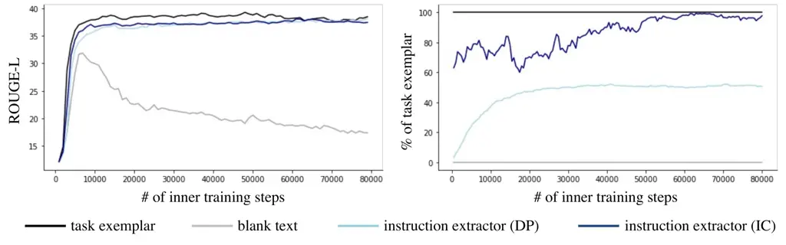
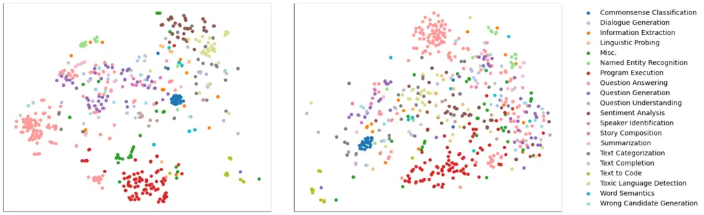
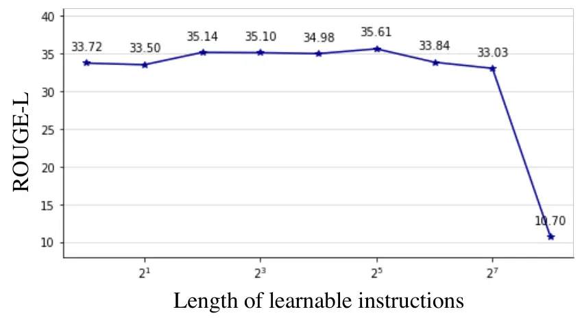
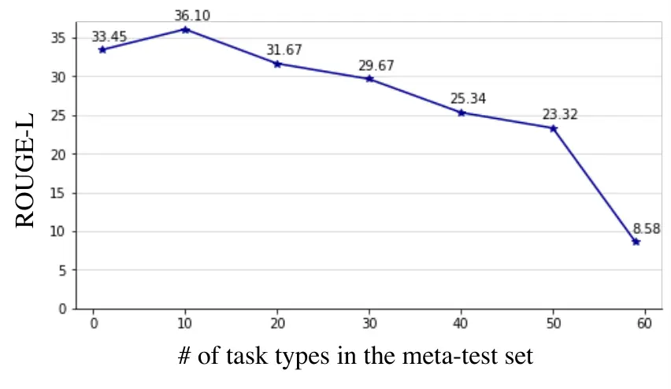

# Differentiable Instruction Optimization for Cross-Task Generalization

Masaru Isonuma Affiliation:  The University of Tokyo Affiliation:  The
University of Edinburgh    Junichiro Mori Affiliation:  The University
of Tokyo Affiliation:  RIKEN{isonuma, isakata}@ipr-ctr.t.u-tokyo.ac.jp
 mori@mi.u-tokyo.ac.jp    Ichiro Sakata Affiliation:  The University of
Tokyo

###### Abstract

Instruction tuning has been attracting much attention to achieve
generalization ability across a wide variety of tasks. Although various
types of instructions have been manually created for instruction tuning,
it is still unclear what kind of instruction is optimal to obtain
cross-task generalization ability. This work presents _instruction
optimization_, which optimizes training instructions with respect to
generalization ability. Rather than manually tuning instructions, we
introduce learnable instructions and optimize them with gradient descent
by leveraging bilevel optimization. Experimental results show that the
learned instruction enhances the diversity of instructions and improves
the generalization ability compared to using only manually created
instructions.

## 1 Introduction

Recently, significant progress has been made in developing models that
can generalize to arbitrary tasks by following natural language
descriptions Brown et al. (2020); Ouyang et al. (2022). _Instruction
tuning_ has been a region of interest as a training technique to obtain
such generalization ability Wei et al. (2022); Sanh et al. (2022);
Mishra et al. (2022). By finetuning pretrained language models on a
variety of tasks with their instructions, models can generalize to
arbitrary tasks unseen during training. Many previous studies witnessed
the effectiveness of instruction tuning Chung et al. (2022); Wang et al.
(2022); Lampinen et al. (2022).

Various instructions have been created for instruction tuning, such as
task name, task definition, positive/negative exemplars of a task,
explanations of why each positive/negative exemplar is
correct/incorrect, etc. However, Mishra et al. (2022); Wang et al.
(2022) showed that the definition and positive exemplars of tasks are
sufficient for instruction tuning, and the effect of adding other types
of instruction is negligible or sometimes has a negative impact on the
generalization performance. Seeking an optimal instruction for
cross-task generalization is an important issue for instruction tuning,
while it requires much human effort (100+ researchers have participated
in previous studies). Furthermore, human-interpretable instructions are
not necessarily optimal for obtaining cross-task generalization ability.

Figure 1: Outline of (a) instruction tuning and (b) instruction
optimization (ours).

Against this background, we propose _instruction optimization_, which
introduces learnable instructions and optimizes them w.r.t. the
cross-task generalization ability. As shown in Figure 1, a model
$`\bm{\theta}`$ is optimized to maximize the performance on meta-train
tasks following learnable instructions. By contrast, learnable
instructions $`\bm{\phi}`$ are trained to maximize the meta-test
performance of the trained model $`\bm{\theta}^{*}(\bm{\phi})`$. This
optimization is called bilevel optimization and is frequently used in
hyperparameter optimization Franceschi et al. (2017); Lorraine et al.
(2020), meta-learning Finn et al. (2017); Franceschi et al. (2018), and
neural architecture search Liu et al. (2018); Zhang et al. (2021). We
regard training instructions as a special type of hyperparameter and
optimize them with gradient descent by relaxing the search space to be
continuous.

To create learnable instructions, we propose two methods: _instruction
embedder_, which generates the embeddings of instructions, and
_instruction extractor_, which selects an optimal task exemplar.
Recently, prompt engineering has drawn attention to seek the optimal
prompt to achieve a task Liu et al. (2022b). Some work studies
continuous prompts that perform prompting in the embedding space of
tokens Li and Liang (2021); Lester et al. (2021), whereas others
retrieve optimal exemplars as a testing prompt for in-context learning
Liu et al. (2022a); Rubin et al. (2022). Our instruction embedder and
instruction extractor follow the idea of continuous prompts and prompt
retrievers, respectively. Whereas previous work optimizes prompts to
solve an individual task on the test, our study differs in the target
and aim of optimization. We optimize the training prompts to maximize
the cross-task generalization ability of the trained model.

In the experiment, we confirmed that the instruction extractor
successfully extracted appropriate instruction, providing proof of
concept. Regarding the comparison with instruction tuning, the
instruction embedder enhances the diversity of instructions and improves
the generalization ability compared to using only manually created
instructions. In contrast, the instruction extractor does not
contributes to the performance gain, which shows that using the same
task exemplar across instances is unexpectedly preferable for cross-task
generalization. This study provides a basis for exploring the optimal
instructions for instruction tuning.

Figure 2: Outline of instruction embedder and instruction extractor.
Instruction tuning uses a manually created instruction or randomly
selected exemplar as _training_ instruction. In contrast, instruction
embedder introduces the learnable embeddings of instruction, while
instruction extractor selects an optimal exemplar as _training_
instruction.

## 2 Preliminaries

Instruction tuning trains a model $`\bm{\theta}`$ to minimize the
training loss defined in Eq. (1):

```math
\displaystyle\begin{split}\bm{\theta}^{*}&\!=\!\argmin_{\bm{\theta}}\mathcal{L}(\bm{\theta})\\
&\!=\!\argmin_{\bm{\theta}}\sum_{t\in\mathcal{T}_{train}}\sum_{i=1}^{N_{t}}\!-\!\log p_{\bm{\theta}}(\bm{y}_{t}^{(i)}|[\bm{I}_{t};\bm{X}_{t}^{(i)}])\end{split} \tag{1}
```

where $`\bm{X}_{t}^{(i)}`$ and $`\bm{I}_{t}`$ denote the embedding
matrix of the $`i`$-th input and instruction of the task $`t`$,
respectively. $`\bm{y}_{t}^{(i)}`$ is a sequence of tokens that
represents a class label or reference text. Instruction tuning regards
all tasks as the conditional text generation given the concatenation of
the instruction and task input $`[\bm{I}_{t};\bm{X}_{t}]`$. By
prepending the instruction to the task input, the trained model
$`\bm{\theta}^{*}`$ can generalize to a variety of unseen tasks
$`t\notin\mathcal{T}_{train}`$.

The optimal training instructions have been sought by manually creating
various types of instruction for instruction tuning Mishra et al.
(2022); Wei et al. (2022); Sanh et al. (2022). However, Mishra et al.
(2022); Wang et al. (2022) showed that task definition and task
exemplars are sufficient for instruction tuning, while adding other
types of instruction is negligible or sometimes negatively affects the
generalization performance. This observation motivates us to
automatically optimize training instructions, rather than manually
tuning them. We introduce learnable instructions and optimize them with
gradient descent by leveraging bilevel optimization. The next section
provides the details of instruction optimization.

## 3 Instruction Optimization

Instruction optimization splits training tasks $`\mathcal{T}_{train}`$
into two sets: meta-train tasks $`\mathcal{T}_{meta-train}`$ and
meta-test tasks $`\mathcal{T}_{meta-test}`$. Subsequently, a model
$`\bm{\theta}`$ is trained to minimize the inner loss on meta-train
tasks following learnable instructions $`\bm{I}_{\phi}`$ in Eq. (2).

```math
\displaystyle\begin{split}&\bm{\theta}^{*}(\bm{\phi})=\argmin_{\bm{\theta}}\mathcal{L}_{in}(\bm{\theta},\bm{\phi})\\
&\!=\!\argmin_{\bm{\theta}}\!\sum_{t\in\mathcal{T}_{meta-train}}\sum_{i=1}^{N_{t}}\!-\!\log p_{\bm{\theta}}(\bm{y}_{t}^{(i)}|[\bm{I}_{\phi};\bm{X}_{t}^{(i)}])\end{split} \tag{2}
```

where $`\bm{\phi}`$ is a parameter for learnable instructions.
$`\bm{I}_{\phi}`$ is constructed using an instruction embedder (Section
3.1) or an instruction extractor (Section 3.2), which will be explained
later.

If the learnable instruction $`\bm{I}_{\phi}`$ is randomly created, the
trained model $`\bm{\theta}^{*}(\bm{\phi})`$ performs poorly on unseen
tasks. Therefore, we optimize $`\bm{\phi}`$ such that the trained model
$`\bm{\theta}^{*}(\bm{\phi})`$ achieves high performance on meta-test
tasks, which are not shown during training. $`\bm{\phi}`$ is updated to
minimize the outer loss in Eq. (3).

```math
\displaystyle\begin{split}&\bm{\phi}^{*}=\argmin_{\bm{\phi}}\mathcal{L}_{out}(\bm{\theta}^{*}(\bm{\phi}))\\
&\!=\!\argmin_{\bm{\phi}}\!\sum_{t\in\mathcal{T}_{meta-test}}\sum_{i=1}^{N_{t}}\!-\!\log p_{\bm{\theta}^{*}}(\bm{y}_{t}^{(i)}|[\bm{I}_{t};\bm{X}_{t}^{(i)}])\end{split} \tag{3}
```

This optimization is called bilevel optimization and is commonly used in
hyperparameter optimization. Note that we use the manually created
instruction $`\bm{I}_{t}`$ to measure the meta-test performance because
we aim to develop a model that can accept arbitrary human-created
instructions.

### 3.1 Instruction Embedder

This section presents a method for creating learnable instructions
$`\bm{I}_{\phi}`$. As shown in Figure 2 (left), the instruction embedder
replaces manually created instructions with the embeddings of learnable
instructions or prepends them to manually created instructions. We
consider the following two types of parameterizations of learnable
instructions:

#### Direct Parameterization (DP)

We parameterize the learnable instruction $`\bm{I}_{\phi}`$ by preparing
a learnable matrix for each task:
$`\bm{I}_{\phi}=\bm{W}_{t}\in\mathcal{R}^{l\times d}`$ where $`l`$
denotes the arbitrary length of a learnable instruction, and $`d`$ is
the dimension of the embeddings in the model $`\bm{\theta}`$. Although
this parameterization is very simple, the size of the parameter
$`\bm{\phi}`$ ($`|\mathcal{T}_{train}|\times l\times d`$) increases when
many training tasks exist. Moreover, as each learnable matrix
$`\bm{W}_{t}`$ is updated only when task $`t`$ is used for computing the
meta-train loss, the matrices are updated infrequently when the number
of training task is large. Therefore, we propose another
parameterization method that is scalable for a large number of training
tasks.

#### Instance Conversion (IC)

Another parameterization method is to convert a task instance
$`\bm{z}_{t}^{(i)}`$ into $`\bm{I}_{\phi}`$ as shown in Eq. (4) and (5).

```math
\displaystyle\bm{h}_{t}^{(i)} \displaystyle=\mathrm{avgpool}(\bm{z}_{t}^{(i)}\bm{V}_{\phi}) \tag{4}
```

```math
\displaystyle\bm{I}_{\phi} \displaystyle=\bm{W}_{\phi}\bm{h}_{t}^{(i)} \tag{5}
```

where the task instance $`\bm{z}_{t}^{(i)}`$ is a sequence of tokens
defined as “Input: $`\bm{x}_{t}^{(i)}`$ Output: $`\bm{y}_{t}^{(i)}`$”,
where $`\bm{x}_{t}^{(i)}`$ and $`\bm{y}_{t}^{(i)}`$ represents the
$`i`$-th input and output of a task $`t`$, respectively.
$`\bm{V}_{\phi}\!\in\!\mathcal{R}^{v\times d^{\prime}}`$ is an word
embedding matrix where $`v`$ denotes the vocabulary size, and
$`\mathrm{avgpool}`$ denotes the average-pooling operation across the
embedded tokens. $`\bm{h}_{t}^{(i)}\!\in\!\mathcal{R}^{d^{\prime}}`$
denotes a latent representation of $`\bm{z}_{t}^{(i)}`$, and
$`\bm{W}_{\phi}\!\in\!\mathcal{R}^{l\times d\times d^{\prime}}`$ is a
learnable tensor to convert the latent representation into an
instruction¹¹ 1 We attempted to use T5 encoder for obtaining
$`\bm{h}_{t}^{(i)}`$; however, it makes bilevel optimization unstable
due to a large number of parameters.. We assume that $`\bm{V}_{\phi}`$
and $`\bm{W}_{\phi}`$ are optimized to generate an optimal instruction
given a task instance. As the parameters are shared across all training
tasks, this parameterization is scalable for a large number of training
tasks.

### 3.2 Instruction Extractor

We consider another type of instruxction that has multiple candidates to
use. A task exemplar is one example because every task instance
$`j\!\in\!\{1,\ldots,N_{t}\}`$ in the training set can be used as a task
exemplar. While instruction tuning randomly selects a task exemplar as
instruction, an optimal task exemplar would exist for cross-task
generalization. We explore how to select the optimal task exemplar that
maximizes the performance on unseen tasks. An outline of the instruction
extractor is shown in Figure 2 (right).

We parameterize the probability $`p_{\phi}(\bm{z}_{t}^{(j)})`$, where
the $`j`$-th instance is selected as an exemplar of task $`t`$. Similar
to the instruction embedder, we consider the following two
parameterizations:

#### Direct Parameterization (DP)

We parameterize the logits of $`p_{\phi}(\bm{z}_{t}^{(j)})`$ by using a
learnable vector $`\bm{v}_{t}\in\mathcal{R}^{N_{t}}`$ for each task
$`t`$. The logits are converted into probabilities using softmax
function in Eq. (6).

```math
\displaystyle p_{\phi}(\bm{z}_{t}^{(j)})=\frac{\exp(v_{t}^{(j)})}{\sum_{j=1}^{N_{t}}\exp(v_{t}^{(j)})} \tag{6}
```

This parameterization is simple but not scalable when the number of
training tasks is large.

#### Instance Conversion (IC)

While direct parameterization parameterizes
$`p_{\phi}(\bm{z}_{t}^{(j)})`$ regardless of the task instance (i.e.,
task input and output), instance conversion considers the conditional
probability given a task instance. Specifically, instance conversion
parameterizes the probability where $`\bm{z}_{t}^{(j)}`$ is selected as
the exemplar of instance $`\bm{z}_{t}^{(i)}`$ in Eq. (7).

```math
\displaystyle p_{\phi}(\bm{z}_{t}^{(j)}|\bm{z}_{t}^{(i)})=\frac{\exp(\bm{h}_{t}^{(j)}\bm{W}_{\phi}\bm{h}_{t}^{(i)})}{\sum_{j=1}^{N_{t}}\exp(\bm{h}_{t}^{(j)}\bm{W}_{\phi}\bm{h}_{t}^{(i)})} \tag{7}
```

where $`\bm{W}_{\phi}\!\in\!\mathcal{R}^{d^{\prime}\times d^{\prime}}`$
denotes a learnable matrix, and
$`\bm{h}_{t}^{(j)}\!\in\!\mathcal{R}^{d^{\prime}}`$ is a latent
representation of the task instance $`\bm{z}_{t}^{(j)}`$ obtained by Eq.
(4). This parameterization assumes that $`\bm{V}_{\phi}`$ and
$`\bm{W}_{\phi}`$ are optimized to select an optimal exemplar given a
task instance. As the parameters $`\bm{\phi}`$ are shared across all
training tasks, this parameterization is also scalable for a large
number of training tasks.

Subsequently, an instance with the highest probability is extracted as
an instruction as shown in Eq. (8) and (9).

```math
\displaystyle\bm{z}_{t} \displaystyle=\argmax_{j}p_{\phi}(\bm{z}_{t}^{(j)}) \tag{8}
```

```math
\displaystyle\bm{I}_{\phi} \displaystyle=\bm{z}_{t}\bm{V}_{\theta} \tag{9}
```

where $`\bm{V}_{\theta}\!\in\!\mathcal{R}^{v\times d}`$ is the word
embedding matrix of the model $`\bm{\theta}`$. Since $`\argmax`$
operation is not differentiable, we use the straight-through estimator
Bengio et al. (2013) to approximate the gradient in the backward pass²²
2 We also tried to compute $`\bm{I}_{\phi}`$ using the expectation of
$`\bm{z}_{t}^{(j)}`$:
$`\bm{I}_{\phi}\!=\!\mathbf{E}_{p_{\phi}}[\bm{z}_{t}^{(j)}\bm{V}_{\theta}]`$
instead of $`\argmax`$ operation; however, it significantly
underperforms.. As computing the probability of all instances requires a
high computational cost when the number of instances is significant, we
set a constant value as $`N_{t}\!=\!N`$ and randomly sampled $`N`$
instances from all training instances.

 while not converged do

  for $`k=1,\ldots,K`$ do

   $`\bm{\theta}^{(k)}\leftarrow\bm{\theta}^{(k-1)}-\eta\left.\nabla_{\bm{\theta}}\mathcal{L}_{in}(\bm{\theta},\bm{\phi})\right|_{\bm{\theta}=\bm{\theta}^{(k-1)}}`$

  end for

  $`\bm{\phi}\leftarrow\bm{\phi}-\eta\nabla_{\bm{\phi}}\mathcal{L}_{out}(\bm{\theta}^{(K)})`$

 end while

Algorithm 1 Bilevel Optimization

### 3.3 Efficiently Solving Bilevel Optimization

Directly solving bilevel optimization requires a substantial
computational cost because it includes a nested formulation. As shown in
Alg. 1, approximating the inner optimization in Eq. (2) by
$`K`$-gradient steps significantly reduces the computational cost, where
$`K`$ is large enough to reach the optimal points of the inner-loop
Franceschi et al. (2017); Shaban et al. (2019).

Computing the hypergradient
$`\nabla_{\bm{\phi}}\mathcal{L}_{out}(\bm{\theta}^{(K)})`$ still
requires large memory space
$`\mathcal{O}(K|\bm{\theta}|\!+\!|\bm{\phi}|)`$ as it needs to store
$`K`$-step gradients Franceschi et al. (2017), and the language model
$`\bm{\theta}`$ contains a lot of parameters. Using the implicit
function theorem in Eq. (10) and (11), the hypergradient can be computed
without storing the intermediate gradients Bengio (2000); Lorraine
et al. (2020).

```math
\displaystyle\nabla_{\bm{\phi}}\mathcal{L}_{out}(\bm{\theta}^{(K)}(\bm{\phi}))\!=\!\frac{\partial\mathcal{L}_{out}(\bm{\theta}^{(K)})}{\partial\bm{\theta}^{(K)}}\frac{\partial\bm{\theta}^{(K)}(\bm{\phi})}{\partial\bm{\phi}} \tag{10}
```

```math
\displaystyle\frac{\partial\bm{\theta}^{(K)}(\bm{\phi})}{\partial\bm{\phi}}\!=\!\left.-\Bigl[\frac{\partial\mathcal{L}_{in}(\bm{\theta},\bm{\phi})}{\partial\bm{\theta}\partial\bm{\theta}}\Bigr]^{\!-\!1}\frac{\partial\mathcal{L}_{in}(\bm{\theta},\bm{\phi})}{\partial\bm{\theta}\partial\bm{\phi}}\right|_{\bm{\theta}^{(K)},\bm{\phi}} \tag{11}
```

However, it is impractical to compute the inverse of the Hessian matrix
in Eq. (11) as exactly inverting Hessian often requires
$`\mathcal{O}(|\bm{\theta}|^{3})`$ computational cost. We thus
approximate the inverse-Hessian using the Neumann approximation, which
is introduced in the hyperparameter optimization Lorraine et al. (2020);
Zhang et al. (2021). The inverse of the Hessian matrix can be
approximated as shown in Eq. (12).

```math
\displaystyle\Bigl[\frac{\partial\mathcal{L}_{in}(\bm{\theta},\bm{\phi})}{\partial\bm{\theta}\partial\bm{\theta}}\Bigr]^{\!-\!1}\!=\!\lim_{M\to\infty}\!\gamma\!\sum_{m=0}^{M}\!\Bigl[\bm{E}\!-\!\gamma\frac{\partial\mathcal{L}_{in}(\bm{\theta},\bm{\phi})}{\partial\bm{\theta}\partial\bm{\theta}}\Bigr]^{m} \tag{12}
```

where $`\bm{E}`$ denotes an identity matrix. $`\gamma\in\mathcal{R}`$ is
sufficiently small to satisfy
$`\|\bm{E}\!-\!\gamma\frac{\partial\mathcal{L}_{in}(\bm{\theta},\bm{\phi})}{\partial\bm{\theta}\partial\bm{\theta}}\|<1`$
in the operator norm. Consequently, the computational cost of the
hypergradient considerably decreases to
$`\mathcal{O}(|\bm{\theta}|\!+\!|\bm{\phi}|)`$ as shown in Lorraine
et al. (2020).



Figure 3: Left: ROUGE-L on test tasks where a task exemplar is used as
_testing_ instruction, while _training_ instruction is varied as above.
Right: the percentage of training instances where a task exemplar is
used as training instruction.

| Split                | Meta-train | Meta-test | Valid | Test |
| -------------------- | ---------- | --------- | ----- | ---- |
| \# of tasks          | 715        | 42        | 757   | 119  |
| \# of task types     | 50         | 10        | 60    | 12   |
| \# of instances/task | 100        | 100       | 10    | 100  |

Table 1: Statistics of the dataset.

## 4 Experiments

### 4.1 Experimental Setup³³ 3 The code is available at [https://github.com/misonuma/instopt](https://github.com/misonuma/instopt).

#### Dataset

In this experiment, we used Super-NaturalInstructions (Wang et al.,
2022, Sup-NatInst;) as a benchmark to measure cross-task generalization.
Sup-NatInst consists of over 1,600 diverse tasks and their instructions
across multiple languages. We used English tasks and their instructions,
resulting in 876 tasks in total.

We used the same test split of tasks (12 types; 119 tasks) and 100
instances for each task as Wang et al. (2022). The remaining 60 task
types (757 tasks) were used for meta-train, meta-test, and validation.
The validation set consisted of 10 instances across all 757 tasks, which
were used to determine hyperparameters including meta-train/test split.
Based on the validation performance, we split the 60 task types into 50
and 10 types, which were used for the meta-train and meta-test set,
respectively. We used $`100`$ instances of each task for the
meta-train/test set. Table 1 summarizes the statistics for each split.
The task types in each split are listed in Appendix A.1.

#### Evaluation & Baselines

We assessed the cross-task generalization in two settings: a zero-shot
setting that uses task definition as _testing_ instruction, and a
one-shot setting that uses a task exemplar (n=1) as _testing_
instruction. We adopted ROUGE-L Lin (2004) to evaluate all tasks. Wang
et al. (2022) shows that the human evaluation results align quite well
with ROUGE-L across a variety of tasks.

For baseline training instructions, we used manually created
instructions (e.g., task definition), exemplars randomly selected for
each task or each instance. Learnable instructions induced by the
instruction embedder or optimal exemplars selected by the instruction
extractor were compared.

#### Implementation Details

In our experiment, we used pretrained T5 Raffel et al. (2020) as the
model $`\bm{\theta}`$. Specifically, we use the LM-adapted version of
the original T5-base (220M)⁵⁵ 5
[https://huggingface.co/google/t5-base-lm-adapt](https://huggingface.co/google/t5-base-lm-adapt),
which is further trained with a language modeling objective Lester
et al. (2021). The hyperparameters of model $`\bm{\theta}`$ were tuned
based on the validation performance of instruction tuning (baselines),
and the same hyperparameters were used for instruction optimization. The
hyperparemters of learnable instructions $`\bm{\phi}`$ were determined
w.r.t. the validation performance of instruction optimization. Further
details are provided in Appendix A.2.

### 4.2 Proof of Concept

Before moving on to the comparison with instruction tuning, we show that
our instruction extractor successfully optimizes the training
instruction. We trained models with two types of _training_
instructions: one of which is a task exemplar, and the other is a blank
text. Then, we evaluated them on the test set, where a task exemplar is
used as the _testing_ instruction. As shown in Figure 3 (left), the
model trained with a task exemplar achieves nearly 40% ROUGE-L (black),
whereas the model trained with blank text significantly declines to
approximately 20% ROUGE-L (gray).

Following these preliminary results, we verified that our instruction
extractor appropriately selects a task exemplar from the two training
instructions and obtains sufficient generalization ability. Figure 3
(left) shows that our instruction extractor achieves competitive
performance with the model trained with a task exemplar. Specifically,
the instance conversion (IC; blue) converges faster than the direct
parameterization (DP; light blue). Figure 3 (right) presents the
percentage of training instances where a task exemplar is selected as
the training instruction. Regarding the DP, the percentage increases
smoothly, whereas it saturates at approximately 50%. In contrast, the IC
reaches almost 100%, though the increase is slightly unstable. These
results indicate that our instruction extractor successfully selects an
appropriate training instruction. Note that the training time of
instruction optimization is reasonable compared to instruction tuning,
as shown in Appendix A.3.

| Training Instruction             | ROUGE-L            |
| -------------------------------- | ------------------ |
| Def.                             | 33.82 $`\pm`$ 0.47 |
| Def. + Pos.                      | 27.74 $`\pm`$ 0.41 |
| Def. + Pos. + Neg.               | 27.91 $`\pm`$ 0.66 |
| Def. + Pos. + Neg. + Expl.       | 29.07 $`\pm`$ 0.31 |
| Instruction Embedder (DP)        | 11.79 $`\pm`$ 0.27 |
| Instruction Embedder (IC)        | 11.99 $`\pm`$ 0.22 |
| Def. + Instruction Embedder (DP) | 34.79 $`\pm`$ 0.33 |
| Def. + Instruction Embedder (IC) | 34.97 $`\pm`$ 0.46 |

Table 2: Zero-shot evaluation where task definition is used as _testing_
instruction, while _training_ instruction is varied as above. Def.: task
definition; Pos.: positive exemplar (n=1), Neg.: negative exemplar
(n=1); Expl.: explanation why each positive/negative exemplar is
correct/incorrect. DP and IC represents direct parameterization and
instance conversion, respectively.

### 4.3 Main Results

Here, we examine the effectiveness of instruction optimization by
comparing it with the baselines. In Table 2 and 3, we show the average
performance across 8 different random seeds and 95% confidence intervals
w.r.t. the t-distribution.

Table 2 shows the average ROUGE-L across all test tasks where the task
definition is used as the testing instruction, while varying the
training instruction. As the baseline of training instructions, we used
manually created task definitions concatenated with positive/negative
exemplars and explanations about each positive/negative exemplar. When
using only learnable instructions generated by the instruction embedder,
the performance is considerably worse than that of baselines. This
underperformance suggests that the learned instructions cannot alternate
with manually created instructions. However, concatenating learnable
instruction with task definition leads to performance gain, whereas
prepending other instructions (positive/negative exemplars and
explanations) has a negative effect. As will be elaborated in Section
5.1, adding learnable instructions improves the diversity of
instructions and achieves higher generalization performance.

In Table 3, we show the results where a task exemplar is used as the
testing instruction. Unfortunately, our instruction extractor
underperforms exemplars randomly selected for each _task_ (i.e., the
same exemplar is used for each instance). To investigate the reason for
the worse performance, we added another baseline, which randomly selects
an exemplar for each _instance_ (i.e., different exemplars are used for
each instance). Unexpectedly, the random exemplars yield considerably
worse ROUGE-L when they are selected for each instance. This result
indicates that using the same exemplar across all instances of each task
is preferable for cross-task generalization. As the instruction
extractor (DP and IC) updates the optimal exemplar during the
optimization, it performs worse than exemplars randomly selected for
each task. In particular, as IC varies the optimal exemplar for each
instance, it results in a lower performance.

The evaluation results of each test task type are shown in Appendix A.4.

| Training Instruction            | ROUGE-L      |
| ------------------------------- | ------------ |
| Random Exemplar (each task)     | 39.59 ± 0.14 |
| Random Exemplar (each instance) | 37.19 ± 0.25 |
| Instruction Extractor (DP)      | 37.85 ± 0.67 |
| Instruction Extractor (IC)      | 37.15 ± 0.52 |

Table 3: One-shot evaluation where a task exemplar is used as _testing_
instruction while _training_ instruction is varied as above. Random
Exemplar denotes exemplars randomly selected for each _task_ or each
_instance_ (n=1). DP and IC represents direct parameterization and
instance conversion, respectively.



Figure 4: Embeddings of the instructions in the meta-train set. Left:
task definition; Right: learned instruction concatenated with task
definition. Each point represents a task, while each color denotes the
task type.

## 5 Discussion

### 5.1 Analysis of Learned Instruction

We discuss how the learned instruction contributes to the improvement of
cross-task generalization.

As the instruction embedder directly generates instruction embeddings in
a continuous space, the learned instruction is difficult to interpret.
Following Lester et al. (2021), we computed the nearest neighbors of
each token in the learned instruction from the vocabulary of the model
$`\bm{\theta}`$; however, we could not find explicit patterns for the
nearest tokens. Therefore, we computed the embeddings of the learned
instructions and visuzalized them at a two-dimensional space using t-SNE
Van der Maaten and Hinton (2008). The embeddings were obtained by the
average pooling across the last hidden states encoded by the T5 encoder.

In Figure 4, we show the embeddings of top 20 task types with respect to
the number of tasks in the meta-train set. The embeddings of the task
definition (left) are closely clustered by the task type, and training
tasks do not cover some spaces. On the other hand, the embeddings of
learned instructions (right) are roughly clustered, and some task types
are scattered over the embedding space (e.g., sentiment analysis and
toxic language detection). As learned instructions enhance the diversity
of instructions and cover a broader embedding space, the trained model
can generalize to wider variety of instructions. Thus, learned
instructions improve the generalization performance on unseen tasks.

Figure 5 shows the generalization performance concerning the length of
the learnable instruction prepended to the task definition. The model’s
performance saturates when the length is $`2^{6}\!=\!64`$. When the
instruction is longer than $`64`$, the performance declines
significantly. As bilevel optimization tends to be unstable for
large-scale hyperparameters, a large instruction length leads to low
generalization performance.



Figure 5: ROUGE-L on the test set where the length of learnable
instructions is varied.

### 5.2 Analysis of Meta-train/test Split

We study how meta-train/test split affects the generalization
performance of the trained model.

#### Number of Meta-train/test Tasks

Figure 6 shows the performance with different numbers of task types in
the meta-train/test split: 1/59, 10/50, 20/40, 30/30, 40/20, 50/10, and
59/1. In each split, meta-train/test tasks were randomly chosen. The
trained model achieves the best generalization performance when the
number of categories in the meta-test is 10. The performance worsens as
the number of meta-test tasks increases, while the number of meta-train
tasks decreases correspondingly.

#### Diverse vs. Not Diverse

We examine whether meta-test tasks should be diverse or not diverse. If
meta-test tasks are diverse, the generalization performance would be
improved because the instruction is trained to achieve higher
performance on various tasks. However, it also increases the risk that
some of meta-test tasks are similar to meta-train tasks, which would
negatively affect the performance on unseen tasks. It is not obvious
whether meta-test tasks should be diverse or not diverse.

To answer this question, we prepared two types of meta-test splits. One
comprises randomly selected tasks, whereas the other consists of tasks
that are grouped by k-means clustering. We prepared 16 different random
splits, while k-means divided the tasks into 16 groups based on the
embeddings of the task definition. Then, for both random split and
k-means, the best split for the validation set was chosen from the 16
splits. Experimental results show that model trained on the random split
achieves 36.1 ROUGE-L, while that of k-means scores 35.0 ROUGE-L on the
test set. Although the margin is not significant, we confirmed that
diverse meta-test tasks are more preferable for cross-task
generalization.



Figure 6: ROUGE-L on the test set w.r.t. the number of task types in the
meta-test set.

## 6 Related Work

#### Instruction Tuning

Instruction tuning has attracted considerable attention to achieve
models that are generalizable across a variety of tasks Wei et al.
(2022); Sanh et al. (2022); Mishra et al. (2022). By prepending either a
few exemplars Min et al. (2022b); Chen et al. (2022) or text-based
instructions Wei et al. (2022); Sanh et al. (2022); Mishra et al. (2022)
to multi-task learning, the trained model can generalize to tasks unseen
during training. Further progress has been made by scaling the number of
tasks Wang et al. (2022); Chung et al. (2022), scaling the model size
Chung et al. (2022); Scao et al. (2022), and improving the training
strategy Lang et al. (2022); Min et al. (2022a); Ye et al. (2023). In
contrast, our work is the first study to optimize training instructions
to improve the cross-task generalization ability.

Although Super-NaturalInstructions Wang et al. (2022) is used as the
benchmark for measuring cross-task generalization in our study, our
instruction optimization can be applied to other cross-task benchmarks,
such as CROSSFIT Ye et al. (2021) and PromptSource Bach et al. (2022).

#### Prompt Engineering

Recent instruction-based NLP has evolved prompt engineering, which seeks
the most appropriate prompt to achieve a task Liu et al. (2022b). While
there are numerous studies to search for an optimal prompt in a discrete
token space Shin et al. (2020); Schick and Schütze (2021); Gao et al.
(2021), some work studies continuous prompts that perform prompting in
the embedding space of tokens Li and Liang (2021); Lester et al. (2021);
Qin and Eisner (2021). Other studies retrieve appropriate exemplars as a
testing prompt for in-context learning and achieve better performance
than randomly selected exemplars Das et al. (2021); Liu et al. (2022a);
Rubin et al. (2022). Whereas the aforementioned methods optimize prompts
to achieve an individual task in the test, our study differs in the
target and aim of optimization; we optimize the training prompts to
maximize the generalization performance of the trained model.

#### Bilevel Optimization

Bilevel optimization has been used to optimize hyperparameters
Franceschi et al. (2017); Lorraine et al. (2020), initial model weights
Finn et al. (2017); Franceschi et al. (2018), and model architectures
Liu et al. (2018); Zhang et al. (2021). We optimize the training
instructions by regarding them as a special type of hyperparameters.
Learnable instructions are constructed by many hyperparameters, which
makes bilevel optimization difficult in terms of computational cost and
stability. Recent studies Rajeswaran et al. (2019); Lorraine et al.
(2020); Zhang et al. (2021) significantly reduce the computational cost
and improve the stability by combining the implicit function theorem
with efficient inverse Hessian approximations. We leverage this idea for
instruction optimization, achieving instruction optimization at a
reasonable computational cost and stability.

## 7 Conclusion

This study presents instruction optimization, which optimizes training
instructions concerning generalization ability. The experimental results
showed that our instruction extractor successfully extracted appropriate
instruction, providing proof of concept. Regarding the comparison with
instruction tuning, the instruction embedder enhanced the diversity of
instructions and improved the generalization ability than using only
manually created instructions. In contrast, the instruction extractor
did not contribute to the performance gain because using the same task
exemplar across instances is unexpectedly preferable for cross-task
generalization. This study provides a basis for exploring the optimal
instructions for instruction tuning.

## Limitations

Our study used T5-base (220M) due to the capacity of our computational
resources (Tesla V100 32GB). Thus, it is unclear whether our method is
also effective for larger models, such as T5-XL/XXL. Lester et al.
(2021) argues that continuous prompts are particularly effective for
large T5 models. Following their results, our instruction embedder is
also expected to be effective for larger models.

As shown in Figure 3, instruction optimization is slightly unstable to
converge. Some studies tackled the unstable convergence of bilevel
optimization by L2-normalization, early stopping Zela et al. (2019), or
perturbation of hyperparameters Chen and Hsieh (2020). These methods
might be effective in stabilizing the instruction optimization.

## Ethics Statement

Our study complies with the ACL Ethics Policy. We used S2ORC (Lo et al.,
2020, CC BY-NC 4.0), PyTorch (Paszke et al., 2019, BSD-style license)
and HuggingFace Transformers (Wolf et al., 2020, Apache-2.0) as
scientific artifacts. Our study was conducted under the licenses and
terms of the scientific artifacts. Our model is trained on a set of
publicly available datasets Wang et al. (2022), in which undesirable
data distribution, such as disinformation, bias, or offensive content,
might present. Such potential risks need to be recognized.

## Acknowledgements

We would like to thank the anonymous reviewers for their valuable
feedback. This work was supported by JST ACT-X JPMJAX1904, JST CREST
JPMJCR21D1, NEDO JPNP20006, and JSPS KAKENHI 23K16940, Japan.

## References

- Bach et al. (2022) Stephen Bach, Victor Sanh, Zheng Xin Yong, Albert
  Webson, Colin Raffel, Nihal V. Nayak, Abheesht Sharma, Taewoon Kim,
  M Saiful Bari, Thibault Fevry, Zaid Alyafeai, Manan Dey, Andrea
  Santilli, Zhiqing Sun, Srulik Ben-david, Canwen Xu, Gunjan Chhablani,
  Han Wang, Jason Fries, Maged Al-shaibani, Shanya Sharma, Urmish
  Thakker, Khalid Almubarak, Xiangru Tang, Dragomir Radev, Mike
  Tian-jian Jiang, and Alexander Rush. 2022. [PromptSource: An
  integrated development environment and repository for natural language
  prompts](https://doi.org/10.18653/v1/2022.acl-demo.9). In _Proceedings
  of the 60th Annual Meeting of the Association for Computational
  Linguistics: System Demonstrations_, pages 93–104, Dublin, Ireland.
  Association for Computational Linguistics.
- Bengio (2000) Yoshua Bengio. 2000. Gradient-based optimization of
  hyperparameters. _Neural computation_, 12(8):1889–1900.
- Bengio et al. (2013) Yoshua Bengio, Nicholas Léonard, and Aaron
  Courville. 2013. Estimating or propagating gradients through
  stochastic neurons for conditional computation. _arXiv:1308.3432v1_.
- Brown et al. (2020) Tom Brown, Benjamin Mann, Nick Ryder, Melanie
  Subbiah, Jared D Kaplan, Prafulla Dhariwal, Arvind Neelakantan, Pranav
  Shyam, Girish Sastry, Amanda Askell, et al. 2020. Language models are
  few-shot learners. _Advances in neural information processing
  systems_, 33:1877–1901.
- Chen and Hsieh (2020) Xiangning Chen and Cho-Jui Hsieh. 2020.
  Stabilizing differentiable architecture search via perturbation-based
  regularization. In _International conference on machine learning_,
  pages 1554–1565. PMLR.
- Chen et al. (2022) Yanda Chen, Ruiqi Zhong, Sheng Zha, George Karypis,
  and He He. 2022. [Meta-learning via language model in-context
  tuning](https://doi.org/10.18653/v1/2022.acl-long.53). In _Proceedings
  of the 60th Annual Meeting of the Association for Computational
  Linguistics (Volume 1: Long Papers)_, pages 719–730, Dublin, Ireland.
  Association for Computational Linguistics.
- Chung et al. (2022) Hyung Won Chung, Le Hou, Shayne Longpre, Barret
  Zoph, Yi Tay, William Fedus, Eric Li, Xuezhi Wang, Mostafa Dehghani,
  Siddhartha Brahma, et al. 2022. Scaling instruction-finetuned language
  models. _arXiv:2210.11416v5_.
- Das et al. (2021) Rajarshi Das, Manzil Zaheer, Dung Thai, Ameya
  Godbole, Ethan Perez, Jay Yoon Lee, Lizhen Tan, Lazaros Polymenakos,
  and Andrew McCallum. 2021. [Case-based reasoning for natural language
  queries over knowledge
  bases](https://doi.org/10.18653/v1/2021.emnlp-main.755). In
  _Proceedings of the 2021 Conference on Empirical Methods in Natural
  Language Processing_, pages 9594–9611, Online and Punta Cana,
  Dominican Republic. Association for Computational Linguistics.
- Finn et al. (2017) Chelsea Finn, Pieter Abbeel, and Sergey
  Levine. 2017. Model-agnostic meta-learning for fast adaptation of deep
  networks. In _International conference on machine learning_, pages
  1126–1135. PMLR.
- Franceschi et al. (2017) Luca Franceschi, Michele Donini, Paolo
  Frasconi, and Massimiliano Pontil. 2017. Forward and reverse
  gradient-based hyperparameter optimization. In _International
  Conference on Machine Learning_, pages 1165–1173. PMLR.
- Franceschi et al. (2018) Luca Franceschi, Paolo Frasconi, Saverio
  Salzo, Riccardo Grazzi, and Massimiliano Pontil. 2018. Bilevel
  programming for hyperparameter optimization and meta-learning. In
  _International Conference on Machine Learning_, pages 1568–1577. PMLR.
- Gao et al. (2021) Tianyu Gao, Adam Fisch, and Danqi Chen. 2021.
  [Making pre-trained language models better few-shot
  learners](https://doi.org/10.18653/v1/2021.acl-long.295). In
  _Proceedings of the 59th Annual Meeting of the Association for
  Computational Linguistics and the 11th International Joint Conference
  on Natural Language Processing (Volume 1: Long Papers)_, pages
  3816–3830, Online. Association for Computational Linguistics.
- Kingma and Ba (2014) Diederik P Kingma and Jimmy Ba. 2014. Adam: A
  method for stochastic optimization. _arXiv:1412.6980v9_.
- Lampinen et al. (2022) Andrew Lampinen, Ishita Dasgupta, Stephanie
  Chan, Kory Mathewson, Mh Tessler, Antonia Creswell, James McClelland,
  Jane Wang, and Felix Hill. 2022. [Can language models learn from
  explanations in
  context?](https://aclanthology.org/2022.findings-emnlp.38) In
  _Findings of the Association for Computational Linguistics: EMNLP
  2022_, pages 537–563, Abu Dhabi, United Arab Emirates. Association for
  Computational Linguistics.
- Lang et al. (2022) Hunter Lang, Monica N Agrawal, Yoon Kim, and David
  Sontag. 2022. Co-training improves prompt-based learning for large
  language models. In _International Conference on Machine Learning_,
  pages 11985–12003. PMLR.
- Lester et al. (2021) Brian Lester, Rami Al-Rfou, and Noah
  Constant. 2021. [The power of scale for parameter-efficient prompt
  tuning](https://doi.org/10.18653/v1/2021.emnlp-main.243). In
  _Proceedings of the 2021 Conference on Empirical Methods in Natural
  Language Processing_, pages 3045–3059, Online and Punta Cana,
  Dominican Republic. Association for Computational Linguistics.
- Li and Liang (2021) Xiang Lisa Li and Percy Liang. 2021.
  [Prefix-tuning: Optimizing continuous prompts for
  generation](https://doi.org/10.18653/v1/2021.acl-long.353). In
  _Proceedings of the 59th Annual Meeting of the Association for
  Computational Linguistics and the 11th International Joint Conference
  on Natural Language Processing (Volume 1: Long Papers)_, pages
  4582–4597, Online. Association for Computational Linguistics.
- Lin (2004) Chin-Yew Lin. 2004. [ROUGE: A package for automatic
  evaluation of summaries](https://aclanthology.org/W04-1013). In _Text
  Summarization Branches Out_, pages 74–81, Barcelona, Spain.
  Association for Computational Linguistics.
- Liu et al. (2018) Hanxiao Liu, Karen Simonyan, and Yiming Yang. 2018.
  Darts: Differentiable architecture search. In _International
  Conference on Learning Representations_.
- Liu et al. (2022a) Jiachang Liu, Dinghan Shen, Yizhe Zhang, Bill
  Dolan, Lawrence Carin, and Weizhu Chen. 2022a. [What makes good
  in-context examples for
  GPT-3?](https://doi.org/10.18653/v1/2022.deelio-1.10) In _Proceedings
  of Deep Learning Inside Out (DeeLIO 2022): The 3rd Workshop on
  Knowledge Extraction and Integration for Deep Learning Architectures_,
  pages 100–114, Dublin, Ireland and Online. Association for
  Computational Linguistics.
- Liu et al. (2022b) Pengfei Liu, Weizhe Yuan, Jinlan Fu, Zhengbao
  Jiang, Hiroaki Hayashi, and Graham Neubig. 2022b. [Pre-train, prompt,
  and predict: A systematic survey of prompting methods in natural
  language processing](https://doi.org/10.1145/3560815). _ACM Computing
  Surveys_.
- Lo et al. (2020) Kyle Lo, Lucy Lu Wang, Mark Neumann, Rodney Kinney,
  and Daniel Weld. 2020. [S2ORC: The semantic scholar open research
  corpus](https://doi.org/10.18653/v1/2020.acl-main.447). In
  _Proceedings of the 58th Annual Meeting of the Association for
  Computational Linguistics_, pages 4969–4983, Online. Association for
  Computational Linguistics.
- Lorraine et al. (2020) Jonathan Lorraine, Paul Vicol, and David
  Duvenaud. 2020. Optimizing millions of hyperparameters by implicit
  differentiation. In _International Conference on Artificial
  Intelligence and Statistics_, pages 1540–1552. PMLR.
- Min et al. (2022a) Sewon Min, Mike Lewis, Hannaneh Hajishirzi, and
  Luke Zettlemoyer. 2022a. [Noisy channel language model prompting for
  few-shot text
  classification](https://doi.org/10.18653/v1/2022.acl-long.365). In
  _Proceedings of the 60th Annual Meeting of the Association for
  Computational Linguistics (Volume 1: Long Papers)_, pages 5316–5330,
  Dublin, Ireland. Association for Computational Linguistics.
- Min et al. (2022b) Sewon Min, Mike Lewis, Luke Zettlemoyer, and
  Hannaneh Hajishirzi. 2022b. [MetaICL: Learning to learn in
  context](https://doi.org/10.18653/v1/2022.naacl-main.201). In
  _Proceedings of the 2022 Conference of the North American Chapter of
  the Association for Computational Linguistics: Human Language
  Technologies_, pages 2791–2809, Seattle, United States. Association
  for Computational Linguistics.
- Mishra et al. (2022) Swaroop Mishra, Daniel Khashabi, Chitta Baral,
  and Hannaneh Hajishirzi. 2022. [Cross-task generalization via natural
  language crowdsourcing
  instructions](https://doi.org/10.18653/v1/2022.acl-long.244). In
  _Proceedings of the 60th Annual Meeting of the Association for
  Computational Linguistics (Volume 1: Long Papers)_, pages 3470–3487,
  Dublin, Ireland. Association for Computational Linguistics.
- Ouyang et al. (2022) Long Ouyang, Jeff Wu, Xu Jiang, Diogo Almeida,
  Carroll L Wainwright, Pamela Mishkin, Chong Zhang, Sandhini Agarwal,
  Katarina Slama, Alex Ray, et al. 2022. Training language models to
  follow instructions with human feedback. _arXiv:2203.02155v1_.
- Paszke et al. (2019) Adam Paszke, Sam Gross, Francisco Massa, Adam
  Lerer, James Bradbury, Gregory Chanan, Trevor Killeen, Zeming Lin,
  Natalia Gimelshein, Luca Antiga, Alban Desmaison, Andreas Kopf, Edward
  Yang, Zachary DeVito, Martin Raison, Alykhan Tejani, Sasank
  Chilamkurthy, Benoit Steiner, Lu Fang, Junjie Bai, and Soumith
  Chintala. 2019. Pytorch: An imperative style, high-performance deep
  learning library. In _Advances in Neural Information Processing
  Systems_, pages 8024–8035. Curran Associates, Inc.
- Qin and Eisner (2021) Guanghui Qin and Jason Eisner. 2021. [Learning
  how to ask: Querying LMs with mixtures of soft
  prompts](https://doi.org/10.18653/v1/2021.naacl-main.410). In
  _Proceedings of the 2021 Conference of the North American Chapter of
  the Association for Computational Linguistics: Human Language
  Technologies_, pages 5203–5212, Online. Association for Computational
  Linguistics.
- Raffel et al. (2020) Colin Raffel, Noam Shazeer, Adam Roberts,
  Katherine Lee, Sharan Narang, Michael Matena, Yanqi Zhou, Wei Li,
  Peter J Liu, et al. 2020. Exploring the limits of transfer learning
  with a unified text-to-text transformer. _Journal of machine learning
  research_, 21(140):1–67.
- Rajeswaran et al. (2019) Aravind Rajeswaran, Chelsea Finn, Sham M
  Kakade, and Sergey Levine. 2019. Meta-learning with implicit
  gradients. _Advances in neural information processing systems_, 32.
- Rubin et al. (2022) Ohad Rubin, Jonathan Herzig, and Jonathan
  Berant. 2022. [Learning to retrieve prompts for in-context
  learning](https://doi.org/10.18653/v1/2022.naacl-main.191). In
  _Proceedings of the 2022 Conference of the North American Chapter of
  the Association for Computational Linguistics: Human Language
  Technologies_, pages 2655–2671, Seattle, United States. Association
  for Computational Linguistics.
- Sanh et al. (2022) Victor Sanh, Albert Webson, Colin Raffel, Stephen
  Bach, Lintang Sutawika, Zaid Alyafeai, Antoine Chaffin, Arnaud
  Stiegler, Arun Raja, Manan Dey, et al. 2022. Multitask prompted
  training enables zero-shot task generalization. In _International
  Conference on Learning Representations_.
- Scao et al. (2022) Teven Le Scao, Angela Fan, Christopher Akiki, Ellie
  Pavlick, Suzana Ilić, Daniel Hesslow, Roman Castagné, Alexandra Sasha
  Luccioni, François Yvon, Matthias Gallé, et al. 2022. Bloom: A
  176b-parameter open-access multilingual language model.
  _arXiv:2211.05100v5_.
- Schick and Schütze (2021) Timo Schick and Hinrich Schütze. 2021.
  [Exploiting cloze-questions for few-shot text classification and
  natural language
  inference](https://doi.org/10.18653/v1/2021.eacl-main.20). In
  _Proceedings of the 16th Conference of the European Chapter of the
  Association for Computational Linguistics: Main Volume_, pages
  255–269, Online. Association for Computational Linguistics.
- Shaban et al. (2019) Amirreza Shaban, Ching-An Cheng, Nathan Hatch,
  and Byron Boots. 2019. Truncated back-propagation for bilevel
  optimization. In _The 22nd International Conference on Artificial
  Intelligence and Statistics_, pages 1723–1732. PMLR.
- Shin et al. (2020) Taylor Shin, Yasaman Razeghi, Robert L. Logan IV,
  Eric Wallace, and Sameer Singh. 2020. [AutoPrompt: Eliciting Knowledge
  from Language Models with Automatically Generated
  Prompts](https://doi.org/10.18653/v1/2020.emnlp-main.346). In
  _Proceedings of the 2020 Conference on Empirical Methods in Natural
  Language Processing (EMNLP)_, pages 4222–4235, Online. Association for
  Computational Linguistics.
- Van der Maaten and Hinton (2008) Laurens Van der Maaten and Geoffrey
  Hinton. 2008. Visualizing data using t-sne. _Journal of machine
  learning research_, 9(11):2579–2605.
- Wang et al. (2022) Yizhong Wang, Swaroop Mishra, Pegah
  Alipoormolabashi, Yeganeh Kordi, Amirreza Mirzaei, Atharva Naik, Arjun
  Ashok, Arut Selvan Dhanasekaran, Anjana Arunkumar, David Stap, Eshaan
  Pathak, Giannis Karamanolakis, Haizhi Lai, Ishan Purohit, Ishani
  Mondal, Jacob Anderson, Kirby Kuznia, Krima Doshi, Kuntal Kumar Pal,
  Maitreya Patel, Mehrad Moradshahi, Mihir Parmar, Mirali Purohit,
  Neeraj Varshney, Phani Rohitha Kaza, Pulkit Verma, Ravsehaj Singh
  Puri, Rushang Karia, Savan Doshi, Shailaja Keyur Sampat, Siddhartha
  Mishra, Sujan Reddy A, Sumanta Patro, Tanay Dixit, and Xudong
  Shen. 2022. [Super-NaturalInstructions: Generalization via declarative
  instructions on 1600+ NLP
  tasks](https://aclanthology.org/2022.emnlp-main.340). In _Proceedings
  of the 2022 Conference on Empirical Methods in Natural Language
  Processing_, pages 5085–5109, Abu Dhabi, United Arab Emirates.
  Association for Computational Linguistics.
- Wei et al. (2022) Jason Wei, Maarten Bosma, Vincent Zhao, Kelvin Guu,
  Adams Wei Yu, Brian Lester, Nan Du, Andrew M Dai, and Quoc V Le. 2022.
  Finetuned language models are zero-shot learners. In _International
  Conference on Learning Representations_.
- Wolf et al. (2020) Thomas Wolf, Lysandre Debut, Victor Sanh, Julien
  Chaumond, Clement Delangue, Anthony Moi, Pierric Cistac, Tim Rault,
  Remi Louf, Morgan Funtowicz, Joe Davison, Sam Shleifer, Patrick von
  Platen, Clara Ma, Yacine Jernite, Julien Plu, Canwen Xu, Teven
  Le Scao, Sylvain Gugger, Mariama Drame, Quentin Lhoest, and Alexander
  Rush. 2020. [Transformers: State-of-the-art natural language
  processing](https://doi.org/10.18653/v1/2020.emnlp-demos.6). In
  _Proceedings of the 2020 Conference on Empirical Methods in Natural
  Language Processing: System Demonstrations_, pages 38–45, Online.
  Association for Computational Linguistics.
- Ye et al. (2021) Qinyuan Ye, Bill Yuchen Lin, and Xiang Ren. 2021.
  [CrossFit: A few-shot learning challenge for cross-task generalization
  in NLP](https://doi.org/10.18653/v1/2021.emnlp-main.572). In
  _Proceedings of the 2021 Conference on Empirical Methods in Natural
  Language Processing_, pages 7163–7189, Online and Punta Cana,
  Dominican Republic. Association for Computational Linguistics.
- Ye et al. (2023) Seonghyeon Ye, Doyoung Kim, Joel Jang, Joongbo Shin,
  and Minjoon Seo. 2023. Guess the instruction! making language models
  stronger zero-shot learners. In _International Conference on Learning
  Representations_.
- Zela et al. (2019) Arber Zela, Thomas Elsken, Tonmoy Saikia, Yassine
  Marrakchi, Thomas Brox, and Frank Hutter. 2019. Understanding and
  robustifying differentiable architecture search. In _International
  Conference on Learning Representations_.
- Zhang et al. (2021) Miao Zhang, Steven W Su, Shirui Pan, Xiaojun
  Chang, Ehsan M Abbasnejad, and Reza Haffari. 2021. idarts:
  Differentiable architecture search with stochastic implicit gradients.
  In _International Conference on Machine Learning_, pages 12557–12566.
  PMLR.

## Appendix A Appendix

### A.1 Task Split

The task types used in the meta-train/meta-test/test split are listed in
Table 4. We prepared 16 random splits of meta-train/test and used the
one that achieved the best validation performance.

| Task types in meta-train set        | \# of tasks |
| ----------------------------------- | ----------- |
| Answer Verification                 | 3           |
| Code to Text                        | 4           |
| Coherence Classification            | 6           |
| Commonsense Classification          | 23          |
| Dialogue Generation                 | 11          |
| Dialogue State Tracking             | 4           |
| Discourse Connective Identification | 1           |
| Entity Generation                   | 1           |
| Fill in The Blank                   | 8           |
| Gender Classification               | 7           |
| Grammar Error Detection             | 2           |
| Information Extraction              | 17          |
| Irony Detection                     | 2           |
| Linguistic Probing                  | 9           |
| Mathematics                         | 4           |
| Misc.                               | 36          |
| Named Entity Recognition            | 17          |
| Negotiation Strategy Detection      | 7           |
| Number Conversion                   | 2           |
| Paraphrasing                        | 4           |
| Poem Generation                     | 1           |
| Pos Tagging                         | 9           |
| Program Execution                   | 90          |
| Punctuation Error Detection         | 1           |
| Question Answering                  | 158         |
| Question Decomposition              | 2           |
| Question Generation                 | 51          |
| Question Understanding              | 13          |
| Sentence Composition                | 7           |
| Sentence Compression                | 1           |
| Sentence Expansion                  | 1           |
| Sentence Ordering                   | 3           |
| Sentence Perturbation               | 4           |
| Sentiment Analysis                  | 42          |
| Spam Classification                 | 1           |
| Speaker Identification              | 9           |
| Speaker Relation Classification     | 2           |
| Story Composition                   | 9           |
| Style Transfer                      | 2           |
| Summarization                       | 12          |
| Text Categorization                 | 28          |
| Text Completion                     | 14          |
| Text Quality Evaluation             | 7           |
| Text Simplification                 | 4           |
| Text to Code                        | 12          |
| Toxic Language Detection            | 32          |
| Translation                         | 2           |
| Word Relation Classification        | 5           |
| Word Semantics                      | 10          |
| Wrong Candidate Generation          | 15          |
| Task types in meta-test set         | \# of tasks |
| Discourse Relation Classification   | 1           |
| Entity Relation Classification      | 1           |
| Explanation                         | 5           |
| Fact Verification                   | 3           |
| Intent Identification               | 4           |
| Preposition Prediction              | 1           |
| Spelling Error Detection            | 1           |
| Stance Detection                    | 2           |
| Stereotype Detection                | 7           |
| Text Matching                       | 17          |
| Task types in test set              | \# of tasks |
| Answerability Classification        | 13          |
| Cause Effect Classification         | 7           |
| Coreference Resolution              | 14          |
| Data to Text                        | 9           |
| Dialogue Act Recognition            | 7           |
| Grammar Error Correction            | 1           |
| Keyword Tagging                     | 5           |
| Overlap Extraction                  | 2           |
| Question Rewriting                  | 11          |
| Textual Entailment                  | 24          |
| Title Generation                    | 18          |
| Word Analogy                        | 8           |

Table 4: Task types used in each split.

| Training Instruction         | Def.         | Inst. Emb. (DP) | Inst. Emb. (IC) | Def. + Inst. Emb. (DP) | Def. + Inst. Emb. (IC) |
| ---------------------------- | ------------ | --------------- | --------------- | ---------------------- | ---------------------- |
| Answerability Classification | 41.20 ± 0.66 | 8.67 ± 0.79     | 9.84 ± 0.52     | 41.21 ± 0.47           | 41.13 ± 0.56           |
| Cause Effect Classification  | 49.77 ± 0.42 | 15.80 ± 1.84    | 16.35 ± 2.03    | 50.47 ± 0.62           | 50.36 ± 0.74           |
| Coreference Resolution       | 32.30 ± 2.16 | 12.09 ± 0.75    | 11.14 ± 0.56    | 34.03 ± 0.91           | 33.79 ± 0.54           |
| Data To Text                 | 27.51 ± 0.49 | 13.61 ± 0.91    | 13.43 ± 0.70    | 29.45 ± 0.46           | 29.35 ± 0.55           |
| Dialogue Act Recognition     | 35.95 ± 3.76 | 8.23 ± 1.08     | 8.61 ± 0.98     | 36.58 ± 2.63           | 35.73 ± 4.05           |
| Grammar Error Correction     | 85.20 ± 0.28 | 79.27 ± 1.92    | 76.20 ± 3.48    | 85.13 ± 0.21           | 85.09 ± 0.08           |
| Keyword Tagging              | 49.52 ± 1.36 | 19.94 ± 1.71    | 19.69 ± 1.04    | 50.62 ± 1.64           | 50.96 ± 1.14           |
| Overlap Extraction           | 20.94 ± 0.41 | 18.13 ± 0.48    | 17.49 ± 1.25    | 20.64 ± 0.45           | 21.27 ± 0.69           |
| Question Rewriting           | 43.28 ± 1.52 | 14.95 ± 1.21    | 15.90 ± 0.78    | 45.49 ± 1.72           | 45.76 ± 1.98           |
| Textual Entailment           | 34.68 ± 2.21 | 7.46 ± 0.83     | 8.03 ± 0.55     | 36.36 ± 0.83           | 37.37 ± 0.94           |
| Title Generation             | 21.55 ± 0.29 | 13.02 ± 0.86    | 12.94 ± 0.35    | 21.50 ± 0.36           | 21.55 ± 0.30           |
| Word Analogy                 | 14.01 ± 1.21 | 4.88 ± 0.84     | 4.88 ± 0.63     | 13.46 ± 1.00           | 13.70 ± 0.31           |
| Average                      | 33.82 ± 0.47 | 11.79 ± 0.27    | 11.99 ± 0.22    | 34.79 ± 0.33           | 34.97 ± 0.46           |

Table 5: Zero-shot evaluation where task definition is used as _testing_
instruction, while _training_ instruction is varied as above. Def.: task
definition; Inst. Emb.: Instruction Embedder. DP and IC represents
direct parameterization and instance conversion, respectively.

| Training Instruction         | Random Exemplar (each task) | Random Exemplar (each instance) | Instruction Extractor (DP) | Instruction Extractor (IC) |
| ---------------------------- | --------------------------- | ------------------------------- | -------------------------- | -------------------------- |
| Answerability Classification | 52.79 ± 0.43                | 53.27 ± 0.55                    | 53.18 ± 0.59               | 53.24 ± 0.68               |
| Cause Effect Classification  | 53.22 ± 0.26                | 53.16 ± 0.37                    | 52.63 ± 0.37               | 52.21 ± 0.49               |
| Coreference Resolution       | 41.59 ± 0.55                | 37.70 ± 0.62                    | 37.27 ± 0.95               | 36.63 ± 0.54               |
| Data To Text                 | 37.29 ± 0.19                | 37.04 ± 0.22                    | 37.31 ± 0.40               | 37.15 ± 0.20               |
| Dialogue Act Recognition     | 36.24 ± 0.43                | 33.56 ± 0.73                    | 35.47 ± 1.06               | 36.33 ± 0.69               |
| Grammar Error Correction     | 85.35 ± 0.14                | 85.21 ± 0.06                    | 85.13 ± 0.18               | 84.86 ± 0.26               |
| Keyword Tagging              | 52.96 ± 0.57                | 49.70 ± 1.47                    | 50.63 ± 1.36               | 50.62 ± 2.18               |
| Overlap Extraction           | 33.45 ± 1.14                | 29.63 ± 2.17                    | 32.64 ± 2.23               | 30.34 ± 1.55               |
| Question Rewriting           | 63.70 ± 0.59                | 64.66 ± 0.19                    | 63.39 ± 1.31               | 63.24 ± 0.56               |
| Textual Entailment           | 31.70 ± 0.36                | 24.81 ± 1.05                    | 27.07 ± 3.46               | 24.15 ± 1.89               |
| Title Generation             | 26.06 ± 0.27                | 24.25 ± 0.47                    | 25.44 ± 0.31               | 25.29 ± 0.29               |
| Word Analogy                 | 16.11 ± 0.34                | 15.84 ± 0.56                    | 16.03 ± 0.78               | 16.43 ± 0.33               |
| Average                      | 39.59 ± 0.14                | 37.19 ± 0.25                    | 37.85 ± 0.67               | 37.15 ± 0.52               |

Table 6: One-shot evaluation where a task exemplar is used as _testing_
instruction, while _training_ instruction is varied as above. Random
Exemplar denotes exemplars randomly selected for each _task_ or each
_instance_ (n=1).

### A.2 Implementation Details

We trained model $`\bm{\theta}`$ for three epochs using Adam Kingma and
Ba (2014) with a learning rate of $`1.0\!\times\!10^{-5}`$ with linear
decay, warmup steps of $`8000`$, and a batch size of $`2`$. The maximum
input and output length were set to $`1024`$ and $`128`$, respectively.

Learnable instructions $`\bm{\phi}`$ were trained using Adam with a
batch size of $`8`$. The learning rate was set to
$`1.0\!\times\!10^{-5}`$ for instruction embedder (DP),
$`1.0\!\times\!10^{-6}`$ for instruction embedder (IC),
$`5.0\!\times\!10^{-5}`$ for instruction extractor (DP),
$`1.0\!\times\!10^{-5}`$ for instruction extractor (IC) with linear
decay. The length of learnable instruction was $`l\!=\!64`$, the number
of inner optimization steps was $`K\!=\!20`$ in Alg. 1, the
hyperparameters for the Neumann approximation were $`M\!=\!1`$ and
$`\gamma\!=\!1.0\!\times\!10^{-5}`$ in Eq. (12). The maximum input
length in Eq. (4) was $`128`$, and we randomly sampled $`N\!=\!32`$
instances for the candidates of the instruction extractor.

Our code is implemented with Python v3.8.13, PyTorch v1.12.0 Paszke
et al. (2019), and transformers v4.18.0 Wolf et al. (2020). Our code is
based on the script published by Wang et al. (2022)⁶⁶ 6
[https://github.com/yizhongw/Tk-Instruct](https://github.com/yizhongw/Tk-Instruct).
ROUGE-L is computed using the Python package distributed by Google⁷⁷ 7
[https://pypi.org/project/rouge-score/](https://pypi.org/project/rouge-score/).

### A.3 Computatinal Time

Our experiments were conducted with a single Tesla V100 (32GB). Each
training run takes approximately 8 hours for instruction optimization,
while it takes 5 hours for instruction tuning, without validation.
However, the training time of instruction optimization depends on the
number of inner training steps $`K`$. It reduces to 6 hours when
$`K\!=\!100`$, while slightly deteriorating the performance.

### A.4 Experimental Results for Each Test Task

Table 5 and Table 6 shows the zero-shot and one-shot evaluation for each
test task type, respectively. We show the average performance across 8
different random seeds and 95% confidence intervals w.r.t. the
t-distribution.
