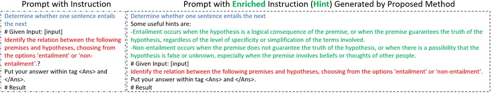
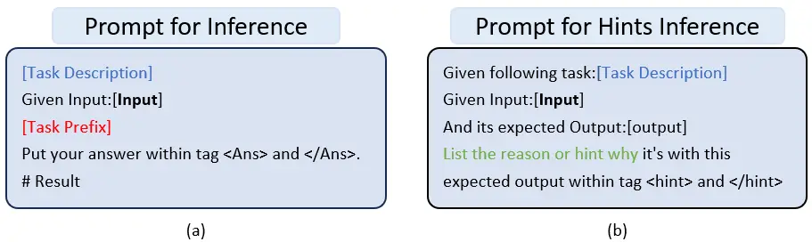
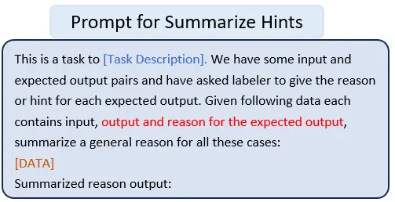

# AutoHint: Automatic Prompt Optimization with Hint Generation

Hong Sun    Xue Li    Yinchuan Xu    Youkow Homma    Qi Cao    Min Wu   
Jian Jiao    Denis Charles

###### Abstract

This paper presents AutoHint, a novel framework for automatic prompt
engineering and optimization for Large Language Models (LLM). While LLMs
have demonstrated remarkable ability in achieving high-quality
annotation in various tasks, the key to applying this ability to
specific tasks lies in developing high-quality prompts. Thus we propose
a framework to inherit the merits of both zero-shot learning and
few-shot learning by incorporating enriched instructions derived from
input-output demonstrations to optimize original prompt. We refer to the
enrichment as the Hint and propose a framework to automatically generate
the hint from labeled data. More concretely, starting from an initial
prompt, our method first instructs a LLM to deduce new hints for
selected samples from incorrect predictions, and then summarizes from
per-sample hints and adds the results back to the initial prompt to form
a new, enriched instruction. The proposed method is evaluated on the
BIG-Bench Instruction Induction dataset for both zero-shot and few-shot
prompts, where experiments demonstrate that our method is able to
significantly boost accuracy for multiple tasks.

###### keywords

large language models ,automatic prompt optimization ,natural language
processing ,natural language generation

^(†)^(†)copyrightyear: 2022^(†)^(†)copyright: Copyright for this paper
by its authors. Use permitted under Creative Commons License Attribution
4.0 International (CC BY 4.0).^(†)^(†)venue: LLM4AI’23: Workshop on
Foundations and Applications in Large-scale AI Models -Pre-training,
Fine-tuning, and Prompt-based Learning, co-located with the 29TH ACM
SIGKDD CONFERENCE ON KNOWLEDGE DISCOVERY AND DATA MINING (KDD), August
6-10, 2023, Long Beach, CA, USA^(†)^(†)email:
hosu@microsoft.com^(†)^(†)email: xeli@microsoft.com^(†)^(†)address:
Microsoft, 1045 La Avenida, Mountain View, CA, 94043, USA

## 1 Introduction

Large Language Models (LLM) have shown remarkable ability to achieve
comparable or even surpass human annotation quality in various
tasks Gilardi et al. (2023), where high-quality prompts are the key to
activate such abilities. This has entailed explorations from many
directions with a large body of studies on prompt engineering, including
methods built upon human instinct or domain knowledge Wu et al. (2022),
data-driven approaches Zhou et al. (2023), or prompt optimization via
in-context learning Zhang et al. (2023); Pryzant et al. (2023), etc.

LLMs could be prompted by zero-shot or few-shot learning. In the former,
the LLM will be provided general instructions for the task at hand, as
shown in the example in the left of Figure 1. By contrast, under a
few-shot setting, LLM is provided with a number of input-output pairs as
demonstrations followed by an unseen input, and then is instructed to
generate a corresponding output. Both of these two approaches come with
their own advantages and disadvantages: the former exhibits better
generalization but may lack the necessary clarity and specificity, since
the instructions can be vague or provide only general descriptions which
is not easy for LLM to interpret, whereas the latter one offers more
detailed information by providing demonstrations but is sensitive to
sample selection or even sample ordering Lu et al. (2022); Xu et al.
(2023); Pryzant et al. (2023).

The above analysis motivates us to seek an alternative approach by
combining merits from both sides, via inducting enriched instructions
from input-output demonstrations and then employing them to refine the
original instruction. Throughout this paper, we will refer to these
enriched instructions as Hints. Figure 1 (right) shows an example of the
hints generated for the Epistemic Reasoning task in BIG-Bench
Instruction Induction (BBII) Zhou et al. (2023) dataset. The original
description for this task is to Determine whether one sentence entails
the next, as highlighted in blue. In contrast, the hints generated by
our method (highlighted in green) showcase a more elaborate instruction,
providing a breakdown of explanations for both entailment and
non-entailment cases. As a result, it provides more clear information
for LLM to interpret the task and proceed with expected actions.

Having the enriched hints is good, but having automatically generated
hints is better. That is why we propose a framework called AutoHint
which aims to generate hints automatically. Our framework samples from
input-output pairs and leverages LLM for dueucing hints accordingly. The
sampling is based on wrongly answered samples, as it is fair to assume
that the original prompt has already conveyed sufficient information for
the correctly answered ones. Following that, we select a small subset
and prompt the LLM to summarize the hints that align best with that
subset without including case-specific information. These hints are
incorporated into the original prompt to generate a refined version. As
our method is orthogonal to zero-shot and few-shot settings, we evaluate
it under both settings on BBII dataset, where we observe remarkable
accuracy improvement.

Our main contributions are three folds:

- •
  We propose AutoHint, an automatic prompt optimization framework which
  inherits merits from both zero-shot and few-shot learning. It adopts a
  residual-sampling-summarize paradigm to enhance robustness to noisy
  samples.
- •
  We report extensive evaluation results on BBII dataset to demonstrate
  the effectiveness of our method.
- •
  Our framework explores fully leveraging GPT-4’s capability for prompt
  optimization to reduce manual effort.



Figure 1: An example of the enriched instruction learned by our proposed
method, taken from Epistemic Reasoning task in BBII dataset, with task
description highlighted in blue, instruction in red and enriched hints
in green. Left: a standard prompt with very general instruction. Right:
the enriched prompt after adding the learned hints.

## 2 Related Work

Since the explosive arrival of LLMs Ouyang et al. (2022), many works
have studied how to boost their capabilities to solve emergent, complex
tasks, among which in-context learning and Chain-of-ThoughtWei et al.
(2022) have proved to be effective two of the most effective methods.
Along this line of research, different directions have been
explored Cobbe et al. (2021); Wu et al. (2022); Kojima et al. (2022);
Wang et al. (2022); Zelikman et al. (????); Zhou et al. (2022); Lu
et al. (2022). Nevertheless, in most tasks the most effective prompts
are still human-crafted, which greatly limits the application of LLM
prompting.

To fill this gap, there has been a growing interest in automatic prompt
engineering, with most prior attempts requiring access to the internal
variables of LLMs on different levels, either through the differentiable
tuning of soft prompts Qin and Eisner (2021); Lester et al. (2021) or
training auxiliary components or models for prompt optimizationDeng
et al. (2022); Hao et al. (2022); Wang et al. (2022); Zhang et al.
(2023); Shin et al. (2020); Long (2023). However, with the growing trend
of limited accessibility to LLMs, such methods are becoming less
feasible for general practitioners.

For that reason, recent works are witnessing a noticeable shift towards
approaches that solely rely on feedback from LLMs Zhou et al. (2023);
Honovich et al. (2022); Pryzant et al. (2023); Xu et al. (2023). More
specifically, Honovich et al. (2022) instructs LLMs to deduce the task
based on input-output demonstrations, and this idea is further extended
into a generation-scoring-selection workflow in Zhou et al. (2023). In
contrast to existing works, our method enriches the general instructions
obtained from Zhou et al. (2023); Honovich et al. (2022), via exploiting
complementary hints with enhanced clarity and specificity from
input-output demonstrations. Therefore, our proposed method is
orthogonal to existing works and can be combined with them to obtain
potentially better results.

## 3 Proposed Method



Figure 2: (a): Prompt template for inferencing output as in Section 3.2.
(b): Prompt template for hints generation as in Section 3.3.

### 3.1 Overview

Given a task with a training dataset containing $`N`$
$`\mathrm{i.i.d.}`$ samples as input-output demonstrations:
$`\mathcal{D}_{train}=\{(x_{1},y_{1}),\cdots,(x_{N},y_{N})\}`$, our
method first inferences the predictions with an initial prompt
$`p_{t}`$, and then uses another prompt $`p_{h}`$ to deduce a reason or
hint $`r_{i}`$ for each sample having incorrect predictions. We denote
the wrongly predicted samples as
$`\mathcal{D}_{residual}=\{(x_{1},y_{1},r_{1}),\cdots,(x_{n},y_{n},r_{n})\}`$,
and then sample $`M`$ samples from $`\mathcal{D}_{residual}`$ to form a
subset
$`\mathcal{S}=\{(x_{1},y_{1},r_{1}),\cdots,(x_{M},y_{M},r_{M})\}`$.
After that, we leverage a prompt $`p_{s}`$ to summarize all the
individual $`r_{i}`$ in $`\mathcal{S}`$ into a final hint
$`r^{\prime}`$. Finally, a new prompt is generated by merging learned
$`r^{\prime}`$ into $`p_{t}`$ to form prompt $`p_{t+1}`$. The overall
procedure is summarized in Algorithm 1.

1: Training set $`\mathcal{D}_{train}=(x_{i},y_{i})`$ with
$`i\in[1,N]`$, validation set $`\mathcal{D}_{val}`$, test set
$`\mathcal{D}_{test}`$, $`p_{h}`$, $`p_{s}`$, an initial prompt $`p`$.

2: Initialize: $`p_{0}=p`$, $`\mathcal{D}_{residual}=\emptyset`$

3: for $`t=0,\cdots,T`$ do

4:   $`\hat{y}_{i}=p_{LLM}(x_{i},p_{t})`$ for $`i\in[1,N]`$

5:
  $`\mathcal{D}_{residual}=\{(x_{i},y_{i},\hat{y}_{i})\}\ for\ \hat{y}_{i}\ \neq y_{i}`$

6:   $`r_{i}\Leftarrow p_{LLM}(r_{i}|(x_{i},y_{i}),p_{h})`$ for
$`(x_{i},y_{i})\in\mathcal{D}_{residual}`$ Section 3.3

7:   $`S\Leftarrow`$ sampling($`\mathcal{D}_{residual}`$) Section 3.4

8:   $`r^{\prime}\Leftarrow p_{LLM}((x_{i},y_{i},r_{i}),p_{s})`$
Section 3.5

9:   Generate $`p_{t+1}`$ based on $`p_{t}`$ and $`r^{\prime}`$

10: end for

Algorithm 1 AutoHint for Prompt Optimization

### 3.2 Inference and Get Residual Data

Figure 2(a) shows the template used to inference prediction
$`\hat{y}_{i}`$ for each sampled input data from
$`\mathcal{D}_{train}`$:

```math
\displaystyle p_{LLM}(\hat{y}_{i}|(x_{i}),p_{t}) \tag{1}
```

where $`p_{t}`$ is the initial prompt constructed by concatenating a
very general task description with the sampled input.

Upon obtaining the inference results, we will only retain incorrectly
predicted samples i.e., $`\mathcal{D}_{residual}`$, for further
processing. The reasons for this are twofold. First, proceeding with all
training data would result in significant costs. Second, we believe that
the current prompt already provides sufficient information for the LLM
to make accurate decisions for correctly predicted data. Therefore, we
only send the error cases to subsequent steps, aiming to generate new
information that can assist in rectifying the current decision.

### 3.3 Hints Generation

After having the residual dataset, another prompt is used to generate
$`r_{i}`$ for each input-output pair:

```math
\displaystyle r_{i}\Leftarrow p_{LLM}(r_{i}|(x_{i},y_{i}),p_{h}) \tag{2}
```

where $`p_{h}`$ is a template prompt constructed by concatenating the
general task description and the corresponding input-output pair, as
shown in Figure 2(b).

### 3.4 Sampling Strategies

We explore various sampling strategies to generate $`S`$, including

- •
  Random: randomly draw $`K`$ samples from $`\mathcal{D}_{residual}`$.
- •
  Random-balanced: randomly draw $`K`$ samples from each category
  (applies to classification tasks only).
- •
  Clustering: first cluster samples based on $`x_{i},y_{i},r_{i}`$, and
  then randomly draw $`K`$ samples from each cluster.

Our framework makes no assumptions on specific clustering methods for
Clustering strategy, and we employ K-Means in our implementation to
obtain the cluster index $`c_{i}`$ for sample $`i`$ based on its feature
vector $`v_{i}`$ for $`\forall i\in S`$, due to its simplicity:

```math
\displaystyle v_{i}=\lambda_{x}f(x_{i})+\lambda_{y}f(y_{i})+\lambda_{r}f(r_{i}), \tag{3}
```

where $`f(\cdot)`$ denotes the encoder that transforms the textual input
$`x_{i}`$, $`y_{i}`$ and $`r_{i}`$ into dense vectors, with
$`\lambda_{x}`$, $`\lambda_{y}`$ and $`\lambda_{r}`$ denoting the
combination weights. We use the BERT-base model as our encoder
$`f(\cdot)`$, but other encoders could be easily integrated into our
framework.

As will be discussed in Section 4, we use a validation set to examine
different sampling strategies and select the best performing one, and
then report its evaluation results on the holdout test set.

### 3.5 Hints Summarization

Given the hints generated from Section 3.3, we leverage another prompt
$`p_{s}`$ shown in Figure 3 to generate a summarized hint to add to the
initial prompt $`p_{t}`$, resulting in an enriched prompt $`p_{t+1}`$.
An example of the enriched prompt with the summarized hints is shown in
Figure 1 (right).



Figure 3: Prompt template for summarizing hints.

The idea of summarizing individual hints here is conceptually analogous
to the calculation involved in deriving a mini-batch stochastic gradient
descent (SGD), where individual gradients within the mini-batch are
aggregated into a single gradient. However, compared to its numerical
counterpart, summarizing hints is much more difficult, since the former
operates in a continuous space with well-established numerical
operations, which is clearly not the case for hints summarization. In
this paper, we propose to transform this non-trivial task into a
tractable problem by leveraging the ability of LLMs to solve emergent
tasks. To our knowledge, this is the first attempt to leverage LLMs to
summarize hints or prompts in automatic prompt generation to make the
result more stable and comprehensive.

## 4 Experiments

### 4.1 Experimental Setup

Dataset We examine our method on 6 tasks from the BIG-Bench Instruction
Induction (BBII)¹¹ 1
[https://github.com/keirp/automatic_prompt_engineer/tree/main/data/bigbench-ii](https://github.com/keirp/automatic_prompt_engineer/tree/main/data/bigbench-ii)
dataset introduced in Zhou et al. (2023), including Epistemic Reasoning,
Logical Fallacy Detection, Implicatures, Hyperbaton, Causal Judgment and
Winowhy. We specifically select these tasks based on their relatively
large data volume and easy-to-parse answer format, which allows us to
obtain higher accuracy. For each task, we randomly split the dataset
into training (60%), validation (20%) and test sets (20%), where the
training set is used for inducing the hints as mentioned in Section 3,
while the validation set is used for hyper-parameter tuning and prompt
selection. After choosing the best enriched prompt based on the
validation set performance, we report the final evaluations on the test
set.

Baselines and Metrics Since our proposed framework aims to exploit
useful information on top of given prompts, we employ the initial prompt
$`p_{t}`$ as our baseline, which is the prompt retrieved from BBII
dataset in our implementation. Given all the tasks are
binary-classification tasks, we report Overall Accuracy (Acc.) and
Balanced Accuracy (Bal Acc.) as our main evaluation metrics. Balanced
Accuracy is averaged per-category accuracy.

Implementation details We use the Azure OpenAI API service (GPT-4) to
evaluate both the baseline and our method. For the inference and
summarization prompts, we set temperature as 0 and topP as 1. For hint
generation, we set temperature as 0.1 and topP as 0.95 to allow some
exploration. We conduct hyper-parameter tuning to examine different
sampling strategies. For each task, we test 20 sets of hyper-parameters
on the validation set and select the best one to conduct evaluation on
the test set. To save costs, we randomly sample a subset from the
validation set for comparison if it is too large, then keep the top
three settings to run a full validation set evaluation and select the
final prompt for the test set evaluation.

|                           |         |          |          |           |          |
| ------------------------- | ------- | -------- | -------- | --------- | -------- |
| Task                      | Testset | Baseline |          | Treatment |          |
|                           | Count   | Acc.     | Bal Acc. | Acc.      | Bal Acc. |
| Epistemic Reasoning       | 499     | 82.5     | 82.9     | 90.5      | 90.15    |
| Logical Fallacy Detection | 700     | 77.46    | 76.18    | 84.03     | 83.66    |
| Implicatures              | 100     | 88.89    | 88.66    | 91.93     | 91.92    |
| Hyperbaton                | 11k     | 66.81    | 66.81    | 82.41     | 82.41    |
| Causal Judgment           | 40      | 60.53    | 60.53    | 65.79     | 65.79    |
| Winowhy                   | 570     | 74.17    | 73.24    | 73.12     | 71.78    |

Table 1: Zero-Shot Prompt Evaluation Results

### 4.2 Experiment Results and Analysis

Our main results are summarized in Table 1, where we observe significant
improvement on both accuracy and balanced accuracy on 5 out of the 6
tasks after adding the hints mined from the proposed method,
demonstrating the effectiveness of our proposed framework under
zero-shot settings.

We also look into the generated hints and observe that for most tasks,
our method is able to mine useful definitions and explanations with more
detailed information after the very first iteration. For the example in
Figure 1, practical instructions are added for both the entailment and
non-entailment segments, assisting annotators including LLMs to better
understand the task at hand.

Regarding sampling strategies, Clustering achieves the best result in 3
out of 6 tasks, Random-balanced leads to the best result on the
remaining tasks, while plain Random sampling shows the worst results.
This highlights the importance of adopting proper sampling strategies
for generating a good summary. Meanwhile, the remarkable performance of
Random-balanced sampling also echos our finding that our method is able
to induce explicit per-category explanations as shown in Figure 1. In
addition, the best results are achieved when no more than 3 samples are
used per label. This may be because more samples confuse the model when
generating the summary.

|                           |          |          |           |          |
| ------------------------- | -------- | -------- | --------- | -------- |
| Task                      | Baseline |          | Treatment |          |
|                           | Acc.     | Bal Acc. | Acc.      | Bal Acc. |
| Epistemic Reasoning       | 76.5     | 80.87    | 83.75     | 85.96    |
| Logical Fallacy Detection | 86.76    | 86.64    | 84.64     | 84.28    |
| Implicatures              | 88.89    | 88.73    | 92.93     | 92.89    |
| Hyperbaton                | 61.88    | 61.88    | 80.41     | 80.41    |
| Causal Judgment           | 55.26    | 55.26    | 73.68     | 73.68    |
| Winowhy                   | 71.55    | 70.43    | 74.69     | 74.04    |

Table 2: Few-Shot Prompt Evaluation Results

|                           |                 |          |                  |          |
| ------------------------- | --------------- | -------- | ---------------- | -------- |
| Task                      | First iteration |          | Second iteration |          |
|                           | Acc.            | Bal Acc. | Acc.             | Bal Acc. |
| Epistemic Reasoning       | 90.5            | 90.15    | 88.2             | 88.2     |
| Logical Fallacy Detection | 84.03           | 83.66    | 87.68            | 87       |
| Implicatures              | 91.93           | 91.92    | 92.92            | 91.91    |
| Hyperbaton                | 82.41           | 82.41    | 90.56            | 90.56    |
| Causal Judgment           | 65.79           | 65.79    | 71.05            | 71.05    |
| Winowhy                   | 73.12           | 71.78    | 73.1             | 71.8     |

Table 3: Accuracy comparison after second iteration (zero-shot)

Meanwhile, as our method is orthogonal to few-short learning, we also
evaluate AutoHint in this setting, and the results are summarized in
Table 2, where our method boosts accuracy significantly in 5 out of 6
tasks. After adding demonstrations randomly sampled from the training
set, we observe a decrease in accuracy on 4 out of 6 tasks, along with
notable performance fluctuation across different sampling seeds. This
observation aligns with previous studies Lu et al. (2022); Xu et al.
(2023) highlighting the importance of carefully selecting effective
demonstrations to mitigate the sensitivity towards samples.

### 4.3 More Iterations

In addition, we also conduct experiments by running additional
iterations to generate more informative prompts. New hints are appended
to existing ones by a prefix _And additional hint might be useful is_.
Overall, we observe a significant boost on the average accuracy over
prompt candidates on the validation set, this indicates our improvement
on the original prompt is solid. However, after selecting the best
prompt, only 3 tasks (Causal Judgement, Logical Fallacy Detection and
Hyperbaton) show further improvement while the rest show accuracy decay.
When manually checking the new hints, we find that they indeed present
complementary or more specific information to existing ones. For
instance, new hints for the Epistemic Reasoning task focus on if the
premise and hypothesis are identical or include additional details.
While it is beneficial to infuse new, correct information, it places
higher demands on the ability of LLM to comprehend these diverse hints.
Our current approach to incorporating hints from later iterations is
simplistic, and as a result, it hinders the language model from
effectively assimilating the more informative instructions. As a result,
it requires a more effective strategy for merging information from
different iterations. Therefore, we plan to address this as part of our
future work.

### 4.4 Cost Analysis

There are 4 calls to LLMs in each iteration: 1) inference, 2) hints
generation, 3) summarization and 4) prompt selection. Among these, the
first call is not unique to our method therefore it does not incur
additional cost. Given the cost for the third call is negligible, we
only need to optimize costs for steps 2 and 4. For step 2, we can sample
a subset first as the final data points needed to obtain the summary is
small. For the last step, we can evaluate on a subset if the validation
set is large, or similar to APE Zhou et al. (2023), iteratively prune
the prompts.

## 5 Conclusion

We propose a novel framework for automatic prompt optimization by
combining merits from zero-shot and few-shot learning. We evaluate our
method on the BBII dataset under both settings, and demonstrate the
effectiveness of the proposed method. Our proposed method could also be
combined with existing methods to achieve potentially better results.
While we didn’t deploy this method in our production system yet, we are
able to leverage this method for reducing some manual analysis effort in
prompt optimization. There are more discussions along this work like
more-representative sample selection, merging information from different
iterations to generate better prompt and cost saving, which we leave
them for future work.

## References

- Gilardi et al. (2023) F. Gilardi, M. Alizadeh, M. Kubli, Chatgpt
  outperforms crowd-workers for text-annotation tasks, arXiv preprint
  arXiv:2303.15056 (2023).
- Wu et al. (2022) T. Wu, M. Terry, C. J. Cai, Ai chains: Transparent
  and controllable human-ai interaction by chaining large language model
  prompts, in: Proceedings of the 2022 CHI Conference on Human Factors
  in Computing Systems, 2022, pp. 1–22.
- Zhou et al. (2023) Y. Zhou, A. I. Muresanu, Z. Han, K. Paster,
  S. Pitis, H. Chan, J. Ba, Large language models are human-level prompt
  engineers, in: The Eleventh International Conference on Learning
  Representations, 2023.
- Zhang et al. (2023) T. Zhang, X. Wang, D. Zhou, D. Schuurmans, J. E.
  Gonzalez, Tempera: Test-time prompt editing via reinforcement
  learning, in: The Eleventh International Conference on Learning
  Representations, 2023.
- Pryzant et al. (2023) R. Pryzant, D. Iter, J. Li, Y. T. Lee, C. Zhu,
  M. Zeng, Automatic prompt optimization with” gradient descent” and
  beam search, arXiv preprint arXiv:2305.03495 (2023).
- Lu et al. (2022) Y. Lu, M. Bartolo, A. Moore, S. Riedel, P. Stenetorp,
  Fantastically ordered prompts and where to find them: Overcoming
  few-shot prompt order sensitivity, in: Proceedings of the 60th Annual
  Meeting of the Association for Computational Linguistics (Volume 1:
  Long Papers), 2022.
- Xu et al. (2023) W. Xu, A. Banburski-Fahey, N. Jojic, Reprompting:
  Automated chain-of-thought prompt inference through gibbs sampling,
  arXiv preprint arXiv:2305.09993 (2023).
- Ouyang et al. (2022) L. Ouyang, J. Wu, X. Jiang, D. Almeida,
  C. Wainwright, P. Mishkin, C. Zhang, S. Agarwal, K. Slama, A. Ray,
  et al., Training language models to follow instructions with human
  feedback, Advances in Neural Information Processing Systems 35 (2022)
  27730–27744.
- Wei et al. (2022) J. Wei, X. Wang, D. Schuurmans, M. Bosma, F. Xia,
  E. H. Chi, Q. V. Le, D. Zhou, et al., Chain-of-thought prompting
  elicits reasoning in large language models, in: Advances in Neural
  Information Processing Systems, 2022.
- Cobbe et al. (2021) K. Cobbe, V. Kosaraju, M. Bavarian, M. Chen,
  H. Jun, L. Kaiser, M. Plappert, J. Tworek, J. Hilton, R. Nakano,
  et al., Training verifiers to solve math word problems, arXiv preprint
  arXiv:2110.14168 (2021).
- Kojima et al. (2022) T. Kojima, S. S. Gu, M. Reid, Y. Matsuo,
  Y. Iwasawa, Large language models are zero-shot reasoners, in:
  Advances in Neural Information Processing Systems, 2022.
- Wang et al. (2022) Y. Wang, Y. Kordi, S. Mishra, A. Liu, N. A. Smith,
  D. Khashabi, H. Hajishirzi, Self-instruct: Aligning language model
  with self generated instructions, arXiv preprint arXiv:2212.10560
  (2022).
- Zelikman et al. (????) E. Zelikman, Y. Wu, J. Mu, N. Goodman, Star:
  Bootstrapping reasoning with reasoning, in: Advances in Neural
  Information Processing Systems, ????
- Zhou et al. (2022) D. Zhou, N. Schärli, L. Hou, J. Wei, N. Scales,
  X. Wang, D. Schuurmans, O. Bousquet, Q. Le, E. Chi, Least-to-most
  prompting enables complex reasoning in large language models, arXiv
  preprint arXiv:2205.10625 (2022).
- Lu et al. (2022) P. Lu, L. Qiu, K.-W. Chang, Y. N. Wu, S.-C. Zhu,
  T. Rajpurohit, P. Clark, A. Kalyan, Dynamic prompt learning via policy
  gradient for semi-structured mathematical reasoning, arXiv preprint
  arXiv:2209.14610 (2022).
- Qin and Eisner (2021) G. Qin, J. Eisner, Learning how to ask: Querying
  lms with mixtures of soft prompts, in: Proceedings of the 2021
  Conference of the North American Chapter of the Association for
  Computational Linguistics: Human Language Technologies, 2021, pp.
  5203–5212.
- Lester et al. (2021) B. Lester, R. Al-Rfou, N. Constant, The power of
  scale for parameter-efficient prompt tuning, in: Proceedings of the
  2021 Conference on Empirical Methods in Natural Language Processing,
  2021, pp. 3045–3059.
- Deng et al. (2022) M. Deng, J. Wang, C.-P. Hsieh, Y. Wang, H. Guo,
  T. Shu, M. Song, E. P. Xing, Z. Hu, Rlprompt: Optimizing discrete text
  prompts with reinforcement learning, arXiv preprint arXiv:2205.12548
  (2022).
- Hao et al. (2022) Y. Hao, Z. Chi, L. Dong, F. Wei, Optimizing prompts
  for text-to-image generation, arXiv preprint arXiv:2212.09611 (2022).
- Shin et al. (2020) T. Shin, Y. Razeghi, R. L. Logan IV, E. Wallace,
  S. Singh, Autoprompt: Eliciting knowledge from language models with
  automatically generated prompts, arXiv preprint arXiv:2010.15980
  (2020).
- Long (2023) J. Long, Large language model guided tree-of-thought,
  arXiv preprint arXiv:2305.08291 (2023).
- Honovich et al. (2022) O. Honovich, U. Shaham, S. R. Bowman, O. Levy,
  Instruction induction: From few examples to natural language task
  descriptions, arXiv preprint arXiv:2205.10782 (2022).
