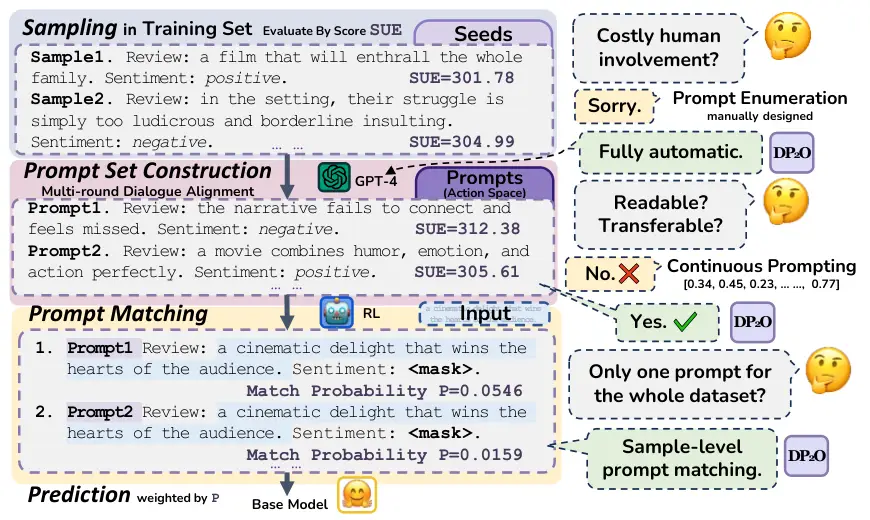
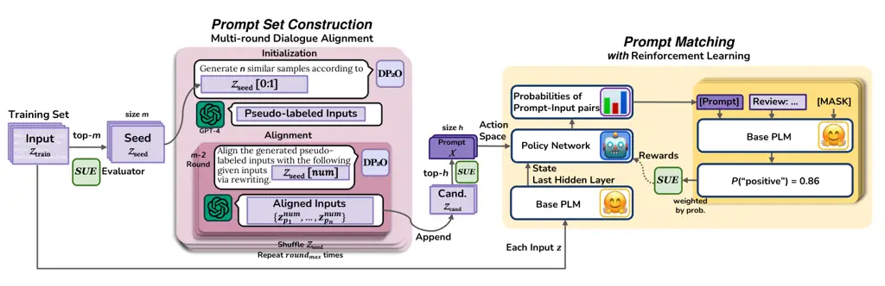

# Dialogue for Prompting: a Policy-Gradient-Based Discrete Prompt Generation for Few-Shot Learning

Chengzhengxu Li    Xiaoming Liu    Yichen Wang    Duyi Li    Yu Lan   
Chao Shen

###### Abstract

Prompt-based pre-trained language models (PLMs) paradigm has succeeded
substantially in few-shot natural language processing (NLP) tasks.
However, prior discrete prompt optimization methods require expert
knowledge to design the base prompt set and identify high-quality
prompts, which is costly, inefficient, and subjective. Meanwhile,
existing continuous prompt optimization methods improve the performance
by learning the ideal prompts through the gradient information of PLMs,
whose high computational cost, and low readability and generalizability
are often concerning. To address the research gap, we propose a
Dialogue-comprised Policy-gradient-based Discrete Prompt Optimization
($`\textsc{DP}_{2}\textsc{O}`$) method. We first design a multi-round
dialogue alignment strategy for readability prompt set generation based
on GPT-4. Furthermore, we propose an efficient prompt screening metric
to identify high-quality prompts with linear complexity. Finally, we
construct a reinforcement learning (RL) framework based on policy
gradients to match the prompts to inputs optimally. By training a policy
network with only 0.62M parameters on the tasks in the few-shot setting,
$`\textsc{DP}_{2}\textsc{O}`$ outperforms the state-of-the-art (SOTA)
method by 1.52% in accuracy on average on four open-source datasets.
Moreover, subsequent experiments also demonstrate that
$`\textsc{DP}_{2}\textsc{O}`$ has good universality, robustness and
generalization ability.¹¹ 1 Code and data are avaliable at
https://github.com/czx-li/DP2O.

Faculty of Electronic and Information Engineering, Xi’an Jiaotong
University

{czx.li, yichen.wang, liduyi}@stu.xjtu.edu.cn, {xm.liu, ylan2020,
chaoshen}@xjtu.edu.cn

^($`\star`$)Corresponding author



Figure 1: An illustration of the procedure and innovation Q&A of
$`\textsc{DP}_{2}\textsc{O}`$. The procedure includes 1) Sampling the
seed set from the training set via $`\mathrm{SUE}`$; 2) Constructing the
prompt by multi-round dialogue with GPT-4 to align the inputs with the
whole training set’s distribution; 3) Employing an RL agent to match
prompts with inputs to predict probabilistically; 4) Feeding all
prompt-input pairs to a base PLM model for downstream tasks and ensemble
predictions by probability weighting.

## Introduction

With the continuous development of pre-trained language models (PLMs)
(Liu et al. 2019; Touvron et al. 2023; Anil et al. 2023), _e.g._,
ChatGPT (OpenAI 2022) and GPT-4 (OpenAI 2023), prompt-based methods have
shown significant rising competitiveness in few-shot downstream tasks
(Schick and Schütze 2020a; Schick and Schütze 2020b). Unlike the
traditional fine-tuning methods, which require the design of additional
neural network heads according to downstream tasks, the prompt-based
methods join particular extra texts to inputs to transfer downstream
tasks into mask-filling tasks. The prompt matches the downstream task
with the model’s pre-training task, and the potential of the PLMs can be
more comprehensively scheduled. However, PLMs are extremely sensitive to
prompts (Holtzman et al. 2019; Lester, Al-Rfou, and Constant 2021).
Minor gaps with the same semantics in prompts may lead PLMs to
completely different performances. Therefore, one core issue of the
prompt-based methods is finding high-quality prompts to promote the
performance of PLMs.

Currently, prompt optimization methods can be divided into two
categories: discrete prompt optimization and continuous prompt
optimization.

Due to the discrete nature of the text, prompts can not be directly
optimized by using the gradient information from PLMs. Therefore,
previous discrete prompt optimization methods heavily relied on the
manually designed basic prompt sets and prompt templates (Jiang et al.
2020; Yuan, Neubig, and Liu 2021; Haviv, Berant, and Globerson 2021;
Davison, Feldman, and Rush 2019). Moreover, lacking clear evaluation
metrics, prior works often use the supervision gain of training-set
prompt as a screening metric during optimization (Zhou et al. 2022; Gao,
Fisch, and Chen 2020). Therefore, discrete prompt optimization methods
usually necessitate a number of labeled data, which contradicts the few-
or zero-shot learning objectives, and overlooks the potential impact of
prompts on the output distribution, and the further effect on the
performance of PLMs.



Figure 2: Overview of $`\textsc{DP}_{2}\textsc{O}`$. In the prompt set
construction stage, we use the multi-round dialogue alignment strategy
to generate high-quality discrete prompts continuously. Given the seed
inputs $`\mathcal{Z}_{\textrm{seed}}`$ with top-$`m`$ $`\mathrm{SUE}`$
score, $`\textsc{DP}_{2}\textsc{O}`$ have a conversation with GPT-4,
which has $`round_{max}`$ times outer loop and $`m-2`$ times inner loop,
to align inputs semantics with the training set. Then
$`\textsc{DP}_{2}\textsc{O}`$ apply the assessment metric
$`\mathrm{SUE}`$ to sort the prompts after dialogue to obtain the final
candidate set $`\mathcal{Z}_{\mathrm{cand}}`$. We filter top-$`h`$
candidates as the final prompt set based on $`\mathrm{SUE}`$ score. In
the prompt matching stage, we build a reinforcement learning framework
to match the appropriate prompt from $`\mathcal{X}`$ for each input
$`z`$ from $`\mathcal{Z}_{\textrm{train}}`$ with probability. The
prompt-input pairs are fed into the base PLM to predict downstream
tasks. The final prediction is the probability-weighted output of all
pairs.

Meanwhile, the continuous prompt optimization methods abandon the text
structure of prompts and improve the performance of PLMs by directly
optimizing token embedding at specific locations (Vu et al. 2021; Li and
Liang 2021; An et al. 2022; Qian et al. 2022). Although these methods
can directly use gradient information to guide the optimization
direction of continuous prompts, the computational cost is often
exceedingly expensive. Besides, continuous prompts usually lack
readability and are hardly used across different PLMs.

Towards these challenges, we propose a Dialogue-comprised
Policy-gradient-based Discrete Prompt Optimization method, named
$`\textsc{DP}_{2}\textsc{O}`$. As shown in Figure 1,
$`\textsc{DP}_{2}\textsc{O}`$ mainly consists of two stages: prompt set
construction and prompt matching. In the prompt set construction stage,
we propose a prompt set generation method with a multi-round dialogue
alignment strategy by employing the dialogue characteristics of GPT-4,
one of the current most capable PLMs on dialogue. Meanwhile, we
introduce an innovative prompt quality assessment metric, _i.e._,
Supervised & Unsupervised Entropy Metric ($`\mathrm{SUE}`$), which
comprehensively considers the supervised and unsupervised impact of
prompts on PLMs with linear complexity and facilitates output
distribution balance and accuracy in downstream tasks. In the prompt
matching stage, we propose a reinforcement learning (RL) framework,
which employs a policy network to select appropriate input prompts. The
prompts, without breaking textual semantics, ensure their readability
and transferability across different PLMs. Finally, the downstream task
is completed through ensemble decision-making. Extensive experiments
show $`\textsc{DP}_{2}\textsc{O}`$ is significantly superior to baseline
and SOTA methods, _e.g._, $`\textsc{DP}_{2}\textsc{O}`$ achieve an
average improvement of 1.52% in accuracy across four public datasets
with only a 10.86% training time of the SOTA method RLPrompt (Deng
et al. 2022). Furthermore, we implement ablation and analysis
experiments to demonstrate the effectiveness, robustness and
generalization of $`\textsc{DP}_{2}\textsc{O}`$.

In summary, our contributions are summarized as follows:

- •
  Novel Generation Strategy: We generate the prompt set via the
  multi-round dialogue alignment strategy, aiming at reducing the cost
  of human involvement in prompting.
- •
  Linear Evaluation Metric: We additionally consider unsupervised
  information of PLMs prediction in prompts evaluation, proposing a new
  metric to screen out excellent prompts with linear complexity.
- •
  Precise Prompt Matching: We apply RL techniques to achieve
  sample-level discrete prompt optimization, further improving the
  performance of PLMs on downstream tasks.
- •
  Outstanding Task Performance: Experiments on four public datasets show
  that $`\textsc{DP}_{2}\textsc{O}`$ effectively improves the
  performance of PLMs under few-shot settings with readability,
  robustness, generalization, and universality.

## Methodology

The main workflow of $`\textsc{DP}_{2}\textsc{O}`$ can be mainly divided
into two stages: prompt set construction and prompt matching, as shown
in Figure 2.

### Prompt Set Construction Stage

Evaluation Metric. Most prevailing methods utilize the aggregate
accuracy of the prompt on the dataset as their sole metric for
assessment, which neglects the impact of the distribution of labels in
the dataset. Lu et al. (2021) find that significantly imbalanced
prediction distributions typically characterize underperforming prompts.
To this end, we introduce a novel evaluation metric termed Supervised &
Unsupervised Entropy metric ($`\mathrm{SUE}`$). $`\mathrm{SUE}`$ aims to
provide a more comprehensive appraisal for prompts by additionally
considering global balance beyond local accuracy.

$`\mathrm{SUE}`$ consists of two parts: supervision score
$`S_{\textrm{sup}}`$ and unsupervised score $`S_{\textrm{uns}}`$. Given
a prompt $`x`$ and input set $`{\mathcal{Z}}`$, for each input
$`z_{i}\in\mathcal{Z}`$, we first calculate the difference of the
probability $`p_{\textrm{LM}}`$ that the $`z_{i}`$ is correctly labeled
$`c_{i}`$ and wrongly labeled as $`c_{\textrm{else}}`$ by a base PLM.
Here $`c_{\textrm{else}}\in\mathcal{C}\setminus\{c_{i}\}`$ exactly, and
$`\mathcal{C}`$ is the label space of the input. Then the supervision
score $`S_{\textrm{sup}}`$ of prompt $`x`$ is defined as:

```math
\displaystyle S_{\textrm{sup}}(x,\mathcal{Z})=\sum_{z_{i}\in{\mathcal{Z}}}(p_{\textrm{LM}}(c_{i}|x,z_{i})-p_{\textrm{LM}}(c_{\textrm{else}}|x,z_{i})) \tag{1}
```

To prevent some prompts from causing PLMs to be overly biased on all
inputs, $`\mathrm{SUE}`$ selects the prompts which guide PLMs to output
a more balanced pseudo-label distribution across all given inputs. Given
a prompt $`x`$, we calculate a entropy value $`\mathbb{H}(.)`$ of each
input $`z_{i}`$, then add $`\mathbb{H}(.)`$ of each input as
$`S_{\textrm{uns}}`$ for the whole input set $`\mathcal{Z}`$:

```math
\displaystyle\mathbb{H}(x,z_{i})=\sum\nolimits_{c_{i}\in{\mathcal{C}}}-p_{\textrm{LM}}(c_{i}|x,z_{i})\log p_{\textrm{LM}}(c_{i}|x,z_{i}) \tag{2}
```

```math
\displaystyle S_{\textrm{uns}}(x,\mathcal{Z})=\sum\nolimits_{z_{i}\in{\mathcal{Z}}}\mathbb{H}(x,z_{i}) \tag{3}
```

Finally, we have our evaluation metric $`\mathrm{SUE}`$ to assess the
quality of prompts as

```math
\displaystyle\mathrm{SUE}(x,\mathcal{Z})=\lambda_{1}S_{\textrm{sup}}(x,\mathcal{Z})+\lambda_{2}S_{\textrm{uns}}(x,\mathcal{Z}) \tag{4}
```

where $`\lambda_{1}`$ and $`\lambda_{2}`$ are the weights to balance the
supervised score $`S_{\textrm{sup}}`$ and the unsupervised score
$`S_{\textrm{uns}}`$. For the input set $`\mathcal{Z}`$ encompassing
multiple inputs, the metric $`\mathrm{SUE}`$ characterizes the holistic
quality of the prompt. Higher $`\mathrm{SUE}`$ represents the better
capability on the specific downstream task (derived from
$`S_{\textrm{sup}}`$) and more benign confidence on all inputs (derived
from $`S_{\textrm{uns}}`$). Meanwhile, when $`\mathcal{Z}`$ only
comprises a single input, $`\mathrm{SUE}`$ can elucidate the degree of
match between the prompt and the input.

#### Prompt Set Generation.

Existing discrete prompt optimization methods, such as Black-Box Tuning
(Sun et al. 2022) and GrIPS (Prasad et al. 2022), mostly require text
editing based on manually designed prompts and vocabularies. Different
from these methods, $`\textsc{DP}_{2}\textsc{O}`$ leverages GPT-4 as a
dialogue model to generate pseudo-label inputs which approximate the
dataset distribution, utilizing only a limited set of training data.
Then the inputs are used as prompt examples for downstream tasks.
Notably, Min et al. (2022) indicate that the label authenticity of these
pseudo-label prompt examples has little impact on the performance of
PLMs. Hence, for $`\textsc{DP}_{2}\textsc{O}`$, we do not validate the
authenticity of the labels of the inputs generated by GPT-4, which
further eliminates the necessity for human annotation. Our experiments
also show that, without verifying the authenticity of labels,
$`\textsc{DP}_{2}\textsc{O}`$ can still achieve praiseworthy and
competitive performance to other methods.

0:  Few-shot training set $`\mathcal{Z}_{\textrm{train}}`$ including
inputs and labels, label space $`\mathcal{C}`$, base PLM and access to
GPT-4 API.

1:  $`\mathcal{Z}_{\textrm{seed}}\leftarrow`$ top-$`m`$ inputs in
$`\mathcal{Z}_{\textrm{train}}`$ via
$`\mathrm{SUE}(z_{i},\mathcal{Z}_{\textrm{train}})`$,
$`z_{i}\in\mathcal{Z_{\textrm{train}}}`$. \*\*\*\* outer-loop begins:
multi-round dialogue \*\*\*\*

2:  $`round\leftarrow 0`$

3:  while $`round<round_{max}`$ do

4:   Random shuffle $`\mathcal{Z}_{\textrm{seed}}`$ .

5:   Input $`\mathcal{Z}_{\textrm{seed}}[0:1]`$ to GPT-4 with prefix
introduction of task.

6:   GPT-4 output $`n`$ pseudo-labeled inputs
$`\{z_{p_{1}}^{1},...,z_{p_{n}}^{1}\}`$. \*\*\*\* inner-loop begins: one
dialogue round \*\*\*\*

7:   Initialize number of used inputs in $`\mathcal{Z}_{\textrm{seed}}`$
$`num\leftarrow 2`$.

8:   while $`num<m`$ do

9:    Input $`\mathcal{Z}_{\textrm{seed}}[num]`$ to GPT-4, asking it
rewrite the previous $`\{z_{p_{1}}^{num-1},...,z_{p_{n}}^{num-1}\}`$.

10:    GPT-4 output $`\{z_{p_{1}}^{num},...,z_{p_{n}}^{num}\}`$.

11:    $`num\leftarrow num+1`$

12:   end while

13:   Append $`\{z_{p_{1}}^{{m-1}},...,z_{p_{n}}^{{m-1}}\}`$ to
$`\mathcal{Z}_{\textrm{cand.}}`$

14:  end while

15:  $`\mathcal{X}\leftarrow`$ top-$`h`$ inputs of
$`\mathcal{Z}_{\textrm{cand.}}`$ via
$`\mathrm{SUE}(z_{i},\mathcal{Z}_{\textrm{train.}})`$ ,
$`z_{i}\in\mathcal{Z}_{\textrm{cand.}}`$

15:  Readable and high-quality prompt set $`\mathcal{X}`$.

Algorithm 1 Prompt Set Construction of $`\textsc{DP}_{2}\textsc{O}`$

With the prevalence of PLMs aiming at chatting, dialogue is an effective
way to input multi-inputs to models. Instead of concatenating them into
long sequence text, dialogue strategy can ease the forgetness of PLMs
caused by the sliding window. As shown in Algorithm 1, we utilize
dialogue to gradually align our prompts with the distribution of PLM to
reduce the potential threat of biased prediction.

Given a training set denoted as $`\mathcal{Z}_{\textrm{train}}`$, we
first individually evaluate each input
$`z_{i}\in\mathcal{Z}_{\textrm{train}}`$ by score
$`\mathrm{SUE}(z_{i},\mathcal{Z}_{\textrm{train}})`$. $`\mathrm{SUE}`$
signifies the input $`z_{i}`$’s efficacy within the given set
$`\mathcal{Z}_{\textrm{train}}`$. We rank
$`\mathcal{Z}_{\textrm{train}}`$ set in descending order based on the
$`\mathrm{SUE}(z_{i},\mathcal{Z}_{\textrm{train}})`$. We then select the
top-$`m`$ inputs to form the seed set
$`\mathcal{Z}_{\textrm{seed}}=\{z_{\textrm{seed}_{1}},z_{\textrm{seed}_{2}},...,z_{\textrm{seed}_{m}}\}`$.

Subsequently, utilizing GPT-4, we generate pseudo-label inputs that
mirror the distribution of the prompts within the
$`\mathcal{Z}_{\textrm{seed}}`$. Initially, GPT-4 randomly takes inputs
from $`\mathcal{Z}_{\textrm{seed}}`$ and then begins a dialogue round
(outer-loop).

In one dialogue round, we first generate $`n`$ pseudo-labeled inputs
$`\{z_{p_{1}}^{1},...,z_{p_{n}}^{1}\}`$ based on any two inputs from
$`\mathcal{Z}_{\textrm{seed}}`$. Then we randomly select one of the
remaining inputs from $`\mathcal{Z}_{\textrm{seed}}`$ into dialogue to
guide GPT-4 to polish the previously generated pseudo-labeled inputs
$`\{z_{p_{1}}^{1},...,z_{p_{n}}^{1}\}`$ and get corresponding
$`\{z_{p_{1}}^{2},...,z_{p_{n}}^{2}\}`$. Repeated the polishing stage
(inner-loop) $`m-2`$ times until all $`z_{\textrm{seed}}`$ inputted to
the dialogue once. Then we get
$`\{z_{p_{1}}^{m-1},...,z_{p_{n}}^{m-1}\}`$ and append them in candidate
set $`\mathcal{Z}_{\textrm{cand}}`$.

However, the order of conversation might impact dialogue alignment. We
suggest re-ordering the conversation multi-time to counteract the effect
of the order. Thus, we shuffle
$`\{z_{\textrm{seed}_{1}},z_{\textrm{seed}_{2}},...,z_{\textrm{seed}_{m}}\}`$
and start a new dialogue round (outer-loop), aiming at minimizing the
impact of order in dialogue. After finishing all $`round_{max}`$ times
dialogue rounds (outer-loop), we compute the score $`\mathrm{SUE}`$ of
all $`n\times round_{max}`$ inputs in $`\mathcal{Z}_{\textrm{cand}}`$.
Then, we select the top-$`h`$ inputs from the candidate set
$`\mathcal{Z}_{\textrm{cand}}`$ as the final prompt set $`\mathcal{X}`$.
From now on, the selected inputs go into the role of prompt.

Overall, we introduce the multi-round dialogue alignment strategy,
optimizing GPT-4’s utility in prompt generation and leveraging its
inherent dialogue characteristic.

### Prompt Matching Stage

Previous studies have underscored the high sensitivity of PLMs to
prompts (Radford et al. 2018; Dathathri et al. 2019; Raffel et al.
2020). Traditional methods tend to rely on either random selection or a
simple cosine similarity metric between the input and prompt embedding
for selection (Gao, Fisch, and Chen 2020). This leads to an
under-exploration of the prompt space limiting the potential performance
enhancements in complex tasks. While for the recently emerging RL-based
methods, the complexity associated with brute-force searching escalates
exponentially with data size growth. Hence, efficiently matching
appropriate prompts for each input is a highly challenging task.

0:  Training set $`\mathcal{Z}_{\textrm{train}}`$ of size $`T`$, testing
set $`\mathcal{Z}_{\textrm{test}}`$, base PLM, the prompt set
$`\mathcal{X}`$ constructed by Algorithm 1. \*\*\*\* training the RL
model \*\*\*\*

1:  Initialize the policy network $`\pi_{\theta}`$ parameters $`\theta`$
and $`epoch\leftarrow 0`$.

2:  while $`epoch<epoch_{max}`$ do

3:   for step $`t`$ in $`[1,...,T]`$ do

4:    Get state $`s_{t}\leftarrow\mathrm{PLM}(z_{t})`$.

5:    Run policy network $`\pi_{\theta}(a_{t}|s_{t})`$ to take an action
$`a_{t}`$ to select a prompt $`x_{t}`$.

6:    Calculate reward by SUE, _i.e._,
$`r_{t}\leftarrow\mathrm{SUE}(x_{t},z_{t})`$.

7:    Add transition to replay buffer.

8:   end for

9:   Update parameters $`\theta`$ of $`\pi_{\theta}`$ with the policy
gradient loss.

10:  end while \*\*\*\* testing phase begins \*\*\*\*

11:  for each input $`z`$ in $`\mathcal{Z}_{\textrm{test}}`$ do

12:   Get state $`s\leftarrow\mathrm{PLM}(z)`$.

13:   Get final prediction according to Eq. 5.

14:  end for

14:  A trained policy network $`\pi_{\theta}`$, predictions for test
inputs.

Algorithm 2 Prompt Matching of $`\textsc{DP}_{2}\textsc{O}`$

Model Overview. In response to these challenges, we define the discrete
prompt matching problem as a Reinforcement Learning (RL) problem, Markov
Decision Process (MDP), as shown in Algorithm 2. For the action space
$`A`$ of the RL agent, an action $`a_{k}`$ denotes that the agent
selects a prompt $`x_{k}`$ from the prompt set $`\mathcal{X}`$ obtained
in the prompt set construction stage.

At each step $`t`$ of the training phase, given a state
$`s_{t}=\mathrm{PLM}(z_{t})`$, _i.e._, the last hidden layer embedding
of input $`z_{t}`$, the RL agent takes an action $`a_{t}`$ of selecting
a prompt $`x_{t}`$ from the prompt set $`\mathcal{X}`$ according to the
policy $`\pi_{\theta}(a_{t}|s_{t})`$ where $`\theta`$ is the learnable
parameter of the policy network. We concatenate $`x_{t}`$ with $`z_{t}`$
and input them into PLM to complete downstream tasks, and calculate the
reward $`r_{t}`$ of the RL agent based on the output of the PLM. The
goal of the RL agent is to maximize the expected reward
$`R=\mathbb{E}(\sum_{t=1}^{T}\gamma^{t}r_{t})`$, where $`\gamma^{t}`$ is
the discount factor at step $`t`$.

In the testing phase, we adopt the ensemble decision-making approach for
prompt selection. The prompts with top-$`k`$ probability values are then
entered into PLM to perform downstream tasks, which are weighted by the
probability from the policy network $`\pi_{\theta}`$. Given an input
$`z`$ and its corresponding state $`s`$, the final prediction obtained
by $`\textsc{DP}_{2}\textsc{O}`$ at label $`c`$ can be expressed as

```math
\displaystyle P(c|z)=\mathrm{softmax}(\sum_{j=1}^{k}\pi_{\theta}(a_{j}|s)\log(p_{\mathrm{LM}}(c|x_{j},z))) \tag{5}
```

State Space. In reinforcement learning, the concept of state space
describes all the information about an environment at a given point in
time. PLM is pre-trained on a large-scale unlabeled corpus based on
self-supervised learning, allowing the model to capture complex language
patterns, including long-distance dependence, polysemy disambiguation,
sentence structure, etc (Dong et al. 2019; Clark et al. 2020). In this
work, we use the last hidden layer embedding of the outputs in the PLMs
to represent the state $`s`$, which is subsequently input into the
policy network. To ensure that the difference between states is
distinguishable to the RL agent, we dynamically maintain a mean and
standard deviation during training of the policy network to normalize
observations of the state.

Action Space. An action $`a\in A`$ is proposed to match an appropriate
prompt for an input based on the observed state, where the action space
size $`|A|=h`$. To make action decisions, we train a policy network
$`\pi_{\theta}(.)`$, which is a simple two-layer fully connected
network, and parameters $`\theta`$ are optimized by the policy gradient
algorithm (Sutton et al. 1999). For input $`z_{t}`$, $`\pi_{\theta}(.)`$
outputs the probability distribution of actions by

```math
\displaystyle\pi_{\theta}(s_{t})=\mathrm{softmax}(w_{2}\cdot\tanh(w_{1}\cdot s_{t})) \tag{6}
```

where $`w_{1}`$ and $`w_{2}`$ represent the parameters $`\theta`$ of the
two fully connected layers.

Reward Design. The reward received by the RL agent acts as the feedback
that directly guides the update direction of the policy network. In this
work, we aim to ensure that the RL-agent-selected prompts for the inputs
can accurately complete the downstream task while maintaining balanced
predicted label distribution. To achieve this, we re-use the
$`\mathrm{SUE}`$ score to evaluate the degree of match between the
prompt and input. Specifically, given an input $`z_{t}`$, we calculate
$`\mathrm{SUE}`$$`(x_{t},z_{t})`$ as the step reward $`r_{t}`$ of the RL
agent after selecting the prompt $`x_{t}`$.

The reward scale obtained by RL agents can vary greatly due to
disparities among different inputs. As a result, RL agents may overly
focus on certain inputs during the training phase and become trapped in
local optima. To address this issue, we normalize all rewards $`r_{t}`$
of the RL agent during training to maintain a relatively stable scale.

\[b\] Category Method SST-2 MR CR Yelp Avg. Continuous Prompt Soft
Prompt Tuning 73.84 $`\pm`$ 10.9 74.17 $`\pm`$ 14.6 75.89 $`\pm`$ 11.8
88.76 $`\pm`$ 4.73 78.17 Black-Box Tuning 89.11 $`\pm`$ 0.92 86.60
$`\pm`$ 1.32 87.45 $`\pm`$ 1.06 93.22 $`\pm`$ 0.54 89.10 AutoPrompt
75.04 $`\pm`$ 7.64 62.02 $`\pm`$ 0.85 57.53 $`\pm`$ 5.88 79.81 $`\pm`$
8.39 68.60 Discrete Prompt Manual Prompt ^($`\dagger`$) 82.82 $`\pm`$
0.00 80.88 $`\pm`$ 0.00 79.60 $`\pm`$ 0.00 83.01 $`\pm`$ 0.00 81.58
Instruction ^($`\dagger`$) 89.03 $`\pm`$ 0.00 85.18 $`\pm`$ 0.00 80.81
$`\pm`$ 0.00 84.44 $`\pm`$ 0.00 84.87 In-Context Demo 85.91 $`\pm`$ 0.72
80.58 $`\pm`$ 1.44 85.50 $`\pm`$ 1.52 89.67 $`\pm`$ 0.48 85.42 GrIPS
87.14 $`\pm`$ 1.57 86.11 $`\pm`$ 0.33 80.02 $`\pm`$ 2.57 88.23 $`\pm`$
0.17 85.38 RLPrompt (SOTA) 90.87 $`\pm`$ 0.86 86.85 $`\pm`$ 0.51 89.62
$`\pm`$ 1.36 93.78 $`\pm`$ 2.98 90.28 $`\textsc{DP}_{2}\textsc{O}`$
93.62 $`\pm`$ 0.72 88.58 $`\pm`$ 0.91 90.76 $`\pm`$ 0.50 94.25 $`\pm`$
0.41 91.80

Table 1: Comparison of the accuracy of $`\textsc{DP}_{2}\textsc{O}`$ and
baseline methods on few-shot text classification tasks. The last column
shows the average accuracy of each method on the four datasets. Overall,
the $`\textsc{DP}_{2}\textsc{O}`$ method outperforms baseline methods in
all cases. $`\dagger`$ Methods not affected by random seeds.

Other Key Details. During the training process, we utilize the policy
gradient algorithm to update the policy network. To enhance the
algorithm’s exploratory potential and accelerate the convergence speed,
we follow Sutton (1988) and incorporate entropy into the loss
computation of the strategy network. This inclusion allows the policy
network to continually optimize the primary loss while maximizing the
entropy of the strategy, thereby minimizing the possibility of the
strategy succumbing to local optimum solutions. Additionally, we use the
constant decay method (Tesauro 1991) to control the learning rate of the
policy network, which helps the algorithm to converge faster in the
early stage of training and optimize the model more stably in the later
stage.

## Experiments

To demonstrate the effectiveness of $`\textsc{DP}_{2}\textsc{O}`$, we
conduct extensive experiments on four open-source datasets of sentiment
classification tasks, including SST-2 (Socher et al. 2013), Yelp (Zhang,
Zhao, and LeCun 2015), MR (Pang and Lee 2005), and CR (Hu and Liu 2004),
and three tasks of GLUE (Wang et al. 2018) in the few-shot setting. We
also analyze the superiority of $`\textsc{DP}_{2}\textsc{O}`$ from
various aspects: a) Ablation experiments to analyze the effect of
modules in $`\textsc{DP}_{2}\textsc{O}`$ on downstream tasks; b)
Universality in few-shot settings; c) Robustness to choice of
verbalizers; d) Generalization for PLMs with different sizes; e)
Lightweight and Efficiency method deployment.

### Experiment Settings

The setting of comparison experiments, including competitors and our
model $`\textsc{DP}_{2}\textsc{O}`$, follows Deng et al. (2022). Also,
we utilize a few-shot experiment following Perez, Kiela, and Cho (2021),
_i.e._, randomly select 16 samples from each category $`c`$ of the
dataset as the training set. Meanwhile, we use the same sampling method
for the validation set. Therefore, the size of our training and
validation sets is $`16\times\left|\mathcal{C}\right|`$.

We chose RoBERT-large (Liu et al. 2019) for all downstream tasks. And we
use GPT-4 (OpenAI 2023) API to generate 60 prompts on each dataset,
screening out 15 of them as action spaces for reinforcement learning. In
the policy network, $`w_{1}\in\mathbb{R}^{1024\times 600}`$ and
$`w_{2}\in\mathbb{R}^{600\times 15}`$. We use AdamW with eps of 0.00001
during training of 200 epochs. The learning rate is 0.001, and
mini-batch size is 32. More details are shown in the appendix.

### Competitors

The baselines for comparison are as follows:

Soft Prompt Tuning (Lester, Al-Rfou, and Constant 2021) replaces
discrete prompt tokens with learnable feature vectors, and optimizes
prompt through gradient information of PLMs.

Black-Box Tuning (Sun et al. 2022) combines the characteristics of
discrete and continuous prompt optimization methods, optimizing the
sequence of continuous prompt tokens attached to PLMs inputs without
gradient.

AutoPrompt (Shin et al. 2020) performs multiple rounds of iteration
based on gradient information, replaces the vocabulary in the prompt,
and optimizes the discrete prompt template.

Manual Prompt applies the prompt designs of Bach et al. (2022), directly
combines the prompt with the input for downstream tasks.

Instruction is a basic form of discrete prompting that facilitates PLMs
to complete downstream tasks through an explanatory text. We design
prompts for each task according to Mishra et al. (2021).

In-Context Demo (Brown et al. 2020) randomly selects training data as
examples to prompt PLMs to process subsequent input.

GrIPS (Prasad et al. 2022) optimizes discrete prompts by lexical-level
editing on basic prompts, _i.e._, substitution, deletion, and swapping,
etc.

RLPrompt (Deng et al. 2022) uses reinforcement learning techniques to
individually train partial parameters of PLMs to generate discrete
prompts for PLMs on downstream tasks.

### Performance Comparison

As shown in Table 1, the $`\textsc{DP}_{2}\textsc{O}`$ method
outperforms its competitors on all datasets. Specifically, compared with
the SOTA method RLPrompt, $`\textsc{DP}_{2}\textsc{O}`$ achieves
accuracy improvements of 2.75%, 1.73%, and 1.14% on SST-2, MR, and CR
datasets, respectively. Additionally, on the Yelp dataset,
$`\textsc{DP}_{2}\textsc{O}`$ still achieved a 0.47% performance
improvement with greater stability, despite RLPropmt performing well.
Furthermore, compared with other prompt optimization methods using
sorely supervision (_i.e._, AutoPrompt and GrIPS), $`\mathrm{SUE}`$,
which combines the unsupervised and supervised components excels. In
terms of average accuracy over all datasets,
$`\textsc{DP}_{2}\textsc{O}`$ performs 23.20% better than AutoPrompt and
6.42% better than GrIPS in accuracy. Compared to Soft Prompt Tuning, one
of the most popular prompt optimization methods,
$`\textsc{DP}_{2}\textsc{O}`$ achieves 13.63% better accuracy on all
four datasets while ensuring prompt readability. Moreover, our proposed
multi-round dialogue alignment strategy can build the high-quality
prompt set stably, resulting in a smaller standard deviation of
$`\textsc{DP}_{2}\textsc{O}`$’s performance compared to Soft Prompt
Tuning.

### Ablation Study

To study the impact of each component of $`\textsc{DP}_{2}\textsc{O}`$
on the final performance, we perform ablation experiments on generation
strategy, selection metric, and matching strategy.

Generation Strategy. We compare the prompt generation strategy of
$`\textsc{DP}_{2}\textsc{O}`$ with two commonly used strategies:
Examples-Only and Prompt-Examples (Ubani, Polat, and Nielsen 2023; Min
et al. 2022; Dai et al. 2023). Example-Only prompt generation strategy
first concatenates a certain number of inputs into a piece of text in
random order, then enters the text into GPT-4 in a single round of
dialogue for generating the pseudo-label inputs. Prompt-Examples
strategy is based on the Examples-Only strategy, applying an explanatory
text prefix to the input combination text. The prefix usually contains
introductions and requirements for the downstream tasks. In the
experiment, we use the same training data, utilize different generation
strategies to generate 20 pseudo-label inputs as prompts and calculate
their average accuracy on the test set. We provide the specific input
used by the three prompt generation strategies in the appendix.

|                                        |       |       |       |       |
| -------------------------------------- | ----- | ----- | ----- | ----- |
| Method                                 | SST-2 | MR    | CR    | Yelp  |
| Examples Only                          | 86.34 | 75.80 | 80.16 | 90.60 |
| Prompt Examples                        | 78.07 | 83.23 | 88.43 | 87.95 |
| $`\textsc{DP}_{2}\textsc{O}`$ Examples | 89.46 | 85.69 | 88.99 | 91.67 |

Table 2: Comparison of prompt generation strategies.
$`\textsc{DP}_{2}\textsc{O}`$ Examples are generated via the multi-round
dialogue alignment strategy.

Table 2 demonstrates that the $`\textsc{DP}_{2}\textsc{O}`$’s prompt
generation strategy, _i.e._, multi-round dialogue alignment strategy,
results in an average accuracy improvement of 3.12%, 2.46%, 0.56% and
1.07% on the SST-2, MR, CR and Yelp datasets than the best comparison
strategy, respectively. We also found that Examples-Only and
Prompt-Examples strategies show significant performance fluctuations
when the dataset changes. In contrast, our multi-round dialogue
alignment strategy is much more stable, indicating that
$`\textsc{DP}_{2}\textsc{O}`$ generates a superior set of prompts by
aligning with the training set data via GPT-4 dialogue.

Selection Metric. Our prompt screening metric $`\mathrm{SUE}`$ consists
of two parts: supervised information and unsupervised information. To
evaluate the effectiveness of each component, we compare
$`\mathrm{SUE}`$ to use these two sole parts. We select the top-15
prompts with the highest scores on each metric from the same prompt set
and then calculate their average accuracy on the test set.

|                                                   |       |       |       |       |
| ------------------------------------------------- | ----- | ----- | ----- | ----- |
| Method                                            | SST-2 | MR    | CR    | Yelp  |
| Supervised                                        | 85.07 | 78.45 | 87.55 | 90.78 |
| Unsupervised                                      | 87.13 | 78.37 | 87.35 | 91.32 |
| $`\mathrm{SUE}`$ in $`\textsc{DP}_{2}\textsc{O}`$ | 87.72 | 78.60 | 88.01 | 92.71 |

Table 3: Ablation study on selection metrics.

Table 3 demonstrates the superior performance of $`\mathrm{SUE}`$ in
prompt screening. For example, on the SST-2, the average accuracy of the
prompts screened by SUE is 0.59% higher than that of the best-performing
comparison metric.

It is noteworthy that prompts selected solely using unsupervised
information achieves comparable performance to supervised information.
This finding indicates that $`\textsc{DP}_{2}\textsc{O}`$ can
potentially perform well on zero-shot tasks.

Matching Strategy. To prove the superiority of utilizing reinforcement
learning in matching prompts, we compare it with the two other prompt
matching methods, _i.e._, Random and Similarity-based. The Random method
randomly matches the prompt and the input, while the Similarity-based
method matches them based on the cosine similarity between the inputs
and the prompt feature embeddings.

|                                     |       |       |       |       |
| ----------------------------------- | ----- | ----- | ----- | ----- |
| Method                              | SST-2 | MR    | CR    | Yelp  |
| Random                              | 92.13 | 87.34 | 89.50 | 92.03 |
| Similarity-based                    | 91.38 | 88.60 | 89.33 | 92.61 |
| RL in $`\textsc{DP}_{2}\textsc{O}`$ | 94.03 | 89.07 | 90.95 | 94.32 |

Table 4: Comparison of the matching strategies.

As shown in Table 4, the matching method for RL in
$`\textsc{DP}_{2}\textsc{O}`$ achieves the best performance, _e.g._, a
1.90% improvement in accuracy on SST-2. It indicates our RL agent can
capture the implicit connection between the prompt and the input while
matching.

### Discussions

Analysis on Universality. To demonstrate $`\textsc{DP}_{2}\textsc{O}`$’s
universality in few-shot settings, we compared it with baseline methods
on the GLUE (Wang et al. 2018) natural language inference and reading
comprehension task, using the base template of Gao, Fisch, and Chen
(2020). Lacking settings and design of some aforementioned baseline
methods on these tasks, here we compared with Soft Prompt Tuning,
Black-Box Tuning, Manual Prompt, and In-Context Demo.

As shown in Table 3, results show that $`\textsc{DP}_{2}\textsc{O}`$
outperforms all baseline methods significantly, including the prevailing
methods, Soft Prompt Tunning (Lester, Al-Rfou, and Constant 2021) and
Black-Box Tuning (Sun et al. 2022). _e.g._,
$`\textsc{DP}_{2}\textsc{O}`$, achieves a performance gain of 2.7% in
the QNLI task, and the improvement reaches an astonishing 5.4% in the
MRPC task. This results demonstrate that $`\textsc{DP}_{2}\textsc{O}`$’s
good universality in the few-shot setting across various tasks, which
greatly stimulates the downstream ability of PLMs.

|                               |                   |                   |                   |
| ----------------------------- | ----------------- | ----------------- | ----------------- |
| Method                        | RTE               | QNLI              | MRPC              |
| Soft Prompt Tuning            | 54.7 $`\pm`$ 10.6 | 49.7 $`\pm`$ 1.73 | 51.6 $`\pm`$ 2.39 |
| Black-Box Tuning              | 52.9 $`\pm`$ 0.44 | 48.8 $`\pm`$ 0.61 | 61.6 $`\pm`$ 0.97 |
| Manual Prompt                 | 51.6 $`\pm`$ 0.00 | 50.8 $`\pm`$ 0.00 | 61.1 $`\pm`$ 0.00 |
| In-Context Demo.              | 59.7 $`\pm`$ 0.85 | 52.4 $`\pm`$ 0.67 | 45.8 $`\pm`$ 0.80 |
| $`\textsc{DP}_{2}\textsc{O}`$ | 61.2 $`\pm`$ 0.81 | 55.1 $`\pm`$ 0.39 | 67.0 $`\pm`$ 1.03 |

Table 5: Analysis on model universality. We use the GLUE Benchmark³³ 3
https://gluebenchmark.com/ online evaluation, whose results are
three-digit decimal numbers.

Analysis on Robustness. Prompt-based methods must map the verbalizer
probabilities from PLMs’ output into the label space that downstream
tasks require. Therefore, the choice of verbalizer directly affects the
final performance of PLMs. Previous work has discussed choosing suitable
verbalizers for PLMs. Here we focus on the robustness of
$`\textsc{DP}_{2}\textsc{O}`$ when facing different verbalizer choices,
as the results shown in Table 6. We follow the experimental setup of
RLPrompt (Deng et al. 2022). Experiments show that
$`\textsc{DP}_{2}\textsc{O}`$ outperforms Manual Prompt at three
different verbalizer settings significantly. Meanwhile, compared to the
SOTA method RLPrompt, $`\textsc{DP}_{2}\textsc{O}`$ also surpasses it
slightly, which accounts for $`\textsc{DP}_{2}\textsc{O}`$’s better
robustness to the choice of verbalizer.

|                   |        |                    |                               |
| ----------------- | ------ | ------------------ | ----------------------------- |
| Verbalizer        | Manual | RLPrompt           | $`\textsc{DP}_{2}\textsc{O}`$ |
| bad/good          | 79.73  | 91.22 $`\pm`$ 1.46 | 91.96 $`\pm`$ 0.41            |
| negative/positive | 76.89  | 92.20 $`\pm`$ 0.65 | 93.64 $`\pm`$ 0.77            |
| terrible/great    | 82.86  | 92.81 $`\pm`$ 0.85 | 93.58 $`\pm`$ 0.51            |

Table 6: Analysis on $`\textsc{DP}_{2}\textsc{O}`$’s robustness to
verbalizers.

Analysis on Generalization. We analyze the model generalization for PLMs
with different sizes, which is involved in two modules of
$`\textsc{DP}_{2}\textsc{O}`$: prompt generalization and policy
generalization.

First, the prompts generated by $`\textsc{DP}_{2}\textsc{O}`$ can
transfer between PLMs of different sizes. That is, the prompts computed
$`\mathrm{SUE}`$ and selected based on a smaller PLM can also achieve
good performance for downstream tasks in another larger PLM.

|                                           |       |       |       |       |
| ----------------------------------------- | ----- | ----- | ----- | ----- |
| Method                                    | SST-2 | MR    | CR    | Yelp  |
| Manual Prompt                             | 82.82 | 80.88 | 79.60 | 83.01 |
| $`\textsc{DP}_{2}\textsc{O}`$ generalized | 83.33 | 80.38 | 84.66 | 89.26 |
| $`\textsc{DP}_{2}\textsc{O}`$             | 93.62 | 88.58 | 90.76 | 94.25 |

Table 7: Analysis on generalization ability of
$`\textsc{DP}_{2}\textsc{O}`$’s prompts on different size PLMs.

In this experiment, we use the metric scores output from the
RoBERTa-base (110M parameters) to select the prompts and test their
generalization on RoBERTa-large (354M parameters) to get the downstream
task prediction accuracy. Impressively, Table 7 shows that the prompts
selected by smaller PLMs are well-transferable with a minor decline in
accuracy than the vanilla, still achieving comparable performance to the
Manual Prompt baseline.

The policy generalization concerns whether the trained policy network of
$`\textsc{DP}_{2}\textsc{O}`$ can function well on different PLMs. We
train a policy network on RoBERTa-base and apply it to RoBERTa-large. In
this test, we keep the prompts unchanged and only focus on evaluating
the policy’s performance. Table 8 shows that even if using a smaller
model to train the policy network, its performance on the large model
version is still better than the commonly used random policy. Also,
generalized $`\textsc{DP}_{2}\textsc{O}`$ only shows a slight decrease
in accuracy to the vanilla.

|                                           |       |       |       |       |
| ----------------------------------------- | ----- | ----- | ----- | ----- |
| Method                                    | SST-2 | MR    | CR    | Yelp  |
| Random                                    | 88.48 | 85.07 | 86.00 | 90.22 |
| $`\textsc{DP}_{2}\textsc{O}`$ generalized | 89.34 | 86.40 | 87.12 | 91.36 |
| $`\textsc{DP}_{2}\textsc{O}`$             | 93.62 | 88.58 | 90.76 | 94.25 |

Table 8: Analysis on generalization ability of the policy.

Analysis on Lightweight and Efficiency. $`\textsc{DP}_{2}\textsc{O}`$
only needs to train a two-layer fully connected network for its policy
network. The number of parameters is 0.62M, which is only 0.73% of the
whole policy network (distilGPT-2 with 82.0M parameters and an
additional MLP with 3.15M parameters) used by RLPrompt in the
experiment.

Meanwhile, as shown in Table 9, we compare the time consumption of
$`\textsc{DP}_{2}\textsc{O}`$ and the SOTA method RLPrompt on the SST-2
dataset using a single NVIDIA GeForce RTX 3090 GPU. We find that the
compact action space design in $`\textsc{DP}_{2}\textsc{O}`$
dramatically reduces the training time, which is only 10.86% of
RLPrompt’s, while $`\textsc{DP}_{2}\textsc{O}`$’s accuracy exceeds
RLPrompt as mentioned in Table 1.

|                   |            |                               |
| ----------------- | ---------- | ----------------------------- |
| Metric            | RLPrompt   | $`\textsc{DP}_{2}\textsc{O}`$ |
| Time per Iterator | 1.09 s     | 1.01 s                        |
| Training Time     | 218.63 min | 23.75 min                     |

Table 9: Time consumption on SST-2 dataset.

## Conclusion

In this paper, we propose $`\textsc{DP}_{2}\textsc{O}`$, a novel
discrete prompt optimization method. To efficiently and accurately
select high-quality prompts, we design a prompt generation strategy
through multi-round dialogue alignment on GPT-4 and propose an efficient
prompt evaluation metric, $`\mathrm{SUE}`$. In addition, we design a
reinforcement learning framework based on policy gradients to match
suitable prompts for a single input. Our experimental results
demonstrate that $`\textsc{DP}_{2}\textsc{O}`$ significantly improves
the performance of PLMs in various downstream tasks while ensuring
prompt readability and transferability. In subsequent analysis
experiments, we also verify $`\textsc{DP}_{2}\textsc{O}`$’s good
universality, robustness, generalization ability, lightweight and
efficiency.

## Acknowledgments

This work is supported by National Key R&D Program (2020YFB1406900),
National Natural Science Foundation of China (62272371, 62103323,
U21B2018, 62161160337, 62132011, 62376210, 62006181, U20B2049),
Initiative Postdocs Supporting Program (BX20190275, BX20200270), China
Postdoctoral Science Foundation (2019M663723, 2021M692565), Fundamental
Research Funds for the Central Universities under grant (xhj032021013,
xtr052023004, xtr022019002), and Shaanxi Province Key Industry
Innovation Program (2021ZDLGY01-02).

## References

- An et al. (2022) An, S.; Li, Y.; Lin, Z.; Liu, Q.; Chen, B.; Fu, Q.;
  Chen, W.; Zheng, N.; and Lou, J.-G. 2022. Input-tuning: Adapting
  unfamiliar inputs to frozen pretrained models. _arXiv preprint
  arXiv:2203.03131_.
- Anil et al. (2023) Anil, R.; Dai, A. M.; Firat, O.; Johnson, M.;
  Lepikhin, D.; Passos, A.; Shakeri, S.; Taropa, E.; Bailey, P.; Chen,
  Z.; et al. 2023. Palm 2 technical report. _arXiv preprint
  arXiv:2305.10403_.
- Bach et al. (2022) Bach, S. H.; Sanh, V.; Yong, Z.-X.; Webson, A.;
  Raffel, C.; Nayak, N. V.; Sharma, A.; Kim, T.; Bari, M. S.; Fevry, T.;
  et al. 2022. Promptsource: An integrated development environment and
  repository for natural language prompts. _arXiv preprint
  arXiv:2202.01279_.
- Brown et al. (2020) Brown, T.; Mann, B.; Ryder, N.; Subbiah, M.;
  Kaplan, J. D.; Dhariwal, P.; Neelakantan, A.; Shyam, P.; Sastry, G.;
  Askell, A.; et al. 2020. Language models are few-shot learners.
  _Advances in neural information processing systems_, 33: 1877–1901.
- Clark et al. (2020) Clark, K.; Luong, M.-T.; Le, Q. V.; and Manning,
  C. D. 2020. Electra: Pre-training text encoders as discriminators
  rather than generators. _arXiv preprint arXiv:2003.10555_.
- Dai et al. (2023) Dai, H.; Liu, Z.; Liao, W.; Huang, X.; Wu, Z.; Zhao,
  L.; Liu, W.; Liu, N.; Li, S.; Zhu, D.; et al. 2023. Chataug:
  Leveraging chatgpt for text data augmentation. _arXiv preprint
  arXiv:2302.13007_.
- Dathathri et al. (2019) Dathathri, S.; Madotto, A.; Lan, J.; Hung, J.;
  Frank, E.; Molino, P.; Yosinski, J.; and Liu, R. 2019. Plug and play
  language models: A simple approach to controlled text generation.
  _arXiv preprint arXiv:1912.02164_.
- Davison, Feldman, and Rush (2019) Davison, J.; Feldman, J.; and Rush,
  A. M. 2019. Commonsense knowledge mining from pretrained models. In
  _Proceedings of the 2019 conference on empirical methods in natural
  language processing and the 9th international joint conference on
  natural language processing (EMNLP-IJCNLP)_, 1173–1178.
- Deng et al. (2022) Deng, M.; Wang, J.; Hsieh, C.-P.; Wang, Y.; Guo,
  H.; Shu, T.; Song, M.; Xing, E. P.; and Hu, Z. 2022. Rlprompt:
  Optimizing discrete text prompts with reinforcement learning. _arXiv
  preprint arXiv:2205.12548_.
- Dong et al. (2019) Dong, L.; Yang, N.; Wang, W.; Wei, F.; Liu, X.;
  Wang, Y.; Gao, J.; Zhou, M.; and Hon, H.-W. 2019. Unified language
  model pre-training for natural language understanding and generation.
  _Advances in neural information processing systems_, 32.
- Gao, Fisch, and Chen (2020) Gao, T.; Fisch, A.; and Chen, D. 2020.
  Making pre-trained language models better few-shot learners. _arXiv
  preprint arXiv:2012.15723_.
- Haviv, Berant, and Globerson (2021) Haviv, A.; Berant, J.; and
  Globerson, A. 2021. BERTese: Learning to speak to BERT. _arXiv
  preprint arXiv:2103.05327_.
- Holtzman et al. (2019) Holtzman, A.; Buys, J.; Du, L.; Forbes, M.; and
  Choi, Y. 2019. The curious case of neural text degeneration. _arXiv
  preprint arXiv:1904.09751_.
- Hu and Liu (2004) Hu, M.; and Liu, B. 2004. Mining and summarizing
  customer reviews. In _Proceedings of the tenth ACM SIGKDD
  international conference on Knowledge discovery and data mining_,
  168–177.
- Jiang et al. (2020) Jiang, Z.; Xu, F. F.; Araki, J.; and
  Neubig, G. 2020. How can we know what language models know?
  _Transactions of the Association for Computational Linguistics_, 8:
  423–438.
- Lester, Al-Rfou, and Constant (2021) Lester, B.; Al-Rfou, R.; and
  Constant, N. 2021. The power of scale for parameter-efficient prompt
  tuning. _arXiv preprint arXiv:2104.08691_.
- Li and Liang (2021) Li, X. L.; and Liang, P. 2021. Prefix-tuning:
  Optimizing continuous prompts for generation. _arXiv preprint
  arXiv:2101.00190_.
- Liu et al. (2019) Liu, Y.; Ott, M.; Goyal, N.; Du, J.; Joshi, M.;
  Chen, D.; Levy, O.; Lewis, M.; Zettlemoyer, L.; and Stoyanov, V. 2019.
  Roberta: A robustly optimized bert pretraining approach. _arXiv
  preprint arXiv:1907.11692_.
- Lu et al. (2021) Lu, Y.; Bartolo, M.; Moore, A.; Riedel, S.; and
  Stenetorp, P. 2021. Fantastically ordered prompts and where to find
  them: Overcoming few-shot prompt order sensitivity. _arXiv preprint
  arXiv:2104.08786_.
- Min et al. (2022) Min, S.; Lyu, X.; Holtzman, A.; Artetxe, M.; Lewis,
  M.; Hajishirzi, H.; and Zettlemoyer, L. 2022. Rethinking the role of
  demonstrations: What makes in-context learning work? _arXiv preprint
  arXiv:2202.12837_.
- Mishra et al. (2021) Mishra, S.; Khashabi, D.; Baral, C.; and
  Hajishirzi, H. 2021. Cross-task generalization via natural language
  crowdsourcing instructions. _arXiv preprint arXiv:2104.08773_.
- OpenAI (2022) OpenAI. 2022. ChatGPT. Website.
- OpenAI (2023) OpenAI. 2023. GPT-4 Technical Report. _ArXiv_,
  abs/2303.08774.
- Pang and Lee (2005) Pang, B.; and Lee, L. 2005. Seeing stars:
  Exploiting class relationships for sentiment categorization with
  respect to rating scales. _arXiv preprint cs/0506075_.
- Perez, Kiela, and Cho (2021) Perez, E.; Kiela, D.; and Cho, K. 2021.
  True few-shot learning with language models. _Advances in neural
  information processing systems_, 34: 11054–11070.
- Prasad et al. (2022) Prasad, A.; Hase, P.; Zhou, X.; and
  Bansal, M. 2022. Grips: Gradient-free, edit-based instruction search
  for prompting large language models. _arXiv preprint
  arXiv:2203.07281_.
- Qian et al. (2022) Qian, J.; Dong, L.; Shen, Y.; Wei, F.; and
  Chen, W. 2022. Controllable natural language generation with
  contrastive prefixes. _arXiv preprint arXiv:2202.13257_.
- Radford et al. (2018) Radford, A.; Narasimhan, K.; Salimans, T.;
  Sutskever, I.; et al. 2018. Improving language understanding by
  generative pre-training.
- Raffel et al. (2020) Raffel, C.; Shazeer, N.; Roberts, A.; Lee, K.;
  Narang, S.; Matena, M.; Zhou, Y.; Li, W.; and Liu, P. J. 2020.
  Exploring the limits of transfer learning with a unified text-to-text
  transformer. _The Journal of Machine Learning Research_, 21(1):
  5485–5551.
- Schick and Schütze (2020a) Schick, T.; and Schütze, H. 2020a.
  Exploiting cloze questions for few shot text classification and
  natural language inference. _arXiv preprint arXiv:2001.07676_.
- Schick and Schütze (2020b) Schick, T.; and Schütze, H. 2020b. It’s not
  just size that matters: Small language models are also few-shot
  learners. _arXiv preprint arXiv:2009.07118_.
- Shin et al. (2020) Shin, T.; Razeghi, Y.; Logan IV, R. L.; Wallace,
  E.; and Singh, S. 2020. Autoprompt: Eliciting knowledge from language
  models with automatically generated prompts. _arXiv preprint
  arXiv:2010.15980_.
- Socher et al. (2013) Socher, R.; Perelygin, A.; Wu, J.; Chuang, J.;
  Manning, C. D.; Ng, A. Y.; and Potts, C. 2013. Recursive deep models
  for semantic compositionality over a sentiment treebank. In
  _Proceedings of the 2013 conference on empirical methods in natural
  language processing_, 1631–1642.
- Sun et al. (2022) Sun, T.; Shao, Y.; Qian, H.; Huang, X.; and
  Qiu, X. 2022. Black-box tuning for language-model-as-a-service. In
  _International Conference on Machine Learning_, 20841–20855. PMLR.
- Sutton (1988) Sutton, R. S. 1988. Learning to predict by the methods
  of temporal differences. _Machine learning_, 3: 9–44.
- Sutton et al. (1999) Sutton, R. S.; McAllester, D.; Singh, S.; and
  Mansour, Y. 1999. Policy gradient methods for reinforcement learning
  with function approximation. _Advances in neural information
  processing systems_, 12.
- Tesauro (1991) Tesauro, G. 1991. Practical issues in temporal
  difference learning. _Advances in neural information processing
  systems_, 4.
- Touvron et al. (2023) Touvron, H.; Lavril, T.; Izacard, G.; Martinet,
  X.; Lachaux, M.-A.; Lacroix, T.; Rozière, B.; Goyal, N.; Hambro, E.;
  Azhar, F.; et al. 2023. Llama: Open and efficient foundation language
  models. _arXiv preprint arXiv:2302.13971_.
- Ubani, Polat, and Nielsen (2023) Ubani, S.; Polat, S. O.; and
  Nielsen, R. 2023. ZeroShotDataAug: Generating and Augmenting Training
  Data with ChatGPT. _arXiv preprint arXiv:2304.14334_.
- Vu et al. (2021) Vu, T.; Lester, B.; Constant, N.; Al-Rfou, R.; and
  Cer, D. 2021. Spot: Better frozen model adaptation through soft prompt
  transfer. _arXiv preprint arXiv:2110.07904_.
- Wang et al. (2018) Wang, A.; Singh, A.; Michael, J.; Hill, F.; Levy,
  O.; and Bowman, S. R. 2018. GLUE: A multi-task benchmark and analysis
  platform for natural language understanding. _arXiv preprint
  arXiv:1804.07461_.
- Yuan, Neubig, and Liu (2021) Yuan, W.; Neubig, G.; and Liu, P. 2021.
  Bartscore: Evaluating generated text as text generation. _Advances in
  Neural Information Processing Systems_, 34: 27263–27277.
- Zhang, Zhao, and LeCun (2015) Zhang, X.; Zhao, J.; and LeCun, Y. 2015.
  Character-level convolutional networks for text classification.
  _Advances in neural information processing systems_, 28.
- Zhou et al. (2022) Zhou, Y.; Muresanu, A. I.; Han, Z.; Paster, K.;
  Pitis, S.; Chan, H.; and Ba, J. 2022. Large language models are
  human-level prompt engineers. _arXiv preprint arXiv:2211.01910_.

## Appendix A Appendix

### Hyperparameter

We provide the training details of $`\textsc{DP}_{2}\textsc{O}`$ here.
We optimize policy network parameters using the policy gradient
algorithm and provide all hyperparameters for reference, which is shown
in Table 10. Among them, Entropy COE represents the weight coefficient
of entropy in loss calculation. We find that appropriate Entropy COE can
help improve the performance of RL agents.

|                 |       |       |       |       |       |       |       |
| --------------- | ----- | ----- | ----- | ----- | ----- | ----- | ----- |
| Hyperparameter  | SST-2 | Yelp  | MR    | CR    | RTE   | QNLI  | MRPC  |
| Learning Rate   | 1e-3  | 1e-3  | 1e-3  | 1e-3  | 1e-3  | 1e-3  | 1e-3  |
| Batch Size      | 32    | 32    | 32    | 32    | 32    | 32    | 32    |
| Entropy COE     | 0.059 | 0.065 | 0.060 | 0.068 | 0.050 | 0.055 | 0.059 |
| Action Dim      | 15    | 15    | 15    | 15    | 15    | 15    | 15    |
| Hidden Dim      | 600   | 600   | 600   | 600   | 600   | 600   | 600   |
| State Dim       | 1024  | 1024  | 1024  | 1024  | 1024  | 1024  | 1024  |
| Top- K          | 10    | 15    | 7     | 3     | 15    | 15    | 5     |
| $`\lambda_{1}`$ | 10    | 10    | 10    | 10    | 10    | 10    | 10    |
| $`\lambda_{2}`$ | 7.00  | 6.50  | 6.75  | 6.75  | 6.00  | 6.50  | 6.50  |

Table 10: Hyperparameters of $`\textsc{DP}_{2}\textsc{O}`$ in the main
experiments.

### Comparison of Different Prompting Methods

We compare the properties of different methods to solve downstream tasks
using PLMs. As shown in Table 11, our proposed method
$`\textsc{DP}_{2}\textsc{O}`$ is the only one with all properties
including frozen PLMs, guided optimize, gradient-free, zero-shot, prompt
readable and prompt generalizable.

|                                      |             |                 |             |            |                 |               |
| ------------------------------------ | ----------- | --------------- | ----------- | ---------- | --------------- | ------------- |
| Methods                              | Frozen PLMs | Guided Optimize | Auto- mated | Read- able | Generaliz- able | Gradient Free |
| Fine-Tuning                          | ✗           | ✓               | ✗           | ✗          | ✗               | ✗             |
| Manual Prompt                        | ✓           | ✗               | ✓           | ✓          | ✓               | ✓             |
| Instructions                         | ✓           | ✗               | ✓           | ✓          | ✓               | ✓             |
| In-Context Demo.                     | ✓           | ✗               | ✗           | ✓          | ✓               | ✓             |
| Soft Prompt Tuning                   | ✓           | ✓               | ✗           | ✗          | ✗               | ✗             |
| AutoPrompt                           | ✓           | ✓               | ✗           | ✗          | ✓               | ✗             |
| GrIPS                                | ✓           | ✗               | ✓           | ✓          | ✓               | ✓             |
| Black-Box Tuning                     | ✓           | ✓               | ✓           | ✗          | ✗               | ✓             |
| RLPrompt                             | ✓           | ✓               | ✓           | ✗          | ✓               | ✓             |
| $`\textsc{DP}_{2}\textsc{O}`$ (mine) | ✓           | ✓               | ✓           | ✓          | ✓               | ✓             |

Table 11: Comparison of $`\textsc{DP}_{2}\textsc{O}`$ with various
methods of using PLMs for downstream tasks.

### Datasets

In Table 12, we provide details of the dataset used in the main
experiment in the few-shot setting, including the type and size of the
training, validation, and test sets. Our experiments include sentiment
classification, natural language inference, reading comprehension and
other tasks.

|          |                     |       |                  |      |
| -------- | ------------------- | ----- | ---------------- | ---- |
| Datasets | Type                | Class | Train/Validation | Test |
| SST-2    | Sentiment (Movie)   | 2     | 32               | 1.8k |
| Yelp     | Sentiment (Yelp)    | 2     | 32               | 38k  |
| MR       | Sentiment (Movie)   | 2     | 32               | 2k   |
| CR       | Sentiment (Product) | 2     | 32               | 2k   |
| RTE      | NLI                 | 2     | 32               | 3k   |
| QNLI     | QA/NLI              | 2     | 32               | 5.4k |
| MRPC     | Paraphrase          | 2     | 32               | 1.7k |

Table 12: Datasets of $`\textsc{DP}_{2}\textsc{O}`$ in the main
experiments.

### Prompt-based Settings

As shown in Table 13, we show the base prompt template and label words
used by different dataset inputs.
$`\mathrm{\left\langle S\right\rangle}`$: input sentence. Note that the
input of RTE, QNLI, and MRPC contains two independent sentences
$`\mathrm{\left\langle S_{1}\right\rangle}`$ and
$`\mathrm{\left\langle S_{2}\right\rangle}`$.

|          |                                                                                                                |                   |
| -------- | -------------------------------------------------------------------------------------------------------------- | ----------------- |
| Datasets | Base template                                                                                                  | Label words       |
| SST-2    | Reviews:$`\mathrm{\left\langle S\right\rangle}`$ Sentiment:\[MASK\]                                            | positive/negative |
| Yelp     | Reviews:$`\mathrm{\left\langle S\right\rangle}`$ Sentiment:\[MASK\]                                            | positive/negative |
| MR       | Reviews:$`\mathrm{\left\langle S\right\rangle}`$ Sentiment:\[MASK\]                                            | positive/negative |
| CR       | Reviews:$`\mathrm{\left\langle S\right\rangle}`$ Sentiment:\[MASK\]                                            | positive/negative |
| RTE      | $`\mathrm{\left\langle S_{1}\right\rangle}`$. \[MASK\], I believe $`\mathrm{\left\langle S_{2}\right\rangle}`$ | Clearly/Yet       |
| QNLI     | $`\mathrm{\left\langle S_{1}\right\rangle}`$? \[MASK\]. Yes, $`\mathrm{\left\langle S_{2}\right\rangle}`$      | Okay/Nonetheless  |
| MRPC     | $`\mathrm{\left\langle S_{1}\right\rangle}`$. \[MASK\]! $`\mathrm{\left\langle S_{2}\right\rangle}`$           | Rather/Alas       |

Table 13: Prompt-based Setting of $`\textsc{DP}_{2}\textsc{O}`$ on each
dataset

### Prompt Set $`\mathcal{X}`$

We present the prompt sets generated and selected across all
experimental datasets in Tables 14 to 20. Observations indicate that the
prompts formulated via the $`\textsc{DP}_{2}\textsc{O}`$ method exhibit
superior readability. In addition, we also find that the semantics of
some high-quality prompts are similar for a single dataset.

### Prompts for Generation

In Table 21, we present the prompts inputted to GPT-4 for multi-round
dialogue alignment strategy on each dataset. At initialization, we use
GPT-4 imitation to generate pseudo-labeled input. Then we use the prompt
to continuously alignment the pseudo-label input according to the newly
provided inputs. $`\mathcal{Z}_{\textrm{seed}}`$: the high-quality input
set selected from the training set with $`\mathrm{SUE}`$ as the metric.

|                                                                                                                      |
| -------------------------------------------------------------------------------------------------------------------- |
| The high-quality prompt set $`\mathcal{X}`$ for SST-2                                                                |
| 1. Review: the narrative fails to connect and feels like a missed opportunity. Sentiment: negative.                  |
| 2. Review: the movie lacks substance and relies heavily on stereotypes. Sentiment: negative.                         |
| 3. Review: the film tries too hard to be edgy, ultimately falling flat. Sentiment: negative.                         |
| 4. Review: the filmś trite plot and subpar acting make for a tedious viewing experience. Sentiment: negative.        |
| 5. Review: its shallow character development and predictable plot makes for a dull watch. Sentiment: negative.       |
| 6. Review: The representation of cultural aspects was egregiously inaccurate and disrespectful. Sentiment: negative. |
| 7. Review: a cinematic delight that wins the hearts of the audience. Sentiment: positive.                            |
| 8. Review: The depiction of mental illness was stereotypical, and frankly offensive. Sentiment: negative.            |
| 9. Review: it lacks depth, making it feel hollow and disconnected. Sentiment: negative.                              |
| 10. Review: the film’s lackluster pacing and clumsy storytelling overshadow its potential. Sentiment: negative.      |
| 11. Review: poor screenplay and uninspiring performances lead to a forgettable experience. Sentiment: negative.      |
| 12. Review: a film that tickles your funny bone with its razor-sharp humor. Sentiment: positive.                     |
| 13. Review: The charactersd́ecisions in the plot were overly ridiculous and somewhat degrading. Sentiment: negative.  |
| 14. Review: a movie that combines humor, emotion, and action in the perfect blend. Sentiment: positive.              |
| 15. Review: a thrilling joyride that keeps viewers glued to their seats. Sentiment: positive.                        |
|                                                                                                                      |

Table 14: The high-quality prompt set $`\mathcal{X}`$ for SST-2.

|                                                                                                      |
| ---------------------------------------------------------------------------------------------------- |
| The high-quality prompt set $`\mathcal{X}`$ for CR                                                   |
| 1. Review: It would not maintain a stable Bluetooth connection. Sentiment: Negative.                 |
| 2. Review: It wouldn’t properly sync with my devices. Sentiment: Negative.                           |
| 3. Review: The smartwatch’s operating system is rather unstable. Sentiment: Negative.                |
| 4. Review: The PC operating system tends to crash often. Sentiment: Negative.                        |
| 5. Review: The OS of this smartwatch isnt́ user-friendly. Sentiment: Negative.                        |
| 6. Review: It wouldn’t stop crashing during use. Sentiment: Negative.                                |
| 7. Review: It consistently fails to disconnect calls, much to my annoyance. Sentiment: negative.     |
| 8. Review: The operating system the machine uses seems to have a few problems. Sentiment: negative.  |
| 9. Review: It’s not user-friendly at all. Sentiment: negative                                        |
| 10. Review: The tablet’s operating system is quite slow. Sentiment: Negative.                        |
| 11. Review: I must admit, the software running the gadget has several glitches. Sentiment: negative. |
| 12. Review: The phone’s OS is not as smooth as I expected. Sentiment: Negative.                      |
| 13. Review: The device fails to disconnect calls properly. Sentiment: negative.                      |
| 14. Review: I will say that the OS that the phone runs does have a few issues. Sentiment: negative   |
| 15. Review: The device simply won’t end calls when needed. Sentiment: negative.                      |
|                                                                                                      |

Table 15: The high-quality prompt set $`\mathcal{X}`$ for CR.

|                                                                                                                                                                                                                                                                                                                                                                                                                                                                                                                                                                                         |
| --------------------------------------------------------------------------------------------------------------------------------------------------------------------------------------------------------------------------------------------------------------------------------------------------------------------------------------------------------------------------------------------------------------------------------------------------------------------------------------------------------------------------------------------------------------------------------------- |
| The high-quality prompt set $`\mathcal{X}`$ for Yelp                                                                                                                                                                                                                                                                                                                                                                                                                                                                                                                                    |
| 1. Review: Far from the Vegas ambiance I anticipated. Bland and unexciting, much like an uninspiring suburb in Texas. The gaming machines were badly arranged, hampering the overall visual aesthetic of the place. Sentiment: negative.                                                                                                                                                                                                                                                                                                                                                |
| 2. Review: Unacceptable service! I had to wait for an exorbitant amount of time for a simple transaction. The staff, especially Emily, were entirely unprofessional, chewing gum in plain sight with no consideration for their customers. Sentiment: negative.                                                                                                                                                                                                                                                                                                                         |
| 3. Review: Worst customer service experience! I was waiting for what felt like an eternity at the payment desk. The woman serving, Olivia, was outright unprofessional, constantly chewing gum and ignoring the needs of the customers. Sentiment: negative.                                                                                                                                                                                                                                                                                                                            |
| 4. Review: Be extremely cautious when making jewelry purchases here. I experienced frustrating delays in responses to my emails and calls. Moreover, the sales associate replaced the ruby we had selected with a garnet without our knowledge (we realized only when the item was delivered 6 weeks later). When the bracelet arrived, it lacked a gemstone and the store refused to refund our money, instead offering to attach the missing gemstone. Upon independent appraisal, the bracelet was only worth 30% of what we shelled out. Utterly disappointed. Sentiment: negative. |
| 5. Review: Incredible Indian food. Some of the best tandoori chicken I’ve had on the East Coast. Dropped in for lunch with a colleague, and later came back for takeaway. The restaurant is large, so waiting should never be an issue. Quick service, friendly staff, reasonable prices, and exceptional dishes. I’ll definitely return. Sentiment: positive.                                                                                                                                                                                                                          |
| 6. Review: Absolutely wonderful Italian restaurant. Definitely among the best pasta dishes I’ve tasted in the Northeast. Dropped in for a dinner with a friend and returned for takeout later. The restaurant is quite large, so waiting for a table should never be a problem. Service was swift and pleasant. Fair prices and excellent meals. Can’t wait to go back. Sentiment: positive.                                                                                                                                                                                            |
| 7. Review: Exercise utmost caution while buying jewelry at this store. Experienced significant delays in response to phone calls and emails. The sales representative even swapped the emerald we purchased for a peridot without our consent (only noticed after it arrived 5 weeks later). The necklace arrived missing a gem, and the store refused to issue a refund, proposing to only replace the missing gem. On independent appraisal, the necklace was worth a mere 30% of what we paid. A thoroughly disappointing experience. Sentiment: negative.                           |
| 8. Review: Absolutely horrendous customer service! 30 minutes to get a book from the library desk! Seriously?! This is unacceptable! The librarian was so unprofessional, she showed no regard for patrons and was busy on her personal laptop the whole time. Her name was Emily. Sentiment: negative.                                                                                                                                                                                                                                                                                 |
| 9. Review: Absolutely top-tier food. This is some of the best Indian food I’ve experienced in the Southwest. I stopped by for a relaxed dinner with my partner during the weekend and came back a few days later for pickup. The restaurant’s interior is quite roomy, so I highly doubt there would be much wait for a table. Service was efficient and congenial. Prices were acceptable and we were utterly delighted with our meals, looking forward to digging into the leftovers. I will certainly go back. Sentiment: positive.                                                  |
| 10. Review: Atrocious service! Had to wait an absurd amount of time at the customer service desk for a basic transaction. The staff, especially Mark, was downright rude and unprofessional, chewing gum without any respect for customers. Sentiment: negative.                                                                                                                                                                                                                                                                                                                        |
| 11. Review: Terrific barbecue joint. Some of the best brisket and ribs I’ve tried in town. I stopped by for a quick lunch and found myself back for more a few days later. It’s quite roomy, so you won’t have to worry about waiting. Service was prompt and cordial. Prices were fair, and the food was great. I’ll be back for sure. Sentiment: positive.                                                                                                                                                                                                                            |
| 12. Review: Fantastic food. Hands down, some of the best Vietnamese cuisine I’ve had in the Southeast. I went in for a quick lunch with a colleague on a weekday and returned a few days later for takeout. The interior is rather spacious, so waiting for a table seems unlikely. The service was swift and friendly. Prices were just right and we thoroughly enjoyed our meals, anticipating the leftovers. I am definitely going back. Sentiment: positive.                                                                                                                        |
| 13. Review: Really remarkable food. Some of the finest French cuisine I’ve had in the Northwest. I popped in for a swift lunch with a friend one afternoon and revisited a few days later for delivery. The venue is spacious, I dont́ think there would ever be a wait for a table. Service was prompt and cordial. Prices were sensible and our meals left us quite content, eagerly awaiting the leftovers. I will definitely be returning. Sentiment: positive.                                                                                                                      |
| 14. Review: I’ve had a wonderful experience with this airline. Flights are consistently on time, the customer service is responsive, and the baggage handling is excellent. This will be my go-to airline for future travel. Sentiment: positive.                                                                                                                                                                                                                                                                                                                                       |
| 15. Review:Review: Really satisfying coffee. One of the best espresso I’ve had in this part of town. Dropped by for a quick caffeine fix in the afternoon and revisited for a to-go cup later in the week. The coffee shop has ample space, so finding a seat shouldn’t be an issue. Quick service, pleasant staff, and reasonably priced. Will visit again. Sentiment: positive.                                                                                                                                                                                                       |
|                                                                                                                                                                                                                                                                                                                                                                                                                                                                                                                                                                                         |

Table 16: The high-quality prompt set $`\mathcal{X}`$ for Yelp.

|                                                                                                                             |
| --------------------------------------------------------------------------------------------------------------------------- |
| The high-quality prompt set $`\mathcal{X}`$ for MR                                                                          |
| 1. Review: a humdrum tale about bravery and camaraderie. Sentiment: negative.                                               |
| 2. Review: visually stunning yet bereft of a compelling storyline. Sentiment: negative.                                     |
| 3. Review: a dreary anecdote about sacrifice and resilience. Sentiment: negative.                                           |
| 4. Review: crackerjack entertainment -- nonstop romance, music, suspense, and action. Sentiment: positive.                  |
| 5. Review: a half-hearted venture into the world of sci-fi. Sentiment: negative                                             |
| 6. Review: a dull account of personal growth and discipline. Sentiment: negative.                                           |
| 7. Review: a wearisome chronicle of integrity and determination. Sentiment: negative.                                       |
| 8. Review: an uninspiring discourse on truth and morality. Sentiment: negative.                                             |
| 9. Review: a dazzling portrayal of love, tragedy, comedy, and suspense. Sentiment: positive.                                |
| 10. Review: a monotonous lesson on trust and loyalty. Sentiment: negative.                                                  |
| 11. Review: a cinematic triumph — mesmerizing performances, absorbing screenplay, and beautiful score. Sentiment: positive. |
| 12. Review: a dry, academic dissection of human nature. Sentiment: negative                                                 |
| 13. Review: a tedious lecture on the dangers of greed. Sentiment: negative                                                  |
| 14. Review: a monotonous tale of perseverance and team spirit. Sentiment: negative.                                         |
| 15. Review: a tiring treatise on the costs of ambition. Sentiment: negative                                                 |
|                                                                                                                             |

Table 17: The high-quality prompt set $`\mathcal{X}`$ for MR.

|                                                                                                                                                                                                                                                                                             |
| ------------------------------------------------------------------------------------------------------------------------------------------------------------------------------------------------------------------------------------------------------------------------------------------- |
| The high-quality prompt set $`\mathcal{X}`$ for QNLI                                                                                                                                                                                                                                        |
| 1. Where can the tropical birds be found? Nonetheless. Yes, Many bird species prefer temperate climates.                                                                                                                                                                                    |
| 2. Who did the farmers collaborate with? Nonetheless. Yes, In most instances, local cooperatives played a significant role.                                                                                                                                                                 |
| 3. Did the castle remain the center of town affairs after the King’s departure? Nonetheless. Yes, The modern town hall was built, which attracted most of the town’s administrative activities.                                                                                             |
| 4. Is it possible to grow crops in all climates? Nonetheless. Yes, Certain types of crops require specific environmental conditions to thrive.                                                                                                                                              |
| 5. Is it possible to farm fish in every type of water body? Nonetheless. Yes, Certain fish species require specific water conditions to survive and reproduce.                                                                                                                              |
| 6. Can wave energy be harvested in any part of the ocean? Nonetheless. Yes, Wave power depends on wave height, speed, wavelength, and water density.                                                                                                                                        |
| 7. What was the primary reason for implementing daylight saving time? Nonetheless. Yes, The practice was implemented to save energy and make better use of daylight during the evenings                                                                                                     |
| 8. Why was the Clean Air Act passed in 1963? Nonetheless. Yes, This law was enacted to control air pollution on a national level                                                                                                                                                            |
| 9. What is the significance of the Kyoto Protocol? Nonetheless. Yes, The Kyoto Protocol was an international treaty committing state parties to reduce greenhouse gas emissions.                                                                                                            |
| 10. What role did children play in the Industrial Revolution? Nonetheless. Yes, Children often worked in factories or mines, where they performed dangerous tasks for low wages.                                                                                                            |
| 11. Why was the Berlin Wall constructed? Nonetheless. Yes, The Wall was built to prevent East Germans from fleeing to the West.                                                                                                                                                             |
| 12. What did the abbot remain as a town built around the abbey? Nonetheless. Yes, The proximity of the Palace of Westminster did not extend to providing monks or abbots with high royal connections; in social origin the Benedictines of Westminster were as modest as most of the order. |
| 13. What did the abbot remain as a town built around the abbey? Nonetheless. Yes, The proximity of the Palace of Westminster did not extend to providing monks or abbots with high royal connections; in social origin the Benedictines of Westminster were as modest as most of the order. |
| 14. How do vaccines help in the prevention of diseases? Nonetheless. Yes, Vaccination has been an effective method in controlling and eliminating many infectious diseases.                                                                                                                 |
| 15. What did the abbot remain as a town built around the abbey? Nonetheless. Yes, The proximity of the Palace of Westminster did not extend to providing monks or abbots with high royal connections; in social origin the Benedictines of Westminster were as modest as most of the order. |
|                                                                                                                                                                                                                                                                                             |

Table 18: The high-quality prompt set $`\mathcal{X}`$ for QNLI.

|                                                                                                                                                                                                                                                                              |
| ---------------------------------------------------------------------------------------------------------------------------------------------------------------------------------------------------------------------------------------------------------------------------- |
| The high-quality prompt set $`\mathcal{X}`$ for RTE                                                                                                                                                                                                                          |
| 1. The rise of online shopping has resulted in many traditional brick-and-mortar stores closing down. This trend is accelerating as the convenience of online shopping continues to appeal to consumers. Clearly, I believe E-commerce is changing the retail landscape.     |
| 2. As scientific advancements are made, the threat of AI taking over jobs has become a reality. The rapid growth of automation in various sectors is inevitable. Clearly, I believe AI is transforming the job market.                                                       |
| 3. While we are aware of the harmful effects of smoking, tobacco use is still prevalent. Despite health warnings, many individuals continue to smoke. Clearly, I believe Tobacco use remains a major health issue.                                                           |
| 4. Some types of information spread faster on social media than others. Clearly, I believe Social media plays a significant role in information dissemination.                                                                                                               |
| 5. Despite increased awareness and understanding, mental health continues to be a pervasive issue. Many individuals worldwide are still suffering from various mental health disorders. Clearly, I believe Mental health remains a major concern.                            |
| 6. Although promoting the importance of a healthy lifestyle is common, obesity rates worldwide are still on the rise. This is happening in spite of the availability of resources for maintaining a healthy weight. Clearly, I believe The fight against obesity is complex. |
| 7. Although we promote the virtues of a balanced diet, fast food chains are seeing an increase in sales. The appeal of quick, cheap meals is hard to resist. Clearly, I believe Fast food consumption is on the rise.                                                        |
| 8. Despite all the advancements in medicine, cancer remains a leading cause of death globally. Treatments have improved, but a definitive cure is still elusive. Clearly, I believe Cancer is a major global health concern.                                                 |
| 9. While efforts have been made to combat climate change, the increasing global temperature is proof of its continual presence. The impact of our actions on the environment is evident. Clearly, I believe Addressing climate change is a complex task.                     |
| 10. With the advent of smart technology, our reliance on electronic devices has increased tremendously. Despite concerns about digital dependency, device usage is increasing. Clearly, I believe We’re becoming increasingly reliant on technology.                         |
| 11. As efforts to combat the spread of misinformation grow, the proliferation of fake news continues to be a problem. Social media platforms are struggling to filter out false information. Clearly, I believe Fake news is a persistent issue.                             |
| 12. Although modern society prides itself on progress, poverty is still a widespread issue. Inequality persists despite economic growth. Clearly, I believe Poverty is a persistent global issue.                                                                            |
| 13. Some jobs are more prone to automation than others due to technological advancements. Clearly, I believe Job automation varies across different professions.                                                                                                             |
| 14. Despite the known benefits of renewable energy sources, fossil fuels continue to dominate the energy market. This continues even as the effects of climate change become more apparent. Clearly, I believe Fossil fuels are still the primary energy source.             |
| 15. Despite numerous safety measures, cyber attacks are becoming more sophisticated and frequent. The digital world is continually under threat. Clearly, I believe Cyber threats are becoming increasingly complex.                                                         |
|                                                                                                                                                                                                                                                                              |

Table 19: The high-quality prompt set $`\mathcal{X}`$ for RTE.

|                                                                                                                                                                                                             |
| ----------------------------------------------------------------------------------------------------------------------------------------------------------------------------------------------------------- |
| The high-quality prompt set $`\mathcal{X}`$ for MRPC                                                                                                                                                        |
| 1. The profit margins for the next quarter are expected to be 20% to 22%. Alsa! That exceeds the company’s initial projection of 18% to 20% profit margins.                                                 |
| 2. The revenue growth for this year is forecasted to be 5% to 6%. Alsa! That is higher than the companyś previous forecast of 3% to 4% growth.                                                              |
| 3. Interest rates are expected to remain between 2.5% and 2.7% for the coming year. Alsa! That is consistent with the central bankś earlier prediction of 2.5% to 2.7% interest rates.                      |
| 4. Despite rising by 2% in early trading, BlueTech stocks fell to a weekly low. Rather! BlueTech stocks experienced a 2% rise before falling to a weekly low.                                               |
| 5. The film opened with poor reviews but eventually garnered a large fan base. Rather! Receiving poor reviews initially, the film later found great success with audiences.                                 |
| 6. Smithś performance declined in the last quarter, recording a loss of 3%. Rather! Recording a loss of 3%, Smithś performance was down last quarter.                                                       |
| 7. The national debt grew by 7% last quarter, hitting a record high. Rather! Last quarter, the national debt increased by 7%, setting a new record.                                                         |
| 8. At 10:00 AM, the gold price was up \$5 at \$1,300, having previously reached \$1,305. Alsa! Gold prices rose \$5 to reach \$1,300, after previously hitting a high of \$1,305.                           |
| 9. Johnson criticized the policy, which he referred to as "a mistake", for causing economic decline. Rather! Referring to it as "a mistake", Johnson criticized the policy for leading to economic decline. |
| 10. The unemployment rate fell to 5.4%, marking a three-year low. Rather! Falling to 5.4%, the unemployment rate marked a three-year low.                                                                   |
| 11. Around 09:00 PM, Xero stocks were down 5 points, or 2%, at \$250, having earlier touched \$255. Alsa! Xero stocks dropped 5 points, or 2%, to close at \$250, after touching \$255 earlier.             |
| 12. The artist, known as "The Painter", unveiled a new series that challenged traditional forms. Rather! Known as "The Painter", the artist introduced a series that broke with tradition.                  |
| 13. At noon, EnergyX shares were up \$2, or 1.5%, at \$150, after reaching a peak of \$151. Alsa! EnergyX shares climbed \$2, or 1.5%, to set a record at \$150, after peaking at \$151.                    |
| 14. Harper, whom they call "The Analyst", provided a bleak forecast for the next quarter. Rather! Referred to as "The Analyst", Harper gave a pessimistic prediction for the next quarter.                  |
| 15. By 3:00 PM, AgriCorpś stocks were down 3%, at \$30, having earlier fallen to \$29. Alsa! AgriCorpś stocks declined 3%, closing at \$30, after earlier touching \$29.                                    |
|                                                                                                                                                                                                             |

Table 20: The high-quality prompt set $`\mathcal{X}`$ for MRPC.

|                                                                                                                                                                                                                                                             |
| ----------------------------------------------------------------------------------------------------------------------------------------------------------------------------------------------------------------------------------------------------------- |
| SST-2                                                                                                                                                                                                                                                       |
| Initialization: As a movie enthusiast, please generate 20 similar samples as shown in the parentheses.($`\mathcal{Z}_{\textrm{seed}}[0:1]`$)                                                                                                                |
| Alignment: Now imitate the example in parentheses, randomly changing the three samples generated by the previous dialogue, and the other samples remain unchanged.($`\mathcal{Z}_{\textrm{seed}}[num]`$)                                                    |
| Yelp                                                                                                                                                                                                                                                        |
| Initialization: As a critic, please generate 20 similar samples as shown in the parentheses.($`\mathcal{Z}_{\textrm{seed}}[0:1]`$)                                                                                                                          |
| Alignment: Now imitate the example in parentheses, randomly changing the three samples generated by the previous dialogue, and the other samples remain unchanged. ($`\mathcal{Z}_{\textrm{seed}}[num]`$)                                                   |
| MR                                                                                                                                                                                                                                                          |
| Initialization: As a movie enthusiast, please generate 20 similar samples as shown in the parentheses.($`\mathcal{Z}_{\textrm{seed}}[0:1]`$)                                                                                                                |
| Alignment: Now imitate the example in parentheses, randomly changing the three samples generated by the previous dialogue, and the other samples remain unchanged. ($`\mathcal{Z}_{\textrm{seed}}[num]`$)                                                   |
| CR                                                                                                                                                                                                                                                          |
| Initialization: As a customer, please generate 20 similar samples as shown in the parentheses.($`\mathcal{Z}_{\textrm{seed}}[0:1]`$)                                                                                                                        |
| Alignment: Now imitate the example in parentheses, randomly changing the three samples generated by the previous dialogue, and the other samples remain unchanged.($`\mathcal{Z}_{\textrm{seed}}[num]`$)                                                    |
| RTE                                                                                                                                                                                                                                                         |
| Initialization: As a prompt engineer, please generate 20 similar samples as shown in the parentheses. The form of prompt is Sentence1+Answer+Sentence2.($`\mathcal{Z}_{\textrm{seed}}[0:1]`$)                                                               |
| Alignment: Now imitate the example in parentheses, randomly changing the three samples generated by the previous dialogue, and the other samples remain unchanged.($`\mathcal{Z}_{\textrm{seed}}[num]`$)                                                    |
| QNLI                                                                                                                                                                                                                                                        |
| Initialization: As a prompt engineer, please generate 20 similar samples as shown in the parentheses. The form of prompt is Question+Answer+Sentence.($`\mathcal{Z}_{\textrm{seed}}[0:1]`$)                                                                 |
| Alignment: Now imitate the example in parentheses, randomly changing the three samples generated by the previous dialogue, and the other samples remain unchanged.($`\mathcal{Z}_{\textrm{seed}}[num]`$)                                                    |
| MRPC                                                                                                                                                                                                                                                        |
| Initialization: As a prompt engineer, please generate 20 similar samples as shown in the parentheses. The form of prompt is Sentence1+Answer+Sentence2 and the answer there are only two answers: ’Alsa’ or ’Rather’.($`\mathcal{Z}_{\textrm{seed}}[0:1]`$) |
| Alignment: Now imitate the example in parentheses, randomly changing the three samples generated by the previous dialogue, and the other samples remain unchanged.($`\mathcal{Z}_{\textrm{seed}}[num]`$)                                                    |
|                                                                                                                                                                                                                                                             |

Table 21: Prompts for multi-round dialogue alignment strategy.
