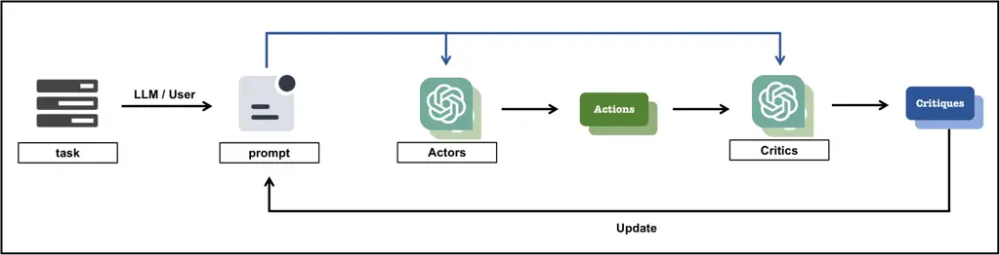
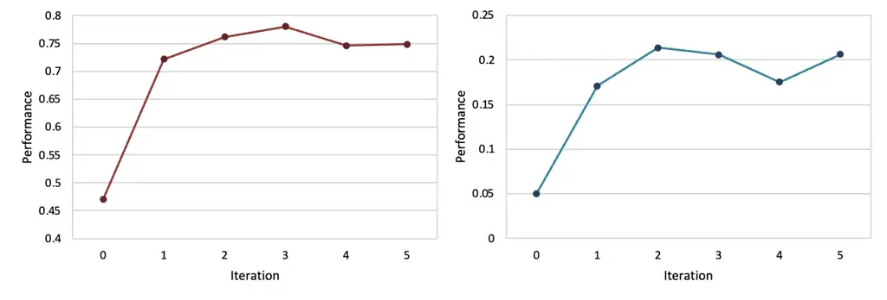

# PACE: Improving Prompt with Actor-Critic Editing for Large Language Model

Yihong Dong    Kangcheng Luo    Xue Jiang    Zhi Jin    Ge Li
Affiliation: Key Laboratory of High Confidence Software Technologies
(Peking University), Affiliation: Ministry of Education; School of
Computer Science, Peking University, Beijing, China
Affiliation: {dongyh, luokangcheng, jiangxue}@stu.pku.edu.cn, {zhijin,
lige}@pku.edu.cn

###### Abstract

Large language models (LLMs) have showcased remarkable potential across
various tasks by conditioning on prompts. However, the quality of
different human-written prompts leads to substantial discrepancies in
LLMs’ performance, and improving prompts usually necessitates
considerable human effort and expertise. To this end, this paper
proposes Prompt with Actor-Critic Editing (PACE) for LLMs to enable
automatic prompt editing. Drawing inspiration from the actor-critic
algorithm in reinforcement learning, PACE leverages LLMs as the dual
roles of actors and critics, conceptualizing prompt as a type of policy.
PACE refines prompt, taking into account the feedback from both actors
performing prompt and critics criticizing response. This process helps
LLMs better align prompt to a specific task, thanks to real responses
and thinking from LLMs. We conduct extensive experiments on 24
instruction induction tasks and 21 big-bench tasks. Experimental results
indicate that PACE elevates the relative performance of
medium/low-quality human-written prompts by up to 98%, which has
comparable performance to high-quality human-written prompts. Moreover,
PACE also exhibits notable efficacy for prompt generation.

## 1 Introduction

The rapid development of LLMs has led to notable advancements in
artificial intelligence. LLMs, such as ChatGPT (OpenAI, 2023), have
emerged as essential tools in various application scenarios, including
automatic question-answering Gabburo et al. (2023); Carta et al. (2022),
embodied agent Lanchantin et al. (2023); Seraj (2023), and code
generation (Shen et al., 2022; Jiang et al., 2023; Dong et al., 2023b),
among others. They have demonstrated remarkable capabilities in handling
a range of tasks. However, their efficacy is not universal and often
depends on how we interact with them - namely, how we provide
appropriate prompts.

Figure 1: The human-written prompt performance of ten tasks proposed in
Instruction Induction dataset (Honovich et al., 2022a), where each task
contains about eight human-written prompts, with absolute performance
differences between 29% and 93% for each task (refer to Appendix C for
detailed results).

The interaction between users and LLMs is heavily mediated by prompts.
These prompts can be understood as entry points, shaping and directing
the LLMs’ enormous reserves of knowledge and computational abilities
toward specific outcomes. Therefore, just as a key unlocks a door or a
command instructs a computer program, prompts guide the response
mechanisms of LLMs, determining the range and depth of answers they
provide. Figure 1 vividly illustrates the sensitivity of LLMs to the
quality and specificity of prompts. Even when posed with the same
underlying task, varying the phrasing or approach of a prompt can yield
vastly different results. For instance, while one prompt might retrieve
a broad overview, another, only slightly rephrased (adding “in detail”),
could elicit a detailed response. This variability underscores not only
the importance of crafting thoughtful and effective prompts but also the
nuanced complexities embedded within this task.

The variability in LLM performance with prompts is primarily caused by
two key factors: 1. Human Articulation Limitations: Humans inherently
think and communicate in a manner that is filled with nuances, emotions,
and subjectivities. When posing questions or presenting requirements,
they might inadvertently omit vital details or introduce ambiguities.
Our natural way of communication is also peppered with cultural
references, idioms, and shorthand that might not always be clear or
universally understood. Therefore, human-written prompts can sometimes
express incomplete, ambiguous, or even erroneous requirements. This not
only affects the accuracy of the output but might also skew it in
unintended directions. 2. Cognitive Discordance between Humans and LLMs:
Even when we assume that a prompt is perfectly articulated, another
challenge arises. There is an intrinsic cognitive gap between human
comprehension and the way language models interpret information. Human
comprehension and cognition need to be “translated” into expressions
that align with LLM’s expectations. Thus, a well-phrased requirement
from a human perspective may still lead to an LLM output that feels off
or unexpected to humans. As a result, crafting high-quality prompts is
usually not accomplished in one go but requires trial and error.

In general, humans develop prompts in two stages: 1. Summarizing the
initial prompt: The first stage involves crafting a preliminary version
of a prompt. It is a process that often draws upon existing data, prior
knowledge, or a specific need within a given context. 2. Improving and
editing prompts: The second stage is characterized by a continuous
process of improvement, modification, and fine-tuning. This stage is
crucial because it takes the initial draft to a polished level, where
the prompt becomes more precise, clear, and potentially more effective
in eliciting the desired response from an LLM. This stage often involves
iterative feedback loops, close scrutiny. However, existing approaches
of automatic prompt engineering concentrate primarily on the first stage
Reynolds and McDonell (2021); Honovich et al. (2022a); Zhou et al.
(2023), while overlooking the second stage that significantly enhances
the quality of prompts. Intuitively, the effect and human effort of the
second stage far surpass those of the first stage, as it is relatively
straightforward for humans to draft a preliminary version of the prompt.
Consequently, there emerges an imperative need for advancements in
automatic prompt editing for LLMs.

In this paper, we propose an effective approach named PACE to tackle
automatic prompt editing for LLMs. This approach draws inspiration from
the actor-critic algorithm, a well-known technique in the realm of
reinforcement learning. PACE repurposes LLMs as both the actor and the
critic. Conceptually, a prompt can be viewed as a policy that directs
the behavior of the LLM. The actor, or the LLM, performs tasks based on
this policy (prompt), while the critic provides a form of supervision,
identifying how well the actor is performing based on the provided
prompts. On this basis, PACE improves the quality of the prompt, thereby
optimizing the performance of LLMs on specific tasks. We conduct
extensive experiments to evaluate the effectiveness of PACE on 24
instruction induction tasks and 21 big-bench tasks. The experimental
results indicate the effectiveness of PACE for automatic prompt editing
and generation.



Figure 2: The paradigm of PACE.

## 2 PACE

We consider a task $`\mathcal{T}`$, accompanied by demonstration data
$`D=\{(X,Y)\}`$. For the task $`\mathcal{T}`$, given an input $`X`$, a
corresponding desired output is $`Y`$. The objective of automatic prompt
editing is to identify a prompt $`p`$ such that, when a LLM
$`\mathcal{M}`$ is queried with the concatenation of this prompt and a
specified input $`[p;X]`$, it generates the corresponding output $`Y`$.
Therefore, we aim to find the prompt $`p`$ that maximizes the
expectation of score $`s(p,X,Y)`$ over possible pairs $`(X,Y)`$.

```math
p^{\star}=\arg\max_{p}s(p)=\arg\max_{p}\mathbb{E}_{(X,Y)}{s(p,X,Y)},
```

where $`\arg\max`$ means to return the parameter that is the maximum
value of the function, $`\mathbb{E}`$ indicates the expectation, and
$`s`$ is a score function.

Owing to the vast and potentially infinite search space, there are
significant challenges in obtaining optimal prompts. Following the
previous work Reynolds and McDonell (2021); Honovich et al. (2022a);
Zhou et al. (2023), we leverage the capabilities of LLM to approximate
the inference of the most likely prompt $`p`$ with a high score. To
further augment the proficiency of LLM in generating or refining
prompts, we introduce the PACE approach, which consists of the
actor-critic paradigm and iterative algorithm.

### 2.1 Actor-Critic Paradigm

As shown in Figure 2, given a prompt generated by LLM or human, we use
LLMs in dual roles: as both the actor and the critic. Prompt $`p`$ in
this context is conceptualized as a policy guiding the LLM. The better
the prompt, the more effective the LLM’s response to a particular task.
A policy, in reinforcement learning terms, is a strategy that the model
uses to determine its actions based on its current state. By treating
prompts as a policy, we can leverage the concepts of reinforcement
learning to guide the iterative refinement of the prompts. Specifically,
in PACE, we use role instruction Dong et al. (2023a) to construct both
actors and critics:

Actor refers to the LLM that executes a task based on a given prompt.
The response generated by the LLM is a direct consequence of the prompt,
and it serves as an action taken by the actor in the environment of
natural language processing tasks. Formally, for a prompt $`p`$ and an
input $`X`$, the action $`a`$ generated by the actor can be represented
as:

```math
a=f_{\operatorname{actor}}([p;X],\mathcal{M}), \tag{1}
```

where $`f_{*}`$ is regarded as the mapping of LLM from input to output.
Specifically, the input parameter in \[ \] will be represented in the
form of the corresponding template¹¹ 1 The template can be found in
Appendix B., which is then fed into the given LLM $`\mathcal{M}`$ to
obtain the output.

Critic refers to the LLM that evaluates the effectiveness of the
response generated by the actor. Specifically, the critic will assess if
the response effectively addresses the task defined by the prompt. The
feedback from the critic is then used to adjust and optimize the
prompts, allowing for a continuous cycle of prompt improvement. For the
response $`a`$, the critic then evaluates $`[p;X;a]`$²² 2 PACE is not
employed during the testing phase, i.e., Eq. (2) does not use test data.
and the desired output $`Y`$ to derive a critique $`c`$ as:

```math
c=f_{\operatorname{critic}}([p;X;a;Y],\mathcal{M}). \tag{2}
```

### 2.2 Iterative Algorithm

The goal of PACE is to refine the prompt to optimize the LLM’s
performance for a specific task. The process involves iteratively
improving the prompt using feedback from the actor and the critic.

Considering the bias caused by inputs and sampling can render critiques
imprecise, thus affecting the outcomes of prompt editing. In a single
iteration, the PACE approach employs $`n`$ actors to execute the given
prompt across varied inputs. Concurrently, $`n`$ critics evaluate the
performance of these actors, providing constructive criticism. This
process culminates in the aggregation of $`n`$ feedback opinions,
offering more holistic guidance for prompt editing. Note that $`n`$ is a
hyperparameter and is set to 4 in this paper.

We start with an initial prompt $`p_{0}`$, where $`p_{0}`$ can be an
empty prompt, which is equivalent to generating from scratch based on
LLM. For each iterative step $`t`$, the candidate prompt $`p_{t}`$ can
be refined according to the aggregation of $`n`$ feedback $`c_{\leq n}`$
as:

```math
p_{t+1}=f_{\operatorname{update}}([p_{t};c_{\leq n}],\mathcal{M}). \tag{3}
```

To evaluate the efficacy of candidate prompt $`p_{t}`$ in each
iteration, we employ a score function $`s`$ to assess $`p_{t}`$ based on
demonstration or valid data. The score function can be broadly
categorized into two types:

1\. Log Probability involves leveraging an LLM to compute the log
probability of the output $`Y`$. Intuitively, a prompt that can produce
an answer with a higher log probability is more likely to be selected in
practical applications.

2\. Practical Evaluation Metric entails generating samples directly and
then assessing them using the practical evaluation metric of the task,
such as Accuracy, BLEU Papineni et al. (2002), BertScore Zhang et al.
(2020), and so forth.

In this paper, we focus on the second type of score function, for two
primary reasons: firstly, some LLMs, owing to competitive business
considerations, might not disclose generation probabilities; secondly,
employing the practical evaluation metric tends to bridge the disparity
during testing, generally resulting in enhanced performance.

We continue the iteration until convergence is achieved or until the
predefined maximum number of iterations is reached. The prompt
$`p^{\star}`$ derived from this iterative process serves as the
finalized prompt tailored for the specific task. The detailed pseudocode
of PACE is outlined in Algorithm 1.

0:  Initial prompt $`p_{0}`$, Demonstrate data $`D`$ of Task
$`\mathcal{T}`$, Score function $`s`$, and LLM $`\mathcal{M}`$.

0:  Prompt $`p^{\star}`$.

1:  Initial $`t=0`$ and $`p^{\star}=p_{0}`$.

2:  repeat

3:   for i from 1 to $`n`$ do

3:    Sample $`(X_{i},Y_{i})`$ from $`D`$.

3:    $`i`$-th actor $`A_{i}`$ generates an action $`a_{i}`$ via Eq.
(1).

3:    $`i`$-th critic $`C_{i}`$ evaluates $`a_{i}`$ to yield a critique
$`c_{i}`$ via Eq. (2).

4:   end for

5:   $`p_{t}`$ is updated base on $`c_{\leq n}`$ via Eq. (3).

6:   $`p^{\star}=max(s(p^{\star}),s(p^{t+1}))`$.

7:   $`t=t+1`$.

8:  until Convergence or a maximum number of iterations.

9:  return $`p^{\star}`$

Algorithm 1 Pseudocode of PACE approach.

|                     |       |        |       |        |       |        |                |        |      |
| ------------------- | ----- | ------ | ----- | ------ | ----- | ------ | -------------- | ------ | ---- |
| Task                | W-HWP | + PACE | M-HWP | + PACE | B-HWP | + PACE | Butter Fingers | + PACE | APE  |
| active_to_passive   | 1     | 0.99   | 1     | 1      | 1     | 1      | 0.02           | 1      | 1    |
| antonyms            | 0.77  | 0.85   | 0.82  | 0.86   | 0.85  | 0.87   | 0.76           | 0.81   | 0.82 |
| cause_and_effect    | 0     | 0.53   | 0.36  | 0.73   | 0.84  | 0.85   | 0.04           | 0.61   | 0.5  |
| common_concept      | 0.05  | 0.06   | 0.08  | 0.15   | 0.15  | 0.16   | 0.01           | 0.04   | 0.04 |
| diff                | 0.87  | 1      | 0.94  | 1      | 1     | 1      | 0.92           | 1      | 0.88 |
| first_word_letter   | 0.6   | 1      | 0.8   | 1      | 1     | 1      | 0              | 1      | 1    |
| informal_to_formal  | 0.46  | 0.59   | 0.52  | 0.6    | 0.64  | 0.67   | 0.57           | 0.54   | 0.5  |
| larger_animal       | 0.2   | 0.53   | 0.46  | 0.93   | 0.93  | 0.95   | 0              | 0.26   | 0.49 |
| letters_list        | 0.56  | 1      | 0.73  | 1      | 1     | 1      | 0.02           | 0.91   | 1    |
| negation            | 0.5   | 0.76   | 0.63  | 0.82   | 0.79  | 0.83   | 0              | 0.78   | 0.81 |
| num_to_verbal       | 0.44  | 1      | 0.59  | 1      | 1     | 1      | 0.27           | 1      | 0.98 |
| ortho_starts_with   | 0.35  | 0.44   | 0.36  | 0.52   | 0.72  | 0.71   | 0.47           | 0.37   | 0.42 |
| rhymes              | 0     | 0.56   | 0.56  | 0.6    | 0.61  | 0.61   | 0.3            | 0.57   | 0.12 |
| second_word_letter  | 0.95  | 1      | 0.96  | 1      | 0.99  | 1      | 0.31           | 1      | 0.25 |
| sentence_similarity | 0     | 0.42   | 0.2   | 0.28   | 0.38  | 0.35   | 0              | 0.01   | 0.11 |
| sentiment           | 0.5   | 0.91   | 0.66  | 0.91   | 0.91  | 0.92   | 0              | 0.89   | 0.85 |
| singular_to_plural  | 0.99  | 1      | 0.99  | 1      | 1     | 1      | 0.98           | 0.99   | 1    |
| sum                 | 0.07  | 1      | 0.99  | 1      | 1     | 1      | 0.64           | 1      | 0.37 |
| synonyms            | 0.11  | 0.12   | 0.13  | 0.16   | 0.15  | 0.17   | 0.12           | 0.14   | 0.39 |
| taxonomy_animal     | 0.42  | 0.92   | 0.74  | 0.85   | 0.98  | 0.96   | 0.28           | 0.86   | 0.69 |
| translation_en-de   | 0.81  | 0.84   | 0.82  | 0.84   | 0.84  | 0.84   | 0.8            | 0.83   | 0.81 |
| translation_en-es   | 0.87  | 0.83   | 0.87  | 0.88   | 0.9   | 0.89   | 0.82           | 0.77   | 0.88 |
| translation_en-fr   | 0.88  | 0.88   | 0.88  | 0.86   | 0.89  | 0.88   | 0.78           | 0.91   | 0.86 |
| word_in_context     | 0     | 0.16   | 0.28  | 0.57   | 0.54  | 0.58   | 0              | 0.49   | 0.23 |
| Average             | 0.47  | 0.72   | 0.64  | 0.78   | 0.79  | 0.8    | 0.36           | 0.71   | 0.62 |

Table 1: The Performance of PACE under Various Initial Prompts on
Instruction Induction

## 3 Experiment Setup

#### Benchmarks.

We perform a comprehensive evaluation on Instruction Induction Honovich
et al. (2022a) and Big-Bench Suzgun et al. (2023) to demonstrate the
efficacy of PACE.

Instruction Induction Honovich et al. (2022a) consists of 24 diverse
instruction induction tasks, each comprising a multitude of
human-written prompts. These tasks cover numerous areas of language
understanding, ranging from fundamental sentence structures to the
identification of similarities and causal relationships.

Big-Bench Suzgun et al. (2023) is composed of 21 more challenging tasks
covering many aspects of language understanding, including emotional
understanding, context-free questions and answers, reading
comprehension, summaries, algorithms, and various reasoning tasks. Each
task has a human-written prompt.

We followed the setup of APE Zhou et al. (2023), dividing over 40 tasks
in two benchmarks into train, val, and test sets. Our approach is
optimized only on the train and val sets, and the final generated prompt
is evaluated on the test set. Detailed descriptions of each task in two
benchmarks can be found in Appendix A.

#### Implementation Details.

In all experiments, we invoke ChatGPT as our base model through its API,
namely gpt-3.5-turbo. We employ ‘0301’ version of gpt-3.5-turbo, which
is a snapshot from March 1st 2023, and will not receive updates. To
increase the stability of LLM’s output, we set the decoding temperature
to 0 and top_p to 1. Moreover, we set max_tokens to 512 for generation.
For hyperparameters of PACE, we set the number of agents $`n`$ to 4 and
that of candidates in each iteration to 2. For fairness, the number of
candidates in other approaches is set to 4\*2 = 8. Unless otherwise
stated, the maximum number of iterations is set to 1, i.e., we use only
1 iteration step for prompt editing in total. The experiments are run
five times and the average results are reported.

## 4 Experimental Results

In this section, we detail the results of our comprehensive experiments
which offer compelling evidence of the effectiveness of PACE in
improving the performance of LLMs. Note that in most experiments, we
only present the average results from all experiments for each
benchmark. Detailed results for each task are available in the Appendix.

### 4.1 The Effect of PACE in Prompt Editing

In Instruction Induction, we evaluated the performance of PACE under
various initial prompts, which included:

- •
  Worst Human-Written Prompt (W-HWP): The least effective prompt among
  all human-written prompts included in the task³³ 3 We evaluate all
  human-written prompts of the task on the base model and then rank
  their performance. Detailed result can be find in Appendix C;
- •
  Medium Human-Written Prompt (M-HWP): Its efficacy is at the median
  compared to all human-written prompts in the task;
- •
  Best Human-Written Prompt (B-HWP): Out of all human-written prompts
  provided in the task, it yielded the best results;
- •
  Butter Fingers: The variant of M-HWP with a 15% misspelling rate
  introduced randomly.

As shown in Table 1, we observe that PACE is effective with
human-written prompts of varying quality. PACE was successful in
substantially enhancing the performance of LLMs that were initially
provided with medium-quality and low-quality human-written prompts,
including M-HWP, W-HWP, and Butter Fingers. In many cases, the LLMs
using the PACE-refined prompts achieved performance levels comparable
to, and in some cases even surpassing, those using high-quality
human-written prompts, i.e., B-HWP. Remarkably, even for B-HWP, PACE
manages to offer a marginal improvement. A notable highlight is the
performance of PACE under the Butter Fingers setting, which encapsulates
reading comprehension challenges. Prompts under this category can be
notoriously difficult, often with inherent errors or misconstructions.
However, the ability of PACE to detect, correct, and improve these
prompts is nothing short of commendable. A staggering enhancement of up
to 98% in the LLM’s performance is a testament to PACE’s robust error
rectification capabilities. Equally impressive is the breadth of PACE’s
effectiveness. These improvements aren’t isolated to specific tasks or
certain domains. On the contrary, a consistent positive trend is
observed across a diverse suite of 24 tasks, suggesting the
generalizability of PACE.

It has been observed that the performance of APE Zhou et al. (2023) is
comparable to that of a medium human-written prompt. However, our
proposed PACE outperforms APE, even under challenging conditions like
the worst human-written prompts and the "Butter Finger" settings,
underscoring the superiority of our approach. We also compare the
efficiency of PACE and APE and find that the running time of PACE is
slightly lower than APE (about 0.78$`\times`$), which is acceptable.
Moreover, it’s essential to highlight that for many tasks, especially
those requiring an initial draft or a general directive, humans can
often produce a satisfactory first attempt without much effort. For
instance, humans can provide a broad overview or a general description
of the intended subject. The real challenge, and where computational
models like PACE come into play, is refining and optimizing these drafts
to produce a high-quality final product.

((a)) Instruction Induction.

((b)) Big-Bench.

Figure 3: The Performance of PACE under Various Initial Prompts.

In Big-Bench, each task is provided with only a single instruction,
which limits our ability to screen prompts of varying qualities, unlike
the tasks taken in Instruction Induction. For this reason, the only
instruction we have by default is M-HWP, and in addition to the Butter
Fingers setting, we have introduced two new settings:

- •
  Empty: The initial prompt is an empty string;
- •
  APE prompt: The initial prompt is generated by LLM with APE Zhou
  et al. (2023).

Figure 3 elucidates the impact of PACE on both Instruction Induction and
Big-Bench across four distinct settings. It is evident that PACE
exhibits consistent improvements across all four settings, highlighting
its robust capability to navigate through these specific conditions
effectively. The enhancement with the application of PACE on the APE
prompt means that even for other LLM-generated prompts, PACE can be
further improved and enhanced to achieve better results, because PACE
takes into account realistic feedback and LLM cognitive processes. It is
worth noting the effect shown by PACE when initialized with an Empty
prompt. This implies that PACE’s utility is not confined to the mere
editing of pre-existing prompts. It is equally adept at crafting initial
prompts from scratch, underlining its versatile and comprehensive
applicative potential. The flexibility demonstrates PACE’s versatility
and its potential in a wide array of scenarios. Furthermore, the
comparative analysis between PACE and APE reveals the superiority of
PACE in enhancing performance across both two benchmarks.

In conclusion, the results from Figure 3 accentuate the effectiveness
and adaptability of PACE across different benchmarks and settings.
Whether refining existing prompts or creating new ones, PACE
consistently delivers enhanced results.

Figure 4: The ablation Study of PACE on Both Two Public Benchmark
Datasets.

### 4.2 Ablation Study

In this section, we delve deeper into the analysis of PACE through an
ablation study, which is designed to gauge the individual contributions
and effectiveness of each module incorporated in APCE.

Figure 4 provides a clear visual representation of our findings. We
observed that both roles – the actor and the critic – are instrumental
in the overall efficiency of PACE. The actor’s primary function is to
execute the prompt, offering real-time feedback to the LLM. This
feedback is not merely mechanical but is crucial in dynamically shaping
the prompt based on changing conditions or requirements. On the other
hand, the critic operates at a meta-level, assessing the quality and
relevance of the feedback. Through thoughtful evaluation, the critic
aids the LLM in refining and editing the prompt to ensure optimal
results.

Comparative analysis between the two roles reveals that the critic
possesses a slightly higher significance in enhancing the system’s
performance, followed closely by the actor. The critic’s evaluative
capabilities ensure that the system doesn’t veer off-course, while the
actor provides the necessary operational feedback to keep the system in
check. It is also worth noting the stark difference in performance when
these roles are absent. Methods that do not incorporate the actor and
critic mechanisms lag noticeably in effectiveness. This disparity is
evident on both benchmarks we tested, underscoring the importance of
these components in PACE.

In essence, our ablation study underscores the synergistic relationship
between the actor and critic in PACE. While each has its unique
function, together they substantially elevate the system’s efficiency
and accuracy.

((a)) Instruction Induction.

((b)) Big-Bench.

Figure 5: Performance of PACE with Different LLMs.

### 4.3 Comparison with different LLMs

In this section, our aim is to underscore the versatility and generality
of the PACE methodology. To do so, we have decided to utilize an array
of different LLMs for the PACE task, including ‘text-davinci-002’,
‘text-davinci-003’, ‘ChatGPT’, and ‘GPT-4’. This diverse selection not
only showcases the breadth of models available but also ensures a
comprehensive assessment across different model capabilities and
specializations.

Referring to Figure 5, the visual representation distinctly showcases
that irrespective of the model chosen, the PACE method consistently
enhances the quality of the initial prompt. This not only strengthens
the argument for the efficacy of PACE but also demonstrates the
robustness of the LLMs in refining textual inputs. This observation is
pivotal, as it suggests that the approach is model-agnostic to some
extent, and the gains are not just circumstantial or confined to
specific LLMs.

In summary, the consistent improvement observed across diverse models
unequivocally demonstrates that the PACE methodology serves as a
universally applicable technique. This technique is instrumental in
enhancing the performance of various LLMs by refining the prompts with
which they are provided.



\(a\) Instruction Induction.                (b) Big-Bench.

Figure 6: Effect of Iteration numbers

### 4.4 Effect of Iteration numbers

In this section, our primary objective is to assess the impact of
varying the number of iterations on our process or system. It’s crucial
to understand how iteration numbers can influence the outcomes, as this
can shed light on the stability, efficiency, and effectiveness of the
procedure in question. By systematically altering the iteration count,
we can derive insights into the optimal number needed to achieve the
desired results without overcomplicating or overburdening the system.

In the exploration of the impact of iteration numbers, it’s pivotal to
understand how iterations influence the outcome. As depicted in Figure
6, there’s a clear trend showcasing the correlation between the number
of iterations and the editing effect. The pattern suggests a dynamic
evolution, wherein the editing effect witnesses a surge with increasing
iterations, up to a point beyond which the effect plateaus and
eventually stabilizes.

This stabilization of the editing effect after a certain number of
iterations indicates a saturation point or a threshold beyond which
additional iterations don’t contribute significantly to enhancing the
effect. What’s noteworthy from the observed data is that typically,
three iterations seem to strike an optimal balance. In summary, it is
recommended to limit the number of iterations to less than 3, which can
effectively balance cost and effect.

## 5 Related Work

Recent advancements in transformer-based LLMs have not only improved the
model’s performance across various NLP tasks (Vaswani et al., 2017;
Devlin et al., 2018; Brown et al., 2020) but have also revealed emergent
capabilities, including few-shot in-context learning, zero-shot problem
solving, chain of thought reasoning, instruction following, and
instruction induction (Cobbe et al., 2021; Wei et al., 2022; Kojima
et al., 2022; Sanh et al., 2022; Wei et al., 2021; Ouyang et al., 2022;
Honovich et al., 2022b). While we share the sentiment with these works
about the potential of LLMs, our focus lies in enhancing their
performance through prompt editing strategies.

#### Automatic prompt engineering with training.

Some work improves prompts by tuning soft prompts in a differentiable
manner. For instance, the work Lester et al. (2021); Qin and Eisner
(2021) employs soft prompts to tailor the behavior of LLMs. Similarly,
efforts like those of Hao et al. (2022); Deng et al. (2022); Zhou et al.
(2022) delve into training auxiliary models or directly training the
prompt generator Hao et al. (2022); Wang et al. (2022). While these
efforts show the potential of differentiable tuning, they face
limitations when LLMs are only accessed via APIs, which limits access to
the model’s internals. Additionally, the prompts generated from such
methods often yield incoherent languages Hambardzumyan et al. (2021).
Therefore, another type of work improves prompts via discrete
manipulations using Reinforcement Learning Shin et al. (2020); Zhang
et al. (2023); Deng et al. (2022), which requires training a reward
model. However, it is challenging to train an excellent and
generalizable reward model.

#### Automatic prompt engineering without training.

Several works have recently explored the potential of using LLMs
themselves to guide prompt optimization without training Reynolds and
McDonell (2021); Honovich et al. (2022a). The work Zhou et al. (2022)
employs the Monte Carlo sampling technique for this purpose. Similarly,
the work Prasad et al. (2022) introduced an evolutionary search approach
for prompts, leveraging LLM-paraphrased and swapped segments of the
original prompt. The work Chen et al. (2023) focuses on refining
SQL-generation prompts using LLM feedback. The work Pryzant et al.
(2023) considers ‘gradients’ to guide LLMs for classification tasks.
However, these methods usually grapple with ambiguous semantic
orientation or a confined task-specific scope.

For automatic prompt editing, EvoPrompt Guo et al. (2023) uses a genetic
algorithm to mutate the original prompt. PROmpting Yang et al. (2023)
leverages LLMs as optimizers, where the optimization task is described
in natural language. Both of them are two concurrent works. The main
difference between PACE and them is that EvoPrompt does not provide
feedback or reflect on execution results to LLMs, similar to PACE w/o
the actor and critic, whereas PROmpting only lacks reflection, akin to
PACE w/o the critic. Detailed comparison results can be found in
Appendix D.

In this paper, PACE refines prompts for LLMs using the actor-critic
paradigm, which provides effective guidance in editing and can be
applied to various tasks.

## 6 Conclusion and Discussion

In this paper, we have proposed PACE, an innovative approach to
automatic prompt editing for LLMs, drawing inspiration from the
Actor-Critic paradigm in reinforcement learning. Our experiments confirm
the potential of PACE in significantly enhancing the effectiveness of
prompts, leading to improved LLM performance across a variety of tasks.
By treating the prompt as a form of policy and conceptualizing LLMs as
both actors and critics, we have presented a fresh perspective on how
prompts can be optimized to better guide the output of LLMs. The
remarkable improvements with PACE in prompt editing and generation
underscore the value of this perspective and its potential to transform
the field of prompt engineering.

## 7 Limitation

There are several limitations to our proposed PACE as follows.

First, PACE relies on the ability of LLMs to understand prompts and
instructions, which is a common limitation of all current automated
prompt engineering approaches. However, with the advancement of LLM
technologies, more LLMs will demonstrate such capabilities, thereby
broadening the application scope of PACE.

Second, due to limitations in computational resources, we are unable to
run large-scale open-source LLMs. However, we evaluated PACE on four
different OpenAI LLMs. The experimental results demonstrate that PACE
achieved consistent and significant performance improvements across 40
tasks on two benchmarks for all four LLMs. This to some extent validates
the broad applicability and effectiveness of PACE.

Third, PACE is efficient in handling medium to low-difficulty problems,
but when faced with highly complex problems, we firmly believe in the
power of human-machine collaboration to unleash its greater potential,
ensuring optimal results.

## References

- Brown et al. (2020) Tom Brown, Benjamin Mann, Nick Ryder, Melanie
  Subbiah, Jared D Kaplan, Prafulla Dhariwal, Arvind Neelakantan, Pranav
  Shyam, Girish Sastry, Amanda Askell, et al. 2020. Language models are
  few-shot learners. _Advances in neural information processing
  systems_, 33:1877–1901.
- Carta et al. (2022) Thomas Carta, Pierre-Yves Oudeyer, Olivier Sigaud,
  and Sylvain Lamprier. 2022. EAGER: asking and answering questions for
  automatic reward shaping in language-guided RL. In _NeurIPS_.
- Chen et al. (2023) Xinyun Chen, Maxwell Lin, Nathanael Schärli, and
  Denny Zhou. 2023. Teaching large language models to self-debug. _arXiv
  preprint arXiv:2304.05128_.
- Cobbe et al. (2021) Karl Cobbe, Vineet Kosaraju, Mohammad Bavarian,
  Jacob Hilton, Reiichiro Nakano, Christopher Hesse, and John
  Schulman. 2021. Training verifiers to solve math word problems. _arXiv
  preprint arXiv:2110.14168_.
- Deng et al. (2022) Mingkai Deng, Jianyu Wang, Cheng-Ping Hsieh, Yihan
  Wang, Han Guo, Tianmin Shu, Meng Song, Eric P Xing, and Zhiting
  Hu. 2022. Rlprompt: Optimizing discrete text prompts with
  reinforcement learning. _arXiv preprint arXiv:2205.12548_.
- Devlin et al. (2018) Jacob Devlin, Ming-Wei Chang, Kenton Lee, and
  Kristina Toutanova. 2018. Bert: Pre-training of deep bidirectional
  transformers for language understanding. _arXiv preprint
  arXiv:1810.04805_.
- Dong et al. (2023a) Yihong Dong, Xue Jiang, Zhi Jin, and Ge Li. 2023a.
  Self-collaboration code generation via chatgpt. _CoRR_,
  abs/2304.07590.
- Dong et al. (2023b) Yihong Dong, Ge Li, and Zhi Jin. 2023b. CODEP:
  grammatical seq2seq model for general-purpose code generation. In
  _ISSTA_, pages 188–198. ACM.
- Gabburo et al. (2023) Matteo Gabburo, Siddhant Garg, Rik
  Koncel-Kedziorski, and Alessandro Moschitti. 2023. Learning answer
  generation using supervision from automatic question answering
  evaluators. In _ACL (1)_, pages 8389–8403. Association for
  Computational Linguistics.
- Guo et al. (2023) Qingyan Guo, Rui Wang, Junliang Guo, Bei Li, Kaitao
  Song, Xu Tan, Guoqing Liu, Jiang Bian, and Yujiu Yang. 2023.
  Connecting large language models with evolutionary algorithms yields
  powerful prompt optimizers. _CoRR_, abs/2309.08532.
- Hambardzumyan et al. (2021) Karen Hambardzumyan, Hrant Khachatrian,
  and Jonathan May. 2021. Warp: Word-level adversarial reprogramming.
  _arXiv preprint arXiv:2101.00121_.
- Hao et al. (2022) Yaru Hao, Zewen Chi, Li Dong, and Furu Wei. 2022.
  Optimizing prompts for text-to-image generation. _arXiv preprint
  arXiv:2212.09611_.
- Honovich et al. (2022a) Or Honovich, Uri Shaham, Samuel R. Bowman, and
  Omer Levy. 2022a. Instruction induction: From few examples to natural
  language task descriptions. _CoRR_, abs/2205.10782.
- Honovich et al. (2022b) Or Honovich, Uri Shaham, Samuel R Bowman, and
  Omer Levy. 2022b. Instruction induction: From few examples to natural
  language task descriptions. _arXiv preprint arXiv:2205.10782_.
- Jiang et al. (2023) Xue Jiang, Yihong Dong, Lecheng Wang, Qiwei Shang,
  and Ge Li. 2023. Self-planning code generation with large language
  model. _CoRR_, abs/2303.06689.
- Kojima et al. (2022) Takeshi Kojima, Shixiang Shane Gu, Machel Reid,
  Yutaka Matsuo, and Yusuke Iwasawa. 2022. Large language models are
  zero-shot reasoners. _arXiv preprint arXiv:2205.11916_.
- Lanchantin et al. (2023) Jack Lanchantin, Sainbayar Sukhbaatar,
  Gabriel Synnaeve, Yuxuan Sun, Kavya Srinet, and Arthur Szlam. 2023. A
  data source for reasoning embodied agents. In _AAAI_, pages 8438–8446.
  AAAI Press.
- Lester et al. (2021) Brian Lester, Rami Al-Rfou, and Noah
  Constant. 2021. The power of scale for parameter-efficient prompt
  tuning. In _Proceedings of the 2021 Conference on Empirical Methods in
  Natural Language Processing_, pages 3045–3059.
- OpenAI (2023) OpenAI. 2023.
  [ChatGPT](https://openai.com/blog/chatgpt/).
- Ouyang et al. (2022) Long Ouyang, Jeff Wu, Xu Jiang, Diogo Almeida,
  Carroll L Wainwright, Pamela Mishkin, Chong Zhang, Sandhini Agarwal,
  Katarina Slama, Alex Ray, et al. 2022. Training language models to
  follow instructions with human feedback. _arXiv preprint
  arXiv:2203.02155_.
- Papineni et al. (2002) Kishore Papineni, Salim Roukos, Todd Ward, and
  Wei-Jing Zhu. 2002. Bleu: a method for automatic evaluation of machine
  translation. In _ACL_, pages 311–318. ACL.
- Prasad et al. (2022) Archiki Prasad, Peter Hase, Xiang Zhou, and Mohit
  Bansal. 2022. Grips: Gradient-free, edit-based instruction search for
  prompting large language models. _arXiv preprint arXiv:2203.07281_.
- Pryzant et al. (2023) Reid Pryzant, Dan Iter, Jerry Li, Yin Tat Lee,
  Chenguang Zhu, and Michael Zeng. 2023. Automatic prompt optimization
  with "gradient descent" and beam search. _CoRR_, abs/2305.03495.
- Qin and Eisner (2021) Guanghui Qin and Jason Eisner. 2021. Learning
  how to ask: Querying lms with mixtures of soft prompts. In
  _Proceedings of the 2021 Conference of the North American Chapter of
  the Association for Computational Linguistics: Human Language
  Technologies_, pages 5203–5212.
- Reynolds and McDonell (2021) Laria Reynolds and Kyle McDonell. 2021.
  Prompt programming for large language models: Beyond the few-shot
  paradigm. In _CHI Extended Abstracts_, pages 314:1–314:7. ACM.
- Sanh et al. (2022) Victor Sanh, Albert Webson, Colin Raffel, Stephen
  Bach, Lintang Sutawika, Zaid Alyafeai, Antoine Chaffin, Arnaud
  Stiegler, Teven Le Scao, Arun Raja, et al. 2022. Multitask prompted
  training enables zero-shot task generalization. In _The Tenth
  International Conference on Learning Representations_.
- Seraj (2023) Esmaeil Seraj. 2023. Embodied, intelligent communication
  for multi-agent cooperation. In _AAAI_, pages 16135–16136. AAAI Press.
- Shen et al. (2022) Sijie Shen, Xiang Zhu, Yihong Dong, Qizhi Guo,
  Yankun Zhen, and Ge Li. 2022. Incorporating domain knowledge through
  task augmentation for front-end javascript code generation. In
  _ESEC/SIGSOFT FSE_, pages 1533–1543. ACM.
- Shin et al. (2020) Taylor Shin, Yasaman Razeghi, Robert L. Logan IV,
  Eric Wallace, and Sameer Singh. 2020. AutoPrompt: Eliciting knowledge
  from language models with automatically generated prompts. In
  _Empirical Methods in Natural Language Processing (EMNLP)_.
- Suzgun et al. (2023) Mirac Suzgun, Nathan Scales, Nathanael Schärli,
  Sebastian Gehrmann, Yi Tay, Hyung Won Chung, Aakanksha Chowdhery,
  Quoc V. Le, Ed Chi, Denny Zhou, and Jason Wei. 2023. Challenging
  big-bench tasks and whether chain-of-thought can solve them. In _ACL
  (Findings)_, pages 13003–13051. Association for Computational
  Linguistics.
- Vaswani et al. (2017) Ashish Vaswani, Noam Shazeer, Niki Parmar, Jakob
  Uszkoreit, Llion Jones, Aidan N Gomez, Łukasz Kaiser, and Illia
  Polosukhin. 2017. Attention is all you need. _Advances in neural
  information processing systems_, 30.
- Wang et al. (2022) Yizhong Wang, Yeganeh Kordi, Swaroop Mishra, Alisa
  Liu, Noah A Smith, Daniel Khashabi, and Hannaneh Hajishirzi. 2022.
  Self-instruct: Aligning language model with self generated
  instructions. _arXiv preprint arXiv:2212.10560_.
- Wei et al. (2021) Jason Wei, Maarten Bosma, Vincent Zhao, Kelvin Guu,
  Adams Wei Yu, Brian Lester, Nan Du, Andrew M Dai, and Quoc V Le. 2021.
  Finetuned language models are zero-shot learners. In _International
  Conference on Learning Representations_.
- Wei et al. (2022) Jason Wei, Xuezhi Wang, Dale Schuurmans, Maarten
  Bosma, Ed Chi, Quoc Le, and Denny Zhou. 2022. Chain of thought
  prompting elicits reasoning in large language models. _arXiv preprint
  arXiv:2201.11903_.
- Yang et al. (2023) Chengrun Yang, Xuezhi Wang, Yifeng Lu, Hanxiao Liu,
  Quoc V. Le, Denny Zhou, and Xinyun Chen. 2023. Large language models
  as optimizers. _CoRR_, abs/2309.03409.
- Zhang et al. (2023) Tianjun Zhang, Xuezhi Wang, Denny Zhou, Dale
  Schuurmans, and Joseph E Gonzalez. 2023. Tempera: Test-time prompt
  editing via reinforcement learning. In _The Eleventh International
  Conference on Learning Representations_.
- Zhang et al. (2020) Tianyi Zhang, Varsha Kishore, Felix Wu, Kilian Q.
  Weinberger, and Yoav Artzi. 2020. Bertscore: Evaluating text
  generation with BERT. In _ICLR_. OpenReview.net.
- Zhou et al. (2022) Yongchao Zhou, Andrei Ioan Muresanu, Ziwen Han,
  Keiran Paster, Silviu Pitis, Harris Chan, and Jimmy Ba. 2022. Large
  language models are human-level prompt engineers. _arXiv preprint
  arXiv:2211.01910_.
- Zhou et al. (2023) Yongchao Zhou, Andrei Ioan Muresanu, Ziwen Han,
  Keiran Paster, Silviu Pitis, Harris Chan, and Jimmy Ba. 2023. Large
  language models are human-level prompt engineers. In _ICLR_.
  OpenReview.net.

## Appendix A Implementation Details

|                   |                     |                                                                                                        |                                                                                                                 |
| ----------------- | ------------------- | ------------------------------------------------------------------------------------------------------ | --------------------------------------------------------------------------------------------------------------- |
| Category          | Task                | Instruction                                                                                            | Demonstration                                                                                                   |
| Spelling          | First Letter        | Extract the first letter of the input word.                                                            | cat $`\rightarrow`$ c                                                                                           |
|                   | Second Letter       | Extract the second letter of the input word.                                                           | cat $`\rightarrow`$ a                                                                                           |
|                   | List Letters        | Break the input word into letters, separated by spaces.                                                | cat $`\rightarrow`$ c a t                                                                                       |
|                   | Starting With       | Extract the words starting with a given letter from the input sentence.                                | The man whose car I hit last week sued me. \[m\] $`\rightarrow`$ man, me                                        |
| Morpho- syntax    | Pluralization       | Convert the input word to its plural form.                                                             | cat $`\rightarrow`$ cats                                                                                        |
|                   | Passivization       | Write the input sentence in passive form.                                                              | The artist introduced the scientist. $`\rightarrow`$ The scientist was introduced by the artist.                |
| Syntax            | Negation            | Negate the input sentence.                                                                             | Time is finite $`\rightarrow`$ Time is not finite.                                                              |
| Lexical Semantics | Antonyms            | Write a word that means the opposite of the input word.                                                | won $`\rightarrow`$ lost                                                                                        |
|                   | Synonyms            | Write a word with a similar meaning to the input word.                                                 | alleged $`\rightarrow`$ supposed                                                                                |
|                   | Membership          | Write all the animals that appear in the given list.                                                   | cat, helicopter, cook, whale, frog, lion $`\rightarrow`$ frog, cat, lion, whale                                 |
| Phonetics         | Rhymes              | Write a word that rhymes with the input word.                                                          | sing $`\rightarrow`$ ring                                                                                       |
| Knowledge         | Larger Animal       | Write the larger of the two given animals.                                                             | koala, snail $`\rightarrow`$ koala                                                                              |
| Semantics         | Cause Selection     | Find which of the two given cause and effect sentences is the cause.                                   | Sentence 1: The soda went flat. Sentence 2: The bottle was left open. $`\rightarrow`$ The bottle was left open. |
|                   | Common Concept      | Find a common characteristic for the given objects.                                                    | guitars, pendulums, neutrinos $`\rightarrow`$ involve oscillations.                                             |
| Style             | Formality           | Rephrase the sentence in formal language.                                                              | Please call once you get there $`\rightarrow`$ Please call upon your arrival.                                   |
| Numerical         | Sum                 | Sum the two given numbers.                                                                             | 22 10 $`\rightarrow`$ 32                                                                                        |
|                   | Difference          | Subtract the second number from the first.                                                             | 32 22 $`\rightarrow`$ 10                                                                                        |
|                   | Number to Word      | Write the number in English words.                                                                     | 26 $`\rightarrow`$ twenty-six                                                                                   |
| Multi- lingual    | Translation         | Translate the word into German / Spanish / French.                                                     | game $`\rightarrow`$ juego                                                                                      |
| GLUE              | Sentiment Analysis  | Determine whether a movie review is positive or negative.                                              | The film is small in scope, yet perfectly formed. $`\rightarrow`$ positive                                      |
|                   | Sentence Similarity | Rate the semantic similarity of two input sentences on a scale of 0 - definitely not to 5 - perfectly. | Sentence 1: A man is smoking. Sentence 2: A man is skating. $`\rightarrow`$ 0 - definitely not                  |
|                   | Word in Context     | Determine whether an input word has the same meaning in the two input sentences.                       | Sentence 1: Approach a task. Sentence 2: To approach the city. Word: approach $`\rightarrow`$ not the same      |
|                   |                     |                                                                                                        |                                                                                                                 |

Table 2: The 24-instruction induction task proposed in the work Honovich
et al. (2022b) is described in detail. For convenience, the original
table in the work Honovich et al. (2022b) is reproduced here.

|                                   |                                                                                                                   |                                                                   |
| --------------------------------- | ----------------------------------------------------------------------------------------------------------------- | ----------------------------------------------------------------- |
| Name                              | Description                                                                                                       | Keywords                                                          |
| gender inclusive sentences german | Given a German language sentence that does not use gender-inclusive forms, transform it to gender-inclusive forms | free response, grammar, inclusion, non-English, paraphrase        |
| movie recommendation              | Recommend movies similar to the given list of movies                                                              | emotional intelligence, multiple choice                           |
| object counting                   | Questions that involve enumerating objects of different types and asking the model to count them                  | free response, logical reasoning                                  |
| operators                         | Given a mathematical operator definition in natural language, apply it                                            | free response, mathematics, numerical response                    |
| question selection                | Given a short answer along with its context, select the most appropriate question which to the given short answer | multiple choice, paraphrase, reading comprehension, summarization |
| ruin names                        | Select the humorous edit that ’ruins’ the input movie or musical artist name                                      | emotional understanding, multiple choice                          |
| snarks                            | Determine which of two sentences is sarcastic                                                                     | emotional understanding, humor, multiple choice                   |
| tense                             | Modify the tense of a given sentence                                                                              | free response, paraphrase, syntax                                 |
| word sorting                      | Sort a list of words                                                                                              | algorithms, free response                                         |
| word unscrambling                 | Unscramble the given letters to form an English word                                                              | free response, implicit reasoning, tokenization                   |

Table 3: A detailed description of Big-Bench Instruction Induction, a
clean and tractable subset of tasks with clear human-written
instructions.

## Appendix B Templates of Actor, Critic, and Update

The purpose of these templates is to allow LLMs to produce corresponding
responses when acting as actor, critic, and update. Note that these
templates are not optimal, and we can improve these templates to get
better results.

### B.1 Actor

Instruction: \[TASK_INSTRUCTION\],  
Input: \[INPUT\],  
Output:

### B.2 Critic

I gave you an instruction:\[TASK_INSTRUCTION\]. Based on this
instruction they produced the following input-prediction pairs and the
corresponding ground truth:  
Input: \[INPUT\],  
Prediction: \[PREDICTION\],  
Ground Truth: \[GROUNDTRUTH\],  
According to Input, Prediction, and Ground Truth, give the critical
advice on how to improve the instruction:

### B.3 Update

I gave you an instruction:\[TASK_INSTRUCTION\]. Based on the instruction
they produced the following critical advices: \[Critical_Advices\].
Taking these critical advices into consideration, the improved
instruction was:

## Appendix C Details of Human-written Prompt and Performance in Instruction Induction

Each task contains multiple human-written prompts and their performances
on the base model.

### C.1 Case Selection

- •
  0.88: Which of the following sentences is the cause?
- •
  0.8: Which of the two events is the cause?
- •
  0.6: Each input consists of two sentences, where one is the cause and
  the other is the outcome. Write The cause sentence.
- •
  0.52: The input is a cause and effect. Write the cause.
- •
  0.36: The input is a cause and effect, write the cause.
- •
  0.2: The input consists of two sentences. One is the cause of the
  other. Write the cause sentence.
- •
  0.04: Find the cause in the following cause and effect pair.
- •
  0.0: Output the sentence describing the cause (the other sentence is
  what happened as a result).
- •
  0.0: Output the cause (other sentence describes what happened as a
  result).

### C.2 Starting With

- •
  0.72: Write a word from the following sentence that starts with the
  bracketed letter.
- •
  0.65: Output all the tokens in the input that start with the letter in
  \[ \].
- •
  0.57: Output all tokens in the sentence that start with the letter in
  \[ \].
- •
  0.55: Write all the words of the input that start with the letter in
  the square brackets.
- •
  0.43: Write all the words from the sentence that start with the letter
  in the square brackets.
- •
  0.4: For each input, list all the words in the sentence that begin
  with the character in brackets at the end of the sentence.
- •
  0.36: Write all the words in the following sentence that start with
  the bracketed letter, in their original order.
- •
  0.35: For each input sentence, list all the words in the sentence that
  begin with the character written inside the brackets.

### C.3 Sum

- •
  1.0: You are given two numbers as input. Apply the + operator to them
  and output the answer.
- •
  1.0: For each input, write the sum of the two numbers that appears
  there.
- •
  0.7: Write the result of adding the two numbers.
- •
  0.51: Write the sum of the pair of numbers for each input.
- •
  0.29: sum the numbers in the input.
- •
  0.24: Add the following numbers.
- •
  0.19: Apply the + operator on the two numbers.
- •
  0.07: Write the sum of the two numbers.

### C.4 Rhymes

- •
  0.62: What is a word that rhymes with the input token.
- •
  0.62: Write a word that rhymes with the input.
- •
  0.6: Write a word that rhymes with the input.
- •
  0.6: Write a word that rhymes with the input word.
- •
  0.6: Write a word that rhymes with each of the following input words.
- •
  0.59: For each word in the input write another word that rhymes with
  it.
- •
  0.58: Write a word that rhymes with the input word.
- •
  0.0: Write a rhyme for the following word.

### C.5 Negation

- •
  0.79: Write a negated version of the given sentence.
- •
  0.79: Negate the given sentence.
- •
  0.79: Negate the following sentence:.
- •
  0.78: Write the negation.
- •
  0.72: Change the fact stated in the sentence to an opposite fact.
- •
  0.69: Output the negation of the input.
- •
  0.68: You will be given a sentence that states a fact (that might be
  true or not). Try to state the opposite fact.
- •
  0.5: For each input, write a sentence that expresses the exact
  opposite meaning of the input.

### C.6 Sentiment

- •
  0.91: Write "positive" if the input is a positive review, and
  "negative" if the input is a negative review.
- •
  0.87: Determine whether the sentiment is positive or negative.
- •
  0.87: Classify the sentiment of the input sentence (options are
  positive or negative).
- •
  0.85: Output whether the sentiment is positive or negative.
- •
  0.85: Given an input text, output whether the sentiment is positive or
  negative.
- •
  0.82: For each input, determine if the sentiment in the input is prone
  to negative or positive opinion.
- •
  0.76: Output whether the sentiment of the input sentence is positive
  or negative.
- •
  0.5: For each input, determine whether it expresses a positive or a
  negative opinion.

### C.7 Membership

- •
  0.98: Write all animals from the list of words.
- •
  0.96: Write only the animals from the list of words.
- •
  0.95: Extract animals.
- •
  0.93: List the animals from the given words.
- •
  0.91: List which of the following are animals.
- •
  0.9: Find the animals in the following list of words.
- •
  0.89: Extract all animals from the input list.
- •
  0.86: Extract all animals from the list.
- •
  0.42: Find the animals in the list.

### C.8 Large Animal

- •
  0.93: Write which of the pair of animals in each input is larger.
- •
  0.93: Write the bigger animal of the two.
- •
  0.93: Write the bigger animal.
- •
  0.93: For each input, write which of the two animals is bigger.
- •
  0.59: find the larger between the following pair of animals.
- •
  0.52: output which of the animals in the input is bigger.
- •
  0.46: Which is bigger?
- •
  0.4: Which of the following animals is bigger?
- •
  0.2: which of the animals separated by , is bigger.

### C.9 Word in Context

- •
  0.57: Each input consists of two sentences (Sentence 1 and Sentence
  2), and a word that appears in at least one sentence as is or in a
  modified way (Word). Classify whether the meaning of this word is the
  same in both sentences (options are "same" or "not the same").
- •
  0.53: Write "same" if the word has the same meaning in both sentences,
  otherwise write "not the same".
- •
  0.52: Each input consists of two sentences (Sentence 1 and Sentence 2)
  and a word that appears in both of them (Word). Classify whether the
  meaning of this word is the same in both sentences (options are "same"
  or "not the same").
- •
  0.5: Given two sentences and a common word, output "same" if the
  common word has the same meaning in both sentences, and "not the same"
  otherwise.
- •
  0.49: Given two sentences and a common word, output "same" if the
  common word has the same meaning in both sentences, otherwise output
  "not the same".
- •
  0.48: "same" if the word has the same meaning in both sentences,
  otherwise "not the same".
- •
  0.0: Whether the meaning of the word is the same or not in both
  sentences.
- •
  0.0: For each input, determine whether the two sentences (marked
  ’Sentence 1’ and ’Sentence 2’) use the selected word (marked ’Word:’)
  with the same meaning or not.
- •
  0.0: For each input, determine if the keyword (marked in ’Word:’) is
  used in the same meaning in both the sentences (marked ’Sentence 1’
  and ’Sentence 2’).
- •
  0.0: Determine whether the meaning of the word is the same in both
  sentences.

### C.10 Sentence Similarity

- •
  0.38: Rate from 0 (definitely not) to 5 (perfectly) the degree in
  which both sentences describe the same event.
- •
  0.37: Rate from 0 (definitly not) to 5 (perfectly) the degree in which
  the two sentences describe the same thing.
- •
  0.26: Each input consists of two sentences (Sentence 1 and Sentence
  2). Rate on a scale of 0 to 5 whether Sentence 1 is a paraphrase of
  Sentence 2.
- •
  0.22: Score from 0 to 5 whether the two sentences describe the same
  event.
- •
  0.2: Score from 0 to 5 whether the two sentences describe the same
  event (5 being highest and 0 lowest).
- •
  0.0: Each input consists of two sentences (Sentence 1 and Sentence 2).
  Rate on a scale of 0 to 5 whether those sentences are paraphrases of
  each other, and also give a brief textual description of the rating (0
  being definitely not, 2 being possibly, 3 being probably, 4 being
  almost perfectly and 5 being perfectly). Use " - " to separate them.

## Appendix D Comparison of PACE and Other Methods

We try to reproduce these two concurrent works (i.e. PROmpting Yang
et al. (2023) and EvoPrompt Guo et al. (2023)) following the original
prompt and pseudo code in these papers. We conduct the comparison
experiment on the public benchmark - Instruction Induction, following
the experimental setup in our paper. Specifically, we keep the setups
consistent for all methods, including base LLM = ChatGPT (i.e.,
‘gpt-3.5-turbo-0301’), number of input prompts = 1 (the default setups
for PROmpting and EvoPrompt are 20 and 10 respectively, but many tasks
do not have so many human-written prompts, so we only input the Worst
Human-Written Prompt), the number of output candidate prompts = 8, and
the number of iteration rounds = 1.

The experimental results show that under the same setups, the
performance improvement of PACE is significantly better than PROmpting
Yang et al. (2023) and EvoPrompt Guo et al. (2023), benefiting from real
feedback (actors) and reflection (critics) of LLMs. In contrast, the
inferior performance of PROmpting and EvoPrompt could be linked to their
reliance on a substantial volume of human-written prompts. However, due
to the limitations of the dataset, we only entered a single
human-written prompt in this experiment.

|                         |                            |           |           |      |
| ----------------------- | -------------------------- | --------- | --------- | ---- |
| Instruction             | Worst Human-Written Prompt | PROmpting | EvoPrompt | PACE |
| active_to_passive       | 1                          | 1         | 1         | 0.99 |
| antonyms                | 0.77                       | 0.82      | 0.82      | 0.85 |
| cause_and_effect        | 0                          | 0         | 0         | 0.53 |
| common_concept          | 0.05                       | 0.08      | 0.06      | 0.06 |
| diff                    | 0.87                       | 1         | 1         | 1    |
| first_word_letter       | 0.6                        | 0         | 0.2       | 1    |
| informal_to_formal      | 0.46                       | 0.53      | 0.53      | 0.59 |
| larger_animal           | 0.2                        | 0.59      | 0.07      | 0.53 |
| letters_list            | 0.56                       | 0.48      | 0.46      | 1    |
| negation                | 0.5                        | 0.78      | 0.23      | 0.76 |
| num_to_verbal           | 0.44                       | 1         | 0.12      | 1    |
| orthography_starts_with | 0.35                       | 0.37      | 0.43      | 0.44 |
| rhymes                  | 0                          | 0.02      | 0         | 0.56 |
| second_word_letter      | 0.95                       | 0.45      | 0.45      | 1    |
| sentence_similarity     | 0                          | 0.05      | 0.05      | 0.42 |
| sentiment               | 0.52                       | 0.13      | 0.22      | 0.91 |
| singular_to_plural      | 0.99                       | 0.98      | 0.97      | 1    |
| sum                     | 0.07                       | 0.99      | 1         | 1    |
| synonyms                | 0.11                       | 0.15      | 0.14      | 0.12 |
| taxonomy_animal         | 0.42                       | 0.73      | 0.73      | 0.92 |
| translation_en-de       | 0.81                       | 0.82      | 0.82      | 0.84 |
| translation_en-es       | 0.87                       | 0.86      | 0.83      | 0.83 |
| translation_en-fr       | 0.88                       | 0.86      | 0.87      | 0.88 |
| word_in_context         | 0                          | 0         | 0.01      | 0.16 |
| Average                 | 0.47                       | 0.53      | 0.46      | 0.72 |

Table 4: Comparison between PACE versus PROmpting Yang et al. (2023) and
EvoPrompt Guo et al. (2023).

## Appendix E Efficiency Comparison

We compare our proposed PACE to the previous prompt generation method
APE, adhering to the experimental setup in our paper. As shown in the
following table, we can find that the running time of PACE is acceptable
and slightly lower than APE.

|                         |              |               |
| ----------------------- | ------------ | ------------- |
| Instruction             | APE Time (s) | PACE Time (s) |
| antonyms                | 193.3841718  | 170.4483252   |
| cause_and_effect        | 165.4218265  | 146.9358413   |
| common_concept          | 272.4779725  | 221.5746787   |
| diff                    | 441.1818587  | 171.3038456   |
| first_word_letter       | 239.3755522  | 160.1741374   |
| informal_to_formal      | 220.3962668  | 131.0239611   |
| larger_animal           | 301.950026   | 257.6089029   |
| letters_list            | 196.5197048  | 144.7002583   |
| taxonomy_animal         | 325.9682828  | 170.7813251   |
| negation                | 191.3055882  | 177.4928019   |
| num_to_verbal           | 193.1570891  | 187.8281341   |
| active_to_passive       | 192.6067982  | 200.9731977   |
| singular_to_plural      | 162.0425067  | 166.054487    |
| rhymes                  | 262.3620207  | 323.8450603   |
| second_word_letter      | 223.0662     | 170.4889729   |
| sentence_similarity     | 370.5423006  | 298.4649165   |
| sentiment               | 197.7973852  | 178.7309837   |
| orthography_starts_with | 224.0993353  | 206.3742661   |
| sum                     | 279.8155023  | 172.6397824   |
| synonyms                | 320.181802   | 161.5457189   |
| translation_en-de       | 163.7373747  | 164.0702665   |
| translation_en-es       | 178.9501115  | 190.471509    |
| translation_en-fr       | 216.419857   | 186.9464092   |
| word_in_context         | 374.4830073  | 247.1816087   |
| Average                 | 246.1351059  | 191.9858079   |

Table 5: Efficiency Comparison of APE and PACE

## Appendix F Details of Performance

|                         |      |      |      |      |      |      |
| ----------------------- | ---- | ---- | ---- | ---- | ---- | ---- |
|                         | 0    | 1    | 2    | 3    | 4    | 5    |
| active_to_passive       | 1    | 1    | 1    | 1    | 1    | 1    |
| antonyms                | 0.81 | 0.85 | 0.87 | 0.85 | 0.88 | 0.87 |
| cause_and_effect        | 0.04 | 0.53 | 0.89 | 0.93 | 0.89 | 0.85 |
| common_concept          | 0.06 | 0.06 | 0.15 | 0.15 | 0.15 | 0.17 |
| diff                    | 1    | 1    | 0.95 | 1    | 1    | 0.99 |
| first_word_letter       | 0.01 | 1    | 1    | 1    | 1    | 1    |
| informal_to_formal      | 0.53 | 0.59 | 0.59 | 0.64 | 0.53 | 0.6  |
| larger_animal           | 0.07 | 0.21 | 0.64 | 0.65 | 0.63 | 0.61 |
| letters_list            | 0.48 | 1    | 1    | 1    | 1    | 1    |
| negation                | 0.26 | 0.76 | 0.75 | 0.76 | 0.75 | 0.76 |
| num_to_verbal           | 0.2  | 1    | 1    | 1    | 1    | 1    |
| orthography_starts_with | 0.37 | 0.44 | 0.42 | 0.37 | 0.29 | 0.34 |
| rhymes                  | 0    | 0.56 | 0.75 | 0.82 | 0.34 | 0.4  |
| second_word_letter      | 0.45 | 1    | 1    | 1    | 1    | 0.99 |
| sentence_similarity     | 0.05 | 0.42 | 0.42 | 0.41 | 0.45 | 0.46 |
| sentiment               | 0.13 | 0.91 | 0.94 | 0.89 | 0.87 | 0.87 |
| singular_to_plural      | 0.98 | 1    | 0.99 | 0.99 | 0.99 | 0.98 |
| sum                     | 0.99 | 1    | 1    | 1    | 1    | 1    |
| synonyms                | 0.13 | 0.12 | 0.1  | 0.32 | 0.36 | 0.46 |
| taxonomy_animal         | 0.74 | 0.92 | 0.96 | 0.94 | 0.83 | 0.74 |
| translation_en-de       | 0.82 | 0.84 | 0.85 | 0.9  | 0.89 | 0.86 |
| translation_en-es       | 0.87 | 0.83 | 0.86 | 0.89 | 0.95 | 0.94 |
| translation_en-fr       | 0.87 | 0.88 | 0.81 | 0.84 | 0.78 | 0.75 |
| word_in_context         | 0    | 0.16 | 0.23 | 0.23 | 0.16 | 0.16 |

Table 6: Details of task Performance in Instruction Induction benchmark.

|                                   |       |       |       |       |       |       |
| --------------------------------- | ----- | ----- | ----- | ----- | ----- | ----- |
|                                   | 0     | 1     | 2     | 3     | 4     | 5     |
| gender_inclusive_sentences_german | 0.175 | 0.2   | 0.2   | 0.2   | 0.225 | 0.225 |
| hyperbaton                        | 0     | 0.14  | 0.4   | 0.51  | 0.57  | 0.51  |
| movie_recommendation              | 0     | 0.2   | 0.29  | 0.27  | 0.21  | 0.27  |
| object_counting                   | 0     | 0.5   | 0.47  | 0.44  | 0.41  | 0.46  |
| operators                         | 0     | 0.024 | 0     | 0     | 0     | 0     |
| question_selection                | 0     | 1     | 1     | 1     | 0.02  | 0.98  |
| ruin_names                        | 0     | 0.356 | 0.6   | 0.3   | 0.556 | 0.289 |
| snarks                            | 0     | 0.514 | 0.514 | 0.541 | 0.595 | 0.568 |
| tense                             | 0.728 | 0.828 | 0.811 | 0.811 | 0.811 | 0.811 |
| word_sorting                      | 0     | 0     | 0.42  | 0.46  | 0.46  | 0.43  |
| word_unscrambling                 | 0.19  | 0.45  | 0.45  | 0.53  | 0.58  | 0.46  |

Table 7: Details of task Performance in Big-Bench benchmark.
