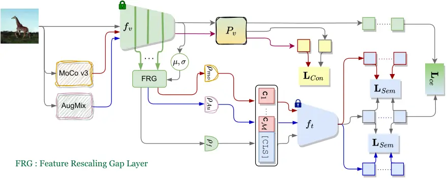
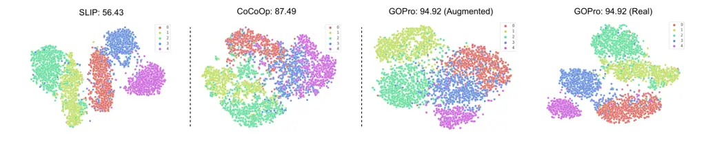

Generate and Optimize Prompts in CLIP

# GOPro: Generate and Optimize Prompts in CLIP using Self-Supervised Learning

Mainak Singha    Ankit Jha    Biplab Banerjee

###### Abstract

Large-scale foundation models, such as CLIP, have demonstrated
remarkable success in visual recognition tasks by embedding images in a
semantically rich space. Self-supervised learning (SSL) has also shown
promise in improving visual recognition by learning invariant features.
However, the combination of CLIP with SSL is found to face challenges
due to the multi-task framework that blends CLIP’s contrastive loss and
SSL’s loss, including difficulties with loss weighting and inconsistency
among different views of images in CLIP’s output space. To overcome
these challenges, we propose a prompt learning-based model called GOPro,
which is a unified framework that ensures similarity between various
augmented views of input images in a shared image-text embedding space,
using a pair of learnable image and text projectors atop CLIP, to
promote invariance and generalizability. To automatically learn such
prompts, we leverage the visual content and style primitives extracted
from pre-trained CLIP and adapt them to the target task. In addition to
CLIP’s cross-domain contrastive loss, we introduce a visual contrastive
loss and a novel prompt consistency loss, considering the different
views of the images. GOPro is trained end-to-end on all three loss
objectives, combining the strengths of CLIP and SSL in a principled
manner. Empirical evaluations demonstrate that GOPro outperforms the
state-of-the-art prompting techniques on three challenging domain
generalization tasks across multiple benchmarks by a significant margin.
Our code is available at
[https://github.com/mainaksingha01/GOPro](https://github.com/mainaksingha01/GOPro).

^(†)^(†)email: mainaksingha.iitb@gmail.com^(†)^(†)email:
ankitjha16@gmail.com^(†)^(†)email:
getbiplab@gmail.com^(†)^(†)affiliation: Indian Institute of Technology
Bombay  
Mumbai, India

## 1 Introduction

Vision-language models (VLMs) or foundational models, such as CLIP
\[Radford et al.(2021)Radford, Kim, Hallacy, Ramesh, Goh, Agarwal,
Sastry, Askell, Mishkin, Clark, et al.\] and ALIGN \[Jia
et al.(2021)Jia, Yang, Xia, Chen, Parekh, Pham, Le, Sung, Li, and
Duerig\], have recently shown exceptional performance in downstream
tasks with zero-shot and few-shot scenarios, by employing image-text
pairs contrastively, supported by additional information from
hand-crafted text prompts like "a photo of a \[cls\]". However, prompt
engineering can present challenges, and learnable prompting techniques,
such as CoOp \[Zhou et al.(2022b)Zhou, Yang, Loy, and Liu\], CoCoOp
\[Zhou et al.(2022a)Zhou, Yang, Loy, and Liu\], and CLIP-Adapter \[Gao
et al.(2021)Gao, Geng, Zhang, Ma, Fang, Zhang, Li, and Qiao\], have
replaced manual prompts, showing better generalization abilities. For
example, CoOp employs learnable parameters to create text prompts, but
the generation of prompts under the supervision of visual features
\[Zhou et al.(2022a)Zhou, Yang, Loy, and Liu, Zhu et al.(2022)Zhu, Niu,
Han, Wu, and Zhang, Khattak et al.(2022)Khattak, Rasheed, Maaz, Khan,
and Khan\] has gained increasing attention. Nevertheless, learning
generalizable prompts by leveraging the pre-trained vision and text
backbones of CLIP is still regarded as an open problem, partially due to
their overlooking of various image transformations.

Representation learning is a common approach that involves pre-training
a model on a large image dataset, such as ImageNet \[Krizhevsky
et al.(2012)Krizhevsky, Sutskever, and Hinton\], using a supervised
approach, which has shown significant improvements in various downstream
tasks. However, self-supervised learning, an unsupervised method, has
gained popularity due to its success in language \[Lan et al.(2019)Lan,
Chen, Goodman, Gimpel, Sharma, and Soricut, Fang et al.(2020)Fang, Wang,
Zhou, Ding, and Xie\] and recent advancements in vision \[Kolesnikov
et al.(2019)Kolesnikov, Zhai, and Beyer, Zhai et al.(2019)Zhai, Oliver,
Kolesnikov, and Beyer\]. The main objective of self-supervised learning
is to replace laborious supervised pre-training that relies on human
annotation by defining an auxiliary task that guides the model towards
learning a better embedding space. Recently, contrastive methods \[Chen
et al.(2020a)Chen, Kornblith, Norouzi, and Hinton, Chen
et al.(2020c)Chen, Fan, Girshick, and He\] have emerged as a powerful
approach to self-supervised pre-training, outperforming more ad-hoc
approaches such as zig-saw solver or rotation prediction \[Hendrycks
et al.(2019a)Hendrycks, Mazeika, Kadavath, and Song\], among others.
Typically, contrastive SSL approaches consider a pair of augmentations
for the input images and aim to learn identical embeddings for them.

Our aim is to investigate the impact of SSL models in leveraging CLIP
for complex class and domain generalization tasks. While this approach
is not entirely new, the sole existing model in this regard, SLIP \[Mu
et al.(2022)Mu, Kirillov, Wagner, and Xie\], has proposed to combine the
vision-language contrastive learning of CLIP \[Radford
et al.(2021)Radford, Kim, Hallacy, Ramesh, Goh, Agarwal, Sastry, Askell,
Mishkin, Clark, et al.\] with a self-supervision head within a
multi-task setup. This approach has shown improved performance and
demonstrated that SSL could complement CLIP’s objective. However, SLIP’s
full training of the model from scratch can be resource-intensive, and
the use of hand-engineered prompts may not be optimal. Moreover, SLIP
does not ensure semantic invariance in the prompt space, which can
affect generalization performance. Therefore, in combining CLIP with
SSL, we need to carefully consider two critical factors. Firstly, we
should leverage the pre-trained CLIP backbone while introducing a small
set of learnable parameters to learn an SSL-influenced joint image-text
embedding space. Secondly, we should replace ad-hoc prompts with
learnable prompts to increase generalizability and jointly ensure a
better alignment of image-text features.

Our proposed GOPro: To address the research queries mentioned earlier,
we present GOPro, a comprehensive framework that leverages the
advantages of contrastive SSL and pre-trained CLIP to generate domain
and class generic prompts while enhancing the invariance of embedding
space against various image-level geometric and photometric
transformations. Our approach ensures that by learning to generate
consistent prompts for different augmentations of the original images,
better generalization can be achieved.

To accomplish the goals, we propose the introduction of learnable
projectors atop CLIP’s frozen vision and text encoders. We refer to the
text projector as the meta-network, aligning with established literature
\[Zhou et al.(2022a)Zhou, Yang, Loy, and Liu\]. To generate augmented
views of input images, we leverage popular models such as MoCo v3
\[Chen\* et al.(2021)Chen\*, Xie\*, and He\], and AugMix \[Hendrycks
et al.(2019b)Hendrycks, Mu, Cubuk, Zoph, Gilmer, and Lakshminarayanan\].
On the other hand, in contrast to existing techniques \[Zhou
et al.(2022b)Zhou, Yang, Loy, and Liu, Zhou et al.(2022a)Zhou, Yang,
Loy, and Liu\] that initialize the prompt learner with hand-crafted
tokens like a photo of a \[CLS\], we propose to learn prompt
distributions per class by exploiting image feature distributions. Our
hypothesis is that prompts learned in conjunction with visual features
offer superior class generalizability. Additionally, we are interested
in differentiating between object content features and style features
\[Li et al.(2017)Li, Wang, Liu, and Hou\] of images, as demonstrated in
\[Bose et al.(2023)Bose, Fini, Jha, Singha, Banerjee, and Ricci\].
However, unlike \[Bose et al.(2023)Bose, Fini, Jha, Singha, Banerjee,
and Ricci\], which suggests learning individual tokens from style
features extracted from each layer of CLIP’s vision encoder, we propose
concatenating content and style information and utilizing a text
projection network to learn prompt token embeddings, as this approach is
found to be computationally more efficient.

The projectors are meticulously trained with three primary loss
objectives to ensure optimal performance. Firstly, we employ a
contrastive loss \[Chen et al.(2020b)Chen, Kornblith, Norouzi, and
Hinton\] between MoCo v3 augmentations of the input image, enhancing the
invariance of the visual projector. Secondly, we fine-tune the visual
and text projectors using a contrastive loss applied to the image-prompt
embeddings. Lastly, we introduce a consistency loss that compares the
prompt embeddings obtained from the actual input image with those of the
augmented views. To improve robustness and optimize uncertainty of the
shared embedding space, we consider the augmented views of MoCo v3 along
with AugMix, as it is found to boost the classification performance
\[Hendrycks et al.(2019b)Hendrycks, Mu, Cubuk, Zoph, Gilmer, and
Lakshminarayanan\] given its composition-based more diverse set of image
synthesis capabilities. However, while \[Hendrycks
et al.(2019b)Hendrycks, Mu, Cubuk, Zoph, Gilmer, and Lakshminarayanan\]
focuses on visual feature consistency with AugMix synthesized images, we
propose to leverage AuxMix to enforce semantic consistency together with
the weak augmentations from MoCo v3 at the prompt space of CLIP, as the
final classification is to be carried out there. We highlight our major
contributions as,

\[-\] In this paper, we strategically enhance CLIP’s prompt learning by
using an SSL objective together with the notion of disentangled
image-domain-conditioned prompt learning.  
\[-\] Our key contributions involve updating newly-introduced
light-weight vision and text projectors atop frozen CLIP using a
combination of visual-space SSL contrastive loss, CLIP’s image-text
contrastive loss, and a novel prompt consistency loss that takes into
account the various views of the images. Furthermore, we propose
learning the prompt distributions leveraging the multi-scale visual
content and style information extracted from CLIP.  
\[-\] To evaluate the effectiveness of our proposed approach, we conduct
extensive experiments across three different settings, including
base-to-new class generalization, cross-dataset transfer, and
single-source multi-target domain generalization on multiple benchmark
datasets (as described in Sec. 4). Our GOPro method significantly
outperforms other state-of-the-art comprehensively in all the cases.

## 2 Related Works

Vision-language models and prompt learning: In general, multimodal
learning has been shown to yield better feature learning than unimodal
setups. Tasks such as image captioning \[Vinyals et al.(2015)Vinyals,
Toshev, Bengio, and Erhan\], image retrieval \[Babenko
et al.(2014)Babenko, Slesarev, Chigorin, and Lempitsky\], and visual
question answering (VQA) \[Agrawal et al.(2016)Agrawal, Lu, Antol,
Mitchell, Zitnick, Batra, and Parikh\] typically require joint
visual-semantic supervision. Moving forward, VLMs such as CLIP \[Radford
et al.(2021)Radford, Kim, Hallacy, Ramesh, Goh, Agarwal, Sastry, Askell,
Mishkin, Clark, et al.\] have recently gained significant attention.
VLMs are trained on large-scale image-text pairs in a contrastive manner
to align the visual and textual embeddings. VLMs efficiently transfer
the learned vision information via prompt-based zero-shot and few-shot
downstream tasks.

Prompt learning is a widely used approach in NLP \[Petroni
et al.(2019)Petroni, Rocktäschel, Lewis, Bakhtin, Wu, Miller, and
Riedel\] and has recently been applied to visual recognition tasks. The
primary aim is to leverage pre-trained language models like BERT
\[Devlin et al.(2018)Devlin, Chang, Lee, and Toutanova\] to provide
useful information for downstream tasks through semantically meaningful
textual prompts. In recent years, research has focused on automating
prompt generation to eliminate manual intervention. One such method is
AutoPrompt \[Shin et al.(2020)Shin, Razeghi, Logan IV, Wallace, and
Singh\], which examines tokens with the most significant gradient
changes in the label likelihood. Meanwhile, CoOp \[Zhou
et al.(2022b)Zhou, Yang, Loy, and Liu\] optimizes prompts by fine-tuning
CLIP for few-shot image classification. CoCoOp \[Zhou et al.(2022a)Zhou,
Yang, Loy, and Liu\] suggests learning conditional prompts based on
image features, which can improve CoOp’s generalization capability.
Crisply, CoCoOp and ProGrad \[Zhu et al.(2022)Zhu, Niu, Han, Wu, and
Zhang\] generate prompts from high-level visual features and optimize
the generated context tokens. Besides, prompt distribution learning
(PDL) \[Lu et al.(2022)Lu, Liu, Zhang, Liu, and Tian\] proposes
optimizing multiple sets of prompts and APPLeNet \[Singha
et al.(2023a)Singha, Jha, Solanki, Bose, and Banerjee\] has demonstrated
significant domain generalization performance using multi-scale features
within remote sensing images. In the other hand, AD-CLIP \[Singha
et al.(2023b)Singha, Pal, Jha, and Banerjee\] has exhibited notable
results in domain adaptation by harnessing visual tokens within the
prompt space. While these methods focus on image data, Video Prompt
Learning (VPL) \[Ju et al.(2022)Ju, Han, Zheng, Zhang, and Xie\]
proposed leveraging foundation models for video data. Finally,
Self-supervised Learning with Inter-modality Prompts (SLIP) \[Mu
et al.(2022)Mu, Kirillov, Wagner, and Xie\] proposed supplementing the
contrastive learning of CLIP with an SSL objective in a multi-task
setup. However, the SSL objective is applied only to the visual branch
and is disjoint from the semantic branch, thus not leveraging the
multi-modal aspect of CLIP comprehensively. In contrast, we ensure that
the SSL objective improves the learning of both the visual and semantic
projectors, resulting in enhanced generalization.

Our approach to prompt learning differs from the literature \[Zhou
et al.(2022b)Zhou, Yang, Loy, and Liu, Zhou et al.(2022a)Zhou, Yang,
Loy, and Liu, Bose et al.(2023)Bose, Fini, Jha, Singha, Banerjee, and
Ricci\] in the way we utilize visual information. While we draw
inspiration from StyLIP \[Bose et al.(2023)Bose, Fini, Jha, Singha,
Banerjee, and Ricci\] in the idea of disentangling image content and
style information, we diverge significantly from \[Bose
et al.(2023)Bose, Fini, Jha, Singha, Banerjee, and Ricci\] in how we
leverage the visual information to initialize prompt tokens. In StyLIP,
each prompt token is learned solely from style information extracted
from a specific layer of CLIP’s vision encoder, which limits its ability
to handle prompts of varied context lengths. In contrast, our approach
combines multi-scale content information with global style information
from the final vision encoder layer and subsequently learns prompt
tokens through a shared meta-network. This offers more flexibility in
the length of prompts, allowing for prompts of different context lengths
to be effectively learned and utilized in our approach.

Self-Supervised Learning: Self-supervised learning (SSL) is a technique
that aims to learn high-quality visual representations from unlabeled
images without additional human supervision. Advancements in SSL have
made it possible to narrow the gap between supervised and unsupervised
representations, as evaluated in downstream tasks \[Chen
et al.(2020a)Chen, Kornblith, Norouzi, and Hinton, Caron
et al.(2020)Caron, Misra, Mairal, Goyal, Bojanowski, and Joulin, Dwibedi
et al.(2021)Dwibedi, Aytar, Tompson, Sermanet, and Zisserman, He
et al.(2020)He, Fan, Wu, Xie, and Girshick\]. One popular approach is
contrastive learning \[Gutmann and Hyvärinen(2010), Wang
et al.(2020)Wang, Yao, Kwok, and Ni\], which aims to embed augmented
views of a given image closely in feature space while pushing away other
images in the same batch \[Chen et al.(2020a)Chen, Kornblith, Norouzi,
and Hinton\] or using a memory bank \[He et al.(2020)He, Fan, Wu, Xie,
and Girshick\]. Other methods focus on retrieving more informative
positive examples during training that exhibit more natural image
variation than simple artificial augmentations \[Ayush
et al.(2021)Ayush, Uzkent, Meng, Tanmay, Burke, Lobell, and Ermon, Oord
et al.(2018)Oord, Li, and Vinyals\]. Some contrastive variants even
report strong performance without negative examples \[Chen and He(2021),
Grill et al.(2020)Grill, Strub, Altché, Tallec, Richemond, Buchatskaya,
Doersch, Avila Pires, Guo, Gheshlaghi Azar, et al.\]. \[Cole
et al.(2022)Cole, Yang, Wilber, Mac Aodha, and Belongie\] showed that
self-supervised training on ImageNet \[Krizhevsky
et al.(2012)Krizhevsky, Sutskever, and Hinton\] is still highly
effective even when using less than $`25\%`$ of the unlabeled images
during training, outperforming supervised pre-training. As opposed to
these approaches, we are keen on improving the invariance of VLMs by
supplementing an SSL task, which is found to be beneficial for domain
and class generalization tasks.

## 3 Problem Definition and Proposed Methodology

Let $`\mathcal{D}_{s}=\{\mathcal{D}_{s}^{i}\}_{i=1}^{n}`$ denote $`n`$
source domains, each with input data $`x^{i}\in\mathcal{X}^{i}`$ and
corresponding label space $`y^{i}\in\mathcal{Y}_{Seen}`$. It’s important
to note that the probability distribution of each domain,
$`P(\mathcal{D}_{s}^{i})`$, may differ for all $`i\in{1,\cdots,n}`$.
During training, we use the labels $`\mathcal{Y}_{Seen}`$ from
$`\mathcal{D}_{s}`$, while during testing, we use
$`\mathcal{Y}_{Unseen}`$ from a target test domain $`\mathcal{D}_{t}`$
with
$`\mathcal{P}(\mathcal{D}_{t})\neq\mathcal{P}(\mathcal{D}_{s}^{i})`$,
$`\forall i\in{1,\cdots,n}`$. For base-to-new class generalization, we
set $`\mathcal{Y}_{Seen}\cap\mathcal{Y}_{Unseen}=\emptyset`$. In
contrast, for domain generalization (DG), we consider single-source DG
and assume that the label sets for both domains are identical
($`\mathcal{Y}_{Seen}\cap\mathcal{Y}_{Unseen}=\mathcal{Y}_{Seen}\cup\mathcal{Y}_{Unseen}`$).
Finally, for the across-dataset DG, there may or may not be some overlap
between $`\mathcal{Y}_{Seen}`$ and $`\mathcal{Y}_{Unseen}`$.

### 3.1 Explaining the working principles of GOPro

This section provides an elaborate description of the architecture and
training methodology of GOPro. Specifically, GOPro utilizes the visual
backbone of CLIP, denoted as $`f_{v}`$, and the text encoder, denoted as
$`f_{t}`$. Let’s assume $`f_{v}`$ consists of $`L`$ encoder layers, and
the feature responses for layer $`l\in[1,L]`$ are denoted as
$`f_{v}^{l}`$. Additionally, we introduce the following learnable units
in GOPro: a vision projector $`P_{v}`$ in the visual space, and text
projectors $`\rho_{f}`$, $`\rho_{Au}`$, and $`\rho_{mo}`$ for obtaining
token embeddings from visual features from the original and the
augmented images (MoCo v3 and AuxMix generated), respectively. For
simplicity, we consider $`\rho=\rho_{f}=\rho_{Au}=\rho_{mo}`$ in our
experiments. The goal is to train $`(\rho,P_{v})`$ using image-prompt
pairs, such that the learned shared embedding space is generalizable,
discriminative, and invariant to image transformations. To achieve this,
we propose the following novel considerations: i) A novel prompt
learning scheme that leverages multi-scale visual content features
extracted from $`f_{v}`$, along with image style information in terms of
the instance-wise feature statistics from the $`L^{th}`$ layer of
$`f_{v}`$ is introduced. ii) For training $`P_{v}`$ using dataset
$`\mathcal{D}_{s}`$, we deploy the MoCo v3 augmentation technique and
use the contrastive formulation of SimCLR \[Chen et al.(2020b)Chen,
Kornblith, Norouzi, and Hinton\], following SLIP \[Mu et al.(2022)Mu,
Kirillov, Wagner, and Xie\]. iii) To train $`P_{v}`$, we consider the
MoCo v3 augmentation $`x_{1}`$ for the original image $`x`$ and the
contrastive loss is realized for $`(x,x_{1})`$. On the other hand, we
consider an AugMix-generated image $`x_{2}`$ for $`x`$. We then carry
out image-text contrastive loss for $`(x,y)`$, while simultaneously
ensuring that $`f_{t}(x,y)\sim f_{t}(x_{1},y)\sim f_{t}(x_{2},y)`$.

In this way, we fully leverage the rich representation space of CLIP and
smoothly adapt the model for the downstream DG tasks with few training
samples.



Figure 1: The design of GOPro entails utilizing the fixed image
$`f_{v}`$ and text encoders $`f_{t}`$ of CLIP. In addition, GOPro
incorporates several distinct trainable meta-networks that generate
tokens for the original image and augmented images created by MoCo v3
\[Chen\* et al.(2021)Chen\*, Xie\*, and He\] and AugMix \[Hendrycks
et al.(2019b)Hendrycks, Mu, Cubuk, Zoph, Gilmer, and Lakshminarayanan\],
denoted as $`\rho_{f}`$, $`\rho_{mo}`$ and $`\rho_{Au}`$ respectively.
To rescale the features from intermediate layers of $`f_{v}`$, the
architecture employs a combination of feature rescaling and the global
average pooling (GAP) operation, which we collectively referred to as
the FRG layer.

Image content and style driven prompt generation: In our approach, we
aim to generate prompts from the visual features $`f_{v}(x)`$ by
disentangling the content and style components. To achieve this, we
utilize multi-scale content features obtained from different layers of
$`f_{v}`$, denoted as
$`\hat{F}(x)=[\hat{f}_{v}^{1}(x);\cdots;\hat{f}_{v}^{L}(x)]`$ after
concatenation. The key idea behind this multi-scale representation is
that $`\hat{F}(x)`$ captures low, mid, and high-level features in its
different layers, making it more transferable compared to considering
only high-level semantic features \[Bose et al.(2023)Bose, Fini, Jha,
Singha, Banerjee, and Ricci\]. Similarly, we represent the style
features using instance-wise feature statistics, namely channel-wise
mean and standard deviation, calculated from the $`L^{th}`$ layer of
$`f_{v}`$. Precisely,
$`\bar{F}(x)=[\vec{\mu_{L}}(x);\vec{\sigma_{L}}(x)]`$ denotes the style
vector. The prompt token initialization for image $`x`$ is then
represented as $`F(x)=[\hat{F}(x);\bar{F}(x)]`$, rescaled through
feature rescaling gap (FRG) layer and it is further adapted to the
distribution of $`\mathcal{D}`$ using $`\rho`$. In GOPro, $`\rho`$ takes
the structure of a single encoder and $`\mathcal{M}`$ decoders, where
$`\mathcal{M}`$ defines the context length. This way, we learn
$`\mathcal{M}`$ distinct tokens given $`F(x)`$. The prompt for class
$`y`$ can be derived as:
$`\text{Pr}_{y}(x,y)=[c_{1};c_{2};\cdots;c_{\mathcal{M}};[CLS_{y}]]`$,
where $`c_{m}`$ is the output from the $`m^{th}`$ decoder of $`\rho`$,
and $`CLS_{y}`$ is the semantic embedding for the class $`y`$. In the
Supplementary, we discuss how our approach differs from the existing
prompt learning techniques \[Bose et al.(2023)Bose, Fini, Jha, Singha,
Banerjee, and Ricci, Zhou et al.(2022b)Zhou, Yang, Loy, and Liu, Zhou
et al.(2022a)Zhou, Yang, Loy, and Liu\].

Visual self-supervised objective: We explore the synergistic combination
of the SimCLR SSL objective with augmentations obtained from MoCo v3, as
reported in the literature \[Mu et al.(2022)Mu, Kirillov, Wagner, and
Xie\], to train $`P_{v}`$. The standard normalized temperature-scaled
cross-entropy loss formulation, denoted as $`\mathbf{L}_{Con}`$ \[Chen
et al.(2020b)Chen, Kornblith, Norouzi, and Hinton\], is employed to
maximize the cosine similarity ($`\delta`$) between an original image
$`x`$ and its augmented view $`x_{1}`$.

Image-text mapping and prompt consistency objective: Our approach
utilizes contrastive learning to map visual and text feature embeddings
into a shared embedding space. To compute the class posterior
probability of an input $`x`$ belonging to class $`y`$, we employ the
following definition, where $`\tau`$ represents the temperature
hyper-parameter. We consider the output of $`P_{v}`$ as the visual
embeddings since this space promotes visual invariance.

```math
p(y|x)=\frac{\exp(\delta(P_{v}(f_{v}(x)),f_{t}(\text{Pr}_{y}(F(x)))/\tau))}{\sum_{k=1}^{|\mathcal{Y}_{Seen}|}\ \exp(\delta(P_{v}(f_{v}(x)),f_{t}(\text{Pr}_{y_{k}}(F(x)))/\tau))} \tag{1}
```

Subsequently, the cross-entropy loss ($`\mathbf{L}_{ce}`$) is computed
between the prediction probabilities of each input image and their
corresponding class labels as follows:

```math
\mathbf{L}_{ce}=\underset{P_{v},\rho}{\arg\min}\underset{(x,y)\in\mathcal{P}(\mathcal{D}_{s})}{\mathbb{E}}-\sum_{k=1}^{\mathcal{Y}_{Seen}}y_{k}log(p(y_{k}|x)_{f_{v},f_{t}}) \tag{2}
```

We emphasize the importance of consistent prompt embeddings obtained
from various augmentations applied to the input image. This is crucial
in achieving semantic invariance, complementing the visual invariance
ensured by $`\mathbf{L}_{Con}`$. To achieve this, we employ two
augmentations per image $`x`$: one generated by MoCo v3, which applies
geometrical transformations to $`x`$, and the other generated by AugMix.
AugMix is particularly useful in scenarios where the data distribution
encountered during deployment may differ from the training distribution,
such as when images are captured with different cameras. AuxMix has been
demonstrated to significantly improve generalization performance without
necessitating changes to the underlying model \[Hendrycks
et al.(2019b)Hendrycks, Mu, Cubuk, Zoph, Gilmer, and Lakshminarayanan\].

Our approach to achieving semantic consistency involves incorporating
distillation losses based on an $`\ell_{2}`$-norm distance measure.
Here, the prompt embedding of the original image $`x`$ serves as the
teacher, while the prompt embeddings of the two augmentations, Moco v3
($`x_{1}`$) and AugMix ($`x_{2}`$), serve as the students. The loss is
defined as,

```math
\displaystyle\mathbf{L}_{Sem}=\underset{P_{v},\rho}{\text{argmin}}\underset{\mathcal{P}(\mathcal{D}_{s})}{\mathbb{E}}||f_{t}(\text{Pr}_{y}(\rho(F(x)))) \displaystyle-f_{t}(\text{Pr}_{y}(\rho(F(x_{1}))))||_{2} \tag{3}
```

```math
\displaystyle+||f_{t}(\text{Pr}_{y}(\rho(F(x))))-f_{t}(\rho(\text{Pr}_{y}(F(x_{2}))))||_{2}
```

Total loss for training and inference: We train the model with respect
to all the losses mentioned above, where,

```math
\centering\mathbf{L}_{Total}=\mathbf{L}_{Sem}+\mathbf{L}_{ce}+\mathbf{L}_{Con}\@add@centering \tag{4}
```

During inference, we generate all the class prompts given
$`\mathcal{Y}_{Unseen}`$ for a given $`x_{t}`$, and the
$`y\in\mathcal{Y}_{Unseen}`$ maximizing $`p(y|x_{t})`$ is selected.

## 4 Experimental Evaluations

Dataset descriptions: We evaluate GOPro on 11 image recognition datasets
for base-to-new class generalization and cross-dataset transfer,
following the procedure described in CoOp \[Zhou et al.(2022b)Zhou,
Yang, Loy, and Liu\]. The datasets include ImageNet \[Krizhevsky
et al.(2012)Krizhevsky, Sutskever, and Hinton\], Caltech101 \[Fei-Fei
et al.(2004)Fei-Fei, Fergus, and Perona\] for generic object
classification, OxfordPets \[Parkhi et al.(2012)Parkhi, Vedaldi,
Zisserman, and Jawahar\], StanfordCars \[Krause et al.(2013)Krause,
Stark, Deng, and Fei-Fei\], Flowers102 \[Nilsback and Zisserman(2008)\],
Food101 \[Bossard et al.(2014)Bossard, Guillaumin, and Gool\], and
FGVCAircraft \[Maji et al.(2013)Maji, Rahtu, Kannala, Blaschko, and
Vedaldi\] for fine-grained classification, SUN397 \[Xiao
et al.(2010)Xiao, Hays, Ehinger, Oliva, and Torralba\] for scene
recognition, UCF101 \[Soomro et al.(2012)Soomro, Zamir, and Shah\] for
action recognition, DTD \[Cimpoi et al.(2014)Cimpoi, Maji, Kokkinos,
Mohamed, , and Vedaldi\] for texture classification, and EuroSAT
\[Helber et al.(2019)Helber, Bischke, Dengel, and Borth\] for satellite
imagery recognition. For domain generalization experiments, we employ
ImageNet as the source dataset and four other ImageNet variants as
target datasets, namely ImageNetV2 \[Recht et al.(2019)Recht, Roelofs,
Schmidt, and Shankar\], ImageNet-Sketch \[Wang et al.(2019)Wang, Ge,
Lipton, and Xing\] - It consists of 50000 images, 50 images for each of
the 1000 ImageNet classes, ImageNet-A \[Hendrycks
et al.(2021b)Hendrycks, Zhao, Basart, Steinhardt, and Song\], and
ImageNet-R \[Hendrycks et al.(2021a)Hendrycks, Basart, Mu, Kadavath,
Wang, Dorundo, Desai, Zhu, Parajuli, Guo, et al.\].

Architecture Details: $`\rho`$ is implemented as a two-layer bottleneck
network followed by Linear-ReLU-Linear, where the hidden layer is
expanded to the number of context tokens. On the other hand, $`P_{v}`$
follows a single-layer MLP structure with a batch normalization layer.
$`f_{v}`$ and $`f_{t}`$ are realized using CLIP’s pre-trained
transformer backbones.  
Training and evaluation protocols: To train GOPro, we utilize the
stochastic gradient descent (SGD) optimizer \[Robbins and Monro(1951)\]
for 50 epochs and apply scheduling to avoid local minima. During
training, we employ 16 shots (samples per class) with a batch size of 4
and ViT-B/16 as the image encoder backbone. The text prompts are
initialized using "a photo of a \[CLS\]", indicating a context length,
$`\mathcal{M}`$=4, as per previous literature \[Zhou et al.(2022a)Zhou,
Yang, Loy, and Liu\]. We report the average top-1 accuracy from three
runs of the model.

### 4.1 Comparisons to the state-of-the-art

Baselines & competitors: In our performance evaluation of GOPro, we
compare it to existing methods from the prompting literature using CLIP.
As our baselines, we utilize Zero-shot CLIP \[Radford
et al.(2021)Radford, Kim, Hallacy, Ramesh, Goh, Agarwal, Sastry, Askell,
Mishkin, Clark, et al.\] and the SSL-based SLIP \[Mu et al.(2022)Mu,
Kirillov, Wagner, and Xie\] models, respectively. Additionally, we
compare our model with prompt learning techniques, such as CoOp \[Zhou
et al.(2022b)Zhou, Yang, Loy, and Liu\], CoCoOp \[Zhou
et al.(2022a)Zhou, Yang, Loy, and Liu\], MaPLe \[Khattak
et al.(2022)Khattak, Rasheed, Maaz, Khan, and Khan\], and StyLIP \[Bose
et al.(2023)Bose, Fini, Jha, Singha, Banerjee, and Ricci\], using
ViT-B/16 backbone.

|                                                                                                                  |       |       |       |
| ---------------------------------------------------------------------------------------------------------------- | ----- | ----- | ----- |
| Method                                                                                                           | Base  | Novel | HM    |
| CLIP \[Radford et al.(2021)Radford, Kim, Hallacy, Ramesh, Goh, Agarwal, Sastry, Askell, Mishkin, Clark, et al.\] | 69.34 | 74.22 | 71.70 |
| SLIP \[Mu et al.(2022)Mu, Kirillov, Wagner, and Xie\]                                                            | 69.77 | 74.28 | 71.96 |
| CoOp \[Zhou et al.(2022b)Zhou, Yang, Loy, and Liu\]                                                              | 82.69 | 63.22 | 71.66 |
| CoCoOp \[Zhou et al.(2022a)Zhou, Yang, Loy, and Liu\]                                                            | 80.47 | 71.69 | 75.83 |
| MaPLe \[Khattak et al.(2022)Khattak, Rasheed, Maaz, Khan, and Khan\]                                             | 82.28 | 75.14 | 78.55 |
| StyLIP \[Bose et al.(2023)Bose, Fini, Jha, Singha, Banerjee, and Ricci\]                                         | 83.22 | 75.94 | 79.41 |
| GOPro                                                                                                            | 84.21 | 77.32 | 80.62 |

Table 1: Comparison of GOPro with state-of-the-art methods on B2N
generalization on the average metrics over 11 visual recognition
datasets. HM represents the harmonic mean.

Base-to-New (B2N) class generalization: Table 1 showcases the
experimental results for B2N class generalization averaged over 11
fine-grained and coarse-grained datasets. The harmonic mean (H) between
the classification accuracies of the Base and Novel classes is computed.
To ensure fairness, we randomly and equally divide the datasets into two
groups, defining the base and novel classes for training and testing,
respectively. Given that GOPro is a self-supervised prompt learning
method, we pay particular attention to SLIP’s self-supervised zero-shot
approach. Remarkably, GOPro achieves superior generalization scores,
surpassing SLIP by a significant margin of 14.44% on seen classes and
3.04% on unseen classes across all datasets on average. Furthermore, we
compare GOPro with recent context optimization-based methods,
demonstrating its superiority over MaPLe and StyLIP by 2.07% and 1.21%
on average, respectively.

Cross-Dataset (CD) generalization: Table 2 showcases the evaluation
results of GOPro on the CD setup, where the model is trained on the
ImageNet dataset (source domain) and zero-shot inference is performed on
the remaining ten datasets (target domains). Remarkably, GOPro surpasses
the target classification performance of CLIP and SLIP by substantial
margins of 2.63% and 2.55%, respectively. Moreover, GOPro outperforms
MaPLe and StyLIP by 1.56% and 0.48%, respectively, on average. These
results demonstrate that GOPro effectively mitigates the generalization
gap for diverse domains and classes.

|                                                                                                                  |         |        |       |       |         |       |          |        |       |         |        |         |
| ---------------------------------------------------------------------------------------------------------------- | ------- | ------ | ----- | ----- | ------- | ----- | -------- | ------ | ----- | ------- | ------ | ------- |
|                                                                                                                  | Source  | Target |       |       |         |       |          |        |       |         |        |         |
| Method                                                                                                           | ImgNet. | C101   | Pets  | Cars  | Flowers | Food  | Aircraft | Sun397 | DTD   | EuroSAT | UCF101 | Average |
| CLIP \[Radford et al.(2021)Radford, Kim, Hallacy, Ramesh, Goh, Agarwal, Sastry, Askell, Mishkin, Clark, et al.\] | 66.73   | 93.31  | 89.10 | 65.64 | 70.73   | 85.86 | 24.72    | 62.58  | 44.39 | 48.28   | 67.72  | 65.23   |
| SLIP \[Mu et al.(2022)Mu, Kirillov, Wagner, and Xie\]                                                            | 68.01   | 93.52  | 89.23 | 65.42 | 70.55   | 85.92 | 25.04    | 62.74  | 44.16 | 48.61   | 67.93  | 65.31   |
| CoOp \[Zhou et al.(2022b)Zhou, Yang, Loy, and Liu\]                                                              | 71.51   | 93.70  | 89.14 | 64.51 | 68.71   | 85.30 | 18.47    | 64.15  | 41.92 | 46.39   | 66.55  | 63.88   |
| CoCoOp \[Zhou et al.(2022a)Zhou, Yang, Loy, and Liu\]                                                            | 71.02   | 94.43  | 90.14 | 65.32 | 71.88   | 86.06 | 22.94    | 67.36  | 45.73 | 45.37   | 68.21  | 65.74   |
| MaPLe \[Khattak et al.(2022)Khattak, Rasheed, Maaz, Khan, and Khan\]                                             | 70.72   | 93.53  | 90.49 | 65.57 | 72.23   | 86.20 | 24.74    | 67.01  | 46.49 | 48.06   | 68.69  | 66.30   |
| StyLIP \[Bose et al.(2023)Bose, Fini, Jha, Singha, Banerjee, and Ricci\]                                         | 72.30   | 95.45  | 91.60 | 67.09 | 72.36   | 88.60 | 25.21    | 68.11  | 47.86 | 48.22   | 69.30  | 67.38   |
| GOPro                                                                                                            | 73.27   | 94.81  | 92.73 | 68.67 | 72.60   | 87.74 | 25.85    | 68.70  | 48.04 | 49.43   | 69.98  | 67.86   |

Table 2: Comparison of GOPro with the prompt benchmark methods for
generalization across datasets. We train the model on ImageNet using
$`16`$-shots with CLIP ViT-B/16 and test on $`10`$ other datasets.



Figure 2: The t-SNE visualizations of visual embeddings from SLIP,
CoCoOp and our proposed GOPro, on the base classes of Eurosat dataset.
GOPro archives better discriminativeness.

Domain generalization (DG): We have conducted experiments to evaluate
the generalization performance of GOPro on a single-source multi-target
(SSMT) DG setup. Unlike the CD setting discussed earlier, we only
consider the common classes across all datasets, as SSMT is a closed-set
setting. The model is trained on the ImageNet dataset and evaluated on
its domain variant datasets. Comparison results with state-of-the-art
(SOTA) methods and GOPro are presented in Table 3.

The results demonstrate that GOPro has outperformed all competitors in
the source domain, with a minimum margin of 0.97%. Additionally, GOPro
outperforms other methods in the target domains as well, with minimum
margins of 1.07%, 1.09%, and 1.49% in ImageNetV2, ImageNet-A, and
ImageNet-R, respectively, except for ImageNet-Sketch, where StyLIP
achieves the best performance.

|                                                                                                                  |          |            |                 |            |            |
| ---------------------------------------------------------------------------------------------------------------- | -------- | ---------- | --------------- | ---------- | ---------- |
|                                                                                                                  | Source   | Target     |                 |            |            |
| Method                                                                                                           | ImageNet | ImageNetV2 | ImageNet-Sketch | ImageNet-A | ImageNet-R |
| CLIP \[Radford et al.(2021)Radford, Kim, Hallacy, Ramesh, Goh, Agarwal, Sastry, Askell, Mishkin, Clark, et al.\] | 66.73    | 60.83      | 46.15           | 47.77      | 73.96      |
| SLIP \[Mu et al.(2022)Mu, Kirillov, Wagner, and Xie\]                                                            | 68.01    | 61.12      | 46.35           | 47.54      | 73.88      |
| CoOp \[Zhou et al.(2022b)Zhou, Yang, Loy, and Liu\]                                                              | 71.51    | 64.20      | 47.99           | 49.71      | 75.21      |
| CoCoOp \[Zhou et al.(2022a)Zhou, Yang, Loy, and Liu\]                                                            | 71.02    | 64.07      | 48.75           | 50.63      | 76.18      |
| MaPLe \[Khattak et al.(2022)Khattak, Rasheed, Maaz, Khan, and Khan\]                                             | 70.72    | 64.07      | 49.15           | 50.90      | 76.98      |
| StyLIP \[Bose et al.(2023)Bose, Fini, Jha, Singha, Banerjee, and Ricci\]                                         | 72.30    | 64.28      | 50.83           | 51.14      | 76.53      |
| GOPro                                                                                                            | 73.27    | 65.35      | 50.36           | 52.23      | 78.02      |

Table 3: Comparison of GOPro with the prompt benchmark methods for
domain generalization across datasets. We train the model on ImageNet
using $`16`$-shots with CLIP ViT-B/16 and test on $`4`$ other datasets.

### 4.2 Ablation Analysis

t-SNE visualization: We present a t-SNE \[Van der Maaten and
Hinton(2008)\] visualization of the image embeddings in Figure 2,
generated by the visual features of the original and augmented images.
We compare them with SLIP \[Mu et al.(2022)Mu, Kirillov, Wagner, and
Xie\] and CoCoOp \[Zhou et al.(2022a)Zhou, Yang, Loy, and Liu\] on the
EuroSAT dataset for the B2N generalization task. The visualization
clearly demonstrates that GOPro has better clustering of each class,
while the cluster points of many classes get overlapped in CoCoOp.

Figure 3: Comparison of results of GOPro with different numbers of
prompt tokens in B2N generalization setup.

Sensitivity to context length for B2N generalization: We have conducted
tests on GOPro using varying prompt tokens ($`\mathcal{M}`$) ranging
from 1 to 16. Instead of manual prompt initialization, we randomly
initialize prompts from the context. In Figure 3, we present the average
performance of GOPro on 11 datasets in the B2N generalization task with
different context lengths. The results indicate that GOPro performs well
on base classes with eight tokens and new classes with 11 tokens.
However, for better overall generalization, it performs best with four
tokens, considering the harmonic mean of both. Interestingly, GOPro
achieves almost the same accuracy as random initialization with a
context length of 4 in manual initialization of "a photo of a", as shown
in Table 1.

|                                                                   |       |       |       |
| ----------------------------------------------------------------- | ----- | ----- | ----- |
| Loss                                                              | Base  | Novel | HM    |
| $`\mathbf{L}_{ce}`$                                               | 81.34 | 72.16 | 76.48 |
| $`\mathbf{L}_{ce}`$ + $`\mathbf{L}_{Con}`$                        | 82.15 | 75.02 | 78.42 |
| $`\mathbf{L}_{ce}`$ + $`\mathbf{L}_{Sem}(x_{1})`$                 | 83.23 | 74.64 | 78.70 |
| $`\mathbf{L}_{ce}`$ + $`\mathbf{L}_{Sem}(x_{2})`$                 | 81.65 | 73.97 | 77.62 |
| $`\mathbf{L}_{ce}`$ + $`\mathbf{L}_{Sem}(x_{1}+x_{2})`$           | 83.87 | 75.15 | 79.27 |
| $`\mathbf{L}_{ce}`$ + $`\mathbf{L}_{Sem}`$ + $`\mathbf{L}_{Con}`$ | 84.21 | 77.32 | 80.62 |

Table 4: Ablation study of GOPro with different losses in B2N
generalization setup.

Ablation on the loss terms: We have conducted multiple experiments with
our proposed model, GOPro, using various loss terms, as presented in
Table 4. The visual contrastive loss, denoted as $`\mathbf{L}_{Con}`$,
is typically utilized to reduce the difference between two different
self-supervised views of augmented image features from MoCo v3.
Discarding this loss results in a decrease in performance by almost
1.35%.

Furthermore, the employment of $`\mathbf{L}_{Sem}`$ enhances the
efficacies of the semantic space, leading to an additional improvement
in the results by 2.2%. We observe that GOPro experiences a decline in
performance by 1.92% and 3% for single augmentations with MoCo v3
($`x_{1}`$) and AugMix ($`x_{2}`$), respectively when compared to the
full GOPro model. These findings highlight the importance of both
losses, along with $`\mathbf{L}_{ce}`$, which are responsible for the
improved performance of GOPro.

## 5 Takeaways

In this paper, we present a comprehensive analysis of how
self-supervised learning can enhance vision-language models. We propose
a novel approach called GOPro that ensures consistency among the
augmented views of input images in both the visual and semantic space of
CLIP, using innovative loss functions. Furthermore, we introduce a new
prompt learning framework in GOPro that leverages visual features by
disentangling content and style information and incorporates them into
prompt learning through a learnable encoder-decoder-based text
projector. Our experimental results demonstrate that GOPro outperforms
benchmark prompting methods in three challenging domain generalization
tasks involving class, domain, and dataset shifts. Additionally, we are
excited to explore the potential of GOPro for more specific
applications, such as medical imaging and remote sensing, among others,
in the future.

## References

- \[Agrawal et al.(2016)Agrawal, Lu, Antol, Mitchell, Zitnick, Batra,
  and Parikh\] Aishwarya Agrawal, Jiasen Lu, Stanislaw Antol, Margaret
  Mitchell, C. Lawrence Zitnick, Dhruv Batra, and Devi Parikh. Vqa:
  Visual question answering, 2016.
- \[Ayush et al.(2021)Ayush, Uzkent, Meng, Tanmay, Burke, Lobell, and
  Ermon\] Kumar Ayush, Burak Uzkent, Chenlin Meng, Kumar Tanmay,
  Marshall Burke, David Lobell, and Stefano Ermon. Geography-aware
  self-supervised learning. In _Proceedings of the IEEE/CVF
  International Conference on Computer Vision_, pages 10181–10190, 2021.
- \[Babenko et al.(2014)Babenko, Slesarev, Chigorin, and Lempitsky\]
  Artem Babenko, Anton Slesarev, Alexandr Chigorin, and Victor
  Lempitsky. Neural codes for image retrieval. In _European conference
  on computer vision_, pages 584–599. Springer, 2014.
- \[Bose et al.(2023)Bose, Fini, Jha, Singha, Banerjee, and Ricci\]
  Shirsha Bose, Enrico Fini, Ankit Jha, Mainak Singha, Biplab Banerjee,
  and Elisa Ricci. Stylip: Multi-scale style-conditioned prompt learning
  for clip-based domain generalization. _arXiv preprint
  arXiv:2302.09251_, 2023.
- \[Bossard et al.(2014)Bossard, Guillaumin, and Gool\] Lukas Bossard,
  Matthieu Guillaumin, and Luc Van Gool. Food-101 - mining
  discriminative components with random forests. In _European Conference
  on Computer Vision_, 2014.
- \[Caron et al.(2020)Caron, Misra, Mairal, Goyal, Bojanowski, and
  Joulin\] Mathilde Caron, Ishan Misra, Julien Mairal, Priya Goyal,
  Piotr Bojanowski, and Armand Joulin. Unsupervised learning of visual
  features by contrasting cluster assignments. _Advances in neural
  information processing systems_, 33:9912–9924, 2020.
- \[Chen et al.(2020a)Chen, Kornblith, Norouzi, and Hinton\] Ting Chen,
  Simon Kornblith, Mohammad Norouzi, and Geoffrey Hinton. A simple
  framework for contrastive learning of visual representations. In
  _International conference on machine learning_, pages 1597–1607. PMLR,
  2020a.
- \[Chen et al.(2020b)Chen, Kornblith, Norouzi, and Hinton\] Ting Chen,
  Simon Kornblith, Mohammad Norouzi, and Geoffrey Hinton. A simple
  framework for contrastive learning of visual representations. In
  _International conference on machine learning_, pages 1597–1607. PMLR,
  2020b.
- \[Chen and He(2021)\] Xinlei Chen and Kaiming He. Exploring simple
  siamese representation learning. In _Proceedings of the IEEE/CVF
  conference on computer vision and pattern recognition_, pages
  15750–15758, 2021.
- \[Chen et al.(2020c)Chen, Fan, Girshick, and He\] Xinlei Chen, Haoqi
  Fan, Ross Girshick, and Kaiming He. Improved baselines with momentum
  contrastive learning. _arXiv preprint arXiv:2003.04297_, 2020c.
- \[Chen\* et al.(2021)Chen\*, Xie\*, and He\] Xinlei Chen\*, Saining
  Xie\*, and Kaiming He. An empirical study of training self-supervised
  vision transformers. _arXiv preprint arXiv:2104.02057_, 2021.
- \[Cimpoi et al.(2014)Cimpoi, Maji, Kokkinos, Mohamed, , and Vedaldi\]
  M. Cimpoi, S. Maji, I. Kokkinos, S. Mohamed, , and A. Vedaldi.
  Describing textures in the wild. In _Proceedings of the IEEE Conf. on
  Computer Vision and Pattern Recognition (CVPR)_, 2014.
- \[Cole et al.(2022)Cole, Yang, Wilber, Mac Aodha, and Belongie\]
  Elijah Cole, Xuan Yang, Kimberly Wilber, Oisin Mac Aodha, and Serge
  Belongie. When does contrastive visual representation learning work?
  In _Proceedings of the IEEE/CVF Conference on Computer Vision and
  Pattern Recognition_, pages 14755–14764, 2022.
- \[Devlin et al.(2018)Devlin, Chang, Lee, and Toutanova\] Jacob Devlin,
  Ming-Wei Chang, Kenton Lee, and Kristina Toutanova. Bert: Pre-training
  of deep bidirectional transformers for language understanding. _arXiv
  preprint arXiv:1810.04805_, 2018.
- \[Dwibedi et al.(2021)Dwibedi, Aytar, Tompson, Sermanet, and
  Zisserman\] Debidatta Dwibedi, Yusuf Aytar, Jonathan Tompson, Pierre
  Sermanet, and Andrew Zisserman. With a little help from my friends:
  Nearest-neighbor contrastive learning of visual representations. In
  _Proceedings of the IEEE/CVF International Conference on Computer
  Vision_, pages 9588–9597, 2021.
- \[Fang et al.(2020)Fang, Wang, Zhou, Ding, and Xie\] Hongchao Fang,
  Sicheng Wang, Meng Zhou, Jiayuan Ding, and Pengtao Xie. Cert:
  Contrastive self-supervised learning for language understanding.
  _arXiv preprint arXiv:2005.12766_, 2020.
- \[Fei-Fei et al.(2004)Fei-Fei, Fergus, and Perona\] Li Fei-Fei, Rob
  Fergus, and Pietro Perona. Learning generative visual models from few
  training examples: An incremental bayesian approach tested on 101
  object categories. In _2004 conference on computer vision and pattern
  recognition workshop_, pages 178–178. IEEE, 2004.
- \[Gao et al.(2021)Gao, Geng, Zhang, Ma, Fang, Zhang, Li, and Qiao\]
  Peng Gao, Shijie Geng, Renrui Zhang, Teli Ma, Rongyao Fang, Yongfeng
  Zhang, Hongsheng Li, and Yu Qiao. Clip-adapter: Better vision-language
  models with feature adapters. _arXiv preprint arXiv:2110.04544_, 2021.
- \[Grill et al.(2020)Grill, Strub, Altché, Tallec, Richemond,
  Buchatskaya, Doersch, Avila Pires, Guo, Gheshlaghi Azar, et al.\]
  Jean-Bastien Grill, Florian Strub, Florent Altché, Corentin Tallec,
  Pierre Richemond, Elena Buchatskaya, Carl Doersch, Bernardo
  Avila Pires, Zhaohan Guo, Mohammad Gheshlaghi Azar, et al. Bootstrap
  your own latent-a new approach to self-supervised learning. _Advances
  in neural information processing systems_, 33:21271–21284, 2020.
- \[Gutmann and Hyvärinen(2010)\] Michael Gutmann and Aapo Hyvärinen.
  Noise-contrastive estimation: A new estimation principle for
  unnormalized statistical models. In _Proceedings of the thirteenth
  international conference on artificial intelligence and statistics_,
  pages 297–304. JMLR Workshop and Conference Proceedings, 2010.
- \[He et al.(2020)He, Fan, Wu, Xie, and Girshick\] Kaiming He, Haoqi
  Fan, Yuxin Wu, Saining Xie, and Ross Girshick. Momentum contrast for
  unsupervised visual representation learning. In _Proceedings of the
  IEEE/CVF conference on computer vision and pattern recognition_, pages
  9729–9738, 2020.
- \[Helber et al.(2019)Helber, Bischke, Dengel, and Borth\] Patrick
  Helber, Benjamin Bischke, Andreas Dengel, and Damian Borth. Eurosat: A
  novel dataset and deep learning benchmark for land use and land cover
  classification. _IEEE Journal of Selected Topics in Applied Earth
  Observations and Remote Sensing_, 12(7):2217–2226, 2019.
- \[Hendrycks et al.(2019a)Hendrycks, Mazeika, Kadavath, and Song\] Dan
  Hendrycks, Mantas Mazeika, Saurav Kadavath, and Dawn Song. Using
  self-supervised learning can improve model robustness and uncertainty.
  _Advances in neural information processing systems_, 32, 2019a.
- \[Hendrycks et al.(2019b)Hendrycks, Mu, Cubuk, Zoph, Gilmer, and
  Lakshminarayanan\] Dan Hendrycks, Norman Mu, Ekin D Cubuk, Barret
  Zoph, Justin Gilmer, and Balaji Lakshminarayanan. Augmix: A simple
  data processing method to improve robustness and uncertainty. _arXiv
  preprint arXiv:1912.02781_, 2019b.
- \[Hendrycks et al.(2021a)Hendrycks, Basart, Mu, Kadavath, Wang,
  Dorundo, Desai, Zhu, Parajuli, Guo, et al.\] Dan Hendrycks, Steven
  Basart, Norman Mu, Saurav Kadavath, Frank Wang, Evan Dorundo, Rahul
  Desai, Tyler Zhu, Samyak Parajuli, Mike Guo, et al. The many faces of
  robustness: A critical analysis of out-of-distribution generalization.
  In _Proceedings of the IEEE/CVF International Conference on Computer
  Vision_, pages 8340–8349, 2021a.
- \[Hendrycks et al.(2021b)Hendrycks, Zhao, Basart, Steinhardt, and
  Song\] Dan Hendrycks, Kevin Zhao, Steven Basart, Jacob Steinhardt, and
  Dawn Song. Natural adversarial examples. In _Proceedings of the
  IEEE/CVF Conference on Computer Vision and Pattern Recognition
  (CVPR)_, pages 15262–15271, June 2021b.
- \[Jia et al.(2021)Jia, Yang, Xia, Chen, Parekh, Pham, Le, Sung, Li,
  and Duerig\] Chao Jia, Yinfei Yang, Ye Xia, Yi-Ting Chen, Zarana
  Parekh, Hieu Pham, Quoc Le, Yun-Hsuan Sung, Zhen Li, and Tom Duerig.
  Scaling up visual and vision-language representation learning with
  noisy text supervision. In _International Conference on Machine
  Learning_, pages 4904–4916. PMLR, 2021.
- \[Ju et al.(2022)Ju, Han, Zheng, Zhang, and Xie\] Chen Ju, Tengda Han,
  Kunhao Zheng, Ya Zhang, and Weidi Xie. Prompting visual-language
  models for efficient video understanding. In _Computer Vision–ECCV
  2022: 17th European Conference, Tel Aviv, Israel, October 23–27, 2022,
  Proceedings, Part XXXV_, pages 105–124. Springer, 2022.
- \[Khattak et al.(2022)Khattak, Rasheed, Maaz, Khan, and Khan\]
  Muhammad Uzair Khattak, Hanoona Rasheed, Muhammad Maaz, Salman Khan,
  and Fahad Shahbaz Khan. Maple: Multi-modal prompt learning. _arXiv
  preprint arXiv:2210.03117_, 2022.
- \[Kolesnikov et al.(2019)Kolesnikov, Zhai, and Beyer\] Alexander
  Kolesnikov, Xiaohua Zhai, and Lucas Beyer. Revisiting self-supervised
  visual representation learning. In _Proceedings of the IEEE/CVF
  conference on computer vision and pattern recognition_, pages
  1920–1929, 2019.
- \[Krause et al.(2013)Krause, Stark, Deng, and Fei-Fei\] Jonathan
  Krause, Michael Stark, Jia Deng, and Li Fei-Fei. 3d object
  representations for fine-grained categorization. In _2013 IEEE
  International Conference on Computer Vision Workshops_, pages
  554–561, 2013.
  [10.1109/ICCVW.2013.77](https://doi.org/10.1109/ICCVW.2013.77).
- \[Krizhevsky et al.(2012)Krizhevsky, Sutskever, and Hinton\] Alex
  Krizhevsky, Ilya Sutskever, and Geoffrey E Hinton. Imagenet
  classification with deep convolutional neural networks. _Advances in
  neural information processing systems_, 25, 2012.
- \[Lan et al.(2019)Lan, Chen, Goodman, Gimpel, Sharma, and Soricut\]
  Zhenzhong Lan, Mingda Chen, Sebastian Goodman, Kevin Gimpel, Piyush
  Sharma, and Radu Soricut. Albert: A lite bert for self-supervised
  learning of language representations. _arXiv preprint
  arXiv:1909.11942_, 2019.
- \[Li et al.(2017)Li, Wang, Liu, and Hou\] Yanghao Li, Naiyan Wang,
  Jiaying Liu, and Xiaodi Hou. Demystifying neural style transfer.
  _arXiv preprint arXiv:1701.01036_, 2017.
- \[Lu et al.(2022)Lu, Liu, Zhang, Liu, and Tian\] Yuning Lu, Jianzhuang
  Liu, Yonggang Zhang, Yajing Liu, and Xinmei Tian. Prompt distribution
  learning. In _Proceedings of the IEEE/CVF Conference on Computer
  Vision and Pattern Recognition_, pages 5206–5215, 2022.
- \[Maji et al.(2013)Maji, Rahtu, Kannala, Blaschko, and Vedaldi\]
  Subhransu Maji, Esa Rahtu, Juho Kannala, Matthew B. Blaschko, and
  Andrea Vedaldi. Fine-grained visual classification of aircraft.
  _CoRR_, abs/1306.5151, 2013. URL
  [http://arxiv.org/abs/1306.5151](http://arxiv.org/abs/1306.5151).
- \[Mu et al.(2022)Mu, Kirillov, Wagner, and Xie\] Norman Mu, Alexander
  Kirillov, David Wagner, and Saining Xie. Slip: Self-supervision meets
  language-image pre-training. In _Computer Vision–ECCV 2022: 17th
  European Conference, Tel Aviv, Israel, October 23–27, 2022,
  Proceedings, Part XXVI_, pages 529–544. Springer, 2022.
- \[Nilsback and Zisserman(2008)\] Maria-Elena Nilsback and Andrew
  Zisserman. Automated flower classification over a large number of
  classes. In _2008 Sixth Indian Conference on Computer Vision, Graphics
  & Image Processing_, pages 722–729, 2008.
  [10.1109/ICVGIP.2008.47](https://doi.org/10.1109/ICVGIP.2008.47).
- \[Oord et al.(2018)Oord, Li, and Vinyals\] Aaron van den Oord, Yazhe
  Li, and Oriol Vinyals. Representation learning with contrastive
  predictive coding. _arXiv preprint arXiv:1807.03748_, 2018.
- \[Parkhi et al.(2012)Parkhi, Vedaldi, Zisserman, and Jawahar\]
  Omkar M. Parkhi, Andrea Vedaldi, Andrew Zisserman, and C. V. Jawahar.
  Cats and dogs. In _IEEE Conference on Computer Vision and Pattern
  Recognition_, 2012.
- \[Petroni et al.(2019)Petroni, Rocktäschel, Lewis, Bakhtin, Wu,
  Miller, and Riedel\] Fabio Petroni, Tim Rocktäschel, Patrick Lewis,
  Anton Bakhtin, Yuxiang Wu, Alexander H Miller, and Sebastian Riedel.
  Language models as knowledge bases? _arXiv preprint
  arXiv:1909.01066_, 2019.
- \[Radford et al.(2021)Radford, Kim, Hallacy, Ramesh, Goh, Agarwal,
  Sastry, Askell, Mishkin, Clark, et al.\] Alec Radford, Jong Wook Kim,
  Chris Hallacy, Aditya Ramesh, Gabriel Goh, Sandhini Agarwal, Girish
  Sastry, Amanda Askell, Pamela Mishkin, Jack Clark, et al. Learning
  transferable visual models from natural language supervision. In
  _International Conference on Machine Learning_, pages 8748–8763.
  PMLR, 2021.
- \[Recht et al.(2019)Recht, Roelofs, Schmidt, and Shankar\] Benjamin
  Recht, Rebecca Roelofs, Ludwig Schmidt, and Vaishaal Shankar. Do
  imagenet classifiers generalize to imagenet? In _International
  conference on machine learning_, pages 5389–5400. PMLR, 2019.
- \[Robbins and Monro(1951)\] Herbert Robbins and Sutton Monro. A
  stochastic approximation method. _The annals of mathematical
  statistics_, pages 400–407, 1951.
- \[Shin et al.(2020)Shin, Razeghi, Logan IV, Wallace, and Singh\]
  Taylor Shin, Yasaman Razeghi, Robert L Logan IV, Eric Wallace, and
  Sameer Singh. Autoprompt: Eliciting knowledge from language models
  with automatically generated prompts. _arXiv preprint
  arXiv:2010.15980_, 2020.
- \[Singha et al.(2023a)Singha, Jha, Solanki, Bose, and Banerjee\]
  Mainak Singha, Ankit Jha, Bhupendra Solanki, Shirsha Bose, and Biplab
  Banerjee. Applenet: Visual attention parameterized prompt learning for
  few-shot remote sensing image generalization using clip. In
  _Proceedings of the IEEE/CVF Conference on Computer Vision and Pattern
  Recognition (CVPR) Workshops_, pages 2023–2033, June 2023a.
- \[Singha et al.(2023b)Singha, Pal, Jha, and Banerjee\] Mainak Singha,
  Harsh Pal, Ankit Jha, and Biplab Banerjee. Ad-clip: Adapting domains
  in prompt space using clip. _arXiv preprint arXiv:2308.05659_, 2023b.
- \[Soomro et al.(2012)Soomro, Zamir, and Shah\] Khurram Soomro,
  Amir Roshan Zamir, and Mubarak Shah. UCF101: A dataset of 101 human
  actions classes from videos in the wild. _CoRR_, abs/1212.0402, 2012.
  URL [http://arxiv.org/abs/1212.0402](http://arxiv.org/abs/1212.0402).
- \[Van der Maaten and Hinton(2008)\] Laurens Van der Maaten and
  Geoffrey Hinton. Visualizing data using t-sne. _Journal of machine
  learning research_, 9(11), 2008.
- \[Vinyals et al.(2015)Vinyals, Toshev, Bengio, and Erhan\] Oriol
  Vinyals, Alexander Toshev, Samy Bengio, and Dumitru Erhan. Show and
  tell: A neural image caption generator. In _Proceedings of the IEEE
  conference on computer vision and pattern recognition_, pages
  3156–3164, 2015.
- \[Wang et al.(2019)Wang, Ge, Lipton, and Xing\] Haohan Wang, Songwei
  Ge, Zachary Lipton, and Eric P Xing. Learning robust global
  representations by penalizing local predictive power. _Advances in
  Neural Information Processing Systems_, 32, 2019.
- \[Wang et al.(2020)Wang, Yao, Kwok, and Ni\] Yaqing Wang, Quanming
  Yao, James T Kwok, and Lionel M Ni. Generalizing from a few examples:
  A survey on few-shot learning. _ACM computing surveys (csur)_,
  53(3):1–34, 2020.
- \[Xiao et al.(2010)Xiao, Hays, Ehinger, Oliva, and Torralba\]
  Jianxiong Xiao, James Hays, Krista A Ehinger, Aude Oliva, and Antonio
  Torralba. Sun database: Large-scale scene recognition from abbey to
  zoo. In _2010 IEEE computer society conference on computer vision and
  pattern recognition_, pages 3485–3492. IEEE, 2010.
- \[Zhai et al.(2019)Zhai, Oliver, Kolesnikov, and Beyer\] Xiaohua Zhai,
  Avital Oliver, Alexander Kolesnikov, and Lucas Beyer. S4l:
  Self-supervised semi-supervised learning. In _Proceedings of the
  IEEE/CVF international conference on computer vision_, pages
  1476–1485, 2019.
- \[Zhou et al.(2022a)Zhou, Yang, Loy, and Liu\] Kaiyang Zhou, Jingkang
  Yang, Chen Change Loy, and Ziwei Liu. Conditional prompt learning for
  vision-language models. In _Proceedings of the IEEE/CVF Conference on
  Computer Vision and Pattern Recognition_, pages 16816–16825, 2022a.
- \[Zhou et al.(2022b)Zhou, Yang, Loy, and Liu\] Kaiyang Zhou, Jingkang
  Yang, Chen Change Loy, and Ziwei Liu. Learning to prompt for
  vision-language models. _International Journal of Computer Vision_,
  130(9):2337–2348, 2022b.
- \[Zhu et al.(2022)Zhu, Niu, Han, Wu, and Zhang\] Beier Zhu, Yulei Niu,
  Yucheng Han, Yue Wu, and Hanwang Zhang. Prompt-aligned gradient for
  prompt tuning. _arXiv preprint arXiv:2205.14865_, 2022.

## 6 Additional Results

Base-to-New (B2N) class generalization in details: In Table 5, we have
shown the detailed results of our proposed GOPro and other prompting
techniques on 11 datasets for B2N generalization task. GOPro is very
much successful to beat others on each and every datasets while
considering the harmonic mean (HM) of base and new classes. It is
important to notice that GOPro has shown significant performance in one
of the most fine-grained dataset FGVC-Aircraft and outperforms others by
at least of 0.38% of margin.

|                                                                                                                  |       |       |       |                                                                                                                  |       |       |       |                                                                                                                  |       |       |       |
| ---------------------------------------------------------------------------------------------------------------- | ----- | ----- | ----- | ---------------------------------------------------------------------------------------------------------------- | ----- | ----- | ----- | ---------------------------------------------------------------------------------------------------------------- | ----- | ----- | ----- |
| (a) Average over 11 datasets                                                                                     |       |       |       | (b) ImageNet                                                                                                     |       |       |       | (c) Caltech101                                                                                                   |       |       |       |
| Method                                                                                                           | Base  | New   | HM    | Method                                                                                                           | Base  | New   | HM    | Method                                                                                                           | Base  | New   | HM    |
| CLIP \[Radford et al.(2021)Radford, Kim, Hallacy, Ramesh, Goh, Agarwal, Sastry, Askell, Mishkin, Clark, et al.\] | 69.34 | 74.22 | 71.70 | CLIP \[Radford et al.(2021)Radford, Kim, Hallacy, Ramesh, Goh, Agarwal, Sastry, Askell, Mishkin, Clark, et al.\] | 72.43 | 68.14 | 70.22 | CLIP \[Radford et al.(2021)Radford, Kim, Hallacy, Ramesh, Goh, Agarwal, Sastry, Askell, Mishkin, Clark, et al.\] | 96.84 | 94.00 | 95.40 |
| SLIP \[Mu et al.(2022)Mu, Kirillov, Wagner, and Xie\]                                                            | 69.77 | 74.28 | 71.96 | SLIP \[Mu et al.(2022)Mu, Kirillov, Wagner, and Xie\]                                                            | 72.95 | 69.76 | 71.32 | SLIP \[Mu et al.(2022)Mu, Kirillov, Wagner, and Xie\]                                                            | 96.97 | 94.05 | 95.49 |
| CoOp \[Zhou et al.(2022b)Zhou, Yang, Loy, and Liu\]                                                              | 82.69 | 63.22 | 71.66 | CoOp \[Zhou et al.(2022b)Zhou, Yang, Loy, and Liu\]                                                              | 76.47 | 67.88 | 71.92 | CoOp \[Zhou et al.(2022b)Zhou, Yang, Loy, and Liu\]                                                              | 98.00 | 89.81 | 93.73 |
| CoCoOp \[Zhou et al.(2022a)Zhou, Yang, Loy, and Liu\]                                                            | 80.47 | 71.69 | 75.83 | CoCoOp \[Zhou et al.(2022a)Zhou, Yang, Loy, and Liu\]                                                            | 75.98 | 70.43 | 73.10 | CoCoOp \[Zhou et al.(2022a)Zhou, Yang, Loy, and Liu\]                                                            | 97.96 | 93.81 | 95.84 |
| MaPLe \[Khattak et al.(2022)Khattak, Rasheed, Maaz, Khan, and Khan\]                                             | 82.28 | 75.14 | 78.55 | MaPLe \[Khattak et al.(2022)Khattak, Rasheed, Maaz, Khan, and Khan\]                                             | 76.66 | 70.54 | 73.47 | MaPLe \[Khattak et al.(2022)Khattak, Rasheed, Maaz, Khan, and Khan\]                                             | 97.74 | 94.36 | 96.02 |
| StyLIP \[Bose et al.(2023)Bose, Fini, Jha, Singha, Banerjee, and Ricci\]                                         | 83.22 | 75.94 | 79.41 | StyLIP \[Bose et al.(2023)Bose, Fini, Jha, Singha, Banerjee, and Ricci\]                                         | 77.15 | 71.34 | 74.13 | StyLIP \[Bose et al.(2023)Bose, Fini, Jha, Singha, Banerjee, and Ricci\]                                         | 98.23 | 94.91 | 96.54 |
| GOPro                                                                                                            | 84.21 | 77.32 | 80.62 | GOPro                                                                                                            | 78.56 | 73.22 | 75.80 | GOPro                                                                                                            | 98.86 | 95.78 | 97.30 |
| (d) OxfordPets                                                                                                   |       |       |       | (e) StanfordCars                                                                                                 |       |       |       | (f) Flowers102                                                                                                   |       |       |       |
| Method                                                                                                           | Base  | New   | HM    | Method                                                                                                           | Base  | New   | HM    | Method                                                                                                           | Base  | New   | HM    |
| CLIP \[Radford et al.(2021)Radford, Kim, Hallacy, Ramesh, Goh, Agarwal, Sastry, Askell, Mishkin, Clark, et al.\] | 91.17 | 97.26 | 94.12 | CLIP \[Radford et al.(2021)Radford, Kim, Hallacy, Ramesh, Goh, Agarwal, Sastry, Askell, Mishkin, Clark, et al.\] | 63.37 | 74.89 | 68.65 | CLIP \[Radford et al.(2021)Radford, Kim, Hallacy, Ramesh, Goh, Agarwal, Sastry, Askell, Mishkin, Clark, et al.\] | 72.08 | 77.80 | 74.83 |
| SLIP \[Mu et al.(2022)Mu, Kirillov, Wagner, and Xie\]                                                            | 91.23 | 97.04 | 94.05 | SLIP \[Mu et al.(2022)Mu, Kirillov, Wagner, and Xie\]                                                            | 63.52 | 74.92 | 68.75 | SLIP \[Mu et al.(2022)Mu, Kirillov, Wagner, and Xie\]                                                            | 72.17 | 77.87 | 74.91 |
| CoOp \[Zhou et al.(2022b)Zhou, Yang, Loy, and Liu\]                                                              | 93.67 | 95.29 | 94.47 | CoOp \[Zhou et al.(2022b)Zhou, Yang, Loy, and Liu\]                                                              | 78.12 | 60.40 | 68.13 | CoOp \[Zhou et al.(2022b)Zhou, Yang, Loy, and Liu\]                                                              | 97.60 | 59.67 | 74.06 |
| CoCoOp \[Zhou et al.(2022a)Zhou, Yang, Loy, and Liu\]                                                            | 95.20 | 97.69 | 96.43 | CoCoOp \[Zhou et al.(2022a)Zhou, Yang, Loy, and Liu\]                                                            | 70.49 | 73.59 | 72.01 | CoCoOp \[Zhou et al.(2022a)Zhou, Yang, Loy, and Liu\]                                                            | 94.87 | 71.15 | 81.71 |
| MaPLe \[Khattak et al.(2022)Khattak, Rasheed, Maaz, Khan, and Khan\]                                             | 95.43 | 97.76 | 96.58 | MaPLe \[Khattak et al.(2022)Khattak, Rasheed, Maaz, Khan, and Khan\]                                             | 72.94 | 74.00 | 73.47 | MaPLe \[Khattak et al.(2022)Khattak, Rasheed, Maaz, Khan, and Khan\]                                             | 95.92 | 72.46 | 82.56 |
| StyLIP \[Bose et al.(2023)Bose, Fini, Jha, Singha, Banerjee, and Ricci\]                                         | 95.96 | 98.14 | 97.04 | StyLIP \[Bose et al.(2023)Bose, Fini, Jha, Singha, Banerjee, and Ricci\]                                         | 75.19 | 74.46 | 74.82 | StyLIP \[Bose et al.(2023)Bose, Fini, Jha, Singha, Banerjee, and Ricci\]                                         | 96.54 | 73.08 | 83.19 |
| GOPro                                                                                                            | 96.36 | 98.49 | 97.41 | GOPro                                                                                                            | 77.59 | 75.35 | 76.45 | GOPro                                                                                                            | 97.73 | 77.91 | 86.70 |
| (g) Food101                                                                                                      |       |       |       | (h) FGVCAircraft                                                                                                 |       |       |       | (i) SUN397                                                                                                       |       |       |       |
| Method                                                                                                           | Base  | New   | HM    | Method                                                                                                           | Base  | New   | HM    | Method                                                                                                           | Base  | New   | HM    |
| CLIP \[Radford et al.(2021)Radford, Kim, Hallacy, Ramesh, Goh, Agarwal, Sastry, Askell, Mishkin, Clark, et al.\] | 90.10 | 91.22 | 90.66 | CLIP \[Radford et al.(2021)Radford, Kim, Hallacy, Ramesh, Goh, Agarwal, Sastry, Askell, Mishkin, Clark, et al.\] | 27.19 | 36.29 | 31.09 | CLIP \[Radford et al.(2021)Radford, Kim, Hallacy, Ramesh, Goh, Agarwal, Sastry, Askell, Mishkin, Clark, et al.\] | 69.36 | 75.35 | 72.23 |
| SLIP \[Mu et al.(2022)Mu, Kirillov, Wagner, and Xie\]                                                            | 90.14 | 91.27 | 90.70 | SLIP \[Mu et al.(2022)Mu, Kirillov, Wagner, and Xie\]                                                            | 27.49 | 36.11 | 31.22 | SLIP \[Mu et al.(2022)Mu, Kirillov, Wagner, and Xie\]                                                            | 69.35 | 75.39 | 72.24 |
| CoOp \[Zhou et al.(2022b)Zhou, Yang, Loy, and Liu\]                                                              | 88.33 | 82.26 | 85.19 | CoOp \[Zhou et al.(2022b)Zhou, Yang, Loy, and Liu\]                                                              | 40.44 | 22.30 | 28.75 | CoOp \[Zhou et al.(2022b)Zhou, Yang, Loy, and Liu\]                                                              | 80.60 | 65.89 | 72.51 |
| CoCoOp \[Zhou et al.(2022a)Zhou, Yang, Loy, and Liu\]                                                            | 90.70 | 91.29 | 90.99 | CoCoOp \[Zhou et al.(2022a)Zhou, Yang, Loy, and Liu\]                                                            | 33.41 | 23.71 | 27.74 | CoCoOp \[Zhou et al.(2022a)Zhou, Yang, Loy, and Liu\]                                                            | 79.74 | 76.86 | 78.27 |
| MaPLe \[Khattak et al.(2022)Khattak, Rasheed, Maaz, Khan, and Khan\]                                             | 90.71 | 92.05 | 91.38 | MaPLe \[Khattak et al.(2022)Khattak, Rasheed, Maaz, Khan, and Khan\]                                             | 37.44 | 35.61 | 36.50 | MaPLe \[Khattak et al.(2022)Khattak, Rasheed, Maaz, Khan, and Khan\]                                             | 80.82 | 78.70 | 79.75 |
| StyLIP \[Bose et al.(2023)Bose, Fini, Jha, Singha, Banerjee, and Ricci\]                                         | 91.20 | 92.48 | 91.84 | StyLIP \[Bose et al.(2023)Bose, Fini, Jha, Singha, Banerjee, and Ricci\]                                         | 37.65 | 35.93 | 36.77 | StyLIP \[Bose et al.(2023)Bose, Fini, Jha, Singha, Banerjee, and Ricci\]                                         | 82.12 | 79.95 | 81.02 |
| GOPro                                                                                                            | 92.37 | 93.56 | 92.96 | GOPro                                                                                                            | 37.89 | 36.44 | 37.15 | GOPro                                                                                                            | 81.94 | 81.64 | 81.79 |
| (j) DTD                                                                                                          |       |       |       | (k) EuroSAT                                                                                                      |       |       |       | (l) UCF101                                                                                                       |       |       |       |
| Method                                                                                                           | Base  | New   | HM    | Method                                                                                                           | Base  | New   | HM    | Method                                                                                                           | Base  | New   | HM    |
| CLIP \[Radford et al.(2021)Radford, Kim, Hallacy, Ramesh, Goh, Agarwal, Sastry, Askell, Mishkin, Clark, et al.\] | 53.24 | 59.90 | 56.37 | CLIP \[Radford et al.(2021)Radford, Kim, Hallacy, Ramesh, Goh, Agarwal, Sastry, Askell, Mishkin, Clark, et al.\] | 56.48 | 64.05 | 60.03 | CLIP \[Radford et al.(2021)Radford, Kim, Hallacy, Ramesh, Goh, Agarwal, Sastry, Askell, Mishkin, Clark, et al.\] | 70.53 | 77.50 | 73.85 |
| SLIP \[Mu et al.(2022)Mu, Kirillov, Wagner, and Xie\]                                                            | 56.71 | 59.30 | 57.98 | SLIP \[Mu et al.(2022)Mu, Kirillov, Wagner, and Xie\]                                                            | 56.43 | 63.79 | 59.88 | SLIP \[Mu et al.(2022)Mu, Kirillov, Wagner, and Xie\]                                                            | 70.55 | 77.56 | 73.89 |
| CoOp \[Zhou et al.(2022b)Zhou, Yang, Loy, and Liu\]                                                              | 79.44 | 41.18 | 54.24 | CoOp \[Zhou et al.(2022b)Zhou, Yang, Loy, and Liu\]                                                              | 92.19 | 54.74 | 68.69 | CoOp \[Zhou et al.(2022b)Zhou, Yang, Loy, and Liu\]                                                              | 84.69 | 56.05 | 67.46 |
| CoCoOp \[Zhou et al.(2022a)Zhou, Yang, Loy, and Liu\]                                                            | 77.01 | 56.00 | 64.85 | CoCoOp \[Zhou et al.(2022a)Zhou, Yang, Loy, and Liu\]                                                            | 87.49 | 60.04 | 71.21 | CoCoOp \[Zhou et al.(2022a)Zhou, Yang, Loy, and Liu\]                                                            | 82.33 | 73.45 | 77.64 |
| MaPLe \[Khattak et al.(2022)Khattak, Rasheed, Maaz, Khan, and Khan\]                                             | 80.36 | 59.18 | 68.16 | MaPLe \[Khattak et al.(2022)Khattak, Rasheed, Maaz, Khan, and Khan\]                                             | 94.07 | 73.23 | 82.35 | MaPLe \[Khattak et al.(2022)Khattak, Rasheed, Maaz, Khan, and Khan\]                                             | 83.00 | 78.66 | 80.77 |
| StyLIP \[Bose et al.(2023)Bose, Fini, Jha, Singha, Banerjee, and Ricci\]                                         | 81.57 | 61.72 | 70.27 | StyLIP \[Bose et al.(2023)Bose, Fini, Jha, Singha, Banerjee, and Ricci\]                                         | 94.61 | 74.06 | 83.08 | StyLIP \[Bose et al.(2023)Bose, Fini, Jha, Singha, Banerjee, and Ricci\]                                         | 85.19 | 79.22 | 82.10 |
| GOPro                                                                                                            | 82.41 | 62.95 | 71.38 | GOPro                                                                                                            | 94.92 | 76.27 | 84.58 | GOPro                                                                                                            | 87.67 | 78.91 | 83.06 |

Table 5: Comparison with state-of-the-art methods on base-to-new
generalization. GOPro shows better generalization performance over
existing methods on 11 different recognition datasets on $`16`$-shots
with context length, $`\mathcal{M}`$=4. HM represents the harmonic mean.

Sensitivity to the variation in the number of shots: We evaluate the
performance of our proposed GOPro on the base-to-new class
generalization task, varying the number of shots from 1 to 16 and taking
all training samples from every base class. Table 6 compares our results
with state-of-the-art prompting techniques. For this evaluation, we use
a context length ($`\mathcal{M}`$) of 4 and ViT-B/16 as the visual
feature backbone, by placing the class token at the end and utilizing a
unified context vector. Since CLIP is a zero-shot approach, we exclude
it and focus on few-shot-based prompting methods. We present our results
as harmonic mean (HM) of base and new classes on average over 11
datasets. Our GOPro consistently outperforms benchmark prompt
learning-based methods by a minimum margin of 0.2%, 0.5%, 2.3%, 1.2% and
1.2% for 1, 2, 4, 8, 16 shots and all training samples, respectively.

Figure 4: Comparison of the computational complexity of GOPro among
different prompting methods in terms of GFLOPS.

|        |        |        |        |        |         |        |
| ------ | ------ | ------ | ------ | ------ | ------- | ------ |
| Method | 1-shot | 2-shot | 4-shot | 8-shot | 16-shot | All    |
| CoOp   | 67.14  | 67.32  | 68.28  | 69.33  | 71.66   |  71.89 |
| CoCoOp | 70.67  | 71.94  | 72.45  | 74.22  |  75.83  | 75.36  |
| StyLIP | 73.98  | 74.46  | 75.57  | 78.86  |  79.41  | 79.25  |
| GOPro  | 74.17  | 74.95  | 77.84  | 79.31  | 80.62   | 80.48  |

Table 6: Comparison of GOPro with state-of-the-art methods on varying
the number of shots for the B2N class generalization task on average of
11 datasets. We choose harmonic mean (H) of base and new classes for
comparison, as well as to depict the generalization trade-off.

Sensitivity to the prompt initialization strategy: In Table 7, we
examine the effectiveness of three distinct prompt initialization
strategies for single-source multi-target (SSMT) domain generalization.
The results emphasize that manual initialization using "a photo of a"
surpasses random initialization and no initialization strategies
significantly for all the target datasets, except ImageNetV2 and
ImageNet-R. However, manual initialization outperforms other strategies
in the evaluation of the source domain i.e. ImageNet dataset.

|                        |          |            |                 |            |            |
| ---------------------- | -------- | ---------- | --------------- | ---------- | ---------- |
|                        | Source   | Target     |                 |            |            |
| Method                 | ImageNet | ImageNetV2 | ImageNet-Sketch | ImageNet-A | ImageNet-R |
| random initilization   | 72.89    | 66.03      | 49.34           | 51.96      | 78.24      |
| without initialization | 71.56    | 63.44      | 49.10           | 48.62      | 77.92      |
| manual initialization  | 73.27    | 65.35      | 50.36           | 52.23      | 78.02      |

Table 7: Comparison of GOPro with the benchmark prompt initialization
methods for domain generalization across datasets. We train the model on
ImageNet using $`16`$-shots with CLIP ViT-B/16 and test on $`4`$ other
datasets.

Computational Complexity: We run our model on NVIDIA RTX A6000 GPU with
48 GB card. Fig. 4 represents the comparison of computational complexity
between different prompting techniques (CoOp \[Zhou et al.(2022b)Zhou,
Yang, Loy, and Liu\], CoCoOp \[Zhou et al.(2022a)Zhou, Yang, Loy, and
Liu\], MaPLe \[Khattak et al.(2022)Khattak, Rasheed, Maaz, Khan, and
Khan\] and StyLIP \[Bose et al.(2023)Bose, Fini, Jha, Singha, Banerjee,
and Ricci\]) in terms of GFLOPS. MaPLe and StyLIP require 0.12% and 0.3%
more computational overhead than CoCoOp respectively, whereas GOPro
needs 0.24%, 0.42% and 0.54% more resources than StyLIP, MaPLe and
CoCoOp. However, GOPro outperforms well the state-of-the-art methods on
all of the three generalization tasks i.e. base-to-new, cross-dataset
and domain generalization by smart margins.
