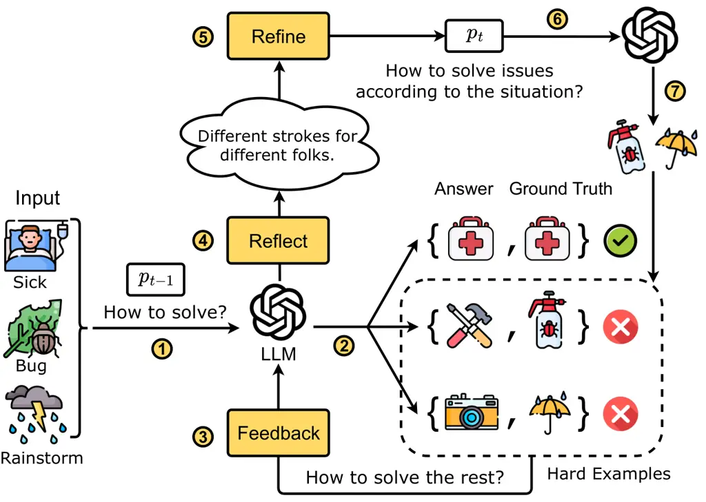
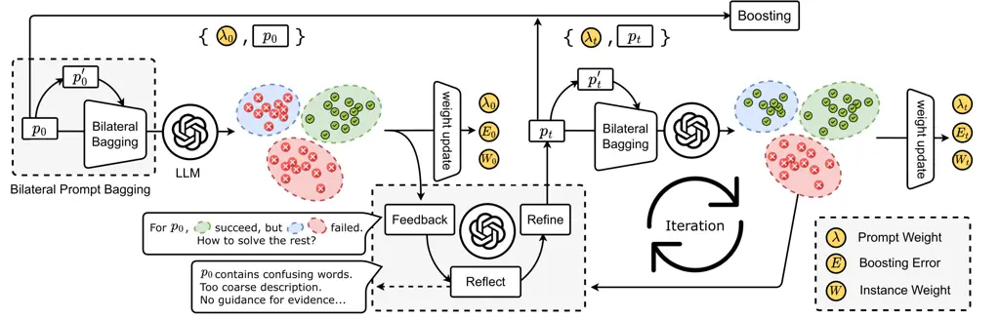

# Prefer: Prompt Ensemble Learning via Feedback-Reflect-Refine

Chenrui Zhang    Lin Liu Note: This work was done during the internship
at Meituan.    Jinpeng Wang    Chuyuan Wang    Xiao Sun    Hongyu Wang
   Mingchen Cai

###### Abstract

As an effective tool for eliciting the power of Large Language Models
(LLMs), prompting has recently demonstrated unprecedented abilities
across a variety of complex tasks. To further improve the performance,
prompt ensemble has attracted substantial interest for tackling the
hallucination and instability of LLMs. However, existing methods usually
adopt a two-stage paradigm, which requires a pre-prepared set of prompts
with substantial manual effort, and is unable to perform directed
optimization for different weak learners. In this paper, we propose a
simple, universal, and automatic method named Prefer (PRompt Ensemble
learning via Feedback-REflect-Refine) to address the stated limitations.
Specifically, given the fact that weak learners are supposed to focus on
hard examples during boosting, Prefer builds a feedback mechanism for
reflecting on the inadequacies of existing weak learners. Based on this,
the LLM is required to automatically synthesize new prompts for
iterative refinement. Moreover, to enhance stability of the prompt
effect evaluation, we propose a novel prompt bagging method involving
forward and backward thinking, which is superior to majority voting and
is beneficial for both feedback and weight calculation in boosting.
Extensive experiments demonstrate that our Prefer achieves
state-of-the-art performance in multiple types of tasks by a significant
margin. We have made our code publicly available¹¹ 1
https://github.com/zcrwind/PREFER.

¹Meituan Inc., Beijing, China ²Beijing Jiaotong University, Beijing,
China

^(🖂)chenrui.zhang@pku.edu.cn, linliu@bjtu.edu.cn,
{wangjinpeng04,wangchuyuan,
sunxiao10,wanghongyu15,caimingchen}@meituan.com

## Introduction

Large Language Models (LLMs) have recently flourished across a variety
of fields, demonstrating unprecedented abilities in myriad of complex
tasks (Zhao et al. 2023b; Ouyang et al. 2022). Trained with large-scale
web data on massive parameters, LLMs show emergent abilities beyond the
original linguistic competence (Wei et al. 2022a), which perform
tremendous versatility in both academia and industry. To elicit the
power of pretrained LLMs directly or adapt LLMs to specific domains,
various paradigms are proposed, including prompt engineering (Qiao
et al. 2022), p-tuning (Liu et al. 2021), and LoRA finetuning (Hu et al.
2021), etc. Due to the immense scale of the model parameters, finetuning
on all or even part of LLMs is costly and time-consuming. To this end,
as a simple and effective paradigm, prompt engineering explores a
fundamentally new way of invoking intrinsic knowledge and reasoning
ability of LLMs based on a pretrain-prompt-predict manner (Liu et al.
2023).



Figure 1: High-level overview of feedback-reflect-refine paradigm.
$`p_{t}`$ denotes the prompt at the $`t`$-th iteration.

Though promising, the naïve prompting approaches are afflicted by
several limitations. As generative language models, LLMs’ output
commonly has a large variance. For instance, the reasoning logic and
predicted results could be contradictory in multiple runs, although the
input prompts are fixed. In addition, LLMs suffer from the notoriously
hallucination issue (Ji et al. 2023), leading to results that are
plausible-sounding but factually incorrect or irrelevant to the inputs.
Furthermore, the quality of LLMs’ output is susceptible to the given
prompts, which entails substantial manual effort and domain expertise to
find out the reliable prompts.

As a promising solution to these issues, prompt ensemble learning has
attracted substantial interest in the community very recently,
demonstrating significant improvements in both effectiveness and
stability across various tasks. As a representative work,
PromptBoosting (Hou et al. 2023) applies the traditional
AdaBoost (Freund and Schapire 1997) algorithm over a set of pre-defined
prompts for text classification. BPE (Pitis et al. 2023) focuses on
Chain-of-Thought (CoT) (Wei et al. 2022b) boosting and builds few-shot
CoT prompts based on self-consistency (Wang et al. 2022). These efforts
empirically demonstrate the strength of prompt ensembles for LLM-based
tasks, yielding exceptional performance gains over single-prompt
baselines.

However, despite their success, existing prompt ensemble approaches,
which typically adopt a two-stage process, have several limitations.
First, they require a pre-prepared set of prompts in advance, which are
either manually defined or generated by another language model with
heavy parameters. This preliminary work is costly and laborious, often
involving a trial-and-error or pre-evaluation process to ensure the
quality of pre-defined prompts. Second, the two-stage paradigm fixes the
prompts to be used in the ensemble process, limiting the adaptability
and scalability of prompt boosting, as the prompts cannot be optimized
jointly. Since the relationships between prompts are ignored during the
iterative boosting process, the pre-defined prompts tend to be
sub-optimal and susceptible. Moreover, existing methods conduct
ensembles either in boosting or in bagging individually, neglecting the
potential benefits of combining the two worlds to enhance performance.

To alleviate the above issues, we advocate that a smarter paradigm for
prompt ensemble in the era of LLMs is expected to be automatic,
self-adaptive and joint-optimizable. Such paradigm reduces the need for
manual effort and domain expertise, as well as takes prompt relations
into consideration for directed optimization. Accordingly, we propose a
simple, automatic and universal approach called Prefer (PRompt Ensemble
learning via Feedback-REflect-Refine), towards a more effective prompt
ensemble via utilizing the generative and reflective capabilities that
LLMs excel at (Madaan et al. 2023). As shown in Figure 1, our Prefer
adopts a feedback-reflect-refine circle for prompt boosting. Concretely
speaking, inspired by the fact that weak learners pay more attention to
hard examples via weight redistribution during boosting, we propose to
transfer this hard-sample-oriented weighting into nature language
feedback, which returns error information to the LLM for reflection.
Hence, considering the reflection information, the LLM perceives the
inadequacies of existing prompts and is able to generate new prompts to
refine them purposefully. Attribute to the feedback-reflect-refine path,
the LLM jointly optimizes the downstream tasks solving and prompt
generation in an automatic manner. Iterating along this path, potential
conflict and redundancy among prompts are reduced, which is vital for
building a more stable and faster learner.

Furthermore, to adequately unleash the ability of each prompt and
further enhance the stability during boosting, we propose a bilateral
bagging approach, which incorporates forward and backward thinking for
multi-source verification. Specifically, drawing inspiration from human
decision-making, wherein uncertain answers are often resolved through a
process of elimination, we instruct the LLM to compute a confidence
score for each response and subsequently filter out the most uncertain
answers. Given the observed tendency of LLMs to overestimate confidence
in their predictions  (Zhao et al. 2021), our bilateral bagging approach
assesses the responses from both forward and backward directions, in
which the overconfidence bias can be counteracted subtly. The empirical
results demonstrate the superiority of our bilateral bagging approach
compared to other regular methods such as majority voting in both
effectiveness and efficiency.

We conduct extensive experiments and in-depth case studies on a number
of tasks, including reasoning, topic classification, hate speech
discrimination, etc. The empirical results testify the effectiveness of
our Prefer approach. Moreover, Prefer shows superiority in both
stability and efficiency compared to existing approaches. We will
provide the source code for reproducibility in the supplementary
material.

## Related Work

Our work is conceptually related to several subareas of artificial
intelligent, including Large Language Models (LLMs), prompt engineering,
and prompt ensemble learning. In this section, we briefly review the
works in each subarea.

### Large Language Models

Nowadays, Large Language Models (LLMs) have made revolutionary progress
and posed significant impact on various artificial intelligent
community (Zhao et al. 2023b; Ouyang et al. 2022). According to the
scale law, LLMs demonstrate unprecedent power (called emergent
abilities) with the rapid growth of model parameters and data
volume (Wei et al. 2022a). For instance, the most prominent applications
including ChatGPT and GPT-4 (OpenAI 2023) have shown surprising
reasoning ability, human-like conversation skills, as well as a rich
reserve of factual commonsense. Based on the surprising emergent
abilities, a series of classical algorithms can evolve to a more
intelligent version. In this paper, we provide a pilot work on ensemble
algorithm as a preliminary study. We believe that our proposed approach
could not only simply serve as a strong baseline to foster future
research on prompt ensemble, but also shed light on the potential
research direction towards improving classical algorithms with the power
of LLMs.



Figure 2: The pipeline of Prefer. Given the initial prompt $`p_{0}`$,
LLM partially solves the problem via incorporating backward thinking.
Then the error information will be used for prompt optimization through
the feedback-reflect-refine process. Iterating this process and finally
ensembling prompts based on evolved weights.

### Prompt Engineering

In order to invoke the power of LLMs, a series of approaches have been
proposed in the community, including parameter-efficient fine-tuning (Hu
et al. 2021; Liu et al. 2021) and prompt engineering (Qiao et al. 2022;
Liu et al. 2023), etc. Due to the heavy weight of LLMs, fully or even
partly fine-tuning them is expensive and inefficient. Accordingly, as an
out-of-the-box paradigm, prompt engineering (aka prompting) has emerged
as a new approach for adapting pretrain-prompt-predict path for
downstream tasks. Tremendous cutting-edge effort has been made towards
this area to improve the performance of prompting. Concretely, prompting
adopts natural language as additional inputs, acting as instructions or
hints to LLMs. For example, GPT2 (Radford et al. 2019) allows for
unsupervised learning of LLM on multiple tasks through handcrafted
task-specific prompts. However, building prompts manually can be
expensive, biased and sub-optimal (Liu et al. 2023). Another line of
works are devoted to conducting prompting in an automatic way.
STaR (Zelikman et al. 2022) utilizes a simple loop to bootstrap LLMs
with a self-taught manner, in which Chain-of-Thought (CoT) (Wei et al.
2022b) rationale is iteratively generated to hint the question answering
process. Closer to our work, APO (Pryzant et al. 2023) iteratively
optimizes the single prompt in a feedback manner, which treats the
textual reflection information as gradient in classical deep learning.

### Prompt Ensemble Learning

Prior studies have proven that LLMs have multiple reasoning paths for a
single problem, which could lead to distinct outputs from identical
inputs (Wang et al. 2022). To this end, prompt ensemble learning has
been presented as a solution, which combines several individual prompts
to obtain better stability and generalization performance. Boosting and
bagging are two typical ensemble methods widely adopted in numerous
classical tasks, while their adaptation on LLMs is still in its infancy.
Current works for prompt boosting typically utilize a two-stage
paradigm. PromptBoosting (Hou et al. 2023) has done a preliminary trial
on this way, which conducts the traditional AdaBoost (Freund and
Schapire 1997) algorithm over a pre-defined prompt set for text
classification. On the other hand, existing prompt bagging approaches
mainly rely on regular majority voting, which can be computationally
intensive. Notably, BPE (Pitis et al. 2023) focuses on constructing
few-shot CoT prompts based on self-consistency (Wang et al. 2022), which
offers better performance than a single prompt in the case of
introducing exponentially additional computation. In this paper, we
propose a computation-efficiency prompt bagging approach inspired by the
human ethology, which incorporates prompt boosting for further
performance improvement.

## Our Prefer Approach

### Preliminaries

In this section, we introduce preliminaries of our Prefer approach,
including the problem formulation and the dismantling of key components.

Considering a reasoning or classification task driven by LLMs, given the
training data $`\mathcal{D}_{tr}=\bigcup_{i}\{(x_{i},y_{i})\}`$, the
goal of the proposed Prefer is to automatically construct a prompt set
$`\mathcal{P}=\bigcup_{t}\{p_{t}\}`$ along with prompt weights
$`\bigcup_{t}\{\lambda_{t}\}`$ via LLM-augmented ensemble learning,
which can then be utilized cooperatively for the subsequent inference.
Here $`x_{i}\in\mathcal{X}`$ denotes the input texts and
$`y_{i}\in{\mathcal{Y}}`$ denotes the output label. It is noted that an
initial prompt $`p_{0}`$ is provided as the seed for the subsequent
iteration. Instead of requiring any supervised fine-tuning (SFT) or
reinforcement learning, our proposed Prefer utilizes out-of-box LLM API
(e.g., ChatGPT or GPT-4) as the foundation model $`\mathcal{M}`$ for
universality and flexibility. As illustrated in Figure 2, our Prefer
mainly contains two components, i.e. feedback-driven prompt boosting and
bilateral prompt bagging, which will be elaborated in sections below.

### Prompt Boosting via Feedback-Reflect-Refine

Before delving into the technical details of the proposed prompt
boosting approach, we first provide our design principle, based on the
thinking about what characteristics should an intelligent prompt
boosting have in the era of LLMs. Review that boosting algorithms
combine several individual weak learners to obtain better generalization
performance. Considering the fact that weaker learners are supposed to
pay more attention to hard samples during boosting, we advocate that an
intelligent boosting algorithm is expected to understand what problems
the previous weak learners cannot solve. That is, instead of building
prompts individually, the relation among prompts should be considered
for better performance and faster convergence. In another vein, to
reduce the manual effort, the prompt boosting process should be
automatic, where each prompt can be constructed without manual
intervention. Furthermore, the prompt boosting should be universal and
adaptive, for empowering any prompting-based task with the superiority
of ensemble learning seamlessly.

Our proposed Prefer embraces all the above design principles, towards a
simple, automatic and adaptive prompt ensemble paradigm. Inspired by the
classical boosting algorithm such as AdaBoost (Freund and Schapire 1997)
and iterative prompting algorithms (Pryzant et al. 2023), we adopt an
iterative manner to build the prompt set where each prompt is treated as
a weak learner. As illustrated in Figure 2, acting as a weak learner,
each prompt can only handle part of the instance space, where new
prompts will be added to expand the solving space by introducing more
information. Based on the error-ambiguity decomposition of ensemble
learning (Opitz and Shavlik 1995), the ensemble error mathematically
contains two parts:

```math
E_{ensemble}=\bar{E}-\bar{A} \tag{1}
```

where $`\bar{E}`$ and $`\bar{A}`$ respectively denote the average error
and the average ambiguity (also called diversity) of individual weak
learners. Based on Eq.(1), the ensemble performance is positively
correlated with both the accuracy and diversity of weak learners.
Considering this requirement, the prompt in each iteration is supposed
to focus on the hard examples that the prompts in previous iterations
cannot handle. Inspired by the way human reflect and refine for
improving performance when tackling difficult tasks, we propose a
feedback-reflect-refine pipeline, asking the LLM to consider the
relation of prompts in the iteration, generate new informative prompts,
and optimize them jointly.

\# Task

Given two sentences, determine whether

sentence 2 provides an answer to the

question posed by sentence 1.

\# Output format

Explain your reasoning process in one

sentence and Answer "Yes" or "No" as the

label.

\# Prediction

Sentence 1: {text1}

Sentence 2: {text2}

Label:\[\]

Listing 1 solving prompt

I’m trying to write a Textual Entailment

task prompt. My current prompt is: {prompt}

But this prompt gets the following examples

wrong: {error_info}

Give {num_feedbacks} reasons why the prompt

could have gotten these examples wrong. Wrap

each reason with \<START\> and \<END\>.

Listing 2 feedback prompt

Concretely speaking, we define two types of prompt templates, namely the
solving prompt and the feedback prompt, which are respectively
responsible for solving downstream tasks and conducting the feedback
process. Following In-Context Learning (ICL) (Dai et al. 2022), we
format both types of prompts with the component of the instruction,
demonstration and output format. Exemplary cases of these two templates
are illustrated in Listing 1 and Listing 2, respectively. Given the
initial seed prompt $`p_{0}`$ and the corresponding performance, we
build the feedback prompt based on the feedback template and the wrong
examples. This is reminiscent of the gradient in deep learning
optimization, which indicates the direction of model optimization, the
key difference lies that the feedback form changes from numerical into
textual. The feedback prompt will then be fed to the LLM $`\mathcal{M}`$
for self-reflecting, and $`\mathcal{M}`$ provides a series of reasons
why the current prompt $`p_{t}`$ can solve some examples well but not
others. Based on the reflection, the LLM is asked to generate new
prompts in connection with hard examples specified in the previous
iteration. In detail, the sampled wrong examples and corresponding
textual labels are combined to error_info in Listing 2. Mathematically,
this feedback-reflect-refine process can be formulated via the Bayesian
theory:

```math
\mathcal{P}(p_{t}|\mathcal{X},\mathcal{Y},p_{t-1})=\mathcal{P}(\mathcal{R}_{t}|\mathcal{X},\mathcal{Y},p_{t-1})\cdot\mathcal{P}(p_{t}|\mathcal{R}_{t}) \tag{2}
```

here $`\mathcal{R}_{t}`$ denotes the reflection of the LLM
$`\mathcal{M}`$ at the $`t`$-th iteration. It is noted that our Prefer
only modifies the instruction of the solving prompt, while other parts
remain unchanged.

Close to our work, APO (Pryzant et al. 2023) also conducts a
feedback-based mechanism for prompt optimization. Nevertheless, there
are several intrinsic differences between such iterative prompting
approach and our Prefer. First, APO aims to search for a single prompt
covering the largest possible solution space, while our Prefer organizes
a set of prompts via ensemble learning, which works in tandem to cover
multiple sub-spaces. Second, our Prefer proposes an effective bagging
approach to reduce the variance of the LLM, which is superior to the
regular techniques such as beam search or Monte Carlo search in APO.
Experimental results demonstrate that our Prefer outperforms APO by a
quite large margin with less computational cost and higher stability.

### Bilateral Prompt Bagging

As shown in Eq.(1), the quality and stability of weak learners is
essential to the ensemble performance. Due to the generative property of
language model, LLMs’ outputs are highly sensitive to the input prompts,
which affects the stability of both the feedback and weight calculation
process. To alleviate this issue, direct solutions include majority
voting or beam search, which is commonly used in the community (Wang
et al. 2022; Li et al. 2023). However, these methods are computationally
intensive, especially for LLMs with massive parameters. Accordingly, to
enhance the ability and stability of each prompt with limited
calculation burden, we further propose a bagging approach called
bilateral prompt bagging, which draws inspiration from human behavior of
utilizing forward and backward thinking for tackling difficult tasks.

Input: Training data $`\mathcal{D}_{tr}=\bigcup_{i}\{(x_{i},y_{i})\}`$,
the LLM $`\mathcal{M}`$, the seed prompt $`p_{0}`$, the prompt templates
$`\mathcal{T}_{\tt solving}`$ and $`\mathcal{T}_{\tt feedback}`$  
Output: the result prompt set $`\mathcal{P}=\bigcup_{t}\{p_{t}\}`$ and
their weights $`\bigcup_{t}\{\lambda_{t}\}`$, the reflection set
$`\bigcup_{t}\{\mathcal{R}_{t}\}`$

1:  Set the initial data weight to
$`\omega_{i}^{(0)}=1/|\mathcal{D}_{tr}|,\forall{i}\in\{0,\cdots,|\mathcal{D}_{tr}|\}`$,
$`\mathcal{P}=\{p_{0}\}`$.

2:  for $`t=0`$ to $`N`$ do

3:   if $`t>0`$ then

4:    Generate new $`p_{t}`$ with {$`\mathcal{M}`$, reflection
$`\mathcal{R}_{t-1}`$}

5:   end if

6:   Solve target tasks with {$`p_{t}`$, $`\mathcal{T}_{\tt solving}`$,
$`\omega_{i}`$}

7:   Conduct bilateral bagging

8:   Build feedback prompt with {error*info,
$`\mathcal{T}*{\tt feedback}`$}

9:   Perform feedback and get the reflection $`\mathcal{R}_{t}`$

10:   Compute weighted error as Eq.(4)

11:   Update the weight on $`p_{t}`$ by Eq.(5)

12:   Update the instance weights in $`\mathcal{D}_{tr}`$ by Eq.(6)
followed by re-normalization

13:   $`\mathcal{P}=\mathcal{P}\cup{p_{t}}`$,
$`\mathcal{R}=\mathcal{R}\cup{\mathcal{R}_{t}}`$

14:  end for

15:  return $`\bigcup_{t}\{p_{t}\}`$, $`\bigcup_{t}\{\lambda_{t}\}`$,
$`\bigcup_{t}\{\mathcal{R}_{t}\}`$

Algorithm 1 Our Prefer Algorithm

Concretely speaking, humans commonly adopt the process of elimination
when they are not sure about the decision making. Inspired by this, we
advocate that similar spirits can be utilized in the prompt bagging. In
each iteration, the LLM $`\mathcal{M}`$ is required to evaluate its
answer’s confidence by utilizing the generated prompt $`p_{t}`$ followed
by a confidence evaluation clause. When the evaluation result is not
confident enough, the reverse thinking takes effect via conducting
elimination process. In detail, we consider the quantitative confidence
score evaluation in both forward and backward thinking. Take the
classification task as an example, in the forward evaluation,
$`\mathcal{M}`$ is required to measure the confidence that each
candidate answer is the correct one. As for the backward evaluation,
$`\mathcal{M}`$ is required reversely to measure the confidence that
each candidate answer is excluded. For notational simplicity, we name
the confidence scores corresponding to the forward and backward
evaluations with $`S^{+}`$ and $`S^{-}`$ respectively. After these, the
final probability can be calculated via combining $`S^{+}`$ and
$`S^{-}`$ with a subtractive fashion:

```math
\hat{y}={\arg\max}_{j}{\frac{e^{S^{+}_{j}-S^{-}_{j}}}{\sum_{c}^{K}{e^{S^{+}_{c}-S^{-}_{c}}}}} \tag{3}
```

here $`\hat{y}`$ denotes the predicted answer, $`c`$ and $`j`$ denote
the indexes of candidate answers. It is noted that LLMs tend to evaluate
confidence score overconfidently (Zhao et al. 2021), while our proposal
ingeniously circumvents this inadequacy via positive and negative
offsets. We believe that such paradigm can also shed light on the
community of LLMs’ calibration (Zhao et al. 2023a).

Attributed to the introduction of reverse thinking mechanism, the
accuracy-versus-efficiency dilemma can be largely alleviated for prompt
bagging. Experimental results explicitly manifest that such bilateral
bagging outperforms regular methods (e.g., majority voting) in both
effectiveness and efficiency.

| Datasets            | SNLI  | MNLI  | QNLI  | RTE   | Ethos | Liar  | ArSarcasm |
| ------------------- | ----- | ----- | ----- | ----- | ----- | ----- | --------- |
| Single Prompt       | 0.587 | 0.660 | 0.660 | 0.720 | 0.833 | 0.535 | 0.511     |
| Single Prompt (CoT) | 0.575 | 0.685 | 0.660 | 0.731 | 0.804 | 0.549 | 0.525     |
| Synonym Ensemble    | 0.580 | 0.746 | 0.720 | 0.659 | 0.812 | 0.572 | 0.569     |
| PromptBoosting      | 0.619 | 0.574 | 0.631 | 0.673 | \-    | \-    | \-        |
| APO                 | \-    | \-    | \-    | \-    | 0.964 | 0.663 | 0.873     |
| APO\*               | \-    | \-    | \-    | \-    | 0.947 | 0.658 | 0.639     |
| Ours                | 0.647 | 0.767 | 0.793 | 0.753 | 0.963 | 0.744 | 0.739     |

Table 1: Main experimental results of our Prefer and the compared
approaches. APO and APO\* respectively denote the reported and our
reproduced results of the Automatic Prompt Optimization (Pryzant et al.
2023). Bold: best; underline: runner-up (results are based on our
reproduction).

| Method  | $`-`$Feedback       | $`-`$Bagging        | Voting              | Ours  |
| ------- | ------------------- | ------------------- | ------------------- | ----- |
| SNLI    | 0.580$`\downarrow`$ | 0.640               | 0.626               | 0.647 |
| MNLI    | 0.746               | 0.713               | 0.733               | 0.767 |
| QNLI    | 0.720               | 0.747               | 0.767               | 0.793 |
| RTE     | 0.659$`\downarrow`$ | 0.740               | 0.760               | 0.753 |
| Ethos   | 0.812$`\downarrow`$ | 0.947               | 0.938               | 0.963 |
| Liar    | 0.572$`\downarrow`$ | 0.718               | 0.701               | 0.744 |
| Sarcasm | 0.572$`\downarrow`$ | 0.653$`\downarrow`$ | 0.649$`\downarrow`$ | 0.739 |

Table 2: Experimental results of the ablation study. $`\downarrow`$
indicates a severe performance drop (more than 10%).

#### Overall Algorithm

To sum up, we conclude the proposed Prefer in Algorithm 1. Basically,
our Prefer follows the pipeline of the classical AdaBoost (Freund and
Schapire 1997) algorithm, while enhancing it with the
feedback-reflect-refine boosting and the bilateral prompt bagging. Both
branches can co-adapt and cooperate for automatic prompt set
optimization. In detail, the weighted ensemble error in the $`t`$-th
iteration is calculated as:

```math
error^{(t)}=\sum_{i=1}^{|\mathcal{D}_{tr}|}\frac{\omega_{i}^{(t)}\cdot\mathbb{I}\big(y_{i}\neq\mathcal{M}(p_{t},x_{i})\big)}{\sum_{i}^{|\mathcal{D}_{tr}|}\omega_{i}} \tag{4}
```

here $`\mathbb{I}`$ is the identify function. Moreover, the weight in
each iteration is updated based on the above error information as:

```math
\lambda^{(t)}=\log\frac{1-error^{(t)}}{error^{(t)}}+\log\big(|\mathcal{Y}|-1\big) \tag{5}
```

Finally, the instance weights in training dataset $`\mathcal{D}_{tr}`$
can be updated by:

```math
\omega^{(t)}_{i}=\omega^{(t-1)}_{i}\cdot\exp\Big(\lambda^{(t)}\cdot\mathbb{I}\big(y_{i}\neq\mathcal{M}(p_{t},x_{i})\big)\Big) \tag{6}
```

here $`\forall{i}\in\{0,\cdots,|\mathcal{D}_{tr}|\}`$ is the index of
training examples. Once the process of Algorithm 1 is complete,
optimized prompts $`\bigcup_{t}\{p_{t}\}`$ along with their weights
$`\bigcup_{t}\{\lambda_{t}\}`$ can be obtained, which can then be
utilized for application via weighted decision making. Moreover, the
intermediate reflection $`\bigcup_{t}\{\mathcal{R}_{t}\}`$ naturally
provides abundant interpretability for prompt boosting.

## Experiments

### Experimental Settings

#### Datasets

We conduct experiments on a wide range of tasks including natural
language inference and classification:

- •
  Natural Language Inference  
  SNLI (Bowman et al. 2015), MNLI (Williams, Nangia, and Bowman 2017),
  and RTE (Dagan, Glickman, and Magnini 2005): textual entailment
  inference;  
  QNLI (Rajpurkar et al. 2016): question-answering inference.
- •
  Natural Language Classification  
  Ethos (Mollas et al. 2020): hate speech detection; Liar (Wang 2017):
  fake news classification;  
  ArSarcasm (Farha and Magdy 2020): Arabic sarcasm detection.

#### Compared Baselines

To manifest the superiority of our Prefer approach, we compare it with
several state-of-the-art baselines. As the closest work to our proposal,
PromptBoosting (Hou et al. 2023) conducts the traditional AdaBoost
algorithm over a pre-defined prompt set for text classification. As a
remarkable work of iterative prompting methods, APO (Pryzant et al. 2023) utilizes an iterative manner for optimizing a single prompt, where
the performance of the previous prompt will be used to form a natural
language “gradient” that guides the prompt optimization. Moreover, we
also conduct single-prompt and Chain-of-Thought (CoT) enhanced
single-prompt experiments, to figure out the superiority of our Prefer
compared with vanilla and optimized non-iterative prompting works.
Lastly, we compare a variant of our Prefer, which rewrites synonymous
prompts for boosting instead of feedback-reflect-refine paradigm, for
ascertaining the utility of LLMs’ reflective ability.

#### Running settings

To make a fair comparison, we closely follow the experimental protocols
that were set up in APO with our own data split. In detail, we mainly
conduct developing and evaluation of our Prefer in few-shot settings.
For each task, we randomly sample $`k`$ examples from the original
training dataset, to build $`k`$-shot training set $`\mathcal{D}_{tr}`$.
By default, the $`k`$ in this paper is set to $`50`$. We use F1-score
for performance evaluation.

### Experimental Results

In view of the key proposals in our Prefer approach, we are naturally
motivated to ask the following interesting research questions.

- •
  RQ1. Is the prompt ensemble learning really useful for improving LLMs’
  performance?
- •
  RQ2. Are the feedback-driven boosting and bilateral bagging mechanism
  both useful for prompt synthesis in ensemble learning?
- •
  RQ3. Is the reason why our proposal is superior to the iterative
  approaches due to the expansion of the sample space?

To figure out the answers to these questions, we conduct sufficient
experiments and the experimental results can be found in Table 1. For
the first question, we compare the ensemble-based approaches (including
PromptBoosting and our Prefer) with the single-prompt-based approaches.
As shown in the experimental results, when compared to the vanilla
(Line 1) and CoT-enhanced single prompt approach (Line 2), both
PromptBoosting and our Prefer outperform them by a significant margin.
For example, our Prefer outperforms the second best approach by up to
6.3% for the QNLI dataset, and 13.1% for the Liar dataset. The general
trend that becomes apparent from the results in Table 1 is that the more
difficult the task is, the better ensemble learning performs. We
conjecture that it is due to the feedback-reflect-refine paradigm can
achieve greater improvement for the harder tasks, while the marginal
gain of this mechanism would be diminishing for easier tasks. It is
noted that the experimental results change marginally by adding
Chain-of-Thought (CoT) for single-prompt approach.

To explore the second research question, we compare our Prefer with both
the two-stage ensemble approach PromptBoosting (Line 4) and the synonym
rewriting ensemble approach (Line 3). For PromptBoosting, we use the
publicly available code of (Hou et al. 2023) and conduct experiments
following its hyperparameter setting. For the synonym rewriting
ensemble, we conduct prompt rewriting operation with same semantics,
followed by regular ensemble learning similar to our Prefer. As
demonstrated in Table 1, our approach consistently outperforms the two
ensemble approaches by a significant margin, reaching around 5% to 35%
relative improvement in most datasets. We attribute the superiority of
Prefer to its feedback-reflect-refine mechanism as well as the design of
the joint optimization paradigm that naturally captures relations among
weak learners.

As for the third question, APO (Pryzant et al. 2023) is introduced as
the remarkable approach of iterative prompting for comparison. It is
noted that we reproduce the APO approach (APO\* at Line 6) for a
strictly fair comparison, which eliminates the interference from data
sampling. Similar performance trends are observed in this comparison,
that is, our Prefer outperforms APO with the power of
feedback-reflect-refine boosting and bilateral prompt bagging. It
manifests that through expanding the sample space in a nonlinear way,
prompting performance can be enhanced significantly than single-prompt
methods with similar iteration rounds. In fact, attributed to our
bagging design, our Prefer is superior to APO not only in effectiveness,
but also in stability and efficiency.

### Ablation Study

Figure 3: Training process comparison for APO and ours.

To figure out the effectiveness of each component in our proposal, we
perform ablations on both feedback-reflect-refine boosting and bilateral
bagging, and the experimental results are provided in Table 2. First, we
remove the feedback mechanism in prompt boosting (“$`-`$Feedback”), in
which the initial seed prompt is just modified by the LLM without
directed optimization, then the similar boosting and bagging strategy is
performed to align the settings of our Prefer. As shown in Table 2, it
is observed that the prompt ensemble without feedback-reflect-refine
path is sub-optimal, signifying that such feedback mechanism plays an
important role for directed prompt boosting. Second, to figure out the
effectiveness of our bilateral bagging component, we also turn off the
whole component (“$`-`$Bagging”) or replace it with majority voting
(“Voting”), as shown in the column 3 and 4 in Table 2, respectively. The
experimental results convey that our bilateral bagging is beneficial for
Prefer, and distinctly outperform the regular bagging approach of
majority voting. Notably, the performance of majority voting is
basically satisfactory, manifesting that the prompt bagging can benefit
the boosting prompt process consistently. An interesting phenomenon is
that removing the feedback-reflect-refine module leads to more serious
performance decline than removing the bagging module. This is expected,
since the bagging mainly benefits the stability for each prompt, while
the boosting is more important for prompt ensemble.

### Training Efficiency

To further demonstrate the superiority of our method, we conduct
detailed experiments on the Ethos dataset for training efficiency,
including training time and convergence speed. As shown in Figure 3,
both APO and our Prefer reach the peak at optimization step 2 to 3,
which indicates that neither approaches require extensive iterations to
achieve impressive results. Clearly, our Prefer has a more stable
performance retention compared to APO during subsequent iterations. On
the other hand, considering the limitations on the speed and frequency
of LLM API accesses, we compare the number of API accesses during
training and the time consumption for the first two prompt optimization
steps, which is displayed in Table 3. It can be observed that the access
number of APO increases rapidly during beam search and bandit selection,
which brings serious efficiency problems. On the contrary, our Prefer
does not enforce optimal optimization at each time step, but rather
maintains a stable and efficient improvement via ensemble learning.

APO Ours Frequency $`b(N+2)+T|D_{sample}|`$ $`2N+2`$ T*(step1) 579.0 s
132.4 s T*(step2) 2100.4 s 336.1 s

Table 3: Comparison of training efficiency. Frequency denotes the number
of API accesses required by the method within each optimization step,
where $`N`$ is training size and $`b`$, $`T`$, $`|D_{sample}|`$ are
hyperparameters required by APO. T*(step1) and T*(step2) represent the
time required for the corresponding optimization steps from the
beginning, where we set $`N=50`$, $`b=4`$, $`T=20`$,
$`|D_{sample}|=16`$.

### Case Study

Figure 4: Comparison of the generation obtained from our
feedback-reflect-refine paradigm and synonymous rewrite.

To visualize our feedback-reflect-refine paradigm, we provided a case
study as an illustration. As shown in Figure 4, taking the nature
language inference task on the QNLI dataset as an example, we provide
the intermediate output of the LLM in the feedback-reflect-refine
process, to show its effectiveness and interpretability. Compared to the
prompt generated by synonymous rewriting (gray box), the one generated
by our method is more informative and logically compensates for the
deficiencies of the previous prompt, thus achieving directed prompt
optimization.

## Conclusion

In this paper, we propose a simple, automatic, and universal prompt
ensemble approach called Prefer (PRompt Ensemble learning via
Feedback-REflect-Refine), empirically showing consistent and significant
improvement over previous baselines. Prefer contains two main
components, including feedback-reflect-refine prompt boosting and
bilateral prompt bagging. Prompt boosting branch directly and
collectively optimizes prompt in an automatic fashion based on the
evolving self-reflection. Prompt bagging proposes a bagging paradigm
containing forward and backward cooperation inspired by human behavior,
which adequately unearths the real quality of each generated prompt and
thus ensures the stability of both the feedback-reflect-refine process
and weight calculation in boosting. In a parallel note, our Prefer
brings the prompt ensemble approach with more interpretability by
harnessing the LLMs’ language ability. For future work, two interesting
questions worth studying, namely 1) how to further reduce the
calculation of prompt ensemble to approach single-prompt colleagues, and 2) how to make more classical algorithm more intelligent based on the
power of LLMs.

## References

- Bowman et al. (2015) Bowman, S. R.; Angeli, G.; Potts, C.; and
  Manning, C. D. 2015. A large annotated corpus for learning natural
  language inference. _arXiv preprint arXiv:1508.05326_.
- Dagan, Glickman, and Magnini (2005) Dagan, I.; Glickman, O.; and
  Magnini, B. 2005. The pascal recognising textual entailment challenge.
  In _Machine learning challenges workshop_, 177–190. Springer.
- Dai et al. (2022) Dai, D.; Sun, Y.; Dong, L.; Hao, Y.; Sui, Z.; and
  Wei, F. 2022. Why can gpt learn in-context? language models secretly
  perform gradient descent as meta optimizers. _arXiv preprint
  arXiv:2212.10559_.
- Farha and Magdy (2020) Farha, I. A.; and Magdy, W. 2020. From arabic
  sentiment analysis to sarcasm detection: The arsarcasm dataset. In
  _Proceedings of the 4th Workshop on Open-Source Arabic Corpora and
  Processing Tools, with a Shared Task on Offensive Language Detection_,
  32–39.
- Freund and Schapire (1997) Freund, Y.; and Schapire, R. E. 1997. A
  decision-theoretic generalization of on-line learning and an
  application to boosting. _Journal of computer and system sciences_,
  55(1): 119–139.
- Hou et al. (2023) Hou, B.; O’Connor, J.; Andreas, J.; Chang, S.; and
  Zhang, Y. 2023. Promptboosting: Black-box text classification with ten
  forward passes. In _International Conference on Machine Learning_,
  13309–13324. PMLR.
- Hu et al. (2021) Hu, E. J.; Shen, Y.; Wallis, P.; Allen-Zhu, Z.; Li,
  Y.; Wang, S.; Wang, L.; and Chen, W. 2021. Lora: Low-rank adaptation
  of large language models. _arXiv preprint arXiv:2106.09685_.
- Ji et al. (2023) Ji, Z.; Lee, N.; Frieske, R.; Yu, T.; Su, D.; Xu, Y.;
  Ishii, E.; Bang, Y. J.; Madotto, A.; and Fung, P. 2023. Survey of
  hallucination in natural language generation. _ACM Computing Surveys_,
  55(12): 1–38.
- Li et al. (2023) Li, Y.; Lin, Z.; Zhang, S.; Fu, Q.; Chen, B.; Lou,
  J.-G.; and Chen, W. 2023. Making Language Models Better Reasoners with
  Step-Aware Verifier. In _Proceedings of the 61st Annual Meeting of the
  Association for Computational Linguistics (Volume 1: Long Papers)_,
  5315–5333.
- Liu et al. (2023) Liu, P.; Yuan, W.; Fu, J.; Jiang, Z.; Hayashi, H.;
  and Neubig, G. 2023. Pre-train, prompt, and predict: A systematic
  survey of prompting methods in natural language processing. _ACM
  Computing Surveys_, 55(9): 1–35.
- Liu et al. (2021) Liu, X.; Zheng, Y.; Du, Z.; Ding, M.; Qian, Y.;
  Yang, Z.; and Tang, J. 2021. GPT understands, too. _arXiv preprint
  arXiv:2103.10385_.
- Madaan et al. (2023) Madaan, A.; Tandon, N.; Gupta, P.; Hallinan, S.;
  Gao, L.; Wiegreffe, S.; Alon, U.; Dziri, N.; Prabhumoye, S.; Yang, Y.;
  et al. 2023. Self-refine: Iterative refinement with self-feedback.
  _arXiv preprint arXiv:2303.17651_.
- Mollas et al. (2020) Mollas, I.; Chrysopoulou, Z.; Karlos, S.; and
  Tsoumakas, G. 2020. Ethos: an online hate speech detection dataset.
  _arXiv preprint arXiv:2006.08328_.
- OpenAI (2023) OpenAI. 2023. GPT-4 Technical Report. Technical Report
  arXiv:2303.08774, OpenAI.
- Opitz and Shavlik (1995) Opitz, D.; and Shavlik, J. 1995. Generating
  accurate and diverse members of a neural-network ensemble. _Advances
  in neural information processing systems_, 8.
- Ouyang et al. (2022) Ouyang, L.; Wu, J.; Jiang, X.; Almeida, D.;
  Wainwright, C.; Mishkin, P.; Zhang, C.; Agarwal, S.; Slama, K.; Ray,
  A.; et al. 2022. Training language models to follow instructions with
  human feedback. _Advances in Neural Information Processing Systems_,
  35: 27730–27744.
- Pitis et al. (2023) Pitis, S.; Zhang, M. R.; Wang, A.; and
  Ba, J. 2023. Boosted Prompt Ensembles for Large Language Models.
  _arXiv preprint arXiv:2304.05970_.
- Pryzant et al. (2023) Pryzant, R.; Iter, D.; Li, J.; Lee, Y. T.; Zhu,
  C.; and Zeng, M. 2023. Automatic prompt optimization with” gradient
  descent” and beam search. _arXiv preprint arXiv:2305.03495_.
- Qiao et al. (2022) Qiao, S.; Ou, Y.; Zhang, N.; Chen, X.; Yao, Y.;
  Deng, S.; Tan, C.; Huang, F.; and Chen, H. 2022. Reasoning with
  language model prompting: A survey. _arXiv preprint arXiv:2212.09597_.
- Radford et al. (2019) Radford, A.; Wu, J.; Child, R.; Luan, D.;
  Amodei, D.; Sutskever, I.; et al. 2019. Language models are
  unsupervised multitask learners. _OpenAI blog_, 1(8): 9.
- Rajpurkar et al. (2016) Rajpurkar, P.; Zhang, J.; Lopyrev, K.; and
  Liang, P. 2016. Squad: 100,000+ questions for machine comprehension of
  text. _arXiv preprint arXiv:1606.05250_.
- Wang (2017) Wang, W. Y. 2017. ”liar, liar pants on fire”: A new
  benchmark dataset for fake news detection. _arXiv preprint
  arXiv:1705.00648_.
- Wang et al. (2022) Wang, X.; Wei, J.; Schuurmans, D.; Le, Q.; Chi, E.;
  Narang, S.; Chowdhery, A.; and Zhou, D. 2022. Self-consistency
  improves chain of thought reasoning in language models. _arXiv
  preprint arXiv:2203.11171_.
- Wei et al. (2022a) Wei, J.; Tay, Y.; Bommasani, R.; Raffel, C.; Zoph,
  B.; Borgeaud, S.; Yogatama, D.; Bosma, M.; Zhou, D.; Metzler, D.;
  et al. 2022a. Emergent abilities of large language models. _arXiv
  preprint arXiv:2206.07682_.
- Wei et al. (2022b) Wei, J.; Wang, X.; Schuurmans, D.; Bosma, M.; Xia,
  F.; Chi, E.; Le, Q. V.; Zhou, D.; et al. 2022b. Chain-of-thought
  prompting elicits reasoning in large language models. _Advances in
  Neural Information Processing Systems_, 35: 24824–24837.
- Williams, Nangia, and Bowman (2017) Williams, A.; Nangia, N.; and
  Bowman, S. R. 2017. A broad-coverage challenge corpus for sentence
  understanding through inference. _arXiv preprint arXiv:1704.05426_.
- Zelikman et al. (2022) Zelikman, E.; Mu, J.; Goodman, N. D.; and Wu,
  Y. T. 2022. Star: Self-taught reasoner bootstrapping reasoning with
  reasoning. _arXiv preprint arXiv:2203.14465_.
- Zhao et al. (2023a) Zhao, T.; Wei, M.; Preston, J. S.; and Poon, H.
  2023a. Automatic Calibration and Error Correction for Large Language
  Models via Pareto Optimal Self-Supervision. _arXiv preprint
  arXiv:2306.16564_.
- Zhao et al. (2023b) Zhao, W. X.; Zhou, K.; Li, J.; Tang, T.; Wang, X.;
  Hou, Y.; Min, Y.; Zhang, B.; Zhang, J.; Dong, Z.; et al. 2023b. A
  survey of large language models. _arXiv preprint arXiv:2303.18223_.
- Zhao et al. (2021) Zhao, Z.; Wallace, E.; Feng, S.; Klein, D.; and
  Singh, S. 2021. Calibrate before use: Improving few-shot performance
  of language models. In _International Conference on Machine Learning_,
  12697–12706. PMLR.
