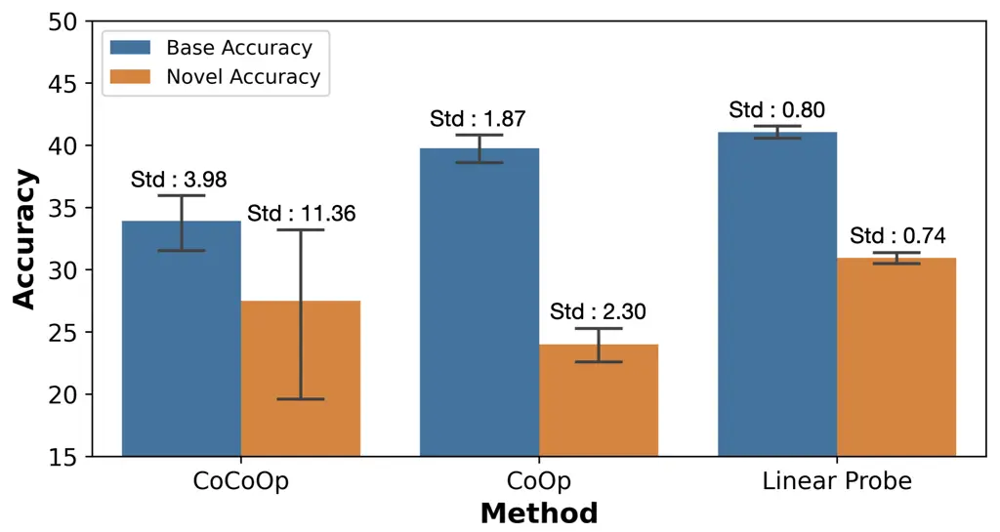
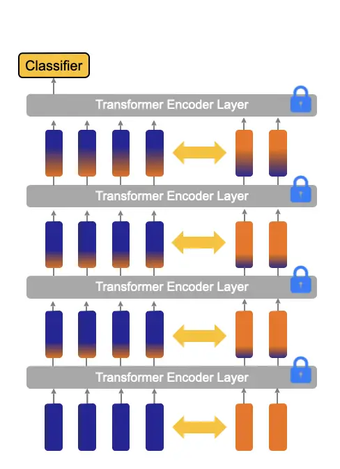
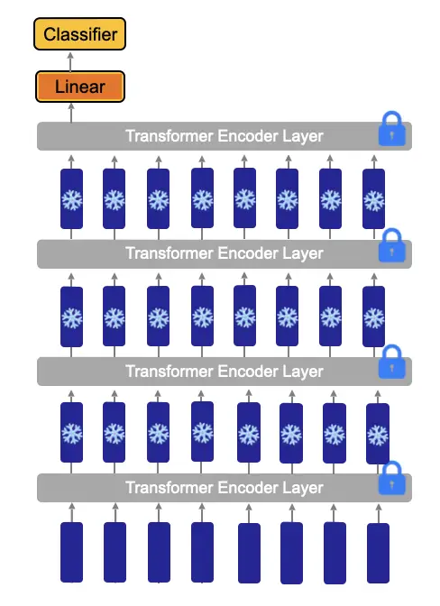
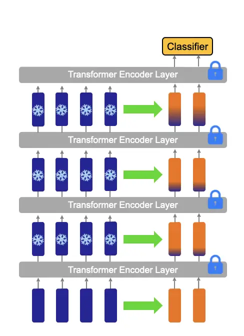
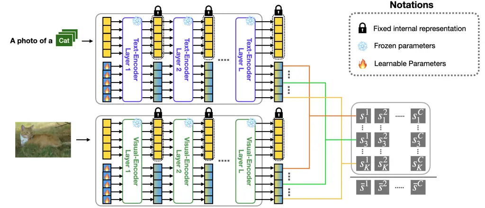
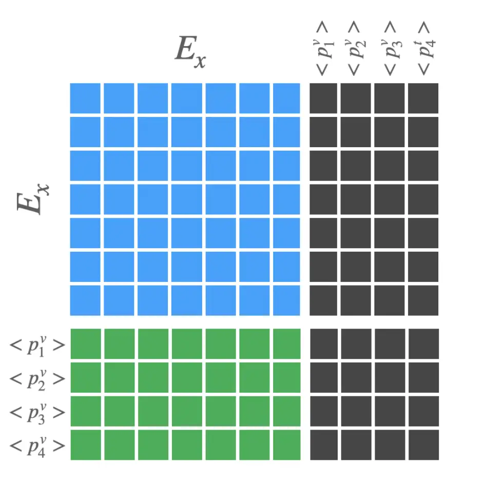
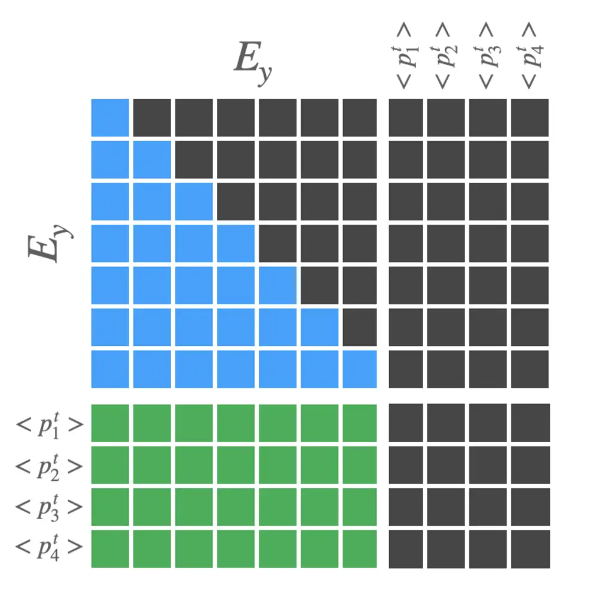
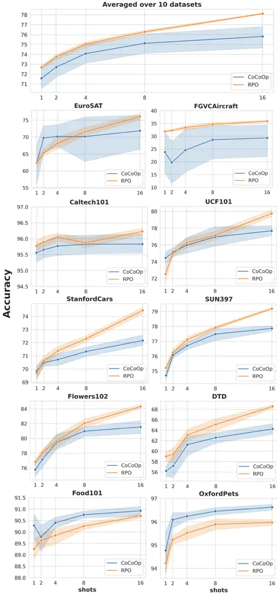
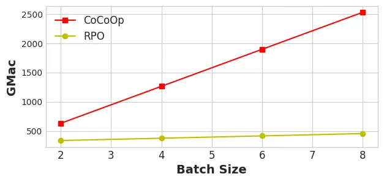

# Read-only Prompt Optimization for Vision-Language Few-shot Learning

Dongjun Lee^(\*)    Seokwon Song^(\*)    Jihee Suh
Affiliation: Joonmyung Choi    Sanghyeok Lee    Hyunwoo J. Kim^(†)
Affiliation: Korea University Affiliation: {mando03, tjrdnjs99, adelsuh,
pizard, cat0626, hyunwoojkim}@korea.ac.kr

###### Abstract

In recent years, prompt tuning has proven effective in adapting
pre-trained vision-language models to downstream tasks. These methods
aim to adapt the pre-trained models by introducing learnable prompts
while keeping pre-trained weights frozen. However, learnable prompts can
affect the internal representation within the self-attention module,
which may negatively impact performance variance and generalization,
especially in data-deficient settings. To address these issues, we
propose a novel approach, Read-only Prompt Optimization (RPO). RPO
leverages masked attention to prevent the internal representation shift
in the pre-trained model. Further, to facilitate the optimization of
RPO, the read-only prompts are initialized based on special tokens of
the pre-trained model. Our extensive experiments demonstrate that RPO
outperforms CLIP and CoCoOp in base-to-new generalization and domain
generalization while displaying better robustness. Also, the proposed
method achieves better generalization on extremely data-deficient
settings, while improving parameter efficiency and computational
overhead. Code is available at
[https://github.com/mlvlab/RPO](https://github.com/mlvlab/RPO).

^(\*)^(\*)footnotetext: Equal
contribution.^(\$\dagger\$)^(\$\dagger\$)footnotetext: Corresponding
author.

## 1 Introduction

Vision-language models like CLIP \[6\], ALIGN \[24\], and FILIP \[50\]
have achieved excellent performance in various vision-language tasks.
Since vision-language models are supervised by natural language based on
the contrastive learning objective, by placing the class name in a
textual template (e.g.,“A photo of a \[CLASS\]”), vision-language models
can effectively classify images in open-vocabulary settings \[6\].



Figure 1: Variance of CoCoOp, CoOp, and linear probing. Linear probing,
which does not shift the pre-trained representation, shows lower
variance in performance compared with prompt learning methods such as
CoOp and CoCoOp.

Recent works have explored the adaptation of these vision-language
models on downstream tasks \[19\]. However, unlike small pre-trained
models, large-scale architectures (e.g., CLIP) are difficult to
fine-tune, since it is inefficient, resource-intensive, and possibly
damaging to the good representations learned during pre-training. In
CLIP, prompt engineering is conducted to provide domain-specific context
to downstream tasks (_e.g_., “A photo of a \[CLASS\], a type of
car”) \[6\]. However, this means that the prompt has to be chosen
manually, based on trial and error. To mitigate this issue, Context
Optimization (CoOp) \[33\] suggests automating prompt engineering on
CLIP, replacing the context words in natural language-based prompts with
learnable vectors. Conditional Context Optimization (CoCoOp) \[31\]
extended CoOp with an image-conditional prompt, generated by an
additional neural network, to improve generalization.



(a)



(b)



(c)

Figure 2: Illustration of methods for model adaptation and RPO. (a) As
denoted by $`\Leftrightarrow`$, token features and prompt features can
see each other in conventional prompt tuning methods. Although the
weight of the model has been frozen, the internal representations of
pre-trained CLIP are increasingly shifted by the newly introduced
learnable prompts through the self-attention mechanism. (b) In linear
probing, internal representations as well as pre-trained parameters are
frozen. The linear layer on top of the model is trained for model
adaptation. (c) As denoted by $`\Rightarrow`$, only the prompts can read
token features and not the other way around in our method, RPO. This
keeps token features frozen and unaffected by introduced prompts while
our read-only prompts only read useful information from token features.

Although these existing methods are proposed to avoid adversely
affecting the learned parameters of the pre-trained model during prompt
learning, they still affect the model’s hidden representation through
the attention mechanism, which we call the internal representation
shift. We visualize this process of representation shift in Figure 2(a).
As tokens are processed through transformer \[55\] layers, the internal
representations of the pre-trained model are largely changed by the
learnable prompts. This can be beneficial, as it allows the model to
better adapt to the downstream task. However, as shown in Figure 1, this
shift has the potential to negatively impact the robustness and
generalization of the model in data-deficient settings. On the other
hand, linear probing has no internal representation shift, as shown in
Figure 2(b), but the linear layer introduces parameter inefficiency.

To inspect how representation shift influences model variance in
data-deficient settings, we conduct a preliminary experiment with linear
probing CLIP, which does not change the internal representation of
pre-trained CLIP. We train the model with 10 random few-shot training
data split on the FGVCAircraft dataset with the 16-shot learning setting
and visualize the variance of performance. Interestingly, as shown in
Figure 1, we observed that linear probing significantly lowers variance
compared to CoOp and CoCoOp, even though it requires more training
parameters (262K) compared to CoOp (2K) and CoCoOp (35K). This result
shows that internal representation shifts induced by training with
deficient data may result in high variance. At the same time, as CoOp
empirically showed, linear probing sometimes shows a lack of
generalizability in domain-shift tasks, and the amount of its additional
parameters is undesirable.

Motivated by this observation, we propose Read-only Prompt Optimization
(RPO) that learns read-only prompts as shown in Figure 2(c). RPO
prevents representation shift during adaptation while being
parameter-efficient, leading to a more robust and generalizable
adaptation.

Our contributions can be summarized as follows:

- •
  We propose Read-only Prompt Optimization (RPO), which allows prompts
  only to read information from the attention-based interactions of a
  pre-trained vision-language model, thereby preventing the internal
  representation shift.
- •
  We develop a simple yet effective initialization method for our
  read-only prompts, leveraging the special token embeddings of the
  pre-trained CLIP vision-language model.
- •
  Our extensive experiments and analyses demonstrate the generalization
  of RPO on domain and label shift in few-shot adaptation settings,
  achieving the best performance in 9 benchmarks on base to new
  generalization and in 4 benchmarks on domain generalization, at the
  same time reducing variance depending on the few-shot sample.

## 2 Related Works

Vision-Language Models The vast amount of web-crawled image-text
pairs \[6, 24, 15, 5, 45, 44\] facilitate vision-language models to be
pre-trained contrastively, which enables the acquisition of powerful and
generalizable image representations. For instance, CLIP \[6\] and
ALIGN \[24\] rely on transformer-based \[55\] encoders to map the
complex relationship between images and text. These vision-language
models have achieved exceptional performance in diverse downstream
tasks, especially in zero-shot image classification. Following these
works, numerous other works \[12, 18, 48, 47\] have emerged to harness
the power of vision-language models for image-related tasks such as
image recognition \[33, 31, 29, 38, 9\].

However, despite the strong generalization performance of these models,
adapting them to specific tasks can be challenging, as assembling large
datasets for diverse downstream tasks is a formidable challenge \[39\].
To mitigate this issue, recent works focus on enabling the rapid
adaptation of pre-trained vision-language models to specific tasks based
on the transferability of CLIP.

Prompt Learning Prompt learning \[27, 22, 32, 13\] is initially proposed
in natural language processing models like GPT \[7, 10\], and
BERT \[21\]. This technique involves incorporating additional tokens,
such as handcrafted instructions or learnable prompts, to facilitate the
fine-tuning of a pre-trained language model for downstream tasks. The
additional tokens provide contextual information of downstream tasks to
the model while keeping the original language model unchanged, thereby
avoiding catastrophic forgetting \[40\]. Based on the effectiveness of
this approach, recent studies have tried to utilize the concept of
prompt learning in vision-language models.

Recent studies in vision-language models used prompt learning, with
continuous vector prompts which are concatenated and processed with text
tokens \[33, 49\]. Another line of works introduced prompts that depend
on visual features \[29, 31, 38, 26, 52\]. The continuous prompt
learning method \[23, 53, 28\] reduces the number of parameters to train
and automatically identifies a well-functioning prompt. Visual Prompt
Tuning (VPT) \[29\] inserts prompts to the visual encoder rather than
the text encoder. Likewise, prompts effectively contain and communicate
knowledge about the task at hand.

Zero-Shot Learning & Domain Generalization Zero-shot learning involves
learning general knowledge from “base” object classes, which is
available during training, and using this knowledge to recognize novel
classes. To achieve this, some approaches include using visual
attributes like color or shape to generalize across classes \[17\], or
using vision-language models to map visual samples and corresponding
text \[33, 31, 34\].

Domain generalization requires the visual encoder to generate
domain-invariant representations, meaning they are not affected by the
particular domain or setting in which the images were taken. For
example, a photo of an apple and a sketch of an apple \[30\] should
result in similar representations. Various methods have been proposed to
achieve domain generalization, such as using pre-trained models for
generalized representations \[2, 41\] and cross-modality
supervision \[20\].

While prompt learning in vision-language models has shown improved
performance, learnable prompts have a high chance of altering
well-functioning parts of the original model through the mechanism of
attention \[55\]. The attention mechanism causes all input embeddings to
interact with each other, thereby affecting the hidden representation of
the pre-trained model. This may lead to unexpected behavior in the
frozen model if the training data is insufficient.

## 3 Method



Figure 3: Overall architecture of RPO. We use the default prompt “A
photo of a \[CLASS\]” for all datasets. Then in both encoders, our
read-only prompts are concatenated to the original features and fed into
a frozen encoder. Attention within these encoders are masked so that our
prompts can be learned, but not shift the original feature interactions.
We compute similarity scores between the outputs of each encoder
corresponding to each of $`K`$ prompts and average them to produce final
classification scores $`\bar{s}^{1}`$ to $`\bar{s}^{C}`$, where $`C`$
denotes the number of classes.

In this section, we propose Read-only Prompt Optimization (RPO) for a
robust and generalizable adaptation of vision-language models to various
downstream tasks in few-shot data deficient settings. We introduce a set
of Read-only Prompts, concatenated to the input of the visual and text
encoders then processed with masked attention to avoid the impact on the
internal representation of CLIP. All pre-trained parameters are frozen
during prompt optimization, and only concatenated read-only prompts are
updated.

### 3.1 Read-only Prompts

For both the text encoder and visual encoder, RPO works with the same
mechanism. We first concatenate a set of continuous learnable prompts,
which requires minimal additional parameters to train, to image patch
embeddings or word embeddings. The formulation is as below.

```math
\displaystyle\mathbf{x^{(0)}} \displaystyle=\left[x^{(0)};E_{x}^{(0)};\{p^{v}_{i}\}_{i=1}^{K}\right], \tag{1}
```

```math
\displaystyle\mathbf{y^{(0)}} \displaystyle=\left[y^{(0)};E_{y}^{(0)};\{p^{t}_{i}\}_{i=1}^{K}\right], \tag{2}
```

where $`x^{(0)}\in\mathbb{R}^{d_{v}},y^{(0)}\in\mathbb{R}^{d_{t}}`$
denote special token embeddings, \[CLS\] for the visual encoder and
\[EOS\] for the text encoder, which act as feature aggregators in each
encoder.
$`E^{(0)}_{x}\in\mathbb{R}^{N_{x}\times d_{v}},E^{(0)}_{y}\in\mathbb{R}^{N_{y}\times d_{t}}`$
denote the visual and text embeddings, and $`d_{v},d_{t}`$ are the
dimensions of image patch and word embeddings, while $`N_{x},N_{y}`$
denote the length of feature tokens, not counting the special tokens.
$`p^{v}_{i},p^{t}_{i}`$ denotes the $`i`$th learnable prompt of the
visual and text encoder, and $`K`$ is the number of prompts. The number
of prompts is equal for both encoders. Note that, unlike previous
textual prompt learning methods where learnable prompts replace the
token embeddings corresponding to ‘A photo of a’, we encode ‘A photo of
a \[CLASS\]’ prompt to produce $`E_{y}^{(0)}`$ and then concatenate
read-only learnable prompts $`\{p_{i}^{t}\}_{i=1}^{K}`$.

### 3.2 Special token-based initialization

In RPO, each learnable prompt is initialized by slightly perturbed
special tokens, i.e., \[CLS\] on the visual encoder and \[EOS\] on the
text encoder, of the pre-trained CLIP, named ST-Initialization. In CLIP,
special tokens play the role of a feature aggregator which acts as a
representative of the input at the last layer of the transformer
encoder. Since read-only prompts carry out feature aggregation as well,
we discovered that it is beneficial to initialize prompts based on
special tokens as a good starting point. The ablation study of
ST-Initialization is described in Table 3. We initialize prompts as
follows:

```math
\begin{split}p^{v}_{i}\sim\mathcal{N}(x^{(0)},\,\sigma^{2}I),\quad p^{t}_{i}\sim\mathcal{N}(y^{(0)},\,\sigma^{2}I),\end{split} \tag{3}
```

where $`\{{p^{v}_{i}\}_{i=1}^{K}}\in\mathbb{R}^{K\times d_{v}}`$ and
$`\{{p^{t}_{i}\}_{i=1}^{K}}\in\mathbb{R}^{K\times d_{t}}`$ denote the
set of read-only visual prompts and text prompts, and $`\sigma^{2}`$ is
the variance for initialization. In this paper, we set $`\sigma`$ as
$`0.1`$. This initializes $`K`$ prompts slightly differently so that the
learnable prompts avoid constant initialization.



(a)



(b)

Figure 4: The visualization of attention masks for each encoder.

### 3.3 Masked attention

In our framework, RPO, masked attention is important for preserving
internal interactions within the pre-trained CLIP. As shown in
Figure 4(a) and Figure 4(b), we propose an attention mask to prevent the
original features from being corrupted by learnable prompt embeddings.
The visual attention mask $`M_{v}\in\mathbb{R}^{N_{v}\times N_{v}}`$ and
textual attention mask $`M_{t}\in\mathbb{R}^{N_{t}\times N_{t}}`$
restricts the attention flow from learnable prompts to existing
features, where $`N_{v}=1+K+N_{x}`$ and $`N_{t}=1+K+N_{y}`$.

The mask can be defined as follows, where $`M^{i,j}`$ denotes the
$`i`$th row, $`j`$th column element of the mask:

```math
\displaystyle M^{i,j}_{v} \displaystyle=\begin{cases}-\infty,&\text{if }j>1+N_{x}\\
0,&\text{otherwise}\end{cases} \tag{4}
```

```math
\displaystyle M^{i,j}_{t} \displaystyle=\begin{cases}-\infty,&\text{if }j>1+N_{y}\text{ or }i>j\\
0,&\text{otherwise}\end{cases} \tag{5}
```

Masked attention operations in the transformer encoder can be formulated
as below.

```math
\begin{split}\mathbf{x}^{(l+1)}&=\mathcal{V}_{l+1}(\mathbf{x}^{(l)},\mathit{M_{v}})\\
&=\mathbf{softmax}\left(\frac{QK^{T}}{\sqrt{d_{v}}}+\mathit{M_{v}}\right)\cdot V,\\
\mathbf{y}^{(l+1)}&=\mathcal{T}_{l+1}(\mathbf{y}^{(l)},\mathit{M_{t}})\\
&=\mathbf{softmax}\left(\frac{QK^{T}}{\sqrt{d_{t}}}+\mathit{M_{t}}\right)\cdot V,\end{split} \tag{6}
```

where $`\mathcal{V}_{l+1}`$ and $`\mathcal{T}_{l+1}`$ are the
$`(l+1)`$-th masked multi-head self-attention layer of the visual
encoder and text encoder, respectively.
$`\mathbf{x}^{(l)}\in\mathbb{R}^{N_{v}\times d_{v}}`$ denotes the input
tensor of the $`(l+1)`$-th visual encoder layer and
$`\mathbf{y}^{(l)}\in\mathbb{R}^{N_{t}\times d_{t}}`$ denotes the input
tensor of the $`(l+1)`$-th text encoder layer. Final outputs of the
visual and text encoders, $`\mathbf{x}^{(L)}`$ and $`\mathbf{y}^{(L)}`$,
are denoted as follows:

```math
\begin{split}\mathbf{x}^{(L)}&=\left[e_{0};E_{x}^{(L)};\{e_{i}\}_{i=1}^{K}\right],\\
\mathbf{y}^{(L)}&=\left[s_{0};E_{y}^{(L)};\{s_{i}\}_{i=1}^{K}\right],\\
\end{split} \tag{7}
```

```math
\begin{split}v_{i}=\mathbf{P}_{v}\cdot e_{i},\\
t_{i}=\mathbf{P}_{t}\cdot s_{i},\\
\end{split} \tag{8}
```

where $`L`$ is the number of layers, $`e_{i},s_{i}`$ are the $`i`$-th
visual and text prompt feature, produced by their respective encoders.
$`\mathbf{P}_{v}`$ and $`\mathbf{P}_{t}`$ are the pre-trained projection
matrix that projects $`e_{i},s_{i}`$ to $`v_{i},t_{i}`$.

### 3.4 Pairwise scoring function

As shown in Figure 3, for $`K`$ pairs of prompts, we compute $`K`$
logits based on cosine similarity given a single image $`x`$ and class
label $`y`$. Given $`x`$ and $`y`$, we define the similarity between
them as Equation 9. By averaging the logits, we yield the same effect as
an ensemble of $`K`$ independent models that have separate perspectives
about image and text.

```math
\text{sim}(x,y)=\frac{1}{K}\sum_{i=1}^{K}\frac{v_{i}\cdot t_{i}}{|v_{i}||t_{i}|} \tag{9}
```

```math
p(y_{k}|x)=\frac{\exp(\text{sim}(x,y_{k})/\tau)}{\sum_{j=1}^{C}\exp(\text{sim}(x,y_{j})/\tau)} \tag{10}
```

Using ensembled logits, we define probability distribution following
Equation 10, where $`\tau`$ denotes the temperature hyperparameter of
pre-trained CLIP.

| Methods | Base  | Novel | H     |
| ------- | ----- | ----- | ----- |
| CLIP    | 69.34 | 74.22 | 71.70 |
| +LP     | 81.80 | 69.17 | 74.65 |
| +CoOp   | 82.69 | 63.22 | 71.66 |
| +CoCoOp | 80.47 | 71.69 | 75.83 |
| +RPO    | 81.13 | 75.00 | 77.78 |

(a) Average over 11 datasets

| Methods | Base  | Novel | H     |
| ------- | ----- | ----- | ----- |
| CLIP    | 72.43 | 68.14 | 70.22 |
| +LP     | 73.13 | 57.10 | 64.13 |
| +CoOp   | 76.47 | 67.88 | 71.92 |
| +CoCoOp | 75.98 | 70.43 | 73.10 |
| +RPO    | 76.60 | 71.57 | 74.00 |

(b) ImageNet.

| Methods | Base  | Novel | H     |
| ------- | ----- | ----- | ----- |
| CLIP    | 96.84 | 94.00 | 95.40 |
| +LP     | 98.03 | 93.50 | 95.71 |
| +CoOp   | 98.00 | 89.81 | 93.73 |
| +CoCoOp | 97.96 | 93.81 | 95.84 |
| +RPO    | 97.97 | 94.37 | 96.03 |

(c) Caltech101.

| Methods | Base  | Novel | H     |
| ------- | ----- | ----- | ----- |
| CLIP    | 91.17 | 97.26 | 94.12 |
| +LP     | 94.87 | 92.50 | 93.67 |
| +CoOp   | 93.67 | 95.29 | 94.47 |
| +CoCoOp | 95.20 | 97.69 | 96.43 |
| +RPO    | 94.63 | 97.50 | 96.05 |

(d) OxfordPets.

| Methods | Base  | Novel | H     |
| ------- | ----- | ----- | ----- |
| CLIP    | 63.37 | 74.89 | 68.65 |
| +LP     | 78.60 | 65.50 | 71.45 |
| +CoOp   | 78.12 | 60.40 | 68.13 |
| +CoCoOp | 70.49 | 73.59 | 72.01 |
| +RPO    | 73.87 | 75.53 | 74.69 |

(e) StanfordCars.

| Methods | Base  | Novel | H     |
| ------- | ----- | ----- | ----- |
| CLIP    | 72.08 | 77.08 | 74.83 |
| +LP     | 97.87 | 65.87 | 78.74 |
| +CoOp   | 97.60 | 59.67 | 74.06 |
| +CoCoOp | 94.87 | 71.75 | 81.71 |
| +RPO    | 94.13 | 76.67 | 84.50 |

(f) Flowers102.

| Methods | Base  | Novel | H     |
| ------- | ----- | ----- | ----- |
| CLIP    | 90.10 | 91.22 | 90.66 |
| +LP     | 88.30 | 88.03 | 88.17 |
| +CoOp   | 88.33 | 82.26 | 85.19 |
| +CoCoOp | 90.70 | 91.29 | 90.99 |
| +RPO    | 90.33 | 90.83 | 90.58 |

(g) Food101.

| Methods | Base  | Novel | H     |
| ------- | ----- | ----- | ----- |
| CLIP    | 27.19 | 36.29 | 31.09 |
| +LP     | 41.37 | 31.13 | 35.53 |
| +CoOp   | 40.44 | 22.30 | 28.75 |
| +CoCoOp | 33.41 | 23.71 | 27.74 |
| +RPO    | 37.33 | 34.20 | 35.70 |

(h) FGVCAircraft.

| Methods | Base  | Novel | H     |
| ------- | ----- | ----- | ----- |
| CLIP    | 69.36 | 75.35 | 72.23 |
| +LP     | 79.47 | 69.73 | 74.28 |
| +CoOp   | 80.60 | 65.89 | 72.51 |
| +CoCoOp | 79.74 | 76.86 | 78.27 |
| +RPO    | 80.60 | 77.80 | 79.18 |

(i) SUN397.

| Methods | Base  | Novel | H     |
| ------- | ----- | ----- | ----- |
| CLIP    | 53.24 | 59.90 | 56.37 |
| +LP     | 80.63 | 55.97 | 66.07 |
| +CoOp   | 79.44 | 41.18 | 54.24 |
| +CoCoOp | 77.01 | 56.00 | 64.85 |
| +RPO    | 76.70 | 62.13 | 68.61 |

(j) DTD.

| Methods | Base  | Novel | H     |
| ------- | ----- | ----- | ----- |
| CLIP    | 56.48 | 64.05 | 60.03 |
| +LP     | 82.30 | 68.00 | 74.47 |
| +CoOp   | 92.19 | 54.74 | 68.69 |
| +CoCoOp | 87.49 | 60.04 | 71.21 |
| +RPO    | 86.63 | 68.97 | 76.79 |

(k) EuroSAT.

| Methods | Base  | Novel | H     |
| ------- | ----- | ----- | ----- |
| CLIP    | 70.53 | 77.50 | 73.85 |
| +LP     | 85.27 | 73.53 | 78.97 |
| +CoOp   | 84.69 | 56.05 | 67.46 |
| +CoCoOp | 82.33 | 73.45 | 77.64 |
| +RPO    | 83.67 | 75.43 | 79.34 |

(l) UCF101.

Table 1: Comparison of CLIP, CoOp, CoCoOp, and Ours (RPO) in the
base-to-new generalization setting. We train our model with a subset of
the classes (base classes) in a 16-shot setting and evaluate on the test
set including base classes and new classes. H denotes the harmonic mean
of base and novel performance.

|         |            | Source   | Target     |                 |            |            |
| ------- | ---------- | -------- | ---------- | --------------- | ---------- | ---------- |
|         | Learnable? | ImageNet | ImageNetV2 | ImageNet-Sketch | ImageNet-A | ImageNet-R |
| CLIP    |            | 66.73    | 60.83      | 46.15           | 47.77      | 73.96      |
| +CoOp   | ✓          | 71.51    | 64.20      | 47.99           | 49.71      | 75.21      |
| +CoCoOp | ✓          | 71.02    | 64.07      | 48.75           | 50.63      | 76.18      |
| +RPO    | ✓          | 71.67    | 65.13      | 49.27           | 50.13      | 76.57      |

Table 2: Comparison of RPO, CoCoOp, CoOp and manual prompt in domain
generalization. RPO learns from ImageNet (16 images per class) and is
evaluated by 4 datasets with distribution shift and ImageNet itself. RPO
performs better on 4 out of 5 datasets compared to CoCoOp.

## 4 Experiments

Following CoCoOp \[31\], we evaluate our model, RPO, in two experimental
settings, 1) Base-to-new generalization, which aims to demonstrate
generalization to the label-shift, where labels are divided into base
and novel classes, and 2) domain generalization, which aims to show
generalization to the domain shift, especially for out-of-distribution
data. We also conduct extensive analyses to explore RPO’s capability to
reduce model variance and improve generalization while maintaining
parameter efficiency and computational efficiency.

Datasets We evaluate RPO in label-shift on 11 image recognition datasets
used in CoOp \[33\] and CoCoOp \[31\]. Specifically, we use
ImageNet \[25\], Caltech101 \[11\], OxfordPets \[54\],
StanfordCars \[3\], Flowers102 \[36\], Food101 \[14\],
FGVCAircraft \[1\], SUN397 \[37\], DTD \[35\], EuroSAT \[4\], and
UCF101 \[51\]. We also conduct experiments to evaluate the domain
generalization ability of RPO with ImageNet \[25\] as the source dataset
and its distinct-domain variants ImageNetV2 \[42\],
ImageNet-Sketch \[30\], ImageNet-A \[46\], and ImageNet-R \[8\] as the
target datasets.

Baselines We set our baseline as CoCoOp \[31\] for two experiments:
base-to-new generalization and domain generalization. We compare RPO
with zero-shot CLIP \[6\] based on manually chosen prompt templates for
each dataset and CoOp \[33\] which optimizes learnable context vectors.
We also take into account the Linear-probing (LP CLIP) in our analysis.
This approach involves incorporating an extra trainable linear layer on
the existing CLIP image encoder. In contrast to the typical
Linear-probing method, which solely relies on the CLIP image encoder and
a trainable linear classifier, we additionaly utilize CLIP text
embeddings which encode the classnames as a classifier weights to
evaluate LP CLIP on base-to-new generalization setting. RPO shows better
generalization and robustness compared to CoCoOp with fewer parameters
and computational expenses, as shown in Table 1(l) and Table 2.

Training details In all the experiments, we use ViT-B/16 CLIP, a CLIP
with vision transformer backbone, as our base model. We set the number
of prompt pairs $`K`$ as $`24`$ for fair comparison with CoCoOp
regarding the number of parameters. The SGD optimizer is used with batch
size 4. For base-to-new generalization, RPO is trained for 15 epochs
with a learning rate of 0.01. For domain generalization, we trained our
model for 15 epochs with a learning rate of 0.005.

### 4.1 Base-to-new generalization

For each dataset, we split classes into two groups, base and novel, by
the alphabetical order of labels. The training dataset consists of 16
images per class of the base classes at random. Models are trained by
this few-shot sampled data depending on 3 random seeds (1, 2, and 3) as
\[31\], and we report the averaged results in the Table 1(l). We
evaluate accuracy on test data corresponding to both the base and novel
classes and use their harmonic mean as the final evaluation metric.

Comparison with CoCoOp RPO outperforms CoCoOp on 9 out of 11 image
recognition benchmarks, while simultaneously addressing the
computational cost associated with CoCoOp’s instance-conditional design.
See Section 4.3 for more discussions about the computational efficiency.
Table 1(l) shows that our method shows better generalization to label
shift in most benchmarks. Out of 11 datasets, RPO achieved better
accuracy in 8 of base and 9 of novel, compared with CoCoOp. In average
over 11 datasets, the gap between the accuracy on base classes and novel
classes decreased, indicating better base-to-new generalization. It is
worth mentioning that the averaged novel accuracy of RPO surpasses the
zero-shot CLIP and also outperforms zero-shot CLIP on 7 out of 11
benchmarks. It supports that RPO is a generalizable adaptation method
for label shift. Although RPO brings slightly lower performance in
OxfordPets and Food101 compared to CoCoOp, the result shows an overall
improvement in both base classes and novel classes.

Comparison with CoOp RPO and CoOp share similar architectures in that
both of them introduce learnable prompts only into the input space.
Despite the architectural similarity, RPO results in higher novel
accuracy on all datasets compared to CoOp. As shown in Table 1(l), RPO
improves the novel accuracy of CoOp by 11.8% on average, which far
outweighs the 1.5% drop in base accuracy. It demonstrates the fact that
read-only prompts implemented by masked attention result in a better
base to new generalization in the context of vision-language model
adaptation.

Comparison with LP Additionally, Linear-Probing (LP CLIP), introduced in
Figure 1, can be considered a comparable baseline for base-to-new
generalization. Despite not outperforming on every benchmark, LP CLIP’s
competitive performance and its relatively small performance variation
implies preventing internal representation shift is beneficial for
robust fine-tuning in data-deficient settings. Despite the commonality
that both LP CLIP and RPO do not shift the internal representation, RPO
exhibits superior generalization performance across 11 datasets. This
observation aligns with previous works \[29, 43, 28\] in that the prompt
tuning outperforms the conventional fine-tuning methods in low-data
scenarios.

### 4.2 Domain generalization

By measuring the generalization ability of the model on
out-of-distribution data, we can verify how robust our learned prompts
are to domain shift. In this section, we evaluate RPO’s domain
generalization performance. We first train RPO with all classes of
ImageNet on the 16-shot setting and then evaluate accuracy on
out-of-distribution datasets (ImageNetV2 \[42\], ImageNet-Sketch \[30\],
ImageNet-A \[46\], and ImageNet-R \[8\]). As shown in Table 2, compared
to CoCoOp, RPO achieves better generalization performance on the four
datasets, except for ImageNet-A. This shows that RPO is more robust to
out-of-distribution.



Figure 5: Variance and generalization of RPO compared with CoCoOp. RPO
is more generalizable and robust than CoCoOp in the perspective of base
to new generalization and lower performance variance.

### 4.3 Analysis

| Methods           | Base  | Novel | H     |
| ----------------- | ----- | ----- | ----- |
| RPO w.o mask/init | 78.63 | 69.56 | 73.29 |
| RPO w.o mask      | 78.55 | 71.34 | 74.59 |
| RPO w.o init      | 82.00 | 72.94 | 76.82 |
| RPO               | 81.13 | 75.00 | 77.78 |

Table 3: Ablation result averaged over 11 datasets.

Ablation on masked attention and ST-initialization We conduct an
ablation study to measure the effect of the read-only mechanism and
ST-initialization. We evaluate 3 variants of RPO (without an attention
mask, without ST-initialization, and without both) on the base to new
generalization setting using 11 image recognition datasets. We report
averaged accuracy in Table 3 to demonstrate that the combination of
masked attention and ST-initialization leads to better generalization
performance. More detailed ablation studies with each dataset is
presented in the supplement.

Analysis on model variance and extreme few-shot setting If the training
samples for adaptation are limited (_e.g_., less than 16 samples per
class) in real-world scenarios, the model variance has a higher chance
of getting large. To show the advantage of RPO in alleviating model
variance as well as improving base-to-new generalization in extreme
few-shot settings (training samples less than 16 per class), we train
the model with 10 random seeds for 10 benchmarks \[11, 54, 3, 36, 14, 1,
37, 35, 4, 51\] on 1, 2, 4, 8, and 16-shot settings. We set the number
of prompts $`K`$ as 4 in this analysis. Then, we compute the harmonic
mean of base and novel accuracy for each of the 10 random seeds and
visualize their variance in Figure 5. As shown in the Figure 5, RPO
shows remarkably lower variance compared to CoCoOp on average, which
supports the effectiveness of the read-only mechanism. Especially, in a
16-shot setting, RPO reduced the variance by 94% on average compared to
CoCoOp, which is demonstrated in the Table 4. This demonstrates that RPO
stabilizes performance variance on 10 benchmarks, including EuroSAT and
FGVCAircraft benchmarks, where CoCoOp exhibits extremely high variance.
Also, RPO shows superior base to new generalization. As demonstrated in
Figure 5, RPO results in more than 1% higher harmonic mean score
compared to CoCoOp on every shot (1, 2, 4, 8, and 16). We conjecture
that the lower variance and the better generalization comes from the
characteristics of RPO that prevents the internal representation shift
of pre-trained model.

|       | 1 shot           |                  | 2 shot           |                  | 4 shot           |                  | 8 shot           |                  | 16 shot          |                  |
| ----- | ---------------- | ---------------- | ---------------- | ---------------- | ---------------- | ---------------- | ---------------- | ---------------- | ---------------- | ---------------- |
|       | CoCoOp           | RPO              | CoCoOP           | RPO              | CoCoOp           | RPO              | CoCoOp           | RPO              | CoCoOp           | RPO              |
| Base  | 71.45$`\pm`$1.58 | 71.69$`\pm`$0.30 | 73.93$`\pm`$1.26 | 73.82$`\pm`$0.57 | 76.50$`\pm`$0.96 | 77.18$`\pm`$0.71 | 78.46$`\pm`$1.02 | 79.66$`\pm`$0.36 | 80.57$`\pm`$0.60 | 81.31$`\pm`$0.30 |
| Novel | 72.47$`\pm`$2.00 | 73.82$`\pm`$0.73 | 71.91$`\pm`$2.25 | 73.83$`\pm`$0.64 | 72.50$`\pm`$2.06 | 73.43$`\pm`$0.67 | 72.78$`\pm`$2.10 | 73.66$`\pm`$0.50 | 72.51$`\pm`$2.19 | 75.47$`\pm`$0.25 |
| H.M   | 71.78$`\pm`$1.80 | 72.69$`\pm`$0.37 | 72.70$`\pm`$1.80 | 73.77$`\pm`$0.45 | 74.08$`\pm`$1.63 | 75.05$`\pm`$0.45 | 75.12$`\pm`$1.74 | 76.27$`\pm`$0.28 | 75.81$`\pm`$1.77 | 78.11$`\pm`$0.10 |

Table 4: Analysis of RPO on extreme few shot settings. We report RPO’s
averaged base accuracy, novel accuracy, and their harmonic mean on 10
benchmark datasets. RPO consistently outperforms CoCoOp on 1, 2, 4, and
8 shot setting evaluated by harmonic mean.

| Methods  | Base  | Novel | H     |
| -------- | ----- | ----- | ----- |
| CoOp     | 82.69 | 63.22 | 71.66 |
| CoCoOp   | 80.47 | 71.69 | 75.83 |
| text-RPO | 79.54 | 74.84 | 77.01 |
| RPO      | 81.13 | 75.00 | 77.78 |

Table 5: Generalizability of uni-modal RPO.

RPO with uni-modal prompts For a better understand of RPO in each
modality, we experiment with RPO with only text prompts (text-RPO) with
little modification to the pairwise scoring function. Text-RPO and CoOp
differ in the point that RPO’s prompts do not affect the internal
representation of the pre-trained model but CoOp’s prompts do. As shown
in Table 5, uni-RPO still achieves competitive performance compared to
CoCoOp with a 0.8% drop compared to RPO, which again demonstrates the
effectiveness of the read-only mechanism.

Computational efficiency It is worth highlighting that RPO surpasses
CoCoOp in both generalization performance and computation efficiency.
Note that CoCoOp employs image conditional prompts depending on the
input image, resulting in a significant increase in computational
overhead. Considering self-attention, roughly speaking, CoCoOp’s
computational complexity of $`O(BCN_{t}^{2}+BN_{v}^{2})`$, where $`B`$,
$`C`$, $`N_{t}`$, and $`N_{v}`$ represent the batch size, the number of
classes in the dataset, the length of the text tokens, and the length of
the image patches, respectively. On the other hand, RPO achieves better
generalization performance when compared to CoCoOp, while maintaining
the same computational complexity as CoOp, which is roughly speaking
$`O(CN_{t}^{2}+BN_{v}^{2})`$ regarding self-attention. As shown in
Figure 6, we measure computational overhead (GMac) for inference with
respect to the batch size. When examining the rate of increase in GMac
with respect to the increase in batch size, the rate of increase
exhibited by CoCoOp is significantly greater than that of RPO.



Figure 6: Computational Cost of CoCoOp an RPO.

## 5 Conclusion

The emergence of large-scale, pre-trained models like CLIP \[6\],
ALIGN \[24\], and FILIP \[50\] has made it increasingly important to
efficiently adapt them to downstream tasks in parameter-efficient
manner. Fine-tuning the entire model can be resource-intensive and may
damage the well-defined model representations learned during
pre-training. In perspective of the parameter efficiency, prompt
learning is a promising approach to avoid these issues, but existing
methods still end up shifting the representation of data tokens through
attention mechanism \[33, 31, 16\], which is an unstable adaptation
strategy especially in data-deficient settings such as few-shot
learning.

To address these challenges, we propose a novel approach that utilizes
read-only prompts to prevent internal representation shift in the
backbone model, resulting in better generalization and robustness. Our
approach also employs learnable prompts on both the visual and text
encoder, and we initialize them to special tokens like \[CLS\] and
\[EOS\] for better convergence. Our extensive experiments demonstrate
that our approach outperforms other methods in base-to-new
generalization and domain generalization with remarkably lower variance.

However, despite the significant potential of this approach, it remains
an under-explored area. Further research is needed to fully understand
the efficiency and effectiveness of this method compared to other
adaptation strategies. Nevertheless, our approach offers a promising
direction for a generalizable and robust adaptation of pre-trained
models in resource-limited settings.

## Acknowledgments

This research was in part supported by the MSIT (Ministry of Science and
ICT), Korea, under the ICT Creative Consilience program
(IITP-2023-2020-0-01819) supervised by the IITP (Institute for
Information & communications Technology Planning & Evaluation); the
National Research Foundation of Korea (NRF) grant funded by the Korea
government (MSIT) (NRF-2023R1A2C2005373); and KakaoBrain corporation.

## References

- \[1\] Subhransu Maji, Esa Rahtu, Juho Kannala, Matthew Blaschko, and
  Andrea Vedaldi. Fine-grained visual classification of aircraft. arXiv
  preprint arXiv:1306.5151, 2013.
- \[2\] Junbum Cha, Kyungjae Lee, Sungrae Park, Sanghyuk Chun. Domain
  generalization by mutual-information regularization with pre-trained
  models. In ECCV, 2022.
- \[3\] Jonathan Krause, Michael Stark, Jia Deng, and Li Fei-Fei. 3d
  object representations for fine-grained categorization. In
  ICCV-W, 2013.
- \[4\] Patrick Helber, Benjamin Bischke, Andreas Dengel, and Damian
  Borth. Eurosat: A novel dataset and deep learning benchmark for land
  use and land cover classification. IEEE Journal of Selected Topics in
  Applied Earth Observations and Remote Sensing, 2019.
- \[5\] Karan Desai, Gaurav Kaul, Zubin Aysola, and Justin Johnson.
  Redcaps: web-curated image-text data created by the people, for the
  people. CoRR, abs/2111.11431, 2021.
- \[6\] Alec Radford, Jong Wook Kim, Chris Hallacy, Aditya Ramesh,
  Gabriel Goh, Sandhini Agarwal, Girish Sastry, Amanda Askell, Pamela
  Mishkin, Jack Clark, et al. Learning transferable visual models from
  natural language supervision. In ICML, 2021.
- \[7\] Alec Radford, Jeffrey Wu, Rewon Child, David Luan, Dario Amodei,
  Ilya Sutskever, et al. Language models are unsupervised multitask
  learners. OpenAI blog, 2019.
- \[8\] Dan Hendrycks, Steven Basart, Norman Mu, Saurav Kadavath, Frank
  Wang, Evan Dorundo, et al. The many faces of robustness: A critical
  analysis of out-of-distribution generalization. ICCV, 2021.
- \[9\] Jean-Baptiste Alayrac, Jeff Donahue, Pauline Luc, Antoine Miech,
  Iain Barr, Yana Hasson, et al. Flamingo: a visual language model for
  few-shot learning, 2022.
- \[10\] Tom B. Brown, Benjamin Mann, Nick Ryder, Melanie Subbiah, Jared
  Kaplan, Prafulla Dhariwal, et al. Language models are few-shot
  learners. In NeurIPS, 2020.
- \[11\] Li Fei-Fei, Rob Fergus, and Pietro Perona. Learning generative
  visual models from few training examples: An incremental bayesian
  approach tested on 101 object categories. In CVPR-W, 2004.
- \[12\] Peter Anderson, Xiaodong He, Chris Buehler, Damien Teney, Mark
  Johnson, Stephen Gould, and Lei Zhang. Bottom-up and top-down
  attention for image captioning and visual question answering. In
  CVPR, 2018.
- \[13\] Yuxian Gu, Xu Han, Zhiyuan Liu, and Minlie Huang. PPT:
  pre-trained prompt tuning for few-shot learning. CoRR,
  abs/2109.04332, 2021.
- \[14\] Lukas Bossard, Matthieu Guillaumin, and Luc Van Gool.
  Food-101–mining discriminative components with random forests. In
  ECCV, 2014.
- \[15\] Xiaowei Hu, Zhe Gan, Jianfeng Wang, Zhengyuan Yang, Zicheng
  Liu, Yumao Lu, and Lijuan Wang. Scaling up vision-language
  pre-training for image captioning. CoRR, abs/2111.12233, 2021.
- \[16\] Hao Huang, Jack Chu, and Fangyun Wei. Unsupervised prompt
  learning for vision-language models. ArXiv, abs/2204.03649, 2022.
- \[17\] Dat Huynh and Ehsan Elhamifar. Fine-grained generalized
  zero-shot learning via dense attribute-based attention. In CVPR, 2020.
- \[18\] Jin-Hwa Kim, Jaehyun Jun, and Byoung-Tak Zhang. Bilinear
  attention networks. In NIPS, 2018.
- \[19\] Sheng Shen, Liunian Harold Li, Hao Tan, Mohit Bansal, Anna
  Rohrbach, Kai-Wei Chang, Zhewei Yao, Kurt Keutzer. How much can clip
  benefit vision-and-language tasks? arXiv preprint
  arXiv:2107.06383, 2021.
- \[20\] Seonwoo Min, Nokyung Park, Siwon Kim, Seunghyun Park, Jinkyu
  Kim. Grounding visual representations with texts for domain
  generalization. In ECCV, 2022.
- \[21\] Jacob Devlin, Ming-Wei Chang, Kenton Lee, and Kristina
  Toutanova. Bert: Pre-training of deep bidirectional transformers for
  language understanding. In NAACL, 2019.
- \[22\] Brian Lester, Rami Al-Rfou, and Noah Constant. The power of
  scale for parameter-efficient prompt tuning. CoRR,
  abs/2104.08691, 2021.
- \[23\] Brian Lester, Rami Al-Rfou, and Noah Constant. The power of
  scale for parameter-efficient prompt tuning. CoRR,
  abs/2104.08691, 2021.
- \[24\] Chao Jia, Yinfei Yang, Ye Xia, Yi-Ting Chen, Zarana Parekh,
  Hieu Pham, Quoc V Le, Yunhsuan Sung, Zhen Li, and Tom Duerig. Scaling
  up visual and vision-language representation learning with noisy text
  supervision. In ICML, 2021.
- \[25\] Jia Deng, Wei Dong, Richard Socher, Li-Jia Li, Kai Li, and Li
  Fei-Fei. Imagenet: A large-scale hierarchical image database. In
  CVPR, 2009.
- \[26\] Tao He, Lianli Gao, Jingkuan Song, Yuan-Fang Li. Towards
  open-vocabulary scene graph generation with prompt-based finetuning.
  In ECCV, 2022.
- \[27\] Xiang Lisa Li and Percy Liang. Prefix-tuning: Optimizing
  continuous prompts for generation. CoRR, abs/2101.00190, 2021.
- \[28\] Xiang Lisa Li and Percy Liang. Prefix-tuning: Optimizing
  continuous prompts for generation. CoRR, abs/2101.00190, 2021.
- \[29\] Menglin Jia, Luming Tang, Bor-Chun Chen, Claire Cardie, Serge
  Belongie, Bharath Hariharan, Ser-Nam Lim. Visual prompt tuning. In
  ECCV, 2022.
- \[30\] Haohan Wang, Songwei Ge, Zachary Lipton, and Eric P Xing.
  Learning robust global representations by penalizing local predictive
  power. In NeurIPS, 2019.
- \[31\] Kaiyang Zhou, Jingkang Yang, Chen Change Loy, Ziwei Liu.
  Conditional prompt learning for vision-language models. In CVPR, 2022.
- \[32\] Xiao Liu, Yanan Zheng, Zhengxiao Du, Ming Ding, Yujie Qian,
  Zhilin Yang, and Jie Tang. GPT understands, too. CoRR,
  abs/2103.10385, 2021.
- \[33\] Kaiyang Zhou, Jingkang Yang, Chen Change Loy, and Ziwei Liu.
  Learning to prompt for vision-language models. arXiv preprint
  arXiv:2109.01134, 2021.
- \[34\] Chengjian Feng, Yujie Zhong, Zequn Jie, Xiangxiang Chu, Haibing
  Ren, Xiaolin Wei, Weidi Xie, Lin Ma. Promptdet: Towards
  open-vocabulary detection using uncurated images. In ECCV, 2022.
- \[35\] Mircea Cimpoi, Subhransu Maji, Iasonas Kokkinos, Sammy Mohamed,
  and Andrea Vedaldi. Describing textures in the wild. In CVPR, 2014.
- \[36\] Maria-Elena Nilsback and Andrew Zisserman. Automated flower
  classification over a large number of classes. In ICVGIP, 2008.
- \[37\] Jianxiong Xiao, James Hays, Krista A Ehinger, Aude Oliva, and
  Antonio Torralba. Sun database: Large-scale scene recognition from
  abbey to zoo. In CVPR, 2010.
- \[38\] Zifeng Wang, Zizhao Zhang, Sayna Ebrahimi, Ruoxi Sun, Han
  Zhang, Chen-Yu Lee, Xiaoqi Ren, Guolong Su, Vincent Perot, Jennifer
  Dy, Tomas Pfister. Dualprompt: Complementary prompting for
  rehearsal-free continual learning. In ECCV, 2022.
- \[39\] Peng Gao, Shijie Geng, Renrui Zhang, Teli Ma, Rongyao Fang,
  Yongfeng Zhang, Hongsheng Li, Yu Qiao. Clip-adapter: Better
  vision-language models with feature adapters, 2021.
- \[40\] Anthony Robins. Catastrophic forgetting in neural networks: the
  role of rehearsal mechanisms. In Proceedings 1993 The First New
  Zealand International Two-Stream Conference on Artificial Neural
  Networks and Expert Systems, pages 65–68, 1993.
- \[41\] Donghyun Kim, Kaihong Wang, Stan Sclaroff, Kate Saenko. A broad
  study of pre-training for domain generalization and adaptation. In
  ECCV, 2022.
- \[42\] Benjamin Recht, Rebecca Roelofs, Ludwig Schmidt, and Vaishaal
  Shankar. Do imagenet classifiers generalize to imagenet? In
  ICML, 2019.
- \[43\] Nathan Schucher, Siva Reddy, and Harm de Vries. The power of
  prompt tuning for low-resource semantic parsing. CoRR,
  abs/2110.08525, 2021.
- \[44\] Christoph Schuhmann, Romain Beaumont, Richard Vencu, Cade
  Gordon, Ross Wightman, Mehdi Cherti, Theo Coombes, Aarush Katta,
  Clayton Mullis, Mitchell Wortsman, Patrick Schramowski, Srivatsa
  Kundurthy, Katherine Crowson, Ludwig Schmidt, Robert Kaczmarczyk, and
  Jenia Jitsev. Laion-5b: An open large-scale dataset for training next
  generation image-text models, 2022.
- \[45\] Krishna Srinivasan, Karthik Raman, Jiecao Chen, Michael
  Bendersky, and Marc Najork. WIT: wikipedia-based image text dataset
  for multimodal multilingual machine learning. CoRR,
  abs/2103.01913, 2021.
- \[46\] Dan Hendrycks, Kevin Zhao, Steven Basart, Jacob Steinhardt, and
  Dawn Song. Natural adversarial examples. In CVPR, 2021.
- \[47\] Zhou Yu, Jun Yu, Yuhao Cui, Dacheng Tao, and Qi Tian. Deep
  modular co-attention networks for visual question answering. In
  CVPR, 2019.
- \[48\] Gao Peng, Zhengkai Jiang, Haoxuan You, Pan Lu, Steven
  Hoi, Xiaogang Wang, and Hongsheng Li. Dynamic fusion with intra- and
  inter- modality attention flow for visual question answering. In
  CVPR, 2019.
- \[49\] Chen Ju, Tengda Han, Kunhao Zheng, Ya Zhang, Weidi Xie.
  Prompting visual-language models for efficient video understanding. In
  ECCV, 2022.
- \[50\] Lewei Yao, Runhui Huang, Lu Hou, Guansong Lu, Minzhe Niu, Hang
  Xu, Xiaodan Liang, Zhenguo Li, Xin Jiang, and Chunjing Xu. FILIP:
  fine-grained interactive language-image pre-training. CoRR,
  abs/2111.07783, 2021.
- \[51\] Khurram Soomro, Amir Roshan Zamir, and Mubarak Shah. Ucf101: A
  dataset of 101 human actions classes from videos in the wild. arXiv
  preprint arXiv:1212.0402, 2012.
- \[52\] Longtian Qiu, Renrui Zhang, Ziyu Guo, Ziyao Zeng, Yafeng
  Li, Guangnan Zhang. Vt-clip: Enhancing vision-language models with
  visual-guided texts. arXiv preprint arXiv:2112.02399, 2021.
- \[53\] Zexuan Zhong, Dan Friedman, and Danqi Chen. Factual probing is
  \[MASK\]: learning vs. learning to recall. CoRR, abs/2104.05240, 2021.
- \[54\] Omkar M Parkhi, Andrea Vedaldi, Andrew Zisserman, and CV
  Jawahar. Cats and dogs. In CVPR, 2012.
- \[55\] Ashish Vaswani, Noam Shazeer, Niki Parmar, Jakob Uszkoreit,
  Llion Jones, Aidan N Gomez, Łukasz Kaiser, and Illia Polosukhin.
  Attention is all you need. In NeurIPS, 2017.
