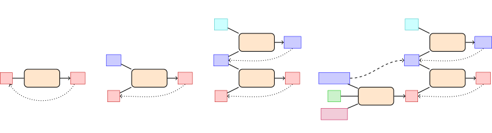
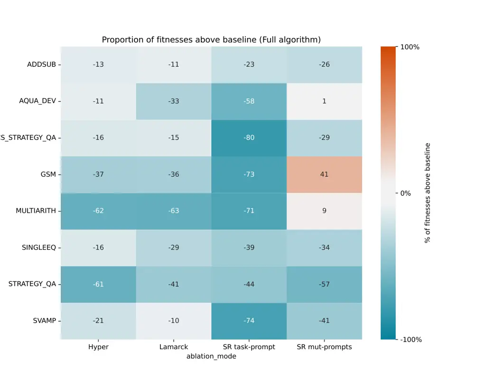

# Promptbreeder: Self-Referential Self-Improvement via Prompt Evolution

Chrisantha Fernando    Dylan Banarse    Henryk Michalewski    Simon
Osindero    Tim Rocktäschel Affiliation: Google DeepMind
Email: [{chrisantha,dylski,henrykm,osindero,rocktaschel}@google.com](mailto:)

###### Abstract

Popular prompt strategies like Chain-of-Thought Prompting can
dramatically improve the reasoning abilities of Large Language Models
(LLMs) in various domains. However, such hand-crafted prompt-strategies
are often sub-optimal. In this paper, we present Promptbreeder, a
general-purpose self-referential self-improvement mechanism that evolves
and adapts prompts for a given domain. Driven by an LLM, Promptbreeder
mutates a population of task-prompts, evaluates them for fitness on a
training set, and repeats this process over multiple generations to
evolve task-prompts. Crucially, the mutation of these task-prompts is
governed by mutation-prompts that the LLM generates and improves
throughout evolution in a self-referential way. That is, Promptbreeder
is not just improving task-prompts, but it is also improving the
mutation-prompts that improve these task-prompts. Promptbreeder
outperforms state-of-the-art prompt strategies such as Chain-of-Thought
and Plan-and-Solve Prompting on commonly used arithmetic and commonsense
reasoning benchmarks. Furthermore, Promptbreeder is able to evolve
intricate task-prompts for the challenging problem of hate speech
classification.

|     |
| --- |
|     |

## 1 Introduction

Prompting is central to the downstream performance of foundation models.
For example, different prompt strategies¹¹ 1 See Appendix A for
definitions of terminology. can have a significant impact on a model’s
reasoning abilities (Wei et al., 2022; Nye et al., 2021; Zhou et al.,
2022; Wang et al., 2022; Zhou et al., 2023; Wang et al., 2023b),
multi-modal processing abilities (Yang et al., 2023b; Wang et al.,
2023d), or tool use abilities (Yao et al., 2022; Schick et al., 2023).
Furthermore, prompting can improve model distillation (Wang et al.,
2023c; Hsieh et al., 2023) and it can be used to simulate agentic
behavior (Wang et al., 2023a; Park et al., 2023; Wu et al., 2023).
However, these prompt strategies are manually engineered. Since the
specific way a prompt is phrased can have a dramatic effect on its
utility (Madaan & Yazdanbakhsh, 2022), it raises the question of whether
prompt engineering can be automated. Automatic Prompt Engineer (Zhou
et al., 2023, APE,) attempts to address this by generating an initial
distribution of prompts using another prompt that infers the problem
from a number of input-output examples from the dataset. However, Zhou
et al. found “diminishing returns to further selection rounds as the
quality seems to stabilize after three rounds”, and consequently
abandoned the use of an iterative APE. We propose a solution to the
problem of diminishing returns via a diversity maintaining evolutionary
algorithm for self-referential self-improvement of prompts for LLMs.

Schmidhuber (1990) notes that the “program of a neural network is its
weight matrix”. Consequently, this “program” can be changed in a
self-referential way by the neural network itself (Schmidhuber, 1993;
Irie et al., 2022). Such a neural network that improves itself, as well
as improving the way it improves itself, might be an important stepping
stone towards open-ended self-referential self-improvement of
AIs (Schmidhuber, 2003). However, self-improvement via self-referential
weight matrices is costly as it requires additional parameters that
modify all of the model’s parameters. Since behaviors and capabilities
of LLMs are significantly influenced by the prompts that we provide to
them, we can similarly think of prompts as the program of an LLM (Zhou
et al., 2023). In this view, changing a prompt strategy such as the
Scratchpad method (Nye et al., 2021) or Chain-of-Thought Prompting (Wei
et al., 2022) corresponds to changing the “program” of the LLM. Taking
this analogy further, we can use the LLM itself to change its prompts,
as well as the way it changes these prompts, moving us towards a fully
self-referential self-improving systems grounded in LLMs.

|           |            |                  |              |            |          |         |        |        |          |        |
| --------- | ---------- | ---------------- | ------------ | ---------- | -------- | ------- | ------ | ------ | -------- | ------ |
|           | Method     | LLM              | MultiArith\* | SingleEq\* | AddSub\* | SVAMP\* | SQA    | CSQA   | AQuA-RAT | GSM8K  |
| Zero-shot | CoT        | text-davinci-003 | (83.8)       | (88.1)     | (85.3)   | (69.9)  | (63.8) | (65.2) | (38.9)   | (56.4) |
|           | PoT        | text-davinci-003 | (92.2)       | (91.7)     | (85.1)   | (70.8)  | –      | –      | (43.9)   | (57.0) |
|           | PS         | text-davinci-003 | (87.2)       | (89.2)     | (88.1)   | (72.0)  | –      | –      | (42.5)   | (58.2) |
|           | PS+        | text-davinci-003 | (91.8)       | (94.7)     | (92.2)   | (75.7)  | (65.4) | (71.9) | (46.0)   | (59.3) |
|           | PS         | PaLM 2-L         | 97.7         | 90.6       | 72.4     | 83.8    | 50.0   | 77.9   | 40.2     | 59.0   |
|           | PS+        | PaLM 2-L         | 92.5         | 94.7       | 74.4     | 86.3    | 50.1   | 73.3   | 39.4     | 60.5   |
|           | APE        | PaLM 2-L         | 95.8         | 82.2       | 72.2     | 73.0    | 38.4   | 67.3   | 45.7     | 77.9   |
|           | OPRO       | PaLM 2-L         | –            | –          | –        | –       | –      | –      | –        | 80.2   |
|           | PB (ours)  | PaLM 2-L         | 99.7         | 96.4       | 87.8     | 90.2    | 71.8   | 85.4   | 62.2     | 83.9   |
| Few-      | Manual-CoT | text-davinci-003 | (93.6)       | (93.5)     | (91.6)   | (80.3)  | (71.2) | (78.3) | (48.4)   | (58.4) |
|           | Auto-CoT   | text-davinci-003 | (95.5)       | (92.1)     | (90.8)   | (78.1)  | –      | –      | (41.7)   | (57.1) |
|           | PB (ours)  | PaLM 2-L         | 100.0        | 98.9       | 87.1     | 93.7    | 80.2   | 85.9   | 64.6     | 83.5   |

Table 1: Promptbreeder (PB) comparison to Chain-of-Thought (Wei et al.,
2022, Manual-CoT,), Zero-shot CoT (Kojima et al., 2022),
Program-of-Thoughts (Chen et al., 2022, PoT,), Auto-CoT (Zhang et al.,
2023b), OPRO (Yang et al., 2023a), Automatic Prompt Engineer Zero-shot
prompt (Zhou et al., 2023, APE,), Plan-and-Solve with (PS+) and without
the improved prompt (Wang et al., 2023b, PS,) and using PaLM 2-L (Anil
et al., 2023) as the underlying LLM (APE,
PS$`{}_{\textbf{PaLM 2-L}}`$/PS+$`{}_{\textbf{PaLM 2-L}}`$). Best
results in both the zero-shot and few-shot categories are highlighted in
bold. Results in brackets are directly taken from the Plan-and-Solve
paper which uses text-davinci-003  (Brown et al., 2020). For datasets
with astericks (MultiArith\*, SingleEq\*, AddSub\*, and SVAMP\*), we
randomly took half of the examples for training and report accuracy on
the remaining test set. See Section 4 and Appendix I for details on the
prompts and datasets.

In this paper, we introduce Promptbreeder (PB) for self-referential
self-improvement of LLMs. Given a seed set of mutation-prompts (i.e.
instructions to modify a task-prompt), thinking-styles (i.e. text
descriptions of general cognitive heuristics), and a domain-specific
problem description, PB generates variations of the task-prompts and
mutation-prompts, exploiting the fact that LLMs can be prompted to act
as mutation operators (Meyerson et al., 2023). Based on the fitness of
the evolved task-prompts as measured on the training set, we select a
subset of evolutionary units consisting of task-prompts and their
associated mutation-prompt, to transmit to future generations. Over
multiple generations of PB, we observe prompts adapting to the domain at
hand. For example, in a mathematical domain, PB evolved the task-prompt
"Show all your working. II. You should use the correct mathematical
notation and vocabulary, where appropriate. III. You should write your
answer in full sentences and in words. IV. You should use examples to
illustrate your points and prove your answers. V. Your workings out
should be neat and legible" on GSM8K (see Appendix J). On a wide range
of commonly used benchmarks spanning commonsense reasoning, arithmetic,
and ethics, we find that PB outperforms state-of-the-art methods like
Chain-of-Thought (Wei et al., 2022) and Plan-and-Solve (Wang et al.,
2023b) prompting. As PB does not require any parameter updates for
self-referential self-improvement, we believe this approach points to an
interesting future where larger and more capable LLMs could further
amplify the gains of our approach.

In summary, this paper makes the following main contributions: (i) we
introduce Promptbreeder, a self-referential self-improvement method for
LLMs that evolves prompts for a domain at hand, as well as improves the
way it is evolving these prompts, (ii) we report improvements over
state-of-the-art prompt strategies on a wide range of commonly used
arithemic and commonsense reasoning benchmarks, and (iii) we investigate
the various self-referential components of Promptbreeder and their
contribution to our results.

Figure 1: Overview of Promptbreeder. Given a problem description and an
initial set of general “thinking-styles” and mutation-prompts,
Promptbreeder generates a population of units of evolution, each unit
consisting of typically two task-prompts and a mutation-prompt. We then
run a standard binary tournament genetic algorithm (Harvey, 2011). To
determine the fitness of a task-prompt we evaluate its performance on a
random batch of training data. Over multiple generations, Promptbreeder
subsequently mutates task-prompts as well as mutation-prompts using five
different classes of mutation operators. The former leads to
increasingly domain-adaptive task-prompts whereas the latter evolves
increasingly useful mutation-prompts in a self-referential way.

## 2 Related Work

Prompting an LLM in the right way is essential to its downstream
performance (Moradi & Samwald, 2021; Madaan & Yazdanbakhsh, 2022; Zhou
et al., 2023). Indeed, even the order in which prompts are presented can
heavily influence LLM performance (Lu et al., 2022). A number of recent
works have focused on devising better prompt strategies, or even
automating such prompt engineering.

Prompting: Chain-of-Thought Prompting (Wei et al., 2022, CoT,) is a
popular prompt strategy which provides intermediate reasoning steps as
few-shot prompts to an LLM, thereby significantly improving its
arithmetic, commonsense, and symbolic reasoning abilities. Notably, the
gains of CoT are more pronounced for stronger LLMs. This is intriguing,
as it points to the possibility of increasingly capable (and potentially
open-ended) self-improving mechanisms on top of adept LLMs—a hypothesis
that Promptbreeder directly builds upon. Instead of few-shot CoT
prompting, Kojima et al. (2022) demonstrate that LLMs can also be
prompted zero-shot (e.g. "Let’s think step by step") to produce their
own chains of thoughts (Zero-shot CoT) that improve reasoning abilities.
Self-Consistency (Wang et al., 2022, CoT-SC,) extends CoT by sampling a
diverse set of workings out and selecting the most consistent answer.
Tree of Thoughts (Yao et al., 2023, ToT,) generalizes CoT to multiple
workings out that can be expanded or backtracked from. Graph of
Thoughts (Besta et al., 2023, GoT,) is a further generalization to
arbitrary graph structures. Plan-and-Solve Prompting (Wang et al.,
2023b, PS,) encourages an LLM to first devise a plan to solve a problem
before attempting to solve it. Similarly, Least-to-Most Prompting (Zhou
et al., 2022) encourages an LLM to decompose a problem into subparts,
and then to solve each part individually before synthesizing an answer.
Self-Refine (Madaan et al., 2023) prompts an LLM to generate a response,
to provide feedback on the response, and to finally refine the solution.

In contrast to gradient-free approaches above, Soft Prompting
approaches (Liu et al., 2021; Qin & Eisner, 2021; Lester et al., 2021,
e.g.,) directly fine-tune continuous prompt representations. Huang
et al. (2022) use CoT and CoT-SC on an unlabelled dataset of questions,
and subsequently fine-tune an LLM based on generated solutions.
Similarly, Zelikman et al. (2022) uses CoT to generate rationales and
fine-tunes the LLM based on those examples and rationales that yielded
the correct answer. However, as argued by Zhou et al. (2023), any
approach that updates all or a portion of LLM parameters will not scale
as models get bigger and, moreover, will not work with the increasing
number of LLMs hidden behind an API.

All of the prompt engineering approaches above are domain agnostic but
hand designed. Central to our work is the hypothesis that we could do
better by employing an automated self-improvement process that can adapt
prompts to a domain at hand. Auto-CoT (Zhang et al., 2023b) and
Automatic-CoT (Shum et al., 2023) automatically find reasoning chains
for Few-Shot CoT. Automatic Prompt Engineer (Zhou et al., 2023, APE,)
uses one generator-prompt to generate prompt candidates, and another
mutation-prompt to mutate them. In contrast to APE, our work performs
compositional task-specific initialization of mutation-prompts,
subsequent online mutation of mutation-prompts, uses special mutation
operators that take into account the whole population and elite history,
and uses diversity-maintenance methods—all of which help avoid the
problem of diminishing returns and diversity loss suffered by APE.

Concurrently to our work, Yang et al. (2023a) developed Optimization by
PROmpting (OPRO), a prompt optimization method that varies prompts using
a single complex mutation prompt, and evaluates newly generated prompts
on a small fixed training set of problems. In contrast, Promptbreeder
autonomously evolves multiple LLM generated mutation-prompts as well as
task-prompts, and evaluates fitness on random subsets from the whole
training set during evolution. At the time of its release, OPRO achieved
a score of 80.2% via the optimized zero-shot prompt "Take a deep breath
and work on this problem step-by-step" on GSM8K. Promptbreeder surpasses
this with 83.9% in the zero-shot setting with the unintuitively simple
prompt "SOLUTION""—further evidence for the sensitivity of LLMs to
prompts and the importance on finding effective prompts automatically.
Also concurrently to our work, Guo et al. (2023) developed EvoPrompt,
which uses a fixed mutation (and crossover) prompt, as well as a prompt
that asks for a mutant of the difference between two parent prompts, to
produce offspring prompts. EvoPrompt is initialized with a whole
population of initial hand-designed task tailored prompts rather than a
single problem description as we do. In contrast to the two approaches
above, Promptbreeder uses LLMs to self-referentially improve
mutation-prompts, and it is able to evolve contexts as well.

Self-Referential Self-Improvement: Developing an open-ended system that
can improve itself as well as improving the way it is improving
itself (Schmidhuber, 1993; Schmidhuber, 2003) is a long-standing open
problem in AI research. Schmidhuber (1993) introduced an “introspective”
neural network with a self-referential weight matrix that can modify its
own weights and, thus, also modify those weights that are governing how
its own weights are modified. Recently, Irie et al. (2022) proposed a
more scalable self-referential weight matrix taking inspiration from
fast weight programmers (Schmidhuber, 1992). Kirsch & Schmidhuber (2022)
propose a self-referential meta-learning approach, combining
self-referential weight matrices with ideas from Gödel
Machines (Schmidhuber, 2003), i.e., to allocate more computational
resources to better performing solutions. However, since these
approaches directly modify parameters of a model, it is unclear how to
scale them to the increasing number of parameters in modern LLMs. In
contrast, for Promptbreeder the substrate of self-referential
self-improvement is natural language, avoiding costly parameter updates
altogether.

Open-Endedness and LLMs: Promptbreeder makes use of the observation by
Lehman et al. (2022), Meyerson et al. (2023) and Chen et al. (2023) that
LLMs are effective at generating mutations from examples. In addition,
LLMs encode human notions of interestingness and can be used to
automatically quantify novelty (Zhang et al., 2023a). Promptbreeder is
related to Picbreeder (Secretan et al., 2008), an open-ended
human-in-the-loop system that evolves increasingly interesting images.
While Picbreeder explores the space of images, Promptbreeder explores
the space of prompts and does so without humans in the loop. As
Promptbreeder is proposing mutated prompts to itself, it is an example
of a system transitioning from “learning from data” to “learning what
data to learn from” (Jiang et al., 2022).

## 3 Promptbreeder

We introduce Promptbreeder, a prompt evolution system that can
automatically explore prompts for a given domain and that is able to
find task-prompts that improve an LLM’s ability to derive answers to
questions in that domain. Promptbreeder is general purpose in that the
same system is able to adapt to many different domains.

Promptbreeder makes use of the observation that LLMs can be used to
generate variations of input text (Lehman et al., 2022; Meyerson et al.,
2023; Chen et al., 2023). Figure 1 gives an overview of our method. We
are interested in evolving task-prompts. A task-prompt $`P`$ is a string
used to condition the context of an LLM in advance of some further input
$`Q`$, intended to ensure a better response than if $`Q`$ had been
presented in the absence of $`P`$. To evaluate the fitness of each
evolved task-prompt, we sample a batch of 100 Q&A pairs from the entire
training set of the domain at hand.²² 2 Our prompt strategy sequentially
applies two task-prompts. The first task-prompt + question produces a
continuation. The continuation + second task-prompt produces the final
answer.

Promptbreeder generates task-prompts according to an evolutionary
algorithm. The mutation operator for this algorithm is itself an LLM,
conditioned on a mutation-prompt $`M`$. That is, a mutated task prompt
$`P^{\prime}`$ is defined by $`P^{\prime}=\LLM(M+P)`$ where ‘$`+`$‘
corresponds to string concatenation. A variety of such mutation-prompts
are described in Section 3.2.

Promptbreeder’s main self-referential mechanism stems from applying the
evolutionary algorithm not just to task-prompts but also to
mutation-prompts. The mutation operator for this meta-level algorithm is
again an LLM, now conditioned on a hyper-mutation prompt $`H`$. That is,
we obtain a mutated mutation-prompt $`M^{\prime}`$ via
$`M^{\prime}=\LLM(H+M)`$.

Given a set of “thinking styles” $`\mathcal{T}`$ and a set of initial
mutation-prompts $`\mathcal{M}`$, as well as a domain-specific problem
description $`D`$, Promptbreeder initializes a population of mutated
task-prompts (see Section 3.1). To clarify, a unit of evolution consists
of a set of task-prompts, a mutation-prompt and in the few-shot case, a
set of correct workings out (i.e. step-by-step or “chains-of-thought”
reasoning steps that led to the correct answer). This means task-prompts
and mutation-prompts are in 1:1 correspondence. To evolve this
population, we employ a binary tournament genetic algorithm framework
(Harvey, 2011): we sample two individuals from the population, we take
the individual with the higher fitness, mutate it (see next section) and
overwrite the loser with the mutated copy of the winner.

### 3.1 Promptbreeder Initialization

To give a concrete example, consider the initialization steps used to
produce the task-prompts and mutation-prompts for GSM8K (a ‘grade school
maths’ word problem dataset). The problem description is "Solve the math
word problem, giving your answer as an arabic numeral". Because
Plan-and-Solve (Wang et al., 2023b) uses two task-prompts we also evolve
two task-prompts (plus a mutation-prompt) per unit of evolution. In
order to promote diversity in the initial prompts, we generate the
initial task-prompts by concatenating (for each task-prompt) a randomly
drawn ‘mutation-prompt’ (e.g. "Make a variant of the prompt.") and a
randomly drawn ‘thinking-style’ (e.g. "Let’s think step by step") to the
problem description, and provide that to the LLM to produce a
continuation, resulting in an initial task-prompt. We do this twice to
produce the two initial task-prompts per unit. Both the mutation-prompt
and the thinking-style are randomly sampled from an initial set of
mutation-prompts and a set of thinking-styles (see Appendices C, D and G
for the full sets). The mutation-prompt is added to the unit of
evolution and so is associated with its specific task-prompt throughout
the evolutionary run.

For the example above, the complete input string to the LLM to make an
initial task-prompt could be "Make a variant of the prompt. Let’s think
step by step. INSTRUCTION: Solve the math word problem, giving your
answer as an arabic numeral. INSTRUCTION MUTANT:". Note how the control
strings "INSTRUCTION" and "INSTRUCTION MUTANT" are added to encourage an
appropriate continuation. Table 4 in Appendix E shows examples of the
initial prompts generated in this way.

### 3.2 Mutation Operators

As shown in Figure 1, there are nine operators falling into five broad
classes which drive the exploration of prompt strategies. For each
replication event only one of nine mutation operators is applied (we
sample with uniform probability over the nine operators to decide which
mutation operator to apply). The rationale for using this diverse set of
operators is to enable the LLM to explore a large space of cognitive
methods of linguistic self-questioning, by repeatedly changing the
framing of the problem as well as retrieving mental models expressed in
natural language that can help tackle a given reasoning challenge.
Investigations from insight learning strongly suggest that diverse
representational re-description is key to problem solving (Öllinger &
Knoblich, 2009)—a principle that we attempt to recreate via
self-referential self-improvement with natural language as the
substrate. Figure 2 illustrates in what way Promptbreeder is
self-referential (see Appendix F for a more detailed explanation).

#### 3.2.1 Direct Mutation

The simplest class of mutation operators directly generate a new
task-prompt $`P^{\prime}`$ from either one existing task-prompt $`P`$
(first-order prompt generation) or from a general prompt that encourages
free-form generation of new task-prompts–i.e. not using an existing
parent, thus zero-order prompt generation.

Zero-order Prompt Generation: We generate a new task-prompt by
concatenating the problem description $`D`$ (e.g. "Solve the math word
problem, giving your answer as an arabic numeral") with the prompt "A
list of 100 hints:", which invites the LLM to come up with a new hint
that could help solve a problem in the given problem domain. We extract
the first generated hint as the new task-prompt. Crucially, this new
task-prompt does not depend on any previously found task-prompt.
Instead, it is re-generated from the problem description each time. Our
rationale for including this zero-order operator is that where prompt
evolution diverges, this operator allows us to generate new task-prompts
closely related to the original problem description, similar to uniform
re-sampling in automated curriculum learning approaches (Jiang et al.,
2021b; Jiang et al., 2021a; Park et al., 2023; Parker-Holder et al.,
2022).

First-order Prompt Generation: We concatenate the mutation-prompt (red),
to the parent task-prompt (blue), and pass it to the LLM to produce the
mutated task-prompt. For example "Say that instruction again in another
way. DON’T use any of the words in the original instruction there’s a
good chap. INSTRUCTION: Solve the math word problem, giving your answer
as an arabic numeral. INSTRUCTION MUTANT: ". This procedure is identical
to the initialization method, except that a randomly sampled
thinking-style string is not used. First-order prompt generation is
Promptbreeder’s standard asexual mutation operator, and it is the core
of every genetic algorithm—taking one parental genotype (task-prompt)
and applying the mutation to it (in this case influenced by the
mutation-prompt).

#### 3.2.2 Estimation of Distribution Mutation

The next class of mutation operators condition not just on zero or one
parent, but instead on a set of parents. As such, they may be more
expressive by considering patterns in the population.

Estimation of Distribution (EDA) Mutation: Inspired by Hauschild &
Pelikan (2011), we provide a filtered and numbered list of the current
population of task-prompts to the LLM and ask it to continue this list
with new task-prompts. We filter the population of prompts on the basis
of BERT (Devlin et al., 2019) embedding cosine similarities between each
other—an individual is not included in the list if it is more than
$`0.95`$ similar to any other entry in the list, thus encouraging
diversity (cf. quality-diversity methods (Lehman & Stanley, 2011b;
Lehman & Stanley, 2011a; Mouret & Clune, 2015)). The prompts are listed
in random order and we do not give the LLM access to the fitness values
of individuals in the population---we found in preliminary experiments
that the LLM did not understand these fitness values³³ 3 This is
contrary to recent findings by Mirchandani et al. (2023). We leave it
for future work to revisit whether LLMs can interpret fitness values for
improved prompt evolution. and resorted to generating copies of entries
in the list.

EDA Rank and Index Mutation: This is a variant of the above in which
task-prompts are listed in fitness order. Preliminary experiments showed
that the LLM is more likely to generate entries that are similar to the
elements appearing later in the list. This is in line with similar
findings of recency effects in LLMs (Liu et al., 2023). Therefore, after
filtering in the same way as before, we ordered the task-prompts in the
population by ascending order of fitness. The top of the list is
prefixed by the following prompt: "INSTRUCTION: " +
\<\<mutation-prompt\>\> + "\n A List of Responses in descending order of
score." + \<\<last index + 1\>\> + "is the best response. It
resembles" + \<\< last index\>\> + "more than it does (1)". Note that we
have ‘lied’ to the LLM by telling it that the order is descending. This
is because otherwise it is too biased towards producing a new entry that
is too similar to the final entry. The contradiction between the
ascending ordering and the statement that it is a descending ordering
appears to improve the diversity of sampling. The rationale for this
operator is again to represent the current distribution in such a way
that high fitness and yet diverse extrapolations are suggested by the
LLM.



Figure 2: Overview of multiple variants of self-referential prompt
evolution. In (a), the LLM is directly used to generate variations
$`P^{\prime}`$ of a prompt strategy $`P`$ (Meyerson et al., 2023, cf.).
Using a mutation prompt $`M`$, we can explicitly prompt an LLM to
produce variations (b). By using a hyper mutation prompt $`H`$, we can
also evolve the mutation prompt itself, turning the system into a
self-referential one (c). Promptbreeder (d) improves the diversity of
evolved prompts and mutation prompts by generating an initial population
of prompt strategies from a set of seed thinking-styles $`\mathcal{T}`$,
mutation-prompts $`\mathcal{M}`$, as well as a high level description
$`D`$ of the problem domain.

Lineage Based Mutation: For each unit of evolution, we store a history
of the individuals in its lineage that were the best in the population,
i.e., a historical chronological list of elites. This list is provided
to the LLM in chronological order (not filtered by diversity), with the
heading "GENOTYPES FOUND IN ASCENDING ORDER OF QUALITY" to produce a
novel prompt as continuation. The rationale for this operator is that we
expect the signal of improving genotype prompts may be stronger than the
signal from prompts in the current population since they provide a
gradient of bad to good prompts that could be followed (assuming this
signal can be used by the LLM).

#### 3.2.3 Hypermutation: Mutation of Mutation-Prompts

While the mutation operators above might already explore diverse
task-prompts, a self-improving system should ideally also improve the
way it is improving itself in a self-referential way. Our third class of
mutation operators includes hyper-mutation operators concerned with the
evolution of evolvability (Dawkins, 2003; Pigliucci, 2008; Payne &
Wagner, 2019; Gajewski et al., 2019)---those which modify the
search/exploration process rather than the task reward obtaining process
directly.⁴⁴ 4 This is similar to population based training (Jaderberg
et al., 2017a)—instead of applying it to hyperparameters such as
learning rates, it applies to the mutation-prompts of Promptbreeder.

Zero-order Hyper-Mutation: We concatenate the original problem
description to a randomly sampled thinking-style, and feed it to the LLM
to generate a new mutation-prompt. The resulting mutation-prompt is
applied to a task-prompt to make a variant of the task-prompt as in
First-order Prompt Generation (see Section 3.2.1). Note that this
zero-order meta-mutation operator is identical to that used during
initialization. The rationale for this operator is to generate mutation
operators in a way similar to initialization, while also bringing in
knowledge from the set of thinking styles.

First-order Hyper-Mutation: We concatenate the hyper-mutation-prompt
"Please summarize and improve the following instruction:" to a
mutation-prompt so that the LLM generates a new mutation-prompt. This
newly generated mutation-prompt is then applied to the task-prompt of
that unit (see First-Order Prompt Generation in Section 3.2.1). In this
way, we can evaluate the influence of the hyper-mutation via its newly
generated mutation-prompt on the quality of the evolved downstream
task-prompt at once.

#### 3.2.4 Lamarckian Mutation

For this class of mutation operators we mimic a Lamarckian process. We
want to use a successful phenotype (i.e. the concrete working out used
to produce correct answers induced by an evolved task-prompt) to
generate a new genotype (i.e. a mutant task-prompt). Several processes
of this form have appeared in the literature of LLMs, e.g.
STaR (Zelikman et al., 2022), APO (Pryzant et al., 2023), and APE (Zhou
et al., 2023).

Working Out to Task-Prompt: This is a ‘Lamarckian’ mutation operator
similar to instruction induction in APE. We give an LLM a previously
generated working out that led to a correct answer via the following
prompt: "I gave a friend an instruction and some advice. Here are the
correct examples of his workings out + \<\<correct working out\>\> + The
instruction was:". This is effectively reverse-engineering the
task-prompt from a given working out. An effective example of this is
shown in Appendix H. This kind of operator is critical when the problem
description is absent, insufficient, or misleading.

#### 3.2.5 Prompt Crossover and Context Shuffling

Our last class of mutation operators are crossover operators and
operators for shuffling the few-shot context examples present in the
units of evolution.

Prompt Crossover: After a mutation operator is applied, with 10% chance
a task-prompt is replaced with a randomly chosen task-prompt from
another member of the population. This member is chosen according to
fitness proportionate selection. Crossover is not applied to
mutation-prompts, only to the task-prompts.

Context Shuffling: Promptbreeder can simultaneously evolve the
task-prompts, mutation-prompts and the set of correct workings out known
as the few-shot context. To achieve the later, we fill up a few-shot
context with only workings out that led to correct answers. During
evaluation we provide this few shot-context before the task-prompt,
providing guidance as to the form of the working out that is desired. If
the few-shot context list is full, a single randomly sampled new correct
working out replaces an existing working out from the list after fitness
evaluation of a unit on a new set of questions. In addition, with a 10%
chance we resample the whole context list with probability inverse to
the maximum context list length.

## 4 Experiments

We used a population size of 50 units, evolved for typically 20-30
generations, where a generation involves forming random pairs of all
individuals in the population and competing them against each other. To
evaluate Promptbreeder, we use the datasets from state-of-the-art prompt
strategies such as Plan-and-Solve, spanning _arithmetic reasoning_ with
GSM8K (Cobbe et al., 2021), SVAMP (Patel et al., 2021), MultiArith (Roy
& Roth, 2016), AddSub (Hosseini et al., 2014), AQuA-RAT (Ling et al.,
2017), and SingleEq (Koncel-Kedziorski et al., 2015), _commonsense
reasoning_ with CommonsenseQA (Talmor et al., 2019, CSQA,) and
StrategyQA (Geva et al., 2021, SQA,), _instruction induction_ tasks
from (Honovich et al., 2023), and _hate speech classification_ on the
ETHOS dataset (Mollas et al., 2022). See Appendix I for details.

## 5 Results and Discussion

We present results of Promptbreeder (PB) in comparison to
state-of-the-art prompt strategies on a range of commonly used reasoning
benchmarks in Table 1. PB outperforms PS+, the best Plan-and-Solve (Wang
et al., 2023b) prompting technique. Note that the performance of PS+ is
improved by using PaLM 2-L (Anil et al., 2023) as the underlying LLM
(PS+$`{}_{\textbf{PaLM 2-L}}`$) on all datasets except ADDSUB compared
to text-davinci-003 results in the original paper. On all other
datasets, zero-shot PB accuracy is higher than PS+, with further
improvement in the few-shot case when examples of discovered solutions
are included with the prompts. In Table 6 in Appendix J, we show the
best evolved zero-shot prompts. The best few-shot candidates are shown
in Section J.5 onwards. Appendix K shows few-shot results and their
controls on the Instruction Induction tasks from the APE paper. To
investigate the ability of Promptbreeder to evolve complex
domain-specific prompts for a downstream task, we applied it to the
ETHOS Hate Speech Classification problem (Mollas et al., 2022).
Promptbreeder was able to evolve a prompt strategy consisting of two
sequentially applied relatively long prompts (see Section J.1) that
scored 89% on ETHOS—an improvement over the hand-designed prompt
"Determine whether a text contains hate speech" which scores only 80%.
This demonstrates that Promptbreeder is capable of intricate
domain-adaptation to a task at hand. Appendix B shows a typical
evolutionary run and the prompts evolved, showing that unlike iterative
APE, fitness continues to increase throughout the run.

We analysed the best mutation-prompts used during a run for GSM8K.
Table 7 in Section J.3 shows the best evolved mutation prompts according
to their scores (the proportion of times that when the mutation-prompt
was applied to a task-prompt in an unit, a better task-prompt was
produced). Table 8 in Section J.4 shows in descending order, the
percentage of times that the different kinds of mutation operators
resulted in an improvement when applied to a task-prompt in the
population. It demonstrates that all mutation operators are important
for Promptbreeder to work, including hyper-mutation operators which lead
to self-referential self-improvement.

We measured the impact of self-referential operators on all the maths
datasets and the ETHOS dataset. Details of the ablation process and its
results can be found in Appendix L. Removing any self-referential
operator is harmful under nearly all circumstances, the greatest benefit
being the initial re-description of task-prompts upon initialization. We
only found one mutation operator to be harmful for one specific task:
drawing randomly from the set of mutation-prompts upon initialization
hurts performance on GSM8K.

## 6 Conclusion and Future Work

We introduced Promptbreeder (PB), a self-referential self-improving
system that can automatically evolve effective domain-specific prompts
for a domain at hand. PB is self-referential in that it not only evolves
task-prompts, but it also evolves mutation-prompts that govern the way
PB modifies task-prompts. Thus, it is not only improving prompts but it
also improves the way it is improving prompts.

Going forward, it could be interesting to use the LLM itself to assess
and promote the diversity of generated prompts (Zhang et al., 2023a,
see), or to use it to determine the fitness of a whole ‘‘thought
process’’, e.g. an N-prompt strategy where prompts are conditionally
applied rather than unconditionally applied as in Promptbreeder. For
example, a more complex ‘‘thought process’’ is to use PB in self-play
mode to evolve pre-prompts for LLM-based policies that compete with each
other, i.e., in a competitive Socratic⁵⁵ 5
[https://princeton-nlp.github.io/SocraticAI/](https://princeton-nlp.github.io/SocraticAI/)
dialog.

PB remains limited compared to the open-endedness of human thought
processes. First, the topology of prompting remains fixed
(see Figure 2)—we only adapt the prompt content not the prompting
algorithm itself. One interpretation of thought is that it is a
reconfigurable open-ended self-prompting process. If so, how does one
develop complex thought strategies? Clearly it is necessary to generate
and evaluate them, and whilst a simple evolutionary process provides one
framework in which a thought strategy could be evolved, our actual human
experience suggests multiple overlapping hierarchical selective
processes at play. Moreover, in addition to language, human thought
involves intonation, imagery, etc., in a multimodal system.

We believe PB points to an exciting future where increasingly open-ended
self-referential self-improvement systems can directly use language as
the substrate for improvement instead of relying on any parameter
updates. This is intriguing, as this approach will likely continue to
scale with ever larger and more capable LLMs in the future.

#### Acknowledgments

We thank Edward Hughes and Tom Schaul for feedback on an early draft of
the paper. We also thank Tom Schaul, Chengrun Yang, and Denny Zhou for
fruitful discussions, as well as Gavin Buttimore, Simon Green, Keith
Anderson, Joss Moore, Ollie Purkiss, John Quan, and Francesco Visin for
their support in running some of the experiments.

## References

- Anil et al. (2023) Rohan Anil, Andrew M. Dai, Orhan Firat, Melvin
  Johnson, Dmitry Lepikhin, Alexandre Passos, Siamak Shakeri, Emanuel
  Taropa, Paige Bailey, Zhifeng Chen, Eric Chu, Jonathan H. Clark,
  Laurent El Shafey, Yanping Huang, Kathy Meier-Hellstern, Gaurav
  Mishra, Erica Moreira, Mark Omernick, Kevin Robinson, Sebastian Ruder,
  Yi Tay, Kefan Xiao, Yuanzhong Xu, Yujing Zhang, Gustavo Hernandez
  Abrego, Junwhan Ahn, Jacob Austin, Paul Barham, Jan Botha, James
  Bradbury, Siddhartha Brahma, Kevin Brooks, Michele Catasta, Yong
  Cheng, Colin Cherry, Christopher A. Choquette-Choo, Aakanksha
  Chowdhery, Clément Crepy, Shachi Dave, Mostafa Dehghani, Sunipa Dev,
  Jacob Devlin, Mark Díaz, Nan Du, Ethan Dyer, Vlad Feinberg, Fangxiaoyu
  Feng, Vlad Fienber, Markus Freitag, Xavier Garcia, Sebastian Gehrmann,
  Lucas Gonzalez, Guy Gur-Ari, Steven Hand, Hadi Hashemi, Le Hou, Joshua
  Howland, Andrea Hu, Jeffrey Hui, Jeremy Hurwitz, Michael Isard, Abe
  Ittycheriah, Matthew Jagielski, Wenhao Jia, Kathleen Kenealy, Maxim
  Krikun, Sneha Kudugunta, Chang Lan, Katherine Lee, Benjamin Lee, Eric
  Li, Music Li, Wei Li, YaGuang Li, Jian Li, Hyeontaek Lim, Hanzhao Lin,
  Zhongtao Liu, Frederick Liu, Marcello Maggioni, Aroma Mahendru, Joshua
  Maynez, Vedant Misra, Maysam Moussalem, Zachary Nado, John Nham, Eric
  Ni, Andrew Nystrom, Alicia Parrish, Marie Pellat, Martin Polacek, Alex
  Polozov, Reiner Pope, Siyuan Qiao, Emily Reif, Bryan Richter, Parker
  Riley, Alex Castro Ros, Aurko Roy, Brennan Saeta, Rajkumar Samuel,
  Renee Shelby, Ambrose Slone, Daniel Smilkov, David R. So, Daniel Sohn,
  Simon Tokumine, Dasha Valter, Vijay Vasudevan, Kiran Vodrahalli,
  Xuezhi Wang, Pidong Wang, Zirui Wang, Tao Wang, John Wieting, Yuhuai
  Wu, Kelvin Xu, Yunhan Xu, Linting Xue, Pengcheng Yin, Jiahui Yu, Qiao
  Zhang, Steven Zheng, Ce Zheng, Weikang Zhou, Denny Zhou, Slav Petrov,
  and Yonghui Wu. PaLM 2 Technical Report, September 2023.
- Besta et al. (2023) Maciej Besta, Nils Blach, Ales Kubicek, Robert
  Gerstenberger, Lukas Gianinazzi, Joanna Gajda, Tomasz Lehmann, Michal
  Podstawski, Hubert Niewiadomski, Piotr Nyczyk, and Torsten Hoefler.
  Graph of thoughts: Solving elaborate problems with large language
  models. _CoRR_, abs/2308.09687, 2023. doi: 10.48550/arXiv.2308.09687.
  URL
  [https://doi.org/10.48550/arXiv.2308.09687](https://doi.org/10.48550/arXiv.2308.09687).
- Brown et al. (2020) Tom B. Brown, Benjamin Mann, Nick Ryder, Melanie
  Subbiah, Jared Kaplan, Prafulla Dhariwal, Arvind Neelakantan, Pranav
  Shyam, Girish Sastry, Amanda Askell, Sandhini Agarwal, Ariel
  Herbert-Voss, Gretchen Krueger, Tom Henighan, Rewon Child, Aditya
  Ramesh, Daniel M. Ziegler, Jeffrey Wu, Clemens Winter, Christopher
  Hesse, Mark Chen, Eric Sigler, Mateusz Litwin, Scott Gray, Benjamin
  Chess, Jack Clark, Christopher Berner, Sam McCandlish, Alec Radford,
  Ilya Sutskever, and Dario Amodei. Language models are few-shot
  learners. In Hugo Larochelle, Marc’Aurelio Ranzato, Raia Hadsell,
  Maria-Florina Balcan, and Hsuan-Tien Lin (eds.), _Advances in Neural
  Information Processing Systems 33: Annual Conference on Neural
  Information Processing Systems 2020, NeurIPS 2020, December 6-12,
  2020, virtual_, 2020. URL
  [https://proceedings.neurips.cc/paper/2020/hash/1457c0d6bfcb4967418bfb8ac142f64a-Abstract.html](https://proceedings.neurips.cc/paper/2020/hash/1457c0d6bfcb4967418bfb8ac142f64a-Abstract.html).
- Chen et al. (2023) Angelica Chen, David M. Dohan, and David R. So.
  Evoprompting: Language models for code-level neural architecture
  search. _CoRR_, abs/2302.14838, 2023. doi: 10.48550/arXiv.2302.14838.
  URL
  [https://doi.org/10.48550/arXiv.2302.14838](https://doi.org/10.48550/arXiv.2302.14838).
- Chen et al. (2022) Wenhu Chen, Xueguang Ma, Xinyi Wang, and William W.
  Cohen. Program of Thoughts Prompting: Disentangling Computation from
  Reasoning for Numerical Reasoning Tasks, November 2022.
- Cobbe et al. (2021) Karl Cobbe, Vineet Kosaraju, Mohammad Bavarian,
  Mark Chen, Heewoo Jun, Lukasz Kaiser, Matthias Plappert, Jerry Tworek,
  Jacob Hilton, Reiichiro Nakano, Christopher Hesse, and John Schulman.
  Training verifiers to solve math word problems. _CoRR_,
  abs/2110.14168, 2021. URL
  [https://arxiv.org/abs/2110.14168](https://arxiv.org/abs/2110.14168).
- Dawkins (2003) Richard Dawkins. 13 - The evolution of evolvability. In
  Sanjeev Kumar and Peter J. Bentley (eds.), _On Growth, Form and
  Computers_, pp. 239–255. Academic Press, London, January 2003. ISBN
  978-0-12-428765-5. doi: 10.1016/B978-012428765-5/50046-3.
- Devlin et al. (2019) Jacob Devlin, Ming-Wei Chang, Kenton Lee, and
  Kristina Toutanova. BERT: pre-training of deep bidirectional
  transformers for language understanding. In Jill Burstein, Christy
  Doran, and Thamar Solorio (eds.), _Proceedings of the 2019 Conference
  of the North American Chapter of the Association for Computational
  Linguistics: Human Language Technologies, NAACL-HLT 2019, Minneapolis,
  MN, USA, June 2-7, 2019, Volume 1 (Long and Short Papers)_, pp.
  4171–4186. Association for Computational Linguistics, 2019. doi:
  10.18653/v1/n19-1423. URL
  [https://doi.org/10.18653/v1/n19-1423](https://doi.org/10.18653/v1/n19-1423).
- Gajewski et al. (2019) Alexander Gajewski, Jeff Clune, Kenneth O.
  Stanley, and Joel Lehman. Evolvability ES: scalable and direct
  optimization of evolvability. In Anne Auger and Thomas Stützle (eds.),
  _Proceedings of the Genetic and Evolutionary Computation Conference,
  GECCO 2019, Prague, Czech Republic, July 13-17, 2019_, pp. 107–115.
  ACM, 2019. doi: 10.1145/3321707.3321876. URL
  [https://doi.org/10.1145/3321707.3321876](https://doi.org/10.1145/3321707.3321876).
- Geva et al. (2021) Mor Geva, Daniel Khashabi, Elad Segal, Tushar Khot,
  Dan Roth, and Jonathan Berant. Did aristotle use a laptop? A question
  answering benchmark with implicit reasoning strategies. _Trans. Assoc.
  Comput. Linguistics_, 9:346–361, 2021. doi: 10.1162/tacl\\a\\00370.
  URL
  [https://doi.org/10.1162/tacl_a_00370](https://doi.org/10.1162/tacl_a_00370).
- Guo et al. (2023) Qingyan Guo, Rui Wang, Junliang Guo, Bei Li, Kaitao
  Song, Xu Tan, Guoqing Liu, Jiang Bian, and Yujiu Yang. Connecting
  Large Language Models with Evolutionary Algorithms Yields Powerful
  Prompt Optimizers, September 2023.
- Harvey (2011) Inman Harvey. The microbial genetic algorithm. In
  _Advances in Artificial Life. Darwin Meets von Neumann: 10th European
  Conference, ECAL 2009, Budapest, Hungary, September 13-16, 2009,
  Revised Selected Papers, Part II 10_, pp. 126–133. Springer, 2011.
- Hauschild & Pelikan (2011) Mark Hauschild and Martin Pelikan. An
  introduction and survey of estimation of distribution algorithms.
  _Swarm and evolutionary computation_, 1(3):111–128, 2011.
- Honovich et al. (2023) Or Honovich, Uri Shaham, Samuel R. Bowman, and
  Omer Levy. Instruction induction: From few examples to natural
  language task descriptions. In Anna Rogers, Jordan L. Boyd-Graber, and
  Naoaki Okazaki (eds.), _Proceedings of the 61st Annual Meeting of the
  Association for Computational Linguistics (Volume 1: Long Papers), ACL
  2023, Toronto, Canada, July 9-14, 2023_, pp. 1935–1952. Association
  for Computational Linguistics, 2023. doi:
  10.18653/v1/2023.acl-long.108. URL
  [https://doi.org/10.18653/v1/2023.acl-long.108](https://doi.org/10.18653/v1/2023.acl-long.108).
- Hosseini et al. (2014) Mohammad Javad Hosseini, Hannaneh Hajishirzi,
  Oren Etzioni, and Nate Kushman. Learning to solve arithmetic word
  problems with verb categorization. In _Proceedings of the 2014
  Conference on Empirical Methods in Natural Language Processing
  (EMNLP)_, pp. 523–533, Doha, Qatar, October 2014. Association for
  Computational Linguistics. doi: 10.3115/v1/D14-1058. URL
  [https://aclanthology.org/D14-1058](https://aclanthology.org/D14-1058).
- Hsieh et al. (2023) Cheng-Yu Hsieh, Chun-Liang Li, Chih-Kuan Yeh,
  Hootan Nakhost, Yasuhisa Fujii, Alex Ratner, Ranjay Krishna, Chen-Yu
  Lee, and Tomas Pfister. Distilling step-by-step! outperforming larger
  language models with less training data and smaller model sizes. In
  Anna Rogers, Jordan L. Boyd-Graber, and Naoaki Okazaki (eds.),
  _Findings of the Association for Computational Linguistics: ACL 2023,
  Toronto, Canada, July 9-14, 2023_, pp. 8003–8017. Association for
  Computational Linguistics, 2023. doi:
  10.18653/v1/2023.findings-acl.507. URL
  [https://doi.org/10.18653/v1/2023.findings-acl.507](https://doi.org/10.18653/v1/2023.findings-acl.507).
- Huang et al. (2022) Jiaxin Huang, Shixiang Shane Gu, Le Hou, Yuexin
  Wu, Xuezhi Wang, Hongkun Yu, and Jiawei Han. Large language models can
  self-improve. _CoRR_, abs/2210.11610, 2022. doi:
  10.48550/arXiv.2210.11610. URL
  [https://doi.org/10.48550/arXiv.2210.11610](https://doi.org/10.48550/arXiv.2210.11610).
- Irie et al. (2022) Kazuki Irie, Imanol Schlag, Róbert Csordás, and
  Jürgen Schmidhuber. A modern self-referential weight matrix that
  learns to modify itself. In Kamalika Chaudhuri, Stefanie Jegelka,
  Le Song, Csaba Szepesvári, Gang Niu, and Sivan Sabato (eds.),
  _International Conference on Machine Learning, ICML 2022, 17-23 July
  2022, Baltimore, Maryland, USA_, volume 162 of _Proceedings of Machine
  Learning Research_, pp. 9660–9677. PMLR, 2022. URL
  [https://proceedings.mlr.press/v162/irie22b.html](https://proceedings.mlr.press/v162/irie22b.html).
- Jaderberg et al. (2017a) Max Jaderberg, Valentin Dalibard, Simon
  Osindero, Wojciech M. Czarnecki, Jeff Donahue, Ali Razavi, Oriol
  Vinyals, Tim Green, Iain Dunning, Karen Simonyan, Chrisantha Fernando,
  and Koray Kavukcuoglu. Population based training of neural networks.
  _CoRR_, abs/1711.09846, 2017a. URL
  [http://arxiv.org/abs/1711.09846](http://arxiv.org/abs/1711.09846).
- Jaderberg et al. (2017b) Max Jaderberg, Volodymyr Mnih,
  Wojciech Marian Czarnecki, Tom Schaul, Joel Z. Leibo, David Silver,
  and Koray Kavukcuoglu. Reinforcement learning with unsupervised
  auxiliary tasks. In _5th International Conference on Learning
  Representations, ICLR 2017, Toulon, France, April 24-26, 2017,
  Conference Track Proceedings_. OpenReview.net, 2017b. URL
  [https://openreview.net/forum?id=SJ6yPD5xg](https://openreview.net/forum?id=SJ6yPD5xg).
- Jiang et al. (2021a) Minqi Jiang, Michael Dennis, Jack Parker-Holder,
  Jakob N. Foerster, Edward Grefenstette, and Tim Rocktäschel.
  Replay-guided adversarial environment design. In Marc’Aurelio Ranzato,
  Alina Beygelzimer, Yann N. Dauphin, Percy Liang, and Jennifer Wortman
  Vaughan (eds.), _Advances in Neural Information Processing Systems 34:
  Annual Conference on Neural Information Processing Systems 2021,
  NeurIPS 2021, December 6-14, 2021, virtual_, pp. 1884–1897, 2021a. URL
  [https://proceedings.neurips.cc/paper/2021/hash/0e915db6326b6fb6a3c56546980a8c93-Abstract.html](https://proceedings.neurips.cc/paper/2021/hash/0e915db6326b6fb6a3c56546980a8c93-Abstract.html).
- Jiang et al. (2021b) Minqi Jiang, Edward Grefenstette, and Tim
  Rocktäschel. Prioritized level replay. In Marina Meila and Tong Zhang
  (eds.), _Proceedings of the 38th International Conference on Machine
  Learning, ICML 2021, 18-24 July 2021, Virtual Event_, volume 139 of
  _Proceedings of Machine Learning Research_, pp. 4940–4950. PMLR,
  2021b. URL
  [http://proceedings.mlr.press/v139/jiang21b.html](http://proceedings.mlr.press/v139/jiang21b.html).
- Jiang et al. (2022) Minqi Jiang, Tim Rocktäschel, and Edward
  Grefenstette. General intelligence requires rethinking exploration.
  _CoRR_, abs/2211.07819, 2022. doi: 10.48550/arXiv.2211.07819. URL
  [https://doi.org/10.48550/arXiv.2211.07819](https://doi.org/10.48550/arXiv.2211.07819).
- Kirsch & Schmidhuber (2022) Louis Kirsch and Jürgen Schmidhuber.
  Eliminating meta optimization through self-referential meta learning.
  _CoRR_, abs/2212.14392, 2022. doi: 10.48550/arXiv.2212.14392. URL
  [https://doi.org/10.48550/arXiv.2212.14392](https://doi.org/10.48550/arXiv.2212.14392).
- Kojima et al. (2022) Takeshi Kojima, Shixiang Shane Gu, Machel Reid,
  Yutaka Matsuo, and Yusuke Iwasawa. Large language models are zero-shot
  reasoners. In _NeurIPS_, 2022. URL
  [http://papers.nips.cc/paper_files/paper/2022/hash/8bb0d291acd4acf06ef112099c16f326-Abstract-Conference.html](http://papers.nips.cc/paper_files/paper/2022/hash/8bb0d291acd4acf06ef112099c16f326-Abstract-Conference.html).
- Koncel-Kedziorski et al. (2015) Rik Koncel-Kedziorski, Hannaneh
  Hajishirzi, Ashish Sabharwal, Oren Etzioni, and Siena Dumas Ang.
  Parsing algebraic word problems into equations. _Transactions of the
  Association for Computational Linguistics_, 3:585–597, 2015. doi:
  10.1162/tacl_a_00160. URL
  [https://aclanthology.org/Q15-1042](https://aclanthology.org/Q15-1042).
- Lehman & Stanley (2011a) Joel Lehman and Kenneth O. Stanley. Evolving
  a diversity of virtual creatures through novelty search and local
  competition. In Natalio Krasnogor and Pier Luca Lanzi (eds.), _13th
  Annual Genetic and Evolutionary Computation Conference, GECCO 2011,
  Proceedings, Dublin, Ireland, July 12-16, 2011_, pp. 211–218. ACM,
  2011a. doi: 10.1145/2001576.2001606. URL
  [https://doi.org/10.1145/2001576.2001606](https://doi.org/10.1145/2001576.2001606).
- Lehman & Stanley (2011b) Joel Lehman and Kenneth O. Stanley.
  Abandoning Objectives: Evolution Through the Search for Novelty Alone.
  _Evolutionary Computation_, 19(2):189–223, June 2011b. ISSN 1063-6560.
  doi: 10.1162/EVCO_a_00025.
- Lehman et al. (2022) Joel Lehman, Jonathan Gordon, Shawn Jain, Kamal
  Ndousse, Cathy Yeh, and Kenneth O. Stanley. Evolution through large
  models. _CoRR_, abs/2206.08896, 2022. doi: 10.48550/arXiv.2206.08896.
  URL
  [https://doi.org/10.48550/arXiv.2206.08896](https://doi.org/10.48550/arXiv.2206.08896).
- Lester et al. (2021) Brian Lester, Rami Al-Rfou, and Noah Constant.
  The power of scale for parameter-efficient prompt tuning. In
  Marie-Francine Moens, Xuanjing Huang, Lucia Specia, and Scott Wen-tau
  Yih (eds.), _Proceedings of the 2021 Conference on Empirical Methods
  in Natural Language Processing, EMNLP 2021, Virtual Event / Punta
  Cana, Dominican Republic, 7-11 November, 2021_, pp. 3045–3059.
  Association for Computational Linguistics, 2021. doi:
  10.18653/v1/2021.emnlp-main.243. URL
  [https://doi.org/10.18653/v1/2021.emnlp-main.243](https://doi.org/10.18653/v1/2021.emnlp-main.243).
- Ling et al. (2017) Wang Ling, Dani Yogatama, Chris Dyer, and Phil
  Blunsom. Program induction by rationale generation: Learning to solve
  and explain algebraic word problems. In _Proceedings of the 55th
  Annual Meeting of the Association for Computational Linguistics
  (Volume 1: Long Papers)_, pp. 158–167, Vancouver, Canada, July 2017.
  Association for Computational Linguistics. doi: 10.18653/v1/P17-1015.
  URL
  [https://aclanthology.org/P17-1015](https://aclanthology.org/P17-1015).
- Liu et al. (2023) Nelson F. Liu, Kevin Lin, John Hewitt, Ashwin
  Paranjape, Michele Bevilacqua, Fabio Petroni, and Percy Liang. Lost in
  the middle: How language models use long contexts. _CoRR_,
  abs/2307.03172, 2023. doi: 10.48550/arXiv.2307.03172. URL
  [https://doi.org/10.48550/arXiv.2307.03172](https://doi.org/10.48550/arXiv.2307.03172).
- Liu et al. (2021) Xiao Liu, Yanan Zheng, Zhengxiao Du, Ming Ding,
  Yujie Qian, Zhilin Yang, and Jie Tang. GPT understands, too. _CoRR_,
  abs/2103.10385, 2021. URL
  [https://arxiv.org/abs/2103.10385](https://arxiv.org/abs/2103.10385).
- Lu et al. (2022) Yao Lu, Max Bartolo, Alastair Moore, Sebastian
  Riedel, and Pontus Stenetorp. Fantastically ordered prompts and where
  to find them: Overcoming few-shot prompt order sensitivity. In
  Smaranda Muresan, Preslav Nakov, and Aline Villavicencio (eds.),
  _Proceedings of the 60th Annual Meeting of the Association for
  Computational Linguistics (Volume 1: Long Papers), ACL 2022, Dublin,
  Ireland, May 22-27, 2022_, pp. 8086–8098. Association for
  Computational Linguistics, 2022. doi: 10.18653/v1/2022.acl-long.556.
  URL
  [https://doi.org/10.18653/v1/2022.acl-long.556](https://doi.org/10.18653/v1/2022.acl-long.556).
- Madaan & Yazdanbakhsh (2022) Aman Madaan and Amir Yazdanbakhsh. Text
  and patterns: For effective chain of thought, it takes two to tango.
  _CoRR_, abs/2209.07686, 2022. doi: 10.48550/arXiv.2209.07686. URL
  [https://doi.org/10.48550/arXiv.2209.07686](https://doi.org/10.48550/arXiv.2209.07686).
- Madaan et al. (2023) Aman Madaan, Niket Tandon, Prakhar Gupta, Skyler
  Hallinan, Luyu Gao, Sarah Wiegreffe, Uri Alon, Nouha Dziri, Shrimai
  Prabhumoye, Yiming Yang, Sean Welleck, Bodhisattwa Prasad Majumder,
  Shashank Gupta, Amir Yazdanbakhsh, and Peter Clark. Self-refine:
  Iterative refinement with self-feedback. _CoRR_, abs/2303.17651, 2023.
  doi: 10.48550/arXiv.2303.17651. URL
  [https://doi.org/10.48550/arXiv.2303.17651](https://doi.org/10.48550/arXiv.2303.17651).
- Meyerson et al. (2023) Elliot Meyerson, Mark J. Nelson, Herbie
  Bradley, Arash Moradi, Amy K. Hoover, and Joel Lehman. Language model
  crossover: Variation through few-shot prompting. _CoRR_,
  abs/2302.12170, 2023. doi: 10.48550/arXiv.2302.12170. URL
  [https://doi.org/10.48550/arXiv.2302.12170](https://doi.org/10.48550/arXiv.2302.12170).
- Mirchandani et al. (2023) Suvir Mirchandani, Fei Xia, Pete Florence,
  Brian Ichter, Danny Driess, Montserrat Gonzalez Arenas, Kanishka Rao,
  Dorsa Sadigh, and Andy Zeng. Large language models as general pattern
  machines. _CoRR_, abs/2307.04721, 2023. doi:
  10.48550/arXiv.2307.04721. URL
  [https://doi.org/10.48550/arXiv.2307.04721](https://doi.org/10.48550/arXiv.2307.04721).
- Mollas et al. (2022) Ioannis Mollas, Zoe Chrysopoulou, Stamatis
  Karlos, and Grigorios Tsoumakas. ETHOS: a multi-label hate speech
  detection dataset. _Complex and Intelligent Systems_, 8(6):4663–4678,
  jan 2022. doi: 10.1007/s40747-021-00608-2. URL
  [https://doi.org/10.1007%2Fs40747-021-00608-2](https://doi.org/10.1007%2Fs40747-021-00608-2).
- Moradi & Samwald (2021) Milad Moradi and Matthias Samwald. Evaluating
  the robustness of neural language models to input perturbations. In
  Marie-Francine Moens, Xuanjing Huang, Lucia Specia, and Scott Wen-tau
  Yih (eds.), _Proceedings of the 2021 Conference on Empirical Methods
  in Natural Language Processing, EMNLP 2021, Virtual Event / Punta
  Cana, Dominican Republic, 7-11 November, 2021_, pp. 1558–1570.
  Association for Computational Linguistics, 2021. doi:
  10.18653/v1/2021.emnlp-main.117. URL
  [https://doi.org/10.18653/v1/2021.emnlp-main.117](https://doi.org/10.18653/v1/2021.emnlp-main.117).
- Mouret & Clune (2015) Jean-Baptiste Mouret and Jeff Clune.
  Illuminating search spaces by mapping elites. _CoRR_,
  abs/1504.04909, 2015. URL
  [http://arxiv.org/abs/1504.04909](http://arxiv.org/abs/1504.04909).
- Nye et al. (2021) Maxwell I. Nye, Anders Johan Andreassen, Guy
  Gur-Ari, Henryk Michalewski, Jacob Austin, David Bieber, David Dohan,
  Aitor Lewkowycz, Maarten Bosma, David Luan, Charles Sutton, and
  Augustus Odena. Show your work: Scratchpads for intermediate
  computation with language models. _CoRR_, abs/2112.00114, 2021. URL
  [https://arxiv.org/abs/2112.00114](https://arxiv.org/abs/2112.00114).
- Öllinger & Knoblich (2009) Michael Öllinger and Günther Knoblich.
  Psychological research on insight problem solving. In _Recasting
  reality: Wolfgang Pauli’s philosophical ideas and contemporary
  science_, pp. 275–300. Springer, 2009.
- Park et al. (2023) Joon Sung Park, Joseph C. O’Brien, Carrie J. Cai,
  Meredith Ringel Morris, Percy Liang, and Michael S. Bernstein.
  Generative agents: Interactive simulacra of human behavior. _CoRR_,
  abs/2304.03442, 2023. doi: 10.48550/arXiv.2304.03442. URL
  [https://doi.org/10.48550/arXiv.2304.03442](https://doi.org/10.48550/arXiv.2304.03442).
- Parker-Holder et al. (2022) Jack Parker-Holder, Minqi Jiang, Michael
  Dennis, Mikayel Samvelyan, Jakob N. Foerster, Edward Grefenstette, and
  Tim Rocktäschel. Evolving curricula with regret-based environment
  design. In Kamalika Chaudhuri, Stefanie Jegelka, Le Song, Csaba
  Szepesvári, Gang Niu, and Sivan Sabato (eds.), _International
  Conference on Machine Learning, ICML 2022, 17-23 July 2022, Baltimore,
  Maryland, USA_, volume 162 of _Proceedings of Machine Learning
  Research_, pp. 17473–17498. PMLR, 2022. URL
  [https://proceedings.mlr.press/v162/parker-holder22a.html](https://proceedings.mlr.press/v162/parker-holder22a.html).
- Patel et al. (2021) Arkil Patel, Satwik Bhattamishra, and Navin Goyal.
  Are NLP models really able to solve simple math word problems? In
  Kristina Toutanova, Anna Rumshisky, Luke Zettlemoyer, Dilek
  Hakkani-Tür, Iz Beltagy, Steven Bethard, Ryan Cotterell, Tanmoy
  Chakraborty, and Yichao Zhou (eds.), _Proceedings of the 2021
  Conference of the North American Chapter of the Association for
  Computational Linguistics: Human Language Technologies, NAACL-HLT
  2021, Online, June 6-11, 2021_, pp. 2080–2094. Association for
  Computational Linguistics, 2021. doi: 10.18653/v1/2021.naacl-main.168.
  URL
  [https://doi.org/10.18653/v1/2021.naacl-main.168](https://doi.org/10.18653/v1/2021.naacl-main.168).
- Payne & Wagner (2019) Joshua L. Payne and Andreas Wagner. The causes
  of evolvability and their evolution. _Nature Reviews Genetics_,
  20(1):24–38, January 2019. ISSN 1471-0064. doi:
  10.1038/s41576-018-0069-z.
- Pigliucci (2008) Massimo Pigliucci. Is evolvability evolvable? _Nature
  Reviews Genetics_, 9(1):75–82, January 2008. ISSN 1471-0064. doi:
  10.1038/nrg2278.
- Pryzant et al. (2023) Reid Pryzant, Dan Iter, Jerry Li, Yin Tat Lee,
  Chenguang Zhu, and Michael Zeng. Automatic prompt optimization with”
  gradient descent” and beam search. _arXiv preprint
  arXiv:2305.03495_, 2023.
- Qin & Eisner (2021) Guanghui Qin and Jason Eisner. Learning How to
  Ask: Querying LMs with Mixtures of Soft Prompts, April 2021.
- Roy & Roth (2016) Subhro Roy and Dan Roth. Solving general arithmetic
  word problems. _arXiv preprint arXiv:1608.01413_, 2016.
- Schick et al. (2023) Timo Schick, Jane Dwivedi-Yu, Roberto Dessì,
  Roberta Raileanu, Maria Lomeli, Luke Zettlemoyer, Nicola Cancedda, and
  Thomas Scialom. Toolformer: Language Models Can Teach Themselves to
  Use Tools, February 2023.
- Schmidhuber (1993) J. Schmidhuber. A ‘Self-Referential’ Weight Matrix.
  In Stan Gielen and Bert Kappen (eds.), _ICANN ’93_, pp. 446–450,
  London, 1993. Springer. ISBN 978-1-4471-2063-6. doi:
  10.1007/978-1-4471-2063-6_107.
- Schmidhuber (1990) Jürgen Schmidhuber. Making the world
  differentiable: On using fully recurrent self-supervised neural
  networks for dynamic reinforcement learning and planning in
  non-stationary environments. 1990.
- Schmidhuber (1992) Jürgen Schmidhuber. Learning to Control Fast-Weight
  Memories: An Alternative to Dynamic Recurrent Networks. _Neural
  Computation_, 4(1):131–139, January 1992. ISSN 0899-7667. doi:
  10.1162/neco.1992.4.1.131.
- Schmidhuber (2003) Jürgen Schmidhuber. Gödel machines:
  self-referential universal problem solvers making provably optimal
  self-improvements. _arXiv preprint cs/0309048_, 2003.
- Secretan et al. (2008) Jimmy Secretan, Nicholas Beato, David B.
  D Ambrosio, Adelein Rodriguez, Adam Campbell, and Kenneth O. Stanley.
  Picbreeder: Evolving pictures collaboratively online. In _Proceedings
  of the SIGCHI Conference on Human Factors in Computing Systems_, CHI
  ’08, pp. 1759–1768, New York, NY, USA, April 2008. Association for
  Computing Machinery. ISBN 978-1-60558-011-1. doi:
  10.1145/1357054.1357328.
- Shir & Bäck (2005) Ofer M Shir and Thomas Bäck. Niching in evolution
  strategies. In _Proceedings of the 7th annual conference on Genetic
  and evolutionary computation_, pp. 915–916, 2005.
- Shum et al. (2023) Kashun Shum, Shizhe Diao, and Tong Zhang. Automatic
  prompt augmentation and selection with chain-of-thought from labeled
  data. _CoRR_, abs/2302.12822, 2023. doi: 10.48550/arXiv.2302.12822.
  URL
  [https://doi.org/10.48550/arXiv.2302.12822](https://doi.org/10.48550/arXiv.2302.12822).
- Talmor et al. (2019) Alon Talmor, Jonathan Herzig, Nicholas Lourie,
  and Jonathan Berant. CommonsenseQA: A question answering challenge
  targeting commonsense knowledge. In _Proceedings of the 2019
  Conference of the North American Chapter of the Association for
  Computational Linguistics: Human Language Technologies, Volume 1 (Long
  and Short Papers)_, pp. 4149–4158, Minneapolis, Minnesota, June 2019.
  Association for Computational Linguistics. doi: 10.18653/v1/N19-1421.
  URL
  [https://aclanthology.org/N19-1421](https://aclanthology.org/N19-1421).
- Wang et al. (2023a) Guanzhi Wang, Yuqi Xie, Yunfan Jiang, Ajay
  Mandlekar, Chaowei Xiao, Yuke Zhu, Linxi Fan, and Anima Anandkumar.
  Voyager: An open-ended embodied agent with large language models.
  _CoRR_, abs/2305.16291, 2023a. doi: 10.48550/arXiv.2305.16291. URL
  [https://doi.org/10.48550/arXiv.2305.16291](https://doi.org/10.48550/arXiv.2305.16291).
- Wang et al. (2023b) Lei Wang, Wanyu Xu, Yihuai Lan, Zhiqiang Hu,
  Yunshi Lan, Roy Ka-Wei Lee, and Ee-Peng Lim. Plan-and-solve prompting:
  Improving zero-shot chain-of-thought reasoning by large language
  models. In Anna Rogers, Jordan L. Boyd-Graber, and Naoaki Okazaki
  (eds.), _Proceedings of the 61st Annual Meeting of the Association for
  Computational Linguistics (Volume 1: Long Papers), ACL 2023, Toronto,
  Canada, July 9-14, 2023_, pp. 2609–2634. Association for Computational
  Linguistics, 2023b. doi: 10.18653/v1/2023.acl-long.147. URL
  [https://doi.org/10.18653/v1/2023.acl-long.147](https://doi.org/10.18653/v1/2023.acl-long.147).
- Wang et al. (2022) Xuezhi Wang, Jason Wei, Dale Schuurmans, Quoc Le,
  Ed Chi, Sharan Narang, Aakanksha Chowdhery, and Denny Zhou.
  Self-consistency improves chain of thought reasoning in language
  models. _arXiv preprint arXiv:2203.11171_, 2022.
- Wang et al. (2023c) Yizhong Wang, Yeganeh Kordi, Swaroop Mishra, Alisa
  Liu, Noah A. Smith, Daniel Khashabi, and Hannaneh Hajishirzi.
  Self-instruct: Aligning language models with self-generated
  instructions. In Anna Rogers, Jordan L. Boyd-Graber, and Naoaki
  Okazaki (eds.), _Proceedings of the 61st Annual Meeting of the
  Association for Computational Linguistics (Volume 1: Long Papers), ACL
  2023, Toronto, Canada, July 9-14, 2023_, pp. 13484–13508. Association
  for Computational Linguistics, 2023c. doi:
  10.18653/v1/2023.acl-long.754. URL
  [https://doi.org/10.18653/v1/2023.acl-long.754](https://doi.org/10.18653/v1/2023.acl-long.754).
- Wang et al. (2023d) Zihao Wang, Shaofei Cai, Anji Liu, Xiaojian Ma,
  and Yitao Liang. Describe, explain, plan and select: Interactive
  planning with large language models enables open-world multi-task
  agents. _CoRR_, abs/2302.01560, 2023d. doi: 10.48550/arXiv.2302.01560.
  URL
  [https://doi.org/10.48550/arXiv.2302.01560](https://doi.org/10.48550/arXiv.2302.01560).
- Wei et al. (2022) Jason Wei, Xuezhi Wang, Dale Schuurmans, Maarten
  Bosma, Brian Ichter, Fei Xia, Ed H. Chi, Quoc V. Le, and Denny Zhou.
  Chain-of-thought prompting elicits reasoning in large language models.
  In _NeurIPS_, 2022. URL
  [http://papers.nips.cc/paper_files/paper/2022/hash/9d5609613524ecf4f15af0f7b31abca4-Abstract-Conference.html](http://papers.nips.cc/paper_files/paper/2022/hash/9d5609613524ecf4f15af0f7b31abca4-Abstract-Conference.html).
- Wu et al. (2023) Yue Wu, Shrimai Prabhumoye, So Yeon Min, Yonatan
  Bisk, Ruslan Salakhutdinov, Amos Azaria, Tom M. Mitchell, and Yuanzhi
  Li. SPRING: GPT-4 out-performs RL algorithms by studying papers and
  reasoning. _CoRR_, abs/2305.15486, 2023. doi:
  10.48550/arXiv.2305.15486. URL
  [https://doi.org/10.48550/arXiv.2305.15486](https://doi.org/10.48550/arXiv.2305.15486).
- Yang et al. (2023a) Chengrun Yang, Xuezhi Wang, Yifeng Lu, Hanxiao
  Liu, Quoc V. Le, Denny Zhou, and Xinyun Chen. Large language models as
  optimizers. _CoRR_, abs/2309.03409, 2023a. doi:
  10.48550/arXiv.2309.03409. URL
  [https://doi.org/10.48550/arXiv.2309.03409](https://doi.org/10.48550/arXiv.2309.03409).
- Yang et al. (2023b) Zhengyuan Yang, Linjie Li, Jianfeng Wang, Kevin
  Lin, Ehsan Azarnasab, Faisal Ahmed, Zicheng Liu, Ce Liu, Michael Zeng,
  and Lijuan Wang. Mm-react: Prompting chatgpt for multimodal reasoning
  and action. _arXiv preprint arXiv:2303.11381_, 2023b.
- Yao et al. (2022) Shunyu Yao, Jeffrey Zhao, Dian Yu, Nan Du, Izhak
  Shafran, Karthik Narasimhan, and Yuan Cao. React: Synergizing
  reasoning and acting in language models. _arXiv preprint
  arXiv:2210.03629_, 2022.
- Yao et al. (2023) Shunyu Yao, Dian Yu, Jeffrey Zhao, Izhak Shafran,
  Thomas L. Griffiths, Yuan Cao, and Karthik Narasimhan. Tree of
  Thoughts: Deliberate Problem Solving with Large Language Models,
  May 2023.
- Zelikman et al. (2022) Eric Zelikman, Yuhuai Wu, Jesse Mu, and Noah D.
  Goodman. Star: Bootstrapping reasoning with reasoning. In
  _NeurIPS_, 2022. URL
  [http://papers.nips.cc/paper_files/paper/2022/hash/639a9a172c044fbb64175b5fad42e9a5-Abstract-Conference.html](http://papers.nips.cc/paper_files/paper/2022/hash/639a9a172c044fbb64175b5fad42e9a5-Abstract-Conference.html).
- Zhang et al. (2023a) Jenny Zhang, Joel Lehman, Kenneth O. Stanley, and
  Jeff Clune. OMNI: open-endedness via models of human notions of
  interestingness. _CoRR_, abs/2306.01711, 2023a. doi:
  10.48550/arXiv.2306.01711. URL
  [https://doi.org/10.48550/arXiv.2306.01711](https://doi.org/10.48550/arXiv.2306.01711).
- Zhang et al. (2023b) Zhuosheng Zhang, Aston Zhang, Mu Li, and Alex
  Smola. Automatic chain of thought prompting in large language models.
  In _The Eleventh International Conference on Learning Representations,
  ICLR 2023, Kigali, Rwanda, May 1-5, 2023_. OpenReview.net, 2023b. URL
  [https://openreview.net/pdf?id=5NTt8GFjUHkr](https://openreview.net/pdf?id=5NTt8GFjUHkr).
- Zhou et al. (2022) Denny Zhou, Nathanael Schärli, Le Hou, Jason Wei,
  Nathan Scales, Xuezhi Wang, Dale Schuurmans, Claire Cui, Olivier
  Bousquet, Quoc Le, et al. Least-to-most prompting enables complex
  reasoning in large language models. _arXiv preprint
  arXiv:2205.10625_, 2022.
- Zhou et al. (2023) Yongchao Zhou, Andrei Ioan Muresanu, Ziwen Han,
  Keiran Paster, Silviu Pitis, Harris Chan, and Jimmy Ba. Large language
  models are human-level prompt engineers. In _The Eleventh
  International Conference on Learning Representations, ICLR 2023,
  Kigali, Rwanda, May 1-5, 2023_. OpenReview.net, 2023. URL
  [https://openreview.net/pdf?id=92gvk82DE-](https://openreview.net/pdf?id=92gvk82DE-).

## Appendix A Glossary

Estimation of Distribution Algorithm  
An optimization algorithm that iteratively refines a probabilistic model
of promising solutions, often using the whole population as a guide.

Fitness Proportionate Selection  
Also knows as Roulette-Wheel Selection, an individual is chosen in
proportion to its fitness in the population.

Mutation Prompt  
The text prompt which when concatenated to the task-prompt is intended
to produce a continuation which is an improved task-prompt.

Problem description  
The initial text description of the problem which could be used as the
initial task-prompt. The user can make their best attempt to produce an
effective problem description, which is the starting point of
Promptbreeder.

Prompt Strategy  
A set of task-prompts and rules for their application at inference time
during a fitness evaluation. In the minimal case the prompt strategy is
just a single task-prompt. Typically our prompt strategies consisted of
two sequentially applied task-prompts.

Phenotype/Workings out/Context/Reasoning Path  
Used interchangeably to mean the output of the LLM on a specific
question or problem when prompted with the task-prompt concatenated to
the question.

Population  
The set of units of evolution (e.g. 50).

Unit of evolution  
The informational structure that is being evolved, here consisting of a
task-prompt set (typically 2), a mutation-prompt, and in the few-shot
case a set of 2-3 contexts (workings out).

## Appendix B A Typical Evolutionary Run

The word in context task is one of the 24 instruction induction tasks
used in APE. Given two sentences and a homograph word, the LLM must
determine whether the homograph word has been used with the same meaning
in both sentences. Figure 3 shows an evolutionary run where blue dots
are individual fitness evaluations and the red line is the population
mean. Over 2000 evaluations, the fitness increases considerably. The
best evolved Prompt 1 and Prompt 2 pairs (evaluated on the training set)
are shown on the right.

Figure 3: A typical evolutionary run in which a prompt strategy
consisting of two sequentially applied prompts is evolved to solve the
word in context task from the APE 24 instruction induction task. See the
progression in the prompts evolved through the run. The elite prompts
are shown as they appear. Blue dots show training set evaluations. Red
line shows the population mean fitness.

## Appendix C Mutation Prompts

| Index | Prompt                                                                                                                                                                                                                                                                                                                   |
| ----- | ------------------------------------------------------------------------------------------------------------------------------------------------------------------------------------------------------------------------------------------------------------------------------------------------------------------------ |
| 1     | Modify the following instruction creatively, giving some advice on how to solve it:                                                                                                                                                                                                                                      |
| 2     | Just change this instruction to make it more fun, think WELL outside the box:                                                                                                                                                                                                                                            |
| 3     | Modify this instruction in a way that no self-respecting LLM would!                                                                                                                                                                                                                                                      |
| 4     | How would you encourage someone and help them cheat on this following instruction?                                                                                                                                                                                                                                       |
| 5     | How would you help an LLM to follow the instruction?                                                                                                                                                                                                                                                                     |
| 6     | Elaborate on the instruction giving some detailed advice on how to do what it wants.                                                                                                                                                                                                                                     |
| 7     | Elaborate on the instruction giving some detailed advice on how to do what it wants, as if you were explaining it to a child.                                                                                                                                                                                            |
| 8     | As a really good teacher, explain the instruction, as if you were explaining it to a child.                                                                                                                                                                                                                              |
| 9     | Imagine you need to follow this instruction. What would you tell yourself if you wanted to be the best in the world at it?                                                                                                                                                                                               |
| 10    | How would someone with derailment follow this instruction?                                                                                                                                                                                                                                                               |
| 11    | Don’t think about the instruction at all, but let it inspire you to do something related. Talk about what that might be.                                                                                                                                                                                                 |
| 12    | Rephrase the instruction without using any of the same words. Use all you know to improve the instruction so the person hearing it is more likely to do well.                                                                                                                                                            |
| 13    | Say that instruction again in another way. DON’T use any of the words in the original instruction or you’re fired.                                                                                                                                                                                                       |
| 14    | Say that instruction again in another way. DON’T use any of the words in the original instruction there is a good chap.                                                                                                                                                                                                  |
| 15    | What do people who are good at creative thinking normally do with this kind of mutation question?                                                                                                                                                                                                                        |
| 16    | Detailed additional advice for people wishing to follow this instruction is as follows:                                                                                                                                                                                                                                  |
| 17    | In one short sentence, here is how I would best follow this instruction.                                                                                                                                                                                                                                                 |
| 18    | In one short sentence, here is some detailed expert advice. Notice how I don’t use any of the same words as in the INSTRUCTION.                                                                                                                                                                                          |
| 19    | In one short sentence, the general solution is as follows. Notice how I don’t use any of the same words as in the INSTRUCTION.                                                                                                                                                                                           |
| 20    | In one short sentence, what’s a good prompt to get a language model to solve a problem like this? Notice how I don’t use any of the same words as in the INSTRUCTION.                                                                                                                                                    |
| 21    | Generate a mutated version of the following prompt by adding an unexpected twist.                                                                                                                                                                                                                                        |
| 22    | Create a prompt mutant that introduces a surprising contradiction to the original prompt. Mutate the prompt to provide an alternative perspective or viewpoint.                                                                                                                                                          |
| 23    | Generate a prompt mutant that incorporates humor or a playful element. Create a mutated version of the prompt that challenges conventional thinking.                                                                                                                                                                     |
| 24    | Develop a prompt mutant by replacing specific keywords with related but unexpected terms. Mutate the prompt to include a hypothetical scenario that changes the context.                                                                                                                                                 |
| 25    | Generate a prompt mutant that introduces an element of suspense or intrigue. Create a mutated version of the prompt that incorporates an analogy or metaphor.                                                                                                                                                            |
| 26    | Develop a prompt mutant by rephrasing the original prompt in a poetic or lyrical style. Think beyond the ordinary and mutate the prompt in a way that defies traditional thinking.                                                                                                                                       |
| 27    | Break free from conventional constraints and generate a mutator prompt that takes the prompt to uncharted territories. Challenge the norm and create a mutator prompt that pushes the boundaries of traditional interpretations.                                                                                         |
| 28    | Embrace unconventional ideas and mutate the prompt in a way that surprises and inspires unique variations. Think outside the box and develop a mutator prompt that encourages unconventional approaches and fresh perspectives.                                                                                          |
| 29    | Step into the realm of imagination and create a mutator prompt that transcends limitations and encourages innovative mutations. Break through the ordinary and think outside the box to generate a mutator prompt that unlocks new possibilities and unconventional paths.                                               |
| 30    | Embrace the power of unconventional thinking and create a mutator prompt that sparks unconventional mutations and imaginative outcomes. Challenge traditional assumptions and break the mold with a mutator prompt that encourages revolutionary and out-of-the-box variations.                                          |
| 31    | Go beyond the expected and create a mutator prompt that leads to unexpected and extraordinary mutations, opening doors to unexplored realms. Increase Specificity: If the original prompt is too general, like ’Tell me about X,’ the modified version could be, ’Discuss the history, impact, and current status of X.’ |
| 32    | Ask for Opinions/Analysis: If the original prompt only asks for a fact, such as ’What is X?’, the improved prompt could be, ’What is X, and what are its implications for Y?’                                                                                                                                            |
| 33    | Encourage Creativity: For creative writing prompts like ’Write a story about X,’ an improved version could be, ’Write a fantasy story about X set in a world where Y is possible.’                                                                                                                                       |
| 34    | Include Multiple Perspectives: For a prompt like ’What is the impact of X on Y?’, an improved version could be, ’What is the impact of X on Y from the perspective of A, B, and C?’                                                                                                                                      |
| 35    | Request More Detailed Responses: If the original prompt is ’Describe X,’ the improved version could be, ’Describe X, focusing on its physical features, historical significance, and cultural relevance.’                                                                                                                |
| 36    | Combine Related Prompts: If you have two related prompts, you can combine them to create a more complex and engaging question. For instance, ’What is X?’ and ’Why is Y important?’ could be combined to form ’What is X and why is it important in the context of Y?’                                                   |
| 37    | Break Down Complex Questions: If a prompt seems too complex, like ’Discuss X,’ the improved version could be, ’What is X? What are its main characteristics? What effects does it have on Y and Z?’                                                                                                                      |
| 38    | Use Open-Ended Questions: Instead of ’Is X true?’, you could ask, ’What are the arguments for and against the truth of X?’                                                                                                                                                                                               |
| 39    | Request Comparisons: Instead of ’Describe X,’ ask ’Compare and contrast X and Y.’                                                                                                                                                                                                                                        |
| 40    | Include Context: If a prompt seems to lack context, like ’Describe X,’ the improved version could be, ’Describe X in the context of its impact on Y during the Z period.’                                                                                                                                                |
| 41    | Make the prompt more visual: Ask the user to visualize the problem or scenario being presented in the prompt.                                                                                                                                                                                                            |
| 42    | Ask for a thorough review: Instead of just presenting the problem, ask the user to write down all the relevant information and identify what’s missing.                                                                                                                                                                  |
| 43    | Invoke previous experiences: Modify the prompt to ask the user to recall a similar problem they’ve successfully solved before.                                                                                                                                                                                           |
| 44    | Encourage a fresh perspective: Suggest in your prompt that the user take a moment to clear their mind before re-approaching the problem.                                                                                                                                                                                 |
| 45    | Promote breaking down problems: Instead of asking the user to solve the problem as a whole, prompt them to break it down into smaller, more manageable parts.                                                                                                                                                            |
| 46    | Ask for comprehension: Modify the prompt to ask the user to review and confirm their understanding of all aspects of the problem.                                                                                                                                                                                        |
| 47    | Suggest explanation to others: Change the prompt to suggest that the user try to explain the problem to someone else as a way to simplify it.                                                                                                                                                                            |
| 48    | Prompt for solution visualization: Instead of just asking for the solution, encourage the user to imagine the solution and the steps required to get there in your prompt.                                                                                                                                               |
| 49    | Encourage reverse thinking: Improve the prompt by asking the user to think about the problem in reverse, starting with the solution and working backwards.                                                                                                                                                               |
| 50    | Recommend taking a break: Modify the prompt to suggest that the user take a short break, allowing their subconscious to work on the problem.                                                                                                                                                                             |
| 51    | What errors are there in the solution?                                                                                                                                                                                                                                                                                   |
| 52    | How could you improve the working out of the problem?                                                                                                                                                                                                                                                                    |
| 53    | Look carefully to see what you did wrong, how could you fix the problem?                                                                                                                                                                                                                                                 |
| 54    | CORRECTION =                                                                                                                                                                                                                                                                                                             |
| 55    | Does the above text make sense? What seems wrong with it? Here is an attempt to fix it:                                                                                                                                                                                                                                  |
| 56    | The above working out has some errors, here is a version with the errors fixed.                                                                                                                                                                                                                                          |

Table 2: Mutator Prompts

## Appendix D Thinking Styles

|       |                                                                                                                                                                                                                                                                                                                           |
| ----- | ------------------------------------------------------------------------------------------------------------------------------------------------------------------------------------------------------------------------------------------------------------------------------------------------------------------------- |
| Index | Thinking Style                                                                                                                                                                                                                                                                                                            |
| 1     | How could I devise an experiment to help solve that problem?                                                                                                                                                                                                                                                              |
| 2     | Make a list of ideas for solving this problem, and apply them one by one to the problem to see if any progress can be made.                                                                                                                                                                                               |
| 3     | How could I measure progress on this problem?                                                                                                                                                                                                                                                                             |
| 4     | How can I simplify the problem so that it is easier to solve?                                                                                                                                                                                                                                                             |
| 5     | What are the key assumptions underlying this problem?                                                                                                                                                                                                                                                                     |
| 6     | What are the potential risks and drawbacks of each solution?                                                                                                                                                                                                                                                              |
| 7     | What are the alternative perspectives or viewpoints on this problem?                                                                                                                                                                                                                                                      |
| 8     | What are the long-term implications of this problem and its solutions?                                                                                                                                                                                                                                                    |
| 9     | How can I break down this problem into smaller, more manageable parts?                                                                                                                                                                                                                                                    |
| 10    | Critical Thinking: This style involves analyzing the problem from different perspectives, questioning assumptions, and evaluating the evidence or information available. It focuses on logical reasoning, evidence-based decision-making, and identifying potential biases or flaws in thinking.                          |
| 11    | Try creative thinking, generate innovative and out-of-the-box ideas to solve the problem. Explore unconventional solutions, thinking beyond traditional boundaries, and encouraging imagination and originality.                                                                                                          |
| 12    | Seek input and collaboration from others to solve the problem. Emphasize teamwork, open communication, and leveraging the diverse perspectives and expertise of a group to come up with effective solutions.                                                                                                              |
| 13    | Use systems thinking: Consider the problem as part of a larger system and understanding the interconnectedness of various elements. Focuses on identifying the underlying causes, feedback loops, and interdependencies that influence the problem, and developing holistic solutions that address the system as a whole. |
| 14    | Use Risk Analysis: Evaluate potential risks, uncertainties, and trade-offs associated with different solutions or approaches to a problem. Emphasize assessing the potential consequences and likelihood of success or failure, and making informed decisions based on a balanced analysis of risks and benefits.         |
| 15    | Use Reflective Thinking: Step back from the problem, take the time for introspection and self-reflection. Examine personal biases, assumptions, and mental models that may influence problem-solving, and being open to learning from past experiences to improve future approaches.                                      |
| 16    | What is the core issue or problem that needs to be addressed?                                                                                                                                                                                                                                                             |
| 17    | What are the underlying causes or factors contributing to the problem?                                                                                                                                                                                                                                                    |
| 18    | Are there any potential solutions or strategies that have been tried before? If yes, what were the outcomes and lessons learned?                                                                                                                                                                                          |
| 19    | What are the potential obstacles or challenges that might arise in solving this problem?                                                                                                                                                                                                                                  |
| 20    | Are there any relevant data or information that can provide insights into the problem? If yes, what data sources are available, and how can they be analyzed?                                                                                                                                                             |
| 21    | Are there any stakeholders or individuals who are directly affected by the problem? What are their perspectives and needs?                                                                                                                                                                                                |
| 22    | What resources (financial, human, technological, etc.) are needed to tackle the problem effectively?                                                                                                                                                                                                                      |
| 23    | How can progress or success in solving the problem be measured or evaluated?                                                                                                                                                                                                                                              |
| 24    | What indicators or metrics can be used?                                                                                                                                                                                                                                                                                   |
| 25    | Is the problem a technical or practical one that requires a specific expertise or skill set? Or is it more of a conceptual or theoretical problem?                                                                                                                                                                        |
| 26    | Does the problem involve a physical constraint, such as limited resources, infrastructure, or space?                                                                                                                                                                                                                      |
| 27    | Is the problem related to human behavior, such as a social, cultural, or psychological issue?                                                                                                                                                                                                                             |
| 28    | Does the problem involve decision-making or planning, where choices need to be made under uncertainty or with competing objectives?                                                                                                                                                                                       |
| 29    | Is the problem an analytical one that requires data analysis, modeling, or optimization techniques?                                                                                                                                                                                                                       |
| 30    | Is the problem a design challenge that requires creative solutions and innovation?                                                                                                                                                                                                                                        |
| 31    | Does the problem require addressing systemic or structural issues rather than just individual instances?                                                                                                                                                                                                                  |
| 32    | Is the problem time-sensitive or urgent, requiring immediate attention and action?                                                                                                                                                                                                                                        |
| 33    | What kinds of solution typically are produced for this kind of problem specification?                                                                                                                                                                                                                                     |
| 34    | Given the problem specification and the current best solution, have a guess about other possible solutions.                                                                                                                                                                                                               |
| 35    | Let’s imagine the current best solution is totally wrong, what other ways are there to think about the problem specification?                                                                                                                                                                                             |
| 36    | What is the best way to modify this current best solution, given what you know about these kinds of problem specification?                                                                                                                                                                                                |
| 37    | Ignoring the current best solution, create an entirely new solution to the problem.                                                                                                                                                                                                                                       |
| 38    | Let’s think step by step.                                                                                                                                                                                                                                                                                                 |
| 39    | Let’s make a step by step plan and implement it with good notion and explanation.                                                                                                                                                                                                                                         |

## Appendix E Initially Evolved Prompts

Example of initial prompts generated by concatenating thinking style
with mutation prompt and problem description.

| Index | Initially Evolved Prompt                                                                                                                                                                            |
| ----- | --------------------------------------------------------------------------------------------------------------------------------------------------------------------------------------------------- |
| 0     | Draw a picture of the situation being described in the math word problem                                                                                                                            |
| 1     | Solve the math word problem by first converting the words into equations using algebraic notation. Then solve the equations for the unknown variables, and express the answer as an arabic numeral. |
| 2     | Solve the math word problem by breaking the problem into smaller, more manageable parts. Give your answer as an arabic numeral.                                                                     |
| 3     | Generate the answer to a word problem and write it as a number.                                                                                                                                     |
| 4     | Collaborative Problem Solving: Work with other people to solve the problem, and give your answer as an arabic numeral.                                                                              |
| 5     | Solve the problem by explaining why systemic or structural issues would not be the cause of the issue.                                                                                              |
| 6     | Draw a diagram representing the problem.                                                                                                                                                            |
| 7     | Solve the math word problem, giving your answer as an equation that can be evaluated.                                                                                                               |
| 8     | Make a list of ideas for solving this problem, and apply them one by one to the problem to see if any progress can be made.                                                                         |
| 9     | Do NOT use words to write your answer.                                                                                                                                                              |

Table 4: Examples of initial prompts generated from the problem
description for GSM8k

## Appendix F Promptbreeder as Self-Referential Self-Improvement System

Why is Promptbreeder self-referential, i.e., in what way does some part
(e.g. a prompt) causally influence (encode, and potentially improve)
itself by a process which is dependent on its own state? Promptbreeder
has several pathways that facilitate this self-referential improvement:
(i) Initial prompts are a function of the LLM parameters (Initialization
Phase). (ii) Initial mutation prompts are a function of the LLM
parameters (Initialization Phase). (iii) Offspring prompts are a
function of the initial prompts, the initial mutation prompts, and the
LLM parameters (Direct Mutation and Estimation of Distribution
Mutation). (iv) Offspring mutation prompts are a function of initial
mutation prompts and the LLM parameters (Hyper Mutation). (v) The
working out for an answer is a function of prompts and the LLM
parameters (Inference). (vi) Offspring prompts can be a function of the
workings out of an answer and the LLM parameters (Lamarckian Mutation).

Figure 2 shows increasingly complex self-referential causal structures
influencing prompt generation. LLMs already encode knowledge about a
vast array of problems. With this in mind, Promptbreeder can be seen as
a mechanism to extract this knowledge through a diversity of causal
processes that generate prompt strategies as well as mutation prompts
used to create variations of prompt strategies, which in turn influence
the the workings out generated by the LLM at inference time .
Consequently, these workings out can influence prompt strategies via
Lamarckian mutation. The richer the set of pathways to facilitate this,
the more self-referential the LLMs interaction with itself is. This
allows the LLM to influence how it works by extracting further
information from itself and distilling this into a prompt or mutation
prompt, which it shows again to itself for further refinement.

There are several pathologies that could arise from such
self-referential processes of recursive prompting. If the process is
unconstrained and uncontrolled then it can diverge (derailment) or get
stuck in an attractor. If the output of the LLM is simply fed back into
itself with no other context, then we observe these failure cases with
higher sampling temperatures favouring escape from attractors. Ideally,
we want the LLM to suggest to itself prompt strategies that have maximal
relevance for the task at hand and yet permit sufficient ‘thinking
outside the box’. It is useful to note a critical aspect in which our
algorithm is not self-referential (in a way that thought is):
Promptbreeder invents new ways of generating mutants, but it does not
invent new (auxiliary) ways of evaluating them (as in  Jaderberg et al.
(2017b))—only the externally specified fitness function is used
throughout.

## Appendix G Problem Descriptions

\[SVAMP, SINGLEEQ, ADDSUB, GSM8K, MULTIARITH\]: "Solve the math word
problem, giving your answer as an arabic numeral."

\[AQUA-RAT\]: "Solve the multiple choice math word problem, choosing
(A),(B),(C),(D) or (E)."

\[ETHOS\]: "Determine whether a text contains hate speech."

\[CSQA\]: "Solve the multiple choice math word problem, choosing
(A),(B),(C),(D) or (E)."

\[SQA\]: "Work out an answer to the commonsense reasoning question
above, and then answer yes or no."

## Appendix H Lamarckian Mutation Example

The Lamarckian Prompt components are shown in red. The working out
concatenated after the Lamarckian prompt is shown in black, and the
continuation (the new prompt) generated by the LLM is shown in blue.


## Appendix I Datasets

### I.1 Control Task-Prompts

Here in Table 5 we list the task-prompts used in the controls for
Chain-of-thought, Plan and Solve PS, Plan and Solve PS+, Zero-shot APE
and OPRO. The zero-shot APE prompt is the one generated to improve over
CoT on the MultiArith and GSM8K datasets.

| Model | Prompt                                                                                                                                                                                                                                                                                                      |
| ----- | ----------------------------------------------------------------------------------------------------------------------------------------------------------------------------------------------------------------------------------------------------------------------------------------------------------- |
| CoT   | ““Let’s think step by step.”                                                                                                                                                                                                                                                                                |
| PS    | “Let’s first understand the problem and devise a plan to solve the problem. Then, let’s carry out the plan and solve the problem step by step.”                                                                                                                                                             |
| PS+   | “Let’s first understand the problem, extract relevant variables and their corresponding numerals, and make a plan. Then, let’s carry out the plan, calculate intermediate variables (pay attention to correct numerical calculation and commonsense), solve the problem step by step, and show the answer.” |
| APE   | “Let’s work this out in a step by step way to be sure we have the right answer.”                                                                                                                                                                                                                            |
| OPRO  | “Take a deep breath and work on this problem step-by-step.”                                                                                                                                                                                                                                                 |

Table 5: Table of prompts evolved for different arithmetic tasks.

### I.2 Arithmetic Reasoning

We evaluate Prompt Evolution using six arithmetic reasoning datasets:
(1) GSM8K (Cobbe et al., 2021) is a dataset of 8.5K high quality
linguistically diverse grade school math word problems created by human
problem writers, (2) SVAMP (Patel et al., 2021) consists of
elementary-level short Natural Language state of the world narratives
and poses a question about some unknown quantities, (3) MultiArith (Roy
& Roth, 2016) benchmark uses math word problems requiring single to
multiple operations and steps of reasoning, (4) AddSub (Hosseini et al., 2014) is a dataset of addition- and subtraction-based arithmetic word
problems, (5) AQuA-RAT (Ling et al., 2017) (Algebra Question Answering
with Rationales) is a dataset that contains algebraic word problems with
rationales. (6) SingleEq (Koncel-Kedziorski et al., 2015) dataset
comprises grade-school algebra word problems as single equations with
varying length which may involve multiple math operations.

### I.3 Commonsense Reasoning

For commonsense reasoning we evaluate Prompt Evolution using two
datasets: (1) CommonsenseQA (Talmor et al., 2019) is a dataset of
multiple-choice questions that require different types of commonsense
knowledge to answer correctly. An example question is ”A revolving door
is convenient for two direction travel, but it also serves as a security
measure at a what? A) bank, B) library, C) department store, D) mall, E)
new york”; Answer = ”A” (2) StrategyQA (Geva et al., 2021) dataset
contains yes/no questions that require multiple steps of reasoning to
answer, for example: ”Will the Albany in Georgia reach a hundred
thousand occupants before the one in New York?”

### I.4 Hate Speech Classification

We experimented with optimizing a long prompt for the hate speech
classification task that was attempted in “Automatic Prompt Optimization
with “Gradient Descent” and Beam Search” (Pryzant et al., 2023), which
used the ETHOS dataset (Mollas et al., 2022). Pryzant et al use a
working-out-conditioned error detection and error fixing prompt to
improve the task specification prompt, a self-referential process
similar to our use of the Lamarckian operator.

### I.5 Instruction Induction

The Instruction Induction dataset (Honovich et al., 2023) comprises 24
language understanding tasks of varying difficulty, from surface-level
spelling and morphosyntactic tasks (e.g., pluralization) to sentence
similarity, causality detection, style transfer (e.g., formality) and
sentiment analysis.

## Appendix J Example Results

| Task       | Prompt 1                                                                                                                                                                          | Prompt 2                                                                                                                                                                                         |
| ---------- | --------------------------------------------------------------------------------------------------------------------------------------------------------------------------------- | ------------------------------------------------------------------------------------------------------------------------------------------------------------------------------------------------ |
| ADDSUB     | Solving word problems involves carefully reading the prompt and deciding on the appropriate operations to solve the problem.                                                      | You know what’s cool? A million dollars.                                                                                                                                                         |
| AQUA       | Do a simple computation.                                                                                                                                                          | MATH WORD PROBLEM CHOICE (A) (B) (C) (D) or (E).                                                                                                                                                 |
| GSM8K      | SOLUTION”                                                                                                                                                                         |                                                                                                                                                                                                  |
| MULTIARITH | Solve the math word problem, giving your answer as an arabic numeral. Let’s think step by step.                                                                                   | Solve the math word problem, giving your answer as an arabic numeral. Explain the problem to someone else as a way to simplify it. What is the core issue or problem that needs to be addressed? |
| SINGLEEQ   | solve the math word problem, which might contain unnecessary information, by isolating the essential facts. Then set up the equations, and give your answer as an arabic numeral. | Solve the math problem.                                                                                                                                                                          |
| SVAMP      | visualise solve number                                                                                                                                                            | (Solve the math word problem. Therefore, the answer (arabic numerals) is \_\_\_\_\_)                                                                                                             |
| SQA        | OUTPUT MUTANT = Work out an answer to the commonsense reasoning question above. If there are multiple people or perspectives involved, try considering them one at a time.        | “Work out an answer to the commonsense reasoning question above. If there are multiple people or perspectives involved, try considering them one at a time. Next, answer yes or no.”             |
| CSQA       | Solve the multiple choice math word problem, choosing (A),(B),(C),(D) or (E).                                                                                                     | Solve the multiple choice math word problem. Can you recall any similar problems you’ve done and how you solved them?                                                                            |

Table 6: Table of two-stage task-prompts evolved for different
arithmetic tasks.

### J.1 ETHOS Evolved Prompt


### J.2 Prompt Evolution Maths results

The experimental set up used a population size of 50. The fitness of an
individual was its accuracy over a randomly select batch of 100 examples
from the training set. Where datasets were not provided with a
training/test split (MultiArith, AddSub, SingleEQ and SVAMP) the dataset
was split into two equal training and test sets before the experiments
were conducted.

During experiments the LLM is sampled under three different contexts:
Redescriber - generating new prompts; Inducer - generating responses
from the question and prompt 1; and Evaluator - generating the final
output using prompt 2. The maximum number of tokens sampled under each
context was 50, 30 and 5 respectively. The temperature of the Inducer
and Evaluator was set to 0.0 in all cases, but the temperature of the
Redescriber was initialized from 1.0 to 2.0 and permitted to evolve
(like a hyperparameter in population based training).

The experiments were run until the training fitness appeared to plateau.
At this point the fittest individual from the whole of the evolutionary
run was evaluated against the test set. Experiments generally ran for
1-2k fitness evaluations. So that would be 20-40 ’generations’ if a
generation is 25 pair evaluations for our populations of 50.

Three diversity maintenance methods are used in cases where the system
gets trapped on a local optimum: 1) Random character strings (typically
of length 50) are appended into the front of the prompt before it is
passed into the LLM. 2). Fitness sharing is applied on the basis of BERT
similarity between the embeddings of prompts Shir & Bäck (2005) 3.
Sampling temperature of the mutant producing LLM (Redescriber) is
initialized uniformly from 1.0 to 2.0, and is mutated by addition of a
uniform random number in the range -0.2, 0.2 at each replication event.

Comparison with PoT, PS and Auto-CoT controls using our model is not
provided because PS and PS+ were the best prompts in Plan-and-Solve.

### J.3 Evolved Mutation Prompts

| Instruction                                                                                                                     | Score  |
| ------------------------------------------------------------------------------------------------------------------------------- | ------ |
| Please summarise and improve the following instruction                                                                          | 24.13% |
| Simplify this instruction by breaking it up into separate sentences. The instruction should be simple and easily understandable | 17.8%  |
| As a really good teacher, explain the instruction, as if you are explaining it to a child                                       | 16.2%  |
| Simplify this instruction as if you are teaching it to a child                                                                  | 10.0   |
| 100 hints                                                                                                                       | 4.3%   |
| A list of 100 hints                                                                                                             | 3.4%   |

Table 7: The most successful mutation prompts evolved in a
self-referential way during a Promptbreeder training run on GSM8K. The
score is the probability that they resulted in an improved prompt when
applied.

### J.4 Mutation Operator Effectiveness

| Mutation Operator           | Percentage |
| --------------------------- | ---------- |
| Zero-order Hyper-Mutation   | 42%        |
| Lineage Based Mutation      | 26%        |
| First-order Hyper-Mutation  | 23%        |
| EDA Rank and Index Mutation | 12.7%      |
| Direct Mutation             | 12%        |
| EDA Mutation                | 10.7%      |
| Lamarckian Mutation         | 6.3%       |

Table 8: The proportion of times that an offspring with fitness greater
than the parent was produced for each of the types of mutation operator
applied, listened from best to worst, for GSM8k.

### J.5 ADDSUB

Individual after 1600 mutations. Prompt 0 refers to the first prompt
applied to the question to produce a working out. This working out is
then concatenated with Prompt 1 to produce the answer. This is the same
as in Plan-And-Solve. We find that in the few-shot evolution case, the
contexts dominate, and often the task-prompts drift into nonsense. They
are less critically determining of fitness than the evolved contexts.


### J.6 AQUA

Individual after 1400 mutations.


### J.7 MULTIARITH

Individual after 610 mutations.


### J.8 GSM8K

Individual after 1010 mutations.


### J.9 SINGLEEQ

Individual after 2010 mutations.


### J.10 SVAMP

Individual after 2400 mutations.


## Appendix K APE Instruction Induction tasks

To demonstrate Promptbreeder’s ability to evolve few-shot contexts as
well as task-prompts we ran few-shot Promptbreeder on all 24 Instruction
Induction datasets used in the APE e xperiments. Unlike text-davinci-002
our LLM is not instruction tuned and yet Promptbreeder was able to match
or surpass the APE results on 21 out of 24 tasks up to 21%.

Three APE controls are provided, see Table 9. The first two are from
previously published results using the text-davinci-002 model. The third
modifies our PromptBreeder to use APE’s task-prompt initialisation
method and then the mutation-prompt from the APE paper “Generate a
variation of the following instruction while keeping the semantic
meaning”

The Instruction Induction datasets we do not start with a problem
description so for task-prompt initialisation APE uses induction input
examples for each task from the dataset. Instruction inputs are a fixed
prompt together a handful of training examples used to infer possible
problem descriptions. To compare Promptbreeder to APE, we therefore
initialized the task description with a randomly chosen induction input
example for each task. The example below is an induction input sample
for the ’Larger Animal’ task.

```ltx_verbatim
I gave a friend an instruction and five inputs. The friend read the
instruction and wrote an output for every one of the inputs.
Here are the input-output pairs:

Input: cougar, flea
Output: cougar

Input: whale shark, dog
Output: whale shark

Input: human, bald eagle
Output: human

Input: flea, great white shark
Output: great white shark

Input: coyote, tiger
Output: tiger

The instruction was
```

| Dataset                     | Zero-shot APE | Few-shot APE | PE using APE prompts | Few-shot PE |
| --------------------------- | ------------- | ------------ | -------------------- | ----------- |
| First Letter                | 100           | 100          | 1                    | 100         |
| Second Letter               | 87            | 69           | 27                   | 95          |
| List Letters                | 99            | 100          | 0                    | 99          |
| Starting With               | 68            | 69           | 6                    | 71          |
| Pluralization               | 100           | 100          | 23                   | 100         |
| Passivization               | 100           | 100          | 100                  | 100         |
| Negation                    | 83            | 90           | 16                   | 90          |
| Antonyms                    | 83            | 86           | 80                   | 87          |
| Synonyms                    | 22            | 14           | 16                   | 43          |
| Membership                  | 66            | 79           | 96                   | 100         |
| Rhymes                      | 100           | 61           | 90                   | 100         |
| Larger Animal               | 97            | 97           | 27                   | 97          |
| Cause Selection             | 84            | 100          | 66                   | 100         |
| Common Concept              | 27            | 32           | 0                    | 0           |
| Formality                   | 65            | 70           | 10                   | 7           |
| Sum                         | 100           | 100          | 72                   | 100         |
| Difference                  | 100           | 100          | 98                   | 100         |
| Number to Word              | 100           | 100          | 66                   | 100         |
| Translation English-German  | 82            | 86           | 46                   | 87          |
| Translation English-Spanish | 86            | 91           | 80                   | 91          |
| Translation English-French  | 78            | 90           | 68                   | 91          |
| Sentiment Analysis          | 94            | 93           | 33                   | 93          |
| Sentence Similarity         | 36            | 43           | 53                   | 56          |
| Word in Context             | 62            | 63           | 6                    | 65          |

Table 9: Prompt Evolution (PE) using PaLM2-L LLM surpasses APE on 21 out
of 24 instruction induction tasks. Three APE controls are provided. The
first two are from previously published results using the
text-davinci-002 model. The third modifies our PromptBreeder to use
APE’s task-prompt initialisation method and then the mutation-prompt
from the APE paper “Generate a variation of the following instruction
while keeping the semantic meaning”.

### K.1 Best prompts and contexts

Here the best few-shot results (evolved prompts and contexts) for the 24
instruction inductions tasks from the APE paper.

#### K.1.1 First Letter


#### K.1.2 Second Letter


#### K.1.3 List Letters


#### K.1.4 Starting With


#### K.1.5 Pluralization


#### K.1.6 Passivization


#### K.1.7 Negation


#### K.1.8 Antonyms


#### K.1.9 Synonyms


#### K.1.10 Membership


#### K.1.11 Rhymes


#### K.1.12 Larger Animal


#### K.1.13 Cause Selection


#### K.1.14 Formality


#### K.1.15 Sum


#### K.1.16 Difference


#### K.1.17 Number to Word


#### K.1.18 Translation English-German


#### K.1.19 Translation English-Spanish


#### K.1.20 Translation English-French

Prompt 0: I’ve translated 5 words from English to French:

Prompt 1: Translate to French

Contexts

Context 0:

Q. destiny

A. I’ve translated 5 words from English to French:

English

French

destiny

destin

destiny

destin

destiny

destin

destiny

destin

destiny

destin

Translate to French

Therefore, the correct answer is (destin).

Q. destiny

A. I’ve translated 5 words from English to French:

English

Context 1:

Q. ideology

A. I’ve translated 5 words from English to French:

English

French

ideology

ideologie

ideology

ideologie

ideology

ideologie

ideology

ideologie

ideology

ideologie

Translate to French

Therefore, the correct answer is (ideologie).

Q. ideology

A. I’ve translated 5 words from English to French:

English

Context 2:

Q. representation

A. I’ve translated 5 words from English to French:

English

French

representation

representation

representation

representation

representation

representation

representation

representation

representation

represent

Translate to French

Therefore, the correct answer is (representation).

Q. representation

A. I’ve translated 5 words from English to French:

English

#### K.1.21 Sentiment Analysis


#### K.1.22 Sentence Similarity


#### K.1.23 Word in Context


## Appendix L Ablations

We performed ablation to measure the impact of various self-referential
components of Promptbreeder. We investigated the following mutation
operators and mechanisms:

- •
  Random initial prompts

  The original problem specification for the dataset is used instead of
  generating an initial task-prompt using the mutation prompt + thinking
  style + problem specification.

- •
  Random initial mutation prompts

  The mutation-prompt ”Please summarize and improve the following
  instruction:” is used instead of randomly selecting a mutation-prompt
  from the list.

- •
  Prompts from context (Lamarckian)

  The Lamarckian mutation operator that generates a task-prompt from a
  correct context is replaced with the default zero-/first-order prompt
  mutation operation (50:50 chance of one or the other)

- •
  Meta-mutation (mutating mutation-prompts)

  When meta-mutation would normally take place the default
  zero-/first-order prompt mutation operation is performed (50:50 chance
  of one or the other)

For each dataset and each ablation, we use a population of 10 for 200
evaluations (equivalent to 20 generations, similar to larger experiments
in this paper) and compare to the complete algorithm with the same
population size and no ablations. To measure how effective an ablated
operation is, we determine the proportion of evaluations in the ablation
that were higher than the baseline evaluations at each generation, and
sum these over all generations in the run. The results in Figure 4 show
that in most cases all the mutation operators have a positive impact on
fitness, with the Random Initial Prompts having the largest positive
impact across all datasets.



Figure 4: The results of ablating the one by one the self-referential
operators compared to using the full algorithm. 0% signifies an ablated
operation with neither positive nor negative impact. From left to right
(Hyper = Removal of mutation-prompt mutation, Lamarck = Removal of
Context to task-prompt mutation, SR task-prompt = Removal of
thinking-style guided task-prompt initialization, SR mut-prompt =
Removal of random selection of a mutation-prompt from the
mutation-prompt list.) . Percentage scores close to $`-100\%`$ indicate
that removing the operation results in lower fitness at equivalent
points in the run; conversely scores close to $`100\%`$ mean that the
operation is actively harmful, because individuals have higher fitnesses
at equivalent points in the run when that operation is removed.

We also investigated the influence of different mutation operators on
the ETHOS hate speech detection dataset (Mollas et al., 2022) with the
under-specified problem specification "Solve the Problem" (in contrast
to the standard problem specification "Determine whether a text contains
hate speech"). Promptbreeder achieved a score of $`81.6\%`$. The
greatest deterioration happens when removing the Lamarckian ‘from
context to prompt’ mutation method which induces the instruction from an
example of the correct working out ($`64.6\%`$). The second greatest
detriment to performance happens when removing random initialization of
mutation prompts, random initialization of prompts, and hyper-mutation
of mutation prompts simultaneously, leaving only context mutation
($`68.7\%`$). Adding back online mutation increases performance back to
$`70.4\%`$ and adding random mutation prompts brings this back up to
$`73.7\%`$. This demonstrates the interplay and importance of
Promptbreeder’s diverse set of mutation operators.
