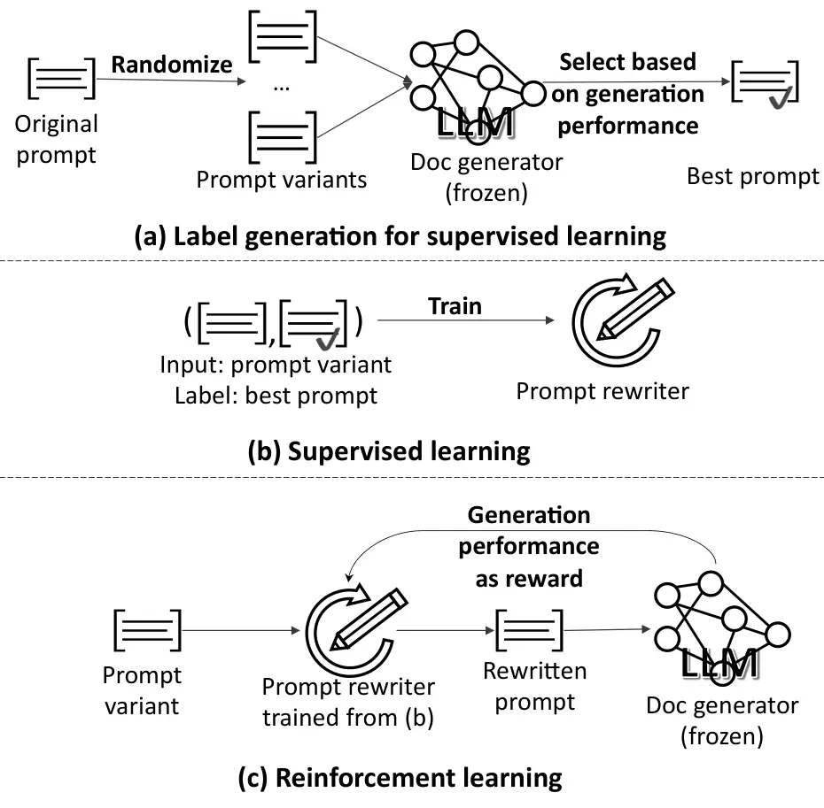

# Learning to Rewrite Prompts for Personalized Text Generation

Conference: Proceedings of the ACM Web Conference 2024; May 13–17, 2024;
Singapore, SingaporeProceedings of the ACM Web Conference 2024 (WWW
’24), May 13–17, 2024, Singapore,
SingaporeDOI: [10.1145/3589334.3645408](https://doi.org/10.1145/3589334.3645408)ISBN: 979-8-4007-0171-9/24/05CCS: Applied
computing Text editing

Cheng Li

Affiliation: Google Research, Mountain View, CA, USA email:
<chgli@google.com> , Mingyang Zhang

Affiliation: Google Research, Mountain View, CA, USA email:
<mingyang@google.com> , Qiaozhu Mei

Note: Work done as a visiting researcher at Google.
Affiliation: University of Michigan, Ann Arbor, MI, USA email:
<qmei@umich.edu> , Weize Kong

Affiliation: Google Research, Mountain View, CA, USA email:
<weize@google.com> and Michael Bendersky

Affiliation: Google Research, Mountain View, CA, USA email:
<bemike@google.com>

© rightsretained

###### Abstract.

Facilitated by large language models (LLMs), personalized text
generation has become a rapidly growing research direction. Most
existing studies focus on designing specialized models for a particular
domain, or they require fine-tuning the LLMs to generate personalized
text. We consider a typical scenario in which the large language model,
which generates personalized output, is frozen and can only be accessed
through APIs. Under this constraint, all one can do is to improve the
input text (i.e., text prompts) sent to the LLM, a procedure that is
usually done manually. In this paper, we propose a novel method to
automatically revise prompts for personalized text generation. The
proposed method takes the initial prompts generated by a
state-of-the-art, multistage framework for personalized generation and
rewrites a few critical components that summarize and synthesize the
personal context. The prompt rewriter employs a training paradigm that
chains together supervised learning (SL) and reinforcement learning
(RL), where SL reduces the search space of RL and RL facilitates
end-to-end training of the rewriter. Using datasets from three
representative domains, we demonstrate that the rewritten prompts
outperform both the original prompts and the prompts optimized via
supervised learning or reinforcement learning alone. In-depth analysis
of the rewritten prompts shows that they are not only human readable,
but also able to guide manual revision of prompts when there is limited
resource to employ reinforcement learning to train the prompt rewriter,
or when it is costly to deploy an automatic prompt rewriter for
inference.

###### Keywords: 

prompt rewrite; personalized text generation; large language models

## 1. Introduction

With the flourishing of artificial intelligence (AI)-powered content
creation, personalized text generation has become a popular research
area. Applications of personalized text generation span a wide range of
domains, including AI-assisted writing of various content types (e.g.,
tweets, news articles, scientific papers, and fictions), corporate and
personal communications (e.g., emails, chats and forum posts), and the
transformation of written content into different styles (e.g.,
summarization or elaboration). Given its importance, it is crucial to
develop generative systems that cater to specific audiences, creation
contexts, and information needs.

Most prior work on personalized text generation relies on
domain-specific features or knowledge and proposes models to address a
particular domain, such as reviews (Li and Tuzhilin, 2019; Li et al.,
2020), dialogue agents (Wu et al., 2021; Zhang et al., 2018; Mazare
et al., 2018) and social networks (GAO et al., \[n.d.\]). Recently,
large language models (LLMs) have been utilized to produce personalized
text across domains (Salemi et al., 2023; Li et al., 2023), and
fine-tuning is usually required to adapt the LLMs to personal data and
the personalized text generation task.

When fine-tuning is feasible, previous work (Li et al., 2023) has found
that the personalized text generator produces the best results when it
is instructed by a prompt that includes descriptions about the user’s
personal context that are processed through multiple stages. These
stages include retrieval, ranking, summarization and synthesis.
Specifically, given a personalized writing task, relevant entries from
the author’s personal history are retrieved and ranked; from the
retrieved entries, important sentences are extracted as a summary and
important keywords are extracted as a synthesis of the author’s personal
context. A prompt is then formed by concatenating the task instruction,
the summary, the synthesis, and the ranked entries.

In most real-world cases, however, fine-tuning the LLM, or the content
generator, is not feasible. On one hand, the LLM is often a black box
with frozen parameters and one has no control over its internal
mechanism. This scenario is typical when one interacts with the popular
LLM applications such as ChatGPT¹¹ 1
[https://chat.openai.com](https://chat.openai.com) and Bard²² 2
[https://bard.google.com](https://bard.google.com). These models are
capable of generating human-like text but are often only accessible
through text-based interfaces or APIs. On the other hand, even if one
has access to the model parameters, fine-tuning a LLM typically requires
an inhibiting amount of computational resources for individual users. In
either case, the only way one can influence the output of the LLM is by
providing different text prompts. In this paper, we focus on this
practical scenario and propose to learn personalized text prompts to
achieve better generation results.

In this scenario, the prompts that are effective for fine-tuning a model
might not be optimal for instructing a frozen LLM. The reasons are two
fold. First, a frozen LLM is more likely to be affected by the noise in
the input. For example, certain summary sentences produced in the
summarization stage might be off-topic. Through fine-tuning, the model
can learn to cope with the noisy summary and mine relevant information
from it. When the LLM is frozen, it is more likely to be severely
affected by this noise and produce less relevant output. Second, certain
choices of the format and content of synthesis might help the LLM better
understand the context of the specific user, producing results more
personalized for that user without manipulating its general knowledge
about the task.

Motivated by these reasons, we train a prompt rewriter that revises
particular components of the original prompt of personalized text
generation (that correspond to particular stages in previous work) so
that it can lead to better performance of a frozen LLM. However, the
gradient of the LLM is often not accessible through APIs, making the
entire training pipeline non-differentiable. Furthermore, the
performance of the document generator is usually measured by word
overlap metrics like Bleu (Papineni et al., 2002), which are also
non-differentiable. To still learn the prompt in an end-to-end manner,
we employ reinforcement learning (RL) to update the prompt rewriter,
where the performance metric is used as the reward.

Prior research has explored RL to optimize the instruction component of
the prompt (Guo et al., 2021; Deng et al., 2022; Zhang et al., 2022),
e.g., “classify the sentiment of the following text”, which is usually
independent of the task input³³ 3 In literature, the task input is also
referred to as the query, instance, or content of a prompt, depending on
what the input to the task actually is, and to be distinguished from the
general description (i.e., the instruction) of the task or the few-shot
exemplars. In our case, the task input is the immediate context of the
writing task and the personal context of the user (see Section 3), so we
use context and input interchangeably. or context. In contrast, our work
aims to optimize the input/context-dependent components of the prompt
specifically for the task of personalized text generation, in particular
the summary and the synthesis of the given user’s personal context.
These components are specific to both the user and the ad hoc intent of
the writing task and are not shared across other users or contexts.

The search space for instruction optimization is relatively small, as
there is a limited vocabulary to describe a general task (e.g.,
sentiment classification). In contrast, the search space for optimizing
input/context-dependent components in a prompt is significantly larger,
as for every document that a particular user is about to write, we may
need a different description about this user’s intended content and
personal preference. Such a tremendous search space places a critical
challenge to the direct application of RL. To address this challenge, we
propose a training paradigm for prompt rewriting that chains supervised
learning (SL) and RL. In this paradigm, the rewriter is first adapted to
the prompt rewrite task using supervised learning, followed by further
optimization using RL.

To evaluate the prompt rewriter, we conduct experiments on datasets from
three representative domains: personal email communications, product
reviews, and social media discussions. Results demonstrate that the
rewritten prompts through our approach outperform both the original
prompts generated by the state-of-the-art method and the prompts
optimized via SL or RL alone on all three domains. This suggests that
our SL-RL paradigm is a promising approach for optimizing prompts for
personalization.

In addition, we conduct an in-depth analysis of the learned prompts.
These prompts are not only human-readable, they also indicate general
rules that explain how the prompts are revised. Using these rules as
guidance to manually revise the original prompts, we can obtain
significantly better performance than the original prompts. Such
guidance is particularly useful when there is limited resource for
reinforcement learning to train the prompt rewriter (which requires
thousands of API calls and the calculation of rewards), or when it is
costly to deploy an automatic prompt rewriter.

## 2. Related Work

Two research directions closely related to our work are personalized
text generation and prompt learning.

Personalized text generation. Researchers have studied personalized
generation for a specific domain by utilizing domain-specific features
or knowledge. For example, Li and Tuzhilin (Li and Tuzhilin, 2019) use
self-attentive recursive autoencoders to generate personalized user
reviews given product descriptions, sentiment labels, and user
historical reviews. Product attributes are utilized in (Li et al., 2020)
to improve personalized review generation. Gao et al. (GAO et al.,
\[n.d.\]) propose to feed personalized features to the encoder to guide
the decoder for personalized social text generation. There are extensive
studies on personalizing dialogue agents (Wu et al., 2021; Zhang et al.,
2018; Mazare et al., 2018). Due to the lack of real data, they have
explored constructing dialogue data by asking crowd-workers to write
dialogues for personas (Zhang et al., 2018), extracting user attributes
and utterances from Reddit (Wu et al., 2021; Mazare et al., 2018) and
Weibo (Zhong et al., 2022; Qian et al., 2021).

Utilizing large language models for personalized generation across
different domains is a new direction. LaMP (Salemi et al., 2023)
provides a benchmark for training and evaluating personalized language
models on classification and sentence-level generation tasks. The
multi-stage and multi-task framework proposed in (Li et al., 2023)
considers the generation of passage-length personalized outputs. Skopyk
et al. (Skopyk et al., \[n.d.\]) propose to train transformer layer
adapters for personalization, but experimental analysis is not included.
Mysore et al. (2023) aim at improving the retriever for personalized
generation. Baek et al. (2023) focus on a different but related task of
personalized contextual query suggestion using LLMs.

Our work differs from previous studies in that we consider the practical
setting where LLMs, which are the foundation models for personalized
text generation, are frozen and can only be accessed through APIs. In
this setting, one can only improve the text prompts to enhance the
generation performance.

Prompt learning. There have been extensive studies on automatically
learning continuous prompts (a.k.a. soft prompts) in an embedding space,
such as prefix tuning (Li and Liang, 2021) and prompt tuning (Lester
et al., 2021). These methods require access to the parameters of the LLM
(even though they are not updated) so that additional parameters can be
trained. In contrast, we focus on the typical scenario where the LLM can
only be accessed through APIs, and we can only modify the discrete
prompts (a.k.a. hard prompts) to improve the generation. Therefore, we
focus our survey on learning discrete prompts.

Researchers have investigated various approaches to assist the
composition of prompts. Retrieval-augmented generation (Lewis et al., 2020) generates text conditional on relevant documents, by retrieving
them and including them into the prompt. Paraphrasing-based
methods (Jiang et al., 2020; Haviv et al., 2021) rewrite a given prompt
into multiple candidate prompts and select the one with the best
performance on the training set.

One line of research most relevant to ours is automatic prompt
generation. Zhou et al. (Zhou et al., 2022) feed example input-output
pairs to a prompting LLM to generate instructions, the quality of which
is evaluated by the zero-shot performance of the target LLM, which is
prompted by the generated instructions. Gao et al. (Gao et al., 2021)
employ the T5 models (Raffel et al., 2020) to generate prompts based on
the task of filling in missing spans. A gradient-based search
method (Shin et al., 2020) is proposed to generate prompts for
classification tasks. The work closest to ours employs reinforcement
learning (RL) to generate prompts, with the reward being the generation
performance of pre-trained language models (Guo et al., 2021; Deng
et al., 2022). The learned prompts are applied to the controlled text
generation task (Guo et al., 2021) and the text style transfer
task (Deng et al., 2022). The above RL based work learns
input/context-independent parts (e.g., the instruction) of the prompts,
which are fixed for the same task during inference time. The TEMPERA
method (Zhang et al., 2022) extends this line of work by learning
input-dependent instructions and exemplars and applies them to text
classification tasks.

Prior work mainly focuses on optimizing the instruction component of the
prompt via RL, with the exception of TEMPERA which also permutes/swaps
the in-context exemplars. Our work instead directly optimizes the more
complex and input-dependent components for personalized text generation
via unrestricted editing operations and tackles the challenge of a much
larger search space. Instead of using small language models, we directly
use the personalized generation performance of a large language model as
the reward. Unlike previous findings that RL-learned prompts are
ungrammatical and unreadable by humans (Deng et al., 2022), our learned
prompts are not only human readable, but can also provide interpretable
guidance on how to manually improve the prompts.

## 3. Problem Formulation

### 3.1. The FtPersLlm Framework

Since our work focuses on a similar setting as the previous work of
personalizing LLMs (Li et al., 2023), we briefly introduce their work to
facilitate discussion. For simplicity, we refer to their framework to
fine-tune the personalized LLM proposed in (Li et al., 2023) as
FtPersLlm.

Suppose a user is writing a document, which we call the current
document. Given the immediate context $`x`$ and the user $`u`$’s
personal context, FtPersLlm aims to finish the document so that the
generated document is close to the real current document as if the user
had completed it. The immediate context $`x`$, or the input to the
personalized writing task, is defined as the title and the start of the
current document. The user’s personal context is defined as documents
authored by this user in the past.

FtPersLlm is a multistage framework. Using the immediate context $`x`$
as the query, a retriever retrieves relevant entries from the user’s
personal context, which are then ranked by a ranker. The ranked entries
$`\mathcal{E}`$ are consumed by: (1) a summarization model
$`\mathbf{Su}(x,\mathcal{E})`$ to summarize the retrieved entries; and
(2) a synthesis model $`\mathbf{Sy}(x,\mathcal{E})`$ to synthesize the
key elements and patterns in the personal context. Different approaches
can be used for synthesis. In FtPersLlm, keywords are extracted at the
synthesis stage. A prompt $`p=(inst,x,\mathbf{Su}(x,\mathcal{E}),`$
$`\mathbf{Sy}(x,\mathcal{E}),\mathcal{E})`$ is generated by
concatenating the instruction $`inst`$ (i.e., Finish the passage in the
user voice), the immediate context $`x`$, the summary
$`\mathbf{Su}(x,\mathcal{E})`$, the synthesis
$`\mathbf{Sy}(x,\mathcal{E})`$, and the ranked entries $`\mathcal{E}`$.
Taking this configured prompt as input, a LLM based document generator
is fine-tuned against the ground-truth current document. Clearly,
$`\mathcal{E}`$, $`\mathbf{Su}(x,\mathcal{E})`$, and
$`\mathbf{Sy}(x,\mathcal{E})`$, are dependent on the immediate context
$`x`$, while $`inst`$ is not.

We use the best configuration learned from FtPersLlm to compose our
initial prompt, where the summary and the keyword synthesis are both
learned to be conditioned on the immediate context via weak supervision.
Specifically, the weak labels for learning the summary are created by
extracting snippets from the retrieved entries that are close in
semantics to snippets from the ground-truth current document. Keywords
are learned in the same way except that words are extracted instead of
snippets.

### 3.2. Prompt Rewriting for Frozen LLMs

Unlike FtPersLlm (Li et al., 2023), we consider a scenario where the
document generator cannot be fine-tuned but is instead a frozen LLM,
which is a black box that accepts a text prompt as input and generates a
piece of text as output. This is a typical scenario when people interact
with chatbots like ChatGPT⁴⁴ 4
[https://chat.openai.com](https://chat.openai.com) and Bard⁵⁵ 5
[https://bard.google.com](https://bard.google.com). Given the original
prompt generated by FtPersLlm, our goal is to optimize a prompt rewriter
that rewrites the initial prompt, which in turn prompts the LLM to
output a desired personalized document.

Specifically, let the training set be a list of examples $`\{(p,d)\}`$,
where $`d`$ is the ground-truth current document, and the prompt $`p`$
consists of the instruction $`inst`$, the immediate context $`x`$, the
summary $`\mathbf{Su}(x,\mathcal{E})`$, the synthesis
$`\mathbf{Sy}(x,\mathcal{E})`$, and the ranked entries $`\mathcal{E}`$.
We aim to train a personalized prompt rewriter $`\mathbf{R}(\cdot)`$
that rewrites the original prompt $`p`$ into
$`p^{\prime}=\mathbf{R}(p)`$ so that we can maximize the similarity
between the generated document $`d^{\prime}=\mathbf{G}(\mathbf{R}(p))`$
and the ground-truth document $`d`$, where the document generator
$`\mathbf{G}`$ is a frozen LLM.

Without loss of generality, in this paper we only train the prompt
rewriter to rewrite two critical components, the summary
$`\mathbf{Su}(x,\mathcal{E})`$ and the synthesis
$`\mathbf{Sy}(x,\mathcal{E})`$, while keeping other components fixed.
The remaining components ($`inst`$ and $`\mathcal{E}`$) can be optimized
in a similar way, or using any existing method that optimizes
instructions and exemplars. We leave this as a direction for future
research.

## 4. Method Overview

We present the overview of our procedure to rewrite prompts for
personalized text generation in Figure 1.

Figure 1. The overview of our procedure to rewrite prompts for
personalized text generation.

As discussed in the introduction, optimizing the context-dependent
summary and synthesis results in a significantly larger search space for
reinforcement learning. To address this challenge, we perform supervised
learning prior to reinforcement learning to adapt the learned model to
the prompt rewriting task. As illustrated in Figure 1 (a), we first
generate labels to facilitate the supervised training of the prompt
rewriter $`\mathbf{R}`$. The labels are updated prompts that result in
improved generation performance of the document generator
$`\mathbf{G}`$. Specifically, we randomize the given original prompt
$`p^{o}`$ by shuffling and removing the elements in both the summary and
the synthesis components and produce a set of prompt variants
$`\{p^{v}_{i}\}`$, including the original prompt $`p^{o}`$. We feed each
variant $`p^{v}_{i}`$ to the document generator, a frozen LLM, to
collect the generated document. We measure the generation performance
against the ground-truth current document using metrics such as
Bleu (Papineni et al., 2002). We refer to the prompt obtaining the
highest metric score as the best prompt $`p^{b}`$.

In Figure 1 (b), we train the prompt rewriter by feeding a prompt
variant $`p^{v}_{i}`$ as input and using the best prompt $`p^{b}`$ as
the label.

Note that the label generated in step (a) is not optimal: (1) it is
impractical to enumerate all prompt variants, feed them to the LLM, and
find the best prompt; (2) the prompt variants can only remove or shuffle
existing elements but could not introduce new but effective elements to
the original prompt. Therefore we continue to train the prompt rewriter
from step (b) by reinforcement learning as in Figure 1 (c). The reward
is obtained by computing the generation performance using metrics like
Bleu (in the same way as step (a)). The prompt rewriter $`\mathbf{R}`$
is then updated to maximize the reward.

## 5. Learning the Prompt Rewriter

We discuss the details of training the prompt rewriter outlined in
Section 4.

### 5.1. Writing Style as Synthesis

Before describing the training details, we introduce a new type of
synthesis based on writing style. Our empirical findings suggest that
this method is a valuable addition to the keyword-based synthesis
proposed by FtPersLlm (Li et al., 2023).

A user’s writing style is likely to remain consistent across different
topics, e.g., their choice of words, preferred sentence structure, or
use of grammar⁶⁶ 6
[https://en.wikipedia.org/wiki/Writing_style](https://en.wikipedia.org/wiki/Writing_style).
Therefore we synthesize a user’s writing style to provide additional
guidance to the document generator.

We use the same LLM used for document generation to synthesize a user’s
writing style based on their personal context. For simplicity and
efficiency, we use the earliest documents in the user’s personal history
that are never used as current documents to synthesize a user’s writing
style regardless of the immediate context. In real applications, we can
also update it periodically in case a user’s writing style shifts over
time.

The instruction we give to the LLM is: “Summarize the author’s writing
style in detail. \<Past Documents\> 1.”. The number 1. prompts the model
to summarize the writing style in a numbered list.

The LLM returns phrases that describe the writing style of the user,
such as writes detailed instructions, professional and results-oriented,
and well-written and engaging. The writing style synthesis is included
into the prompt in addition to the keyword synthesis (see Figure 2 (a)).

### 5.2. Label Generation for Supervised Learning

Before applying reinforcement learning, we perform supervised learning
to adapt (i.e., fine-tune) a sequence-to-sequence model to the task of
prompt rewriting. This process helps to reduce the search space of the
RL algorithm, as discussed in the introduction.

The challenge is the lack of ground-truth labels, or optimal prompts
that lead to the best generation performance. We address this by
randomizing elements from the summary and synthesis, anticipating that
one of the randomized versions might lead to better results and thus can
be used as labels. We define three types of elements:

- •
  Sentences in the summary.
- •
  Keywords in the synthesis.
- •
  Phrases describing the user’s writing style in the synthesis.

For each type, we perform randomization of elements in the original
prompt to produce multiple prompt variants. Our intuition is that both
the selection and the ordering of elements can affect the generation
performance. Specifically, we randomize the order of elements and remove
the trailing $`k`$ elements, where $`k`$ is uniformly sampled from
$`[0,\lfloor N/2\rfloor]`$ and $`N`$ is the number of elements. For
example, keywords $`w_{1},w_{2},w_{3},w_{4},w_{5}`$ may be permuted into
a new sequence $`w_{3},w_{2},w_{5},w_{1},w_{4}`$, and then into the
final sequence $`w_{3},w_{2},w_{5}`$ after randomly removing the last
$`2`$ words.

We produce $`P`$ unique randomized sequences for each element type,
which leads to a set of $`P^{3}+1`$ prompt variants $`\{p^{v}_{i}\}`$
per current document, including the original prompt. We will study the
effect of different number of generated prompt variants in the
experiments. All other components (e.g., the instructions, and ranked
entries) of a prompt variant remain the same as those of the original
prompt.

We feed each prompt variant $`p^{v}_{i}`$ to the document generator and
evaluate the generation performance $`sc(p^{v}_{i})`$ against
ground-truth current document based on metrics like Bleu. The variant
with the highest score is chosen as the best prompt
$`p^{b}=\arg\max_{p^{v}_{i}}sc(p^{v}_{i})`$ and can be used as the label
for supervised learning. An example of the original prompt is present in
Figure 2 (a) and a prompt variant is present in Figure 2 (b).

Figure 2. An example of the original prompt, a prompt variant, and the
label for supervised learning. Bold parts are input-independent
instructions, while plain parts are dependent on the user context.

Admittedly, there might be more sophisticated methods to generate labels
other than randomization. We leave exploring better methods as future
work since we find randomization to be efficient and effective: (1) it
does not require enumeration of all possible permutations; (2) the best
prompts improve Bleu (Papineni et al., 2002) by $`10`$ over original
prompts on all datasets we experiment with.

### 5.3. Supervised Learning

A training example is created for each prompt variant as input and the
best prompt as the output label. Any sequence-to-sequence model can be
trained as a prompt rewriter by minimizing the cross-entropy loss.
Practically, such a model should have a smaller size than the document
generator so that both training and prompt rewriting are efficient. We
choose the T5-11B model (Raffel et al., 2020) for most experiments since
it is effective and still smaller than most state-of-the-art LLMs. We
will compare models with different sizes in the experiment section.

In practice, we find that removing unchanged components from the label
makes training more efficient – the prompt rewriter does not have to
learn to copy the unchanged components. Hence we only keep the summary
and the synthesis in the label while removing other unchanged components
like instruction and ranked entries. An example of such label is shown
in Figure 2 (c). Before feeding the rewritten prompt to the document
generator, we add the unchanged components back to the rewritten prompt.

### 5.4. Reinforcement Learning

Though best prompts empirically show significant improvement over
original prompts, using best prompts as labels for supervised learning
is not optimal. First, it is almost impossible to enumerate all possible
prompt variations for every current document and feed them to an
expensive LLM to find the best prompt. Second, the prompt variations do
not introduce new elements into the original prompt that might lead to
better generated documents. As a result, the prompt rewriter learned in
a supervised manner simply copies, reorders, or deletes elements in
almost all cases.

To address these issues, we apply Reinforcement Learning (RL) to further
fine-tune the prompt rewriter. Using the performance of the document
generator as the reward, the prompt rewriter is trained in an end-to-end
manner, eliminating the constraint on the quality of the generated
labels. Furthermore, by including the whole vocabulary in the action
space, the prompt rewriter is set free to explore advanced strategies
such as adding new words.

Below we describe how we formulate our task as a RL problem.

- •
  Action space consists of all tokens in the vocabulary of the prompt
  rewriter. This definition allows the rewriter to remove, reorder, and
  add new words to the original prompt.
- •
  State is defined as the concatenation of the hidden states of the
  encoder of the rewriter and the generated tokens so far from the
  rewriter for a given input prompt.
- •
  Reward is the performance of the document generator taking the
  rewritten prompt as the input, which is measured against ground-truth
  current documents by metrics such as Bleu. In this way, our prompt
  rewriter is optimized towards the document generator in an end-to-end
  manner.

The reward objective can be optimized by any off-the-shelf RL algorithm.
We employ Proximal Policy Optimization (PPO) (Schulman et al., 2017) as
the RL algorithm. Note that the training examples for both supervised
and reinforcement learning are selected from the same set of users, and
the test set consists of a different set of users.

## 6. Experiment setup

We describe our experiment setup in detail in this section, including
datasets, hyperparameters, competing methods, and metrics.

|               | \#avg chars of | \#avg past docs  | \#users |        |        | \#current docs |        |        |
| ------------- | -------------- | ---------------- | ------- | ------ | ------ | -------------- | ------ | ------ |
|               | current docs   | per user context | Train   | Val.   | Test   | Train          | Val.   | Test   |
| Avocado email | 3,648.8        | 42.3             | 501     | 27     | 53     | 13,305         | 764    | 1,227  |
| Amazon review | 918.2          | 31.0             | 342,431 | 20,121 | 39,955 | 342,431        | 20,121 | 39,955 |
| Reddit        | 618.7          | 90.1             | 191,225 | 11,207 | 22,616 | 191,225        | 11,207 | 22,616 |

Table 1. Dataset statistics.

### 6.1. Datasets

We evaluate our models on the same set of public datasets as
FtPersLlm (Li et al., 2023). Each of the three datasets comes from a
representative domain: (1) for the Avocado Research Email
Collection (Oard et al., 2015), the task is to generate personalized
emails; (2) for the Amazon review data (Ni et al., 2019), the largest
category books is used and the goal is to generate personalized reviews;
(3) for the Reddit comments dataset (Stuck_In_the_Matrix, 2015), the
task is to generate personalized posts or comments.

We replicate the data processing steps outlined in (Li et al., 2023)
with a few differences. First, we filter out current documents that
produces less than $`5`$ prompt variants. This is because few prompt
variants means limited number of elements in the original prompts and
thus we have less room to rewrite the prompts.

Second, we introduce additional knowledge into the immediate context to
help the document generator understand the task. For the Amazon review
data, we append the product title and the description to the original
immediate context. For the Reddit data, we append the top-level post and
the parent comment. For the Email data, we do not add additional
content.

Third, for the Amazon review data and the Reddit data, we only include
the most recent document per user as the current document instead of
including all qualified documents. We add this constraint because
evaluating the prompt variants per current document (see Section 5.2 for
details) takes more time when the dataset is large. We remove this
constraint for the Email data since the data size is small. Note that
this efficiency problem only exists at training time. Once the prompt
rewriter is trained, the deployment is efficient.

Following (Li et al., 2023), we partition the datasets by users so that
the validation and the test sets only include documents from users that
are not present in the training set. The partition ratio of users in
train/validation/test sets is 85/5/10. All the performance reported in
the experiment section is based on the test set.

A summary of data statistics can be found in Table 1.

### 6.2. Hyperparameters

We select the T5-11B (Raffel et al., 2020) model as our prompt rewriter
for most experiments. One subsection of the experiment analysis will be
devoted to investigating the effect of different model sizes. In the
supervised learning stage, the T5-11B model is fine-tuned using the
Adafactor algorithm (Shazeer and Stern, 2018) with a base learning rate
of 0.001. A linear warmup scheduler is used for the first 1,000 training
steps. Additionally, the square root normalized decay of the learning
rate is applied. The model is trained until its performance converges on
the validation set. Decoding is performed using beam search (Freitag and
Al-Onaizan, 2017) with a beam size of 4.

We use the PaLM 2 model (Anil et al., 2023), a new state-of-the-art LLM,
as our document generator. It adopts temperature sampling as the
decoding strategy. The parameters of PaLM 2 are frozen, and we set the
temperature to $`0`$ to make the output deterministic.

We use Bleu (Papineni et al., 2002) as the metric to select the best
prompt among prompt variants. It is also used as the reward to train the
prompt rewriter in the RL stage.

For most experiments, we set $`P`$, the number of unique randomized
sequences for each element type introduced in Section 5.2, to 4. This
leads to $`4^{3}+1=65`$ prompt variants generated to find the best
prompt as the label in the supervised learning stage. Since this could
greatly increase the label generation time, we experiment with reducing
the number of prompt variants in Appendix C.

### 6.3. Competing methods

Prior research on prompt generation (Guo et al., 2021; Deng et al.,
2022; Zhang et al., 2022) aim at improving the instruction component of
prompts, while we target the input-dependent components. Therefore,
existing methods are complementary to our proposed method but are not
directly comparable.

We build on top of the original prompt, which has empirically proven to
be the best configuration in FtPersLlm (Li et al., 2023), as our
baseline. The summary and the keywords for synthesis in FtPersLlm are
learned by weak supervision, as detailed in Section 3.1. We add writing
style described in Section 5.1 as an additional type of synthesis. We
refer to this method as Original.

We train two variations of prompt rewriter, one using supervised
learning only, denoted as RewriterSl, and the other using RL only
without the SL stage, named as RewriterRl. We call the prompt rewriter
trained via the SL-RL paradigm RewriterSlRl.

### 6.4. Evaluation Metrics

We calculate the overlap between the document produced by the document
generator and the ground-truth current document. Following (Li and
Tuzhilin, 2019; Salemi et al., 2023; Li et al., 2023), we use a variety
of metrics that are widely adopted in personalized generation tasks:
Bleu (Papineni et al., 2002), Rouge-1, Rouge-2, and Rouge-L (Lin, 2004),
even though only Bleu is used to calculate the reward for RL.

We employ the paired t-test for statistical significance tests.

## 7. Experimental results

### 7.1. Overall Performance

|               |               |               |               |               |
| ------------- | ------------- | ------------- | ------------- | ------------- |
|               | Bleu          | Rouge-1       | Rouge-2       | Rouge-L       |
| Avocado email |               |               |               |               |
| Original      | 9.59          | 30.04         | 16.26         | 23.49         |
| RewriterSl    | $`9.87`$      | $`31.24^{*}`$ | $`16.41`$     | $`23.53`$     |
| RewriterRl    | 8.62          | 25.24         | 12.31         | 16.59         |
| RewriterSlRl  | $`13.18^{*}`$ | $`33.74^{*}`$ | $`21.01^{*}`$ | $`27.04^{*}`$ |
| Amazon review |               |               |               |               |
| Original      | 5.00          | 25.73         | 7.03          | 16.32         |
| RewriterSl    | $`5.14`$      | $`25.97`$     | $`7.18`$      | $`16.38`$     |
| RewriterRl    | 3.53          | 21.65         | 5.54          | 10.39         |
| RewriterSlRl  | $`13.07^{*}`$ | $`34.12^{*}`$ | $`17.01^{*}`$ | $`25.16^{*}`$ |
| Reddit        |               |               |               |               |
| Original      | 13.13         | 31.92         | 17.13         | 24.79         |
| RewriterSl    | $`13.22`$     | $`32.43^{*}`$ | $`17.31`$     | $`24.85`$     |
| RewriterRl    | 9.62          | 21.83         | 11.72         | 15.34         |
| RewriterSlRl  | $`20.59^{*}`$ | $`40.28^{*}`$ | $`27.68^{*}`$ | $`34.35^{*}`$ |

Table 2. Overall performance(%). \* indicates statistically significant
improvement over Original at the level of 0.01.

The overall performance of all competing methods are present in Table 2.
Note that the performance reported in this paper are generally lower
than that in FtPersLlm (Li et al., 2023). The reasons are two folds: (1)
FtPersLlm fine-tunes the document generator, which significantly boosts
model performance; (2) the immediate context includes a short start of
the current document, which is also the start of the ground-truth
output. Fine-tuned models learn to copy the start to their output while
a frozen LLM does not.

In general, RewriterSl trained via supervised learning performs very
closely to or slightly better than original prompts. RewriterSlRl
trained by RL outperforms Original by a large margin.

|               | Bleu  | Rouge-1 | Rouge-2 | Rouge-L |
| ------------- | ----- | ------- | ------- | ------- |
| Avocado email | 20.88 | 44.95   | 28.74   | 36.47   |
| Amazon review | 15.72 | 40.58   | 18.83   | 28.72   |
| Reddit        | 25.64 | 46.52   | 30.92   | 38.15   |

Table 3. Performance(%) of the best prompt variants. Not comparable to
Table 2 as they are selected per ground-truth.

Analysis of RewriterSl. One possible reason that RewriterSl does not
perform well could be the poor performance of the best prompt. Therefore
we calculate the performance of the best prompt on the test set and list
it in Table 3. Based on this table, the best prompt performs extremely
well. Note that it cannot be treated as a baseline as it is selected
based on the ground-truth current document. To investigate further, we
compare the original prompt, the best prompt, and the prompt generated
by RewriterSl.

Multiple reasons lead to the marginal improvement of RewriterSl. First,
some elements in the best prompt, e.g., keywords or summary sentences,
happen to be more relevant to the ground-truth current document. But it
is hard for the supervised rewriter to learn why they are more relevant
than those removed merely based on the immediate context. Second,
multiple prompts might achieve very similar performance as the best
prompt, meaning that there are elements in the best prompt whose order
or presence do not really matter. Hence it is hard for RewriterSl to
learn general patterns that lead to better prompts. Therefore RewriterSl
only performs very few modifications and thus achieves similar
performance as the original prompt. Third, the summary and the keywords
from Original are learned through weak supervision by T5-11B (Raffel
et al., 2020), which already achieve decent performance and it is not
easy for RewriterSl to improve them further.

Analysis of RewriterRl. Without supervised learning as the prior stage,
RewriterRl performs poorly. The action space is too large for the RL
algorithm to efficiently search for a policy with high rewards. Indeed,
we observe that prompts produced by RewriterRl without pre-training
contain meaningless tokens.

Analysis of RewriterSlRl. With supervised pre-training, RewriterSlRl is
well adapted to prompt rewriting – it explores the search space more
efficiently and produce human-readable prompts. Using the performance of
the document generator as the reward, RewriterSlRl is trained end-to-end
without depending on the quality of the generated labels or best
prompts. Moreover, guided by prior knowledge from supervised learning,
the prompt rewriter is free to explore strategies like adding new words
because all tokens in the vocabulary are considered in the action space.
The advantages of RewriterSlRl bring a significant gain over Original.

### 7.2. Case Studies and General Patterns Learned

We conduct an in-depth, qualitative analysis of the prompts rewritten by
RewriterSlRl, presenting representative examples in Table 4 (and
examples of generated documents in Table 6 from Appendix as well as
analysis of negative cases in Appendix A). Our analysis reveals several
general patterns.

Analysis of the summary. The entire summary section is removed from the
prompts for all datasets. We find that this is because the summary is
composed of snippets extracted from retrieved historical entries (Li
et al., 2023), meaning that some parts of the summary are relevant to
the current context but some are off-topic. Interestingly, FtPersLlm
still finds the summary useful since the fine-tuned LLM learns to select
important phrases to use from the summary, while the frozen LLM does not
learn to filter from the entire summary.

Analysis of the keyword synthesis. We find multiple interesting patterns
of how the keyword synthesis is rewritten.

First, we see two types of new keywords added to the prompt. (a)
Keywords about the current topic, which could be synonyms or simply
original words in the immediate context. We find that even copying the
words from the immediate context as keywords could help the LLM keep to
the topic. For example, adding the keyword baseball for a baseball book
review helps the model stay on the topic about baseball. (b) Common
words used frequently by the author in the retrieved entries are added,
e.g., totally or literally.

Second, important keywords are repeated. In FtPersLlm, the synthesis
model is trained to output unique keywords. Interestingly, RewriterSlRl
learns to repeat keywords to convey their degree of importance to the
document generator. As a result, the document generator either uses
these repeated keywords more frequently, or composes the document around
these keywords.

Third, keywords that are less relevant to the current topic are removed.
Note that the synthesis model from FtPersLlm has already been trained to
only output potentially relevant keywords, but RewriterSlRl learns to be
even more conservative on relevance by learning through the reward
function that the document generator can be easily impacted by less
relevant keywords.

Lastly, keywords are reordered. The synthesis model from FtPersLlm is
trained to output keywords in the decreasing order of their importance.
RewriterSlRl instead reorders them based on their possible appearance
order in the generated output. This makes it easier for the document
generator to utilize them sequentially.

Analysis of the writing style synthesis. We observe different patterns
of how writing styles are revised on different datasets.

Interestingly, on the Email data, almost all the users’ writing styles
have been updated into the same text: the author is thorough, and they
make the changes they have. Even though the second part of the writing
style is vague, the first part can be easily interpreted, which mentions
the word thorough and provides a hint to the document generator that the
output should be lengthy and detailed. Indeed, the statistics from
Table 1 show that the Email data contains the longest documents of all
the three datasets.

On the Amazon reviews, the entire writing style section is removed. We
suspect that this is because topics in books reviews are relatively
narrower than other datasets, and a user’s writing style can already be
easily inferred from retrieved past reviews. Writing style inferred in
this way can also be more accurate than general descriptions generated
based on random reviews of this user.

On the Reddit data, many phrases that are more stylistic, e.g.,
sarcastic and logical, are removed. RewriterSlRl prefers phrases that
describe interests of users, or topics a user is going to write given
the immediate context, e.g., likes whiskey and enjoys music.

Note: Italic words are included in the immediate context as part of the
prompt. To save space, non-learnable components like the immediate
context or the retrieved entries are omitted in the prompt examples, and
the less important parts of the summary section are truncated.

| Example 1 Ground-truth doc: Yeah. My great old granddad passed away last September and these days, I wish I could call him up and talk about my real worries. Y’know, where my life is going, whether I’m a good man… He was so damn wise, so gentle. He’d never use a sharp word where a kind one would do, and would go through hell for a friend. I loved him, and i miss him, and now he’s gone, and I wish I’d had all these conversations with him.                                                                                                                                                                                                                                                                                              |
| ------------------------------------------------------------------------------------------------------------------------------------------------------------------------------------------------------------------------------------------------------------------------------------------------------------------------------------------------------------------------------------------------------------------------------------------------------------------------------------------------------------------------------------------------------------------------------------------------------------------------------------------------------------------------------------------------------------------------------------------------------ |
| Original prompt: Past document summary: Around about my age, we live in the same country, we’ve met up for drinks and a chat. I’d consider him quite a good friend. When our sister left, we went through a lot of stuff together after that. We went from fighting to talking, from talking to laughing. Instead of competing, we began to help each other… Keywords: years \| went \| through \| these \| talk \| stuff \| she \| real \| our \| old \| little \| life \| last \| he’s \| great \| friends \| few \| ever \| enough \| each \| down \| best \| around \| age \| sorry \| set \| read \| quest Writing style: patient, answering questions and clarifying doubts \| sharing their personal experience and knowledge \| enjoys history |
| RewriterRl prompt: \<extra_id_0\>es \| punctuation style: punctuation style boldfont link bold bold bold bold \<extra_id_12\> \<extra_id_12\>                                                                                                                                                                                                                                                                                                                                                                                                                                                                                                                                                                                                          |
| RewriterSlRl prompt: Keywords: old \| granddad \| I wish \| talk \| passed \| life \| days \| sorry Writing style: sharing their personal experience and knowledge                                                                                                                                                                                                                                                                                                                                                                                                                                                                                                                                                                                     |
| Why RewriterSlRl prompt is better: (a) summary is less relevant and is removed; (b) less relevant keywords are removed; (c) keywords are reordered based on their possible order of appearance in generated text; (d) non-relevant phrases describing writing style are removed.                                                                                                                                                                                                                                                                                                                                                                                                                                                                       |
| Example 2 Ground-truth doc: This is the second book in a new series, and its a continuation for call of the dragon. Drakes writing draws you into her world and won’t let you go. Youll find yourself wishing for a dragon of your own. Theres plenty of action and adventure here. The story moves at a fast pace, with a seductive slow burn romance. If you are a fan of epic fantasy, you owe it to yourself to read this new series by Jessica Drake. I received an arc for an honest review.                                                                                                                                                                                                                                                     |
| Original prompt: Past document summary: This is Jasmine Walts finest work to date. She returns to her style of writing found in the Baine Chronicles. If you enjoyed that series, with the Fenris spin offs, you are going to love the wonderful characters in call of the dragon. This is a beautiful seduction. I absolutely love the world building of this series, and the interplay of the characters… Keywords: yourself \| walts \| walt \| ive \| dragon \| call Writing style: fluid and draws readers into her world \| romantic \| informative and helpful, perfect for those looking to learn new skills                                                                                                                                   |
| RewriterRl prompt: \<extra_id_3\> \| \<extra_id_4\> \| \| \<extra_id_5\> \| \| \| \| \| \| dragon \<extra_id_8\> of \<extra_id_9\>. \<extra_id_26\>. i can’t wait to read more. \<extra_id_27\> wal                                                                                                                                                                                                                                                                                                                                                                                                                                                                                                                                                    |
| RewriterSlRl prompt: Keywords: yourself \| call \| dragon \| dragon \| adventure                                                                                                                                                                                                                                                                                                                                                                                                                                                                                                                                                                                                                                                                       |
| Why RewriterSlRl prompt is better: (a) summary is less relevant and is removed; (b) the new word adventure is added, which is relevant to the immediate context; (c) less relevant keywords are removed; (d) the keyword dragon is highly topic-relevant and is repeated; (e) writing style is removed as it can be more accurately inferred from retrieved reviews.                                                                                                                                                                                                                                                                                                                                                                                   |

Table 4. Examples of rewritten prompts.

### 7.3. Ablation Study

|                          |               |               |               |               |
| ------------------------ | ------------- | ------------- | ------------- | ------------- |
|                          | Bleu          | Rouge-1       | Rouge-2       | Rouge-L       |
| Avocado email            |               |               |               |               |
| RewriterSlRl\_(word)     | $`11.15^{*}`$ | $`30.72`$     | $`18.28^{*}`$ | $`24.99^{*}`$ |
| RewriterSlRl\_(sum,word) | $`11.17^{*}`$ | $`30.98^{*}`$ | $`19.83^{*}`$ | $`25.37^{*}`$ |
| Amazon review            |               |               |               |               |
| RewriterSlRl\_(word)     | $`12.93^{*}`$ | $`34.23^{*}`$ | $`17.09^{*}`$ | $`25.13^{*}`$ |
| RewriterSlRl\_(sum,word) | $`12.90^{*}`$ | $`34.34^{*}`$ | $`17.18^{*}`$ | $`25.22^{*}`$ |
| Reddit                   |               |               |               |               |
| RewriterSlRl\_(word)     | $`19.75^{*}`$ | $`38.62^{*}`$ | $`26.15^{*}`$ | $`32.08^{*}`$ |
| RewriterSlRl\_(sum,word) | $`19.45^{*}`$ | $`38.48^{*}`$ | $`25.97^{*}`$ | $`31.97^{*}`$ |

Table 5. Performance(%) of the ablation study by removing certain
element types. \* indicates statistically significant improvement over
the best variant of the original prompt (see Appendix B for its
definition) at the level of 0.01.

RewriterSlRl learns to omit less useful element types, verified by an
ablation study – in Table 5, we remove element types one at a time from
the input prompt to RewriterSlRl.

The observations are aligned with learned patterns of RewriterSlRl. (1)
For the Amazon data, only the keywords are important. (3) For the other
two datasets, both writing style and keywords are important.

### 7.4. More studies in Appendix

Due to limited space, we refer interested readers to Appendix for more
analysis, including negative cases (Appendix A), how learned patterns
improve original prompts (Appendix B), the effect of reducing the the
number of prompt variants (Appendix C), inference cost (Appendix D),
quantitative analysis of the rewritten prompts (Appendix E), and the
impact of rewriter model size (Appendix F).

## 8. Conclusion

We examine a typical situation where LLMs that are tasked for text
generation can only be accessed through APIs, limiting our options to
revising the text prompts to improve personalized generation. We develop
a prompt rewriter by combining supervised learning and reinforcement
learning, which automatically updates prompts that have been carefully
designed for personalization in previous work. We evaluate the proposed
method on datasets from three representative domains, showing that the
rewritten prompts outperform both the original prompts and the prompts
revised via supervised learning or reinforcement learning alone. In
addition, we conduct an in-depth analysis of the rewritten prompts. The
analysis shows that the automatically rewritten prompts are not only
human-readable but also provide actionable rules. These rules can guide
manual prompt improvement, especially when deploying reinforcement
learning or an automatic prompt rewriter is costly.

## References

- Anil et al. (2023) Rohan Anil, Andrew M Dai, Orhan Firat, Melvin
  Johnson, Dmitry Lepikhin, Alexandre Passos, Siamak Shakeri, Emanuel
  Taropa, Paige Bailey, Zhifeng Chen, et al. 2023. Palm 2 technical
  report. _arXiv preprint arXiv:2305.10403_ (2023).
- Baek et al. (2023) Jinheon Baek, Nirupama Chandrasekaran, Silviu
  Cucerzan, Sujay Kumar Jauhar, et al. 2023. Knowledge-Augmented Large
  Language Models for Personalized Contextual Query Suggestion. _arXiv
  preprint arXiv:2311.06318_ (2023).
- Deng et al. (2022) Mingkai Deng, Jianyu Wang, Cheng-Ping Hsieh, Yihan
  Wang, Han Guo, Tianmin Shu, Meng Song, Eric Xing, and Zhiting
  Hu. 2022. RLPrompt: Optimizing Discrete Text Prompts with
  Reinforcement Learning. In _Proceedings of the 2022 Conference on
  Empirical Methods in Natural Language Processing_. 3369–3391.
- Freitag and Al-Onaizan (2017) Markus Freitag and Yaser
  Al-Onaizan. 2017. Beam Search Strategies for Neural Machine
  Translation. _ACL 2017_ (2017), 56.
- Gao et al. (2021) Tianyu Gao, Adam Fisch, and Danqi Chen. 2021. Making
  pre-trained language models better few-shot learners. In _Joint
  Conference of the 59th Annual Meeting of the Association for
  Computational Linguistics and the 11th International Joint Conference
  on Natural Language Processing, ACL-IJCNLP 2021_. Association for
  Computational Linguistics (ACL), 3816–3830.
- GAO et al. (\[n.d.\]) Yong-Bing GAO, Jun-Tian GAO, Rong MA, and
  Li-Dong YANG. \[n.d.\]. Research on user granularity-level
  personalized social text generation technology. _Journal of Computer
  Applications_ (\[n. d.\]), 0.
- Guo et al. (2021) Han Guo, Bowen Tan, Zhengzhong Liu, Eric Xing, and
  Zhiting Hu. 2021. Text Generation with Efficient (Soft)
  $`Q`$-Learning. (2021).
- Haviv et al. (2021) Adi Haviv, Jonathan Berant, and Amir
  Globerson. 2021. BERTese: Learning to Speak to BERT. In _Proceedings
  of the 16th Conference of the European Chapter of the Association for
  Computational Linguistics: Main Volume_. 3618–3623.
- Jiang et al. (2020) Zhengbao Jiang, Frank F Xu, Jun Araki, and Graham
  Neubig. 2020. How can we know what language models know? _Transactions
  of the Association for Computational Linguistics_ 8 (2020), 423–438.
- Lester et al. (2021) Brian Lester, Rami Al-Rfou, and Noah
  Constant. 2021. The Power of Scale for Parameter-Efficient Prompt
  Tuning. In _Proceedings of the 2021 Conference on Empirical Methods in
  Natural Language Processing_. 3045–3059.
- Lewis et al. (2020) Patrick Lewis, Ethan Perez, Aleksandra Piktus,
  Fabio Petroni, Vladimir Karpukhin, Naman Goyal, Heinrich Küttler, Mike
  Lewis, Wen-tau Yih, Tim Rocktäschel, et al. 2020. Retrieval-augmented
  generation for knowledge-intensive nlp tasks. _Advances in Neural
  Information Processing Systems_ 33 (2020), 9459–9474.
- Li et al. (2023) Cheng Li, Mingyang Zhang, Qiaozhu Mei, Yaqing Wang,
  Spurthi Amba Hombaiah, Yi Liang, and Michael Bendersky. 2023. Teach
  LLMs to Personalize–An Approach inspired by Writing Education. _arXiv
  preprint arXiv:2308.07968_ (2023).
- Li et al. (2020) Junyi Li, Siqing Li, Wayne Xin Zhao, Gaole He,
  Zhicheng Wei, Nicholas Jing Yuan, and Ji-Rong Wen. 2020.
  Knowledge-enhanced personalized review generation with capsule graph
  neural network. In _Proceedings of the 29th ACM International
  Conference on Information & Knowledge Management_. 735–744.
- Li and Tuzhilin (2019) Pan Li and Alexander Tuzhilin. 2019. Towards
  Controllable and Personalized Review Generation. In _Proceedings of
  the 2019 Conference on Empirical Methods in Natural Language
  Processing and the 9th International Joint Conference on Natural
  Language Processing (EMNLP-IJCNLP)_. 3237–3245.
- Li and Liang (2021) Xiang Lisa Li and Percy Liang. 2021.
  Prefix-Tuning: Optimizing Continuous Prompts for Generation. In
  _Proceedings of the 59th Annual Meeting of the Association for
  Computational Linguistics and the 11th International Joint Conference
  on Natural Language Processing (Volume 1: Long Papers)_. 4582–4597.
- Lin (2004) Chin-Yew Lin. 2004. Rouge: A package for automatic
  evaluation of summaries. In _Text summarization branches out_. 74–81.
- Mazare et al. (2018) Pierre-Emmanuel Mazare, Samuel Humeau, Martin
  Raison, and Antoine Bordes. 2018. Training Millions of Personalized
  Dialogue Agents. In _Proceedings of the 2018 Conference on Empirical
  Methods in Natural Language Processing_. 2775–2779.
- Mysore et al. (2023) Sheshera Mysore, Zhuoran Lu, Mengting Wan, Longqi
  Yang, Steve Menezes, Tina Baghaee, Emmanuel Barajas Gonzalez, Jennifer
  Neville, and Tara Safavi. 2023. PEARL: Personalizing Large Language
  Model Writing Assistants with Generation-Calibrated Retrievers. _arXiv
  preprint arXiv:2311.09180_ (2023).
- Ni et al. (2019) Jianmo Ni, Jiacheng Li, and Julian McAuley. 2019.
  Justifying recommendations using distantly-labeled reviews and
  fine-grained aspects. In _Proceedings of the 2019 conference on
  empirical methods in natural language processing and the 9th
  international joint conference on natural language processing
  (EMNLP-IJCNLP)_. 188–197.
- Oard et al. (2015) Douglas Oard, William Webber, David Kirsch, and
  Sergey Golitsynskiy. 2015. Avocado research email collection.
  _Philadelphia: Linguistic Data Consortium_ (2015).
- Papineni et al. (2002) Kishore Papineni, Salim Roukos, Todd Ward, and
  Wei-Jing Zhu. 2002. Bleu: a method for automatic evaluation of machine
  translation. In _Proceedings of the 40th annual meeting of the
  Association for Computational Linguistics_. 311–318.
- Qian et al. (2021) Hongjin Qian, Xiaohe Li, Hanxun Zhong, Yu Guo,
  Yueyuan Ma, Yutao Zhu, Zhanliang Liu, Zhicheng Dou, and Ji-Rong
  Wen. 2021. Pchatbot: A large-scale dataset for personalized chatbot.
  In _Proceedings of the 44th International ACM SIGIR Conference on
  Research and Development in Information Retrieval_. 2470–2477.
- Raffel et al. (2020) Colin Raffel, Noam Shazeer, Adam Roberts,
  Katherine Lee, Sharan Narang, Michael Matena, Yanqi Zhou, Wei Li, and
  Peter J Liu. 2020. Exploring the limits of transfer learning with a
  unified text-to-text transformer. _The Journal of Machine Learning
  Research_ 21, 1 (2020), 5485–5551.
- Salemi et al. (2023) Alireza Salemi, Sheshera Mysore, Michael
  Bendersky, and Hamed Zamani. 2023. LaMP: When Large Language Models
  Meet Personalization. _arXiv preprint arXiv:2304.11406_ (2023).
- Schulman et al. (2017) John Schulman, Filip Wolski, Prafulla Dhariwal,
  Alec Radford, and Oleg Klimov. 2017. Proximal policy optimization
  algorithms. _arXiv preprint arXiv:1707.06347_ (2017).
- Shazeer and Stern (2018) Noam Shazeer and Mitchell Stern. 2018.
  Adafactor: Adaptive learning rates with sublinear memory cost. In
  _International Conference on Machine Learning_. PMLR, 4596–4604.
- Shin et al. (2020) Taylor Shin, Yasaman Razeghi, Robert L Logan IV,
  Eric Wallace, and Sameer Singh. 2020. AutoPrompt: Eliciting Knowledge
  from Language Models with Automatically Generated Prompts. In
  _Proceedings of the 2020 Conference on Empirical Methods in Natural
  Language Processing (EMNLP)_. 4222–4235.
- Skopyk et al. (\[n.d.\]) Khrystyna Skopyk, Artem Chernodub, and Vipul
  Raheja. \[n.d.\]. Personalizing Large Language Models. (\[n. d.\]).
- Stuck_In_the_Matrix (2015) Stuck_In_the_Matrix. 2015. Reddit Public
  Comments (2007-10 through 2015-05). (2015).
  [https://www.reddit.com/r/datasets/comments/3bxlg7/i_have_every_publicly_available_reddit_comment/](https://www.reddit.com/r/datasets/comments/3bxlg7/i_have_every_publicly_available_reddit_comment/)
- Wu et al. (2021) Yuwei Wu, Xuezhe Ma, and Diyi Yang. 2021.
  Personalized response generation via generative split memory network.
  In _Proceedings of the 2021 Conference of the North American Chapter
  of the Association for Computational Linguistics: Human Language
  Technologies_. 1956–1970.
- Zhang et al. (2018) Saizheng Zhang, Emily Dinan, Jack Urbanek, Arthur
  Szlam, Douwe Kiela, and Jason Weston. 2018. Personalizing Dialogue
  Agents: I have a dog, do you have pets too?. In _Proceedings of the
  56th Annual Meeting of the Association for Computational Linguistics
  (Volume 1: Long Papers)_. 2204–2213.
- Zhang et al. (2022) Tianjun Zhang, Xuezhi Wang, Denny Zhou, Dale
  Schuurmans, and Joseph E Gonzalez. 2022. Tempera: Test-time prompt
  editing via reinforcement learning. In _The Eleventh International
  Conference on Learning Representations_.
- Zhong et al. (2022) Hanxun Zhong, Zhicheng Dou, Yutao Zhu, Hongjin
  Qian, and Ji-Rong Wen. 2022. Less is More: Learning to Refine Dialogue
  History for Personalized Dialogue Generation. In _Proceedings of the
  2022 Conference of the North American Chapter of the Association for
  Computational Linguistics: Human Language Technologies_. 5808–5820.
- Zhou et al. (2022) Yongchao Zhou, Andrei Ioan Muresanu, Ziwen Han,
  Keiran Paster, Silviu Pitis, Harris Chan, and Jimmy Ba. 2022. Large
  language models are human-level prompt engineers. _arXiv preprint
  arXiv:2211.01910_ (2022).

Note: Italic words are included in the immediate context as part of the
prompt.

| Example 1 Ground-truth doc: Yeah. My great old granddad passed away last September and these days, I wish I could call him up and talk about my real worries. Y’know, where my life is going, whether I’m a good man… He was so damn wise, so gentle. He’d never use a sharp word where a kind one would do, and would go through hell for a friend. I loved him, and i miss him, and now he’s gone, and I wish I’d had all these conversations with him.                                          |
| -------------------------------------------------------------------------------------------------------------------------------------------------------------------------------------------------------------------------------------------------------------------------------------------------------------------------------------------------------------------------------------------------------------------------------------------------------------------------------------------------- |
| Document generated by Original prompt: I wish I could talk to him about the girl I’m seeing, and how I’m not sure if I’m doing the right thing. I wish I could talk to him about my job, and how I’m not sure if I’m happy with it. I wish I could talk to him about my friends, and how I’m not sure if I’m close enough to them. I wish I could talk to him about my family, and how I’m not sure if I’m doing enough for them.                                                                  |
| Document generated by RewriterSlRl prompt: I wish I could talk to my old granddad about what I’m doing with it, what I want to do with it. I wish I could ask him for advice, for guidance. I wish I could tell him about the girl I’m seeing, about the things I’m worried about, about the things I’m excited about. I wish I could just talk to him. I wish I could talk to him about everything. He was the one person I could always talk to, and now he’s gone. I miss him so much.          |
| Example 2 Ground-truth doc: This is the second book in a new series, and its a continuation for call of the dragon. Drakes writing draws you into her world and won’t let you go. Youll find yourself wishing for a dragon of your own. Theres plenty of action and adventure here. The story moves at a fast pace, with a seductive slow burn romance. If you are a fan of epic fantasy, you owe it to yourself to read this new series by Jessica Drake. I received an arc for an honest review. |
| Document generated by Original prompt: A continuation of the story from call of the dragon, and I’ve enjoyed both books. Walts writing is beautiful, and the characters are well developed. I’m looking forward to reading more from her.                                                                                                                                                                                                                                                          |
| Document generated by RewriterSlRl prompt: Apocalyptic world with call of the dragon. Drakes are the main characters in this series, and they are fascinating creatures. The author does a great job of describing a dragon with adventure. The story is fast-paced and exciting, and it will keep you turning the pages. I highly recommend this book to anyone who enjoys fantasy novels.                                                                                                        |

Table 6. Examples of document generator outputs.

## Appendix A Analysis of Negative Cases

In Section 7.2, we present case studies where our proposed methods
perform better. To make the analysis comprehensive, we also include an
analysis on negative cases. We found the major loss pattern is that our
method sometimes removes elements that look less relevant to the user’s
personal context but actually turn out to be relevant to their output.
In other words, the rewriter tends to be conservative – it keeps
elements in the prompt if it is highly confident that they will be used
in this user’s output. This indeed leads to higher performance overall,
but it could also exclude elements that are not so certain but actually
useful. In general, this pattern may be attributed to the trade-off
between exploration and exploitation, which is a typical issue
introduced by reinforcement learning.

Note: Italic words are included in the immediate context as part of the
prompt.

| Ground-truth doc: I read this book during a very difficult period in my life, a time when dispair ruled and the future seemed dark and threatening. Then I read this little book by forest church and my despair began to lift because of its commonsense, uplifting ideas about how we human and I in particular create meaning in our lives. The book suggests ways of looking at one’s life and making things meaningful based on the projects we all have in our lives. During the last few months I’ve returned to the simple wisdom of this book again and again to refresh my ideas and motivations. read it. take it to heart if you will. Perhaps it can help you see the projects you need to do to make your life more meaningful.                                                                                                                                                                          |
| ---------------------------------------------------------------------------------------------------------------------------------------------------------------------------------------------------------------------------------------------------------------------------------------------------------------------------------------------------------------------------------------------------------------------------------------------------------------------------------------------------------------------------------------------------------------------------------------------------------------------------------------------------------------------------------------------------------------------------------------------------------------------------------------------------------------------------------------------------------------------------------------------------------------------- |
| Original prompt: Past document summary: I approach ’self-help’ books with a healthy skepticism. I read this book because it was recommended to me by a group leader. I went to the bookstore, browsed it, and couldn’t put it down. This book asks questions and it gives ways for each of us to provide our individual answers for our unique living circumstances. Keywords: view \| provides \| meaning \| ideas \| happiness \| explores \| explore \| based \| variety \| value \| understanding \| share \| secular \| put down \| power \| play \| perspective \| opportunity \| matter \| lead \| issue \| impact \| guidance \| decide \| context \| bunch Writing style: honest, straightforward, and scintillating \| secular, agnostic, reviews disguised case \| healthy skepticism, asks questions, gives ways to provide individual answers \| unconventional, uses group therapy context, essays about |
| Document generated by Original prompt: I was looking for something to help me find meaning in my life and this book provided me with that. It is a manual on how to craft your life, and it provides a variety of ideas and tools that can help you find meaning in your own life. I found the book to be very helpful and I would recommend it to anyone who is looking for guidance on how to live a more meaningful life.                                                                                                                                                                                                                                                                                                                                                                                                                                                                                           |
| RewriterSlRl prompt: Keywords: provides \| dispair \| craft \| based \| understanding \| secular \| power \| play \| opportunity                                                                                                                                                                                                                                                                                                                                                                                                                                                                                                                                                                                                                                                                                                                                                                                       |
| Document generated by RewriterSlRl prompt: but it is not preachy. It provides a practical, common sense approach to life and living. It is a book that can be read and reread, and each time you will find something new to learn.                                                                                                                                                                                                                                                                                                                                                                                                                                                                                                                                                                                                                                                                                     |
| Why Original prompt is better: The original prompt mentions keywords like meaning and guidance, which helps the LLM generate an output similar to the real document. Unfortunately RewriterSlRl thinks that these keywords are less relevant and removes them.                                                                                                                                                                                                                                                                                                                                                                                                                                                                                                                                                                                                                                                         |

Table 7. An example of negative case.

## Appendix B Implications of the Learned Patterns for Improving Original Prompts

Inspired by the general patterns discovered by RewriterSlRl, we
investigate whether one can manually improve the original prompts using
these patterns. This approach can be particularly valuable for common
users who do not have the resources for reinforcement learning, or when
deploying an automatic prompt rewriter is too costly. We conduct the
following experiments.

#### Original variants

We create variants of Original based on the observation that
RewriterSlRl removes the entire section of summary or writing style for
some datasets. We produce all possible combinations based on the
presence or absence of summary, keywords, and writing style. The results
are shown in Table 8, where Original*(∅) denotes removing all three
components, Original*(sum) keeps the summary only, Original*(stl) keeps
the style only, and Original*(word) keeps the keywords only.

|                      |               |               |               |               |
| -------------------- | ------------- | ------------- | ------------- | ------------- |
|                      | Bleu          | Rouge-1       | Rouge-2       | Rouge-L       |
| Avocado email        |               |               |               |               |
| Original\_(∅)        | $`7.13^{*}`$  | $`23.23^{*}`$ | $`14.21^{*}`$ | $`18.80^{*}`$ |
| Original\_(sum)      | $`8.08^{*}`$  | $`24.14^{*}`$ | $`13.70^{*}`$ | $`19.05^{*}`$ |
| Original\_(word)     | $`10.38^{*}`$ | $`29.66^{*}`$ | $`15.97^{*}`$ | $`23.14^{*}`$ |
| Original\_(stl)      | $`9.15^{*}`$  | $`29.57^{*}`$ | $`17.16^{*}`$ | $`23.90^{*}`$ |
| Original\_(sum,word) | $`8.80^{*}`$  | $`28.49^{*}`$ | $`14.91^{*}`$ | $`22.13^{*}`$ |
| Original\_(sum,stl)  | $`7.91^{*}`$  | $`26.77^{*}`$ | $`14.74^{*}`$ | $`21.44^{*}`$ |
| Original\_(word,stl) | $`9.63^{*}`$  | $`30.55^{*}`$ | $`16.21^{*}`$ | $`23.97^{*}`$ |
| Amazon review        |               |               |               |               |
| Original\_(∅)        | $`4.96^{*}`$  | $`21.22^{*}`$ | $`7.42^{*}`$  | $`14.93^{*}`$ |
| Original\_(sum)      | $`2.99^{*}`$  | $`17.67^{*}`$ | $`4.78^{*}`$  | $`11.88^{*}`$ |
| Original\_(word)     | $`12.09^{*}`$ | $`33.39^{*}`$ | $`15.04^{*}`$ | $`23.85^{*}`$ |
| Original\_(stl)      | $`6.03^{*}`$  | $`23.43^{*}`$ | $`8.43^{*}`$  | $`16.37^{*}`$ |
| Original\_(sum,word) | $`4.59^{*}`$  | $`25.65^{*}`$ | $`6.54^{*}`$  | $`15.95^{*}`$ |
| Original\_(sum,stl)  | $`2.64^{*}`$  | $`18.17^{*}`$ | $`4.30^{*}`$  | $`11.84^{*}`$ |
| Original\_(word,stl) | $`10.29^{*}`$ | $`31.11^{*}`$ | $`13.11^{*}`$ | $`21.92^{*}`$ |
| Reddit               |               |               |               |               |
| Original\_(∅)        | $`4.07^{*}`$  | $`14.98^{*}`$ | $`6.24^{*}`$  | $`11.65^{*}`$ |
| Original\_(sum)      | $`4.79^{*}`$  | $`17.27^{*}`$ | $`6.95^{*}`$  | $`12.84^{*}`$ |
| Original\_(word)     | $`15.80^{*}`$ | $`34.09^{*}`$ | $`21.15^{*}`$ | $`28.03^{*}`$ |
| Original\_(stl)      | $`10.50^{*}`$ | $`25.90^{*}`$ | $`13.82^{*}`$ | $`20.58^{*}`$ |
| Original\_(sum,word) | $`11.61^{*}`$ | $`29.79^{*}`$ | $`15.51^{*}`$ | $`22.89^{*}`$ |
| Original\_(sum,stl)  | $`8.15^{*}`$  | $`24.15^{*}`$ | $`10.79^{*}`$ | $`18.01^{*}`$ |
| Original\_(word,stl) | $`16.03^{*}`$ | $`34.94^{*}`$ | $`20.87^{*}`$ | $`28.28^{*}`$ |

Table 8. Performance(%) of the original prompt variants inspired by
patterns learned by RewriterSlRl. \* indicates the improvement of
RewriterSlRl over the corresponding variant is significant at the level
of 0.01.

We make the following observations. First, RewriterSlRl can indeed guide
the users towards the direction to improve the prompts – the results
after manual revision of the prompts are consistent with patterns
learned by RewriterSlRl: (1) Original*(word) and Original*(word,stl)
generally outperform other variants; (2) Original variants with summary
mostly score lower than those without summary; (3) for the Amazon data,
Original\_(word) achieve the best performance. These observations suggest
that one can prioritize to synthesize the user’s personal context with
keywords and writing style in the prompt for new tasks, instead of
overly summarizing the relevant entries in their history. Moreover, all
the Original variants still underperform RewriterSlRl significantly,
which means that an automatic prompt rewriter still has an advantage
over the simple strategy of trying different combinations when resource
permits.

|                               | Bleu          | Rouge-1       | Rouge-2       | Rouge-L   |
| ----------------------------- | ------------- | ------------- | ------------- | --------- |
| Original$`{}_{word,stl^{*}}`$ | $`12.14^{*}`$ | $`33.16^{*}`$ | $`19.81^{*}`$ | $`26.81`$ |

Table 9. Performance(%) of Original$`{}_{word,stl^{*}}`$ with original
keywords and the uniform writing style learned by RewriterSlRl. \*
indicates the improvement of RewriterSlRl over
Original$`{}_{word,stl^{*}}`$ is significant at the level of 0.01.

#### A uniform writing style on the Email data

In Section 7.2, we observe that RewriterSlRl learns a uniform writing
style for the Email generation, which encourages the output of the LLM
to be thorough. We therefore replace the writing style component of
Original*(word,stl) by this learned description for Email generation,
which is referred to as Original$`{}*{word,stl^{\*}}`$ in Table 9. Even
though its performance is still lower than RewriterSlRl, the gap becomes
much smaller as there is a considerable improvement over
Original\_(word,stl). This indicates that this uniform writing style
found by RewriterSlRl plays an important role in improving the
generation performance. When experimenting with a new task of writing
long documents, it may be beneficial to explore adding a writing style
instruction that encourages the output to be thorough.

## Appendix C Reducing the number of prompt variants

As mentioned in Section 6.2, we generate $`65`$ prompt variants to find
the best prompt as the label in the supervised learning stage. Since
this could introduce longer label generation time, we experiment with
reducing the number of prompt variants in Appendix C. Specifically, we
run an experiment that only generates $`4`$ prompt variants per current
document, and go through the same training pipeline for RewriterSlRl.
The results are as listed in Table 10.

|               | Bleu  | Rouge-1 | Rouge-2 | Rouge-L |
| ------------- | ----- | ------- | ------- | ------- |
| Avocado email | 12.87 | 33.78   | 20.68   | 26.81   |
| Amazon review | 12.80 | 33.82   | 16.88   | 24.72   |
| Reddit        | 20.82 | 40.29   | 28.21   | 34.70   |

Table 10. Overall performance(%) of RewriterSlRl based on $`4`$ prompt
variants.

Comparing to Table 2, where $`65`$ prompt variants are used, we can see
that using $`4`$ prompt variants produces similar performance compared
to using 65 variants. The differences are not statistically significant.
This suggests that: (1) the labels do not have to be perfect, as at the
SL stage, we only need to adapt the model to the rewriting task rather
than optimizing it; (2) there is room to greatly reduce the training
cost by using fewer variants with an unperceivable performance
degradation.

Please note that label generation is a cost at training time, which is
usually upon the provider of the personalized text generation service
and not upon the individual users. Compared to existing approaches that
require fine-tuning the LLM generator, this cost is already much more
affordable to most service providers. Once the rewriter is trained, the
inference/serving cost is the same as rewriters trained by other
methods. For individual users of the personalized text generation
service, the cost is the same regardless of how the rewriter is trained
– they call the rewriter once to obtain the rewritten prompt, and call
the generator using the rewritten prompt to obtain the personalized
generated text.

## Appendix D Inference cost

Assuming that both the prompt rewriter and the document generator are
accessed via API calls during serving time, we calculate the inference
cost (see Table 11) in terms of the number of tokens, which is a
commonly used method to compute cost for LLMs.

|                               | Avocado email | Amazon review | Reddit |
| ----------------------------- | ------------- | ------------- | ------ |
| Original prompt               | 498           | 587           | 531    |
| RewriterSlRl rewritten prompt | 428           | 531           | 479    |
| Doc generator response        | 85            | 82            | 70     |

Table 11. The average number of tokens as inference cost

At the inference time, a user will call the rewriter once and the LLM
document generator once. The rewriter uses a much smaller model (T5-11B)
so the cost is dominated by the API call to the LLM generator, which the
user has to do anyway. Note that the prompt rewriter actually reduces
the length of the original prompt, which could potentially reduce the
cost of the user.

## Appendix E Quantitative analysis of the rewritten prompts

In case studies, we observe that the prompt rewriter trained only by
supervised learning simply copies, reorders, and deletes elements in the
prompt in most cases, while RewriterSlRl is able to generate new words.
We present quantitative results in Table 12 on the amount of new words
generated by RewriterSlRl.

|                         | Avocado email | Amazon review | Reddit |
| ----------------------- | ------------- | ------------- | ------ |
| Avg new words           | 1.8           | 3.0           | 2.9    |
| Percentage of new words | 46.7%         | 50.5%         | 49.5%  |

Table 12. Generation of new words by RewriterSlRl

## Appendix F Impact of Rewriter Model Size

The experiments above are based on using the T5-11B model (Raffel
et al., 2020) as the prompt rewriter. Though T5-11B is already smaller
than the document generator, or state-of-the-art LLMs, we are interested
in whether one can use an even more lightweight model for rewriting.

|                 |               |               |               |               |
| --------------- | ------------- | ------------- | ------------- | ------------- |
|                 | Bleu          | Rouge-1       | Rouge-2       | Rouge-L       |
| Avocado email   |               |               |               |               |
| T5-11B          | $`13.18^{*}`$ | $`33.74^{*}`$ | $`21.01^{*}`$ | $`27.04^{*}`$ |
| T5-3B           | $`12.19^{*}`$ | $`30.81`$     | $`18.91^{*}`$ | $`24.67^{*}`$ |
| T5-Large (770M) | $`11.91^{*}`$ | $`31.04^{*}`$ | $`19.13^{*}`$ | $`24.74^{*}`$ |
| Amazon review   |               |               |               |               |
| T5-11B          | $`13.07^{*}`$ | $`34.12^{*}`$ | $`17.01^{*}`$ | $`25.16^{*}`$ |
| T5-3B           | $`12.17`$     | $`33.55`$     | $`15.96^{*}`$ | $`23.92`$     |
| T5-Large (770M) | $`12.15`$     | $`33.26`$     | $`15.26`$     | $`23.75`$     |
| Reddit          |               |               |               |               |
| T5-11B          | $`20.59^{*}`$ | $`40.28^{*}`$ | $`27.68^{*}`$ | $`34.35^{*}`$ |
| T5-3B           | $`19.07^{*}`$ | $`37.44^{*}`$ | $`26.20^{*}`$ | $`32.26^{*}`$ |
| T5-Large (770M) | $`17.11^{*}`$ | $`35.65^{*}`$ | $`22.34^{*}`$ | $`29.43^{*}`$ |

Table 13. Performance(%) of rewriter models with different sizes trained
by RL. \* indicates statistically significant improvement over the best
variant of the original prompt at the level of 0.01.

Table 13 shows the performance of T5 models with different sizes as the
rewriter. Though all these models still bring in considerable benefits
of prompt rewriting, reducing the size of the rewriter model does result
in a degradation of the performance.
