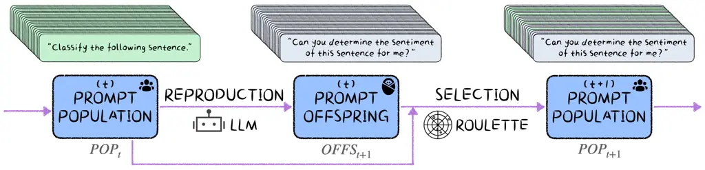
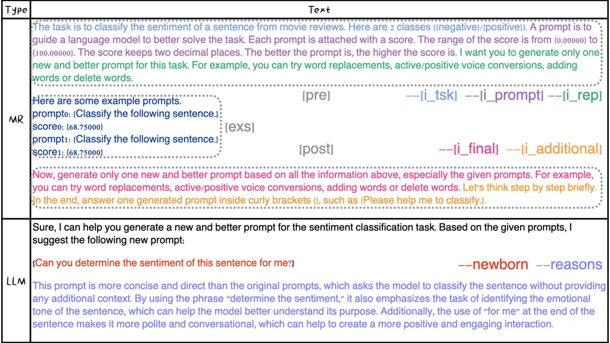
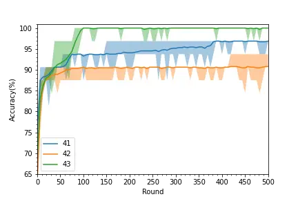
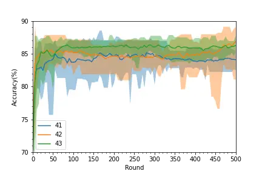

# SPELL: Semantic Prompt Evolution based on a LLM Discussion and comparison with contemporaneous works in Appendix B

Yujian Betterest LiKai Wu^(††)School of Artificial Intelligence, Xidian
University ^(†)^(†)thanks:  Correspondence:
[bebetterest@outlook.com](mailto:bebetterest@outlook.com)
Affiliation: Institute of Freedom and Happiness, Dream Place

###### Abstract

Prompt engineering is a new paradigm for enhancing the performance of
trained neural network models. For optimizing text-style prompts,
existing methods usually individually operate small portions of a text
step by step, which either breaks the fluency or could not globally
adjust a prompt. Since large language models (LLMs) have powerful
ability of generating coherent texts token by token, can we utilize LLMs
for improving prompts? Based on this motivation, in this paper,
considering a trained LLM as a text generator, we attempt to design a
black-box evolution algorithm for automatically optimizing texts, namely
SPELL (Semantic Prompt Evolution based on a LLM). The proposed method is
evaluated with different LLMs and evolution parameters in different text
tasks. Experimental results show that SPELL could rapidly improve the
prompts indeed. We further explore the evolution process and discuss on
the limitations, potential possibilities and future work.



Figure 1: Overview of SPELL (Semantic Prompt Evolution based on a LLM).

## 1 Introduction

Prompts (Liu et al., 2023) are additional contents which would be
integrated with the original input data to enhance the performance of a
trained target model. For example, in a text classification task, a
prompt, "\[input text\]\nDivide the above text into 2 classes: positive
and negative.\nClass:\[MASK\]", may strengthen the performance of a
language model because the prompt reduces the probabilities of many
unrelated tokens and hints what the model should focus on. Good prompt
engineering methods are able to enhance the ability of a target model
with limited and efficient optimization. Besides, prompts are flexible.
They could be continuous (Li and Liang, 2021; Qin and Eisner, 2021),
possibly work in hidden layers (Sun et al., 2022b), and have already
been applied to many modalities, such as text (Lester et al., 2021; Liu
et al., 2022), vision (Jia et al., 2022; Sohn et al., 2023), and graph
(Sun et al., 2022a; Yi et al., 2023). In this paper, we only focus on
discrete text-style prompts applied at the input of a language model for
text tasks.



Figure 2: A reproduction example including $`MP_{r}`$ and the response
from the LLM.

There are many methods to optimize text-style prompts. Gradient-based
methods (Wallace et al., 2019; Shin et al., 2020) are the most intuitive
one. They usually relax the discrete embeddings for optimization and
need large computation because of the process of backward through the
trained model. Nowadays, many target models are considered as black
boxes since only inference APIs are provided for the users. Hence, many
black-box methods, based on evolution (Sun et al., 2022c; Sun et al.,
2022b), reinforcement learning (Deng et al., 2022; Zhang et al., 2023;
Diao et al., 2023) or search strategies (Prasad et al., 2023), improve
the prompts without the information of gradients and parameters inside
the target model. In particular, evolution-based methods maintain a
population consists of several prompts as individuals and optimize the
population by biological mechanisms such as reproduction and selection.
However, these methods individually operate small portions of text step
by step, leading to lack of global adjustment and serious damage on the
fluency. The prompts optimized by these methods usually consist of
various _strange_ characters, such as "an-lione\_-lo-:)eak".

In recent years, large language models (LLMs) (Li et al., 2021; Zhao
et al., 2023) are the most popular star among various new AI
applications. Optimized on language modeling, they could get universal
generalization ability. With appropriate instructions, they could
acquire amazing performance on language understanding, reasoning and
text generation. Especially, the generated texts are coherent enough.

Therefore, we attempt to propose SPELL (Semantic Prompt Evolution based
on a LLM), an evolution algorithm to optimize prompts. Since the
proposed method considers a LLM as a generator, SPELL would utilize the
global feature of a prompt and the improved prompts are coherent.
Through experiments, we evaluate that SPELL could rapidly improve
performance keeping prompts fluent. Besides, we discover the evolution
process and the impacts of different LLMs or evolution strategies. The
limitations, challenges and possible directions are discussed on in the
end.

## 2 Methodology

As shown in Figure 1, SPELL maintains a population $`POP_{t}`$ of
$`N_{POP}`$ prompt individuals initialized as $`I_{ini}`$. By two
biological mechanisms, reproduction and selection, the population
evolves as

```math
\displaystyle OFFS_{t}=reproduction(POP_{t})
```

```math
\displaystyle POP_{t+1}=selection(OFFS_{t}\cup POP_{t})
```

where $`reproduction`$ generates the offspring $`OFFS_{t}`$ from
$`POP_{t}`$ and the next population $`POP_{t+1}`$ consists of
individuals selected from the union of $`OFFS_{t}`$ and $`POP_{t}`$. As
evolving for $`T`$ times, the population is gradually optimized by
generating better individuals and selecting the potential ones. In the
evolution process, how to inherit outstanding feature and make effective
explorations are the keys. In the following subsections, we introduce
different components of SPELL and explain how they work in detail.

### 2.1 Problem Formulation

In this paper, we focus on the text tasks translated to classification.
For example, sentiment analysis is to classify the emotion contained in
a given text. The text $`X`$ for a target language model $`M`$ is
constructed as

```math
X=concat([input],\backslash n,[prompt],\backslash n,[head])
```

where $`concat`$ stands for concatenate and $`[input]`$ for the input
example. $`\backslash n`$ is considered as an interval. $`[prompt]`$ is
the prompt to enhance $`M`$. $`[head]`$ is set as "class:" to guide
$`M`$ to make the prediction. Next, by language modeling, $`M`$ makes
the prediction as

```math
y=\mathop{\arg\min}\limits_{l_{i}\in L}P_{M}(l_{i}|x_{1},x_{2}...x_{N_{X}})
```

where L is the label space. To simplify the prediction process, we
choose one word standing for each label, such as "positive" and
"negative" in sentiment analysis. It is worth mentioning that we pay
attention to optimizing $`[prompt]`$ keeping $`M`$ fixed.

### 2.2 Reproduction

Reproduction is the process of generating newborns. To keep useful
feature from the previous generation, we select $`N_{P}`$ individuals
$`I_{P,t}`$ from $`POP_{t}`$ as parents for each child, which is
introduced in Section 2.3. Besides, the newborn individuals generated by
a LLM $`G`$ naturally include random variations as explorations. We
construct the core meta prompt for reproduction $`MP_{r}`$ as

```math
MP_{r}=concat([pre],\backslash n,[exs],\backslash n,[post])
```

where

```math
\displaystyle\begin{cases}[pre]=concat([i_{tsk}],[i_{prompt}],[i_{rep}])\\
[exs]=concat([pro_{1}],\backslash n,[pro_{2}]...[pro_{N_{P}}])\\
[post]=concat([i_{final}],[i_{additional}])\\
[pro_{i}]=concat([I_{P,t,i}],[fit_{i}]),i\in[1,N_{P}]\end{cases}
```

$`[pre]`$ describes the information on the task ($`[i_{tsk}]`$), defines
what a prompt is for ($`[i_{prompt}]`$) and leads to reproduction
($`[i_{rep}]`$). $`[exs]`$ shows selected parents for reference
($`[pro]`$). $`[post]`$ emphasizes generation requests ($`[i_{final}]`$)
and points out other additional instructions ($`[i_{additional}]`$).
Besides, $`[fit_{i}]`$ is the fitness/score for the corresponding
individual $`[I_{P,t,i}]`$. By default, $`[i_{prompt}]`$ is set as "A
prompt is to guide a language model to better solve the task. Each
prompt is attached with a score. The better the prompt is, the higher
the score is."; $`[i_{rep}]`$ is "I want you to generate only one new
and better prompt for this task. For example, you can try word
replacements, active/positive voice conversions, adding words or delete
words."; $`[i_{final}]`$ stands for "Now, generate only one new and
better prompt based on all the information above, especially the given
prompts. For example, you can try word replacements, active/positive
voice conversions, adding words or delete words." for detailed
generation requests; $`[i_{additional}]`$ is introduced later and
$`[i_{task}]`$ is listed in Table 4. Given a meta prompt $`MP_{r}`$, an
individual $`I_{o,t,i}`$ of the offspring $`OFFS_{t}`$ is obtained by

```math
I_{N,t,i}=EXT(G(MP_{r}))
```

where $`EXT`$ extracts the new prompt by the rule included in
$`[i_{additional}]`$. Specifically, in this paper, $`[i_{additional}]`$
is set as "Let’s think step by step briefly. In the end, output one
generated prompt inside curly brackets {}, such as {Please help me to
classify.}.", which means $`EXT`$ would take out the content inside a
pair of curly brackets. In particular, the optimization is prompt-wise
global and semantic because $`G`$ generates texts by language modeling.
After that, we obtain the next population $`POP_{t+1}`$ by selecting
individuals from $`POP_{t}`$ and $`OFFS_{t}`$.

### 2.3 Selection

Selection is to choose some individuals being parents or structuring the
new population. Selection strategies usually pay attention to balance
survival of the fittest and the luckiest. In SPELL, the selection is
based on roulette. First, we calculate the selection probability
$`P_{S,i}`$ for an individual $`I_{i}`$ among a candidate set $`CAN`$ as

```math
P_{S,i}=\frac{e^{fitness(I_{i})}}{\sum_{j\in CAN}(e^{fitness(I_{j})})}
```

where $`fitness`$ is the metric function which describes how a
individual performs in the target task. Better the individual is, higher
the corresponding selection probability is, which is helpful for
convergence. Then, $`N_{S}`$ selected individuals $`I_{S}`$ are sampled
from $`CAN`$ as

```math
I_{S}=sample(CAN,N_{S},P_{S})
```

In this way, poor individual would have a chance to be selected, which
enriches the diversity.

## 3 Experiments

#### Setups

We experiment on three text tasks from GLUE (Wang et al., 2018): SST-2
for sentiment prediction, RTE for textual entailment recognition, and
AG’s News for news classification. Following Sun et al., 2022d, our
experiments are in the few-shot setting. Only $`k`$ samples for each
class are selected as $`k`$-shot training data $`D_{train}`$. The
original development data is the test data $`D_{test}`$, and for
datasets without development data, the original test data is used. All
datasets and the trained target model are implemented by huggingface¹¹ 1
[https://huggingface.co](https://huggingface.co) and all LLM APIs are
available on qianfan platform²² 2
[https://cloud.baidu.com/product/wenxinworkshop](https://cloud.baidu.com/product/wenxinworkshop).
In addition, by default, the trained target model is RoBERTa-large³³ 3
[https://huggingface.co/roberta-large](https://huggingface.co/roberta-large)
(Liu et al., 2019) while the LLM for reproduction is Llama-2-Chat-7b
(Touvron et al., 2023); for each round, 5 new individuals are generated
based on 1 parent and and another 5 newborns based on 2 parents; elite
preservation is implemented for keeping the best individual;
$`N_{POP}`$=$`N_{s}`$=20, $`T`$=500, $`k`$=16, the seed is set to 42,
$`fitness`$ is the classification accuracy and the maximum $`fitness`$
of individuals in a population is considered as the performance of the
population.

|                |          |        |              |
| -------------- | -------- | ------ | ------------ |
| Method         | SST-2(%) | RTE(%) | AG’s News(%) |
| Zero-shot      | 70.6     | 45.5   | 54.3         |
| Fine-tuning    | 81.4     | 54.4   | 86.2         |
| LM-BFF         | 92.3     | 66.6   | 87.1         |
| DART           | 93.5     | 59.0   | 86.8         |
| BBT            | 88.2     | 49.1   | 81.2         |
| RLPrompt       | 90.5     | 52.2   | 76.2         |
| PROMPTBOOSTING | 87.6     | 60.0   | 85.2         |
| TEMPERA        | 91.9     | 60.3   | 85.5         |
| SPELL          | 89.2     | 50.9   | 70.0         |

Table 1: Performance of different methods in $`D_{test}`$. Zero-shot
utilizes the initial prompt for prediction. Fine-tuning, LM-BFF (Gao
et al., 2021) and DART (Zhang et al., 2022) are white-box methods while
BBT (Sun et al., 2022c), RLPrompt (Deng et al., 2022), PROMPTBOOSTING
(Hou et al., 2023), TEMPERA (Zhang et al., 2023), and SPELL (ours) are
black-box methods.

#### Overall View

We compare SPELL with state-of-the-art methods and feasible black-box
works. As shown in Table 1, as a black-box method, SPELL could improve
the accuracy and shows the potential of prompt optimization problems.





Figure 3: Accuracy vs. round with different seeds. Three seeds (41, 42
and 43) are considered. The top one is evaluated in $`D_{train}`$ while
the bottom one in $`D_{test}`$.

#### Optimization Process

The optimization process is described in Figure 3. Due to the few-shot
setting, there exists a performance gap between $`D_{train}`$ and
$`D_{test}`$. SPELL optimizes with fewer rounds than many black-box
methods, such as BBT and RLPROMPT (more than 3k rounds for prompts of
only 5 tokens). In addition, it is worth noting that, due to the
randomness of evolution process and text generation, SPELL is unstable
with obvious fluctuations. In addition, the individual generation
process is semantically causal and newborn prompts are coherent since it
is spelled by the LLM token by token according to language modeling. For
example, in SST-2, given the initial prompt "Classify the following
sentence.", LLM would globally improve it to a new fluent one "Can you
determine the sentiment of this sentence for me?" with clear reasons
"…more concise and direct…emphasizes the task…more polite and
conversational". A reproduction example is shown in Figure 2.

| LLM         | Size(B) | Train(%) | Test(%) |
| ----------- | ------- | -------- | ------- |
| Llama2-Chat | 7       | 100.0    | 89.2    |
| Llama2-Chat | 13      | 96.9     | 90.0    |
| BLOOMZ      | 7       | n/a      | n/a     |
| ERNIE-Bot   | n/a     | 100.0    | 90.7    |

Table 2: Performance on various LLMs in SST-2. Two Llama2 (Touvron
et al., 2023) models with different size are evaluated. BLOOMZ
(Muennighoff et al., 2022) fails to generate individuals following
instructions. The size of ERNIE-Bot (Baidu, 2023) is not available.

#### Influence of Different LLMs

As shown in Table 2, we evaluate SPELL with different LLMs. Without any
especial adaptation, not every LLM could be utilized in SPELL. For
example, BLOOMZ is not available because it can not reply following the
hinted format. In addition, ERBIE-Bot performs the best while the test
accuracy of Llama2-Chat-13B is higher than that of Llama2-Chat-7B. It
seems that larger and better LLMs would have better performance. Thus,
the LLM for generation is essential for SPELL.

|                    |          |         |
| ------------------ | -------- | ------- |
| Configuration      | Train(%) | Test(%) |
| _Base_             | 100.0    | 89.2    |
| $`fitness`$=_loss_ | 71.9     | 69.4    |
| $`N_{POP}`$=2      | 100.0    | 88.9    |
| $`N_{POP}`$=50     | 100.0    | 87.0    |
| $`k`$=32           | 95.3     | 86.2    |
| $`k`$=64           | 92.2     | 90.7    |

Table 3: Results of ablation studies in SST-2. _Base_ means the default
settings ($`fitness`$=accuracy; $`N_{POP}`$=20; $`k`$=16). _loss_ refers
to the cross-entropy loss.

#### Ablation Studies

As shown in Table 3, we attempt to find out the impact of some
meaningful factors. Even though previous methods usually utilize
$`loss`$ for optimization, we find that SPELL could not work well when
$`fitness`$ is set as $`loss`$. It may demonstrate that a pure LLM could
not effectively exploit the information contained in $`loss`$. Instead,
our method could improve the population simply based on the accuracy. In
addition, for the balance of exploration and greediness, the size of the
population $`N_{POP}`$ should be neither too small or large. Besides,
larger $`D_{train}`$ trends to obtain higher accuracy for better
estimation.

## 4 Conclusion and Discussion

In this paper, we propose SPELL, a semantic prompt evolution method
considering a LLM as a prompt generator. We demonstrate that the
proposed method could globally optimize prompts quickly, the
reproduction process is reasonable and new spelled prompts are coherent.
Besides, we do some ablation studies for further investigation. Even if
our method seems unstable, it shows huge latent capacity. Future work
may focus on adjusting a LLM to be more adaptive for semantic prompt
optimization, such as meta prompt optimization and parameter effective
parameter-efficient alignment, stabilizing the optimization, and
expanding semantic evolution beyond text optimization.

## References

- Baidu (2023) Baidu. 2023. Ernie bot: Baidu’s knowledge-enhanced large
  language model built on full ai stack technology.
  [http://research.baidu.com/Blog/index-view?id=183](http://research.baidu.com/Blog/index-view?id=183).
- Deng et al. (2022) Mingkai Deng, Jianyu Wang, Cheng-Ping Hsieh, Yihan
  Wang, Han Guo, Tianmin Shu, Meng Song, Eric Xing, and Zhiting
  Hu. 2022. RLPrompt: Optimizing discrete text prompts with
  reinforcement learning. In _Proceedings of the 2022 Conference on
  Empirical Methods in Natural Language Processing_, pages 3369–3391,
  Abu Dhabi, United Arab Emirates. Association for Computational
  Linguistics.
- Diao et al. (2023) Shizhe Diao, Zhichao Huang, Ruijia Xu, Xuechun Li,
  LIN Yong, Xiao Zhou, and Tong Zhang. 2023. Black-box prompt learning
  for pre-trained language models. _Transactions on Machine Learning
  Research_.
- Gao et al. (2021) Tianyu Gao, Adam Fisch, and Danqi Chen. 2021. Making
  pre-trained language models better few-shot learners. In _Proceedings
  of the 59th Annual Meeting of the Association for Computational
  Linguistics and the 11th International Joint Conference on Natural
  Language Processing (Volume 1: Long Papers)_, pages 3816–3830, Online.
  Association for Computational Linguistics.
- Guo et al. (2023) Qingyan Guo, Rui Wang, Junliang Guo, Bei Li, Kaitao
  Song, Xu Tan, Guoqing Liu, Jiang Bian, and Yujiu Yang. 2023.
  Connecting large language models with evolutionary algorithms yields
  powerful prompt optimizers. _arXiv preprint arXiv:2309.08532_.
- Hou et al. (2023) Bairu Hou, Joe O’Connor, Jacob Andreas, Shiyu Chang,
  and Yang Zhang. 2023. PromptBoosting: Black-box text classification
  with ten forward passes. In _Proceedings of the 40th International
  Conference on Machine Learning_, volume 202 of _Proceedings of Machine
  Learning Research_, pages 13309–13324. PMLR.
- Jia et al. (2022) Menglin Jia, Luming Tang, Bor-Chun Chen, Claire
  Cardie, Serge Belongie, Bharath Hariharan, and Ser-Nam Lim. 2022.
  Visual prompt tuning. In _European Conference on Computer Vision_,
  pages 709–727. Springer.
- Lester et al. (2021) Brian Lester, Rami Al-Rfou, and Noah
  Constant. 2021. The power of scale for parameter-efficient prompt
  tuning. In _Proceedings of the 2021 Conference on Empirical Methods in
  Natural Language Processing_, pages 3045–3059, Online and Punta Cana,
  Dominican Republic. Association for Computational Linguistics.
- Li et al. (2021) Junyi Li, Tianyi Tang, Wayne Xin Zhao, and Ji-Rong
  Wen. 2021. Pretrained language model for text generation: A survey. In
  _Proceedings of the Thirtieth International Joint Conference on
  Artificial Intelligence, IJCAI-21_, pages 4492–4499. International
  Joint Conferences on Artificial Intelligence Organization. Survey
  Track.
- Li and Liang (2021) Xiang Lisa Li and Percy Liang. 2021.
  Prefix-tuning: Optimizing continuous prompts for generation. In
  _Proceedings of the 59th Annual Meeting of the Association for
  Computational Linguistics and the 11th International Joint Conference
  on Natural Language Processing (Volume 1: Long Papers)_, pages
  4582–4597, Online. Association for Computational Linguistics.
- Liu et al. (2023) Pengfei Liu, Weizhe Yuan, Jinlan Fu, Zhengbao Jiang,
  Hiroaki Hayashi, and Graham Neubig. 2023. Pre-train, prompt, and
  predict: A systematic survey of prompting methods in natural language
  processing. _ACM Computing Surveys_, 55(9):1–35.
- Liu et al. (2022) Xiao Liu, Kaixuan Ji, Yicheng Fu, Weng Tam,
  Zhengxiao Du, Zhilin Yang, and Jie Tang. 2022. P-tuning: Prompt tuning
  can be comparable to fine-tuning across scales and tasks. In
  _Proceedings of the 60th Annual Meeting of the Association for
  Computational Linguistics (Volume 2: Short Papers)_, pages 61–68,
  Dublin, Ireland. Association for Computational Linguistics.
- Liu et al. (2019) Yinhan Liu, Myle Ott, Naman Goyal, Jingfei Du,
  Mandar Joshi, Danqi Chen, Omer Levy, Mike Lewis, Luke Zettlemoyer, and
  Veselin Stoyanov. 2019. Roberta: A robustly optimized bert pretraining
  approach. _arXiv preprint arXiv:1907.11692_.
- Muennighoff et al. (2022) Niklas Muennighoff, Thomas Wang, Lintang
  Sutawika, Adam Roberts, Stella Biderman, Teven Le Scao, M Saiful Bari,
  Sheng Shen, Zheng-Xin Yong, Hailey Schoelkopf, et al. 2022.
  Crosslingual generalization through multitask finetuning. _arXiv
  preprint arXiv:2211.01786_.
- Prasad et al. (2023) Archiki Prasad, Peter Hase, Xiang Zhou, and Mohit
  Bansal. 2023. GrIPS: Gradient-free, edit-based instruction search for
  prompting large language models. In _Proceedings of the 17th
  Conference of the European Chapter of the Association for
  Computational Linguistics_, pages 3845–3864, Dubrovnik, Croatia.
  Association for Computational Linguistics.
- Qin and Eisner (2021) Guanghui Qin and Jason Eisner. 2021. Learning
  how to ask: Querying LMs with mixtures of soft prompts. In
  _Proceedings of the 2021 Conference of the North American Chapter of
  the Association for Computational Linguistics: Human Language
  Technologies_, pages 5203–5212, Online. Association for Computational
  Linguistics.
- Shin et al. (2020) Taylor Shin, Yasaman Razeghi, Robert L. Logan IV,
  Eric Wallace, and Sameer Singh. 2020. AutoPrompt: Eliciting Knowledge
  from Language Models with Automatically Generated Prompts. In
  _Proceedings of the 2020 Conference on Empirical Methods in Natural
  Language Processing (EMNLP)_, pages 4222–4235, Online. Association for
  Computational Linguistics.
- Sohn et al. (2023) Kihyuk Sohn, Huiwen Chang, José Lezama, Luisa
  Polania, Han Zhang, Yuan Hao, Irfan Essa, and Lu Jiang. 2023. Visual
  prompt tuning for generative transfer learning. In _Proceedings of the
  IEEE/CVF Conference on Computer Vision and Pattern Recognition
  (CVPR)_, pages 19840–19851.
- Sun et al. (2022a) Mingchen Sun, Kaixiong Zhou, Xin He, Ying Wang, and
  Xin Wang. 2022a. Gppt: Graph pre-training and prompt tuning to
  generalize graph neural networks. In _Proceedings of the 28th ACM
  SIGKDD Conference on Knowledge Discovery and Data Mining_, KDD ’22,
  page 1717–1727, New York, NY, USA. Association for Computing
  Machinery.
- Sun et al. (2022b) Tianxiang Sun, Zhengfu He, Hong Qian, Yunhua Zhou,
  Xuanjing Huang, and Xipeng Qiu. 2022b. BBTv2: Towards a gradient-free
  future with large language models. In _Proceedings of the 2022
  Conference on Empirical Methods in Natural Language Processing_, pages
  3916–3930, Abu Dhabi, United Arab Emirates. Association for
  Computational Linguistics.
- Sun et al. (2022c) Tianxiang Sun, Yunfan Shao, Hong Qian, Xuanjing
  Huang, and Xipeng Qiu. 2022c. Black-box tuning for
  language-model-as-a-service. In _Proceedings of the 39th International
  Conference on Machine Learning_, volume 162 of _Proceedings of Machine
  Learning Research_, pages 20841–20855. PMLR.
- Sun et al. (2022d) Tianxiang Sun, Yunfan Shao, Hong Qian, Xuanjing
  Huang, and Xipeng Qiu. 2022d. Black-box tuning for
  language-model-as-a-service. In _International Conference on Machine
  Learning_, pages 20841–20855. PMLR.
- Touvron et al. (2023) Hugo Touvron, Louis Martin, Kevin Stone, Peter
  Albert, Amjad Almahairi, Yasmine Babaei, Nikolay Bashlykov, Soumya
  Batra, Prajjwal Bhargava, Shruti Bhosale, et al. 2023. Llama 2: Open
  foundation and fine-tuned chat models. _arXiv preprint
  arXiv:2307.09288_.
- Wallace et al. (2019) Eric Wallace, Shi Feng, Nikhil Kandpal, Matt
  Gardner, and Sameer Singh. 2019. Universal adversarial triggers for
  attacking and analyzing NLP. In _Proceedings of the 2019 Conference on
  Empirical Methods in Natural Language Processing and the 9th
  International Joint Conference on Natural Language Processing
  (EMNLP-IJCNLP)_, pages 2153–2162, Hong Kong, China. Association for
  Computational Linguistics.
- Wang et al. (2018) Alex Wang, Amanpreet Singh, Julian Michael, Felix
  Hill, Omer Levy, and Samuel R Bowman. 2018. Glue: A multi-task
  benchmark and analysis platform for natural language understanding.
  _arXiv preprint arXiv:1804.07461_.
- Yang et al. (2023) Chengrun Yang, Xuezhi Wang, Yifeng Lu, Hanxiao Liu,
  Quoc V Le, Denny Zhou, and Xinyun Chen. 2023. Large language models as
  optimizers. _arXiv preprint arXiv:2309.03409_.
- Yi et al. (2023) Zixuan Yi, Iadh Ounis, and Craig Macdonald. 2023.
  Contrastive graph prompt-tuning for cross-domain recommendation. _ACM
  Transactions on Information Systems_.
- Zhang et al. (2022) Ningyu Zhang, Luoqiu Li, Xiang Chen, Shumin Deng,
  Zhen Bi, Chuanqi Tan, Fei Huang, and Huajun Chen. 2022. Differentiable
  prompt makes pre-trained language models better few-shot learners. In
  _International Conference on Learning Representations_.
- Zhang et al. (2023) Tianjun Zhang, Xuezhi Wang, Denny Zhou, Dale
  Schuurmans, and Joseph E. Gonzalez. 2023. TEMPERA: Test-time prompt
  editing via reinforcement learning. In _The Eleventh International
  Conference on Learning Representations_.
- Zhao et al. (2023) Wayne Xin Zhao, Kun Zhou, Junyi Li, Tianyi Tang,
  Xiaolei Wang, Yupeng Hou, Yingqian Min, Beichen Zhang, Junjie Zhang,
  Zican Dong, et al. 2023. A survey of large language models. _arXiv
  preprint arXiv:2303.18223_.

## Appendix A Other Settings

| Task  | $`i_{task}`$                                                                                                                                                                                                                                                |
| ----- | ----------------------------------------------------------------------------------------------------------------------------------------------------------------------------------------------------------------------------------------------------------- |
| SST-2 | "The task is to classify the sentiment of a sentence from movie reviews. Here are 2 classes ({negative}/{positive})."                                                                                                                                       |
| RTE   | "The task is to classify the relationship between sentence1 and sentence2. Here are 2 classes ({yes}/{no}). {yes} means the relationship is entailment, the meaning of one sentence is entailed (can be inferred) from the other sentence, otherwise {no}." |
| Task  | $`I_{ini}`$                                                                                                                                                                                                                                                 |
| SST-2 | "Classify the following sentence."                                                                                                                                                                                                                          |
| RTE   | "Classify whether the relationship between the following sentence1 and sentence2 is entailment."                                                                                                                                                            |

Table 4: A list of $`i_{task}`$ and $`I_{ini}`$ in the experiments.

## Appendix B On the Contemporaneous Works

We discuss on two recent and similar contemporaneous works which utilize
a LLM as a prompt generator/optimizer as well. It is worth noticing that
OPRO and EVOPROMPT perform rather well while SPELL (ours) does not.
Moreover, there’s overlap between the datasets on which EVOPROMPT is
evaluated and those of ours. Considering the difference of the target
model, we think the reason may be that the accuracy is originally higer
when the target model is a LLM, and that the improved prompts generated
by a LLM could not be well "understood" by a relatively small language
model. In addition, the comparisons of OPRO and EVOPROMPT with SPELL
(ours) are illustrated in detail as follows:

#### OPRO (Yang et al., 2023)

The target model of OPRO is a LLM while that of SPELL is a much smaller
language model. Besides, we think the key difference is that OPRO
constructs a prompt-score trajectory of prompts to update the prompts
while SPELL (ours) introduces selection and reproduction with randomness
from evolution algorithm for prompt improvement.

#### EVOPROMPT (Guo et al., 2023)

EVOPROMPT and SPELL are really similar. EVOPROMPT includes evolution
algorithm as well and further apply differential evolution with a LLM.
EVOPROMPT separately designs the crossover and mutation operators while
SPELL (ours) consists of one general operator for reproduction. Besides,
the target model of EVOPROMPT is a LLM.
