# Use Your INSTINCT: INSTruction optimization for LLMs usIng Neural bandits Coupled with Transformers

Xiaoqiang Lin\* Email: [wenyang@comp.nus.edu.sg](mailto:)    Zhaoxuan
Wu\* Email: [shuyao95@gmail.com](mailto:)    Zhongxiang Dai^(†) Email:
[seekiong@nus.edu.sg](mailto:)    Wenyang Hu Email:
[jaillet@mit.edu](mailto:)    Yao Shu Email:
[lowkh@comp.nus.edu.sg](mailto:)    See-Kiong Ng    Patrick Jaillet &
Bryan Kian Hsiang Low Affiliation: Department of Computer Science,
National University of Singapore Affiliation: Institute of Data Science,
National University of Singapore Affiliation: Integrative Sciences and
Engineering Programme, National University of Singapore Affiliation: AI
Platform Department, Tencent Affiliation: Department of Electrical
Engineering and Computer Science, MIT{xiaoqiang.lin,
wu.zhaoxuan}@comp.nus.edu.sg, dzx@nus.edu.sg,    Xiaoqiang Lin
Affiliation: Department of Computer Science, National University of
Singapore    Zhaoxuan Wu Affiliation: Institute of Data Science,
National University of Singapore Affiliation: Integrative Sciences and
Engineering Programme, National University of Singapore    Zhongxiang
Dai Affiliation: LIDS and EECS, Massachusetts Institute of Technology
Correspondence to: <daizx@mit.edu>    Wenyang Hu Affiliation: Department
of Computer Science, National University of Singapore Affiliation:
Institute of Data Science, National University of Singapore    Yao Shu
Affiliation: Guangdong Lab of AI and Digital Economy (SZ)    See-Kiong
Ng Affiliation: Department of Computer Science, National University of
Singapore Affiliation: Institute of Data Science, National University of
Singapore    Patrick Jaillet Affiliation: LIDS and EECS, Massachusetts
Institute of Technology    Bryan Kian Hsiang Low Affiliation: Department
of Computer Science, National University of Singapore

###### Abstract

Large language models (LLMs) have shown remarkable instruction-following
capabilities and achieved impressive performances in various
applications. However, the performances of LLMs depend heavily on the
_instructions_ given to them, which are typically manually tuned with
substantial human efforts. Recent work has used the query-efficient
Bayesian optimization (BO) algorithm to automatically optimize the
instructions given to black-box LLMs. However, BO usually falls short
when optimizing highly sophisticated (e.g., high-dimensional) objective
functions, such as the functions mapping an instruction to the
performance of an LLM. This is mainly due to the limited expressive
power of the Gaussian process (GP) which is used by BO as a surrogate to
model the objective function. Meanwhile, it has been repeatedly shown
that neural networks (NNs), especially pre-trained transformers, possess
strong expressive power and can model highly complex functions. So, we
adopt a _neural bandit_ algorithm which replaces the GP in BO by an NN
surrogate to optimize instructions _for black-box LLMs_. More
importantly, the neural bandit algorithm allows us to naturally _couple
the NN surrogate with the hidden representation learned by a pre-trained
transformer_ (i.e., an open-source LLM), which significantly boosts its
performance. These motivate us to propose our _INSTruction optimization
usIng Neural bandits Coupled with Transformers_ (INSTINCT) algorithm. We
perform instruction optimization for ChatGPT and use extensive
experiments to show that INSTINCT consistently outperforms baselines in
different tasks, e.g., various instruction induction tasks and the task
of improving zero-shot chain-of-thought instructions. Our code is
available at
[https://github.com/xqlin98/INSTINCT](https://github.com/xqlin98/INSTINCT).

###### Keywords:

Prompt Optimization, Instruction Optimization, Large Language Models

^(†)^(†)affiliationnotice: Equal contribution

## 1 Introduction

_Large language models_ (LLMs) have recently achieved remarkable
performances across a variety of tasks (Zhao et al., 2023; Touvron et
al., 2023). This can mainly be attributed to the strong
instruction-following capability of LLMs, which allows adaptation to
various downstream applications (Liu et al., 2023; Chen et al., 2023a).
However, it has been widely observed that the performances of LLMs
heavily depend on the instructions/prompts given to them. These
instructions are typically manually designed, which can be a
human-intensive and costly process (Reynolds & McDonell, 2021; Mishra et
al., 2021). Therefore, it is of paramount importance to develop
efficient methods to automatically optimize the instructions/prompts to
attain the best performance of LLMs. In this work, we refer to this
problem as _instruction optimization_ and use instructions/prompts
interchangeably.

Some works have adopted gradient-based methods to optimize the
instructions of LLMs (Shin et al., 2020; Li & Liang, 2021; Lester et
al., 2021). However, these methods require access to the gradient of the
LLMs and are hence restricted to white-box (i.e., open-source) LLMs,
whereas the most powerful LLMs nowadays are typically _black-box_ (e.g.,
ChatGPT (OpenAI, 2023a) and GPT-4 (OpenAI, 2023b)). Furthermore, even
for white-box LLMs, gradient computation becomes resource-intensive and
hence less practical as the models become larger, which is another
limitation of gradient-based methods. Therefore, recent works have
proposed instruction optimization methods not requiring the model
gradient, which are able to optimize the instructions for black-box LLMs
(Zhou et al., 2023; Prasad et al., 2023; Pryzant et al., 2023). However,
these methods are based on heuristic local search and are hence not able
to leverage the observation history (i.e., the previously queried
instructions and their scores) when selecting new instructions to query.
As a consequence, these methods are not able to balance _exploration_ of
the entire space of instructions (to query instructions whose scores are
uncertain) vs. _exploitation_ of the current observation history (to
query instructions predicted to have high scores based on the
observation history). This makes them _query-inefficient_ and hence
impractical when the API calls to black-box LLMs incur costs such as
monetary and time expenses.

In this regard, the recent work of Chen et al. (2023b) has proposed the
InstructZero algorithm which optimizes the instruction using the
_query-efficient_ Bayesian optimization (BO) algorithm (Garnett, 2023).
To apply BO, InstructZero uses _a separate white-box LLM_ to convert
instruction optimization for black-box LLMs to a continuous optimization
problem, i.e., optimizing the _soft prompt_ which is a continuous vector
(more details in Sec. 2.1). Then, InstructZero uses a Gaussian process
(GP) (Rasmussen & Williams, 2006) as a surrogate to model the objective
function (i.e., the function mapping a soft prompt to a score), and
sequentially selects the soft prompts to query by maximizing an
acquisition function which balances exploration and exploitation in a
theoretically grounded manner. However, it has been shown that BO often
falls short when optimizing highly sophisticated or high-dimensional
objective functions (Dai et al., 2022), such as the function mapping a
soft prompt to the performance (i.e., score) of an LLM. This important
shortcoming of BO is mainly attributed to the limited expressive power
of the GP surrogate. On the other hand, it has been repeatedly shown
that _neural networks_ (NNs), especially pre-trained _transformer_
models (Vaswani et al., 2017), possess strong expressive power and can
model highly complex functions with high-dimensional inputs.

Therefore, in this work, we perform instruction optimization for
black-box LLMs by adopting a recently developed _neural bandit_
algorithm: _Neural Upper Confidence Bound_ (NeuralUCB) (Zhou et al., 2020) (Sec. 2.2). NeuralUCB replaces the GP surrogate in BO with an NN
surrogate while preserving the ability of BO to trade-off exploration
vs. exploitation in a principled way. More importantly, NeuralUCB allows
us to naturally _couple the NN surrogate with the hidden representation
learned by a pre-trained transformer_ (i.e., a white-box LLM), which
further improves the capability of the NN surrogate for score prediction
and hence boosts the performance of our algorithm. As a result, we
propose our _INSTruction optimization usIng Neural bandits Coupled with
Transformers_ (INSTINCT) algorithm (Sec. 3). In our empirical
evaluations, we optimize the instructions for the black-box LLM ChatGPT
(OpenAI, 2023a) and adopt Vicuna (Chiang et al., 2023) as the white-box
LLM. Figure 1 gives a glimpse of the impressive performance of INSTINCT
over baselines. We use extensive experiments to show that our INSTINCT
consistently outperforms the existing methods in different tasks (Sec.
4), such as in various instruction induction tasks (Sec. 4.1) and the
task of improving the zero-shot chain-of-thought (CoT) instruction (Sec.
4.2). We also use ablation studies to unveil interesting insights about
our INSTINCT algorithm (Sec. 5).

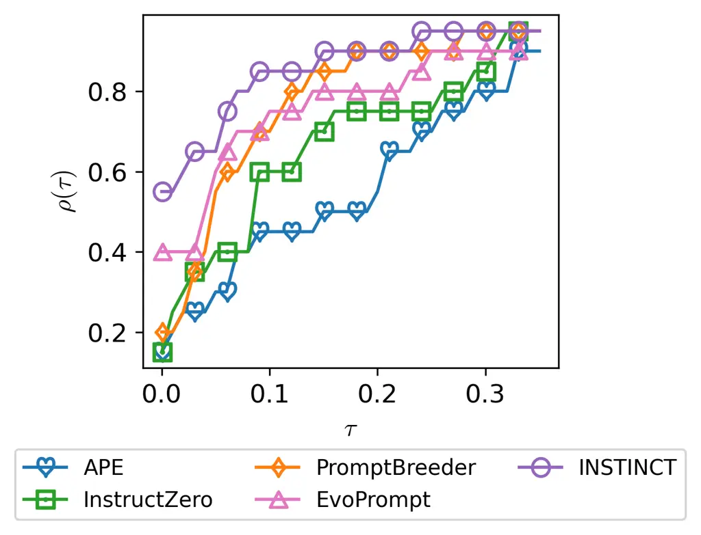

Figure 1: The performance profile curve of our INSTINCT over baselines.
More details are in App. E.3.

## 2 Background and Problem Settings

### 2.1 Bayesian Optimization for Instruction Optimization

Instruction Optimization. A black-box LLM $`f`$ takes as input an
_instruction_ $`\rho`$ prepended to a test input $`x`$, and outputs a
sentence $`\hat{y}=f(\rho,x)`$. The LLM $`f`$ is _black-box_ in that we
can only query it via its API and cannot access its parameters. We
consider a language task with a validation dataset
$`D_{V}={\{(x_{i},y_{i})\}}_{i=1}^{n}`$ of $`n`$ pairs of input sentence
$`x_{i}`$ and its corresponding ground truth output sentence $`y_{i}`$.
For an instruction $`\rho`$ and an input $`x_{i}`$, a score function
$`s(\cdot,\cdot)`$ compares the LLM output sentence
$`\hat{y}_{i}=f(\rho,x_{i})`$ with the ground truth output sentence
$`y_{i}`$ to return a score $`s(\hat{y}_{i},y_{i})`$. As a result,
instruction optimization can be formulated as the problem of finding the
optimal instruction $`\rho^{*}`$ that achieves the highest score
averaged over the validation set $`D_{V}`$. Note that the performance of
the instruction $`\rho`$ we find using the validation set $`D_{V}`$ is
evaluated using a separate test set $`D_{T}`$.

Directly optimizing the instruction $`\rho`$ for a black-box LLM $`f`$
is challenging because of the combinatorial nature of the tokens forming
the instruction $`\rho`$. To this end, InstructZero (Chen et al., 2023b)
has used a separate white-box (i.e., open-source) LLM $`w`$ to convert
this combinatorial optimization problem (i.e., optimizing $`\rho`$) into
continuous optimization, i.e., optimizing a _soft prompt_ $`z`$.
Specifically, a soft prompt $`z\in Z\subset\mathbb{R}^{d}`$ is a
$`d`$-dimensional continuous vector and corresponds to the token
embeddings of a number $`N_{z}`$ of soft tokens (Lester et al., 2021). A
soft prompt $`z`$ is prepended to the token embeddings of a fixed set
$`E`$ of input-output exemplars
$`E=\{(x_{\tau},y_{\tau})\}_{\tau=1}^{\kappa}`$ for the task. These
concatenated embeddings are used as the input to the white-box LLM
$`w`$, which subsequently generates an instruction $`\rho(z)=w(z,E)`$.
The generated instruction $`\rho(z)`$ is then prepended to a test input
$`x_{i}`$ (from the validation dataset
$`D_{V}={\{(x_{i},y_{i})\}}_{i=1}^{n}`$) and used as input to the
black-box LLM $`f`$ to generate an output sentence
$`\hat{y}_{i}=f(\rho(z),x_{i})`$, which is then evaluated to produce a
score $`s(\hat{y}_{i},y_{i})`$. In doing so, with a fixed set $`E`$ of
exemplars, the discrete optimization problem of optimizing $`\rho`$ is
converted to the optimization of a continuous soft prompt $`z`$:

```math
\displaystyle z^{*} \displaystyle={\argmax}_{z\in Z}h\big(\rho(z)\big), \tag{1}
```

```math
\displaystyle h\big(\rho(z)\big) \displaystyle\triangleq\mathbb{E}_{(x,y)\in D_{V}}s\bigl(f\big(\rho(z),x\big),y\bigl)
```

```math
\displaystyle=(1/n){\textstyle\sum^{n}_{i=1}}s\bigl(\hat{y}_{i},y_{i}\bigl).
```

Based on this formulation, InstructZero (Chen et al., 2023b) has adopted
_Bayesian optimization_ (BO) (Garnett, 2023) to maximize the objective
function $`h\big(\rho(z)\big)`$ (equation 1). To achieve this, a
_Gaussian process_ (GP) (Rasmussen & Williams, 2006) is used as a
surrogate to model the function $`h\big(\rho(z)\big)`$. In every
iteration $`t`$ of BO, the current observation history is used to update
the GP model which is then used to calculate an _acquisition function_
$`\alpha_{t}(z)`$. Then, a soft prompt $`z_{t}`$ is selected by
maximizing $`\alpha_{t}(z)`$: $`z_{t}=\arg\max_{z\in Z}\alpha_{t}(z)`$.
Next, the selected $`z_{t}`$ is used as input to the white-box LLM $`w`$
to produce an instruction $`\rho_{t}`$, which is then evaluated using
the black-box LLM $`f`$ to produce a score $`h_{t}`$ (details in Sec.
3.3). Lastly, the newly collected input-output pair $`(z_{t},h_{t})`$ is
added to the observation history to update the GP model, which is then
used to select the soft prompt $`z_{t+1}`$ in the next iteration.

The soft prompt $`z`$ is normally high-dimensional (e.g.,
$`d=5120\times N_{z}`$ when $`w`$ is Vicuna 13B), which makes it
challenging for BO to optimize. So, InstructZero (Chen et al., 2023b)
has adopted the technique of _random projection_ to reduce the input
dimension. That is, given a matrix
$`A\in\mathbb{R}^{d\times d^{\prime}}`$ ($`d^{\prime}\ll d`$) with
randomly sampled elements and a $`d^{\prime}`$-dimensional continuous
vector $`\hat{z}`$, the vector $`z=A\hat{z}`$ is used as the soft
prompt. After substituting the $`z`$ by $`A\hat{z}`$, the input variable
to be optimized in equation 1 is changed to $`\hat{z}`$ and hence the
input dimension of the optimization problem is reduced to
$`d^{\prime}`$. The reduced input dimension $`d^{\prime}`$, i.e., the
_intrinsic dimension_, is chosen as $`d^{\prime}=10`$ in InstructZero.

### 2.2 Neural Bandits

Neural bandit algorithms, such as NeuralUCB (Zhou et al., 2020) we have
adopted in this work, replace the GP surrogate in BO (Sec. 2.1) by a
neural network (NN) while preserving the principled ability of BO to
trade-off exploration vs. exploitation. The strong expressive power of
NNs equips neural bandit algorithms with the ability to optimize highly
complicated objective functions, which is theoretically justified (Dai
et al., 2022). In practice, neural bandit algorithms have also been
shown to outperform BO especially in problems with sophisticated
objective functions (Lisicki et al., 2021). However, naively applying
NeuralUCB to our problem is challenged by the huge computational costs.
This is because every evaluation of the NeuralUCB acquisition function
requires performing an inference using the white-box LLM, which can be
extremely costly since the acquisition function needs to be evaluated
many times in every iteration. So, we use a technique based on
pre-computation (Sec. 3.2) to sidestep this expensive computation and
hence make our INSTINCT algorithm scalable. Moreover, we also couple the
NN surrogate in NeuralUCB with the powerful hidden representation
learned by a pre-trained transformer to further improve the performance
of our INSTINCT (Sec. 3.1).

## 3 INSTINCT for Instruction Optimization

|                                                             |
| ----------------------------------------------------------- |
| 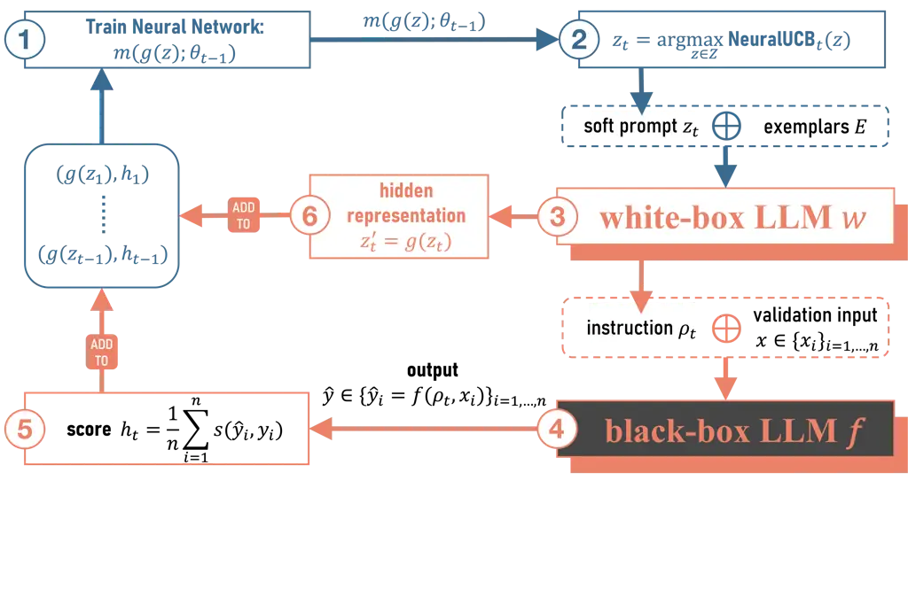 |

Figure 2: Illustration of our INSTINCT algorithm. Every step is
described in detail in Sec. 3.

Overview. In every iteration $`t`$ of our INSTINCT algorithm (Fig. 2),
we firstly use the current observation history (i.e., pairs of soft
prompts and observed scores) to train an NN for score prediction (step
{\scriptsize1}⃝, Sec. 3.1), and use the trained NN to calculate the
NeuralUCB acquisition function (equation 2), which is then maximized to
select the next soft prompt $`z_{t}`$ to query (step {\scriptsize2}⃝,
Sec. 3.2). Next, we feed the selected $`z_{t}`$ (and a small set $`E`$
of exemplars for the task) as the input to the white-box LLM, which then
generates an instruction $`\rho_{t}`$ (step {\scriptsize3}⃝). Then,
$`\rho_{t}`$ is evaluated using the validation set $`D_{V}`$ (steps
{\scriptsize4}⃝ and {\scriptsize5}⃝), which produces a score $`h_{t}`$. In
the subsequent sections, We discuss every step of our INSTINCT in the
following sections, with some technical details deferred to App. D.

### 3.1 Training Neural Network for Score Prediction (step {\scriptsize1}⃝)

In step {\scriptsize1}⃝, we use the current observation history to train
an NN, i.e., a multi-layer perceptron (MLP), for score prediction. Here
we use $`g`$ to denote the mapping from a soft prompt $`z`$ to its
corresponding _hidden representation of the last token in the final
layer_ of the pre-trained transformer (i.e., the white-box LLM $`w`$):
$`z^{\prime}=g(z)`$.¹¹ 1 Note that in addition to the soft prompt $`z`$,
the hidden representation $`z^{\prime}`$ also depends on other factors
such as the set $`E`$ of exemplars. We have omitted the dependency on
these factors here as they are kept fixed for a task. Hereafter, we
refer to $`z^{\prime}=g(z)`$ as the hidden representation of $`z`$ for
simplicity. Importantly, thanks to the strong expressive power of the
pre-trained transformer, we can stack an NN (i.e., MLP) on top of the
hidden representation $`z^{\prime}=g(z)`$ to achieve accurate score
predictions (more details below). Also note that connecting the hidden
representation (of the last token in the final layer) of a pre-trained
transformer with an MLP to perform prediction tasks has been commonly
adopted and proven effective in various applications (Radford et al.,
2018; Radford et al., 2019).

We use $`m(g(z);\theta)`$ to denote an NN (i.e., MLP) with parameters
$`\theta`$ and input hidden representation $`z^{\prime}=g(z)`$. Note
that although our NN $`m(g(z);\theta)`$ is used to predict a score for
every soft prompt $`z`$, we have used $`z^{\prime}=g(z)`$ to represent
its input because we freeze the parameters of the pre-trained
transformer model, i.e., the hidden representation $`z^{\prime}=g(z)`$
for every $`z`$ is fixed. In iteration $`t`$, given the first $`t-1`$
observations $`\{\big(g(z_{\tau}),h_{\tau}\big)\}_{\tau=1}^{t-1}`$, we
train our NN $`m(g(z);\theta)`$ using Adam (Kingma & Ba, 2015) to
minimize the mean squared error (MSE) loss with an L2 regularization
parameter $`\lambda`$. This yields the updated NN parameters
$`\theta_{t-1}`$. Importantly, the resulting NN $`m(g(z);\theta_{t-1})`$
can both leverage the powerful hidden representation $`z^{\prime}=g(z)`$
learned by the pre-trained white-box LLM and adapt to the task of score
prediction thanks to NN training. So, the trained NN
$`m(g(z);\theta_{t-1})`$ is able to _accurately predict the scores of
different soft prompts_, which is crucial for the compelling performance
of our INSTINCT algorithm. After the NN training, we use it to select
the next soft prompt to query via the NeuralUCB acquisition function,
which we discuss in the next section.

### 3.2 Selecting the Next Soft Prompt $`z_{t}`$ (Step {\scriptsize2}⃝)

In step {\scriptsize2}⃝, we choose the next soft prompt $`z_{t}`$ to
query by maximizing the NeuralUCB acquisition function (Sec. 2.2).
Specifically, we use the trained NN $`m(g(z);\theta_{t-1})`$ (Sec. 3.1)
to calculate the acquisition function value $`\text{NeuralUCB}_{t}(z)`$
for every soft prompt $`z\in Z`$ in the domain, which is then maximized
across all $`z\in Z`$ to choose the next $`z_{t}`$ to query:

```math
\displaystyle z_{t} \displaystyle={\arg\max}_{z\in Z}\text{NeuralUCB}_{t}(z), \tag{2}
```

```math
\displaystyle\text{NeuralUCB}_{t}(z) \displaystyle\triangleq m(g(z);\theta_{t-1})+\nu_{t}\sigma_{t-1}(g(z);\theta_{t-1}),
```

in which $`m(g(z);\theta_{t-1})`$ denotes the predicted score for soft
prompt $`z`$, $`\sigma_{t-1}(g(z);\theta_{t-1})`$ is a _principled
measure of our uncertainty_ about the function value $`h(z)`$ at $`z`$
which is calculated using the gradient of the NN (Jacot et al., 2018)
(see its detailed expression in App. D), and $`\nu_{t}`$ is a weighting
parameter. As a result, the acquisition function
$`\text{NeuralUCB}_{t}(z)`$ (equation 2) is able to select a soft prompt
$`z_{t}`$ by simultaneously encouraging both (i) exploitation of the
observation history
$`\{\big(g(z_{\tau}),h_{\tau}\big)\}_{\tau=1}^{t-1}`$ to encourage the
selection of soft prompts predicted to have high scores
$`m(g(z);\theta_{t-1})`$ and (ii) exploration of entire domain $`Z`$ of
soft prompts by preferring the selection of soft prompts with larger
uncertainty $`\sigma_{t-1}(g(z);\theta_{t-1})`$. Intuitively, we are
able to both (i) leverage the accurate score prediction enabled by the
strong expressivity of the NN coupled with the powerful hidden
representation learned by the pre-trained transformer $`w`$ and (ii)
perform principled exploration of the entire domain of soft prompts
thanks to the principled uncertainty measure
$`\sigma_{t-1}(g(z);\theta_{t-1})`$, which combine to lead to the strong
practical performance of our INSTINCT algorithm (Sec. 4). We defer more
detailed explanations of $`\text{NeuralUCB}_{t}(z)`$ (equation 2) to
App. D.

Pre-Computation to Save Costs. Interestingly, since our INSTINCT
algorithm does not require updating the pre-trained hidden
representation $`z^{\prime}=g(z)`$, we can adopt a natural technique to
significantly reduce its computational cost. That is, before running our
INSTINCT, we generate a discrete domain $`\widetilde{Z}`$ of soft
prompts (details in the next paragraph) using a scrambled Sobol sequence
following the common practice in BO (Eriksson et al., 2019), which
ensures that the discrete domain $`\widetilde{Z}`$ has a good coverage
of the original continuous domain $`Z`$. Then, we pre-compute the hidden
representation $`z^{\prime}=g(z)`$ for every soft prompt $`z`$ in this
discrete domain $`\widetilde{Z}`$. Given all pre-computed hidden
representations (i.e., $`z^{\prime}=g(z)`$ for all
$`z\in\widetilde{Z}`$), when selecting the next soft prompt $`z_{t}`$
during our algorithm (equation 2), we can instead maximize over the
fixed discrete domain $`\widetilde{Z}`$:
$`z_{t}={\arg\max}_{z\in\widetilde{Z}}\text{NeuralUCB}_{t}(z)`$. This
considerably reduces the computational cost because every hidden
representation $`g(z)`$ has been pre-computed. We show the empirical
speedup in wall-clock time in App. E.1.

Generating the Discrete Domain $`\widetilde{Z}`$. We have also adopted
the technique of _random projection_ (Sec. 2.1) when generating the
discrete domain $`\widetilde{Z}`$. Specifically, instead of directly
generating a scrambled Sobol sequence of $`d`$-dimensional vectors
($`d`$ is the dimension of the soft prompt $`z`$), we generate a
sequence of $`d^{\prime}`$-dimensional vectors ($`d^{\prime}\ll d`$),
which constitute a discrete domain in the $`d^{\prime}`$-dimensional
space, denoted as $`\widetilde{Z}^{\prime}`$ (Sec. 2.1). Next, we use a
matrix $`A\in\mathbb{R}^{d\times d^{\prime}}`$ (with randomly sampled
elements) to project every point $`\hat{z}\in\widetilde{Z}^{\prime}`$ in
the $`d^{\prime}`$-dimensional discrete domain
$`\widetilde{Z}^{\prime}`$ to the original $`d`$-dimensional space:
$`z=A\hat{z}`$ for all $`\hat{z}\in\widetilde{Z}^{\prime}`$. The
resulting projected $`d`$-dimensional vectors constitute our discrete
domain $`\widetilde{Z}`$. We have adopted this technique of random
projection to generate $`\widetilde{Z}`$ because it provides us a simple
way to adjust the overall magnitudes of the soft prompts in the discrete
domain $`\widetilde{Z}`$ by tuning the intrinsic dimension
$`d^{\prime}`$. Intuitively, a larger intrinsic dimension $`d^{\prime}`$
in general causes the soft prompts $`z\in\widetilde{Z}`$ to have larger
magnitudes/norms (see detailed explanation in App. D.2), and different
tasks may be suitable for soft prompts with different overall
magnitudes. Therefore, this flexibility to choose $`d^{\prime}`$ allows
us to _automatically adapt to the task at hand_ by using the validation
set to tune $`d^{\prime}`$ and hence further boosts the performance of
our INSTINCT algorithm.

### 3.3 Evaluating the Selected $`z_{t}`$ (Steps {\scriptsize3}⃝-{\scriptsize5}⃝)

After the soft prompt $`z_{t}`$ is selected (Sec. 3.2), we proceed to
evaluate its performance. Specifically, the selected soft prompt
$`z_{t}`$ is prepended to the embeddings of a set $`E`$ of exemplars (as
well as other texts such as “The instruction was to”). The concatenated
embeddings are then inputted to the white-box LLM $`w`$ to generate an
instruction $`\rho_{t}=w(z_{t},E)`$ (Step {\scriptsize3}⃝). Next, for
every input $`x_{i}`$ in the validation set
$`D_{V}={\{(x_{i},y_{i})\}}_{i=1}^{n}`$, we prepend the generated
instruction $`\rho_{t}`$ to $`x_{i}`$ and use them as the input to the
black-box LLM $`f`$ to generate its output sentence
$`\hat{y}_{i}=f(\rho_{t},x_{i})`$ (Step {\scriptsize4}⃝), which is used
to calculate a score $`s(\hat{y}_{i},y_{i})`$. The score $`h_{t}`$ for
$`\rho_{t}`$ is therefore calculated by averaging over the validation
set: $`h_{t}=(1/n)\sum^{n}_{i=1}s(\hat{y}_{i},y_{i})`$ (Step
{\scriptsize5}⃝). Lastly, we extract the hidden representation of
$`z_{t}`$: $`z_{t}^{\prime}=g(z_{t})`$ (Step {\scriptsize6}⃝), and add
the newly collected input-output pair $`(g(z_{t}),h_{t})`$ to the
observation history, which is subsequently used to train the NN
$`m(g(z);\theta_{t})`$ (Step {\scriptsize1}⃝) and select the soft prompt
$`z_{t+1}`$ in the next iteration (Step {\scriptsize2}⃝).

### 3.4 Strengths of Our INSTINCT

The strengths of our INSTINCT lie in not only its enhanced exploitation
(i.e., accurate score prediction) facilitated by our NN surrogate and
its coupling with the hidden representation from the pre-trained
transformer (discussed in Sec. 3.1), but also its better exploration
enabled by our principled uncertainty estimation. In particular, the
exploration of BO/neural bandits relies on a good _similarity measure_
between different pairs of soft prompts. That is, if a pair of soft
prompts leads to similar scores (i.e., function values), a reliable
similarity measure should assign a large similarity value to this pair
of soft prompts. However, an important challenge faced by the framework
adopted by both InstructZero and our INSTINCT (Fig. 2) is that
_different soft prompts can lead to the same instruction and hence the
same score_ (we verify this in Sec. 5), and these pairs of soft prompts
should be given large similarity values. Unfortunately, InstructZero
cannot effectively handle this issue because it has made use of standard
similarity measures from BO (i.e., the Matérn kernel) to measure
similarity in the _original_ space of soft prompts.²² 2 The
instruction-coupled kernel used by InstructZero (Chen et al., 2023b) can
only resolve this issue when measuring the similarity between a pair of
_already-queried_ soft prompts. See detailed explanations in App. C.1.
In contrast, our INSTINCT can better resolve this issue thanks to the
use of the hidden representation in our principled uncertainty measure
$`\sigma_{t-1}(g(z);\theta_{t-1})`$ (equation 2): If two soft prompts
lead to the same instruction (and hence the same score), the distance
between their hidden representations is also small. We have empirically
verified this in our ablation study (Sec. 5). Therefore, the superiority
of our INSTINCT in terms of both exploitation and exploration helps it
achieve consistently better performances than existing methods.

## 4 Experiments

|                          |                |                |                |                |                 |
| ------------------------ | -------------- | -------------- | -------------- | -------------- | --------------- |
| Task                     | APE            | InstructZero   | PROMPTBREEDER  | EvoPrompt      | INSTINCT (ours) |
| antonyms                 | 0.6367(0.1416) | 0.8267(0.0072) | 0.8000(0.0327) | 0.7967(0.0152) | 0.8467(0.0027)  |
| auto_categorization      | 0.2500(0.0094) | 0.2567(0.0119) | 0.2200(0.0249) | 0.2600(0.0309) | 0.2500(0.0330)  |
| auto_debugging           | 0.2917(0.0340) | 0.3750(0.0000) | 0.2917(0.0340) | 0.3750(0.0000) | 0.2917(0.0340)  |
| cause_and_effect         | 0.5733(0.0891) | 0.8133(0.0109) | 0.7467(0.0968) | 0.8267(0.0475) | 0.5867(0.0871)  |
| common_concept           | 0.0691(0.0207) | 0.0864(0.0398) | 0.0991(0.0190) | 0.1211(0.0000) | 0.2129(0.0019)  |
| diff                     | 0.6733(0.2667) | 0.6933(0.2224) | 1.0000(0.0000) | 1.0000(0.0000) | 1.0000(0.0000)  |
| informal_to_formal       | 0.5736(0.0026) | 0.5310(0.0024) | 0.5849(0.0214) | 0.6182(0.0047) | 0.5534(0.0000)  |
| letters_list             | 1.0000(0.0000) | 0.5900(0.1674) | 0.9867(0.0072) | 1.0000(0.0000) | 1.0000(0.0000)  |
| negation                 | 0.7533(0.0109) | 0.7767(0.0136) | 0.7700(0.0205) | 0.7867(0.0027) | 0.8167(0.0027)  |
| object_counting          | 0.3633(0.0191) | 0.3600(0.0929) | 0.3433(0.0586) | 0.1167(0.0626) | 0.3400(0.0698)  |
| odd_one_out              | 0.6333(0.0144) | 0.6133(0.0871) | 0.6400(0.0163) | 0.6533(0.0109) | 0.7000(0.0163)  |
| orthography_starts_with  | 0.4567(0.1477) | 0.5067(0.0871) | 0.5600(0.0403) | 0.6000(0.0205) | 0.6667(0.0272)  |
| rhymes                   | 0.1567(0.0640) | 1.0000(0.0000) | 0.5433(0.0178) | 0.6133(0.0178) | 1.0000(0.0000)  |
| second_word_letter       | 0.7467(0.2028) | 0.4333(0.1872) | 0.5700(0.1987) | 0.4133(0.2397) | 0.1000(0.0411)  |
| sentence_similarity      | 0.0000(0.0000) | 0.0000(0.0000) | 0.0067(0.0054) | 0.2833(0.0357) | 0.1400(0.0047)  |
| sum                      | 0.6733(0.2667) | 1.0000(0.0000) | 1.0000(0.0000) | 1.0000(0.0000) | 1.0000(0.0000)  |
| synonyms                 | 0.3600(0.0759) | 0.2767(0.0925) | 0.3633(0.0425) | 0.1367(0.0054) | 0.3067(0.0491)  |
| taxonomy_animal          | 0.3467(0.2341) | 0.7167(0.0838) | 0.7200(0.0478) | 0.7167(0.1308) | 0.8567(0.0599)  |
| word_sorting             | 0.3300(0.0374) | 0.3100(0.1143) | 0.5633(0.0423) | 0.5167(0.0435) | 0.5133(0.0027)  |
| word_unscrambling        | 0.4400(0.1389) | 0.5500(0.0170) | 0.6067(0.0191) | 0.6033(0.0072) | 0.6333(0.0072)  |
| \# best-performing tasks | 3              | 3              | 4              | 8              | 11              |
| average rank             | 3.8            | 3.2            | 2.65           | 2.25           | 2.1             |

Table 1: Average test accuracy (standard error) achieved by the best
instruction discovered by different algorithms for different tasks (3
independent trials with different random seeds). For better
distinguishability, only the tasks for which any method has an average
test accuracy less than $`0.8`$ (i.e., more challenging tasks) are
included. The results including all tasks are given in Table 5 (App.
B.2).

We perform instruction optimization for ChatGPT and use Vicuna-13B as
the white-box LLM $`w`$. We conduct instruction induction tasks using
$`30`$ datasets from Chen et al. (2023b) (Sec. 4.1), and the task of
improving the zero-shot chain-of-thought instruction using $`3`$
arithmetic reasoning datasets: GSM8K (Cobbe et al., 2021), AQUARAT (Ling
et al., 2017) and SVAMP (Patel et al., 2021) (Sec. 4.2). We compare our
INSTINCT with four representative baselines: APE (Zhou et al., 2023),
InstructZero (Chen et al., 2023b), PROMPTBREEDER (Fernando et al., 2023)
and EvoPrompt (Guo et al., 2024). Following InstructZero, we initialize
our algorithm by randomly selecting $`40`$ soft prompts, and then run
our INSTINCT to query another $`125`$ soft prompts. For INSTINCT and
InstructZero, in all tasks unless specifically specified, we use the
validation set $`D_{V}`$ to perform a grid search over the intrinsic
dimension $`d^{\prime}`$ in $`\{10,50,100\}`$ and the number $`N_{z}`$
of soft tokens in $`\{3,5,10\}`$ (Sec. 2.1). This ensures that our
INSTINCT uses the same the total number of queries to the black-box LLM
as InstructZero for a fair comparison. For every algorithm, after
finding the best instruction using the validation set $`D_{V}`$, we
evaluate the discovered instruction using the separate test set
$`D_{T}`$ and report the test accuracy as the score. More details on the
experiments are deferred to App. B.1.

### 4.1 Instruction Induction

|              |         |         |         |
| ------------ | ------- | ------- | ------- |
| Method       | ROUGE-1 | ROUGE-2 | ROUGE-L |
| APE          | 0.32549 | 0.10308 | 0.30245 |
| InstructZero | 0.32595 | 0.10528 | 0.30061 |
| EvoPrompt    | 0.35058 | 0.11633 | 0.32372 |
| INSTINCT     | 0.35580 | 0.13350 | 0.33600 |

Table 2: Instruction optimization on SAMSum dataset (summarization
task).

|                       |          |                                                 |         |
| --------------------- | -------- | ----------------------------------------------- | ------- |
| Method                | Dataset  | Best Zero-Shot CoT Instruction                  | Score   |
| (Kojima et al., 2022) | GSM8K    | Let’s think step by step.                       | 0.71797 |
| InstructZero          | GSM8K    | Let’s use the instruction to solve the problem. | 0.74299 |
| INSTINCT (ours)       | GSM8K    | Let’s think about it.                           | 0.74526 |
| (Kojima et al., 2022) | AQUA-RAT | Let’s think step by step.                       | 0.52362 |
| InstructZero          | AQUA-RAT | Let’s break down the problem.                   | 0.54331 |
| INSTINCT (ours)       | AQUA-RAT | I have a new solution.                          | 0.54724 |
| (Kojima et al., 2022) | SVAMP    | Let’s think step by step.                       | 0.7625  |
| InstructZero          | SVAMP    | Let’s use the equation.                         | 0.795   |
| INSTINCT (ours)       | SVAMP    | Let’s use our brains.                           | 0.81    |

Table 3: The best zero-shot CoT instructions found by different
algorithms and their scores.

We aim to find a task-specific instruction that best describes the
relationship between inputs and outputs of a given task. We report in
Table 1 the test accuracy achieved by the best instruction discovered by
different methods for various instruction induction tasks. Our INSTINCT
achieves the highest accuracy in $`11`$ out of the $`20`$ tasks, with an
average rank of $`1.8`$ which is significantly better than APE,
InstructZero and EvoPrompt. We have shown these $`20`$ tasks here
because they allow for better distinguishability among different
algorithms, and the advantage of our INSTINCT is consistent in the table
including all $`30`$ tasks (Table 5 in App. B.2). We have also performed
a text summarization task using the SAMSum dataset (Gliwa et al., 2019)
(Table 2), in which our INSTINCT again performs the best. The results
here demonstrate the superior capability of our INSTINCT for instruction
optimization across a variety of tasks. In the Appendix, we have also
illustrated how our INSTINCT algorithm is able to generate
higher-quality instructions across different iteration in Fig. 8 (App.
B.2), and presented the best final instruction our INSTINCT discovered
for every task in Table 17.

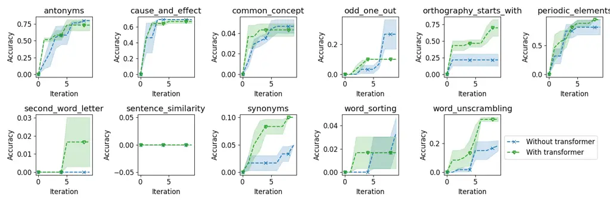

Figure 3: The performance of best prompts in early iterations. The tasks
plotted are those for which the performance gap is larger than $`0.01`$
with and without using the hidden representation.

### 4.2 Improving Zero-Shot Chain-of-Thought Prompt

Chain-of-thought (CoT) reasoning has been found to be an effective
technique to boost the performance of LLMs in complex tasks that require
multiple steps of reasoning (Wei et al., 2022). The work of Kojima et
al. (2022) has discovered that the performance of LLMs in complicated
reasoning tasks can be significantly improved by simply prepending the
_zero-shot CoT instruction_ “Let’s think step by step.” to the
questions, which outperforms other manually designed instructions. Here
we show that our INSTINCT algorithm can further improve over this
zero-shot CoT instruction across multiple tasks in Table 3. We defer our
detailed experimental design to App. B.3. We also show that our INSTINCT
is able to improve expert-level instructions in App. E.7.

## 5 Ablation Study

Effectiveness of the Hidden Representation. Here we empirically verify
that the use of the hidden representation from the pre-trained
transformer when building the NN surrogate (Sec. 3.1) indeed helps
improve the performance of our INSTINCT algorithm. To this end, we
compare the evolution of the performances of our INSTINCT algorithm with
and without using the hidden representation across different iterations.
The results in Fig. 3 suggest that in the early iterations with a small
number of observations, the use of the hidden representation allows our
NN surrogate to quickly learn to accurately predict the scores and hence
helps our INSTINCT algorithm quickly achieve high accuracies. After more
iterations, our INSTINCT algorithm without using the hidden
representation can also achieve competitive performances after enough
observations (i.e., training data) have been collected such that the NN
surrogate can be trained to accurately predict the scores.

|                                                             |                                                             |
| ----------------------------------------------------------- | ----------------------------------------------------------- |
| 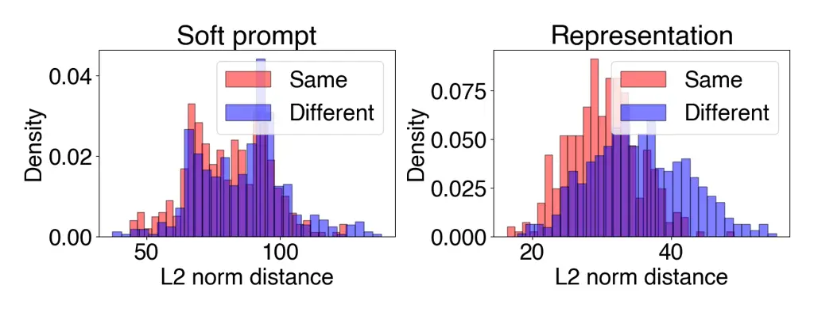 | 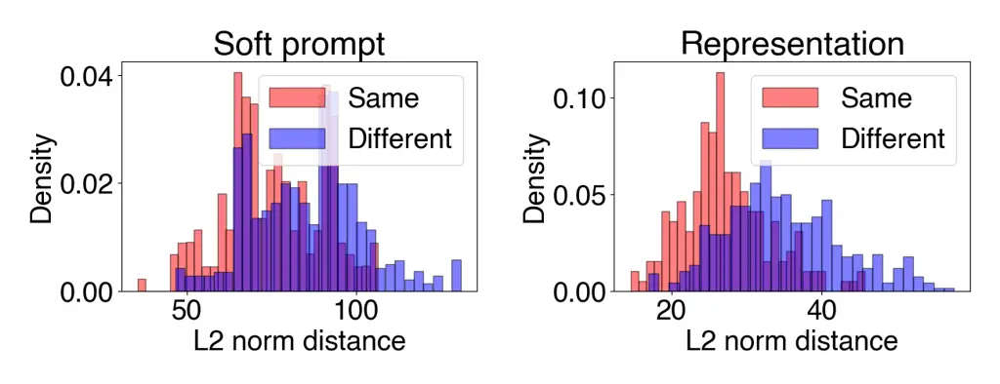 |
| active_to_passive                                           | first_word_letter                                           |

Figure 4: Pairwise L2 distances between soft prompts (left) and hidden
representations (right) for soft prompts mapping to the same (red) and
different (blue) instructions. See details in Sec. 5.

|                          |                |                |                     |
| ------------------------ | -------------- | -------------- | ------------------- |
| Task                     | INSTINCT       | test-time-only |   one-shot INSTINCT |
|                          |                | one-shot       |                     |
|                          |                | INSTINCT       |                     |
| antonyms                 | 0.8467(0.0027) | 0.8533(0.0027) | 0.8633(0.0072)      |
| auto_categorization      | 0.2500(0.0330) | 0.3000(0.0125) | 0.3000(0.0216)      |
| auto_debugging           | 0.2917(0.0340) | 0.4583(0.0680) | 0.6250(0.0000)      |
| cause_and_effect         | 0.5867(0.0871) | 0.6267(0.0871) | 0.7733(0.0109)      |
| common_concept           | 0.2129(0.0019) | 0.2496(0.0019) | 0.1812(0.0243)      |
| diff                     | 1.0000(0.0000) | 1.0000(0.0000) | 1.0000(0.0000)      |
| informal_to_formal       | 0.5534(0.0000) | 0.5159(0.0000) | 0.5362(0.0139)      |
| letters_list             | 1.0000(0.0000) | 1.0000(0.0000) | 1.0000(0.0000)      |
| negation                 | 0.8167(0.0027) | 0.8567(0.0054) | 0.8433(0.0223)      |
| object_counting          | 0.3400(0.0698) | 0.3567(0.0119) | 0.4600(0.0216)      |
| odd_one_out              | 0.7000(0.0163) | 0.6333(0.0109) | 0.6667(0.0054)      |
| orthography_starts_with  | 0.6667(0.0272) | 0.6667(0.0191) | 0.7167(0.0027)      |
| rhymes                   | 1.0000(0.0000) | 0.7467(0.2068) | 1.0000(0.0000)      |
| second_word_letter       | 0.1000(0.0411) | 0.2433(0.0530) | 0.4567(0.0191)      |
| sentence_similarity      | 0.1400(0.0047) | 0.1600(0.0000) | 0.2400(0.0573)      |
| sum                      | 1.0000(0.0000) | 1.0000(0.0000) | 0.9933(0.0054)      |
| synonyms                 | 0.3067(0.0491) | 0.3700(0.0694) | 0.4600(0.0047)      |
| taxonomy_animal          | 0.8567(0.0599) | 0.8967(0.0495) | 0.9233(0.0098)      |
| word_sorting             | 0.5133(0.0027) | 0.6200(0.0047) | 0.6200(0.0340)      |
| word_unscrambling        | 0.6333(0.0072) | 0.5833(0.0098) | 0.5467(0.0191)      |
| \# best-performing tasks | 7              | 7              | 14                  |
| average rank             | 2.2            | 1.8            | 1.45                |

Table 4: Average test accuracy achieved by (i) INSTINCT, (ii)
test-time-only one-shot INSTINCT, and (iii) one-shot INSTINCT. The
results including all tasks are given in Table 6 (App. C.2).

Hidden Representation Give Better Similarity Measure. As discussed in
Sec. 3.4, an important challenge faced by both InstructZero (Chen et
al., 2023b) and our INSTINCT is that _multiple soft prompts can lead to
the same instruction and hence the same score_, and this issue cannot be
effectively handled by InstructZero (Chen et al., 2023b) (more
explanations in App. C.1).Footnote 2 In contrast, our INSTINCT can
better resolve this issue because our principled uncertainty measure is
calculated _based on the hidden representations_. For two soft prompts
mapping to the same instruction, the distance between their hidden
representations is small. Here we empirically verify this and show the
results in Fig. 4 (more results in Fig. 10, App. C.1). We firstly
construct $`2`$ groups of soft prompts: The soft prompts in the first
group map to the same instruction (referred to as the “Same” group), and
the soft prompts in the second group map to different instructions (the
“Different” group). For both the “Same” group (red color in Fig. 4) and
“Different” group (blue color in Fig. 4), for _every pair of soft
prompts within a group_, we compute the pairwise L2 distance between
both the original soft prompts (left figure for each task in Fig. 4) and
their hidden representations (right figure). The right figure for each
task (Fig. 4) shows that the pairwise distances between the hidden
representations within the “Same” group (red) are markedly smaller than
those for the “Different” group (blue). Meanwhile, this notable
difference between the $`2`$ groups is not observed in the left figure
for each task (i.e., the pairwise distances between original soft
prompts). This indicates that the hidden representations make it
significantly easier to resolve the above-mentioned issue, and hence our
INSTINCT can perform better exploration. We also use another ablation
study (Table 8, App. C.4) to verify that our principled exploration is
necessary for the competitive performance of our INSTINCT.

Improving INSTINCT via One-shot In-Context Learning. Here, we show that
the performance of our INSTINCT can be further improved via in-context
learning (ICL) (Brown et al., 2020), which is a widely used method to
boost the performance of LLMs. We propose two methods to incorporate ICL
into our INSTINCT: (i) test-time-only one-shot INSTINCT which only
appends an exemplar after _the best instruction discovered_ by our
INSTINCT algorithm (and pass the concatenated instruction-exemplar to
the black-box LLM for evaluation) at test time, and (ii) one-shot
INSTINCT which appends an exemplar after _every queried instruction_
$`\rho_{t}`$ during our INSTINCT algorithm. The results (Table 4) show
that adding an exemplar to the best-discovered instruction
(test-time-only one-shot INSTINCT) improves the performance of our
INSTINCT. Additionally adding the one-shot exemplar to every queried
instruction during our INSTINCT (one-shot INSTINCT) further enhances the
performance, which is likely because this improves the alignment between
our optimization objective and test performance. These results
demonstrate the compatibility of our INSTINCT with ICL and suggest wider
potential applications of our INSTINCT through its combination with ICL.

Improving INSTINCT with ChatGPT Rephrasing. Here we propose a technique
to further improve the performance of our INSTINCT based on the
resampling technique from APE (Zhou et al., 2023). Specifically, in
every iteration after the instruction $`\rho_{t}`$ is generated by the
white-box LLM (Fig. 2), instead of directly passing $`\rho_{t}`$ to the
black-box LLM for evaluation, we firstly pass $`\rho_{t}`$ to ChatGPT
and instruct it to rephrase and improve this instruction $`\rho_{t}`$ to
obtain a new instruction $`\rho_{t}^{\prime}`$. Then, the new
instruction $`\rho_{t}^{\prime}`$ is evaluated by the black-box LLM to
produce the score $`h_{t}`$. We applied this improved variant of our
INSTINCT algorithm to instruction induction tasks (Sec. 4.1) with large
room for improvement, i.e., those with average test accuracies below
$`0.8`$ (Table 1). We plot the histogram of the improvements (i.e.,
improved average test accuracy minus original average test accuracy) in
Fig. 5. The figure shows that this technique to exploit the strong
paraphrasing capability of ChatGPT has the potential to further enhance
our INSTINCT algorithm (at the expense of an additional query to ChatGPT
in every iteration). More details on the experiments here are given in
App. C.3.

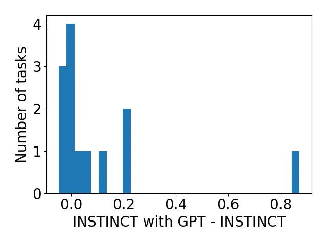

Figure 5: Improving INSTINCT with ChatGPT rephrasing.

Versatility under various combinations of white-box and black-box LLMs.
We conduct further experiments to show that our INSTINCT is able to
generalize to different combinations of black-box LLM and white-box LLM.
Specifically, we further consider PaLM2 (Anil et al., 2023) and GPT4 as
the black-box LLM, and WizardLM (Xu et al., 2024) as the white-box LLM.
We show that our INSTINCT algorithm consistently performs well across
different combinations in Table 9 in App. C.5, where we also discuss
some additional interesting insights.

## 6 Related Work

Instruction Optimization for Black-Box LLMs. The methods BBT (Sun et
al., 2022b), BBTv2 (Sun et al., 2022a) and clip-tuning (Chai et al., 2022) have proposed to use evolutionary algorithms (EAs) to optimize the
prompts for black-box LLMs. However, these methods are inapplicable to
our setting because they additionally require access to the input token
embeddings and output logits of the black-box LLMs, whereas the
black-box LLMs we consider only allow query access. GRIPS (Prasad et
al., 2023) and APO (Pryzant et al., 2023) have used edit-based
operations to propose candidate instructions and performed instruction
optimization in a gradient-free manner. Diao et al. (2023) have applied
reinforcement learning for prompt optimization. Guo et al. (2024) and
Fernando et al. (2023) (both concurrent to our paper) have adopted EAs
while using an LLM as the evolutionary operator. The recent work of Zhou
et al. (2023) has proposed APE, which searches for high-scoring
instructions by adopting an LLM to produce candidate instructions and
then using iterative re-sampling to generate other candidates similar to
the promising instructions. However, these methods above are usually
query-inefficient, mostly because they are based on local search and
hence cannot effectively handle the exploration-exploitation trade-off
(Sec. 1). Another concurrent work (Yang et al., 2024) has used an LLM as
an optimizer to solve generic optimization problems and applied their
method to instruction optimization. The previous method most closely
related to our paper is InstructZero (Chen et al., 2023b), which has
applied the query-efficient BO algorithm to instruction optimization for
black-box LLMs (see Sec. 2.1). We also discuss the related works on
instruction optimization for white-box LLMs (App. A.1), as well as BO
and neural bandits (App. A.3). Moreover, we give a visual summarization
of the related works on instruction optimization in App. A.2.

## 7 Conclusion

We introduce our INSTINCT algorithm to optimize the instructions for
black-box LLMs. Our INSTINCT replaces the GP surrogate in BO by an NN
surrogate, and couples the NN surrogate with the hidden representation
learned by a pre-trained transformer. We optimize the instructions for
ChatGPT, and use extensive experiments to show that our INSTINCT
consistently outperforms existing methods in various tasks. A potential
limitation of our INSTINCT is that it needs a numeric score during
optimization and hence requires a validation set. Although we have
followed the common practice from previous works, a validation set may
not be easy to obtain in some applications, which will require
additional techniques to attain a reliable score to guide our
optimization process.

## Acknowledgements

This research is supported by the National Research Foundation (NRF),
Prime Minister’s Office, Singapore under its Campus for Research
Excellence and Technological Enterprise (CREATE) programme. The Mens,
Manus, and Machina (M3S) is an interdisciplinary research group (IRG) of
the Singapore MIT Alliance for Research and Technology (SMART) centre.
This research is supported by the National Research Foundation Singapore
and the Singapore Ministry of Digital Development and Innovation,
National AI Group under the AI Visiting Professorship Programme (award
number AIVP-$`2024`$-$`001`$). This research/project is supported by the
National Research Foundation Singapore and DSO National Laboratories
under the AI Singapore Programme (AISG Award No:
AISG$`2`$-RP-$`2020`$-$`018`$). We acknowledge CSC (Finland) for
awarding this project access to the LUMI supercomputer, owned by the
EuroHPC Joint Undertaking, and hosted by CSC (Finland) and the LUMI
consortium. The access was made possible via collaboration between NSCC
(Singapore) and CSC (Finland).

## Impact Statement

Since our proposed method aims to improve the performance of LLMs (via
instruction optimization) for different tasks, there may exist some
ethical implications related to the usage of LLMs. Specifically, in
certain maliciously designed tasks, our method may be used by a
malicious party to produce harmful/inappropriate instructions. This is
because currently our method only aims to maximize the test performance
of the black-box LLM when selecting the instructions for any given task.
Therefore, to account for such potential ethical issues and prevent the
generation of harmful instructions, we may explore extensions of our
method which can also account for additional objectives or constraints
(e.g., harmfulness) during the optimization process.

## References

- Anil et al. (2023) Anil, R., Dai, A. M., Firat, O., Johnson, M.,
  Lepikhin, D., Passos, A., Shakeri, S., Taropa, E., Bailey, P., Chen,
  Z., et al. PaLM 2 technical report. _arXiv preprint
  arXiv:2305.10403_, 2023.
- Arora et al. (2019) Arora, S., Du, S. S., Hu, W., Li, Z.,
  Salakhutdinov, R. R., and Wang, R. On exact computation with an
  infinitely wide neural net. In _Proc. NeurIPS_, pp. 8141–8150, 2019.
- Bergstra et al. (2011) Bergstra, J., Bardenet, R., Bengio, Y., and
  Kégl, B. Algorithms for hyper-parameter optimization. In _Proc.
  NeurIPS_, pp. 2546–2554, 2011.
- Brown et al. (2020) Brown, T., Mann, B., Ryder, N., Subbiah, M.,
  Kaplan, J. D., Dhariwal, P., Neelakantan, A., Shyam, P., Sastry, G.,
  Askell, A., et al. Language models are few-shot learners. In _Proc.
  NeurIPS_, pp. 1877–1901, 2020.
- Chai et al. (2022) Chai, Y., Wang, S., Sun, Y., Tian, H., Wu, H., and
  Wang, H. Clip-tuning: Towards derivative-free prompt learning with a
  mixture of rewards. In _Proc. EMNLP (Findings)_, pp. 108–117, 2022.
- Chen et al. (2023a) Chen, J., Chen, L., Huang, H., and Zhou, T. When
  do you need chain-of-thought prompting for ChatGPT? _arXiv preprint
  arXiv:2304.03262_, 2023a.
- Chen et al. (2023b) Chen, L., Chen, J., Goldstein, T., Huang, H., and
  Zhou, T. Instructzero: Efficient instruction optimization for
  black-box large language models. _arXiv preprint arXiv:2306.03082_,
  2023b.
- Chiang et al. (2023) Chiang, W.-L., Li, Z., Lin, Z., Sheng, Y., Wu,
  Z., Zhang, H., Zheng, L., Zhuang, S., Zhuang, Y., Gonzalez, J. E.,
  Stoica, I., and Xing, E. P. Vicuna: An open-source chatbot impressing
  GPT-4 with 90%\* ChatGPT quality.
  [https://lmsys.org/blog/2023-03-30-vicuna](https://lmsys.org/blog/2023-03-30-vicuna),
  March 2023.
- Cobbe et al. (2021) Cobbe, K., Kosaraju, V., Bavarian, M., Chen, M.,
  Jun, H., Kaiser, L., Plappert, M., Tworek, J., Hilton, J., Nakano, R.,
  et al. Training verifiers to solve math word problems. _arXiv preprint
  arXiv:2110.14168_, 2021.
- Dai et al. (2022) Dai, Z., Shu, Y., Low, B. K. H., and Jaillet, P.
  Sample-then-optimize batch neural Thompson sampling. In _Proc.
  NeurIPS_, pp. 23331–23344, 2022.
- Dai et al. (2023a) Dai, Z., Lau, G. K. R., Verma, A., Shu, Y.,
  Low, B. K. H., and Jaillet, P. Quantum Bayesian optimization. In
  _Proc. NeurIPS_, 2023a.
- Dai et al. (2023b) Dai, Z., Shu, Y., Verma, A., Fan, F. X., Low, B. K.
  H., and Jaillet, P. Federated neural bandit. In _Proc. ICLR_, 2023b.
- Deng et al. (2022) Deng, M., Wang, J., Hsieh, C.-P., Wang, Y., Guo,
  H., Shu, T., Song, M., Xing, E., and Hu, Z. RLPrompt: Optimizing
  discrete text prompts with reinforcement learning. In _Proc. EMNLP_,
  pp. 3369–3391, 2022.
- Diao et al. (2023) Diao, S., Huang, Z., Xu, R., Li, X., Yong, L.,
  Zhou, X., and Zhang, T. Black-box prompt learning for pre-trained
  language models. _Transactions on Machine Learning Research_, 2023.
- Dolan & Moré (2002) Dolan, E. D. and Moré, J. J. Benchmarking
  optimization software with performance profiles. _Mathematical
  programming_, 91:201–213, 2002.
- Eriksson et al. (2019) Eriksson, D., Pearce, M., Gardner, J.,
  Turner, R. D., and Poloczek, M. Scalable global optimization via local
  bayesian optimization. In _Proc. NeurIPS_, pp. 5496–5507, 2019.
- Fernando et al. (2023) Fernando, C., Banarse, D., Michalewski, H.,
  Osindero, S., and Rocktäschel, T. Promptbreeder: Self-referential
  self-improvement via prompt evolution. _arXiv preprint
  arXiv:2309.16797_, 2023.
- Garnett (2023) Garnett, R. _Bayesian optimization_. Cambridge
  University Press, 2023.
- Gliwa et al. (2019) Gliwa, B., Mochol, I., Biesek, M., and Wawer, A.
  SAMSum corpus: A human-annotated dialogue dataset for abstractive
  summarization. In _Proceedings of the 2nd Workshop on New Frontiers in
  Summarization_, pp. 70–79, 2019.
- Gu et al. (2021) Gu, Q., Karbasi, A., Khosravi, K., Mirrokni, V., and
  Zhou, D. Batched neural bandits. _arXiv preprint
  arXiv:2102.13028_, 2021.
- Guo et al. (2024) Guo, Q., Wang, R., Guo, J., Li, B., Song, K., Tan,
  X., Liu, G., Bian, J., and Yang, Y. Connecting large language models
  with evolutionary algorithms yields powerful prompt optimizers. In
  _Proc. ICLR_, 2024.
- Huggingface (2023) Huggingface. Open LLM leaderboard.
  [https://huggingface.co/spaces/HuggingFaceH4/open_llm_leaderboard](https://huggingface.co/spaces/HuggingFaceH4/open_llm_leaderboard), 2023.
- Jacot et al. (2018) Jacot, A., Gabriel, F., and Hongler, C. Neural
  tangent kernel: Convergence and generalization in neural networks. In
  _Proc. NeurIPS_, pp. 8580–8589, 2018.
- Kassraie et al. (2022) Kassraie, P., Krause, A., and Bogunovic, I.
  Graph neural network bandits. In _Proc. NeurIPS_, pp.
  34519–34531, 2022.
- Kingma & Ba (2015) Kingma, D. P. and Ba, J. Adam: A method for
  stochastic optimization. In _Proc. ICLR_, 2015.
- Kojima et al. (2022) Kojima, T., Gu, S. S., Reid, M., Matsuo, Y., and
  Iwasawa, Y. Large language models are zero-shot reasoners. In _Proc.
  NeurIPS_, pp. 22199–22213, 2022.
- Lattimore & Szepesvári (2020) Lattimore, T. and Szepesvári, C. _Bandit
  Algorithms_. Cambridge University Press, 2020.
- Lester et al. (2021) Lester, B., Al-Rfou, R., and Constant, N. The
  power of scale for parameter-efficient prompt tuning. In _Proc.
  EMNLP_, pp. 3045–3059, 2021.
- Li et al. (2023) Li, X., Zhang, T., Dubois, Y., Taori, R., Gulrajani,
  I., Guestrin, C., Liang, P., and Hashimoto, T. B. AlpacaEval: An
  automatic evaluator of instruction-following models.
  [https://github.com/tatsu-lab/alpaca_eval](https://github.com/tatsu-lab/alpaca_eval), 2023.
- Li & Liang (2021) Li, X. L. and Liang, P. Prefix-tuning: Optimizing
  continuous prompts for generation. In _Proceedings of the 59th Annual
  Meeting of the Association for Computational Linguistics and the 11th
  International Joint Conference on Natural Language Processing (Volume
  1: Long Papers)_, pp. 4582–4597, 2021.
- Lin (2004) Lin, C.-Y. ROUGE: A package for automatic evaluation of
  summaries. In _Text summarization branches out_, pp. 74–81, 2004.
- Ling et al. (2017) Ling, W., Yogatama, D., Dyer, C., and Blunsom, P.
  Program induction by rationale generation: Learning to solve and
  explain algebraic word problems. In _Proc. Annual Meeting of the ACL_,
  pp. 158–167, 2017.
- Lisicki et al. (2021) Lisicki, M., Afkanpour, A., and Taylor, G. W. An
  empirical study of neural kernel bandits. In _NeurIPS Workshop on
  Bayesian Deep Learning_, 2021.
- Liu et al. (2023) Liu, P., Yuan, W., Fu, J., Jiang, Z., Hayashi, H.,
  and Neubig, G. Pre-train, prompt, and predict: A systematic survey of
  prompting methods in natural language processing. _ACM Computing
  Surveys_, 55(9), 2023.
- LMSYS (2023) LMSYS. Chatbot arena leaderboard.
  [https://lmsys.org/blog/2023-05-25-leaderboard](https://lmsys.org/blog/2023-05-25-leaderboard), 2023.
- Mishra et al. (2021) Mishra, S., Khashabi, D., Baral, C., Choi, Y.,
  and Hajishirzi, H. Reframing instructional prompts to GPTk’s language.
  _ACL Findings_, 2021.
- OpenAI (2023a) OpenAI. ChatGPT.
  [https://chat.openai.com](https://chat.openai.com), 2023a.
- OpenAI (2023b) OpenAI. GPT-4 technical report. _arXiv preprint
  arXiv:2303.08774_, 2023b.
- Patel et al. (2021) Patel, A., Bhattamishra, S., and Goyal, N. Are NLP
  models really able to solve simple math word problems? In _Proc.
  NAACL_, pp. 2080–2094, 2021.
- Prasad et al. (2023) Prasad, A., Hase, P., Zhou, X., and Bansal, M.
  GrIPS: Gradient-free, edit-based instruction search for prompting
  large language models. In _Proc. EACL_, 2023.
- Pryzant et al. (2023) Pryzant, R., Iter, D., Li, J., Lee, Y. T., Zhu,
  C., and Zeng, M. Automatic prompt optimization with “gradient descent”
  and beam search. In _Proc. EMNLP_, pp. 7957–7968, 2023.
- Radford et al. (2018) Radford, A., Narasimhan, K., Salimans, T.,
  Sutskever, I., et al. Improving language understanding by generative
  pre-training. 2018.
- Radford et al. (2019) Radford, A., Wu, J., Child, R., Luan, D.,
  Amodei, D., Sutskever, I., et al. Language models are unsupervised
  multitask learners. _OpenAI blog_, 1(8):9, 2019.
- Rasmussen & Williams (2006) Rasmussen, C. E. and Williams, C. K. I.
  _Gaussian Processes for Machine Learning_. MIT Press, 2006.
- Reynolds & McDonell (2021) Reynolds, L. and McDonell, K. Prompt
  programming for large language models: Beyond the few-shot paradigm.
  In _Extended Abstracts of the 2021 CHI Conference on Human Factors in
  Computing Systems_, 2021.
- Shi et al. (2023) Shi, W., Han, X., Gonen, H., Holtzman, A., Tsvetkov,
  Y., and Zettlemoyer, L. Toward human readable prompt tuning: Kubrick’s
  the shining is a good movie, and a good prompt too? In _Proc. EMNLP_,
  pp. 10994–11005, 2023.
- Shin et al. (2020) Shin, T., Razeghi, Y., IV, R. L. L., Wallace, E.,
  and Singh, S. Eliciting knowledge from language models using
  automatically generated prompts. In _Proc. EMNLP_, pp.
  4222–4235, 2020.
- Sun et al. (2022a) Sun, T., He, Z., Qian, H., Huang, X., and Qiu, X.
  BBTv2: Pure black-box optimization can be comparable to gradient
  descent for few-shot learning. In _Proc. EMNLP_, pp. 3916–3930, 2022a.
- Sun et al. (2022b) Sun, T., Shao, Y., Qian, H., Huang, X., and Qiu, X.
  Black-box tuning for language-model-as-a-service. In _Proc. ICML_, pp.
  20841–20855, 2022b.
- Tiao et al. (2021) Tiao, L. C., Klein, A., Seeger, M. W., Bonilla, E.
  V., Archambeau, C., and Ramos, F. BORE: Bayesian optimization by
  density-ratio estimation. In _Proc. ICML_, pp. 10289–10300.
  PMLR, 2021.
- Touvron et al. (2023) Touvron, H., Lavril, T., Izacard, G., Martinet,
  X., Lachaux, M.-A., Lacroix, T., Rozière, B., Goyal, N., Hambro, E.,
  Azhar, F., et al. LLaMA: Open and efficient foundation language
  models. _arXiv preprint arXiv:2302.13971_, 2023.
- Vaswani et al. (2017) Vaswani, A., Shazeer, N., Parmar, N., Uszkoreit,
  J., Jones, L., Gomez, A. N., Kaiser, Ł., and Polosukhin, I. Attention
  is all you need. In _Proc. NeurIPS_, pp. 6000–6010, 2017.
- Wei et al. (2022) Wei, J., Wang, X., Schuurmans, D., Bosma, M., Xia,
  F., Chi, E., Le, Q. V., Zhou, D., et al. Chain-of-thought prompting
  elicits reasoning in large language models. In _Proc. NeurIPS_, pp.
  24824–24837, 2022.
- Xu et al. (2024) Xu, C., Sun, Q., Zheng, K., Geng, X., Zhao, P., Feng,
  J., Tao, C., and Jiang, D. WizardLM: Empowering large language models
  to follow complex instructions. In _Proc. ICLR_, 2024.
- Yang et al. (2024) Yang, C., Wang, X., Lu, Y., Liu, H., Le, Q. V.,
  Zhou, D., and Chen, X. Large language models as optimizers. In _Proc.
  ICLR_, 2024.
- Zhang et al. (2021) Zhang, W., Zhou, D., Li, L., and Gu, Q. Neural
  Thompson sampling. In _Proc. ICLR_, 2021.
- Zhao et al. (2023) Zhao, W. X., Zhou, K., Li, J., Tang, T., Wang, X.,
  Hou, Y., Min, Y., Zhang, B., Zhang, J., Dong, Z., et al. A survey of
  large language models. _arXiv preprint arXiv:2303.18223_, 2023.
- Zhong et al. (2021) Zhong, Z., Friedman, D., and Chen, D. Factual
  probing is \[MASK\]: Learning vs. learning to recall. In _Proc.
  NAACL_, pp. 5017–5033, 2021.
- Zhou et al. (2020) Zhou, D., Li, L., and Gu, Q. Neural contextual
  bandits with UCB-based exploration. In _Proc. ICML_, pp.
  11492–11502, 2020.
- Zhou et al. (2023) Zhou, Y., Muresanu, A. I., Han, Z., Paster, K.,
  Pitis, S., Chan, H., and Ba, J. Large language models are human-level
  prompt engineers. In _Proc. ICLR_, 2023.

## Appendix A Additional Related Work

### A.1 Related Works on Instruction Optimization for White-Box LLMs

AutoPrompt (Shin et al., 2020) and FluentPrompt (Shi et al., 2023) have
adopted gradient-based methods to search for an optimal sequence of
discrete tokens that form an instruction. To sidestep this combinatorial
optimization problem, several works (Lester et al., 2021; Li & Liang,
2021; Zhong et al., 2021) have used gradient descent to optimize a
sequence of continuous task-specific vectors (i.e., soft prompt)
prepended to the input prompt. RLPrompt (Deng et al., 2022) has instead
trained a task-specific network inserted into a frozen pre-trained LLM
via reinforcement learning (RL) reward signals. However, these methods
cannot be used to optimize prompts for black-box LLMs, which are
typically more powerful.

### A.2 Summarization of Related Work on Instruction Optimization

[TABLE]

### A.3 Related Work on Bayesian Optimization and Neural Bandits

Multi-armed bandits algorithms have been extensively studied to address
sequential decision-marking problems by balancing the trade-off between
exploration and exploitation (Lattimore & Szepesvári, 2020). Bayesian
optimization (BO), also known as kernelized bandits, is a type of bandit
algorithm that uses a Gaussian process (GP) (Rasmussen & Williams, 2006)
to model the objective function (i.e., the reward function in bandits)
(Garnett, 2023; Dai et al., 2023a). However, traditional BO algorithms
(Bergstra et al., 2011; Tiao et al., 2021; Garnett, 2023) can not handle
the high-dimensional input objective functions. Fortunately, leveraging
the expressive power of neural networks (NNs), recent works such as
NeuralUCB (Zhou et al., 2020) and NeuralTS (Zhang et al., 2021) have
been proposed to better model the reward function in bandits using NNs
and hence are able to deal with high-dimensional input objective
functions while preserving strong theoretical guarantees. The
application of neural bandits has been further extended to batched (Gu
et al., 2021), federated (Dai et al., 2023b) and graph-structured
(Kassraie et al., 2022) settings, among others.

## Appendix B Additional Main Experimental Details and Results

### B.1 Datasets and Implementation Details

We provide comprehensive comparisons between our method and the existing
baselines using various widely-used datasets. All experiments were
carried out on a server with AMD EPYC processors and NVIDIA A100 GPUs.

Prompting Templates. Carefully designed language input prompts are
important to elicit expected responses from the LLMs. We follow
InstructZero for the template designs.

For instruction generation, we use the following prompting template with
five-shot demonstrations (Fig. 6) where each \[INPUT\] and \[OUTPUT\]
pairs are replaced with the input-output pairs from the exemplar set
$`E=\{(x_{\tau},y_{\tau})\}_{\tau=1}^{\kappa}`$ when $`\kappa=5`$. The
output from the LLM is our instruction $`\rho`$.

Instruction Generation Template

Input: \[INPUT\]  
Output: \[OUTPUT\]

Input: \[INPUT\]  
Output: \[OUTPUT\]

Input: \[INPUT\]  
Output: \[OUTPUT\]

Input: \[INPUT\]  
Output: \[OUTPUT\]

Input: \[INPUT\]  
Output: \[OUTPUT\]

The instruction was to

Figure 6: The prompt for our white-box LLM to generate instructions.

To evaluate an instruction, we use the following prompting template on a
test input (Fig. 7) where \[INSTRUCTION\] is replaced with the
instruction $`\rho`$ and \[TEST INPUT\] is replaced with test input from
a separate test set $`D_{T}`$.

Evaluation Template

Instruction: \[INSTRUCTION\]

Input: \[TEST INPUT\]

Output:

Figure 7: The prompt for the black-box LLM to generate answer/output.

Datasets & Preprocessing. The $`30`$ datasets for instruction induction
in Sec. 4.1 are the same as those in InstructZero (Chen et al., 2023b).
We omitted $`2`$ datasets, namely CS Algorithms, and ASCII, because the
test datasets for these two tasks are not open-sourced. For the SAMSum
dataset, we select $`200`$ data points from the original test dataset as
a test dataset to save the cost of evaluation (i.e., the cost of calling
ChatGPT API). For the arithmetic reasoning datasets (i.e., GSM8K,
AQUARAT, SVAMP), we process the dataset the same way as APE (Zhou et
al., 2023) does. For GSM8K and AQUARAT, we use all test data from each
corresponding test dataset to evaluate the test accuracy of the
instruction. For AQUARAT, we sample $`400`$ data points from its test
datasets as $`D_{T}`$ for evaluating the test accuracy to save the cost
of the evaluation. For all arithmetic reasoning datasets, we sample
$`200`$ data points from each corresponding training dataset as the
validation dataset $`D_{V}`$.

Evaluation Metrics. For instruction induction, we use the F1 score for
“common_concept”, “informal_to_formal” and SAMSum; we use the exact set
matching for “orthography_starts_with” and “taxonomy_animal”; we check
whether the output label is contained in the model output for the task
of “synonyms”; and we adopt the “exact match” metric for the rest of
instruction induction tasks. For the SAMSum dataset, we additionally
provide ROUGE-1, ROUGE-2, and ROUGE-L (Lin, 2004) as the evaluation
metrics. For the arithmetic reasoning datasets, we use the same way as
APE (Zhou et al., 2023) to extract the answer (e.g., numbers or choices)
from the generated text and use accuracy as the metric.

|                               |                |                |                |                |
| ----------------------------- | -------------- | -------------- | -------------- | -------------- |
| Algorithm                     | APE            | InstructZero   | EvoPrompt      | INSTINCT       |
| active_to_passive             | 1.0000(0.0000) | 0.9967(0.0027) | 0.9933(0.0027) | 0.9700(0.0245) |
| antonyms                      | 0.6367(0.1416) | 0.8267(0.0072) | 0.7967(0.0152) | 0.8467(0.0027) |
| auto_categorization           | 0.2500(0.0094) | 0.2567(0.0119) | 0.2600(0.0309) | 0.2500(0.0330) |
| auto_debugging                | 0.2917(0.0340) | 0.3750(0.0000) | 0.3750(0.0000) | 0.2917(0.0340) |
| cause_and_effect              | 0.5733(0.0891) | 0.8133(0.0109) | 0.8267(0.0475) | 0.5867(0.0871) |
| common_concept                | 0.0691(0.0207) | 0.0864(0.0398) | 0.1211(0.0000) | 0.2129(0.0019) |
| diff                          | 0.6733(0.2667) | 0.6933(0.2224) | 1.0000(0.0000) | 1.0000(0.0000) |
| first_word_letter             | 1.0000(0.0000) | 1.0000(0.0000) | 1.0000(0.0000) | 0.9300(0.0531) |
| informal_to_formal            | 0.5736(0.0026) | 0.5310(0.0024) | 0.6182(0.0047) | 0.5534(0.0000) |
| larger_animal                 | 0.8967(0.0054) | 0.9000(0.0408) | 0.7933(0.0791) | 0.9367(0.0027) |
| letters_list                  | 1.0000(0.0000) | 0.5900(0.1674) | 1.0000(0.0000) | 1.0000(0.0000) |
| negation                      | 0.7533(0.0109) | 0.7767(0.0136) | 0.7867(0.0027) | 0.8167(0.0027) |
| num_to_verbal                 | 0.9967(0.0027) | 1.0000(0.0000) | 1.0000(0.0000) | 1.0000(0.0000) |
| object_counting               | 0.3633(0.0191) | 0.3600(0.0929) | 0.1167(0.0626) | 0.3400(0.0698) |
| odd_one_out                   | 0.6333(0.0144) | 0.6133(0.0871) | 0.6533(0.0109) | 0.7000(0.0163) |
| orthography_starts_with       | 0.4567(0.1477) | 0.5067(0.0871) | 0.6000(0.0205) | 0.6667(0.0272) |
| periodic_elements             | 0.9267(0.0218) | 0.8667(0.0606) | 0.9000(0.0377) | 0.9267(0.0272) |
| rhymes                        | 0.1567(0.0640) | 1.0000(0.0000) | 0.6133(0.0178) | 1.0000(0.0000) |
| second_word_letter            | 0.7467(0.2028) | 0.4333(0.1872) | 0.4133(0.2397) | 0.1000(0.0411) |
| sentence_similarity           | 0.0000(0.0000) | 0.0000(0.0000) | 0.2833(0.0357) | 0.1400(0.0047) |
| sentiment                     | 0.9133(0.0144) | 0.8767(0.0242) | 0.8767(0.0054) | 0.8967(0.0144) |
| singular_to_plural            | 1.0000(0.0000) | 0.9867(0.0109) | 1.0000(0.0000) | 1.0000(0.0000) |
| sum                           | 0.6733(0.2667) | 1.0000(0.0000) | 1.0000(0.0000) | 1.0000(0.0000) |
| synonyms                      | 0.3600(0.0759) | 0.2767(0.0925) | 0.1367(0.0054) | 0.3067(0.0491) |
| taxonomy_animal               | 0.3467(0.2341) | 0.7167(0.0838) | 0.7167(0.1308) | 0.8567(0.0599) |
| translation_en-de             | 0.8400(0.0047) | 0.8233(0.0098) | 0.8133(0.0072) | 0.8400(0.0047) |
| translation_en-es             | 0.8700(0.0000) | 0.8733(0.0054) | 0.8467(0.0098) | 0.8800(0.0000) |
| translation_en-fr             | 0.8867(0.0027) | 0.8767(0.0027) | 0.8833(0.0027) | 0.8300(0.0205) |
| word_sorting                  | 0.3300(0.0374) | 0.3100(0.1143) | 0.5167(0.0435) | 0.5133(0.0027) |
| word_unscrambling             | 0.4400(0.1389) | 0.5500(0.0170) | 0.6033(0.0072) | 0.6333(0.0072) |
| \#tasks that perform the best | 11             | 5              | 12             | 17             |
| Average ranking               | 2.60           | 2.57           | 2.13           | 1.87           |

Table 5: Test accuracy (standard error) for the best instruction
discovered by different algorithms for all instruction induction tasks
(Sec. 4.1). The results are obtained using 3 independent trials with
different random seeds. The Table corresponds to Table 1 in the main
paper, except that all tasks are shown here.

White/Black-box Models. We follow InstructZero to use Vicuna-13B as the
default white-box model for instruction generation and GPT-3.5-turbo as
the default black-box model for evaluation. However, the versions for
these models are not specified by the InstructZero paper. Especially for
GPT-3.5-turbo, the model is continually updated by OpenAI. To ensure
fair comparison and reproducibility, we use GPT-3.5-turbo-0301 (which
will be supported by OpenAI until at least June 2024) and
Vicuna-13B-v1.1 as the default model choices for all the experiments
carried out in this paper.

Hyperparameter Details for the Neural Bandit Algorithm. We set
$`\lambda=0.1`$ (Sec. 3.1) and $`\nu_{t}=1`$ (Sec. 3.2) in all
experiments. When doing the random projection, the elements in the
projection matrix are sampled i.i.d. from $`Uni(-1,1)`$. We choose the
number of hidden representations in the discrete domain
$`\widetilde{Z}`$ to be $`10000`$ and at each iteration of our INSTINCT,
we randomly sample $`1000`$ data points from the $`\widetilde{Z}`$ to
evaluate the NeuralUCB acquisition function to accelerate our algorithm.
We stack an MLP on top of the hidden representations of the pre-trained
transformer language model. The MLP has an input dimension of $`5120`$,
an output dimension of 1, and a hidden layer of size $`100`$. We train
the MLP following to minimize the mean squared error (MSE) loss for
$`1000`$ iterations after each new observation point. A default learning
rate of $`0.001`$ is used.

Repeated Experiments with Seeding. For both our INSTINCT and
InstructZero, when we perform a grid search over the intrinsic dimension
(within $`\{10,50,100\}`$) and the number of soft tokens (within
$`\{3,5,10\}`$) using the validation set for each task, we only conduct
this grid search for $`1`$ of the $`3`$ trials, and directly use the
best parameters found in the first trial in the remaining $`2`$ trials.
This is done to save computational costs.

### B.2 Instruction Induction

For better distinguishability, we only presented the tasks for which any
method has an average test accuracy of less than $`0.8`$ (i.e., more
challenging tasks) in the main text. A full comparison including all
tasks is given in Table 5. Overall, our INSTINCT significantly
outperforms the APE and InstructZero baselines, achieving the best
performance in $`19`$ out of the $`30`$ instruction induction tasks. To
assess the performance of the methods from their ranks in each task,
INSTINCT also achieves the highest average ranking of $`1.53`$ over all
instruction induction tasks.

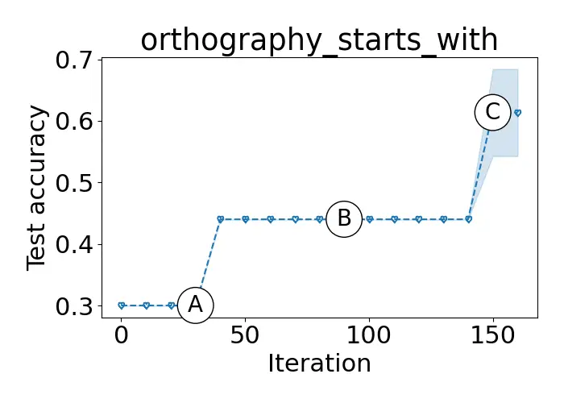

Task description: Given a sentence and a letter, output the words that
start with the letter in the sentence.

|           |                                                                                                      |
| --------- | ---------------------------------------------------------------------------------------------------- |
| Iteration | Instruction                                                                                          |
| A         | The instruction was to find a word that could be formed by rearranging the letters of the given word |
| B         | The instruction was to find the word that the input corresponds to, and output it                    |
| C         | The instruction was to output the word that starts with the letter that was inputted                 |

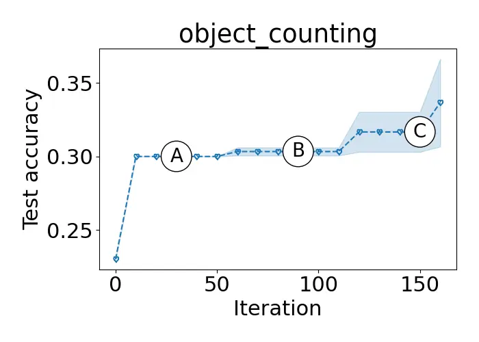

Task description: Given a sentence, output the number of objects in the
sentence.

|           |                                                                                                                            |
| --------- | -------------------------------------------------------------------------------------------------------------------------- |
| Iteration | Instruction                                                                                                                |
| A         | The instruction was to output the number of items that the speaker has, given the list of items that the speaker possesses |
| B         | The instruction was to output the number of objects mentioned in the input                                                 |
| C         | The instruction was to output the number of items the player has, but the player has entered the number of items instead   |

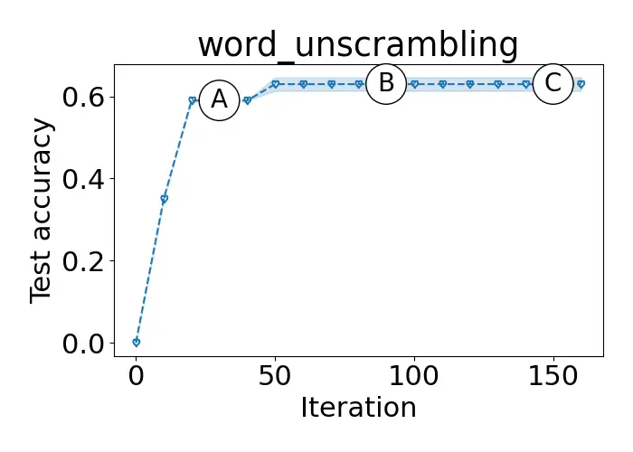

Task description: Given a list of shuffled letters, rearrange the
letters to form a meaningful word.

|           |                                                                                                                       |
| --------- | --------------------------------------------------------------------------------------------------------------------- |
| Iteration | Instruction                                                                                                           |
| A         | The instruction was to output the word that the input word spells when the letters are rearranged in a specific order |
| B         | The instruction was to output the word that is formed by rearranging the letters of the given word                    |
| C         | The instruction was to output the word that is formed by rearranging the letters of the given word                    |

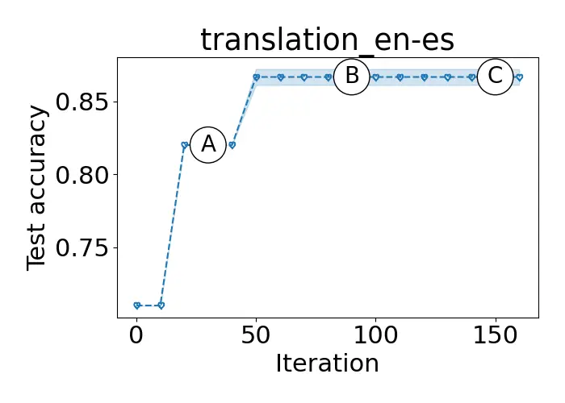

Task description: Translate the words from English to Spanish.

|           |                                                                    |
| --------- | ------------------------------------------------------------------ |
| Iteration | Instruction                                                        |
| A         | The instruction was to translate the words from Spanish to English |
| B         | The instruction was to translate the words from English to Spanish |
| C         | The instruction was to translate the words from English to Spanish |

Figure 8: The test accuracy of the best instruction found as the
iteration increases. The quality of the instruction (i.e., test
accuracy) increases as more iterations are used to perform our INSTINCT.

Visualizing the Optimization Process. We additionally investigate the
optimization process of our INSTINCT algorithm in finding the best
instruction. Fig. 8 presents the average test performance (over $`3`$
random seeds) of the best instruction so far over optimization
iterations. We partition the optimization process into three stages,
namely stages A, B, C, which correspond to the iteration $`30`$, $`90`$,
$`150`$, respectively. We see steady improvements as the optimization
progresses, producing better instructions that capture the input-output
relationships of the tasks. The instructions at stage C matches closely
to the task descriptions provided in Fig. 8. Interestingly, we also
observe that the instruction that performs best on LLM does not
necessarily correspond to human perception. For example, in the task of
object_counting, the instruction outputted at stage B may seem more
appropriate to a human being as compared to the instruction at stage C.
However, the latter achieves better test performance. This further
necessitates an automatic instruction tuning algorithm like INSTINCT
which streamlines the process to generate task-specific instructions
that work the best on a given black-box LLM.

### B.3 Improving Zero-Shot Chain-of-Thought Instructions

To improve the chain-of-thought instruction for arithmetic reasoning
tasks, we use the following instruction generation prompt for the
white-box LLM. Note that when finding the chain-of-thought instruction,
we fix the intrinsic dimension $`d^{\prime}`$ to be $`1000`$ and search
the number of soft tokens $`N_{z}`$ over $`\{3,5,10\}`$ for both
InstructZero and INSTINCT. The intrinsic dimension is set to be higher
because we find that when the intrinsic dimension is smaller than
$`1000`$, the variety of the generated instructions will be small (i.e.,
different soft prompts will result in the same instruction). Increasing
the number of intrinsic dimensions will increase the L2 norm of the soft
prompt (as we will investigate in App. D.2) and thus affect the
generated instruction more (i.e., generating different instructions
given different soft prompts). As shown in Fig. 9, we ask the white-box
LLM to generate prompts to solve the math problems and we provide 3
example chain-of-thought instructions to guide the white-box LLM to
generate chain-of-thought style instructions as similarly used by (Yang
et al., 2024). These examples are important since the white-box LLM
needs to know what are the possible instructions for other LLMs to do
chain-of-thought. The other part of the setting is the same as the
setting in the instruction induction task.

Instruction Generation Template for Chain-of-thought

I have some instruction examples for solving school math problems.

Instruction:  
Let’s figure it out!

Instruction:  
Let’s solve the problem.

Instruction:  
Let’s think step by step.

Write your new instruction that is different from the examples to solve
the school math problems.

Instruction:

Figure 9: The prompt for our white-box LLM to generate chain-of-thought
instructions.

## Appendix C More Details on Ablation Study

### C.1 Hidden Representations Give Better Similarity Measure (More Details)

|                                                              |                                                                  |
| ------------------------------------------------------------ | ---------------------------------------------------------------- |
| 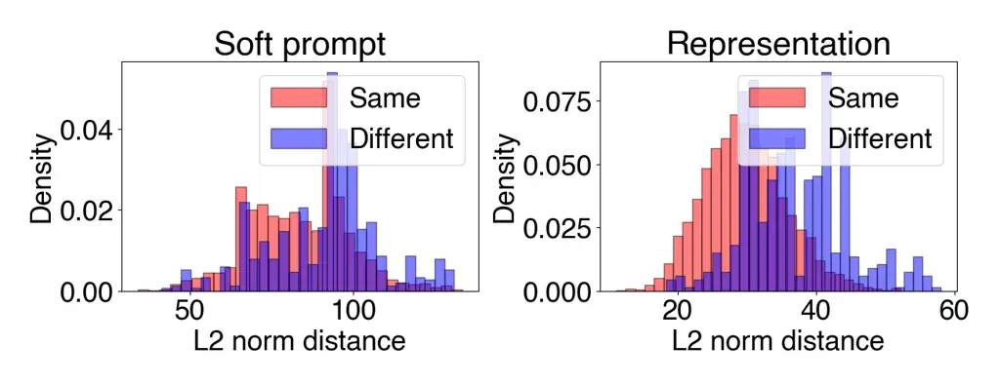 |     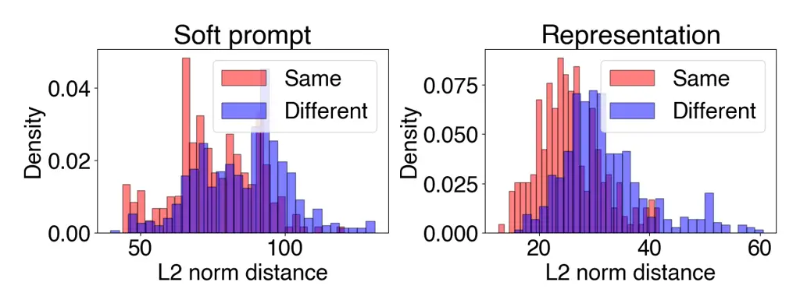 |
| informal_to_formal                                           | num_to_verbal                                                    |

Figure 10: Two additional tasks for Fig. 4. See the caption of Fig. 4
for a detailed explanation.

Here we give more discussions as to why the hidden representations lead
to better similarity measures compared with the original soft prompts,
which has been verified by our experiments in Sec. 5.

Note that we feed every soft prompt $`z_{t}`$ (i.e., a _continuous
vector_) to the white-box LLM $`w`$ to produce the instruction
$`\rho_{t}`$ (i.e., a sentence), which is then passed to the black-box
LLM $`f`$ for evaluation (Fig. 2). As a result, there exist multiple
soft prompts (i.e., continuous vectors) that map to the same
instruction. Therefore, it is important for an instruction optimization
algorithm to take this into account in order to achieve efficient
exploration of the space of soft prompts (i.e., to avoid unnecessary
queries at multiple soft prompts that map to the same instruction).
Despite their instruction-coupled kernel (Chen et al., 2023b),
InstructZero is _unable to account for this issue_ when computing the
similarity between an already-queried soft prompt and a new soft prompt,
because its similarity measure reduces to the standard L2 distance-based
kernel (i.e., the Matérn kernel). In contrast, our INSTINCT algorithm is
able to take this issue into account because it builds the NN surrogate
on top of _the hidden representations of the soft prompts_ (Sec. 3.1)
which makes it easier to identify pairs of soft prompts that map to the
same instruction.

Fig. 10 presents the results for two additional tasks (in addition to
the two tasks shown in the main paper in Fig. 4). The results from these
additional figures lead to the same interpretations as Fig. 4 in the
main paper, i.e., for pairs of soft prompts leading to the same
instruction, the hidden representations make it much easier to identify
that they should be assigned high similarity values.

|                          |                |                         |                |
| ------------------------ | -------------- | ----------------------- | -------------- |
| Task                     | zero-shot      | test-time-only one-shot | one-shot       |
|                          | INSTINCT       | INSTINCT                | INSTINCT       |
| active_to_passive        | 0.9700(0.0245) | 1.0000(0.0000)          | 0.9967(0.0027) |
| antonyms                 | 0.8467(0.0027) | 0.8533(0.0027)          | 0.8633(0.0072) |
| auto_categorization      | 0.2500(0.0330) | 0.3000(0.0125)          | 0.3000(0.0216) |
| auto_debugging           | 0.2917(0.0340) | 0.4583(0.0680)          | 0.6250(0.0000) |
| cause_and_effect         | 0.5867(0.0871) | 0.6267(0.0871)          | 0.7733(0.0109) |
| common_concept           | 0.2129(0.0019) | 0.2496(0.0019)          | 0.1812(0.0243) |
| diff                     | 1.0000(0.0000) | 1.0000(0.0000)          | 1.0000(0.0000) |
| first_word_letter        | 0.9300(0.0531) | 1.0000(0.0000)          | 1.0000(0.0000) |
| informal_to_formal       | 0.5534(0.0000) | 0.5159(0.0000)          | 0.5362(0.0139) |
| larger_animal            | 0.9367(0.0027) | 0.9267(0.0027)          | 0.9300(0.0000) |
| letters_list             | 1.0000(0.0000) | 1.0000(0.0000)          | 1.0000(0.0000) |
| negation                 | 0.8167(0.0027) | 0.8567(0.0054)          | 0.8433(0.0223) |
| num_to_verbal            | 1.0000(0.0000) | 1.0000(0.0000)          | 1.0000(0.0000) |
| object_counting          | 0.3400(0.0698) | 0.3567(0.0119)          | 0.4600(0.0216) |
| odd_one_out              | 0.7000(0.0163) | 0.6333(0.0109)          | 0.6667(0.0054) |
| orthography_starts_with  | 0.6667(0.0272) | 0.6667(0.0191)          | 0.7167(0.0027) |
| periodic_elements        | 0.9267(0.0272) | 0.9800(0.0000)          | 1.0000(0.0000) |
| rhymes                   | 1.0000(0.0000) | 0.7467(0.2068)          | 1.0000(0.0000) |
| second_word_letter       | 0.1000(0.0411) | 0.2433(0.0530)          | 0.4567(0.0191) |
| sentence_similarity      | 0.1400(0.0047) | 0.1600(0.0000)          | 0.2400(0.0573) |
| sentiment                | 0.8967(0.0144) | 0.9167(0.0072)          | 0.8933(0.0027) |
| singular_to_plural       | 1.0000(0.0000) | 0.9933(0.0027)          | 0.8433(0.0650) |
| sum                      | 1.0000(0.0000) | 1.0000(0.0000)          | 0.9933(0.0054) |
| synonyms                 | 0.3067(0.0491) | 0.3700(0.0694)          | 0.4600(0.0047) |
| taxonomy_animal          | 0.8567(0.0599) | 0.8967(0.0495)          | 0.9233(0.0098) |
| translation_en-de        | 0.8400(0.0047) | 0.8300(0.0082)          | 0.8367(0.0027) |
| translation_en-es        | 0.8800(0.0000) | 0.8700(0.0047)          | 0.8833(0.0027) |
| translation_en-fr        | 0.8300(0.0205) | 0.8767(0.0072)          | 0.8867(0.0119) |
| word_sorting             | 0.5133(0.0027) | 0.6200(0.0047)          | 0.6200(0.0340) |
| word_unscrambling        | 0.6333(0.0072) | 0.5833(0.0098)          | 0.5467(0.0191) |
| \# best-performing tasks | 11             | 11                      | 19             |
| average rank             | 2.13           | 1.83                    | 1.53           |

Table 6: Table containing the results for all tasks in our ablation
study on further improving our INSTINCT algorithm via one-shot
in-context-learning (Sec. 5) The results here correspond to Table 4 in
Sec. 5 in the main paper.

### C.2 Improving INSTINCT via One-Shot In-Context Learning

We have demonstrated in Table 4 (in the main text) the improved
performance of instruction induction when incorporating one-shot
in-context learning into our algorithm. Table 6 shows the results of all
$`30`$ instruction induction tasks. One-shot INSTINCT is the
best-performing method in $`19`$ out of $`30`$ tasks with a highest
average ranking of $`1.53`$. Therefore, we draw the same conclusion as
the main text that our INSTINCT is compatible with in-context learning
and has wider potential applications of our INSTINCT through its
combination with in-context learning.

Now, we elaborate on the necessary modifications in the implementation
to carry out one-shot in-context learning with INSTINCT. To directly
adopt in-context learning at test time (i.e., for our test-time-only
one-shot INSTINCT algorithm), we modify the evaluation template to
include one exemplar as a demonstration. Referring to Fig. 11,
\[INSTRUCTION\] is replaced with the instruction $`\rho`$, \[INPUT\] and
\[OUTPUT\] pairs are replaced with one exemplar’s input and output, and
\[TEST INPUT\] is replaced with test input from a separate test set
$`D_{T}`$. For one-shot INSTINCT, we use the one-shot evaluation
template (Fig. 11) for both validation and test.

One-shot Evaluation Template

Instruction: \[INSTRUCTION\]

Input: \[INPUT\]  
Output: \[OUTPUT\]

Input: \[TEST INPUT\]

Output:

Figure 11: The prompt for the black-box LLM to generate answer/output in
the one-shot in-context learning setting.

### C.3 Improve INSTINCT with ChatGPT Rephrasing (More Details)

To rephrase the instruction using ChatGPT to further improve the
performance of INSTINCT as discussed in Sec. 5, we use the prompting
template as shown in Fig. 12 to rephrase every instruction $`\rho_{t}`$
generated by Vicuna in every iteration $`t`$. The \[INSTRUCTION\] in
Fig. 12 is replaced by the instruction $`\rho_{t}`$ generated by Vicuna
and the \[INPUT\] and \[OUTPUT\] are the same exemplars we used for
generating the instruction from Vicuna (i.e., the set $`E`$ of exemplars
in Fig. 2).

Rephrasing Template

We have an instruction to write an output for each input:
\[INSTRUCTION\]. Here are some input-output pairs:  
Input: \[INPUT\]  
Output: \[OUTPUT\]

Input: \[INPUT\]  
Output: \[OUTPUT\]

Input: \[INPUT\]  
Output: \[OUTPUT\]

Input: \[INPUT\]  
Output: \[OUTPUT\]

Input: \[INPUT\]  
Output: \[OUTPUT\]

We need a better rephrasing of the instruction to guide a person in
writing a correct output for an input. The rephrased instruction is to

Figure 12: The prompt template for rephrasing instruction generated by
INSTINCT using ChatGPT to further boost the performance.

We also present Table 7 containing results corresponding to Fig. 5 in
the main text. We observe the potential to further improve difficult
tasks by exploiting the strong paraphrasing capability of ChatGPT.

|                         |                |                    |
| ----------------------- | -------------- | ------------------ |
|                         | INSTINCT       | INSTINCT + ChatGPT |
| auto_categorization     | 0.2500(0.0330) | 0.2800(0.0027)     |
| auto_debugging          | 0.2917(0.0340) | 0.2917(0.0113)     |
| cause_and_effect        | 0.5867(0.0871) | 0.7867(0.0960)     |
| common_concept          | 0.2129(0.0019) | 0.1644(0.0024)     |
| informal_to_formal      | 0.5534(0.0000) | 0.5533(0.0057)     |
| odd_one_out             | 0.7000(0.0163) | 0.7067(0.0048)     |
| object_counting         | 0.3400(0.0698) | 0.5400(0.0072)     |
| orthography_starts_with | 0.6667(0.0272) | 0.7133(0.0048)     |
| second_word_letter      | 0.1000(0.0411) | 0.9733(0.0059)     |
| sentence_similarity     | 0.1400(0.0047) | 0.1367(0.0524)     |
| synonyms                | 0.3067(0.0491) | 0.2867(0.0398)     |
| word_sorting            | 0.5133(0.0027) | 0.6200(0.0047)     |
| word_unscrambling       | 0.6333(0.0072) | 0.6067(0.0119)     |

Table 7: Test accuracy achieved by our technique of ChatGPT rephrasing
(Sec. 5) to further improve the performance of our INSTINCT. The results
here correspond to Fig. 5 in the main paper.

### C.4 Effectiveness of Principled Exploration

We verify the effectiveness of the principled exploration of our
INSTINCT algorithm facilitated by the uncertainty term
$`\sigma(\cdot,\cdot)`$ in equation 2, which is one of the important
strengths of our INSTINCT (Sec. 3.4). To achieve this, we compare the
performance of our INSTINCT algorithm when the weighting parameter
$`\nu_{t}`$ (equation 2) is set to (i) the default value of
$`\nu_{t}=1`$ (i.e., with exploration) which is used in all our
experiments and (ii) $`\nu_{t}=0`$ (i.e., no exploration). As shown in
Table 8, having principled exploration helps dramatically improve the
instruction induction performance, which verifies the necessity of the
principled exploration in our INSTINCT algorithm.

|                     |               |               |
| ------------------- | ------------- | ------------- |
| Algorithm           | $`\nu_{t}=1`$ | $`\nu_{t}=0`$ |
| active_to_passive   | 1.000000      | 0.950000      |
| antonyms            | 0.850000      | 0.860000      |
| auto_categorization | 0.300000      | 0.320000      |
| common_concept      | 0.217614      | 0.210471      |
| informal_to_formal  | 0.553387      | 0.553387      |
| negation            | 0.820000      | 0.810000      |
| object_counting     | 0.410000      | 0.380000      |
| odd_one_out         | 0.740000      | 0.680000      |
| second_word_letter  | 0.160000      | 0.100000      |
| sentence_similarity | 0.150000      | 0.140000      |
| sentiment           | 0.930000      | 0.880000      |
| synonyms            | 0.390000      | 0.370000      |
| taxonomy_animal     | 0.930000      | 0.950000      |
| translation_en-fr   | 0.880000      | 0.820000      |
| word_sorting        | 0.510000      | 0.520000      |
| word_unscrambling   | 0.650000      | 0.410000      |

Table 8: Performance of INSTINCT with $`\nu_{t}=1`$ (with our principled
exploration) and $`\nu_{t}=0`$ (no exploration).

### C.5 Performance of Different Combinations of White-box LLMs and Black-box LLMs

We conduct further experiments to show that our approach is able to
generalize to different combinations of black-box LLM and white-box LLM.
Specifically, we further consider PaLM2 (Anil et al., 2023)³³ 3 We use
text-bison-001 which is based on PaLM2. and GPT4 as the black-box LLM,
and WizardLM (Xu et al., 2024) as the white-box LLM. We compare six
combinations: GPT3.5+Vicuna, PaLM2+Vicuna, GPT3.5+WizardLM,
PaLM2+WizardLM, GPT4+Vicuna and GPT4+WizardLM. The number of soft tokens
is set to 3 and we vary the intrinsic dimension among $`[10,50,100]`$ to
obtain the best performance. Table 9 shows the results for different
combinations.

|                         |        |        |          |          |        |          |
| ----------------------- | ------ | ------ | -------- | -------- | ------ | -------- |
| Black-box LLM           | GPT3.5 | PaLM2  | GPT3.5   | PaLM2    | GPT4   | GPT4     |
| White-box LLM           | Vicuna | Vicuna | WizardLM | WizardLM | Vicuna | WizardLM |
| antonyms                | 0.8200 | 0.8200 | 0.8400   | 0.8300   | 0.8300 | 0.8000   |
| auto_categorization     | 0.1600 | 0.2200 | 0.2600   | 0.2100   | 0.1500 | 0.3400   |
| auto_debugging          | 0.3750 | 0.3750 | 0.3750   | 0.3750   | 0.2500 | 0.2500   |
| cause_and_effect        | 0.8000 | 1.0000 | 0.5600   | 1.0000   | 0.9600 | 0.8800   |
| common_concept          | 0.1959 | 0.0312 | 0.1103   | 0.1688   | 0.1107 | 0.1562   |
| diff                    | 0.6700 | 0.9700 | 1.0000   | 1.0000   | 0.9800 | 1.0000   |
| informal_to_formal      | 0.5534 | 0.4950 | 0.6071   | 0.5372   | 0.5594 | 0.4596   |
| letters_list            | 1.0000 | 0.9900 | 1.0000   | 0.9300   | 1.0000 | 1.0000   |
| negation                | 0.7600 | 0.7900 | 0.8000   | 0.8400   | 0.8100 | 0.7600   |
| object_counting         | 0.3300 | 0.6500 | 0.2800   | 0.6000   | 0.5700 | 0.6500   |
| odd_one_out             | 0.7400 | 0.6200 | 0.7400   | 0.6200   | 0.7800 | 0.7800   |
| orthography_starts_with | 0.4700 | 0.4800 | 0.7100   | 0.5200   | 0.6700 | 0.7200   |
| rhymes                  | 1.0000 | 0.9900 | 0.6100   | 0.8100   | 1.0000 | 0.9900   |
| second_word_letter      | 0.1400 | 0.2000 | 0.3500   | 0.2300   | 0.8800 | 0.7400   |
| sentence_similarity     | 0.0000 | 0.0000 | 0.0000   | 0.1900   | 0.0000 | 0.1100   |
| sum                     | 1.0000 | 1.0000 | 1.0000   | 1.0000   | 1.0000 | 1.0000   |
| synonyms                | 0.3400 | 0.3600 | 0.1700   | 0.2000   | 0.4700 | 0.1400   |
| taxonomy_animal         | 0.8900 | 0.8400 | 0.9300   | 0.8900   | 0.9500 | 1.0000   |
| word_sorting            | 0.2700 | 0.0700 | 0.5400   | 0.1900   | 0.6000 | 0.7100   |
| word_unscrambling       | 0.6500 | 0.1200 | 0.6100   | 0.1900   | 0.6900 | 0.6700   |
| Average ranking         | 3.5    | 3.85   | 3.0      | 3.15     | 2.45   | 2.65     |

Table 9: Test accuracy for different combinations of black-box LLMs +
white-box LLMs using INSTINCT.

In addition to showing that our INSTINCT algorithm performs consistently
well across different combinations, the results in Table 9 also provide
some additional interesting insights. Firstly, GPT4+Vicuna achieves the
best performance followed by GPT4+WizardLM, which is reasonable because
GPT4 is the state-of-the-art LLM. Secondly, using WizardLM as the
white-box LLM in general leads to better performances than using Vicuna
(i.e., GPT3.5+WizardLM is better than GPT3.5+Vicuna, and PaLM2+WizardLM
is better than PaLM2+Vicuna), even though WizardLM and Vicuna have the
same number of parameters (i.e., 13B). This can also be justified
because it is corroborated by some LLM leaderboards (Li et al., 2023;
Huggingface, 2023), in which WizardLM ranks higher than Vicuna. Thirdly,
using GPT3.5 as the black-box LLM generally leads to better performances
than using PaLM2 (which can be seen by comparing GPT3.5+Vicuna with
PaLM2+Vicuna, and comparing GPT3.5+WizardLM with PaLM2+WizardLM), which
is consistent with the LLM leaderboard in (LMSYS, 2023).

## Appendix D More Technical Details on Our INSTINCT algorithm (Sec. 3)

### D.1 More Technical Details on Our Principled Uncertainty Measure

Here we explain the detailed calculation of our principled measure of
uncertainty $`\sigma_{t-1}(g(z);\theta_{t-1})`$ Sec. 3.2), which has
been derived based on the theory of neural tangent kernel (NTK) (Jacot
et al., 2018; Arora et al., 2019) and neural bandits (Zhou et al., 2020;
Zhang et al., 2021).

We use $`\nabla_{\theta}m(g(z),\theta_{t-1})`$ to represent the gradient
of the NN parameters $`\theta`$ evaluated at $`\theta_{t-1}`$, denote by
$`p`$ the total number of parameters of the NN surrogate, and use
$`I_{p\times p}`$ to represent the $`p\times p`$-dimensional identity
matrix. In iteration $`t`$, i.e., after the first $`t-1`$ observations
$`\{\big(g(z_{\tau}),h_{\tau}\big)\}_{\tau=1}^{t-1}`$ have been
collected, we firstly calculate the following $`p\times p`$-dimensional
matrix:

```math
V_{t-1}=\sum^{t-1}_{\tau=1}\nabla_{\theta}m(g(z),\theta_{t-1})\nabla_{\theta}m(g(z),\theta_{t-1})^{\top}+\lambda I_{p\times p}. \tag{3}
```

Next, our uncertainty about the function value $`h(z)`$ at $`z`$ is
calculated as:

```math
\sigma_{t-1}(g(z);\theta_{t-1})=\sqrt{\nabla_{\theta}m(g(z),\theta_{t-1})^{\top}V_{t-1}^{-1}\nabla_{\theta}m(g(z),\theta_{t-1})}. \tag{4}
```

Formally, $`\sigma_{t-1}(g(z);\theta_{t-1})`$ is the _Gaussian process
(GP) posterior standard deviation_ (Rasmussen & Williams, 2006) when the
empirical NTK is used as the kernel:
$`k(z_{1},z_{2})=\nabla_{\theta}m(g(z_{1}),\theta_{t-1})^{\top}\nabla_{\theta}m(g(z_{2}),\theta_{t-1})`$.
Note that when calculating the uncertainty
$`\sigma_{t-1}(g(z);\theta_{t-1})`$ here, we have treated the hidden
representation $`g(z)`$ as the input, which is justified because the
hidden representation is fixed since we freeze the parameters of the
white-box LLM $`w`$ (i.e., the pre-trained transformer).

The calculation of $`\sigma_{t-1}(g(z);\theta_{t-1})`$ in equation 4
requires inverting the matrix $`V_{t-1}`$ which is usually
computationally prohibitive since the number $`p`$ of parameters of the
NN is usually very large. Therefore, we have followed the common
practice in neural bandits (e.g., adopted by both NeuralUCB (Zhou et
al., 2020) and NeuralTS (Zhang et al., 2021)) to use a diagonal
approximation of $`V_{t-1}`$. That is, we only keep the diagonal
elements of $`V_{t-1}`$ and set all other matrix elements to $`0`$,
which allows us to sidestep the computational cost of matrix inversion.

### D.2 Detailed Explanation on the Impact of the Intrinsic Dimension

In this section, through both theoretical analysis and empirical
demonstrations, we analyze the impact of the intrinsic dimension
$`d^{\prime}`$ of the random variable drawn from the Sobel sequence on
the norm of the soft prompt. Our results here provide justifications for
our discussion in Sec. 3.2 in the paragraph Generating the Discrete
Domain $`\widetilde{Z}`$.

Let $`z^{\prime}\in\mathbb{R}^{d^{\prime}}`$ be the vector drawn from
the Sobel sequence where $`d^{\prime}`$ is the intrinsic dimension. Note
that each element of $`z^{\prime}`$ is identically and independently
distributed (i.i.d.), i.e., $`z^{\prime}_{j}\sim Uni(0,1)`$. We use
$`A\in\mathbb{R}^{d\times d^{\prime}}`$ to denote a random projection
matrix where each element $`A_{ij}\sim Uni(-1,1)`$ is also i.i.d.
distributed.

Now, consider $`z=Az^{\prime}`$ and we want to calculate $`\|z\|^{2}`$.
We can alternatively express

```math
\displaystyle A=\begin{bmatrix}A_{1}\\
A_{2}\\
\vdots\\
A_{d}\end{bmatrix},\quad Az^{\prime}=\begin{bmatrix}A_{1}z^{\prime}\\
A_{2}z^{\prime}\\
\vdots\\
A_{d}z^{\prime}\end{bmatrix}
```

where each $`A_{i}`$ is a row vector of dimension $`d^{\prime}`$ and
$`A_{i}z^{\prime}=\sum_{j=1}^{d^{\prime}}A_{ij}z^{\prime}_{j}`$.

Then,

```math
\displaystyle\mathbb{E}\left[\|z\|^{2}\right] \displaystyle=\mathbb{E}\left[\|Az^{\prime}\|^{2}\right]
```

```math
\displaystyle=\mathbb{E}\left[\sum_{i=1}^{d}(A_{i}z^{\prime})^{2}\right]
```

```math
\displaystyle=\mathbb{E}\left[\sum_{i=1}^{d}\left(\sum_{j=1}^{d^{\prime}}A_{ij}z^{\prime}_{j}\right)^{2}\right]
```

```math
\displaystyle\stackrel{{\scriptstyle\mathclap{\mbox{\tiny(a)}}}}{{=}}\sum_{i=1}^{d}\sum_{j=1}^{d^{\prime}}\mathbb{E}\left[\left(A_{ij}z^{\prime}_{j}\right)^{2}\right]
```

```math
\displaystyle\stackrel{{\scriptstyle\mathclap{\mbox{\tiny(b)}}}}{{=}}dd^{\prime}\mathbb{E}\left[A_{ij}^{2}\right]\mathbb{E}\left[z_{j}^{\prime 2}\right]
```

where (a) follows from the fact that all elements are independent random
variables and (b) follows from i.i.d. $`A_{ij}`$ and i.i.d.
$`z_{j}^{\prime}`$. Therefore, we have shown that
$`\mathbb{E}\left[\|z\|^{2}\right]\propto d^{\prime}`$.

We perform a synthetic experiment to verify the result we derived above.
Specifically, for a fixed intrinsic dimension, we sample $`1000`$ Sobol
sequences and use random projection to project them to the soft prompt
space. We compute the average square of the L2 norm of the $`1000`$ soft
prompts. We vary the intrinsic dimension from $`10`$ to $`1000`$. As
shown in Fig. 13, when increasing the number of intrinsic dimensions,
the square of the L2 norm of the corresponding soft prompts increases
linearly with the number of intrinsic dimensions.

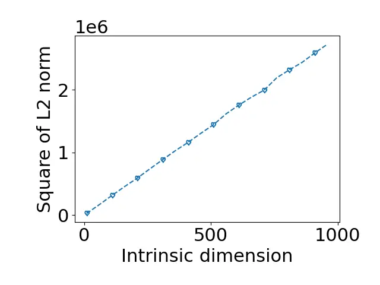

Figure 13: The square of the L2 norm of the soft prompt as the number of
intrinsic dimensions increases from $`10`$ to $`1000`$.

## Appendix E Further Supplementary Experiments

### E.1 Speedup of Using Pre-computation

We have conducted additional experiments to compare the running time of
our INSTINCT algorithm with and without the pre-computation of the
representations. The results in Table 10 show that the pre-computation
dramatically reduces the wall-clock running time of our INSTINCT
algorithm.

[TABLE]

Table 10: The running time (± standard error) of our INSTINCT algorithm
with and without pre-computation. The results are averaged on 20
instruction induction tasks in Table 1.

In Table 10, “without pre-computation” denotes the baseline whose only
difference with our INSTINCT algorithm is that this baseline uses
forward passes to compute every hidden representation in each iteration,
and “INSTINCT (with pre-computation)” is our algorithm. The first column
in Table 10 (165 iterations, same as the experiments in our paper) shows
that pre-computation drastically reduces the running time of our
INSTINCT algorithm from around 78 minutes to 29 minutes. In addition,
Table 10 shows that in tasks that require more iterations, the
pre-computation brings even more significant speed-ups. This is because
as the number of iterations increases, the cost of pre-computation is
further amortized across more iterations, which makes the computational
savings offered by pre-computation more pronounced.

We perform additional experiments to empirically compare the running
time of InstructZero and our INSTINCT. The results in Table 11 show that
our INSTINCT has comparable computational costs with InstructZero.

|                                      |                         |                           |
| ------------------------------------ | ----------------------- | ------------------------- |
| Algorithm                            | Total running time      | Time for querying ChatGPT |
| InstructZero                         | 18.00 mins (±0.41 mins) | 11.97 mins (±0.35 mins)   |
| INSTINCT (including pre-computation) | 29.05 mins (±0.54 mins) | 11.99 mins (±0.32 mins)   |

Table 11: The running time (± standard error) of InstructZero and our
INSTINCT. The results are averaged over the 20 instruction induction
tasks in Table 1.

Our INSTINCT is slightly slower than InstructZero due to the use of the
neural network and the pre-computation of the transformer
representations. However, with this slight increase in the computational
cost, our INSTINCT has achieved significantly better performances than
InstructZero as demonstrated in Table 1, Table 3, Table 2, and Table 4.
Moreover, as shown in Table 10, the method of pre-computation is crucial
for our INSTINCT to achieve a comparable computational cost with
InstructZero, and the benefit of the pre-computation becomes more
significant as a larger query budget is adopted. This further
demonstrates the importance of the contribution of our method of
pre-computation.

### E.2 Details on Comparison with the Evolutionary Algorithm

Recent concurrent works (e.g., EvoPrompt (Guo et al., 2024) and
PromptBreeder (Fernando et al., 2023)) use the evolutionary algorithm to
find the best instructions. Our experiment results in Table 1 have
demonstrated our superior performance over the concurrent evolutionary
algorithm-based method EvoPrompt, even though EvoPrompt requires more
queries to ChatGPT (i.e., the black-box LLM).

The reason that EvoPrompt uses more queries to ChatGPT than our INSTINCT
is because, in every iteration, Evoprompt needs to query ChatGPT to
generate a new instruction and query ChatGPT again to obtain its score,
whereas our INSTINCT only needs the latter query to ChatGPT (to obtain
the score). Despite getting less feedback from the black-box LLM (i.e.,
ChatGPT), our INSTINCT still performs better than EvoPrompt. This is
because our INSTINCT is based on neural bandits which is a global
optimization algorithm that is able to utilize the historical data to
efficiently balance exploration vs. exploitation. In contrast, EvoPrompt
uses the evolutionary algorithm which is a local optimization algorithm
that cannot utilize historical data to efficiently explore the global
search space of instructions. Moreover, some other concurrent works on
black-box methods for instruction optimization (e.g., PromptBreeder
(Fernando et al., 2023)) are based on similar core ideas as EvoPrompt,
i.e., they also use a powerful LLM (e.g., ChatGPT) to propose new
candidate instructions via rephrasing and use the evolutionary algorithm
for instruction optimization. Therefore, we expect our performance
advantage over EvoPrompt (which is the most relevant work to our setting
and the most recent of these works to the best of our knowledge) to also
hold for the other black-box methods.

### E.3 Performance Profile Curve for Instruction Induction Tasks


Figure 14: The performance profile curve for the 20 instruction
induction tasks in Table 1. This is a reproduction of Fig. 1 in the main
text.

The performance profile curve (Dolan & Moré, 2002) shows how frequently
the performance of different approaches is within a certain distance of
the best performance. It is a suitable measure for the performance of
methods over a large number of tasks. To draw the performance profile
curve for a method, for each task $`i`$, we check whether the
performance of this method in task $`i`$ is within $`\tau`$ distance to
the best performance (among different methods) in task $`i`$, and define
an indicator function $`\mathbb{I}()`$. Next, we average this indicator
function across all $`n_{p}`$ tasks, which yields a value $`\rho(\tau)`$
(equation 5). Finally, the performance profile curve for this method is
obtained by varying the value of $`\tau`$ and calculating the
corresponding $`\rho(\tau)`$.

```math
\rho(\tau)=\frac{\sum_{i=1}^{n_{p}}\mathbb{I}\bigl((\text{Best performance of task i}-\text{Performance of the approach on task i})\leq\tau\bigl)}{n_{p}} \tag{5}
```

Fig. 14 (a reproduction of Fig. 1 in the main text) shows the
performance profile for APE, InstructZero, EvoPrompt and INSTINCT.
INSTINCT consistently performs the best since it always has the highest
$`\rho(\tau)`$ under different $`\tau`$. The performance profile curves
also make it easier to visualize the performance superiority of our
INSTINCT algorithm.

### E.4 Performance of InstructZero and INSTINCT under Different Soft Prompt Dimensionalities

We vary the soft prompt dimensionality by changing the number of soft
tokens to see how the performance of INSTINCT and InstructZero changes.
Specifically, we vary the number of soft tokens among $`[3,5,10]`$ which
corresponds to soft prompt dimensionalities of $`[15360,26500,51200]`$
respectively. Fig. 15 shows the performance comparison between INSTINCT
and InstructZero. The performance is measured by the fraction of tasks
that each approach achieves the best performance among the performance
of InstructZero and INSTINCT. As the soft prompt dimensionality
increases, the performance of InstructZero drops. When the soft prompt
dimensionality is 51200, the fraction of achieving the best performance
for InstructZero drops dramatically compared to when the soft prompt
dimensionality is 5120. While for INSTINCT, the performance does not
drop significantly as the soft prompt dimensionality increases. Fig. 16
shows the test accuracy of the instructions generated from InstructZero
and INSTINCT for the detailed tasks when the soft prompt dimensionality
changes. Similarly, the performance of InstructZero generally drops when
the soft prompt dimensionality increases while the performance of
INSTINCT remains stable and better than InstructZero.

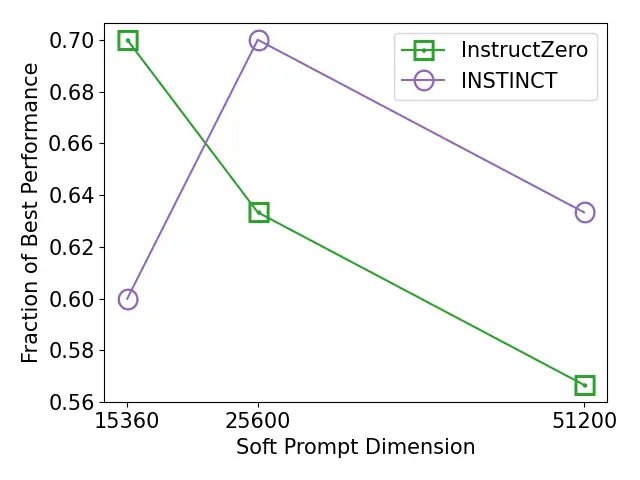

Figure 15: The fraction of tasks that one approach achieves the best
performance among 30 instruction induction tasks under different soft
prompt dimensionalities. Higher is better.

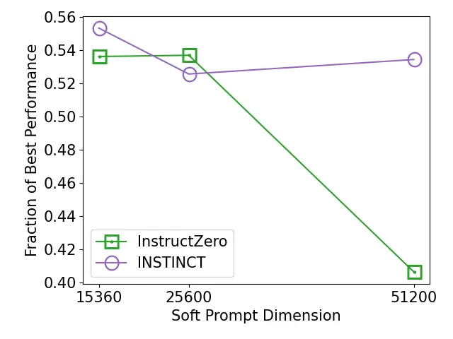

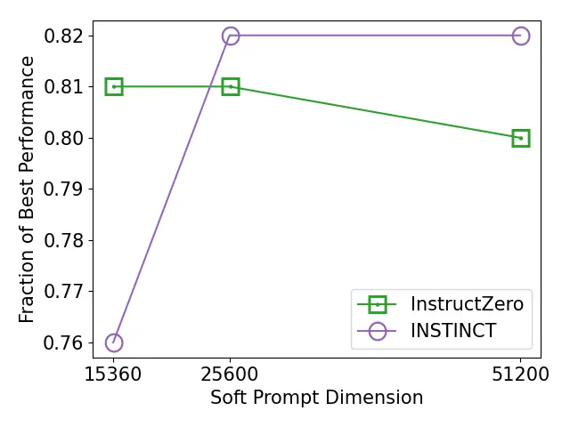

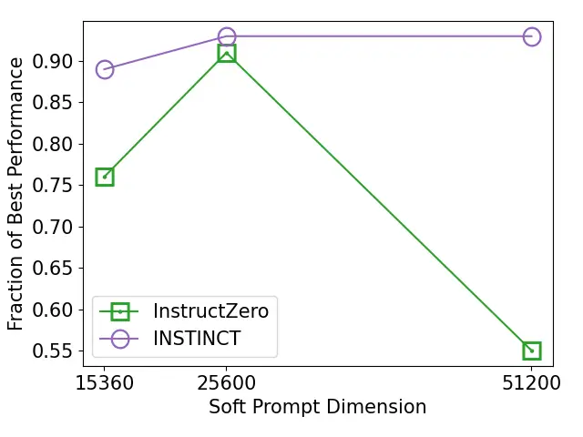

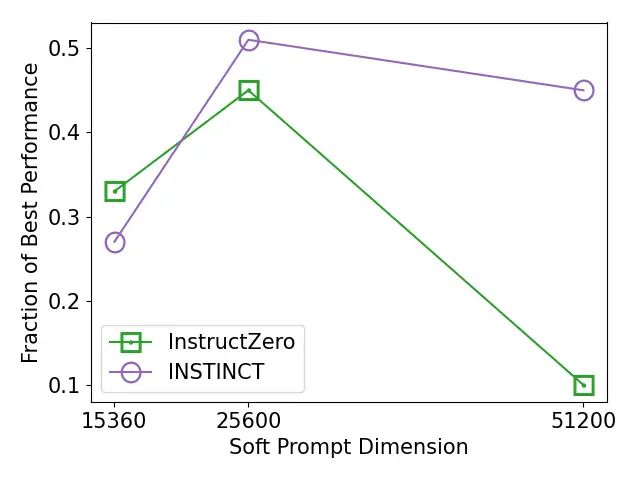

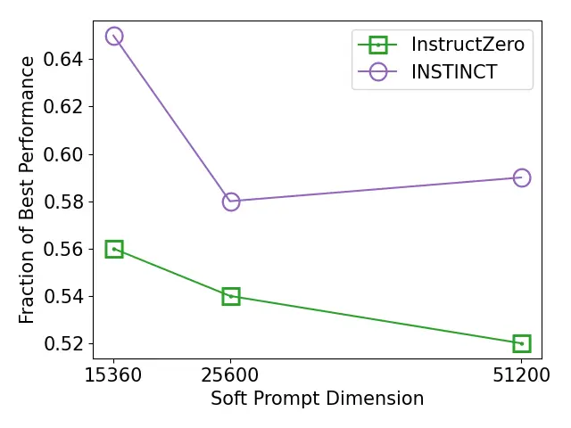

Figure 16: Test accuracy on different instruction induction tasks under
different soft prompt dimensionalities. The tasks are
informal_to_formal, negation, taxonomy_animal, word_sorting and
word_unscrambling.

### E.5 Performance Gain with respect to Random Selection

In this section, we answer two questions. Firstly, how much is the
improvement of INSTINCT over the initialized random soft prompts?
Secondly, how much is the improvement of INSTINCT over a pure random
exploration baseline which spends all its 165 black-box API query budget
using a random Sobol sequence?

We compare the instruction generated by INSTINCT with the best
instruction generated by random selection of 40 and 165 soft prompts to
show the improvement of our algorithm over random selection. The results
are in Table 12 and Table 13. The results demonstrate that our INSTINCT
consistently outperforms these two pure exploration baselines. This is
because our INSTINCT effectively balances exploration vs. exploitation
during the optimization process. Note that validation accuracy (not test
accuracy reported in the table) is the metric used during instruction
optimization, which explains why in a few tasks, the best instruction
among the 40 initial instructions has a higher test accuracy than our
INSTINCT algorithm.

|                          |                     |                 |
| ------------------------ | ------------------- | --------------- |
| Task                     | Initialization only | INSTINCT (ours) |
| antonyms                 | 0.8500              | 0.8467          |
| auto_categorization      | 0.0100              | 0.2500          |
| auto_debugging           | 0.2500              | 0.2917          |
| cause_and_effect         | 0.5200              | 0.5867          |
| common_concept           | 0.0045              | 0.2129          |
| diff                     | 1.0000              | 1.0000          |
| informal_to_formal       | 0.5394              | 0.5534          |
| letters_list             | 1.0000              | 1.0000          |
| negation                 | 0.7600              | 0.8167          |
| object_counting          | 0.2200              | 0.3400          |
| odd_one_out              | 0.6400              | 0.7000          |
| orthography_starts_with  | 0.4400              | 0.6667          |
| rhymes                   | 0.4900              | 1.0000          |
| second_word_letter       | 0.1300              | 0.1000          |
| sentence_similarity      | 0.0000              | 0.1400          |
| sum                      | 1.0000              | 1.0000          |
| synonyms                 | 0.4200              | 0.3067          |
| taxonomy_animal          | 0.9300              | 0.8567          |
| word_sorting             | 0.0400              | 0.5133          |
| word_unscrambling        | 0.5800              | 0.6333          |
| \# best-performing tasks | 7                   | 16              |

Table 12: Test accuracy for the best instruction generated by random
selection of $`40`$ soft prompts and the instruction generated by
INSTINCT.

|                          |            |                 |
| ------------------------ | ---------- | --------------- |
| Task                     | 165 random | INSTINCT (ours) |
| antonyms                 | 0.8067     | 0.8467          |
| auto_categorization      | 0.2033     | 0.2500          |
| auto_debugging           | 0.2917     | 0.2917          |
| cause_and_effect         | 0.5467     | 0.5867          |
| common_concept           | 0.0196     | 0.2129          |
| diff                     | 0.2533     | 1.0000          |
| informal_to_formal       | 0.4200     | 0.5534          |
| letters_list             | 1.0000     | 1.0000          |
| negation                 | 0.6733     | 0.8167          |
| object_counting          | 0.3533     | 0.3400          |
| odd_one_out              | 0.6733     | 0.7000          |
| orthography_starts_with  | 0.5233     | 0.6667          |
| rhymes                   | 0.6000     | 1.0000          |
| second_word_letter       | 0.1167     | 0.1000          |
| sentence_similarity      | 0.0133     | 0.1400          |
| sum                      | 0.9433     | 1.0000          |
| synonyms                 | 0.2300     | 0.3067          |
| taxonomy_animal          | 0.9367     | 0.8567          |
| word_sorting             | 0.2400     | 0.5133          |
| word_unscrambling        | 0.5867     | 0.6333          |
| \# best-performing tasks | 5          | 17              |

Table 13: Test accuracy for the best instruction generated by random
selection of $`165`$ soft prompts and the instruction generated by
INSTINCT.

### E.6 Comparison with Other Modern BO Strategies

We conduct additional experiments to demonstrate that INSTINCT works
better than simply changing the BO strategies in InstructZero. We use
two of the state-of-the-art modern BO strategies, BORE (Tiao et al., 2021) and TuRBO (Eriksson et al., 2019), to modify the BO strategy used
in InstructZero and show that our INSTINCT algorithm performs
significantly better than BORE and TuRBO.

From Table 14, we can see that our INSTINCT algorithm performs the best
and is significantly better than other BO strategies, i.e.,
InstructZero, InstructZero (BORE), InstructZero (TuRBO). Specifically,
InstructZero (BORE) performs better than the original InstructZero, this
is because BORE enjoys an improved expressiveness by casting the
computation of EI as a binary classification problem and further uses an
MLP as the classifier, and hence BORE is a better BO strategy in
instruction optimization. InstructZero (TuRBO) performs slightly worse
than InstructZero, this is because the InstructZero adopts the
instruction-coupled Kernel that uses the instruction scores to improve
the kernel function which cannot be easily adopted by TuRBO. Overall,
our INSTINCT still performs the best among all methods that are compared
here.

|                         |                |                |                |                |                |                 |
| ----------------------- | -------------- | -------------- | -------------- | -------------- | -------------- | --------------- |
| Task                    | APE            | InstructZero   | InstructZero   | InstructZero   | EvoPrompt      | INSTINCT (ours) |
|                         |                |                | (TuRBO)        | (BORE)         |                |                 |
| antonyms                | 0.6367(0.1416) | 0.8267(0.0072) | 0.8400(0.0100) | 0.8467(0.0067) | 0.7967(0.0152) | 0.8467(0.0027)  |
| auto_categorization     | 0.2500(0.0094) | 0.2567(0.0119) | 0.1333(0.1135) | 0.2633(0.0033) | 0.2600(0.0309) | 0.2500(0.0330)  |
| auto_debugging          | 0.2917(0.0340) | 0.3750(0.0000) | 0.2917(0.0417) | 0.2917(0.0417) | 0.3750(0.0000) | 0.2917(0.0340)  |
| cause_and_effect        | 0.5733(0.0891) | 0.8133(0.0109) | 0.6400(0.1442) | 0.6400(0.1007) | 0.8267(0.0475) | 0.5867(0.0871)  |
| common_concept          | 0.0691(0.0207) | 0.0864(0.0398) | 0.1122(0.0371) | 0.1280(0.0576) | 0.1211(0.0000) | 0.2129(0.0019)  |
| diff                    | 0.6733(0.2667) | 0.6933(0.2224) | 0.5567(0.2774) | 0.6500(0.2829) | 1.0000(0.0000) | 1.0000(0.0000)  |
| informal_to_formal      | 0.5736(0.0026) | 0.5310(0.0024) | 0.3341(0.1454) | 0.4941(0.0275) | 0.6182(0.0047) | 0.5534(0.0000)  |
| letters_list            | 1.0000(0.0000) | 0.5900(0.1674) | 0.6200(0.2610) | 1.0000(0.0000) | 1.0000(0.0000) | 1.0000(0.0000)  |
| negation                | 0.7533(0.0109) | 0.7767(0.0136) | 0.7867(0.0384) | 0.7800(0.0603) | 0.7867(0.0027) | 0.8167(0.0027)  |
| object_counting         | 0.3633(0.0191) | 0.3600(0.0929) | 0.3667(0.0484) | 0.4167(0.0233) | 0.1167(0.0626) | 0.3400(0.0698)  |
| odd_one_out             | 0.6333(0.0144) | 0.6133(0.0871) | 0.5333(0.1775) | 0.5000(0.1747) | 0.6533(0.0109) | 0.7000(0.0163)  |
| orthography_starts_with | 0.4567(0.1477) | 0.5067(0.0871) | 0.6933(0.0219) | 0.5067(0.1067) | 0.6000(0.0205) | 0.6667(0.0272)  |
| rhymes                  | 0.1567(0.0640) | 1.0000(0.0000) | 1.0000(0.0000) | 0.5800(0.2139) | 0.6133(0.0178) | 1.0000(0.0000)  |
| second_word_letter      | 0.7467(0.2028) | 0.4333(0.1872) | 0.4100(0.2902) | 0.2267(0.0318) | 0.4133(0.2397) | 0.1000(0.0411)  |
| sentence_similarity     | 0.0000(0.0000) | 0.0000(0.0000) | 0.0400(0.0400) | 0.0167(0.0167) | 0.2833(0.0357) | 0.1400(0.0047)  |
| sum                     | 0.6733(0.2667) | 1.0000(0.0000) | 0.9867(0.0133) | 1.0000(0.0000) | 1.0000(0.0000) | 1.0000(0.0000)  |
| synonyms                | 0.3600(0.0759) | 0.2767(0.0925) | 0.3433(0.0536) | 0.3833(0.0067) | 0.1367(0.0054) | 0.3067(0.0491)  |
| taxonomy_animal         | 0.3467(0.2341) | 0.7167(0.0838) | 0.7300(0.1242) | 0.8600(0.0693) | 0.7167(0.1308) | 0.8567(0.0599)  |
| word_sorting            | 0.3300(0.0374) | 0.3100(0.1143) | 0.2200(0.1266) | 0.2567(0.1087) | 0.5167(0.0435) | 0.5133(0.0027)  |
| word_unscrambling       | 0.4400(0.1389) | 0.5500(0.0170) | 0.4533(0.0581) | 0.5567(0.0088) | 0.6033(0.0072) | 0.6333(0.0072)  |
| average rank            | 4.25           | 3.55           | 3.85           | 3.05           | 2.55           | 2.35            |

Table 14: Average test accuracy (standard error) achieved by the best
instruction discovered by different algorithms (including the new modern
BO strategies: BORE and TuRBO) for different tasks (3 independent trials
with different random seeds). The tasks follow the 20 instruction
induction tasks in Table 1.

### E.7 Improving Expert-Level Instructions with INSTINCT

To further investigate the ability of our INSTINCT to improve upon
expert-level instructions, we perform experiments in this scenario using
the instruction induction tasks. The setting is the same as the
zero-shot CoT reasoning experiment (see Table 3), except that here we
ask the white-box LLM to rephrase the expert instructions for the
instruction induction tasks (see Table 15). The template is
”Instruction: \[instruction here\]. Rephrase the instruction so that it
is clearer for solving a task. The rephrased instruction is to ”. Here
we focus on the difficult tasks in Table 1 of our paper. Table 16 shows
that our INSTINCT is able to consistently improve upon the expert-level
instructions.

|                     |                                                                                                                                                               |
| ------------------- | ------------------------------------------------------------------------------------------------------------------------------------------------------------- |
| Task                | Expert-level instruction                                                                                                                                      |
| antonyms            | Provide an antonym for the word                                                                                                                               |
| cause_and_effect    | Given two sentences, output the sentence that is the effect of the other                                                                                      |
| common_concept      | Given a list of words, describe the common feature of these words                                                                                             |
| informal_to_formal  | Given the informal sentence, provide the formal sentence                                                                                                      |
| object_counting     | Given a list of items, output the number of items in the list                                                                                                 |
| sentence_similarity | Given two sentence, output how similar they are using the following labels: 1 - probably not, 2 - possibly, 3 - probably, 4 - almost perfectly, 5 - perfectly |
| synonyms            | Given a word, output a related word                                                                                                                           |
| word_sorting        | Provide the words in alphabetical order                                                                                                                       |
| word_unscrambling   | Given a list of shuffled letters, rearrange the letters to form a meaningful word.                                                                            |

Table 15: Expert instructions for difficult tasks.

|                     |                          |                                  |
| ------------------- | ------------------------ | -------------------------------- |
| Task                | Expert-level instruction | INSTINCT with expert instruction |
| antonyms            | 0.7700                   | 0.8200                           |
| cause_and_effect    | 0.0800                   | 0.7200                           |
| common_concept      | 0.0195                   | 0.1071                           |
| informal_to_formal  | 0.4810                   | 0.5441                           |
| object_counting     | 0.1100                   | 0.4000                           |
| sentence_similarity | 0.3200                   | 0.3400                           |
| synonyms            | 0.0900                   | 0.1200                           |
| word_sorting        | 0.5200                   | 0.5800                           |
| word_unscrambling   | 0.5800                   | 0.6400                           |

Table 16: Test accuracy for the expert instructions and the instruction
from our INSTINCT which is obtained by improving upon expert
instructions.

In summary, our INSTINCT is a general algorithm in the sense that it can
be naturally adapted to the zero-shot setting with no available paired
data, by improving upon expert-level instructions.

|                         |                                                                                                                                                                                                                                                                                     |
| ----------------------- | ----------------------------------------------------------------------------------------------------------------------------------------------------------------------------------------------------------------------------------------------------------------------------------- |
| Task                    | Best instruction                                                                                                                                                                                                                                                                    |
| active_to_passive       | The instruction was to flip the subject and verb in each sentence, but keep the preposition the same                                                                                                                                                                                |
| antonyms                | The instruction was to take a word and change it to its opposite                                                                                                                                                                                                                    |
| auto_categorization     | The instruction was to create a list of things that the input could be associated with, and the output would be the category that the input belongs to                                                                                                                              |
| auto_debugging          | The instruction was to add a line of code to the input to change the output                                                                                                                                                                                                         |
| cause_and_effect        | The instruction was to identify the sentence that is the cause of the effect in the input sentence pair                                                                                                                                                                             |
| common_concept          | The instruction was to ”involve” the objects mentioned in the input, so the answer would be ”involve oscillations” for the input ”guitars, pendulums”                                                                                                                               |
| diff                    | The instruction was to be:. Input: 41 13. Output: 28. The instruction was to be:. Input: 72 31. Output: 41. The instruction was to be:. Input: 125 35. Output: 90.                                                                                                                  |
| first_word_letter       | The instruction was to input the word ”year” into the computer and the output was ”y”. The instruction was to input the word ”trust” into the computer and the output was ”t”. The instruction was to input the word ”qualification” into the computer and the output was ”q”.      |
| informal_to_formal      | The instruction was to convert the input sentence into an output sentence that is grammatically correct and idiomatic in English                                                                                                                                                    |
| larger_animal           | The instruction was to create a program that takes an input of two animals and outputs the animal that is bigger                                                                                                                                                                    |
| letters_list            | The instruction was to output the input with a space after each letter                                                                                                                                                                                                              |
| negation                | The instruction was to make the output false by adding the word ”not” to the input                                                                                                                                                                                                  |
| num_to_verbal           | The instruction was to convert numbers to words                                                                                                                                                                                                                                     |
| object_counting         | The instruction was to output the number of objects in the input list, but the number of objects was not limited to just whole numbers                                                                                                                                              |
| odd_one_out             | The instruction was to find the word that is most dissimilar to the others in the group                                                                                                                                                                                             |
| orthography_starts_with | The instruction was to output the word that starts with the letter that was inputted                                                                                                                                                                                                |
| periodic_elements       | The instruction was to write a program that takes an input of a number and outputs the name of the element that corresponds to that number on the periodic table                                                                                                                    |
| rhymes                  | The instruction was to output the first word that appeared in the input text, with no extra spaces                                                                                                                                                                                  |
| second_word_letter      | The instruction was to input the word ’year’ and output the word ’e’. The input ’year’ was not found in the list of words provided                                                                                                                                                  |
| sentence_similarity     | The instruction was to classify the following sentences based on their degree of certainty, using the following scale:. 1 - probably. 2 - possibly. 3 - probably not. The results are as follows:. Sentence 1: 3 - probably not. Sentence 2: 2 - possibly.                          |
| sentiment               | The instruction was to output positive or negative based on the sentiment of the review, regardless of whether the review was actually positive or negative                                                                                                                         |
| singular_to_plural      | The instruction was to add -s to the end of each word, which indicates plural                                                                                                                                                                                                       |
| sum                     | The instruction was to add the numbers of the two input numbers                                                                                                                                                                                                                     |
| synonyms                | The instruction was to create a list of words that could be used in the same way as the original words                                                                                                                                                                              |
| taxonomy_animal         | The instruction was to output the name of an animal that starts with the letter ”H”. Input: horse, pajamas, scarf, hippo, egg, whale. Output: whale, horse, pajamas, scarf, hippo. The instruction was to output the name of an animal                                              |
| translation_en-de       | The instruction was to translate the input words into German, and the output was the German word that corresponded to the input word                                                                                                                                                |
| translation_en-es       | The instruction was to translate the following text:. Input: press. Output: prensa. Input: participant. Output: participante. Input: company. Output: compañía. Input: outline. Output: contorno. Input: label. Output: etiquetar. The translation is not accurate, the output does |
| translation_en-fr       | The instruction was to be given in French, but the words were often mispronounced, and the. Input: student. Output: étudiant. Input: doctor. Output: médecin. Input: lawyer. Output: avocat. Input: engineer. Output: ingénieur. Input: chef. Output: chef                          |
| word_sorting            | The instruction was to ”List: Serve wittgenstein emissive explicable ahmedabad grebe” and the output was ”ahmedabad emissive explicable grebe serve wittgenstein”                                                                                                                   |
| word_unscrambling       | The instruction was to output the word that is formed by rearranging the letters of the given word                                                                                                                                                                                  |

Table 17: The best instruction discovered by our INSTINCT algorithm for
every instruction induction task (Sec. 4.1).
