# Tailored Visions: Enhancing Text-to-Image Generation with Personalized Prompt Rewriting

Zijie Chen    Lichao Zhang    Fangsheng Weng    Lili Pan    Zhenzhong
Lan Affiliation: Zhejiang University  Westlake University  Scietrain
Affiliation: University of Electronic Science and Technology of China  
{chenzijie, zhanglichao, lanzhenzhong}@westlake.edu.cn ,
lilipan@uestc.edu.cn

###### Abstract

Despite significant progress in the field, it is still challenging to
create personalized visual representations that align closely with the
desires and preferences of individual users. This process requires users
to articulate their ideas in words that are both comprehensible to the
models and accurately capture their vision, posing difficulties for many
users. In this paper, we tackle this challenge by leveraging historical
user interactions with the system to enhance user prompts. We propose a
novel approach that involves rewriting user prompts based on a newly
collected large-scale text-to-image dataset with over 300k prompts from
3115 users. Our rewriting model enhances the expressiveness and
alignment of user prompts with their intended visual outputs.
Experimental results demonstrate the superiority of our methods over
baseline approaches, as evidenced in our new offline evaluation method
and online tests. Our code and dataset are available at
https://github.com/zzjchen/Tailored-Visions

^(\${}^{\*}\$)^(\${}^{\*}\$)footnotetext: Equal
contribution.^(\${}^{\dagger}\$)^(\${}^{\dagger}\$)footnotetext:
Corresponding author.

## 1 Introduction

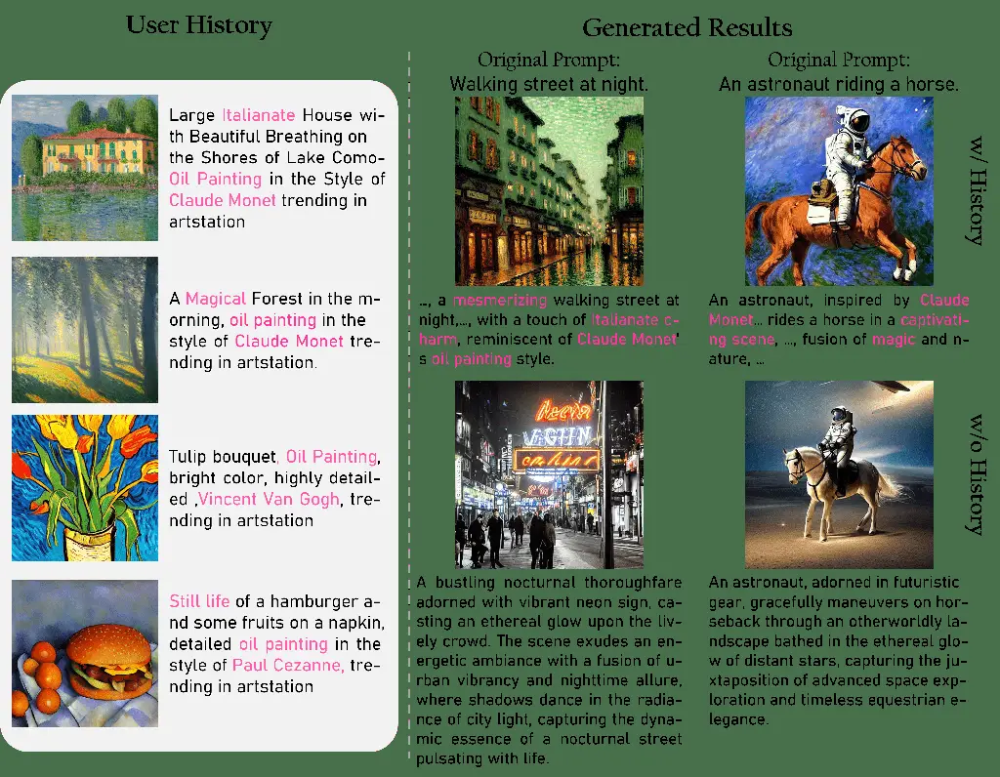

Figure 1: Comparison between our personalized prompt rewriting method
and the standard prompt rewriting method. Our technique excels at
incorporating user preferences, such as ”oil paintings by artists,”
while methods that lack a historical context frequently generate content
that may not align with the user’s desires.

Increasingly large and powerful foundation models \[1, 20, 4\] are
trained through self-supervised learning. These large pretrained models
(LPMs) serve as efficient compressors \[3\], condensing vast amounts of
internet data. This compression enables the convenient extraction of the
knowledge encoded within these models via natural language descriptions.
Despite being in its infancy, this approach exhibits potentials to
surpass traditional search engines as a superior source for knowledge
and information acquisition.

Akin to refining queries for search engines, prompts given to LPMs must
also be carefully crafted. However, the complexity of prompts, the
unpredictability of model responses compared to traditional search
engines present unique challenges. Significant research efforts \[10,
29\] have been made to comprehend how LPMs react to various prompts,
with some studies examining the feasibility of rewriting prompts for
specificity. However, without access to users’ personal data and
behavior, tailoring the prompt to meet the user’s needs accurately
remains challenging.

Our research addresses this issue by integrating user preference
information into prompt rewriting. The primary obstacle in personalized
query rewriting is the absence of a dataset containing text-to-image
prompts with personalized information. To overcome this, we have
assembled a large dataset encompassing over 300k text-to-image histories
from 3,115 users. We rewrite user prompts using their query history,
although we had limited access to personal information, leaving room for
further research. Another significant challenge is the evaluation of
rewritten queries. To evaluate their efficacy, we’ve developed a new
offline method that uses multiple metrics to measure how well our
rewriting models can recover the original user query from the
ChatGPT-shortened version.

Our paper’s contributions are threefold:

1\. We’ve compiled a large Personalized Image Prompt (PIP) dataset,
which will be made public upon paper acceptance to aid future research
in this field.

2\. We experimented with two query rewriting techniques and proposed a
new query evaluation method to assess their performance.

3\. We propose a new benchmark for personalized text-to-image
generation, which promotes the standardization of this field.

While there is still a considerable distance to cover before we can
create a perfect prompt encapsulating both the user’s requirements and
the model’s capabilities, we believe our research provides a critical
stepping stone in this ongoing exploration.

## 2 Related Work

This section provides an overview of prior work on text-to-image
generation, personalization for such generation, and prompt rewriting.
It’s important to note that our review is aimed more at offering
sufficient background knowledge rather than exhaustive coverage of all
related works.

### 2.1 Text-to-Image Generation

Large text-to-image generation models can generate high-fidelity image
synthesis and achieve a deep level of language understanding.
DALL-E \[17\] uses a VQ-VAE transformer-based method to learn a visual
codebook in the first stage and then trains autoregressive transformers
on sequences of text tokens followed by image tokens in the second
stage. DALL-E2 \[18\] introduces latent diffusion models to generate
various images by conditioning on CLIP text latents and CLIP image
embeddings generated by a prior model. Imagen \[22\] discovers that a
larger language model with more parameters trained on text-only data
improves the quality of text-to-image generation. Late developments like
stable-diffusion (SD) \[20\] proposes to generate images effectively in
latent space significantly lowering computational costs. Furthermore, SD
designs a conditional mechanism to complete class-conditional,
text-to-image and layout-to-image models. Furthermore, ControlNet \[28\]
accomplishes certain function by conditioning on multi-modal data, e.g.,
edge, sketching, pose, segmentation, depth etc., which unavoidably
involving additional condition-generation modalities.

Despite these models’ ability to generate high-fidelity images, they
often fail to meet the precise needs of the users. Text-to-image
generation is more like a game of chance.

### 2.2 Personalization for Text-to-Image Generation

Recently, personalization approaches based on text-to-image models have
taken a set of images of a concept and generated variations of the
concept. Specifically, some methods optimize a set of text embeddings.
For example,  \[2\] involves pseudo-word embeddings by a set encoder to
provide personalization and Textual inversion \[4\] composes the concept
into language sentences and performed as a personalized creation. Some
methods finetune the diffusion model. For example, DreamBooth \[21\]
finetunes the text-to-image diffusion model with shared parallel
branches. To speed up, CustomDiffusion \[12\] reduces the amount of
fientuned parameters, and  Tewel et al. \[25\] locks the subject’s
cross-attention key to its superordinate category to align with visual
concepts. Moreover, an additional encoder is trained to map concept
images to its textual representation by  \[5\] and  \[24\].

Existing studies have three key limitations: they demand extra images
and fine-tuning of text-to-image models with limited scope for new
concepts; they can’t learn from user interaction history and need
detailed user prompts; and there’s a lack of public, personalized
text-to-image datasets that truly reflect user preferences.

### 2.3 Prompt Rewriting

Recently, researchers have found that optimizing prompts can boost the
performance of LLMs on several NLP tasks and even search systems. For
examples,  Guo et al. \[6\] connect the LLM with evolutionary algorithms
to generate an optimized prompt from parent prompts, without any
gradient calculation.  Yang et al. \[27\] propose to use LLM as an
optimizer by generating new prompts based on a trajectory of previously
generated prompts in each optimization step with the objective of
maximizing the accuracy of the task. In the work \[30\], LLMs serve as
models for engineering work like inference, scoring, and resampling. In
search systems, LLMs are used to generate query expansion terms by
 \[10\], while they are used to reformulate query by  Wang et al. \[26\]
instead.

For T2I generation, one relatively close work, SUR-adapter \[29\] learns
to align the representations between simple prompt and complex prompt by
an adapter. \[7\] optimize prompt through general rewriting. However,
Neither of above works utilized personalized information for improving
prompts.

## 3 Personalized Image-Prompt (PIP) Dataset

### 3.1 Dataset Collection

The Personalized Image-Prompt (PIP) dataset is the first large-scale
personalized generated image-text dataset. The original data are
collected from a public website^(†)^(†) ^(†) https://zmrj.art/ that we
host to provide open-domain text-to-image generation to users. PIP
dataset includes 3115 users and 300,237 text-to-image histories
generated by these users using SD v1-5 \[20\] and an internal fine-tuned
version of SD v1-5. Each user in PIP has created 18 or more images and
provided at least 12 different prompts.

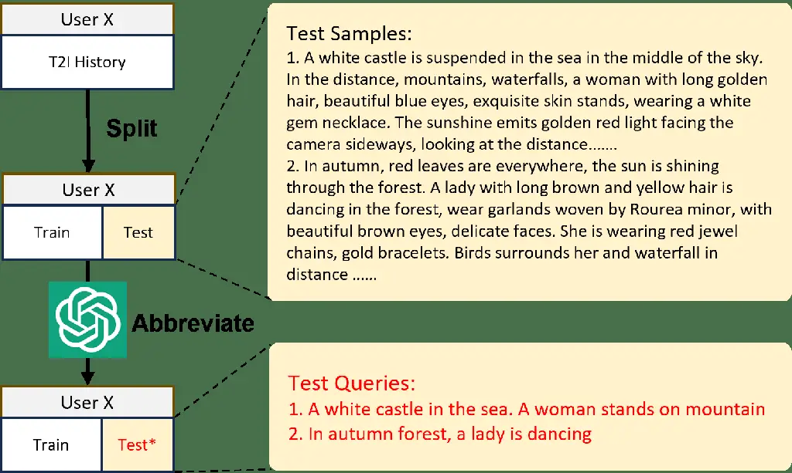

Figure 2: Dataset creation process. We split our dataset into training
and testing sets and summarize each prompts in the test set using
ChatGPT.

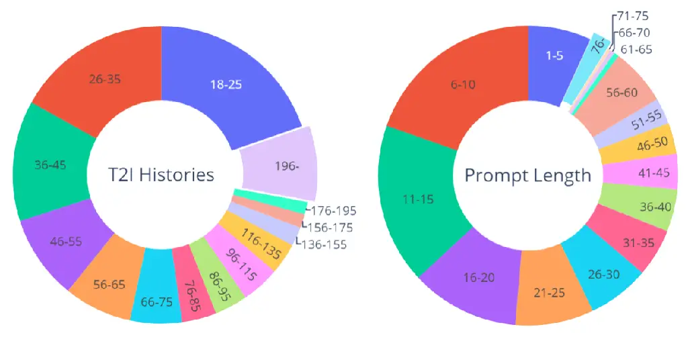

Figure 3: Dataset statistics and distribution. Left: Proportion of users
based on the varying number of historical prompts they have. Note that
each user has a minimum of 18 historical prompts, as we have excluded
those with fewer prompts from the dataset. Right: Proportion of prompts
based on their varying lengths. Best view in color.

Figure 2 illustrates the process of creating the dataset. For each
individual user, we randomly choose two prompts to serve as test
prompts, with the remaining prompts allocated as training prompts
(historical user query). The purpose of using random selection instead
of the most recent generated prompts is to enhance the diversity of our
test data. Subsequently, we employ ChatGPT to condense the test prompts,
ensuring they only include the primary object or scene, as depicted in
Figure  2. We shorten the prompts into three scales, i.e., contain only
nouns, noun phases or short sentences respectively.

In the ensuing experiment, each test prompt in the test set will be
considered as the input prompt $`x_{t}`$ for every user $`u`$, with the
original prompts serving as the ground truth that reflect the user’s
authentic preferences. The remaining prompts are utilized as training
samples.

The PIP dataset consists of 300,237 image-prompt pairs, personally
categorized by 3,115 users. These pairs are divided into 294,007
training samples and 6,230 test samples.

### 3.2 Dataset Statistics and Distribution

In this section, we showcase the data statistics that depict the quality
and diversity of PIP. We specifically illustrate data distributions of
the number of prompts and prompt length for each user, and delve deeper
into the content of the prompt through a word cloud representation.

Each data sample contain a prompt, the generated images, UserID, Image
size, and URL, as illustrated Figure 4.

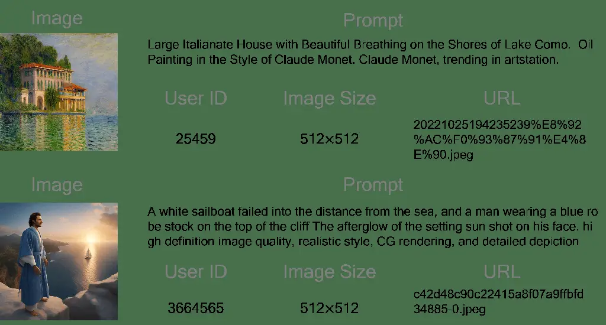

Figure 4: Two examples from a user history, containing Image, Prompt,
User ID, Image size and URL.

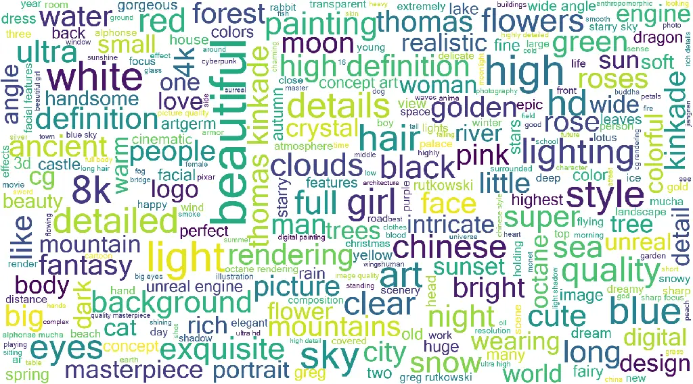

Figure 5: Word cloud visualization of top 250 keywords sampled from the
PIP dataset.

In PIP dataset, each user contributes at least 18 images, as depicted in
the left section of Figure 3. This results in a long-tail distribution.
The prompts have an average word count of 27.53. The length of the
prompts, ranging from 1 to 284 words, also follows a long-tail
distribution, as seen in the right section of Figure 3. Despite the
presence of about 2500 prompts that exceed the 75-word limit of SD, we
retain them to maintain the integrity of user preferences.

Figure 5 presents the 250 most frequently used words or phrases. The
frequency of these words is determined by the highest TF-IDF value
across all users. The word cloud reveals that these words describe
various image attributes, such as objects, styles, quality, and colors.
This variety underlines the high diversity present within the prompt
content of the PIP dataset.

### 3.3 User Preference Evaluation

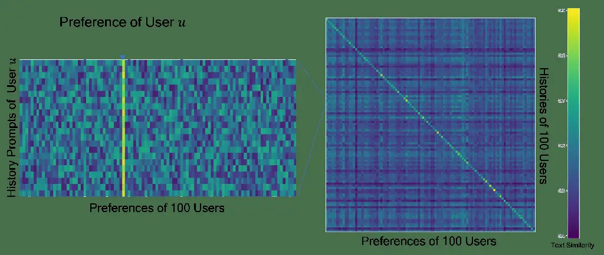

Figure 6: Text similarity between user histories and user preferences.
There is a great deal of diversity in user preferences in the PIP
dataset. In the zoomed-in version of the similarity map on the left,
users’ history prompts are highly similar to their preferences.

For each user $`u`$ in PIP dataset, we summarize his preference
$`P_{u}`$ into 5 phrases from his history prompts using ChatGPT.

We visualize the text similarities between the histories and preferences
of 100 users in Figure 6. For two users $`u,v`$, the similarity of
$`u`$’s histories and $`v`$’s preferences is defined as the mean of text
similarities between $`u`$’s history prompts and $`v`$’s preference
$`P_{v}`$. The text similarity is calculated using GTR-T5-large  \[14\].
Furthermore, we visualize the text similarities between the history
prompts of a random user and 100 user preferences in the left part of
Figure 6. This shows that text-to-image users have different preferences
and the preference $`p_{u}`$ we summarized successfully captures the key
feature the user prefers.

Based on this observation, we present two metrics to evaluate prompt
rewriting methods in terms of how the rewritten results are aligned to a
user’s preference, namely Preference Matching Score (PMS) and
Image-Align.

Preference Matching Score (PMS). PMS calculates the CLIPScore \[8\]
between generated image and user’s preference $`P_{u}`$. It measures how
the generated image aligns with the user’s preference.

```math
\displaystyle\vskip-11.38109pt\textbf{PMS}=\frac{w}{N}\sum^{N}_{u=1}\max\left(\text{cos}\left(\mathbf{Em}\left(I^{\prime}_{u}\right),\mathbf{Em}\left(P_{u}\right)\right),0\right) \tag{1}
```

where $`P_{u}`$ is the user $`u`$’s preference, $`I^{\prime}_{u}`$ is
the generated image correspondingly, $`N`$ is total user number (i.e.
3115). $`\mathbf{Em}`$ means the embedding extracted by using CLIP.
$`w=2.5`$ is a scaling constant.

Image-Align. It measures the similarity between the generated image and
the ground-truth image. Image-Align quantifies how closely the current
created image aligns with the user’s truly saved image. The similarity
between two images are calculated using CLIP  \[16\].

Apart from these metrics, we also adopt ROUGE-L to evaluate prompt
rewriting methods in our experiment. Calculating ROUGE-L between the
rewritten prompt against the original prompt measures the ability of
prompt rewriting methods to recover the original prompt. We set
$`\beta=5`$ to emphasize the recall of generated prompts.

## 4 Personalized Prompt Rewriting

The basic idea of our personalization method is to rewrite the input
prompt, considering user preferences gleaned from past user
interactions. The full pipeline of our Personalized Prompt Rewriting
(Personalized PR) method is depicted in the left part of Figure 7. If a
user $`u`$ input a prompt $`x_{t}`$, a retriever
$`\mathbf{Ret}\left(x_{t},\mathcal{Q}_{t}\right)`$ retrieves prompts
from the user’s historical prompt set $`\mathcal{Q}_{t}`$, using
$`x_{t}`$ as a query. Based on the retrival result
$`\mathcal{R}_{t}=\mathbf{Ret}\left(x_{t},\mathcal{Q}_{t}\right)`$, the
rewriter $`\mathbf{Rew}`$ rewrites the input prompt to generate a
personalized prompt
$`x^{\prime}_{t}=\mathbf{Rew}\left(x_{t},\mathcal{R}_{t}\right)`$.
Finally, the text-to-image generation model $`\mathbf{G}`$ produces the
image $`I^{\prime}_{t}=\mathbf{G}\left(x^{\prime}_{t},\epsilon\right)`$
from the rewritten prompt, where $`\epsilon`$ is a random noise
vector^(†)^(†) ^(†) The image generated from the prompt $`x_{t}`$ is
denoted as $`I_{t}`$, where
$`I_{t}=\mathbf{G}\left(x_{t},\epsilon\right)`$..

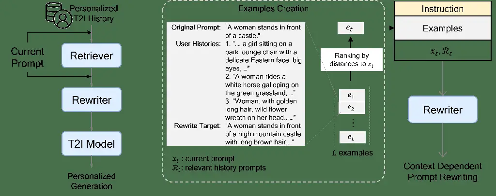

Figure 7: Left: Pipeline of Personalized Prompt Rewriting (Personalized
PR), including Retriever, Rewriter and T2I model to generate
personalized images from user histories. Right: Illustration of
context-dependent prompt rewriting. We present a specific example for
better understanding the procedure of context-dependent prompt
rewriting.

### 4.1 Retrieval and Ranking

In the retrieval stage, given the input prompt $`x_{t}`$, the retriever
$`\mathbf{Ret}\left(x_{t},\mathcal{Q}_{t}\right)`$ retrieves relevant
prompts from historical prompt set $`\mathcal{Q}_{t}`$, using $`x_{t}`$
as a query.

By analyzing user prompts, we have noticed that users tend to construct
prompts that involve objects, their attributes, and the relationships
between objects. In the works \[23\], \[11\], a query for image
retrieval is defined to include objects, attributes of objects, and
relations between objects. Inspired by this, we suspect users have the
habit of using attributes and some objects, such as background, to
express their preferences. To confirm this, we visualize the word cloud
of the top 250 frequent words in the text prompts of all users, as shown
in the right part of Figure 5. In Figure 5, we find some attributes,
such as “cute”, “golden”, and “beautiful” appear in prompts with high
frequency, as well as some objects, such as “mountain”, “sea,” and
“sky”. Intuitively, we can use the current prompt $`x_{t}`$ to locate
the relevant history prompts that include the same or similar attributes
or objects.

To locate relevant prompts, two retrieval methods are used: dense and
sparse. In dense retrieval, we choose the prompt $`x_{t}`$ and calculate
its textual embedding $`\mathbf{Em}\left(x_{t}\right)`$ using CLIP’s
text encoder, also the text encoder in Stable Diffusion \[20\]. We
suspect the prompts with similar visual attributes and objects will be
close to each other in the text embedding space. To confirm this, we
visualize some retrieval results in Figure 8. The three nearest
neighbors of $`\mathbf{Em}\left(x_{t}\right)`$ are prompts that are
semantically related. For example, if the input prompt is “Hobbit
homes”, the three most relevant prompts would include the words
“village”, “city”, and “house”. This dense retrieval method is also
referred to as embedding-based retrieval (EBR). In sparse retrieval, we
use BM25 to locate relevant prompts that include the same visual
attributes and objects.

In the above retrival, we rank relevant prompts in EBR-based or
BM25-based ranking, depending on the retrieval ways. In EBR-based
ranking, we rank the relevant prompts based on their embedding
similarity with the query $`x_{t}`$. For similarity measuring, we choose
cosine similarity as it is a commonly used similarity measure in
embedding learning. In BM25-based ranking, BM25 scores are used for
similarity measures. Consequently, we obtain the top $`k`$ relevant user
queries $`\mathcal{R}_{t}=\left\{r_{1},...,r_{k}\right\}`$.

### 4.2 Rewriting

The procedure of context-independent rewriting leverages pertinent
queries $`\mathcal{R}_{t}=\left\{r_{1},...,r_{k}\right\}`$, and employs
ChatGPT to encapsulate user preferences and rewrite the prompt directly.
These queries $`\mathcal{R}_{t}`$ are organized based on their relevance
to $`x_{t}`$.

In the context-dependent scenario, we initially create a collection of
demonstration examples $`\mathcal{E}=\left\{e_{1},...,e_{L}\right\}`$
using manual design. We then select a small subset of these examples to
serve as demonstrations for each rewriting task. Given the issue of
order sensitivity in in-context learning, as highlighted in the
study \[13\], we arrange the demonstration examples in a descending
sequence based on their proximity to the input prompt $`x_{t}`$. The
in-context rewriting process we employ is illustrated in the right
section of Figure  7.

## 5 Experiment

We carried out experiments for prompt rewriting methods on our PIP
dataset. We validate our method through both offline and online
evaluation. And we further analyze the number of historical prompts for
best extracting the users’ preference by ablating top retrieval. For
offline evaluation, we use the aforementioned three metrics: PMS,
Image-Align, and ROUGE-L.

For online evaluation, we carried out single blind experiment for
recently active users on our website. Real user feedback is collected to
evaluate our method.

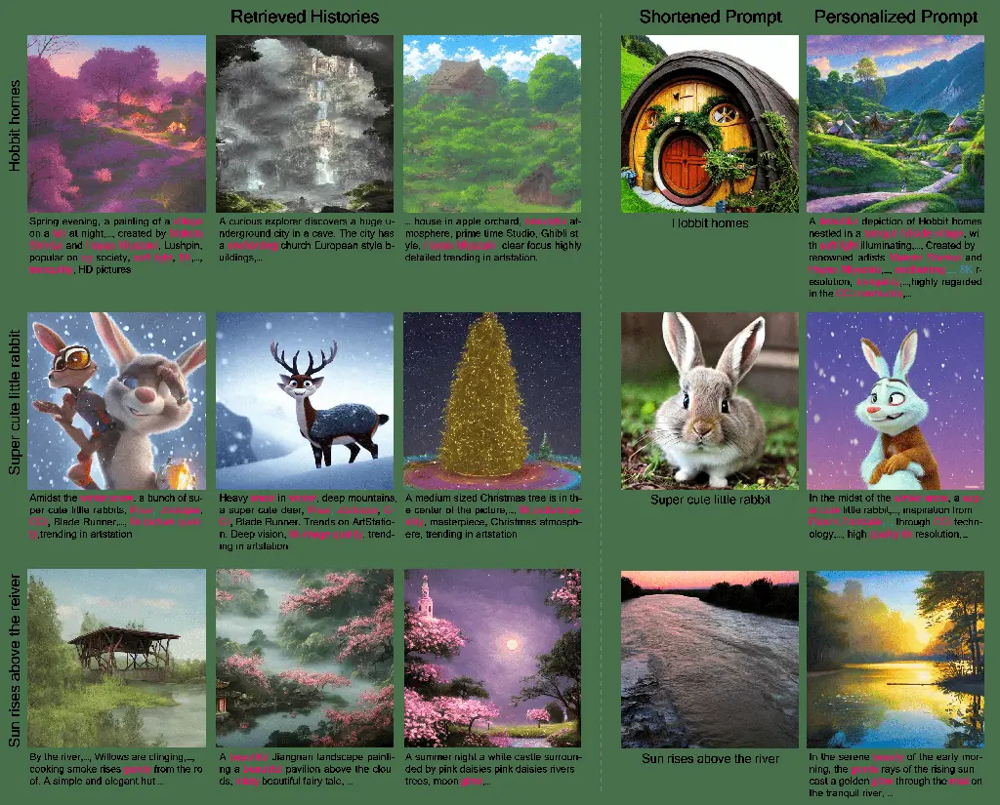

Figure 8: Qualitative analysis of personalized retrieval and rewriting.

### 5.1 Implementation Details

Details of our Personalized PR method are as follows. In retrieval, we
choose the relevant text prompt number as $`k=3`$. We use ChatGPT \[15\]
as our rewriter. An input example for context-independent
rewriting^(†)^(†) ^(†) The input for in-context rewriting is only
different from context-independent rewriting in terms of the presence of
demonstration example. See supplementary for detail. is shown in Table
 1. For in-context rewriting, we set $`L=5`$ and randomly select one
demonstration example for each rewriting task, unless otherwise
specified.

Unless other specified, all the experiments use EBR to retrieve
historical prompts, and one-shot in-context learning to rewrite the
shortened prompt.

We use Stable Diffusion (SD) v1-5 \[19\] as our text-to-image generation
model for all methods. SD v1-5 is sampled using PNDM scheduler in 50
steps and setting the classifier-free guidance scale to 7.0.

| ChatGPT Input Template for Context-independent Rewriting                                                                                                                                                                                                                                                |
| ------------------------------------------------------------------------------------------------------------------------------------------------------------------------------------------------------------------------------------------------------------------------------------------------------- |
| Prompt in text-to-image generation describes the detailed attributes of the object user plans to draw. User’s preference in text-to-image generation is shown in history prompts.                                                                                                                       |
| Given 3 history prompts, your task is to rewrite the current prompt so that it matches the user’s preference. The rewritten prompt should retain primary objects in the original prompt and conform to the user’s preference. Please avoid being too diffused and restrict your output within 70 words. |
| The history prompts are: {$`\mathcal{R}_{t}`$}                                                                                                                                                                                                                                                          |
| The current prompt is: {$`x_{t}`$}                                                                                                                                                                                                                                                                      |
| The rewritten prompt (one sentence less than 70 words) is:                                                                                                                                                                                                                                              |

Table 1: Input template for context-independent rewriting.

We compare our method with two baseline methods, namely Promptist \[7\]
and General Prompt Rewriting (General PR). Both are general
text-to-image prompt rewriting methods completely overlooking users’
preferences.

Promptist \[7\]. Promptist uses the GPT-2 as the base model and has
trained it on a self-collected text-to-image prompt dataset with 360K
prompts, by using supervised fine-tuing method and reinforcement
learning.

General PR. We prompt ChatGPT \[15\] to perform general prompt rewriting
in a normal manner. In practice, we input ChatGPT with the current
prompt $`x_{t}`$ without any user historical information. Apart from the
absence of histories, everything else of the prompt template for ChatGPT
remains the same as the template in Table 1.

We feed baseline methods with the input prompt $`x_{t}`$ and obtain its
output as prompt rewriting results $`x_{t}^{\prime}`$.
$`x_{t}^{\prime}`$ is later used to generate their image results via
$`I^{\prime}_{t}=\mathbf{G}\left(x^{\prime}_{t},\epsilon\right)`$

### 5.2 Qualitative Analysis

To illustrate the effectiveness of our retrieval methods, we provide
visualizations of the retrieved relevant image-prompt pairs in the left
section of Figure 8. These examples are drawn from the experimental
results of three different test prompts from three users. The retrieved
histories exhibit a high degree of similarity with their corresponding
queries in terms of objects, attributes, as well as the overall style or
mood of the image.

This effectively demonstrates the proficiency of our retriever in
sourcing relevant user histories, thereby providing a robust reference
for our rewriter to carry out personalized prompt rewriting.

In the right section of Figure 8, we display the generation outcomes of
both “Shortened Prompt” and “Personalized Prompt”. The “Shortened
Prompt” column exhibits the results produced from the shortened prompts,
while the “Personalized Prompt” column features the rewritten prompts of
our method along with their corresponding generated images. It’s evident
from these displays that images our method generates are more inclined
towards user preferences based on their histories, a testament to the
expressive power of our rewritten prompt. For instance, when the query
“Hobbit homes” is used (as seen in the first row), we observe the user’s
preferred style across three images, all capturing the mood of
mountainous scenery and depicting the Hobbit homes within a consistent
landscape.

### 5.3 Quantitative Comparison

To further examine the effectiveness of our Personalized PR method, we
conduct offline and online quantitative evaluation, comparing different
settings to the baseline methods without enhanced prompt rewritten on
the test samples we created.

|                      |           |                  |                         |                     |
| -------------------- | --------- | ---------------- | ----------------------- | ------------------- |
| Method               | Retriever | PMS $`\uparrow`$ | Image-Align$`\uparrow`$ | ROUGE-L$`\uparrow`$ |
| Shortened Prompt     | \-        | 0.5567           | 0.6272                  | 0.3268              |
| Promptist \[7\]      | \-        | 0.5858           | 0.6481                  | 0.2947              |
| General PR           | \-        | 0.5996           | 0.5912                  | 0.2082              |
| Personalized PR      | BM25      | 0.6125           | 0.6581                  | 0.3942              |
|                      | EBR       | 0.6083           | 0.6485                  | 0.4137              |
| Personalized PR+ ICL | BM25      | 0.6253           | 0.6456                  | 0.4417              |
|                      | EBR       | 0.6179           | 0.6796                  | 0.4686              |

Table 2: Comparison results of different variants of our method with the
baseline. Evidently, our method using EBR retriever (top-3 retrieval)
and 1-shot ICL can achieve most best results.

Offline Test Table 2 showcases the numerical results comparing various
retrieval and rewriting configurations with shortened prompts. We can
see that Promptist \[7\] and General PR are slightly better than
‘Shortened Prompt’ in terms of PMS and Image-Align. Without the users’
histories, these large language models perform prompt rewriting in
arbitrary pathways. Thus, the rewritten prompts these baseline methods
generate could totally deviate from the users’ preferences. Such
hallucination scenarios result in the decrease in terms of ROUGE-L for
both Promptist \[7\] and General PR. This indicates that although
general prompt rewriting methods appear to be refining the prompts,
their results do not align with users’ preferences well. Our method
outperforms all baseline methods, i.e. Promptist \[7\] and General PR,
on all metrics.

A comparison between BM25 and EBR reveals that dense retrieval generally
outperforms sparse retrieval, although the difference is relatively
small, indicating that both methods can produce satisfactory results.

Further, when contrasting context-independent rewriting with in-context
rewriting, it’s evident that ICL produces superior outcomes. By
integrating ICL with EBR, we achieve absolute improvements of 14.2%,
6.9% and 5.6% in terms of ROUGE-L, PMS and Text-Align metrics
respectively. This underscores the exceptional performance of
personalized prompting.

To check how sensitive our prompt rewriting methods with respect to the
length of the prompts before rewriting. we assess our rewriting method
using two additional types of prompts with shorter lengths, namely “Noun
Phrase” and “Noun”, as detailed in Table  3.

| Prompt Type    | Method          | PMS $`\uparrow`$ | Image-Align$`\uparrow`$ | ROUGE-L$`\uparrow`$ |
| -------------- | --------------- | ---------------- | ----------------------- | ------------------- |
| Noun           | Original        | 0.5537           | 0.6087                  | 0.1770              |
|                | Personalized PR | 0.6142           | 0.6478                  | 0.2804              |
| Noun Phrase    | Original        | 0.5554           | 0.6146                  | 0.2459              |
|                | Personalized PR | 0.6168           | 0.6534                  | 0.3387              |
| Short Sentence | Original        | 0.5567           | 0.6272                  | 0.3268              |
|                | Personalized PR | 0.6179           | 0.6796                  | 0.4686              |

Table 3: Performance with respect to different prompt lengths, i.e.
Noun, Noun Phrase and Short Sentence. Our “Personalized PR” equipped
with top-3 dense retriever, and 1-shot ICL consistently enhances
results, even with only nouns or noun phrases.

These two prompts are derived using spaCy \[9\] from our dataset,
adhering to the principle of minimizing word count while maintaining the
main entities. The results displayed in Table  3 show that across all
three shortened scale, “Personalized PR” outperforms the baseline across
all metrics, demonstrating the effectiveness of our methods in
recovering user preferences.

Online Test To further validate our approach, we have carried out a
single-blinded online evaluation on our website mentioned above. Active
users recently in the website are randomly selected to participate in
the online test. Upon each prompt input by a participant, there’s an
equal chance of generating an image using either “Original Prompt” or
our method’s “Personalized Prompt”. Participants can choose to “Save” or
“Delete” each generated image based on their preference. We use their
“Save” actions to assess our method’s effectiveness. In the online test,
247 users generated 905 images, with 433 from “Original Prompt” and 472
from “Personalized Prompt”. The results of the online evaluation, as
shown in Figure  9, indicate that users prefer images generated using
the “Personalized Prompt” over the “Original Prompt”, with a 17.1%
increase in “Save” actions. This suggests that our method aligns better
with user preferences, affirming its effectiveness. We anticipate even
better results in real-world scenarios with more user information and an
improved text-to-image generation method.

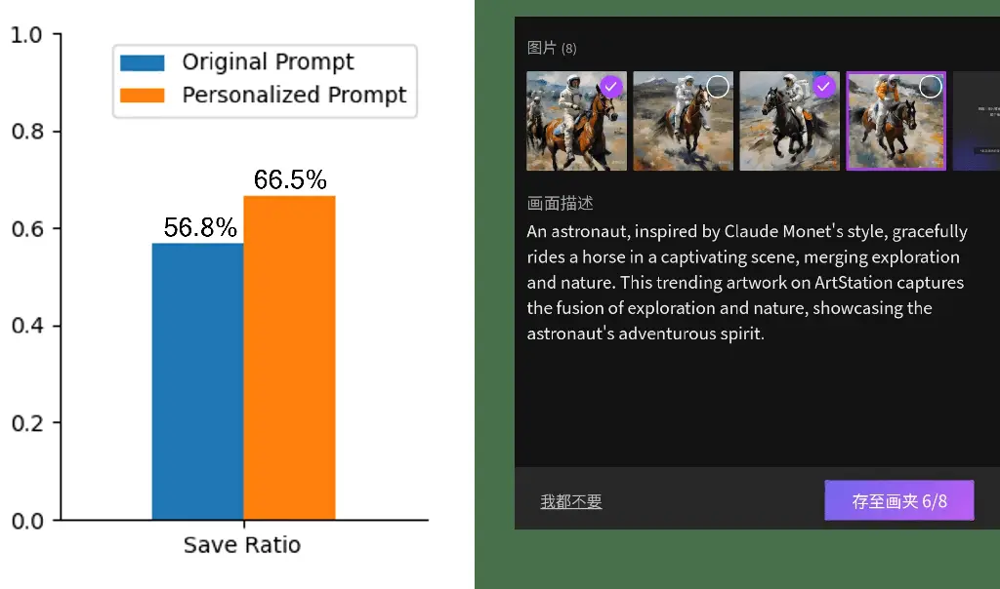

Figure 9: Illustration of our online evaluation methods and the
improvement of Save Rate from personalized Prompt.

### 5.4 Ablation Study

In this section, we ablate $`k`$ relevant historical prompts used to
rewrite personalized prompts and the number of demonstration examples
used for in-context learning. We evaluate each experiment on the same
setup as in Section  5.1.

| Method                | Retrieval Top-$`k`$ | PMS $`\uparrow`$ | Image-Align $`\uparrow`$ | ROUGE-L $`\uparrow`$ |
| --------------------- | ------------------- | ---------------- | ------------------------ | -------------------- |
| Personalized PR + ICL | 1                   | 0.6057           | 0.6751                   | 0.4539               |
|                       | 3                   | 0.6179           | 0.6796                   | 0.4686               |
|                       | 5                   | 0.6204           | 0.6748                   | 0.4474               |
|                       | 7                   | 0.6265           | 0.6651                   | 0.4592               |

Table 4: Ablation for Retrieval Top-k. We empirically conduct
experiments with respect to $`k\in\{1,3,5,7\}`$, keeping the
configuration of DENSE retriever and 1-shot ICL.

Retrieval Top-k Ablation. As shown in Table  4, when using 3 most
relevant historical prompts for rewriting, we can obtain most best
results among all evaluation metrics. We analyze that too more
historical prompts could provide redundant information and also too long
prompt input to ChatGPT worsens the rewriting performance. Therefore, we
choose 3 as the number of retrieval results, a balanced manner between
performance and efficiency.

| Method (Retrieval)     | ICL Shot | PMS $`\uparrow`$ | Image-Align $`\uparrow`$ | ROUGE-L $`\uparrow`$ |
| ---------------------- | -------- | ---------------- | ------------------------ | -------------------- |
| Personalized PR (BM25) | 1        | 0.6253           | 0.6456                   | 0.4417               |
|                        | 3        | 0.6289           | 0.6580                   | 0.4381               |
|                        | 5        | 0.6236           | 0.6571                   | 0.4226               |
| Personalized PR (EBR)  | 1        | 0.6179           | 0.6796                   | 0.4686               |
|                        | 3        | 0.6274           | 0.6708                   | 0.4354               |
|                        | 5        | 0.6242           | 0.6724                   | 0.4439               |

Table 5: Ablation for Number of ICL Demonstrations. We experiment with
consistent top-3 retrieval both on BM25 and EBR. When we set ICL shot as
1 and use EBR retriever, we observe more superior results appearing.

Number of ICL Demonstrations Ablation. Table  5 shows that 1-shot
setting, i.e., given 1 demonstration example for in-context learning,
can achieve the best results in general among all the four evaluation
metrics regarding both BM25 and EBR. This demonstrates that our prompt
rewriting template is efficient and effective enough for extracting the
personalized preference from numerous historical data of each user.

## 6 Conclusion and Future Work

In conclusion, this study has underscored the significance of harnessing
historical user behaviors to construct personalized AI content
generation. Our strategy aims to refine user prompts by capitalizing on
previous user interactions with the system. We have introduced an
innovative technique that entails reconfiguring user prompts based on a
newly developed, large-scale text-to-image dataset encompassing over
300,000 prompts from 3,115 distinct users. This methodology has proven
to augment the expressiveness of user prompts and ensure their alignment
with the desired visual outputs. Our empirical results have underscored
the supremacy of our techniques over conventional methods. This
superiority was corroborated through our novel offline evaluation method
and online tests, thereby affirming the efficacy of our approach.

Although the outcomes are encouraging, considerable research still lies
ahead in this domain. In the realm of personalized text-to-image
generation, the incorporation of more personal details like a user’s age
and gender could bolster performance. The methodologies used could be
extended to other LPMs, including LLMs. Additionally, techniques for
enhancing search engines, e.g. data source purification and ranking
optimization, could be assimilated into these models.

We are confident that our contributions represent advancements towards a
more personalized and user-focused artificial intelligence.

## References

- \[1\] Tom Brown, Benjamin Mann, Nick Ryder, Melanie Subbiah, Jared D
  Kaplan, Prafulla Dhariwal, Arvind Neelakantan, Pranav Shyam, Girish
  Sastry, Amanda Askell, et al. Language models are few-shot learners.
  _Advances in neural information processing systems_,
  33:1877–1901, 2020.
- \[2\] Niv Cohen, Rinon Gal, Eli A Meirom, Gal Chechik, and Yuval
  Atzmon. “this is my unicorn, fluffy”: Personalizing frozen
  vision-language representations. In _European Conference on Computer
  Vision_, pages 558–577. Springer, 2022.
- \[3\] Grégoire Delétang, Anian Ruoss, Paul-Ambroise Duquenne, Elliot
  Catt, Tim Genewein, Christopher Mattern, Jordi Grau-Moya, Li Kevin
  Wenliang, Matthew Aitchison, Laurent Orseau, et al. Language modeling
  is compression. _arXiv preprint arXiv:2309.10668_, 2023.
- \[4\] Rinon Gal, Yuval Alaluf, Yuval Atzmon, Or Patashnik, Amit H
  Bermano, Gal Chechik, and Daniel Cohen-Or. An image is worth one word:
  Personalizing text-to-image generation using textual inversion. _arXiv
  preprint arXiv:2208.01618_, 2022.
- \[5\] Rinon Gal, Moab Arar, Yuval Atzmon, Amit H Bermano, Gal Chechik,
  and Daniel Cohen-Or. Encoder-based domain tuning for fast
  personalization of text-to-image models. _ACM Transactions on Graphics
  (TOG)_, 42(4):1–13, 2023.
- \[6\] Qingyan Guo, Rui Wang, Junliang Guo, Bei Li, Kaitao Song, Xu
  Tan, Guoqing Liu, Jiang Bian, and Yujiu Yang. Connecting large
  language models with evolutionary algorithms yields powerful prompt
  optimizers, 2023.
- \[7\] Yaru Hao, Zewen Chi, Li Dong, and Furu Wei. Optimizing prompts
  for text-to-image generation. _arXiv preprint arXiv:2212.09611_, 2022.
- \[8\] Jack Hessel, Ari Holtzman, Maxwell Forbes, Ronan Le Bras, and
  Yejin Choi. Clipscore: A reference-free evaluation metric for image
  captioning. _arXiv preprint arXiv:2104.08718_, 2021.
- \[9\] Matthew Honnibal, Ines Montani, Sofie Van Landeghem, and Adriane
  Boyd. spaCy: Industrial-strength Natural Language Processing in
  Python. 2020.
- \[10\] Rolf Jagerman, Honglei Zhuang, Zhen Qin, Xuanhui Wang, and
  Michael Bendersky. Query expansion by prompting large language models.
  _arXiv preprint arXiv:2305.03653_, 2023.
- \[11\] Ranjay Krishna, Yuke Zhu, Oliver Groth, Justin Johnson, Kenji
  Hata, Joshua Kravitz, Stephanie Chen, Yannis Kalantidis, Li-Jia Li,
  David A Shamma, et al. Visual genome: Connecting language and vision
  using crowdsourced dense image annotations. _International journal of
  computer vision_, 123:32–73, 2017.
- \[12\] Nupur Kumari, Bingliang Zhang, Richard Zhang, Eli Shechtman,
  and Jun-Yan Zhu. Multi-concept customization of text-to-image
  diffusion. In _Proceedings of the IEEE/CVF Conference on Computer
  Vision and Pattern Recognition_, pages 1931–1941, 2023.
- \[13\] Jiachang Liu, Dinghan Shen, Yizhe Zhang, Bill Dolan, Lawrence
  Carin, and Weizhu Chen. What makes good in-context examples for
  gpt-$`3`$? _arXiv preprint arXiv:2101.06804_, 2021.
- \[14\] Jianmo Ni, Chen Qu, Jing Lu, Zhuyun Dai, Gustavo Hernández
  Ábrego, Ji Ma, Vincent Y Zhao, Yi Luan, Keith B Hall, Ming-Wei Chang,
  et al. Large dual encoders are generalizable retrievers. _arXiv
  preprint arXiv:2112.07899_, 2021.
- \[15\] OpenAI. Chatgpt.
  [https://chat.openai.com](https://chat.openai.com).
- \[16\] Alec Radford, Jong Wook Kim, Chris Hallacy, Aditya Ramesh,
  Gabriel Goh, Sandhini Agarwal, Girish Sastry, Amanda Askell, Pamela
  Mishkin, Jack Clark, et al. Learning transferable visual models from
  natural language supervision. In _International conference on machine
  learning_, pages 8748–8763. PMLR, 2021.
- \[17\] Aditya Ramesh, Mikhail Pavlov, Gabriel Goh, Scott Gray, Chelsea
  Voss, Alec Radford, Mark Chen, and Ilya Sutskever. Zero-shot
  text-to-image generation. In _International Conference on Machine
  Learning_, pages 8821–8831. PMLR, 2021.
- \[18\] Aditya Ramesh, Prafulla Dhariwal, Alex Nichol, Casey Chu, and
  Mark Chen. Hierarchical text-conditional image generation with clip
  latents. _arXiv preprint arXiv:2204.06125_, 1(2):3, 2022.
- \[19\] Robin Rombach, Andreas Blattmann, Dominik Lorenz, Patrick
  Esser, and Björn Ommer. Stable diffusion v1-5.
  [https://huggingface.co/runwayml/stable-diffusion-v1-5](https://huggingface.co/runwayml/stable-diffusion-v1-5).
- \[20\] Robin Rombach, Andreas Blattmann, Dominik Lorenz, Patrick
  Esser, and Björn Ommer. High-resolution image synthesis with latent
  diffusion models. In _Proceedings of the IEEE/CVF Conference on
  Computer Vision and Pattern Recognition (CVPR)_, pages
  10684–10695, 2022.
- \[21\] Nataniel Ruiz, Yuanzhen Li, Varun Jampani, Yael Pritch, Michael
  Rubinstein, and Kfir Aberman. Dreambooth: Fine tuning text-to-image
  diffusion models for subject-driven generation. In _Proceedings of the
  IEEE/CVF Conference on Computer Vision and Pattern Recognition_, pages
  22500–22510, 2023.
- \[22\] Chitwan Saharia, William Chan, Saurabh Saxena, Lala Li, Jay
  Whang, Emily L Denton, Kamyar Ghasemipour, Raphael Gontijo Lopes,
  Burcu Karagol Ayan, Tim Salimans, et al. Photorealistic text-to-image
  diffusion models with deep language understanding. _Advances in Neural
  Information Processing Systems_, 35:36479–36494, 2022.
- \[23\] Sebastian Schuster, Ranjay Krishna, Angel Chang, Li Fei-Fei,
  and Christopher D Manning. Generating semantically precise scene
  graphs from textual descriptions for improved image retrieval. In
  _Proceedings of the fourth workshop on vision and language_, pages
  70–80, 2015.
- \[24\] Jing Shi, Wei Xiong, Zhe Lin, and Hyun Joon Jung. Instantbooth:
  Personalized text-to-image generation without test-time finetuning.
  _arXiv preprint arXiv:2304.03411_, 2023.
- \[25\] Yoad Tewel, Rinon Gal, Gal Chechik, and Yuval Atzmon.
  Key-locked rank one editing for text-to-image personalization. In _ACM
  SIGGRAPH 2023 Conference Proceedings_, pages 1–11, 2023.
- \[26\] Xiao Wang, Sean MacAvaney, Craig Macdonald, and Iadh Ounis.
  Generative query reformulation for effective adhoc search. _arXiv
  preprint arXiv:2308.00415_, 2023.
- \[27\] Chengrun Yang, Xuezhi Wang, Yifeng Lu, Hanxiao Liu, Quoc V Le,
  Denny Zhou, and Xinyun Chen. Large language models as optimizers.
  _arXiv preprint arXiv:2309.03409_, 2023.
- \[28\] Lvmin Zhang and Maneesh Agrawala. Adding conditional control to
  text-to-image diffusion models. _arXiv preprint
  arXiv:2302.05543_, 2023.
- \[29\] Shanshan Zhong, Zhongzhan Huang, Wushao Wen, Jinghui Qin, and
  Liang Lin. Sur-adapter: Enhancing text-to-image pre-trained diffusion
  models with large language models. _arXiv preprint
  arXiv:2305.05189_, 2023.
- \[30\] Yongchao Zhou, Andrei Ioan Muresanu, Ziwen Han, Keiran Paster,
  Silviu Pitis, Harris Chan, and Jimmy Ba. Large language models are
  human-level prompt engineers. _arXiv preprint arXiv:2211.01910_, 2022.

Supplementary Material

## 7 Details of User Preference Summarization in PIP Dataset

Here, we provide details about how the user preference $`P_{u}`$ in PIP
dataset is summarized. As mentioned in Section 3.3, we use ChatGPT to
summarize $`P_{u}`$ based on the user $`u`$’s historical prompts
$`\mathcal{Q}_{t}`$. Considering ChatGPT’s context length, we randomly
select 50 historical prompts for summarization, assuming users have more
than 50 different historical prompts. The input template for ChatGPT is
shown in Table 6.

| ChatGPT Input Template for Summarizing User Preference                                                                                                                                                                                 |
| -------------------------------------------------------------------------------------------------------------------------------------------------------------------------------------------------------------------------------------- |
| Your task is to use no more than five phrases to summarize user’s preference based on history text prompts he uses in text to image generation.                                                                                        |
| A user’s preference reveals what kind of image he might prefer or the image style he likes. Do not include objects that appear in history prompts in your answer. Just answer the phrases in sequential order, separate using a comma. |
| Please summarize the preference for the following user:                                                                                                                                                                                |
| The history prompts of a user: $`\mathcal{Q}_{t}`$                                                                                                                                                                                     |
| The keywords of the user’s preference:                                                                                                                                                                                                 |

Table 6: Prompt Template we use for summarizing user preference

## 8 Further Details of In-Context Personalized PR and General PR

As mentioned in 5.1, our prompt manner for in-context rewriting is as
similar as for context-independent, both in Personalized PR and General
PR. Here we show the in-context personalized PR input template in Table
7, and we show the general PR input template in Table 8, respectively.

| ChatGPT Input Template for In-context Rewriting                                                                                                                                                                                                                                                         |
| ------------------------------------------------------------------------------------------------------------------------------------------------------------------------------------------------------------------------------------------------------------------------------------------------------- |
| Prompt in text-to-image generation describes the detailed attributes of the object user plans to draw. User’s preference in text-to-image generation is shown in history prompts.                                                                                                                       |
| Given 3 history prompts, your task is to rewrite the current prompt so that it matches the user’s preference. The rewritten prompt should retain primary objects in the original prompt and conform to the user’s preference. Please avoid being too diffused and restrict your output within 70 words. |
| Examples:{$`\mathcal{E}`$}                                                                                                                                                                                                                                                                              |
| The history prompts are: {$`\mathcal{R}_{t}`$}                                                                                                                                                                                                                                                          |
| The current prompt is: {$`x_{t}`$}                                                                                                                                                                                                                                                                      |
| The rewritten prompt (one sentence less than 70 words) is:                                                                                                                                                                                                                                              |

Table 7: ChatGPT input template for in-context personalized prompt
rewriting.

| ChatGPT Input Template for General Prompt Rewriting                                                                                                                                                                                                                 |
| ------------------------------------------------------------------------------------------------------------------------------------------------------------------------------------------------------------------------------------------------------------------- |
| Prompt in text-to-image generation describes the detailed attributes of the object he plans to draw. A nice prompt for text-to-image generation usually includes various aspects of the image including descriptions of the scene, mood, style, lighting, and more. |
| Given an input prompt, your task is to rewrite the prompt to a better one. Your rewritten prompt is supposed to describe the image better, and less than 70 words.                                                                                                  |
| The input prompt is: {$`x_{t}`$}                                                                                                                                                                                                                                    |
| The rewritten prompt (one sentence less than 70 words) is :                                                                                                                                                                                                         |

Table 8: Input template for General PR.

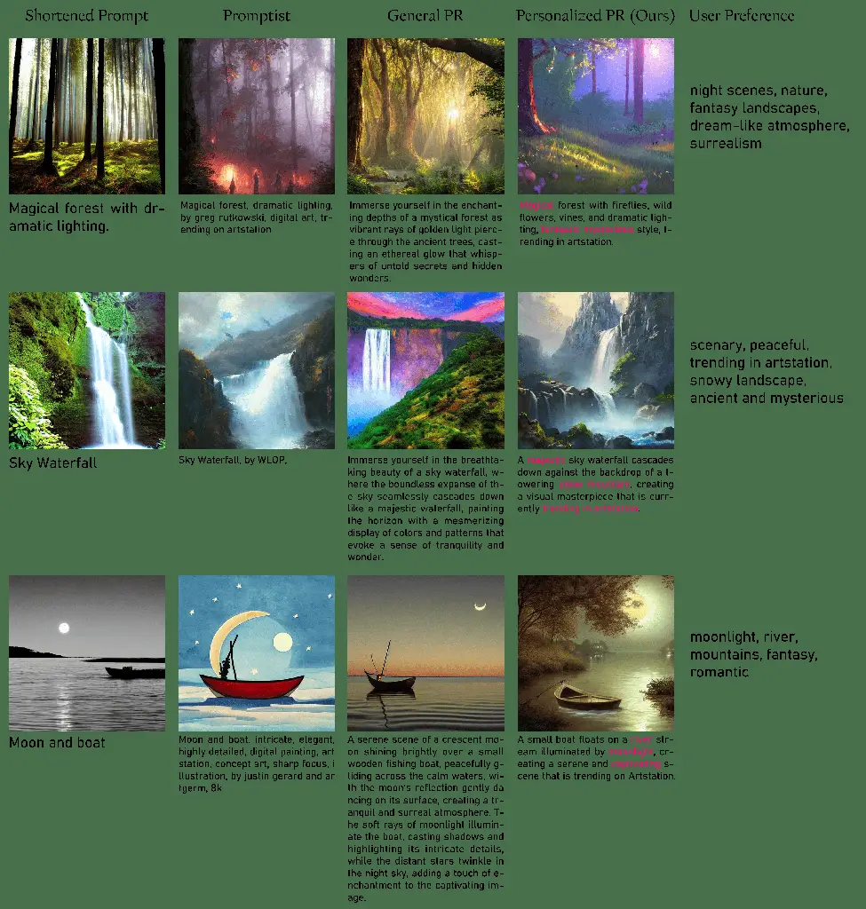

Figure 10: Qualitative comparison of our method Personalized PR against
baseline methods. Compared with Promptist, General PR, our personalized
method aligns with user preference better. Please zoom in to see
details.

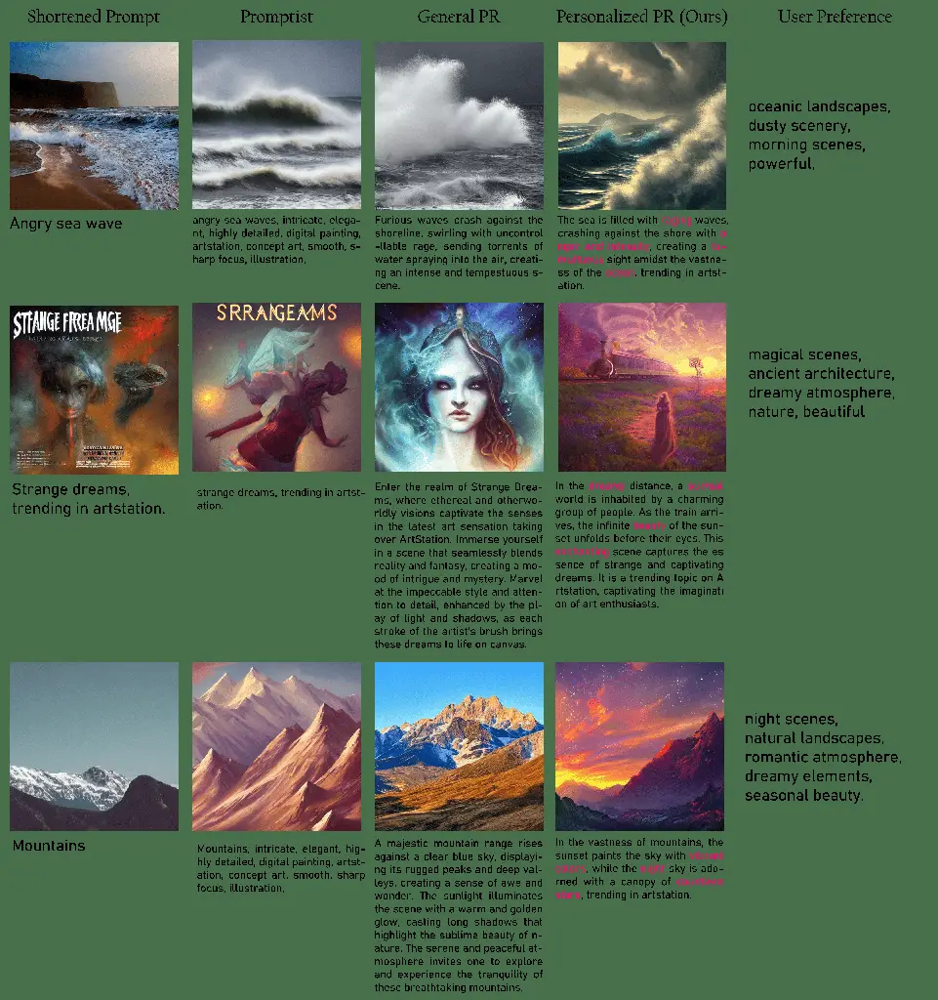

Figure 11: More comparison results. Please zoom in to see details.

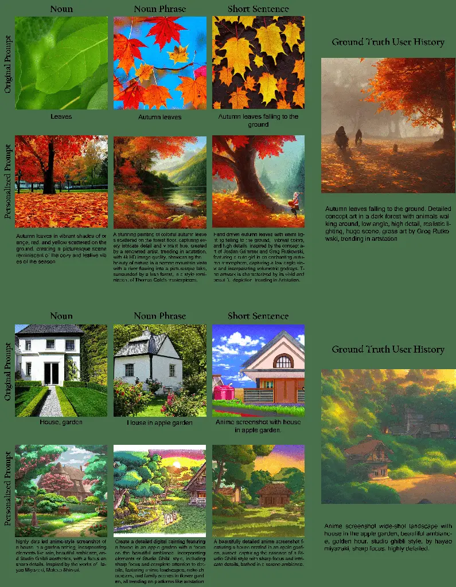

Figure 12: Qualitative results of our method under different type
(length) of input prompts. Our personalized PR can generate more
expressive user-preferred images as similar as the user groundtruth
compared with the original prompt. Please zoom in to see details.

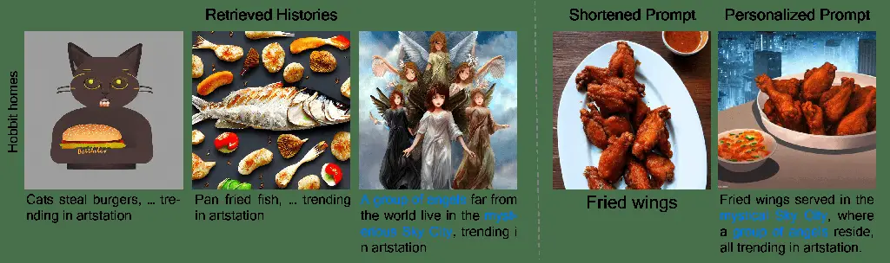

Figure 13: A failure case of our method. The words in blue indicate
irrelevant objects are added to the rewritten prompt, resulting bad
generation.

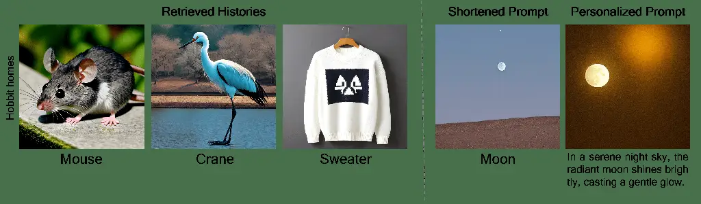

Figure 14: A failure case of our method.

## 9 Additional Qualitative Results

We provide additional qualitative results of our Personalized PR method
to demonstrate the effectiveness of our method.

In Figure 10 and Figure 11, we show comparisons of our method against
baseline methods, i.e. Promptist \[7\] and General PR, in terms of the
rewritten prompt as well as the corresponding images generated using SD
v1-5. All methods use the ”Shortened Prompt” as input $`x_{t}`$. To
evaluate the alignment with the user preference of the compared methods,
we show the user preference $`P_{u}`$ for several cases of the exemplar.
By leveraging historical prompts, our method can rewrite the prompt in
accordance with the user’s preference in each case. However, general
prompt rewriting methods either insert just a few tags (such as “digital
art” or “by greg rutkowski” etc.) arbitrarily. These generations either
produce something resembling a carefully crafted text-to-image prompt or
continually add tedious details, resulting in a lengthy text output.
Lost histories, these methods fail to meet the user’s preference.

As mentioned in 5.3 and Table 3, we have conducted experiments to
demonstrate the performance of our method in terms of two shorter types
of input prompt $`x_{t}`$. The quantitative results in 3 showcase that
our method performs robustly even on conditions of very short prompt.
Here, we provide two qualitative examples along with user ground truth
generated images in Figure  12. These results showcase that, by
leveraging historical prompts, our method is capable of rewriting input
prompt $`x_{t}`$ properly and further generating images that are very
close to the users’ true intentions, either in terms of style or
objects. Even in scenarios where the prompt only comprises nouns without
attributes, our method adeptly discerns the implicit taste of users
toward these objects, resulting in image generation much closer to the
users’ actual preferences.

## 10 Failure Cases

Our Personalized PR is a first trail of personalized text-to-image
prompt rewriting, where we evaluate our methods using naive yet
effective methods and models. Nevertheless, we would like to present
failure cases of our Personalized PR method. While such failures do
occur for some reasons, they are exceptionally rare. From which, we
expect that our method’s failure could help promote further studies on
personalized prompt rewriting.

Figure  13 illustrate a failure case where irrelevant objects are
involved into the image. We attribute the results into two reasons: the
irrelevant retrieval result $`\mathcal{R}_{t}`$, and the misconception
of Rewriter. For the irrelevant retrieval result, the retrieved
historical prompts describe some totally different scenes, such as
“group of angels” and “Sky City” in the third retrieved history shown in
Figure  13. For the misconception of Rewriter, the Rewriter ChatGPT
 \[15\] captures some objects irrelevant to “fried wings” which is the
user’s preference, thus leading to this failure.

Furthermore, we visualize another failure case in Figure  14. It happens
when the Rewriter fails to acquire adequate personalized information
from historical prompts. In this case, the user prefer to generate
various objects without sequential connections in the historical
prompts. Therefore, the Rewriter fails to capture useful information for
prompt rewriting. As a result, the rewritten prompt can be likely the
generation result sourcing from the ChatGPT’s hallucination.

Even though there might be instances of failure, our Personalized PR
poses a foundation method to align text-to-image prompts with user
preferences. With our constructed PIP dataset, proposed Personalized PR
method and the corresponding standard evaluation, we have paved a
pathway of personalization in text-to-image generation and we expect to
foster further research towards better user preference extraction.
