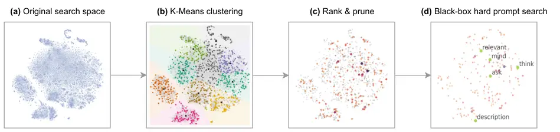

# Survival of the Most Influential Prompts: Efficient Black-Box Prompt Search via Clustering and Pruning

Han Zhou Affiliation: Language Technology Lab, University of Cambridge
Email: [hz416@cam.ac.uk](mailto:)    Xingchen Wan Affiliation: Machine
Learning Research Group, University of Oxford
Email: [iv250@cam.ac.uk](mailto:)    Ivan Vulić Affiliation: Language
Technology Lab, University of Cambridge
Email: [alk23@cam.ac.uk](mailto:)    Anna Korhonen Affiliation: Language
Technology Lab, University of Cambridge
Email: [xwan@robots.ox.ac.uk](mailto:)

###### Abstract

^(\*)^(\*)footnotetext: Equal contribution. Code is available at
[https://github.com/cambridgeltl/ClaPS](https://github.com/cambridgeltl/ClaPS)

Prompt-based learning has been an effective paradigm for large
pretrained language models (LLM), enabling few-shot or even zero-shot
learning. Black-box prompt search has received growing interest recently
for its distinctive properties of gradient-free optimization, proven
particularly useful and powerful for model-as-a-service usage. However,
the discrete nature and the complexity of combinatorial optimization
hinder the efficiency of modern black-box approaches. Despite extensive
research on search algorithms, the crucial aspect of search space design
and optimization has been largely overlooked. In this paper, we first
conduct a sensitivity analysis by prompting LLM, revealing that only a
small number of tokens exert a disproportionate amount of influence on
LLM predictions. Leveraging this insight, we propose the Clustering and
Pruning for Efficient Black-box Prompt Search (ClaPS), a simple
black-box search method that first clusters and prunes the search space
to focus exclusively on influential prompt tokens. By employing even
simple search methods within the pruned search space, ClaPS achieves
state-of-the-art performance across various tasks and LLMs, surpassing
the performance of complex approaches while significantly reducing
search costs. Our findings underscore the critical role of search space
design and optimization in enhancing both the usefulness and the
efficiency of black-box prompt-based learning.

## 1 Introduction

Many of the recent astounding breakthroughs in artificial intelligence
have revolved around pretrained large language models (LLMs). Though
capabilities of LLMs have advanced at a breakneck speed, modern LLMs are
remarkably consistent in that they are almost invariably powered by
Transformer-based architectures Vaswani et al. (2017) pretrained with
simple, self-supervised text completion on a large corpus. This is
typically followed by fine-tuning and/or, more recently, prompting-based
methods on specific tasks Lyu et al. (2022); Kojima et al. (2022); Chen
et al. (2023).

Figure 1: Our proposed method achieves the best any-time performance:
Anytime test accuracy against wall-clock time ClaPS (our proposed
method) compared to other baselines in a few-shot learning setup on
SST-2 with Flan-T5\_(base). Lines and shades denote the mean and standard
deviation over 5 random seeds, respectively (single seed for ClaPS
(greedy)).

Prompt-based learning is particularly appealing for modern LLMs due to
its sample efficiency and flexibility compared to conventional
fine-tuning. This enables few-shot or even zero-shot learning Brown
et al. (2020); Liu et al. (2023). It can be categorized into two types:
soft and hard prompt tuning. Soft prompt tuning directly optimizes the
embedding space of the model with other model parameters frozen (Li and
Liang, 2021; Lester et al., 2021, inter alia). Although these methods do
not require full gradient updates like fine-tuning, they still require
parameter access, back-propagation through massive models, and are
typically model- and/or task-specific.

Hard prompt tuning (HPT), on the other hand, is an emerging paradigm
that directly searches for discrete tokens to be added to text input.
Hard prompts are more portable and more amenable to human
interpretation, as they are actual tokens rather than abstract arrays in
the embedding space Shin et al. (2020). More importantly, unlike soft
prompting, which invariably requires parameter access of LLMs due to the
need to modify the embeddings, HPT is feasible even if the task LLM is
only available as a _‘black box’_, i.e., only the model outputs, but not
information like parameters and gradients, are available. Indeed,
methods leveraging reinforcement learning (RL) Deng et al. (2022); Zhang
et al. (2023) and gradient estimation Diao et al. (2023) have been
recently proposed to exploit this powerful property, particularly since
many advanced LLMs (e.g., GPT-4 OpenAI (2023) and Bard) are increasingly
made available in a model-as-a-service (MaaS) manner, on which parameter
or gradient access is expensive or impossible – thus, in this paper, we
also focus on this practical but challenging black-box setup.

Despite the promising progress, one challenge plaguing the
aforementioned black-box HPT approaches is the difficulty of the
discrete and combinatorial optimization inherent to this problem when no
gradient guidance is available – it is common that existing methods
require a large number of model queries, frequently in the order of
$`\mathcal{O}(10^{3})`$ or more, before convergence. While previous
works have attempted to alleviate this problem by improving the search
strategy, search space design has been largely overlooked. For example,
previous works take the natural decision of using the entire tokenizer
vocabulary as the search space Deng et al. (2022), by a convenient
extension from the soft prompt tuning. However, as we will show with an
analysis of the search spaces of discrete prompts, such a practice is
actually suboptimal and has made the optimization unnecessarily
difficult. Similar to the phenomenon observed in related discrete
optimization problems such as neural architecture search Wan et al.
(2022); Ru et al. (2020); Zhou et al. (2023b), we find the influence
exerted by different tokens on the LLM when prepended to the text
queries as discrete prompts to be highly non-uniform, with a small
number of tokens (e.g., 0.1 - 1% of all tokens) exerting a
disproportionate amount of influence. Meanwhile, the models are
insensitive to or even harmed by the vast majority of the other,
‘non-influential’ tokens, which nevertheless act as nuisance variables
during the search to substantially increase the optimization difficulty
and resources required.

Inspired by these findings, we then propose Clustering and Pruning for
Efficient Black-box Prompt Search (ClaPS), a simple black-box search
method that first clusters and prunes the search space to focus on this
subset of influential tokens, followed by the discrete prompt search on
a few-shot objective. We find that after pruning, even the simplest
search strategy (e.g., random or evolutionary search) can outperform
state-of-the-art methods with much more complicated search strategies,
often at a fraction of the search costs over these competing methods
(e.g., ClaPS outperforms RLPrompt with only 2.8% of its cost measured in
terms of wall-clock time). In summary, in this paper, we offer the
following contributions:

1.  1.  We analyze the influence different tokens in the vocabulary exert on
        LLM predictions, and find that only a small fraction of tokens
        positively influence LLMs when used as discrete prompts.
2.  2.  We propose ClaPS, a black-box discrete prompt search method
        compatible with a few-shot learning setup, via a
        cluster-prune-then-search routine that focuses on a small set of
        influential tokens as discrete prompt candidates.
3.  3.  We then show that while conceptually simple, ClaPS attains
        state-of-the-art performance, often achieved at a very small
        fraction of the cost of competing methods in more than 8 tasks with
        instruction-finetuned Flan-T5 models.

## 2 Preliminaries

Hard prompt tuning (HPT). As mentioned in §1, HPT aims to find discrete
tokens to be concatenated directly to the test queries with the goal of
maximizing task performance. Formally, HPT may be represented as an
optimization problem:

```math
\displaystyle\mathbf{p}^{*}=\operatorname*{arg\,max}_{\mathbf{p}\in\mathcal{P}}\operatorname*{\mathbb{E}}_{x_{i},y_{i}\sim\mathcal{D}}\Big[R\big(\mathbf{f}(C(\mathbf{p},x_{i})),y_{i}\big)\Big], \tag{1}
```

where $`\{x_{i},y_{i}\}`$ denotes a query-target pair,
$`\mathbf{p}=\{p_{1},...,p_{K}\}`$ are the additional tokens to be
concatenated with the text query $`x`$ – this is often referred to as
the discrete prompts, whose optimization is the focus of HPT and we use
$`\mathcal{P}`$ to denote the prompt search space, the set of all
possible discrete prompts. $`C(\mathbf{p},x_{i})`$ refers to the
concatenation of $`\mathbf{p}`$ and a formatted query $`x_{i}`$:

```math
\displaystyle C(\mathbf{p},x_{i})=\texttt{Concat}(\mathbf{p},\texttt{template}(x_{i})), \tag{2}
```

where $`\texttt{template}(\cdot)`$ denotes any human-designed
pre-processing procedure that formats $`x_{i}`$;
$`\mathbf{f}\big(C(\mathbf{p},x_{i})\big)\in\mathbb{R}_{\geq 0}^{|\mathcal{Y}|}`$
is the output probability distribution of the model given $`x_{i}`$ over
all possible classes $`\mathcal{Y}`$ (defined by the verbalizers) with
$`\sum_{j=1}^{|\mathcal{Y}|}f^{(j)}\big(C(\mathbf{p},x_{i})\big)=1`$; it
is worth stressing again that under a black-box setup considered in this
paper, the output probabilities are the only observation available to us
and we assume no access to other information, including but not limited
to the model architectures, parameters or gradients. Finally,
$`R(\cdot,\cdot)`$ refers to a reward function given the model
predictions and the ground-truth labels (an example is the negative
cross-entropy loss). The goal of HPT is thus to find the optimal
$`\mathbf{p}^{*}`$ that maximizes this reward on expectation over some
data-generating distribution $`\mathcal{D}`$. Since the true
data-generating distribution is always assumed to be latent, in practice
we solve Eq. (1) via empirical risk minimization with a standard
train-validation-test split.

Search strategy and search space. Solving Eq. (1) is, in general,
challenging, as it involves difficult combinatorial discrete
optimization, and the gradients essential for standard first-order
optimization are not available. A natural recourse, that most previous
works have focused on, is developing better zeroth order search
strategies, via, for example, reinforcement learning and Monte Carlo
gradient estimation. Search space (i.e., $`\mathcal{P}`$), on the other
hand, is much less well-studied despite the fact that its design has
been previously shown to be one of the most important influencing
factors in related discrete optimization problems. In HPT, the overall
search space $`\mathcal{P}`$ can be decomposed as a Cartesian product
over the search space of individual tokens:
$`\mathcal{P}=\prod_{k=1}^{K}\mathcal{P}_{k}`$, which is in turn often
designed heuristically, and popular choices include the entire tokenizer
vocabulary $`\mathcal{P}_{k}=\mathcal{V}`$ (and thus
$`|\mathcal{P}|=|\mathcal{V}|^{K}`$ for a $`K`$-token discrete prompt)
Deng et al. (2022) or a subset of frequent $`n`$-grams from it Diao
et al. (2023) – given the exponential scaling w.r.t. the value of $`K`$,
$`|\mathcal{P}|`$ is typically huge even for modest
$`|\mathcal{P}_{k}|`$ and/or $`K`$.

## 3 Analyzing Prompt Search Spaces

Figure 2: Only a small fraction of tokens improve performance.
Distribution of the incremental reward $`\Delta{R}(v)`$ (Eq. 3)
evaluated on 16-shot RTE samples with Flan-T5\_(base). The top-{1,5,10}%
tokens in terms of their incremental reward are highlighted in colors.

General search spaces are highly redundant. We argue that, like any
other optimization problem, the search space, in our case, may also have
a profound effect on both the search strategy and the downstream
performance. As the research community of HPT grows, we argue that a
systematic study of the search space design is crucial. As discussed,
existing search spaces are often expensive and heuristically designed.
However, a large search space is not necessarily well-designed:
crucially, it is unknown whether all parts of $`\mathcal{P}`$ positively
contribute to downstream task performance, or it could simply be highly
redundant, i.e., a large fraction of $`\mathcal{P}`$ might in fact be
unimportant or even harmful, which simply increase complexity but
nevertheless act as confounding factors that make the optimization in
Eq. (1) unnecessarily hard.

To answer this question, we analyze the building blocks of the most
general search space where the individual tokens of the discrete prompts
may be any token in the vocabulary $`\mathcal{V}`$. To quantify the
incremental influence for a token $`v\in\mathcal{V}`$, we define:

```math
\Delta R(v):=\frac{\sum_{i=1}^{N}R\big(\mathbf{f}(C(v,x_{i})),y_{i}\big)-R\big(\mathbf{f}(C(x_{i})),y_{i}\big)}{N}, \tag{3}
```

where we treat a token $`v`$ as a single-token discrete prompt to be
concatenated to text queries $`x_{i}`$ and its influence $`\Delta R(v)`$
is the change in reward compared to the case where a formatted input
without any prompt token $`C(x_{i})`$; $`N`$ denotes the number of
labeled samples randomly sampled from the training set of the target
task – we use $`N=16`$ throughout this paper, and we define
$`R(\cdot,\cdot)`$ as the negative cross-entropy:

```math
R(\mathbf{f}(C(\mathbf{p},x_{i})),y_{i})=\sum_{j=1}^{|\mathcal{Y}|}y_{i}^{(j)}\log{f}^{(j)}\big(C(\mathbf{p},x_{i})\big). \tag{4}
```

We visualize the results of the above analysis on a representative task
in Fig. 2 where we compute $`\Delta R(v)`$ for all tokens in the
vocabulary¹¹ 1 Note that the enumeration here is over
$`\mathcal{P}_{k}`$, which is typically tractable, as opposed to
$`\mathcal{P}`$. The computation may be further accelerated via
clustering – see §4., and we find the distribution of influence over the
vocabulary of tokens is, in fact, heavily non-uniform, with a small
fraction (roughly 1%, marked in green) of all tokens exerting a
disproportionate amount of influence on the prediction of LLMs whereas
the vast majority of tokens either actively harm LLM predictions or
exert negligible influence.

Figure 3: Pruning improves prompt search. Distribution of accuracy on
RTE with Flan-T5\_(base) by random sampling 100 5-token prompts from
different vocabulary spaces. Random refers to a random vocabulary set,
and BDPL prunes a context-relevant vocabulary set based on
task-dependent $`n`$-gram scores. Pruning indicates our reward pruning
on the vocabulary space. RLPrompt denotes the final test accuracy
achieved by RLPrompt Deng et al. (2022) on this task.



Figure 4: Illustration of the ClaPS pipeline. Starting from (a) the
original search space (in this case, the entire vocabulary
$`\mathcal{V}`$ with $`|\mathcal{V}|\sim\mathcal{O}(10^{4})`$,
visualized via t-SNE plots of vector embeddings for illustration only),
(b) we first perform the optional, unsupervised step of K-Means
clustering to retain a fraction of representative tokens
$`\mathcal{V}_{s}`$ with $`|\mathcal{V}_{s}|\sim\mathcal{O}(10^{3})`$.
We then (c) prune the tokens using the procedure described in §3 to
retain a small fraction of influential ($`\sim\mathcal{O}(10^{2})`$)
tokens as the search space. We finally perform (d) black-box prompt
search over the reduced search space to identify the final $`K`$-token
discrete prompts.

Search space pruning. The finding above means that it would be highly
challenging for any search method to navigate in the original search
space, especially in a black-box setup: the method has to learn to both
identify the small fraction of functioning tokens and to avoid the vast
majority of unimportant or harmful ones. Instead of doing so, we propose
to prune $`\mathcal{P}_{k}`$ by focusing on the small fraction of the
most influential tokens identified above only – given the Cartesian
structure of $`\mathcal{P}`$, this results in an exponential reduction
of the overall search space $`\mathcal{P}`$: with a representative
$`K=5`$ and if we retain the top-1% tokens in terms of $`\Delta R(v)`$
given by Eq. 3, there is a $`\mathcal{O}(10^{10})`$ reduction in
$`|\mathcal{P}|`$.

To validate the effectiveness of the pruning procedure and that the
search space reduction does not lead to sacrifices in performance, we
randomly sample 100 5-token discrete prompts from the reduced search
space after the aforementioned pruning procedure and use their
performances as an approximation of the overall search space quality,
and we compare the results against the samples drawn from 1) the
original, unmodified search space (Vocab), 2) a reduced search space
with $`\mathcal{P}_{k}`$ reduced to 10% of the original, but the tokens
are randomly selected (Random), and 3) a $`\mathcal{P}_{k}`$ consists of
frequent $`n`$-grams selected via pointwise mutual information as in
Diao et al. (2023) (BDPL). We visualize the test accuracy distribution
in the RTE task in Fig. 3, and we find pruning to massively improve
search space quality and reduce search difficulty compared to both
random pruning and the pruning strategy proposed in BDPL, the latter of
which does outperform Random and Vocab but is nevertheless outperformed
by our pruning strategy. Crucially, the fact that the median of the 100
randomly sampled discrete prompts already performs similarly to RLPrompt
Deng et al. (2022), a state-of-the-art method that features much more
complicated and expensive RL search strategy and a tailored reward
function, highlights the extreme importance of search space design.

## 4 Efficient Black-Box Prompt Search via Clustering and Pruning

Inspired by the analyses presented in §3, we now present Efficient
Black-Box Prompt Search via Clustering and Pruning, or ClaPS in short,
with the overall procedure illustrated in Fig. 4 and Algorithm 1. At a
high level, ClaPS utilizes a multi-step approach, combining the search
space pruning proposed in §3 with an optional clustering step to reduce
further the computational cost and a simple black-box prompt search
routine. We describe the procedure in detail below.

1:  Input: Original token search space $`\mathcal{P}_{k}`$ (typically
the entire vocabulary $`\mathcal{V}`$); search space size to retain
after clustering $`|\mathcal{V}_{c}|`$ (can be set to $`|\mathcal{V}|`$
if no clustering is required); search space fraction to retain after
pruning $`\alpha`$; discrete prompt length (in terms of \# tokens)
$`K`$.

2:  Output: Optimized discrete prompts $`\mathbf{p}^{*}`$

3:  if $`|\mathcal{V_{s}}|<|\mathcal{V}|`$ then

4:   \[Clustering\]: Obtain a reduced set of representative tokens
$`\mathcal{V}_{c}`$ with clustering (§4) as the new token search space
$`\mathcal{P}_{k}\leftarrow\mathcal{V}_{c}`$

5:  end if

6:  for $`v\in\mathcal{P}_{k}`$ do

7:   Compute the incremental influence $`\Delta R(v)`$ of each token
$`v`$ according to Eq. 3.

8:  end for

9:  \[Pruning\]: Rank and prune the tokens in $`\mathcal{P}_{k}`$ and
only retain the top-$`\alpha`$ fraction of tokens in terms of
$`\Delta R(v)`$ as the new token search space.

10:   \[Search\]: Run black-box prompt search in the prompt search space
$`\mathcal{P}=\prod_{k}^{K}\mathcal{P}_{k}`$ to solve Eq. 1 to obtain an
optimized discrete prompt $`\mathbf{p}^{*}`$.

Algorithm 1 ClaPS.

Clustering. By default, ClaPS enumerates the tokens in $`\mathcal{V}`$
and obtains the influence score (Eq. 3) of each token by evaluating on a
16-shot training set. While this procedure, which requires
$`\mathcal{O}(10^{4})`$ model evaluations can be already tractable, here
we propose an additional optional step to accelerate further our method:
instead of enumerating all tokens, we may use an unsupervised algorithm
on the token embedding space to obtain a subset of diverse tokens
$`\mathcal{V}_{c}`$ that well-represent $`\mathcal{V}`$ (illustrated in
Fig. 4(b)) – while alternative methods that explicitly optimize for
diversity set selection exist, we opt for the simple greedy K-means++
Arthur and Vassilvitskii (2007) to generate $`\mathcal{V}_{c}`$ (we set
$`|\mathcal{V}_{c}|=2000`$ unless otherwise stated). Formally, for each
centroid $`\mathbf{e}_{c}`$ identified by K-means++, we collect the
closest token in terms of its embedding $`\ell_{2}`$ distance:

```math
\normalsize\mathcal{V}_{c}=\{v_{c}\}_{c=1}^{|\mathcal{V}_{c}|}\text{ where }v_{c}=\operatorname*{arg\,min}_{v\in\mathcal{V}}\lVert\mathbf{e}_{v}-\mathbf{e}_{c}\rVert_{2}. \tag{5}
```

The size of the retained vocabulary $`|\mathcal{V}_{c}|`$ is a
hyperparameter of the search algorithm (to be discussed in detail at the
end of this section) and determines the number of model queries in the
next stage, with a smaller $`|\mathcal{V}_{c}|`$ leading to more
aggressive reduction and improved query efficiency but may lead to some
performance loss as some influential tokens may be removed from the
search space at this stage. In our experiments, we set
$`|\mathcal{V}_{c}|=2000`$ for all model and task combinations without
further hyperparameter tuning, and after the above procedure, the number
of LLM queries at the pruning stage reduces from $`\mathcal{O}(10^{4})`$
to $`\mathcal{O}(10^{3})`$. Empirically, as shown in §6, we find this
additional procedure to reduce the cost by roughly 3/4 relative to
enumeration (i.e., no pruning) in terms of wall-clock time at only a
small performance impact. A sensitivity study of hyperparameters is also
performed in §6.

Ranking and pruning. As illustrated in Fig. 4(c), we prune
$`\mathcal{V}_{c}`$ (with clustering) or $`\mathcal{V}`$ (without
clustering) using the procedure described in §3 to obtain the set of
influential tokens for prompt search $`\mathcal{V}_{\mathrm{it}}`$. The
size of $`\mathcal{V}_{\mathrm{it}}`$ is another hyperparameter, which
in this case encodes the greediness with a small
$`|\mathcal{V}_{\mathrm{it}}|`$ suggesting a more greedy algorithm that
only considers tokens that minimize the validation loss. However, as we
empirically show in §6, combining the most influential tokens does not
necessarily lead to the optimal prompt, and balancing greediness with
prompt search in the next stage leads to the optimal outcome – in this
paper, we set $`|\mathcal{V}_{\mathrm{it}}|=200`$ for all experiments
without further model- or task-specific hyperparameter tuning.

Black-box prompt search. The final step of ClaPS, as illustrated in
Fig. 4(d), is search. To demonstrate that ClaPS is search
method-agnostic, we consider three different search strategies in our
experiments. To differentiate from previous work focusing on search
strategies, we first consider a lightweight search strategy with a basic
evolutionary search algorithm with the following ingredients:

- •
  Initialization: we initialize with a population of $`M`$ uniformly
  sampled $`K`$-token discrete prompts from the pruned search space, and
  we evaluate the accuracy of each discrete prompt on a held-out,
  16-shot validation set.
- •
  Evolution: after evaluating all prompts in the population, at each
  search epoch, we retain the top 10% of the population in terms of the
  validation loss as seed prompts. We then generate the next population
  of $`\frac{M}{2}`$ prompts via crossover, where two randomly selected
  seed prompts exchange tokens to create a new offspring, and
  $`\frac{M}{2}`$ new prompts via mutation, where we swap a token in a
  seed prompt with another token in the (pruned) vocabulary with a fixed
  probability.
- •
  Termination: at the end of the final search epoch, we simply return
  the prompt that leads to the best validation loss seen as the final
  $`\mathbf{p}^{*}`$.

To demonstrate the versatility of ClaPS, we also consider two additional
search strategies, namely greedy search and particle swarm
optimization Kennedy and Eberhart (1995); Bonyadi and Michalewicz
(2017). The greedy algorithm is a commonly used baseline in
combinatorial optimization: Starting with an empty string
$`\mathbf{p}^{*}_{0}:=\emptyset`$, at the $`k+1`$-th iteration, we
iterate through the search space $`\mathcal{V}_{\mathrm{it}}`$ (with
$`|\mathcal{V}_{\mathrm{it}}|=200`$ following the previous paragraph)
and simply select the token that leads to the highest reward,
conditioned on partial prompt $`\mathbf{p}^{*}_{\leq k}`$ with $`k`$
tokens already selected so far. More formally, the ($`k+1`$)-th token of
$`\mathbf{p}^{*}`$ is recursively selected by:

```math
{p}^{*}_{k+1}=\operatorname*{arg\,max}_{v\in\mathcal{V}_{\mathrm{it}}}\sum_{i=1}^{N}R(\mathbf{f}(C(\texttt{Concat}(\mathbf{p}^{*}_{\leq k},v),x_{i})),y_{i}), \tag{6}
```

and the algorithm terminates when all $`K`$ tokens are selected. For the
particle swarm optimizer, we use an adapted version of the algorithm
described by Zang et al. (2020) to work in the discrete search space,
and we refer the reader to Appendix A for further implementation
details.

It is worth noting that we only consider a small representative, and
definitely non-exhaustive set of search algorithms. ClaPS, which focuses
on search space design, can be deemed as a meta-method that is
compatible with any search strategy, including but not limited to the
ones proposed in previous work, in a plug-and-play manner. It is
therefore possible that combining ClaPS with a more advanced search
method would lead to even stronger performance – we defer a thorough
investigation to future work.

## 5 Related Work

|         |                 |        |       |       |        |          |        |                  |        |       |       |        |          |        |
| ------- | --------------- | ------ | ----- | ----- | ------ | -------- | ------ | ---------------- | ------ | ----- | ----- | ------ | -------- | ------ |
| Model   | Flan-T5\_(base) |        |       |       |        |          |        | Flan-T5\_(large) |        |       |       |        |          |        |
| Method  | FT              | Manual | BDPL  | RLP.  | Search | ClaPS    |        | FT               | Manual | BDPL  | RLP.  | Search | ClaPS    |        |
|         |                 |        |       |       |        | Genetics | Greedy |                  |        |       |       |        | Genetics | Greedy |
| SST-2   | 76.19           | 85.32  | 84.89 | 86.01 | 85.85  | 87.78    | 90.37  | 83.72            | 92.32  | 92.43 | 92.55 | 92.73  | 93.03    | 94.27  |
| RTE     | 51.55           | 73.65  | 72.27 | 78.52 | 77.47  | 81.23    | 79.42  | 49.10            | 84.12  | 84.12 | 84.55 | 85.05  | 86.12    | 86.28  |
| SNLI    | 60.98           | 48.97  | 51.65 | 63.06 | 59.30  | 65.92    | 63.47  | 74.62            | 76.50  | 78.05 | 85.57 | 84.27  | 84.08    | 84.75  |
| QNLI    | 67.94           | 62.40  | 61.53 | 74.85 | 65.83  | 70.52    | 80.07  | 77.32            | 82.67  | 80.45 | 83.80 | 82.78  | 85.81    | 86.47  |
| MNLI    | 45.99           | 43.15  | 42.52 | 57.60 | 47.30  | 50.45    | 57.02  | 51.91            | 70.68  | 75.32 | 80.85 | 79.26  | 81.81    | 77.82  |
| MRPC    | 68.73           | 69.12  | 71.49 | 58.82 | 72.74  | 68.43    | 65.93  | 70.83            | 76.72  | 83.96 | 80.15 | 74.85  | 77.11    | 75.49  |
| QQP     | 66.31           | 79.07  | 68.44 | 80.09 | 80.57  | 80.87    | 81.40  | 77.23            | 81.29  | 77.25 | 72.23 | 82.01  | 81.31    | 78.10  |
| News    | 83.62           | 71.15  | 70.71 | 76.91 | 77.20  | 76.06    | 77.13  | 83.72            | 81.22  | 80.77 | 82.62 | 82.96  | 84.24    | 83.08  |
| Average | 65.16           | 66.60  | 65.44 | 71.98 | 70.78  | 72.66    | 74.35  | 71.06            | 80.69  | 81.54 | 82.39 | 82.99  | 84.19    | 83.28  |

Table 1: Accuracy on Flan-T5*(base) (Left) and Flan-T5*(large) (Right).
We reproduce all baselines and report the mean for 5 random seeds for
Flan-T5*(base). For computation-expensive experiments, we report
single-seed results for Flan-T5*(large). The best and second-best
results are marked in bold fonts and ranked by color.

Prompt learning. Prompt learning is a class of powerful methods for LLM
adaptation and has become an efficient alternative to full model
finetuning Liu et al. (2023). Earlier methods Li and Liang (2021);
Lester et al. (2021); Liu et al. (2022b) typically feature soft prompt
tuning, where continuous prompts which modify the input embedding of an
otherwise frozen LLM are optimized. Other methods, such as the
parameter-efficient fine-tuning (PEFT) techniques He et al. (2022),
which only tune a small fraction of the model parameters Houlsby et al.
(2019); Hu et al. (2022), may also be regarded as soft prompt learning.
While promising, a drawback of the soft prompting methods is that since
the model-specific input embedding layers often need to be modified,
these methods inevitably require internal model access. Furthermore,
with a few exceptions like BBT (discussed in the next paragraph), many
soft prompting methods still require back-propagation of gradients
through massive models, which can still be computationally expensive. In
contrast to soft prompting, hard prompt learning learns discrete tokens:
AutoPrompt Shin et al. (2020) uses model gradients to select appropriate
tokens automatically, but is nevertheless restricted to a ‘white-box’
setup.

Black-box prompt optimization. In contrast to the white-box methods
discussed above, several methods are proposed to tune discrete prompts
in a black-box manner (i.e., not using internal knowledge about the
pretrained LLM). Black-box tuning (BBT) and BBTv2 Sun et al. (2022b);
Sun et al. (2022a) use gradient-free optimization to learn soft prompts
that are projected back to the embedding/weight space and concatenated
to the query embedding and/or weights. While not using model gradients,
these methods nevertheless require access to input embedding of the task
model itself, and hence are not black-box in the strictest sense. In the
strictly black-box setup, methods using reinforcement learning Deng
et al. (2022); Zhang et al. (2023), discrete optimization Prasad et al.
(2023), and gradient estimation Diao et al. (2023) have been proposed;
we empirically compare against them in §6. Furthermore, as discussed in
§4, ClaPS is fully orthogonal to the previous work since these
techniques focus on improving search strategy. Several other works have
focused on optimizing specific components of the prompt design, e.g.,
Rubin et al. (2022); Liu et al. (2022a); Wan et al. (2023a); Wan et al.
(2023b) focus on selecting in-context examples and Zhou et al. (2023a)
mitigate the in-context bias by calibration. We argue that these methods
are again orthogonal to our contributions and thus may offer combining
benefits.

## 6 Experiments and Results

|        |                 |        |       |       |        |          |        |                  |        |       |       |        |          |        |
| ------ | --------------- | ------ | ----- | ----- | ------ | -------- | ------ | ---------------- | ------ | ----- | ----- | ------ | -------- | ------ |
| Model  | Flan-T5\_(base) |        |       |       |        |          |        | Flan-T5\_(large) |        |       |       |        |          |        |
| Method | FT              | Manual | BDPL  | RLP.  | Search | ClaPS    |        | FT               | Manual | BDPL  | RLP.  | Search | ClaPS    |        |
|        |                 |        |       |       |        | Genetics | Greedy |                  |        |       |       |        | Genetics | Greedy |
| BG     | 34.85           | 33.97  | 33.36 | 37.16 | 35.67  | 36.16    | 34.57  | 33.95            | 43.87  | 44.91 | 44.61 | 44.78  | 45.13    | 44.63  |
| DE     | 37.35           | 35.47  | 35.07 | 38.16 | 36.91  | 39.56    | 41.64  | 40.56            | 55.17  | 55.63 | 62.67 | 60.80  | 62.29    | 57.74  |
| EN     | 47.69           | 41.20  | 40.08 | 54.23 | 46.17  | 54.14    | 54.77  | 69.04            | 69.84  | 76.77 | 81.18 | 79.04  | 81.15    | 77.11  |
| ES     | 35.51           | 34.53  | 33.82 | 34.27 | 36.62  | 38.00    | 40.50  | 52.40            | 53.03  | 51.92 | 58.58 | 58.55  | 60.52    | 55.59  |
| FR     | 40.23           | 35.15  | 33.92 | 37.27 | 35.67  | 38.16    | 41.98  | 48.30            | 54.69  | 55.07 | 63.81 | 60.35  | 63.76    | 57.62  |
| HI     | 33.50           | 33.33  | 33.33 | 33.13 | 33.51  | 33.99    | 34.61  | 32.95            | 33.81  | 34.41 | 35.45 | 34.97  | 35.03    | 34.61  |
| RU     | 34.99           | 33.85  | 33.42 | 33.51 | 36.91  | 37.46    | 37.01  | 37.13            | 48.96  | 49.34 | 49.74 | 49.68  | 50.62    | 47.84  |
| SW     | 34.01           | 33.37  | 33.33 | 34.19 | 33.72  | 33.71    | 35.95  | 36.33            | 36.87  | 37.29 | 38.94 | 36.67  | 37.56    | 36.81  |
| TR     | 34.14           | 33.81  | 33.54 | 36.53 | 33.86  | 36.11    | 36.67  | 35.35            | 43.91  | 44.57 | 45.69 | 45.85  | 45.31    | 42.91  |
| Avg.   | 36.92           | 34.96  | 34.43 | 37.61 | 36.56  | 38.59    | 39.74  | 42.89            | 48.91  | 50.00 | 53.41 | 52.30  | 53.49    | 50.54  |

Table 2: Accuracy in 9 languages on XNLI with Flan-T5*(base) (Left) and
Flan-T5*(large) (Right). Methods in other languages show similar
performance to Hindi and Swahili with marginal improvements over random
prediction and are omitted from the table. We report single-seed
RLPrompt results due to its computation costs for XNLI tasks. Refer to
Table 1 for additional explanations.

Evaluation data. We include various tasks from single-sentence to
multi-sentence classification tasks, from mono-lingual to multi-lingual
NLI datasets for widely validating the performance of ClaPS at different
levels of task difficulty. We conduct experiments on the standard GLUE
dataset Wang et al. (2018) including: SST-2, RTE, QNLI, MNLI, MRPC, QQP.
Furthermore, we include AG’s News Zhang et al. (2015) and SNLI Bowman
et al. (2015) following the previous hard prompt tuning papers Deng
et al. (2022); Zhang et al. (2023). In addition, we include XNLI Conneau
et al. (2018), a multilingual NLI task, as the most challenging unseen
dataset for revealing the potential of our method in different
languages. For all tasks, we follow the standard few-shot setting Perez
et al. (2021), where 16 shots represent 16 examples per class for both
training and validation sets. Since the test labels for GLUE tasks are
unavailable, following standard practice we take validation shots from
the training sets and treat the validation set as the test set.

Baselines. In the few-shot learning setup, we mainly compare ClaPS with
gradient-free black-box baselines. Training details of all the methods
in comparison are included in Appendix A.

- •
  Finetuning: we finetune the seq2seq language model following the
  standard setup Karimi Mahabadi et al. (2021); Zeng et al. (2023).
- •
  BDPL Diao et al. (2023): BDPL first models the prompt generation as
  samples drawn from a multi-dimensional categorical distribution, and
  uses Monte Carlo-estimated gradients to optimize the distribution
  parameters. The search space is over a subset of $`\mathcal{V}`$ that
  appear as frequent $`n`$-grams in the task training corpus.
- •
  RLPrompt Deng et al. (2022): It trains a policy network that generates
  discrete prompts (an MLP layer on top of a frozen, pretrained GPT-2
  model) with a bespoke piece-wise reward. The search space is over the
  whole vocabulary.
- •
  Search and Prune & Search: we include these baselines both as ablation
  experiments and to directly gauge the impact of search space design on
  the downstream task performance. Search baseline utilizes the genetics
  search algorithm described in §4 directly in the full, non-pruned
  vocabulary search space without clustering and pruning. Prune & Search
  refers to ClaPS without the clustering step where we prune on the
  whole vocabulary followed by the genetics search.

Models. We explore the potential of ClaPS with instruction-finetuned
models, and we test on a wide range of challenging tasks with
Flan-T5*(base) and Flan-T5*(large) models, one of the most powerful
open-sourced models of their size Chung et al. (2022). We refer readers
for detailed hyperparameters and training setups to Appendix A.

Discussion of main results. We present the results on all tasks except
XNLI in Table 1, whereas the XNLI results are provided in Table 2. For
ClaPS results, we present ClaPS with genetics and greedy search
algorithms in the main text and show the results with particle swarm
optimization in Appendix B. Across both sets of tasks, we find ClaPS (i)
to consistently improve on standard, no-prompt Manual baseline and (ii)
to outperform the other prompting baselines across the models and tasks.
More specifically, ClaPS (genetics) outperforms RLPrompt 0.6% and 1.8%
on average for Flan-T5*(base) and Flan-T5*(large), respectively. In
addition, we find that when used with ClaPS, the greedy search
algorithm, although straightforward, can be surprisingly strong across
many experiments except for XNLI with Flan-T5\_(large); this concretely
shows that ClaPS may orthogonally benefit different suitable search
algorithms. Furthermore, in contrast to other prompting baselines like
BDPL and RLPrompt, which occasionally lead to performance deterioration
from Manual, ClaPS consistently improves over the latter. We hypothesize
that it is exactly due to the stability of our approach enabled by
searching only on pruned search space featuring positively influential
tokens, whereas the competing methods may suffer from unstable and noisy
gradient estimations and/or RL policies over a search space with more
harmful sub-components.

Finally, we emphasize that ClaPS achieves state-of-the-art performance
with rather naïve search strategies, which stands in stark contrast to
the competing methods that are both much more complicated
methodologically and often orders-of-magnitude more expensive – we argue
that this highlights that methods focusing on search space design
warrant further investigation in future work.

|                  |           |        |          |          |           |
| ---------------- | --------- | ------ | -------- | -------- | --------- |
| Methods          | \# Param. | VRAM   | Time     | \# Query | SST-2 (%) |
| FT               | 250M      | 6.53GB | 0.42 min | \-       | 76.15     |
| RLPrompt         | 3M        | 3.60GB | 65.1 min | 12000    | 86.01     |
| BDPL             | 1K        | 2.54GB | 0.20 min | 600      | 84.89     |
| Search           | 0         | 2.54GB | 1.26 min | 4000     | 85.82     |
| Prune & Search   | 0         | 2.54GB | 7.65 min | 24000    | 87.84     |
| ClaPS (Genetics) | 0         | 2.54GB | 1.80 min | 6000     | 87.78     |
| ClaPS (Greedy)   | 0         | 2.54GB | 0.86 min | 3000     | 90.37     |

Table 3: Comparing the efficiency of ClaPS with baselines in the
few-shot learning setup with Flan-T5\_(base). We report the number of
trainable parameters, the peak VRAM load, and the wall-clock time for
the training phase of all methods. The pruning-phase time span is
included in ClaPS. Note that RLPrompt and BDPL are run under their
default settings, respectively.

Efficiency analysis. We analyze the performance-cost trade-off of
various methods on a representative task in Table 3, which highlights
the much-enhanced practicality of ClaPS compared to the baselines: ClaPS
is extremely storage-efficient as it requires no additional parameters
to be stored in the GPU, and the only memory requirement is to maintain
the task model under an inference-only (i.e., no gradient storage) mode.
ClaPS also achieves the best trade-off between time efficiency and
performance as faster methods (FT and BDPL) perform much worse, whereas
methods like RLPrompt perform better, but are orders-of-magnitude
slower. It is worth noting for fairness of comparison, we also perform
additional experiments by running BDPL longer than the default, but we
find that doing so only brings marginal improvement over the Manual
baseline, as illustrated in Fig. 1.

Examples of discovered discrete prompts.

|            |                                         |
| ---------- | --------------------------------------- |
| Dataset    | RLPrompt-found Prompt                   |
| SST-2      | ReviewCustomerBankBankBank              |
| RTE        | DatabaseansweranswerYesĠyes             |
| QQP        | ComponentArgsArgsChangeĠaffecting       |
| XNLI\_(EN) | NodeArgsArgsArgsĠaffecting              |
| Dataset    | ClaPS-found Prompt                      |
| SST-2      | cruise perfect properly review cruise   |
| RTE        | answer respectively minimum tell answer |
| QQP        | suggest outside cause exists statement  |
| XNLI\_(EN) | think ask relevant description mind     |

Table 4: Examples of ClaPS-discovered prompts compared to RLPrompt for a
collection of tasks using Flan-T5\_(base). The ClaPS prompts are
prepended to the formatted text queries, whose templates are listed in
Appendix A.

Table 4 presents examples of ClaPS-discovered prompts, and
interestingly, we often observe some interpretability even though ClaPS
has not been explicitly tuned towards fluency. For example, in SST-2, a
movie review sentiment-classification task, ClaPS picks ‘review’ as a
part of the best prompt. On the other hand, RTE and XNLI\_(EN) are both
textual entailment tasks and ClaPS again spontaneously discovers prompts
provide an instruction-like signal to ‘ask’ the model to ‘answer’ the
question. While the other prompts are less immediately interpretable, we
hypothesize that they nevertheless act to tune the model embedding
towards the optimal direction for the target task for performance
improvement. ClaPS does share some words with the competitive baseline,
RLPrompt, and these words (e.g., ‘review’ and ‘answer’) are usually
‘influential prompts’ identified by our pruning strategy and have
significant impacts on the model’s prediction. With a similar or even
better quality of prompts, ClaPS stands out by first establishing an
efficient search space while saving substantial computation costs.

Ablation and sensitivity studies.

Figure 5: Ablation studies. Top row: Flan-T5\_(base) accuracy on
SST-2/RTE with (ClaPS-genetics) and without (Prune&Search) clustering.
Bottom row: performance sensitivity to pruning strength from 0% (no
pruning, i.e., the Search baseline in Tables 1 & 2 to 99.9%. Mean
$`\pm`$ standard deviation (error bar or shade) shown.

In Fig. 5, we first study the performance impact of the use of
clustering by comparing ClaPS against Prune&Search: we find that in the
tasks considered, clustering minimally affects the performance, but
leads to a $`\sim`$75% speed-up in terms of wall-clock time. We also
investigate the effect of different pruning strengths, and find that 1)
pruning generally improves performance, 2) performance is rather
insensitive to (reasonable) pruning strength, and 3) the threshold of 1%
(corresponding to 99% in Fig. 5) is a generalizable choice across tasks.
Finally, we conduct additional ablation experiments to test the
robustness of ClaPS w.r.t. other hyperparameters, such as the number of
clusters during clustering and the prompt length; the readers are
referred to Appendix B for details.

## 7 Conclusion

We first analyzed the search spaces in the general paradigm of hard
prompt search. Inspired by the findings that only a small fraction of
tokens exert a positive influence on prediction, we proposed ClaPS, an
efficient black-box prompt search method via clustering and pruning. The
ClaPS method is methodologically simple, easy to implement, and
cost-effective, and we showed that it achieves state-of-the-art
performance in both mono-lingual and multi-lingual tasks with Flan-T5
models. ClaPS is a meta-method orthogonal to the search strategy, and we
expect more efficient and effective prompt search algorithms can be
created on top of it. We hope that future work will invest more time
into the important problem of search space design.

## Limitations

We argue that ClaPS only serves as a first step towards the promising
direction of better search space design and automation, and thus, the
room for improvement is ample. First, we have only considered a suite of
natural language understanding (NLU) tasks that may be cast as
classification in the present study, whereas prompting techniques for
generative tasks are, in general, less developed.

Second, we have only explored a token-based search space for hard
prompts as it is the most general, but alternative search spaces built
on the overall instruction templates and exemplifiers exist (such as the
ones used in Zhang et al. (2023) and Prasad et al. (2023). We
hypothesize that since these search spaces are also often heuristically
designed, the search space issues and the pruning procedure may also
apply to these search spaces, which are often claimed to be more
interpretable, and thus, it would be interesting to extend our analysis,
and methodology to these alternative spaces.

Third, as we discussed in §4, while the present paper primarily focuses
on search space, it is possible to combine ClaPS with more advanced
search methods for further potential gains: some promising strategies
include reinforcement learning, as used in Deng et al. (2022) and Zhang
et al. (2023), and sample-efficient zeroth-order algorithms that may
operate directly over the token search spaces, such as the recent
advancements in Bayesian optimization over discrete and/or combinatorial
variables Baptista and Poloczek (2018); Wan et al. (2021); Daulton
et al. (2022). We defer thorough investigations to future work.

## Acknowledgements

Han Zhou is supported by the UK Research and Innovation (UKRI) Frontier
Research Grant EP/Y031350/1 (the UK government’s funding guarantee for
ERC Advanced Grants) awarded to Anna Korhonen at the University of
Cambridge. Xingchen Wan is supported by the Clarendon Scholarship at
University of Oxford. The work has been supported in part by a Royal
Society University Research Fellowship (no 221137; 2022-) awarded to
Ivan Vulić, and by the UK EPSRC grant EP/T02450X/1.

## References

- Arthur and Vassilvitskii (2007) David Arthur and Sergei
  Vassilvitskii. 2007. [k-means++: the advantages of careful
  seeding](http://dl.acm.org/citation.cfm?id=1283383.1283494). In
  _Proceedings of the Eighteenth Annual ACM-SIAM Symposium on Discrete
  Algorithms, SODA 2007, New Orleans, Louisiana, USA, January 7-9,
  2007_, pages 1027–1035. SIAM.
- Baptista and Poloczek (2018) Ricardo Baptista and Matthias
  Poloczek. 2018. Bayesian optimization of combinatorial structures. In
  _International Conference on Machine Learning_, pages 462–471. PMLR.
- Bonyadi and Michalewicz (2017) Mohammad Reza Bonyadi and Zbigniew
  Michalewicz. 2017. Particle swarm optimization for single objective
  continuous space problems: a review. _Evolutionary computation_,
  25(1):1–54.
- Bowman et al. (2015) Samuel R. Bowman, Gabor Angeli, Christopher
  Potts, and Christopher D. Manning. 2015. [A large annotated corpus for
  learning natural language
  inference](https://doi.org/10.18653/v1/D15-1075). In _Proceedings of
  the 2015 Conference on Empirical Methods in Natural Language
  Processing_, pages 632–642, Lisbon, Portugal. Association for
  Computational Linguistics.
- Brown et al. (2020) Tom Brown, Benjamin Mann, Nick Ryder, Melanie
  Subbiah, Jared D Kaplan, Prafulla Dhariwal, Arvind Neelakantan, Pranav
  Shyam, Girish Sastry, Amanda Askell, et al. 2020. [Language models are
  few-shot
  learners](https://proceedings.neurips.cc/paper/2020/hash/1457c0d6bfcb4967418bfb8ac142f64a-Abstract.html).
  _Advances in neural information processing systems_, 33:1877–1901.
- Chen et al. (2023) Wei-Lin Chen, Cheng-Kuang Wu, and Hsin-Hsi
  Chen. 2023. [Self-icl: Zero-shot in-context learning with
  self-generated
  demonstrations](https://doi.org/10.48550/arXiv.2305.15035). _arXiv
  preprint arXiv:2305.15035_.
- Chung et al. (2022) Hyung Won Chung, Le Hou, Shayne Longpre, Barret
  Zoph, Yi Tay, William Fedus, Eric Li, Xuezhi Wang, Mostafa Dehghani,
  Siddhartha Brahma, Albert Webson, Shixiang Shane Gu, Zhuyun Dai, Mirac
  Suzgun, Xinyun Chen, Aakanksha Chowdhery, Sharan Narang, Gaurav
  Mishra, Adams Yu, Vincent Y. Zhao, Yanping Huang, Andrew M. Dai,
  Hongkun Yu, Slav Petrov, Ed H. Chi, Jeff Dean, Jacob Devlin, Adam
  Roberts, Denny Zhou, Quoc V. Le, and Jason Wei. 2022. [Scaling
  instruction-finetuned language
  models](https://doi.org/10.48550/arXiv.2210.11416). _CoRR_,
  abs/2210.11416.
- Conneau et al. (2018) Alexis Conneau, Ruty Rinott, Guillaume Lample,
  Adina Williams, Samuel Bowman, Holger Schwenk, and Veselin
  Stoyanov. 2018. [XNLI: Evaluating cross-lingual sentence
  representations](https://doi.org/10.18653/v1/D18-1269). In
  _Proceedings of the 2018 Conference on Empirical Methods in Natural
  Language Processing_, pages 2475–2485, Brussels, Belgium. Association
  for Computational Linguistics.
- Daulton et al. (2022) Sam Daulton, Xingchen Wan, David Eriksson,
  Maximilian Balandat, Michael A Osborne, and Eytan Bakshy. 2022.
  [Bayesian optimization over discrete and mixed spaces via
  probabilistic
  reparameterization](https://openreview.net/forum?id=WV1ZXTH0OIn). In
  _Advances in Neural Information Processing Systems_.
- Deng et al. (2022) Mingkai Deng, Jianyu Wang, Cheng-Ping Hsieh, Yihan
  Wang, Han Guo, Tianmin Shu, Meng Song, Eric Xing, and Zhiting
  Hu. 2022. [RLPrompt: Optimizing discrete text prompts with
  reinforcement learning](https://aclanthology.org/2022.emnlp-main.222).
  In _Proceedings of the 2022 Conference on Empirical Methods in Natural
  Language Processing_, pages 3369–3391, Abu Dhabi, United Arab
  Emirates. Association for Computational Linguistics.
- Diao et al. (2023) Shizhe Diao, Zhichao Huang, Ruijia Xu, Xuechun Li,
  LIN Yong, Xiao Zhou, and Tong Zhang. 2023. [Black-box prompt learning
  for pre-trained language
  models](https://openreview.net/forum?id=IvsGP7xRvm). _Transactions on
  Machine Learning Research_.
- He et al. (2022) Junxian He, Chunting Zhou, Xuezhe Ma, Taylor
  Berg-Kirkpatrick, and Graham Neubig. 2022. [Towards a unified view of
  parameter-efficient transfer
  learning](https://openreview.net/forum?id=0RDcd5Axok). In _The Tenth
  International Conference on Learning Representations, ICLR 2022,
  Virtual Event, April 25-29, 2022_. OpenReview.net.
- Houlsby et al. (2019) Neil Houlsby, Andrei Giurgiu, Stanislaw
  Jastrzebski, Bruna Morrone, Quentin de Laroussilhe, Andrea Gesmundo,
  Mona Attariyan, and Sylvain Gelly. 2019. [Parameter-efficient transfer
  learning for NLP](http://proceedings.mlr.press/v97/houlsby19a.html).
  In _Proceedings of the 36th International Conference on Machine
  Learning, ICML 2019, 9-15 June 2019, Long Beach, California, USA_,
  pages 2790–2799.
- Hu et al. (2022) Edward J. Hu, Yelong Shen, Phillip Wallis, Zeyuan
  Allen-Zhu, Yuanzhi Li, Shean Wang, Lu Wang, and Weizhu Chen. 2022.
  [Lora: Low-rank adaptation of large language
  models](https://openreview.net/forum?id=nZeVKeeFYf9). In _The Tenth
  International Conference on Learning Representations, ICLR 2022,
  Virtual Event, April 25-29, 2022_. OpenReview.net.
- Karimi Mahabadi et al. (2021) Rabeeh Karimi Mahabadi, Sebastian Ruder,
  Mostafa Dehghani, and James Henderson. 2021. [Parameter-efficient
  multi-task fine-tuning for transformers via shared
  hypernetworks](https://doi.org/10.18653/v1/2021.acl-long.47). In
  _Proceedings of the 59th Annual Meeting of the Association for
  Computational Linguistics and the 11th International Joint Conference
  on Natural Language Processing (Volume 1: Long Papers)_, pages
  565–576, Online. Association for Computational Linguistics.
- Kennedy and Eberhart (1995) James Kennedy and Russell Eberhart. 1995.
  Particle swarm optimization. In _Proceedings of ICNN’95-international
  conference on neural networks_, volume 4, pages 1942–1948. IEEE.
- Kojima et al. (2022) Takeshi Kojima, Shixiang Shane Gu, Machel Reid,
  Yutaka Matsuo, and Yusuke Iwasawa. 2022. [Large language models are
  zero-shot
  reasoners](http://papers.nips.cc/paper_files/paper/2022/hash/8bb0d291acd4acf06ef112099c16f326-Abstract-Conference.html).
  In _NeurIPS_.
- Lester et al. (2021) Brian Lester, Rami Al-Rfou, and Noah
  Constant. 2021. [The power of scale for parameter-efficient prompt
  tuning](https://doi.org/10.18653/v1/2021.emnlp-main.243). In
  _Proceedings of the 2021 Conference on Empirical Methods in Natural
  Language Processing_, pages 3045–3059, Online and Punta Cana,
  Dominican Republic. Association for Computational Linguistics.
- Li and Liang (2021) Xiang Lisa Li and Percy Liang. 2021.
  [Prefix-tuning: Optimizing continuous prompts for
  generation](https://doi.org/10.18653/v1/2021.acl-long.353). In
  _Proceedings of the 59th Annual Meeting of the Association for
  Computational Linguistics and the 11th International Joint Conference
  on Natural Language Processing (Volume 1: Long Papers)_, pages
  4582–4597, Online. Association for Computational Linguistics.
- Liu et al. (2022a) Jiachang Liu, Dinghan Shen, Yizhe Zhang, Bill
  Dolan, Lawrence Carin, and Weizhu Chen. 2022a. [What makes good
  in-context examples for
  GPT-3?](https://doi.org/10.18653/v1/2022.deelio-1.10) In _Proceedings
  of Deep Learning Inside Out (DeeLIO 2022): The 3rd Workshop on
  Knowledge Extraction and Integration for Deep Learning Architectures_,
  pages 100–114, Dublin, Ireland and Online. Association for
  Computational Linguistics.
- Liu et al. (2023) Pengfei Liu, Weizhe Yuan, Jinlan Fu, Zhengbao Jiang,
  Hiroaki Hayashi, and Graham Neubig. 2023. [Pre-train, prompt, and
  predict: A systematic survey of prompting methods in natural language
  processing](https://doi.org/10.1145/3560815). _ACM Computing Surveys_,
  55(9):1–35.
- Liu et al. (2022b) Xiao Liu, Kaixuan Ji, Yicheng Fu, Weng Tam,
  Zhengxiao Du, Zhilin Yang, and Jie Tang. 2022b. [P-tuning: Prompt
  tuning can be comparable to fine-tuning across scales and
  tasks](https://doi.org/10.18653/v1/2022.acl-short.8). In _Proceedings
  of the 60th Annual Meeting of the Association for Computational
  Linguistics (Volume 2: Short Papers)_, pages 61–68, Dublin, Ireland.
  Association for Computational Linguistics.
- Lyu et al. (2022) Xinxi Lyu, Sewon Min, Iz Beltagy, Luke Zettlemoyer,
  and Hannaneh Hajishirzi. 2022. [Z-icl: Zero-shot in-context learning
  with
  pseudo-demonstrations](https://doi.org/10.48550/arXiv.2212.09865).
  _arXiv preprint arXiv:2212.09865_.
- OpenAI (2023) OpenAI. 2023. [Gpt-4 technical
  report](http://arxiv.org/abs/2303.08774).
- Perez et al. (2021) Ethan Perez, Douwe Kiela, and Kyunghyun Cho. 2021.
  [True few-shot learning with language
  models](https://proceedings.neurips.cc/paper/2021/hash/5c04925674920eb58467fb52ce4ef728-Abstract.html).
  In _Advances in Neural Information Processing Systems 34: Annual
  Conference on Neural Information Processing Systems 2021, NeurIPS
  2021, December 6-14, 2021, virtual_, pages 11054–11070.
- Prasad et al. (2023) Archiki Prasad, Peter Hase, Xiang Zhou, and Mohit
  Bansal. 2023. [GrIPS: Gradient-free, edit-based instruction search for
  prompting large language
  models](https://aclanthology.org/2023.eacl-main.277). In _Proceedings
  of the 17th Conference of the European Chapter of the Association for
  Computational Linguistics_, pages 3827–3846, Dubrovnik, Croatia.
  Association for Computational Linguistics.
- Ru et al. (2020) Robin Ru, Pedro Esperanca, and Fabio Maria
  Carlucci. 2020. [Neural architecture generator
  optimization](https://proceedings.neurips.cc/paper/2020/hash/8c53d30ad023ce50140181f713059ddf-Abstract.html).
  _Advances in Neural Information Processing Systems_, 33:12057–12069.
- Rubin et al. (2022) Ohad Rubin, Jonathan Herzig, and Jonathan
  Berant. 2022. [Learning to retrieve prompts for in-context
  learning](https://doi.org/10.18653/v1/2022.naacl-main.191). In
  _Proceedings of the 2022 Conference of the North American Chapter of
  the Association for Computational Linguistics: Human Language
  Technologies_, pages 2655–2671, Seattle, United States. Association
  for Computational Linguistics.
- Shin et al. (2020) Taylor Shin, Yasaman Razeghi, Robert L. Logan IV,
  Eric Wallace, and Sameer Singh. 2020. [AutoPrompt: Eliciting Knowledge
  from Language Models with Automatically Generated
  Prompts](https://doi.org/10.18653/v1/2020.emnlp-main.346). In
  _Proceedings of the 2020 Conference on Empirical Methods in Natural
  Language Processing (EMNLP)_, pages 4222–4235, Online. Association for
  Computational Linguistics.
- Sun et al. (2022a) Tianxiang Sun, Zhengfu He, Hong Qian, Yunhua Zhou,
  Xuanjing Huang, and Xipeng Qiu. 2022a. [BBTv2: Towards a gradient-free
  future with large language
  models](https://aclanthology.org/2022.emnlp-main.259). In _Proceedings
  of the 2022 Conference on Empirical Methods in Natural Language
  Processing_, pages 3916–3930, Abu Dhabi, United Arab Emirates.
  Association for Computational Linguistics.
- Sun et al. (2022b) Tianxiang Sun, Yunfan Shao, Hong Qian, Xuanjing
  Huang, and Xipeng Qiu. 2022b. [Black-box tuning for
  language-model-as-a-service](https://proceedings.mlr.press/v162/sun22e.html).
  In _International Conference on Machine Learning_, pages 20841–20855.
  PMLR.
- Vaswani et al. (2017) Ashish Vaswani, Noam Shazeer, Niki Parmar, Jakob
  Uszkoreit, Llion Jones, Aidan N Gomez, Łukasz Kaiser, and Illia
  Polosukhin. 2017. [Attention is all you
  need](https://proceedings.neurips.cc/paper/2017/hash/3f5ee243547dee91fbd053c1c4a845aa-Abstract.html).
  _Advances in neural information processing systems_, 30.
- Wan et al. (2021) Xingchen Wan, Vu Nguyen, Huong Ha, Bin Xin Ru, Cong
  Lu, and Michael A. Osborne. 2021. [Think global and act local:
  Bayesian optimisation over high-dimensional categorical and mixed
  search spaces](http://proceedings.mlr.press/v139/wan21b.html). In
  _International Conference on Machine Learning_, pages 10663–10674.
- Wan et al. (2022) Xingchen Wan, Binxin Ru, Pedro M Esperança, and
  Zhenguo Li. 2022. [On redundancy and diversity in cell-based neural
  architecture search](https://openreview.net/forum?id=rFJWoYoxrDB). In
  _International Conference on Learning Representations_.
- Wan et al. (2023a) Xingchen Wan, Ruoxi Sun, Hanjun Dai, Sercan Arik,
  and Tomas Pfister. 2023a. [Better zero-shot reasoning with
  self-adaptive
  prompting](https://doi.org/10.18653/v1/2023.findings-acl.216). In
  _Findings of the Association for Computational Linguistics: ACL 2023_,
  pages 3493–3514, Toronto, Canada. Association for Computational
  Linguistics.
- Wan et al. (2023b) Xingchen Wan, Ruoxi Sun, Hootan Nakhost, Hanjun
  Dai, Julian Martin Eisenschlos, Sercan O Arik, and Tomas Pfister.
  2023b. [Universal self-adaptive
  prompting](https://doi.org/10.48550/arXiv.2305.14926). _arXiv preprint
  arXiv:2305.14926_.
- Wang et al. (2018) Alex Wang, Amanpreet Singh, Julian Michael, Felix
  Hill, Omer Levy, and Samuel Bowman. 2018. [GLUE: A multi-task
  benchmark and analysis platform for natural language
  understanding](https://doi.org/10.18653/v1/W18-5446). In _Proceedings
  of the 2018 EMNLP Workshop BlackboxNLP: Analyzing and Interpreting
  Neural Networks for NLP_, pages 353–355, Brussels, Belgium.
  Association for Computational Linguistics.
- Zang et al. (2020) Yuan Zang, Fanchao Qi, Chenghao Yang, Zhiyuan Liu,
  Meng Zhang, Qun Liu, and Maosong Sun. 2020. [Word-level textual
  adversarial attacking as combinatorial
  optimization](https://doi.org/10.18653/v1/2020.acl-main.540). In
  _Proceedings of the 58th Annual Meeting of the Association for
  Computational Linguistics_, pages 6066–6080, Online. Association for
  Computational Linguistics.
- Zeng et al. (2023) Guangtao Zeng, Peiyuan Zhang, and Wei Lu. 2023.
  [One network, many masks: Towards more parameter-efficient transfer
  learning](https://doi.org/10.48550/arXiv.2305.17682). _CoRR_,
  abs/2305.17682.
- Zhang et al. (2023) Tianjun Zhang, Xuezhi Wang, Denny Zhou, Dale
  Schuurmans, and Joseph E. Gonzalez. 2023. [TEMPERA: Test-time prompt
  editing via reinforcement
  learning](https://openreview.net/forum?id=gSHyqBijPFO). In _The
  Eleventh International Conference on Learning Representations_.
- Zhang et al. (2015) Xiang Zhang, Junbo Jake Zhao, and Yann
  LeCun. 2015. [Character-level convolutional networks for text
  classification](https://proceedings.neurips.cc/paper/2015/hash/250cf8b51c773f3f8dc8b4be867a9a02-Abstract.html).
  In _Advances in Neural Information Processing Systems 28: Annual
  Conference on Neural Information Processing Systems 2015, December
  7-12, 2015, Montreal, Quebec, Canada_, pages 649–657.
- Zhou et al. (2023a) Han Zhou, Xingchen Wan, Lev Proleev, Diana Mincu,
  Jilin Chen, Katherine Heller, and Subhrajit Roy. 2023a. [Batch
  calibration: Rethinking calibration for in-context learning and prompt
  engineering](https://doi.org/10.48550/arXiv.2309.17249). _arXiv
  preprint arXiv:2309.17249_.
- Zhou et al. (2023b) Han Zhou, Xingchen Wan, Ivan Vulić, and Anna
  Korhonen. 2023b. [Autopeft: Automatic configuration search for
  parameter-efficient
  fine-tuning](https://doi.org/10.48550/arXiv.2301.12132). _arXiv
  preprint arXiv:2301.12132_.

## Appendix A Implementation Details

### A.1 Additional Experimental Details

For all experiments that record wall-clock time, we run on a single RTX
4090 24GB GPU. The main experimental results in Table 1 & 2, we run on
the RTX 4090 24GB GPU and the A100 80GB GPU.

ClaPS. During the phase of search space pruning, we exclusively focus on
tokens with a space in front of it, which removes the majority of tokens
that are not a single word and various symbols across different
languages. In clustering, we collect 2000 centroids with the closest
word in the embedding space. Then, we filter the clustered set by
removing repetitive words, which then gives 1867 tokens as the initial
search space before pruning.

In implementing the evolutionary search algorithm, we conduct a 30-epoch
search with a population size of 128, and both mutation and crossover
size of 64. At each epoch, we retain a 10% fraction of top candidates to
the next epoch. We searched only for the 5-token length for all our
experiments.

For the particle swarm optimization, we use the open-source
implementation
([https://github.com/thunlp/SememePSO-Attack](https://github.com/thunlp/SememePSO-Attack))
from Zang et al. (2020) that is compatible with discrete search spaces
over word tokens. The key changes that we made were to reflect the fact
that the prompting setup is less restrictive than the adversarial attack
that Zang et al. (2020) considered, which would also require the changes
in text to be as imperceptible as possible. As such, we removed
constraints such as only substitution is allowed, and, unlike
adversarial attacks where the algorithm is terminated whenever a
successful perturbation is found, we always run full 40 epochs.

Fine-tuning. We follow the same implementation of standard T5
fine-tuning Karimi Mahabadi et al. (2021); Zeng et al. (2023). Due to
the simplicity of the seq2seq pipeline, we keep the default training
templates for all fine-tuning experiments.

BDPL. We use the same prompt templates for both ClaPS and BDPL. We use
the default hyperparameter setup for all its experiments with a sample
size of 20 and 30 epochs. For the experiments in Fig. 1, we run BDPL for
roughly the same wall-clock time as ClaPS, which lasts 360 epochs.

|           |               |        |               |               |               |               |                |        |
| --------- | ------------- | ------ | ------------- | ------------- | ------------- | ------------- | -------------- | ------ |
| Method    | FT            | Manual | BDPL          | RLP.          | Search        | ClaPS         |                |        |
|           |               |        |               |               |               | Genetics      | Particle Swarm | Greedy |
| SST-2     | 76.19\_(0.93) | 85.32  | 84.89\_(2.29) | 86.01\_(1.32) | 85.85\_(1.79) | 87.78\_(1.77) | 87.55\_(1.81)  | 90.37  |
| RTE       | 51.55\_(2.46) | 73.65  | 72.27\_(2.37) | 78.52\_(0.60) | 77.47\_(1.13) | 81.23\_(0.56) | 79.93\_(1.85)  | 79.42  |
| SNLI      | 60.98\_(4.18) | 48.97  | 51.65\_(3.95) | 63.06\_(0.42) | 59.30\_(2.27) | 65.92\_(3.14) | 66.12\_(3.35)  | 63.47  |
| QNLI      | 67.94\_(4.19) | 62.40  | 61.53\_(1.81) | 74.85\_(3.40) | 65.83\_(2.20) | 70.52\_(2.04) | 69.45\_(1.73)  | 80.07  |
| MNLI      | 45.99\_(4.81) | 43.15  | 42.52\_(4.29) | 57.60\_(0.88) | 47.30\_(3.85) | 50.45\_(3.09) | 53.71\_(1.78)  | 57.02  |
| MRPC      | 68.73\_(0.71) | 69.12  | 71.49\_(7.93) | 58.82\_(1.83) | 72.74\_(1.11) | 68.43\_(3.03) | 70.83\_(2.14)  | 65.93  |
| QQP       | 66.31\_(2.81) | 79.07  | 68.44\_(2.64) | 80.09\_(0.59) | 80.57\_(1.76) | 80.87\_(0.75) | 81.51\_(0.25)  | 81.40  |
| AG’s News | 83.62\_(0.77) | 71.15  | 70.71\_(0.60) | 76.91\_(0.76) | 77.20\_(1.76) | 76.06\_(0.86) | 77.03\_(1.13)  | 77.13  |
| Average   | 65.16         | 66.60  | 65.44         | 71.98         | 70.78         | 72.66         | 73.27          | 74.35  |

Table 5: Accuracy on Flan-T5*(base) with three different search
algorithms on ClaPS. We reproduce all baselines and report the mean and
standard deviation for 5 random seeds for Flan-T5*(base). The best and
second-best results are marked in bold fonts and ranked by color.

|           |               |               |               |               |
| --------- | ------------- | ------------- | ------------- | ------------- |
| \#Cluster | 20000         | 6000          | 2000          | 1000          |
| SST-2     | 87.84\_(2.11) | 87.66\_(2.07) | 87.78\_(1.77) | 88.19\_(0.52) |
| RTE       | 81.95\_(0.94) | 80.43\_(1.57) | 81.23\_(0.56) | 77.91\_(1.43) |

Table 6: Performance of ClaPS (Genetics) with respect to the number of
clusters in the phase of clustering.

|         |               |               |               |
| ------- | ------------- | ------------- | ------------- |
| \#Token | 2             | 5             | 10            |
| SST-2   | 87.04\_(1.18) | 87.78\_(1.77) | 87.41\_(0.88) |
| RTE     | 80.07\_(1.87) | 81.23\_(0.56) | 79.49\_(1.59) |

Table 7: Performance of ClaPS (Genetics) over the number of discrete
tokens in the stage of black-box prompt search.

RLPrompt. We implement the same prompt templates for both ClaPS and
RLPrompt for a fair comparison. We report the default hyperparameter
setup for all experiments. For computationally expensive experiments
with XNLI or using Flan-T5\_(large) as the backbone, we set the training
steps as 6000 instead of 12000. In addition, since RLPrompt requires an
order-of-magnitude training cost than ClaPS, we set a strict wall-clock
limit to all RLPrompt experiments that go beyond 12 training hours via
A100. We then take the same number of evaluation prompts as ClaPS at
fixed time intervals. Following RLPrompt’s open-source script, we test
the prompt with the highest validation reward score.

## Appendix B Additional Experimental Results

We attach the main experimental results from Table 1 with standard
deviation and one additional ClaPS results by particle swarm
optimization in Table 5. Based on three different ClaPS search
strategies, we find that, in absolute terms, it does matter what search
strategy is used to yield improved task performance, and this is thus
largely task-dependent. In relative terms, ClaPS improves almost all of
the tasks with significantly enhanced efficiency, validating its
orthogonality to the selected search algorithm.

We provide an ablation study that conducts the ClaPS pipeline with
different numbers of clusters in the phase of clustering in Table 6. It
reveals that having the number of clusters at 2000 stands as a good
empirical trade-off point for saving the cost while showing strong
performance across tasks.

We then provide an ablation study with various token lengths in Table 7.
First, increasing the token length from 2 to 5 leads to an improvement
in performance over the two tasks. It shows that a longer sentence can
provide more expressive control and description for prompting the
language model. By further increasing the token length from 5 to 10, we
observe a decrease in performance and consider this to be due to the
dimensionality problem in derivative-free optimization.

## Appendix C Prompt Template

We present the prompt template of the tasks considered in Table 8.

[TABLE]

Table 8: Prompt templates for prompt search experiments, where we also
implement the same template for both BDPL and RLPrompt experiments. We
use Template 1 for Flan-T5*(base) experiments. Due to the level of
difficulty of SNLI/MNLI/XNLI, we evaluate Template 2 with task
instruction for Flan-T5*(large) experiments, which demonstrate better
in-context learning capability than small language models. All templates
are manually created and fixed without iterations.
