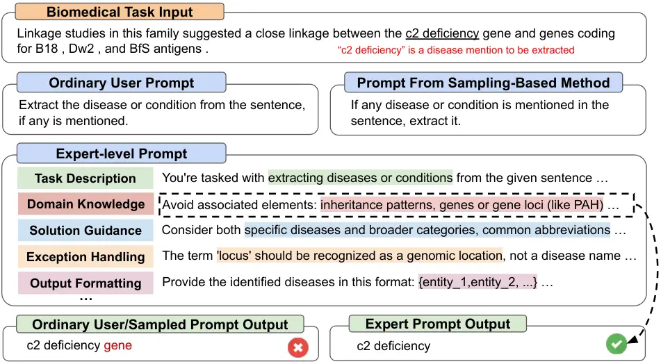
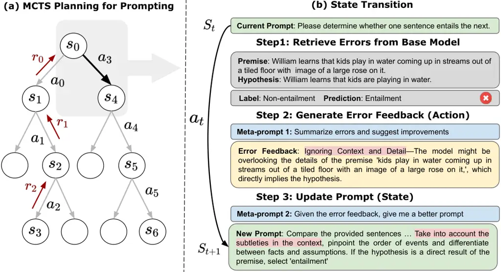
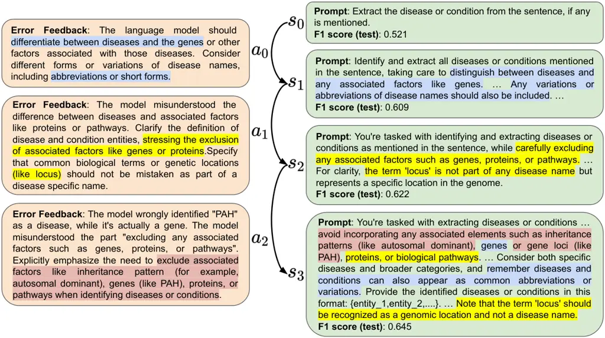

# PromptAgent: Strategic Planning with Language Models Enables Expert-level Prompt Optimization

Xinyuan Wang Chenxi Li Zhen Wang Fan Bai Haotian Luo ^(†)^(†)thanks:
Equal contribution^(†)^(†)thanks: Corresponding author Affiliation: UC
San Diego Affiliation: Georgia Institute of Technology
Affiliation: Mohamed bin Zayed University of Artificial Intelligence   
Jiayou Zhang Nebojsa Jojic Eric Xing Zhiting Hu Email: [{xiw136, chl078,
zhw085, zhh019}@ucsd.edu](mailto:) Affiliation: UC San Diego
Affiliation: Microsoft Research Affiliation: Mohamed bin Zayed
University of Artificial Intelligence Affiliation: Carnegie Mellon
University

###### Abstract

Highly effective, task-specific prompts are often heavily engineered by
experts to integrate detailed instructions and domain insights based on
a deep understanding of both instincts of large language models (LLMs)
and the intricacies of the target task. However, automating the
generation of such expert-level prompts remains elusive. Existing prompt
optimization methods tend to overlook the depth of domain knowledge and
struggle to efficiently explore the vast space of expert-level prompts.
Addressing this, we present PromptAgent, an optimization method that
autonomously crafts prompts equivalent in quality to those handcrafted
by experts. At its core, PromptAgent views prompt optimization as a
strategic planning problem and employs a principled planning algorithm,
rooted in Monte Carlo tree search, to strategically navigate the
expert-level prompt space. Inspired by human-like trial-and-error
exploration, PromptAgent induces precise expert-level insights and
in-depth instructions by reflecting on model errors and generating
constructive error feedback. Such a novel framework allows the agent to
iteratively examine intermediate prompts (states), refine them based on
error feedbacks (actions), simulate future rewards, and search for
high-reward paths leading to expert prompts. We apply PromptAgent to 12
tasks spanning three practical domains: BIG-Bench Hard (BBH), as well as
domain-specific and general NLP tasks, showing it significantly
outperforms strong Chain-of-Thought and recent prompt optimization
baselines. Extensive analyses emphasize its capability to craft
expert-level, detailed, and domain-insightful prompts with great
efficiency and generalizability¹¹ 1 Code and demo are available at:
[https://github.com/XinyuanWangCS/PromptAgent](https://github.com/XinyuanWangCS/PromptAgent).

|     |
| --- |
|     |

## 1 Introduction

Prompt engineering aims to craft effective prompts for harnessing the
full potential of large language models (LLMs). Recent automatic prompt
engineering, i.e., prompt optimization, has successfully studied
training soft prompts (Lester et al., 2021; Hu et al., 2021; Wang
et al., 2022), or searching for optimal combinations of discrete
tokens (Shin et al., 2020; Deng et al., 2022; Zhang et al., 2022), by
utilizing internal states or gradients of LLMs. For cutting-edge,
proprietary API-based LLMs like GPT-4 (OpenAI, 2023b), prompt
engineering largely relies on somewhat ad-hoc human-machine
interactions. Human prompting experts thus need a unique blend of domain
knowledge and intuition for LLMs to design the most effective prompts.
For instance, an ideal prompt from human experts, shown in Figure 1,
might integrate nuanced elements like task descriptions, domain
knowledge, solution guidance, etc., all of which substantially boost
prompt quality and performance.



Figure 1: Expert-level prompt vs. ordinary human-written prompt and
prompt from sampling-based methods (i.e., Automatic Prompt Engineer,
Zhou et al. (2022)). The task is in the biomedical domain for extracting
disease entities (NCBI, Doğan et al. (2014)). The expert prompt provides
much richer domain-specific details and structured guidance than the
other two, leading to the correct prediction.

Figure 2: Prompt comparison across different base models.

Automating expert-level prompting engineering on API-based LLMs presents
significant challenges, largely due to the intricate nature of
expert-level prompts, as illustrated in Figure 1. Although recent prompt
optimization approaches have begun to utilize techniques like iterative
sampling or evolutionary algorithms, such as Monte Carlo search (Zhou
et al., 2022) or Gibbs sampling (Xu et al., 2023), they mostly employ
heuristic methods like text edits or paraphrasing for generating
candidate prompts (Zhou et al., 2022; Prasad et al., 2023). These
approaches also often rely on straightforward iteration algorithms and
lack a principled strategy to guide the exploration. Consequently, they
tend to settle on local variants of prompts from ordinary users and
rarely ascend to the excellence and nuances of expert-level prompts.
Critically, many of these methods overlook that prompting engineering is
essentially a human-in-the-loop application. In this process, humans
refine prompts by fixing intermediate errors and integrating necessary
domain knowledge through iterative interactions. This iterative
refinement process characterizes the merits of how human experts craft
superior prompts. Yet, the challenge remains that human exploration,
while effective, can be expensive and less efficient at handling
multiple errors simultaneously to explore the prompt space, thereby
impeding the scalability of expert-level prompting.

To address the above challenges and combine human-like exploration with
machine efficiency, we introduce PromptAgent in this paper. Drawing
inspiration from human trial-and-error processes, PromptAgent seamlessly
incorporates the principled planning approach, specifically Monte Carlo
Tree Search (MCTS), to strategically optimize the prompting process.
Notably, PromptAgent reformulates prompt optimization as a strategic
planning problem to address the complexity of expert-level prompt space.
Under this planning framework, it plays trial-and-error iteration to
retrieve model errors and leverages the self-reflection ability of
LLMs (Jang, 2023; Shinn et al., 2023; Pan et al., 2023) to generate
insightful error feedback. This feedback, in turn, plays a critical role
in effectively inducing domain knowledge and guiding towards in-depth
prompts. Through strategic planning, PromptAgent iteratively leverages
insightful error feedback (action) to refine each version of prompts
(state). Starting from an initial prompt (state), PromptAgent
systematically grows the prompt space in a tree structure and
prioritizes high-reward traces to navigate the vast space of
expert-level prompts. The principled MCTS planning allows PromptAgent to
look ahead and simulate future rewards, which are then backpropagated to
update the beliefs about the current prompt so that PromptAgent can
explore more promising alternatives later.

We demonstrate that PromptAgent can discover productive expert-level
prompts by applying it to 12 tasks spanning three practical and distinct
domains: BIG-Bench Hard (BBH) (Suzgun et al., 2022), as well as
domain-specific and general NLP tasks. Starting with an initial
human-written prompt and a small set of training samples, PromptAgent
not only enhances the performance of the initial human prompt greatly
but also significantly surpasses strong Chain-of-Thought (CoT) and
recent prompt optimization baselines. For instance, Figure 2 shows
PromptAgent consistently outperforms human and Automatic Prompt Engineer
(APE) (Zhou et al., 2022) baselines across GPT-3.5, GPT-4, and PaLM 2,
yielding improvements by 9.1%, 7.7% and 6% over APE, respectively.
Extensive qualitative results further highlight the expert-level aspects
of optimized prompts, indicating that PromptAgent effectively bridges
the domain gap in challenging tasks, offering great exploration
efficiency and generalizability. As we anticipate the emergence of even
more powerful LLMs that can understand intricate instructions, we
believe that expert-level prompting will spearhead the next era of
prompt engineering, where PromptAgent stands as a pioneering step in
this research direction.

## 2 Related Works

Prompt optimization. Automatically discovering optimal prompts has
emerged as a central challenge in the era of LLMs. For open-sourced
LLMs, one can leverage their internal states or gradients to either
train additional parameters, such as soft prompts (Li & Liang, 2021;
Lester et al., 2021; Hu et al., 2021; Wang et al., 2022), or search for
discrete prompts via gradient-based search (Shin et al., 2020; Wen
et al., 2023) or reinforcement learning (Deng et al., 2022; Zhang
et al., 2022). However, such methods are less feasible for
closed-sourced LLMs, which urges people to study gradient-free prompt
optimization, typically assuming only APIs and a limited training set
are available. Most gradient-free methods follow an iterative process of
prompt sampling, i.e., starting from an initial prompt, they iteratively
sample prompt candidates and score them to select the best one for the
next iteration. Numerous methods emphasize diversifying the prompt
candidates—examples include edit-based methods like deleting or swapping
phrases (Prasad et al., 2023), back translation (Xu et al., 2022),
evolutionary operations (Guo et al., 2023; Fernando et al., 2023), or
more relevantly, LLM rewriting based on natural language feedback (Zhou
et al., 2022; Pryzant et al., 2023; Yang et al., 2023). There are also
explorations into alternate sampling procedures like Monte Carlo
search (Zhou et al., 2022), Gibbs sampling (Xu et al., 2023) or Beam
search (Pryzant et al., 2023). Nevertheless, PromptAgent fundamentally
differs from all the above methods in two ways. First, while primary
search algorithms have been investigated (Zhou et al., 2022; Xu et al.,
2023; Pryzant et al., 2023), we are the first to introduce strategic
planning into prompting optimization research. This innovation provides
a structured way to efficiently navigate the intricate space of prompts,
with principled capabilities like lookahead and backtrack. Second, most
previous methods generate prompt candidates as local variants, such as
paraphrasing or LLM sampling, fail to incorporate fine-grained domain
insights. Instead, we formulate prompt generation as the state
transition and strategically convert error feedback into new states,
leading to expert-level prompts.

Augmenting LLMs with self-reflection and planning. Despite their
remarkable capabilities, modern LLMs exhibit certain limitations, such
as long-term coherence (Malkin et al., 2022), lacking an internal world
model (Hao et al., 2023a), the inability to act in the real world, etc.
Thus, augmenting LLMs with external modules like reasoning and tools has
drawn extensive attention recently (Mialon et al., 2023; Ozturkler
et al., 2022; Hao et al., 2023b; Jojic et al., 2023), of which two
common strategies are relevant here: self-reflection and planning with
LLMs. Self-reflection encourages the LLM to introspect, critique its
outputs, and subsequently suggest more refined solutions (Jang, 2023;
Pan et al., 2023). This has been leveraged to enhance a variety of
applications, from complex computer tasks (Shinn et al., 2023), text
generation (Welleck et al., 2022) to reasoning (Paul et al., 2023).

Moreover, planning with LLMs sheds light on evaluating and enhancing
these models. At its core, planning is an essential ability for
intelligent agents to generate a sequence of actions in achieving
specific goals (McCarthy et al., 1963; Bylander, 1994). One line of
research is to prompt and evaluate LLMs on planning tasks directly (Liu
et al., 2023). For instance, translation-based approaches translate
natural language instructions into executable programs (e.g., Planning
domain description language) to run classical planning algorithms.
Another closer line of research is to augment the strategic reasoning
ability of LLMs with planning-based algorithms. For example, Tree of
Thoughts (ToT) applies DFS/BFS to augment CoT prompting, while both
CoRe (Zhu et al., 2022) and RAP (Hao et al., 2023a) utilize MCTS to
navigate richer reasoning paths. Yet, in contrast to existing endeavors
in LLM augmentation, PromptAgent is the first novel framework for
synergistically marrying the spirits of self-reflection and planning
specifically tailored for prompt optimization.

## 3 Methodology

Given a base LLM $`\mathcal{B}`$ and a target task $`\mathcal{T}`$, the
job at hand for a prompt engineer is to craft an optimized natural
language prompt $`\mathcal{P}^{\mathcal{T}}`$ that maximizes the
performance of $`\mathcal{B}`$ on $`\mathcal{T}`$. However, the gap
between novice and expert prompt engineers can be significant,
particularly for tasks demanding specialized domain expertise, such as
in the biomedical domain. Our primary objective is to autonomously
refine the task prompt $`\mathcal{P}^{\mathcal{T}}`$ to bridge this
knowledge gap, minimizing human intervention. Most existing approaches
rely on sampling local prompt alternatives iteratively, which is not
only resource-intensive but also lacks assurance of yielding an optimal
final prompt. In light of this, we introduce PromptAgent, an agent-based
framework to produce expert-level task prompts via strategic planning
and reflecting with error feedback during the prompting process,
striking a proper balance of exploration and performance.



Figure 3: (a) MCTS (Monte Carlo Tree Search) planning for expert-level
prompting. The tree structure enables strategic planning for
PromptAgent. (b) A simplified state transition example. Given a current
state (prompt), the base model (gpt-3.5-turbo) collects errors from the
task dataset. The optimizer model (gpt-4) provides error feedback
accordingly. The optimized model then updates the prompt according to
the feedback and transits to the next state.

Problem formulation. Following a standard setting in prompt
optimization (Zhou et al., 2022), we start with an initial natural
language task prompt $`\mathcal{P}_{0}`$ (e.g., “Let’s solve this
problem step-by-step”) and a small set of training samples from target
task $`\mathcal{T}`$ as $`(Q,A)=\{q_{i},a_{i}\}_{i=1}^{N}`$, where
$`q_{i}`$/$`a_{i}`$ are input/output pairs for each sample (e.g., a
question and its answer). Given the model input consisting of
$`\mathcal{P}`$ and $`q_{i}`$, the base LLM $`\mathcal{B}`$ makes the
prediction (typically through a left-to-right generation process) based
on $`p_{\mathcal{B}}(a_{i}|q_{i},\mathcal{P})`$²² 2 Note this is
traditionally a zero-shot setting we focus on, where task prompt
excludes any training samples.. The goal of prompt optimization is to
find the optimal natural language prompt $`\mathcal{P}^{*}`$ that
maximizes the performance towards a measure function $`\mathcal{R}`$
(e.g., accuracy). This can be formally defined as an optimization
problem:
$`\mathcal{P}^{*}=\argmax_{\mathcal{P}\in\mathcal{S}}\ \sum_{i}\mathcal{R}(p_{\mathcal{B}}(a_{i}|q_{i},\mathcal{P}))`$,
where $`\mathcal{S}`$ denotes the sample space for a natural language
prompt, an infinite and intractable space, if not impossible, to
comprehensively enumerate. Conventionally, human experts draw upon a
blend of heuristics and domain-specific insights to craft such prompts.
Although previous optimization methods have attempted to leverage
iterative sampling methods for prompt discovery (Zhou et al., 2022), we
advance this line of research by proposing a unified framework that
seamlessly integrates strategic planning for superior, expert-level
prompt optimization. Next, we introduce the formulation of PromptAgent
and then present the planning-based prompt optimization.

### 3.1 PromptAgent Framework Design

The goal of PromptAgent is to effectively integrate expert prior
knowledge into the task prompt while ensuring an efficient and strategic
exploration of the expansive prompt space. In this planning framework,
we define the state as each iteration or version of the task prompt,
$`s_{t}=\mathcal{P}_{t}`$. This allows systematic monitoring of the
evolution of prompts and directly applying refinements to modify them.
Actions, in this context, can be thought of as potential modifications
to the current prompt (state), such as word replacements or
paraphrasing, as explored in prior works (Jiang et al., 2020; Prasad
et al., 2023). However, a more desirable action space should introduce
more effective and meaningful revisions that invoke prior expert
knowledge, ultimately steering toward expert-level prompts. We thus
propose error-based actions where each action is generated based on
certain errors made by the base model. Specifically, as illustrated in
Figure 3 (b), actions are framed as error feedbacks to guide subsequent
refinements of the prompt. Such error feedbacks effectively suggest
potential directions for correcting model errors, ensuring the revised
prompt better instructs the base model to avoid previously observed
pitfalls. Note that this approach also resonates with recent findings on
the self-reflection capabilities of LLMs (Pryzant et al., 2023; Shinn
et al., 2023; Paul et al., 2023), such that an LLM can directly reflect
on their errors to yield better prompt modifications.

Given the definition of state and action, PromptAgent formulates the
prompt optimization problem as a Markov Decision Process (MDP) by the
tuple $`(\mathcal{S},\mathcal{A},{T},r)`$. Here, $`\mathcal{S}`$ denotes
the state space, $`\mathcal{A}`$ is the action space, $`T`$ defines the
transition function
$`T:\mathcal{S}\times\mathcal{A}\mapsto\mathcal{S}`$, and $`r`$ is the
reward function $`r:\mathcal{S}\times\mathcal{A}\mapsto\mathbb{R}`$. As
illustrated in Figure 3 (a), for any given current state $`s_{t}`$,
PromptAgent iteratively generates an action $`a_{t}`$ based on
$`a_{t}\sim p_{\mathcal{O}}(a|s_{t},m_{1})`$, where $`m_{1}`$ is a
meta-prompt employed by an optimizer LLM $`\mathcal{O}`$ to facilitate
the action generation. Specifically, Figure 3 (b) shows the two-step
process of action generation: collecting errors of the base model from
training samples (Step 1) and reflecting on such errors to draw useful
error feedbacks (Step 2). Afterward, PromptAgent obtains a new state
based on the transition function
$`p_{\mathcal{O}}(s_{t+1}|s_{t},a_{t},m_{2})`$, where $`m_{2}`$ is
another meta-prompt helping the state transition to update the prompt,
also operating on $`\mathcal{O}`$. More specifically, given current
error feedback as action $`a_{t}`$, $`m_{2}`$ asks the optimizer to
generate a new prompt (state) to leverage any domain knowledge and
effectively address model errors, similar to how prompting experts
revise their prompts based on error feedbacks.

Finally, the quality of each newly generated state $`s_{t}`$ after
applying action $`a_{t}`$ is determined by the reward function
$`r_{t}=r(s_{t},a_{t})`$. Drawing parallels with the intricate nature of
reward engineering in Reinforcement Learning (RL), crafting rewards
could be complex to accommodate domain-specific knowledge or preferences
specified for the task of interest. Without losing the generality of our
framework across a variety of tasks, we straightforwardly define the
reward as the task performance on a held-out set separated from the
given training samples. The exact definition of reward, however, will
depend on task-specific metrics as described in the implementation
details later.

### 3.2 Strategic Planning for Prompt Optimization

The aforementioned reformulation of the prompt optimization enables us
to seamlessly integrate PromptAgent with principle planning algorithms,
notably the Monte Carlo Tree Search (MCTS). This enables strategically
navigating the vast prompt space while balancing the exploration and
exploitation in finding high-reward paths of error feedbacks, which
leads to the most generalizable expert-level prompts. Specifically, we
observe some error feedbacks (actions) may inject instance-specific
details into task prompts (states) that are hard to generalize task-wise
(exploitation), where we need strategic planning to explore novel error
feedbacks for higher rewards (exploration). MCTS operationalizes such
strategic planning, as shown in Figure 3 (a), by progressively
constructing a tree structure with each node as a state and each edge as
the action for transiting states. MCTS expands the tree strategically by
maintaining a state-action value function,
$`Q:\mathcal{S}\times\mathcal{A}\mapsto\mathbb{R}`$, which represents
the potential future rewards for applying an action $`a_{t}`$ to a state
$`s_{t}`$. In other words, we rely on this function,
$`{Q}(s_{t},a_{t})`$, to look ahead and estimate the potential rewards
for paths following the current state-action pair. To update this $`Q`$
function and expand the tree, MCTS iteratively performs four operations:
selection, expansion, simulation, and back-propagation. The iteration
process ends when a pre-defined number of iterations is reached, and we
then select the highest-reward trace for the final prompt. We next
explain the four operations in PromptAgent, and the pseudocode of our
MCTS-based prompt optimization can be found in Algorithm 1 of the
Appendix.

Selection is the first step that selects the most promising nodes at
each level to be further expanded and explored. At each iteration, it
starts from the root node $`s_{0}`$, traverses through each tree level,
selects a subsequent child node at every level, and stops at a leaf
node. When selecting the child node at each level, we leverage the Upper
Confidence bounds applied to Trees (UCT) algorithm, which is well-known
for balancing the exploitation (choosing high-value nodes) and
exploration (choosing less-visited nodes) as follows:

```math
\displaystyle\vskip-5.0pta^{\ast}_{t}=\argmax_{a_{t}^{\prime}\in{A}(s_{t})}\left(Q(s_{t},a_{t}^{\prime})+c\cdot\sqrt{\frac{\ln\mathcal{N}(s_{t})}{\mathcal{N}(\text{ch}(s_{t},a_{t}^{\prime}))}}\ \right)\vskip-5.0pt \tag{1}
```

where $`{A}(s_{t})`$ is the action set for node $`s_{t}`$,
$`\mathcal{N}(s_{t})`$ is the number of visiting times for node
$`s_{t}`$, $`\text{ch}(s,a)`$ represents the child node for $`s_{t}`$
after applying action $`a_{t}^{\prime}`$ and $`c`$ is a constant to
adjust the exploration. As we can see, the first term signifies
exploitation by the $`Q`$ value, and the second term indicates
exploration, measuring the uncertainty for less visited nodes. In other
words, if a node was less explored and its child node was less visited
before, the second term will be higher.

Expansion grows the tree by adding new child nodes to the leaf node
reached by the previous selection step. This is done by applying the
action generation and state transition (Figure 3 (b)) multiple times,
resulting in multiple new actions and states. Note that we may sample
multiple training batches to derive diverse error feedbacks (actions).
Within new nodes, we then send the highest-reward one to the next
simulation step.

Simulation is the lookahead step to simulate the future trajectories for
the selected node from the previous expansion step. This step usually
comes with a playout policy to reach the terminal state quickly and
calculate the future rewards. The choice of playout could be flexible,
such as choosing random moves until the terminal. To reduce the
computation cost of simulation and simplify the process, we perform the
previous expansion step iteratively until the terminal, i.e., we keep
generating multiple actions and selecting the highest-reward node among
them to proceed to the next tree level.

Back-propagation happens when a terminal state is met during the
simulation. The terminal state is usually defined when a pre-defined
maximum depth is reached, or an early-stopping criterion is encountered.
We then back-propagate the future rewards along the path from the root
to the terminal node by updating the $`Q`$ value function. Specifically,
for each state-action pair in the path, $`Q(s_{t},a_{t})`$ is updated by
aggregating the rewards from all future trajectories starting from
$`s_{t}`$ as follows:

```math
\displaystyle\vskip-5.0ptQ^{*}(s_{t},a_{t})=\frac{1}{M}\sum_{j=1}^{M}\left(\sum_{s^{\prime}\in S_{s_{t}}^{j},a^{\prime}\in A_{a_{t}}^{j}}r(s^{\prime},a^{\prime})\right)\vskip-5.0pt \tag{2}
```

where $`M`$ is the number of future trajectories starting from
$`s_{t}`$, $`S_{s_{t}}^{j}`$ and $`A_{a_{t}}^{j}`$ represent the
$`j`$-th state and action sequences starting from $`s_{t}`$ and
$`a_{t}`$, respectively.

PromptAgent executes the above four operations with a pre-defined number
of iterations to stabilize the $`Q`$ values and fully grow the tree for
exploring the vast prompt space. We finally need to select the best
trace and node (i.e., prompt) for the final evaluation. Multiple
alternative solutions can be leveraged for this output strategy, e.g.,
one could opt for the best node in the best path with the highest
reward, or directly choose the leaf node with the largest number of
visiting times. For simplicity and empirical purposes, we use the first
strategy to select the output prompt, which works the best in our
experiments.

## 4 Experiments

### 4.1 Experimental Setup

Tasks and Datasets. To comprehensively evaluate the effects of
expert-level prompt optimization for a wide range of applications, we
curate 12 tasks from three distinct domains for thorough experiments:
BIG-Bench Hard (BBH), as well as domain-specific and general NLP tasks.
BBH (Suzgun et al., 2022) is a subset of challenging BIG-Bench
tasks (Srivastava et al., 2023) that are beyond the capabilities of
current LLMs. We select 6 BBH tasks that emphasize a blend of domain
knowledge (i.e., Geometric Shapes and Causal Judgment) and complex
reasoning abilities (i.e., Penguins in a table, Object Counting,
Epistemic Reasoning, and Temporal Sequences). We also select three
domain-specific tasks in the biomedical domain, where domain insights
are explicitly desired when crafting expert-level prompts. Such tasks
include a disease named-entity recognition (NER) task (NCBI, Doğan
et al. (2014)), a biomedical sentence similarly task (Biosses,
Soğancıoğlu et al. (2017)), and a medical question answering task (Med
QA, Jin et al. (2021)). Moreover, to show PromptAgent can also be
generally applicable and beneficial for traditional NLP tasks, we
further select three well-known NLU tasks, i.e., two text classification
tasks (TREC, Voorhees & Tice (2000) and Subj, Pang & Lee (2004)), and a
natural language inference task (CB, De Marneffe et al. (2019)).

Baselines. We compare our methods with three types of baselines:
ordinary human prompts, Chain-of-Thought (CoT) prompts, and recent
prompt optimization methods. (1) Human prompts are human-designed
instructions representing the generic level of prompt engineering, which
usually come from the original datasets. We also have a few-shot (FS)
version of human prompts with teaching examples from Suzgun et al.
(2022) for BBH tasks and randomly sampled ones from the training set for
others. (2) CoT prompts are considered very effective tricks to boost
LLM performance by inducing intermediate reasoning steps, especially for
BBH tasks (Suzgun et al., 2022). We directly use the CoT prompts from
Suzgun et al. (2022) for BBH tasks and construct CoT prompts by
ourselves for other tasks. We also have a zero-shot (ZS) version of CoT,
using “Let’s think step by step” as the prompt to trigger CoT behavior
without few-shot examples (Kojima et al., 2022). (3) Prompt optimization
methods include GPT Agent and Automatic Prompt Engineer (APE) (Zhou
et al., 2022). GPT Agent represents the recent surge of interest in
LLM-powered autonomous agents (Weng, 2023), such as Auto-GPT³³ 3
[https://github.com/Significant-Gravitas/AutoGPT](https://github.com/Significant-Gravitas/AutoGPT).
Such agents are expected to autonomously perform planning and
self-reflection to solve human requests, including optimizing task
prompts. We leverage one of the powerful ChatGPT Plugins (OpenAI, 2023a)
with GPT-4, AI Agents⁴⁴ 4
[https://aiagentslab.com/](https://aiagentslab.com/) for prompt
optimization. Specifically, similar to PromptAgent, we sample similar
model errors and ask AI Agents plugin to rewrite the prompt based on the
errors with a similar iteration number as PromptAgent. Lastly, APE is
one of the most recent prompt optimization methods that proposes a Monte
Carlo search-based method to iteratively propose and select prompts.

|             |          |          |           |               |          |               |       |
| ----------- | -------- | -------- | --------- | ------------- | -------- | ------------- | ----- |
|             | Penguins | Geometry | Epistemic | Object Count. | Temporal | Causal Judge. | Avg.  |
| Human (ZS)  | 0.595    | 0.227    | 0.452     | 0.612         | 0.720    | 0.470         | 0.513 |
| Human (FS)  | 0.595    | 0.315    | 0.556     | 0.534         | 0.408    | 0.620         | 0.505 |
| CoT (ZS)    | 0.747    | 0.320    | 0.532     | 0.542         | 0.734    | 0.610         | 0.581 |
| CoT         | 0.747    | 0.540    | 0.720     | 0.960         | 0.626    | 0.650         | 0.707 |
| GPT Agent   | 0.696    | 0.445    | 0.406     | 0.502         | 0.794    | 0.520         | 0.561 |
| APE         | 0.797    | 0.490    | 0.708     | 0.716         | 0.856    | 0.570         | 0.690 |
| PromptAgent | 0.873    | 0.670    | 0.806     | 0.860         | 0.934    | 0.670         | 0.802 |

Table 1: Prompting performance on BBH tasks. ZS: Zero-Shot, FS:
Few-Shot. We select six challenging tasks from BBH (Suzgun et al.,
2022), requiring domain knowledge (e.g., Geometry) or reasoning (e.g.,
Causal Judgement). Our method outperforms in 5/6 tasks, with only CoT
surpassing in Object Counting. On average, our accuracy exceeds others
by at least 9%.

Implementation details. For the datasets with default testing or
validation set, we use their original split to obtain our testing set.
If there is no official training/testing split, such as BBH tasks, we
sample a reasonably large set for stable testing. As stated in
Section 3.1, we also split a portion of training samples for calculating
the reward. The details of the datasets can be found in Appendix A.1.
Unless further specified, we select GPT-3.5 as the default base LLM to
be optimized, which is one of the decently powerful modern LLMs. For the
optimizer LLM, we need one with a good self-reflection ability and,
thus, use GPT-4 as the default optimizer LLM. We set the temperature as
0.0 for base LLM to make predictions and 1.0 in other contexts. When
implementing PromptAgent, we set the number of iterations for MCTS as
12, and the exploration weight $`c`$ in Equation 1 as 2.5. During the
expansion step, we generate actions based on model errors by sampling
batches from training samples. We sample expand_width batches and
generate num_samples new prompts per batch. The maximum depth of each
path is depth_limit. To simplify the process of tuning these
hyperparameters, we explore three settings: Standard, Wide, and Lite,
where Standard and Lite have larger depth, while Wide generates more
nodes per expansion step (Specific parameters can be found in Appendix
Table 7). The best setting for PromptAgent is selected based on the
rewards. Further details are available in Appendix A, including input
formatting, data splitting, and the implementation specifics of both the
PromptAgent and baseline methods.

### 4.2 Results and Analyses

|             |                       |         |        |       |                   |       |       |       |
| ----------- | --------------------- | ------- | ------ | ----- | ----------------- | ----- | ----- | ----- |
|             | Domain-specific Tasks |         |        |       | General NLU Tasks |       |       |       |
|             | NCBI (F1)             | Biosses | Med QA | Avg.  | Subj              | TREC  | CB    | Avg.  |
| Human (ZS)  | 0.521                 | 0.550   | 0.508  | 0.526 | 0.517             | 0.742 | 0.714 | 0.658 |
| Human (FS)  | 0.447                 | 0.625   | 0.492  | 0.521 | 0.740             | 0.742 | 0.429 | 0.637 |
| CoT (ZS)    | 0.384                 | 0.425   | 0.508  | 0.439 | 0.656             | 0.63  | 0.750 | 0.679 |
| CoT         | 0.376                 | 0.675   | 0.542  | 0.531 | 0.670             | 0.784 | 0.643 | 0.699 |
| GPT Agent   | 0.125                 | 0.625   | 0.468  | 0.406 | 0.554             | 0.736 | 0.339 | 0.543 |
| APE         | 0.576                 | 0.700   | 0.470  | 0.582 | 0.696             | 0.834 | 0.804 | 0.778 |
| PromptAgent | 0.645                 | 0.750   | 0.570  | 0.655 | 0.806             | 0.886 | 0.911 | 0.868 |

Table 2: Prompt performance on specialized and general NLU tasks.
Specialized tasks are three biomedical tasks explicitly asking for
domain knowledge for prompting. General NLU tasks are used to
demonstrate the generality of our method. Ours significantly
outperformed in all tasks.

Comparison with various prompting baselines. Table 1 & 2 present a
comprehensive comparison of expert-level prompts generated by
PromptAgent against human prompts, CoT prompts, and existing prompt
optimization methods across 12 tasks spanning three domains. Observing
BBH tasks from Table 1, PromptAgent significantly outperforms all
baselines overall and achieves 28.9%, 9.5%, and 11.2% relative
improvement over baselines, i.e., human prompts (ZS), CoT, and APE,
respectively. It is noteworthy that CoT prompts are especially effective
in BBH tasks than human prompts, similar to findings from Suzgun et al.
(2022). This is because BBH tasks usually require strictly formatted
solutions that can be readily induced by the step-by-step CoT reasoning,
which also explains why CoT achieves very good performance on Object
Counting that can benefit from step-by-step solutions the most. However,
PromptAgent still outperforms CoT by a great margin in all tasks (except
Object Counting), indicating that our optimized expert-level prompt can
lead to bigger improvement over few-shot CoT reasoning (even under the
zero-shot prompt setting). Regarding optimization methods, while we
appreciate the planning and self-reflection of the GPT Agent, its
planning is only used for a single turn of prompt rewriting, but not on
a global scale of strategically exploring prompt space. APE, on the
other hand, shows a greater scale of searching ability, but its
exploration is based on Monte Carlo search, which suffers from
inefficient planning and a lack of error-based reflections. Both
deficits of GPT Agent and APE suggest the necessity of strategic
planning in PromptAgent to fully explore the prompt space and deliver
expert-level prompts.

Table 2 presents results on domain-specific and general NLP tasks. The
former encompasses a broad spectrum of biomedical tasks, such as
information extraction, sentence similarity, and question answering.
Crafting prompts for these tasks requires extensive domain knowledge and
heavy LLM prompt engineering instincts, where we can observe that
straightforward human prompts and CoT prompts do not work very well.
Prompt optimization methods like APE with automatic prompt sampling and
refining are promising to incorporate domain knowledge without too much
human intervention. Notably, PromptAgent surpasses APE significantly by
+7.3% improvement on average, suggesting PromptAgent can better induce
effective domain knowledge to produce expert-level prompts and close the
knowledge gap between novice and expert prompt engineers. For general
NLP tasks, the efficacy and generality of PromptAgent are further
emphasized, outperforming both CoT and APE by margins of +16.9% and +9%,
respectively. This implies the nontrivial expert gap, even for general
NLP tasks, underscoring the imperative for expert prompts in diverse
applications.

Prompt generalization. We next conduct experiments to investigate
whether our optimized prompts can be generalized to other base LLMs.
This emphasizes the robustness and transferability of expert-level
prompts, which are urgently favorable and underpinning two key facts:
(a) the domain insights and nuanced guidance in expert prompts can be
seamlessly transferred across powerful LLMs, reinforcing the universal
applicability of expert prompts, and (b) we only need to optimize each
task once, leading to better computational efficiency. It is crucial to
note that the primary goal of PromptAgent is to optimize prompts for
state-of-the-art LLMs to achieve expert-level prompting, while less
advanced and smaller LLMs, like GPT-2 or LLaMA, may not adeptly grasp
the subtleties of these expert-level prompts, potentially causing
significant performance drop. Nonetheless, for a holistic assessment, we
evaluate two additional base LLMs, one more potent (GPT-4) and one less
robust (PaLM 2) than GPT-3.5, within this experimental framework.

Table 3 shows the results when we directly apply the optimized prompts
from GPT-3.5 to GPT-4 and PaLM 2 (chat-bison-001) across all 12 tasks.
For comparison, we also adopt the same human and APE prompts to these
base LLMs as baselines. For certain tasks, such as Penguins, we may
employ slightly different prompts than those referenced in Table 1 to
make PaLM 2 generate reasonable responses instead of persistent null
answers. Observing Table 3, it is worth highlighting that when a
stronger base LLM as GPT-4 is deployed, our expert prompts manifest
further enhancements, either on par with or outperforming Human and APE
prompts in almost all tasks (11/12) (The only exception, Temporal, seems
to be a solved task by GPT-4 with almost perfect accuracy). This
underscores the untapped potential of expert prompting, especially with
the evolution of more sophisticated LLMs in the near future. When
transferring expert prompts to a weaker LLM as PaLM 2, its performance
drops dramatically across all tasks unexpectedly. Nonetheless, we still
observe PromptAgent exceeds both baselines on 7/12 tasks, with great
improvements on domain-specialized tasks, such as NCBI, demonstrating
the usefulness of domain insights from expert prompts.

|               |         |       |       |       |       |       |        |       |       |
| ------------- | ------- | ----- | ----- | ----- | ----- | ----- | ------ | ----- | ----- |
|               | GPT-3.5 |       |       | GPT-4 |       |       | PaLM 2 |       |       |
| Tasks         | Human   | APE   | Ours  | Human | APE   | Ours  | Human  | APE   | Ours  |
| Penguins      | 0.595   | 0.747 | 0.797 | 0.772 | 0.848 | 0.962 | 0.430  | 0.443 | 0.456 |
| Geometry      | 0.227   | 0.490 | 0.670 | 0.495 | 0.445 | 0.680 | 0.290  | 0.215 | 0.360 |
| Epistemic     | 0.452   | 0.708 | 0.806 | 0.734 | 0.848 | 0.848 | 0.470  | 0.392 | 0.588 |
| Object Count. | 0.612   | 0.716 | 0.860 | 0.830 | 0.852 | 0.888 | 0.290  | 0.378 | 0.320 |
| Temporal      | 0.720   | 0.856 | 0.934 | 0.980 | 0.992 | 0.982 | 0.540  | 0.522 | 0.620 |
| Causal Judge. | 0.470   | 0.570 | 0.670 | 0.740 | 0.740 | 0.770 | 0.440  | 0.440 | 0.430 |
| NCBI (F1)     | 0.521   | 0.576 | 0.645 | 0.588 | 0.428 | 0.697 | 0.016  | 0.025 | 0.177 |
| Biosses       | 0.550   | 0.700 | 0.750 | 0.700 | 0.775 | 0.800 | 0.500  | 0.300 | 0.600 |
| Med QA        | 0.508   | 0.470 | 0.570 | 0.770 | 0.758 | 0.774 | 0.284  | 0.274 | 0.276 |
| Subj          | 0.517   | 0.696 | 0.806 | 0.867 | 0.805 | 0.879 | 0.496  | 0.537 | 0.499 |
| TREC          | 0.742   | 0.834 | 0.886 | 0.716 | 0.764 | 0.876 | 0.380  | 0.400 | 0.230 |
| CB            | 0.714   | 0.804 | 0.914 | 0.911 | 0.893 | 0.911 | 0.571  | 0.643 | 0.732 |
| Average       | 0.552   | 0.685 | 0.776 | 0.759 | 0.762 | 0.839 | 0.392  | 0.381 | 0.441 |

Table 3: Prompt generalization results. While we optimize GPT-3.5 as the
default base LLM, its optimized prompts are transferable to other base
LLMs like GPT-4 and PaLM 2 (chat-bison-001). GPT-4 sees further
enhancement with our prompts, beating baselines in 11/12 tasks. Weaker
LLMs like PaLM 2 may have challenges with our advanced prompts but still
surpass baselines in 7/12 tasks. Overall, ours can significantly beat
baselines with different base LLMs.

|          |       |       |        |             |
| -------- | ----- | ----- | ------ | ----------- |
|          | MC    | Beam  | Greedy | MCTS (Ours) |
| Penguins | 0.772 | 0.823 | 0.810  | 0.873       |
| Biosses  | 0.575 | 0.675 | 0.700  | 0.750       |
| Geometry | 0.490 | 0.610 | 0.545  | 0.670       |
| Causal   | 0.650 | 0.610 | 0.660  | 0.670       |
| Subj     | 0.692 | 0.765 | 0.778  | 0.806       |
| Average  | 0.635 | 0.697 | 0.698  | 0.754       |

Table 4: Ablation study on search methods. MC: Monte Carlo search,
Greedy: greedy depth-first search, Beam: beam search. Testing tasks are
representative of three domains from BBH (Suzgun et al., 2022),
domain-specialized and general NLU. Our method consistently outperforms
all other ablated search algorithms across every task we evaluated.

Ablation on search strategies. To investigate the effect of strategic
planning in PromptAgent systematically, we conduct a thorough ablation
study by comparing multiple alternative search strategies to MCTS, i.e.,
a single Monte Carlo (MC) search, a greedy depth-first search (Greedy),
and a Beam search. We use the same action generation and state
transition as in PromptAgent and only replace the MCTS planning with
each search method. Specifically, MC is a directionless search with a
single step of randomly sampling and selecting one action. Greedy
provides more structured exploration by consistently choosing the best
among multiple samples per step. Beam search also focuses on a
structured exploration by keeping multiple promising paths at each
level. We keep the same number of overall explored prompts (exploration
efficiency; see below for more results) for all three baselines to have
a similar exploration space. See more implementation details about
search variants in Appendix A.4.

We select a subset of tasks from all three domains to compare all the
above search variants due to the computation budget. Table 4 shows that
both Greedy and Beam greatly improve the MC baseline, suggesting the
necessity of structured iterative exploration in our framework. When
maintaining the same exploration efficiency, we observe comparable
overall performance for Beam and Greedy. However, neither method
strategically explores the prompt space since they operate in a strictly
forward direction, lacking the capability to foresee future outcomes and
backtrack to past decisions. In contrast, the strategic planning for
MCTS allows PromptAgent to navigate complex expert prompt spaces more
effectively, which significantly surpasses all search ablations on all
tasks and gets a relative 5.6% overall improvement over the best
baseline.

|             |                                                                                                                                                                                                                                                                                                                                                                                                                                                                                                                                                                                                                                                                                                                                                                                                                                                          |           |
| ----------- | -------------------------------------------------------------------------------------------------------------------------------------------------------------------------------------------------------------------------------------------------------------------------------------------------------------------------------------------------------------------------------------------------------------------------------------------------------------------------------------------------------------------------------------------------------------------------------------------------------------------------------------------------------------------------------------------------------------------------------------------------------------------------------------------------------------------------------------------------------- | --------- |
| Approach    | Optimized Prompt                                                                                                                                                                                                                                                                                                                                                                                                                                                                                                                                                                                                                                                                                                                                                                                                                                         | F1 score. |
| Human       | Extract the disease or condition from the sentence, if any is mentioned.                                                                                                                                                                                                                                                                                                                                                                                                                                                                                                                                                                                                                                                                                                                                                                                 | 0.521     |
| APE         | If any disease or condition is mentioned in the sentence, extract it.                                                                                                                                                                                                                                                                                                                                                                                                                                                                                                                                                                                                                                                                                                                                                                                    | 0.576     |
| PromptAgent | You’re tasked with extracting diseases or conditions from the given sentence, remember to be cautious and avoid incorporating any associated elements such as inheritance patterns (like autosomal dominant), genes or gene loci (like PAH), proteins, or biological pathways. The task does not entail making assumptions or inferences about the disease names based on other advanced biological terms in the context. Consider both specific diseases and broader categories, and remember diseases and conditions can also appear as common abbreviations or variations. Provide the identified diseases or conditions in this format: {entity_1,entity_2,….}. If there are no diseases or conditions present, output an empty list in this form: {}. Note that the term ‘locus’ should be recognized as a genomic location and not a disease name. | 0.645     |

Table 5: Prompt comparison for the NCBI task, including normal human
prompt, APE-optimized prompt, and expert-level prompt optimized by
PromptAgent. Both baselines mostly describe the task, while our expert
prompt is composed of more complex structures and domain-specific
insights, achieving superior performance. Bold text denotes domain
knowledge usually handcrafted by domain specialists, but here
automatically discovered by PromptAgent. We highlight different aspects
of expert prompt with colors, including Task Description, Term
Clarification, Solution Guidance, Exception Handling, Priority &
Emphasis, Formatting. (Best view with colors)

(a) Performance vs. Exploration Efficiency

(b) Convergence Analysis

Figure 4: (a) Exploration efficiency analysis. A proper balance of
exploration and exploitation is crucial for search and planning. We
compare the number of explored prompts between our method and three
strong baselines. Ours achieves the best trade-off of performance and
exploration (clustering in the top-left corner). (b) Convergence curves
for Epistemic task. We visualize the mean and variance of the training
and testing performance along the paths. We can observe that both curves
increase at first and become stable after depth 3, suggesting a stable
learning process

Exploration efficiency analysis. In addition to the superior
performance, one of the key advantages of PromptAgent is that it can
efficiently explore the prompt space via strategic planning. Exploration
efficiency is also vital to make the computation cost of the search
manageable. We thus analyze the exploration efficiency by comparing
PromptAgent with some of our search baselines, including Greedy Search
and APE from the previous section. Specifically, the exploration
efficiency is measured by the number of prompts explored during the
search, i.e., nodes generated during the exploration. We plot its
relationship with the task performance in Figure 4(a). The Greedy-S and
Greedy-L are based on Greedy Search with 34 and 72 explored prompts. The
APE explores 150 prompts in each task. The figure shows that points of
PromptAgent are clustered around the top left corner, indicating a
superior performance with higher accuracy but fewer explored nodes
(higher exploration efficiency). Notably, while increasing the number of
prompts in Greedy Search may enhance performance (from Greedy-S to
Greedy-L), it demands higher exploration cost and still does not surpass
PromptAgent. Also, without principled guidance, directionless searches
like APE cannot effectively boost performance, even with larger
exploration. Nevertheless, to maintain exploration efficiency and
superior performance, strategic planning is crucial in PromptAgent and
worthy of further research investment in future works. The detailed
hyperparameter settings of Greedy-S, Greedy-L, and APE are in
Appendix A.4

Convergence analysis. To delve deeper into the learning process of
PromptAgent, we examine the evolution of expert prompts throughout the
tree planning process. Specifically, we monitor and visualize
performance changes with respect to tree depth. As illustrated in
Figure 4(b) for the Epistemic task, we assess the performance across all
nodes and aggregate both training (reward) and testing performance at
each depth level. The plotted trajectories represent the evolution of
average performance on both training (reward) and testing, illustrating
a consistent improvement and gradually surpassing all baseline methods.
For brevity, convergence plots for other tasks and hyperparameter
settings, focusing solely on training trajectories to reduce
computational overhead on testing sets, are provided in Appendix C and
Appendix A.3. A recurring pattern observed, similar to that in
Figure 4(b), indicates an upward trend in the initial iterations,
suggesting a robust learning dynamic of PromptAgent to iteratively
refine and enhance expert prompts.



Figure 5: The MCTS state-action transition trajectory of the highest
average reward path in NCBI. The initial state is $`s_{0}`$ with a
human-written prompt. At each state transition step, a new prompt is
crafted by adjusting the prior state based on error feedback.
Highlighted colors indicate similar domain-specific insights. The last
state integrates the information from the entire trajectory, elevating
the F1 score from 0.521 to 0.645.

Qualitative analysis. To provide a more direct illustration of how
PromptAgent progressively leverages error feedback (action) to enhance
prompts (states), we conduct a qualitative analysis to examine the
optimized trace from PromptAgent exploration. Figure 5 displays the
initial four states and the corresponding three action-state transitions
for the best reward path associated with the NCBI task (Doğan et al., 2014) to extract disease entities. We highlight the domain insights by
colors in both actions and states, where consistent coloring signifies
analogous insights. Observably, from an initial human-composed prompt as
$`s_{0}`$, PromptAgent discovers various insightful error feedback
(action) and effectively merges them into a refined prompt (state) with
improved test performance. Over successive transitions, the definition
of disease entities becomes increasingly refined, and
biomedical-specific details are seamlessly integrated. The accumulation
of this iterative process is reflected in the last state, $`s_{3}`$,
which, infused with aggregated insights from its preceding path,
manifests as an expert-level prompt, leading to a superior performance.

We further annotate various quality aspects of optimized expert prompts,
highlighting important perspectives on how expert prompts advance prompt
engineering and provoke advanced task understanding of LLMs. As shown in
Table 15 for the NCBI task and Appendix D for all other tasks, in
comparison with general human prompts and APE-optimized prompts,
PromptAgent prompts are typically more elaborate, offering comprehensive
task instruction, which covers various diverse aspects, such as
clarifying terminologies, guiding solutions, handling exceptional cases,
etc. It is imperative to mention that while future research might
explore prompt compression techniques (Jiang et al., 2023; Yin et al., 2023) to condense the expert prompt without sacrificing performance, the
increased complexity of expert-level prompting naturally aligns with the
advancement of contemporary state-of-the-art LLMs, enabling more
sophisticated understanding of tasks and human requests.

## 5 Conclusion

In this paper, we introduce PromptAgent, a novel prompt optimization
framework capable of autonomously crafting expert-level prompts for a
given task. Expert-level prompting distinguishes itself from traditional
prompt engineering by its effectiveness of seamlessly integrating domain
insights and closing the knowledge gap for domain experts. To achieve
this, central to PromptAgent is the novel perspective of viewing prompt
optimization as a strategic planning problem, leveraging the power of
MCTS planning to strategically and efficiently traverse the complex
prompt space. PromptAgent incorporates domain-specific knowledge from
tasks into the newly generated prompts through a trial-and-error manner
based on the self-reflection abilities of LLMs. We tested the
PromptAgent on 12 diverse tasks spanning three distinct domains. The
prompts optimized by PromptAgent consistently exhibited expert-level
characteristics, enriched with domain-specific details and guidance.
These prompts significantly outperformed both human-written,
Chain-of-Thought prompting and other optimized method baselines. Further
in-depth analyses revealed superior transferability, exploration
efficiency, and quality for our expert prompts, paving the way for
future prompt engineering to unlock the sophisticated task understanding
of state-of-the-art LLMs.

## References

- Bylander (1994) Tom Bylander. The computational complexity of
  propositional strips planning. _Artificial Intelligence_,
  69(1-2):165–204, 1994.
- De Marneffe et al. (2019) Marie-Catherine De Marneffe, Mandy Simons,
  and Judith Tonhauser. The commitmentbank: Investigating projection in
  naturally occurring discourse. In _proceedings of Sinn und Bedeutung_,
  volume 23, pp. 107–124, 2019.
- Deng et al. (2022) Mingkai Deng, Jianyu Wang, Cheng-Ping Hsieh, Yihan
  Wang, Han Guo, Tianmin Shu, Meng Song, Eric Xing, and Zhiting Hu.
  Rlprompt: Optimizing discrete text prompts with reinforcement
  learning. In _Proceedings of the 2022 Conference on Empirical Methods
  in Natural Language Processing_, pp. 3369–3391, 2022.
- Doğan et al. (2014) Rezarta Islamaj Doğan, Robert Leaman, and Zhiyong
  Lu. Ncbi disease corpus: a resource for disease name recognition and
  concept normalization. _Journal of biomedical informatics_,
  47:1–10, 2014.
- Fernando et al. (2023) Chrisantha Fernando, Dylan Banarse, Henryk
  Michalewski, Simon Osindero, and Tim Rocktäschel. Promptbreeder:
  Self-referential self-improvement via prompt evolution. _arXiv
  preprint arXiv:2309.16797_, 2023.
- Guo et al. (2023) Qingyan Guo, Rui Wang, Junliang Guo, Bei Li, Kaitao
  Song, Xu Tan, Guoqing Liu, Jiang Bian, and Yujiu Yang. Connecting
  large language models with evolutionary algorithms yields powerful
  prompt optimizers. _arXiv preprint arXiv:2309.08532_, 2023.
- Hao et al. (2023a) Shibo Hao, Yi Gu, Haodi Ma, Joshua Jiahua Hong,
  Zhen Wang, Daisy Zhe Wang, and Zhiting Hu. Reasoning with language
  model is planning with world model. _arXiv preprint arXiv:2305.14992_,
  2023a.
- Hao et al. (2023b) Shibo Hao, Tianyang Liu, Zhen Wang, and Zhiting Hu.
  Toolkengpt: Augmenting frozen language models with massive tools via
  tool embeddings. _arXiv preprint arXiv:2305.11554_, 2023b.
- Hu et al. (2021) Edward J Hu, Phillip Wallis, Zeyuan Allen-Zhu,
  Yuanzhi Li, Shean Wang, Lu Wang, Weizhu Chen, et al. Lora: Low-rank
  adaptation of large language models. In _International Conference on
  Learning Representations_, 2021.
- Jang (2023) Eric Jang. Can llms critique and iterate on their own
  outputs? _evjang.com_, Mar 2023. URL
  [https://evjang.com/2023/03/26/self-reflection.html](https://evjang.com/2023/03/26/self-reflection.html).
- Jiang et al. (2023) Huiqiang Jiang, Qianhui Wu, Chin-Yew Lin, Yuqing
  Yang, and Lili Qiu. Llmlingua: Compressing prompts for accelerated
  inference of large language models. _arXiv preprint
  arXiv:2310.05736_, 2023.
- Jiang et al. (2020) Zhengbao Jiang, Frank F Xu, Jun Araki, and Graham
  Neubig. How can we know what language models know? _Transactions of
  the Association for Computational Linguistics_, 8:423–438, 2020.
- Jin et al. (2021) Di Jin, Eileen Pan, Nassim Oufattole, Wei-Hung Weng,
  Hanyi Fang, and Peter Szolovits. What disease does this patient have?
  a large-scale open domain question answering dataset from medical
  exams. _Applied Sciences_, 11(14):6421, 2021.
- Jojic et al. (2023) Ana Jojic, Zhen Wang, and Nebojsa Jojic. Gpt is
  becoming a turing machine: Here are some ways to program it. _arXiv
  preprint arXiv:2303.14310_, 2023.
- Kojima et al. (2022) Takeshi Kojima, Shixiang Shane Gu, Machel Reid,
  Yutaka Matsuo, and Yusuke Iwasawa. Large language models are zero-shot
  reasoners. _Advances in neural information processing systems_,
  35:22199–22213, 2022.
- Lester et al. (2021) Brian Lester, Rami Al-Rfou, and Noah Constant.
  The power of scale for parameter-efficient prompt tuning. In
  _Proceedings of the 2021 Conference on Empirical Methods in Natural
  Language Processing_, pp. 3045–3059, 2021.
- Li & Liang (2021) Xiang Lisa Li and Percy Liang. Prefix-tuning:
  Optimizing continuous prompts for generation. In _Proceedings of the
  59th Annual Meeting of the Association for Computational Linguistics
  and the 11th International Joint Conference on Natural Language
  Processing (Volume 1: Long Papers)_, pp. 4582–4597, Online,
  August 2021. Association for Computational Linguistics. doi:
  10.18653/v1/2021.acl-long.353. URL
  [https://aclanthology.org/2021.acl-long.353](https://aclanthology.org/2021.acl-long.353).
- Liu et al. (2023) Bo Liu, Yuqian Jiang, Xiaohan Zhang, Qiang Liu,
  Shiqi Zhang, Joydeep Biswas, and Peter Stone. Llm+ p: Empowering large
  language models with optimal planning proficiency. _arXiv preprint
  arXiv:2304.11477_, 2023.
- Malkin et al. (2022) Nikolay Malkin, Zhen Wang, and Nebojsa Jojic.
  Coherence boosting: When your pretrained language model is not paying
  enough attention. In _Proceedings of the 60th Annual Meeting of the
  Association for Computational Linguistics (Volume 1: Long Papers)_,
  pp. 8214–8236, 2022.
- McCarthy et al. (1963) John McCarthy et al. _Situations, actions, and
  causal laws_. Comtex Scientific, 1963.
- Mialon et al. (2023) Grégoire Mialon, Roberto Dessì, Maria Lomeli,
  Christoforos Nalmpantis, Ram Pasunuru, Roberta Raileanu, Baptiste
  Rozière, Timo Schick, Jane Dwivedi-Yu, Asli Celikyilmaz, et al.
  Augmented language models: a survey. _arXiv preprint
  arXiv:2302.07842_, 2023.
- OpenAI (2023a) OpenAI, Sep 2023a. URL
  [https://openai.com/blog/chatgpt-plugins](https://openai.com/blog/chatgpt-plugins).
- OpenAI (2023b) OpenAI. Gpt-4 technical report. _ArXiv_,
  abs/2303.08774, 2023b. URL
  [https://api.semanticscholar.org/CorpusID:257532815](https://api.semanticscholar.org/CorpusID:257532815).
- Ozturkler et al. (2022) Batu Ozturkler, Nikolay Malkin, Zhen Wang, and
  Nebojsa Jojic. Thinksum: Probabilistic reasoning over sets using large
  language models. _arXiv preprint arXiv:2210.01293_, 2022.
- Pan et al. (2023) Liangming Pan, Michael Saxon, Wenda Xu, Deepak
  Nathani, Xinyi Wang, and William Yang Wang. Automatically correcting
  large language models: Surveying the landscape of diverse
  self-correction strategies. _arXiv preprint arXiv:2308.03188_, 2023.
- Pang & Lee (2004) Bo Pang and Lillian Lee. A sentimental education:
  sentiment analysis using subjectivity summarization based on minimum
  cuts. In _Proceedings of the 42nd Annual Meeting on Association for
  Computational Linguistics_, pp. 271–es, 2004.
- Paul et al. (2023) Debjit Paul, Mete Ismayilzada, Maxime Peyrard,
  Beatriz Borges, Antoine Bosselut, Robert West, and Boi Faltings.
  Refiner: Reasoning feedback on intermediate representations. _arXiv
  preprint arXiv:2304.01904_, 2023.
- Prasad et al. (2023) Archiki Prasad, Peter Hase, Xiang Zhou, and Mohit
  Bansal. Grips: Gradient-free, edit-based instruction search for
  prompting large language models. In _Proceedings of the 17th
  Conference of the European Chapter of the Association for
  Computational Linguistics_, pp. 3827–3846, 2023.
- Pryzant et al. (2023) Reid Pryzant, Dan Iter, Jerry Li, Yin Tat Lee,
  Chenguang Zhu, and Michael Zeng. Automatic prompt optimization with”
  gradient descent” and beam search. _arXiv preprint
  arXiv:2305.03495_, 2023.
- Shin et al. (2020) Taylor Shin, Yasaman Razeghi, Robert L Logan IV,
  Eric Wallace, and Sameer Singh. Autoprompt: Eliciting knowledge from
  language models with automatically generated prompts. In _Proceedings
  of the 2020 Conference on Empirical Methods in Natural Language
  Processing (EMNLP)_, pp. 4222–4235, 2020.
- Shinn et al. (2023) Noah Shinn, Federico Cassano, Beck Labash, Ashwin
  Gopinath, Karthik Narasimhan, and Shunyu Yao. Reflexion: Language
  agents with verbal reinforcement learning. _arXiv preprint
  arXiv:2303.11366_, 2023.
- Soğancıoğlu et al. (2017) Gizem Soğancıoğlu, Hakime Öztürk, and
  Arzucan Özgür. Biosses: a semantic sentence similarity estimation
  system for the biomedical domain. _Bioinformatics_,
  33(14):i49–i58, 2017.
- Srivastava et al. (2023) Aarohi Srivastava, Abhinav Rastogi, Abhishek
  Rao, Abu Awal Md Shoeb, Abubakar Abid, Adam Fisch, Adam R Brown, Adam
  Santoro, Aditya Gupta, Adrià Garriga-Alonso, et al. Beyond the
  imitation game: Quantifying and extrapolating the capabilities of
  language models. _Transactions on Machine Learning Research_, 2023.
- Suzgun et al. (2022) Mirac Suzgun, Nathan Scales, Nathanael Schärli,
  Sebastian Gehrmann, Yi Tay, Hyung Won Chung, Aakanksha Chowdhery,
  Quoc V Le, Ed H Chi, Denny Zhou, et al. Challenging big-bench tasks
  and whether chain-of-thought can solve them. _arXiv preprint
  arXiv:2210.09261_, 2022.
- Voorhees & Tice (2000) Ellen M Voorhees and Dawn M Tice. Building a
  question answering test collection. In _Proceedings of the 23rd annual
  international ACM SIGIR conference on Research and development in
  information retrieval_, pp. 200–207, 2000.
- Wang et al. (2022) Zhen Wang, Rameswar Panda, Leonid Karlinsky,
  Rogerio Feris, Huan Sun, and Yoon Kim. Multitask prompt tuning enables
  parameter-efficient transfer learning. In _The Eleventh International
  Conference on Learning Representations_, 2022.
- Welleck et al. (2022) Sean Welleck, Ximing Lu, Peter West, Faeze
  Brahman, Tianxiao Shen, Daniel Khashabi, and Yejin Choi. Generating
  sequences by learning to self-correct. _arXiv preprint
  arXiv:2211.00053_, 2022.
- Wen et al. (2023) Yuxin Wen, Neel Jain, John Kirchenbauer, Micah
  Goldblum, Jonas Geiping, and Tom Goldstein. Hard prompts made easy:
  Gradient-based discrete optimization for prompt tuning and discovery.
  _arXiv e-prints_, pp. arXiv–2302, 2023.
- Weng (2023) Lilian Weng. Llm-powered autonomous agents.
  _lilianweng.github.io_, Jun 2023. URL
  [https://lilianweng.github.io/posts/2023-06-23-agent/](https://lilianweng.github.io/posts/2023-06-23-agent/).
- Xu et al. (2022) Hanwei Xu, Yujun Chen, Yulun Du, Nan Shao, Wang
  Yanggang, Haiyu Li, and Zhilin Yang. Gps: Genetic prompt search for
  efficient few-shot learning. In _Proceedings of the 2022 Conference on
  Empirical Methods in Natural Language Processing_, pp.
  8162–8171, 2022.
- Xu et al. (2023) Weijia Xu, Andrzej Banburski-Fahey, and Nebojsa
  Jojic. Reprompting: Automated chain-of-thought prompt inference
  through gibbs sampling. _arXiv preprint arXiv:2305.09993_, 2023.
- Yang et al. (2023) Chengrun Yang, Xuezhi Wang, Yifeng Lu, Hanxiao Liu,
  Quoc V Le, Denny Zhou, and Xinyun Chen. Large language models as
  optimizers. _arXiv preprint arXiv:2309.03409_, 2023.
- Yin et al. (2023) Fan Yin, Jesse Vig, Philippe Laban, Shafiq Joty,
  Caiming Xiong, and Chien-Sheng Jason Wu. Did you read the
  instructions? rethinking the effectiveness of task definitions in
  instruction learning. _arXiv preprint arXiv:2306.01150_, 2023.
- Zhang et al. (2022) Tianjun Zhang, Xuezhi Wang, Denny Zhou, Dale
  Schuurmans, and Joseph E Gonzalez. Tempera: Test-time prompt editing
  via reinforcement learning. In _The Eleventh International Conference
  on Learning Representations_, 2022.
- Zhou et al. (2022) Yongchao Zhou, Andrei Ioan Muresanu, Ziwen Han,
  Keiran Paster, Silviu Pitis, Harris Chan, and Jimmy Ba. Large language
  models are human-level prompt engineers. In _The Eleventh
  International Conference on Learning Representations_, 2022.
- Zhu et al. (2022) Xinyu Zhu, Junjie Wang, Lin Zhang, Yuxiang Zhang,
  Ruyi Gan, Jiaxing Zhang, and Yujiu Yang. Solving math word problem via
  cooperative reasoning induced language models. _arXiv preprint
  arXiv:2210.16257_, 2022.

Inputs:

   Initial prompt (state) $`s_{0}`$, state transition function
$`p_{\theta}`$, reward function $`r_{\theta}`$, action generation
function $`p_{\phi}`$, number of generated actions $`d`$, depth limit
$`L`$, iteration number $`\tau`$, exploration weight $`c`$ (Equation 1)

Initialize:

   State to action mapping $`A:\mathcal{S}\mapsto\mathcal{A}`$, children
mapping $`\text{ch}:\mathcal{S}\times\mathcal{A}\mapsto\mathcal{S}`$,
rewards $`r:\mathcal{S}\times\mathcal{A}\mapsto\mathbb{R}`$,
State-action value function
$`Q:\mathcal{S}\times\mathcal{A}\mapsto\mathbb{R}`$, visit-time counter
$`\mathcal{N}:\mathcal{S}\mapsto\mathbb{N}`$

for $`n\leftarrow 0,\dots,\tau-1`$ do

  for $`t\leftarrow 0,\dots,L-1`$ do

   if $`A(s_{t})`$ is not empty then $`\triangleright`$ selection

     $`a_{t}\leftarrow\arg\max_{a\in{A}(s_{t})}\left(Q(s_{t},a)+c\cdot\sqrt{\frac{\ln\mathcal{N}(s_{t})}{\mathcal{N}(\text{ch}(s_{t},a))}}\right)`$

     $`s_{t+1}\leftarrow\text{ch}(s_{t},a_{t})`$,
$`r_{t}\leftarrow r(s_{t},a_{t})`$,
$`\mathcal{N}(s_{t})\leftarrow\mathcal{N}(s_{t})+1`$

   else$`\triangleright`$ expansion and simulation

     for $`i\leftarrow 1,\dots,d`$ do

      Sample $`a_{t}^{i}\sim p_{\phi}(a|s_{t})`$,
$`s_{t+1}^{i}\sim p_{\theta}(s|s_{t},a_{t}^{i})`$, and
$`r_{t}^{i}\leftarrow r_{\theta}(s_{t},a_{t}^{i})`$

      Update $`A(s_{t})\leftarrow\{a_{t}^{i}\}_{i=1}^{d}`$,
$`\text{ch}(s_{t},a_{t}^{i})\leftarrow s_{t+1}^{i}`$, and
$`r(s_{t},a_{t}^{i})\leftarrow r_{t}^{i}`$

     end for

     $`a_{t}\leftarrow\arg\max_{a^{i}_{t}\in{A}(s_{t})}r_{t}^{i}(s_{t},a^{i}_{t})`$

     $`s_{t+1}\leftarrow\text{ch}(s_{t},a_{t})`$,
$`r_{t}\leftarrow r(s_{t},a_{t})`$,
$`\mathcal{N}(s_{t})\leftarrow\mathcal{N}(s_{t})+1`$

   end if

   if $`s_{t+1}`$ is an early-stopping state then break

  end for

  $`T\leftarrow`$ the actual number of steps

  for $`t\leftarrow T-1,\dots,0`$ do $`\triangleright`$ back-propagation

   Update $`Q(s_{t},a_{t})`$ with $`\{r_{t},r_{t+1},\dots,r_{L}\}`$
based on Equation 2

  end for

end for

Algorithm 1
$`\operatorname{\text{PromptAgent}-MCTS}(s_{0},p_{\theta},r_{\theta},p_{\phi},d,L,\tau,c)`$

## Appendix A More Experiment Details

### A.1 Input Formulation

The normal model input is composed of the following components:

Prompt + Task Prefix + Question + Task Suffix + Answer Format

“Prompt” is the optimization target. “Task Prefix” (Optional) is the
task-specific background intro (For example, a table of background data
in the Penguins). “Question” is the main body of the task’s question.
“Task Suffix” (Optional) includes the options (For example, yes/no,
entailment/non-entailment, or A, B, C, D in tasks with multiple
choices). “Answer Format” (Optional) is designed for answer caption from
the model’s response. Examples of the task input are in Appendix B.

The meta formats and prompts, as explained in Section 3.1, are in
Appendix A.5.

|                  |       |      |
| ---------------- | ----- | ---- |
| Task             | Train | Test |
| Bigbench         |       |      |
| Penguins         | 70    | 79   |
| Geometry         | 150   | 200  |
| Epistemic        | 500   | 500  |
| Object counting  | 300   | 500  |
| Temporal         | 300   | 500  |
| causal judgement | 90    | 100  |
| Domain Knowledge |       |      |
| NCBI             | 2000  | 940  |
| Biosses          | 60    | 40   |
| Med QA           | 2000  | 500  |
| General NLP      |       |      |
| Subj             | 400   | 1000 |
| TREC             | 400   | 500  |
| CB               | 125   | 56   |

Table 6: Data split

### A.2 Data Split

For datasets with predefined testing sets, we directly use them as our
testing set. When these exceed 1,000 examples, we sample 1000 from them.
If no default testing set is provided, we shuffle the data and allocate
approximately half for testing purposes. We then sample a subset from
the remaining data as the training set. From this training set, a
held-out subset is sampled for reward calculation with a default size of 150. If the training set is smaller than 150 or very large, the subset
will range between 60 to 200 examples accordingly. The data split
details are in Table 6.

### A.3 More Implementation Details

PromptAgent (Ours). PromptAgent performs MCTS planning within the prompt
space, requiring both terminal state conditions and a reward function. A
terminal state is achieved when the path length hits depth_limit. The
reward function is determined by the base model’s performance on the
held-out set. For computational efficiency to avoid unnecessary
exploration, we also apply an early-stopping method after depth is
larger than 2: if the state’s reward is less than a min_threshold or
larger than a max_threshold, we then reach an early-stopping state.
Specifically, min_threshold is the average of the rewards of its parent
node and the root node, while max_threshold is the maximum of all the
current nodes, which encourages shorter paths. We now further illustrate
the details of Algorithm 1.

1.  1.  Initialization. The PromptAgent-MCTS algorithm starts with an
        initial prompt as the root node. For BBH tasks, we directly adopt
        the task “description” from the original datasets as the initial
        prompts, except that Object Counting’s default description doesn’t
        follow the format of instruction. We crafted the initial prompts for
        the rest of the tasks according to their task objectives or
        question-answer formats. The root node will be evaluated to obtain
        the reward before the first expansion.
2.  2.  MCTS Iterations. The agent will perform 12 MCTS iterations. During
        the selection step, starting from the root node, the best child node
        will be added to the path according to its UCT value (Equation 1),
        and the exploration weight $`c`$ in UCT is 2.5. During the expansion
        step, expand_width batches (batch_size is $`5`$) of examples will be
        sampled from the training set, and each batch will be fed to the
        base model to collect the errors. If there is no error, this
        sample-forward loop will iterate until an error is found. The errors
        will be formatted using error_string (illustrated in Table 8) and
        inserted into error_feedback (illustrated in Table 8, Meta-prompt 1
        in Figure 3) to summarize errors by the optimizer. state_transit
        prompt (illustrated in Table8, Meta-prompt 2 in Figure 3) contains
        the expanding node’s prompt, the trajectory of prompts (list of
        prompts from the root of the expanding node on the currently
        selected path), and the error summarization, which is fed into the
        optimizer to generate num_samples new prompts (nodes). The new nodes
        will be evaluated and added as the expanding node’s children if they
        are not terminal nodes. Each expansion will generate expand_width
        $`\times`$ num_samples new prompts. The simulation step will
        recursively expand the last node in the path and pick the one with
        the highest reward to add to the path. When the last node satisfies
        the terminal condition or early-stopping condition, the simulation
        is stopped. During the back-propagation, from the last node to the
        root, the cumulative rewards (the sum of rewards from the node to
        the leaf/terminal node) will be appended to the node’s cumulative
        reward list, the average of which will be the node’s $`Q`$
        (Equation 2). We have three hyperparameter settings: Standard, Wide,
        and Lite in Table 7. In the Standard and Lite experiments, both have
        an expand_width of 3 and num_samples of 1, but their depth_limit are
        8 for Standard and 4 for Lite. Wide experiment has expand_width is
        $`3`$ and $`num\_samples=2`$ to generate more nodes in each
        expansion step, but with a depth_limit of 6 to limit the total
        number of explored prompts. We select the best setting for each task
        based on the final rewards.
3.  3.  Output strategy. Each MCTS iteration will output one path from the
        root node to the leaf node, and there are tens of nodes generated
        after the searching process. We select the path with the highest
        average reward, then pick the prompt with the highest reward in the
        path as the final output prompt. We employ this strategy because the
        path with the highest average reward represents the best overall
        search trajectory, and also, the best prompt might not always be the
        last node on the optimal path, given that it may be a terminal state
        by reaching the depth limit.

|                 |          |      |      |
| --------------- | -------- | ---- | ---- |
| Experiment Name | Standard | Wide | Lite |
| depth_limit     | 8        | 6    | 4    |
| expand_width    | 3        | 3    | 3    |
| num_samples     | 1        | 2    | 1    |

Table 7: Hyperparameter settings for PromptAgent Experiments

### A.4 Baselines Implementation Details

We illustrate the details for various baselines in our experiments.

Monte Carlo (MC). MC performs one-step sampling multiple times and
selects the best one as the optimized prompt. It uses the same prompt
sampling method as PromptAgent, but limits the searching depth to one.
In the search ablation study, we sampled 72 new prompts in each task.

Beam Search (Beam). Beam also uses the same expand function as
PromptAgent. Each node, except the root, will be expanded into 3 new
nodes, and the beam width is 3, meaning that there will be 9 nodes in
each depth of the search tree, and the best 3 nodes will be kept for the
next expansion. The root will be expanded into 9 new nodes. The search
depth is 8, so there will be 72 nodes or new prompts in total.

Greedy Search (Greedy). Greedy is based on the Beam Search, but the beam
width is one, so the algorithm turns into a depth-first greedy search.
We conducted 2 experiments, Greedy-S and Greedy-L, in Figure 4(a), with
the same search depth of 8 but different expand widths. The Greedy-S’s
expand width is 3, and it has 34 prompts in total. The Greedy-L has an
expand_width of 9 and 72 nodes in total, which is also referred to as
the Greedy baseline in Table 4.

APE (Zhou et al., 2022). We employ the iterative APE with one iteration
as our baseline, as suggested by the original paper (Zhou et al., 2022).
When generating new prompts, a mini-batch comprising 5 data pieces is
sampled as Input-Output examples for APE. Specifically, for Initial
Proposal Step, by default, 10 data batches are sampled, with each batch
being used to generate 10 new prompts. This results in a total of 100
candidate prompts during the initial step. (Due to the longer processing
time of Med QA, only 25 candidates are generated for it in this phase.)
Subsequently, the five prompts with the highest evaluation scores are
chosen for the iterative proposal step. For Iterative Proposal Step,
similar to the initial phase, 10 batches of data are sampled for each
proposed prompt, resulting in a total of 50 candidate prompts in this
step. Following this, the prompt with the top evaluation score is chosen
as the optimized prompt.

### A.5 Meta Formats

In this section, we present the full formats for meta-prompts used in
the PromptAgent. “input_format” is the actual input of the base model
given a question. “error_string” represents the format of each error
example. “error_feedback” includes several error examples and guides the
optimizer model to collect the error feedback. “state_transit” guides
the optimizer model to make state transitions (generate new prompts),
which includes the information of error examples and the sequence of
prompts in the selected path, which is the “trajectory_prompts”.

|                |                                                                                                                                                                                                                                                                                                                                                                                                                                                                                                                                                                                                                                                                                                                                                                      |
| -------------- | -------------------------------------------------------------------------------------------------------------------------------------------------------------------------------------------------------------------------------------------------------------------------------------------------------------------------------------------------------------------------------------------------------------------------------------------------------------------------------------------------------------------------------------------------------------------------------------------------------------------------------------------------------------------------------------------------------------------------------------------------------------------- |
| Format Name    | Meta Format                                                                                                                                                                                                                                                                                                                                                                                                                                                                                                                                                                                                                                                                                                                                                          |
| input_format   | {prompt} {task_prefix} {question} {task_suffix} {answer_format}                                                                                                                                                                                                                                                                                                                                                                                                                                                                                                                                                                                                                                                                                                      |
| error_string   | \<{index}\> The model’s input is: {question} The model’s response is: {response} The correct label is: {label} The model’s prediction is {prediction}                                                                                                                                                                                                                                                                                                                                                                                                                                                                                                                                                                                                                |
| error_feedback | I’m writing prompts for a language model designed for a task. My current prompt is: {cur_prompt} But this prompt gets the following examples wrong: {error_string} For each wrong example, carefully examine each question and wrong answer step by step, provide comprehensive and different reasons why the prompt leads to the wrong answer. At last, based on all these reasons, summarize and list all the aspects that can improve the prompt.                                                                                                                                                                                                                                                                                                                 |
| state_transit  | I’m writing prompts for a language model designed for a task. My current prompt is: {cur_prompt} But this prompt gets the following examples wrong: {error_string} Based on these errors, the problems with this prompt and the reasons are: {error_feedback} There is a list of former prompts including the current prompt, and each prompt is modified from its former prompts: {trajectory_prompts} Based on the above information, please write {steps_per_gradient} new prompts following these guidelines: 1. The new prompts should solve the current prompt’s problems. 2. The new prompts should consider the list of prompts and evolve based on the current prompt. 3. Each new prompt should be wrapped with \<START\>and \<END\>. The new prompts are: |

Table 8: Meta Formats.

## Appendix B Task Input Examples

In this section, we show some input examples in several tasks for the
base model. Specifically, our tasks fall into three categories:
multi-choice selection, name entity recognition, and direct answer
matching. As representative examples, we select Penguins in A Table,
NCBI, and Subjective to illustrate the input format.

Figure 6: Input format of Penguins in A Table task.

Figure 7: Input formats of NCBI and Subjective task.

## Appendix C Convergence observation details

Figure 8: Convergence plots with the “Wide” setting.
$`\textit{expand\_width}=3`$, $`\textit{num\_samples}=2`$, and
$`\textit{depth\_limit}=6`$. The Average Reward Path is the average
reward of paths, and the blue area is the variance. The Best Reward Path
is the path with highest average reward, where the best node is selected
as the node with highest reward on the Best Reward Path.

Figure 9: Convergence plots with the “Lite” setting.
$`\textit{expand\_width}=3`$, $`\textit{num\_samples}=1`$, and
$`\textit{depth\_limit}=4`$. The Average Reward Path is the average
reward of paths, and the blue area is the variance. The Best Reward Path
is the path with highest average reward, where the best node is selected
as the node with highest reward on the Best Reward Path.

Figure 10: Convergence plots with the “Standard” setting.
$`\textit{expand\_width}=3`$, $`\textit{num\_samples}=1`$, and
$`\textit{depth\_limit}=8`$. The Average Reward Path is the average
reward of paths, and the blue area is the variance. The Best Reward Path
is the path with highest average reward, where the best node is selected
as the node with highest reward on the Best Reward Path.

## Appendix D Optimized Prompts from PromptAgent

In this section, we present the optimized prompt for all tasks,
illustrating how PromptAgent optimized prompts are different from
ordinary human-written prompts and APE-optimized prompts.

|             |                                                                                                                                                                                                                                                                                                                                                                                                                                                                                                                                                                                                                                                                                                                                                                                                                                                                                                                                                                                                                                                                                                                                                                                                                                                                                                                                                                                                                                                                                                                                                                                                                                                                                                                                                                                                                                                                                                                                                                                                                                    |       |
| ----------- | ---------------------------------------------------------------------------------------------------------------------------------------------------------------------------------------------------------------------------------------------------------------------------------------------------------------------------------------------------------------------------------------------------------------------------------------------------------------------------------------------------------------------------------------------------------------------------------------------------------------------------------------------------------------------------------------------------------------------------------------------------------------------------------------------------------------------------------------------------------------------------------------------------------------------------------------------------------------------------------------------------------------------------------------------------------------------------------------------------------------------------------------------------------------------------------------------------------------------------------------------------------------------------------------------------------------------------------------------------------------------------------------------------------------------------------------------------------------------------------------------------------------------------------------------------------------------------------------------------------------------------------------------------------------------------------------------------------------------------------------------------------------------------------------------------------------------------------------------------------------------------------------------------------------------------------------------------------------------------------------------------------------------------------- | ----- |
| Approach    | Optimized Prompt                                                                                                                                                                                                                                                                                                                                                                                                                                                                                                                                                                                                                                                                                                                                                                                                                                                                                                                                                                                                                                                                                                                                                                                                                                                                                                                                                                                                                                                                                                                                                                                                                                                                                                                                                                                                                                                                                                                                                                                                                   | Acc.  |
| Human       | Name geometric shapes from their SVG paths.                                                                                                                                                                                                                                                                                                                                                                                                                                                                                                                                                                                                                                                                                                                                                                                                                                                                                                                                                                                                                                                                                                                                                                                                                                                                                                                                                                                                                                                                                                                                                                                                                                                                                                                                                                                                                                                                                                                                                                                        | 0.227 |
| APE         | ”Determine the shape each SVG path element is drawing, then pair it with the corresponding letter from the available choices. In this case, C symbolizes hexagon, G is for pentagon, I signifies sector, and B stands for heptagon.”                                                                                                                                                                                                                                                                                                                                                                                                                                                                                                                                                                                                                                                                                                                                                                                                                                                                                                                                                                                                                                                                                                                                                                                                                                                                                                                                                                                                                                                                                                                                                                                                                                                                                                                                                                                               | 0.490 |
| PromptAgent | In this task, you are tasked with interpreting SVG paths to determine the geometric figure they represent. The paths are delineated by commands: ’M’ (move to), ’L’ (line to), and ’A’ (arc). An ’M’ command initiates a path, potentially fragmenting a path into sub-paths, but it’s crucial to not immediately view each ’M’ as the starting point of a disconnected figure; often, they may continue the same geometric shape, manifesting as different sections within it. ’L’ commands constitute line segments thus forming the boundaries of the figure. ’A’ commands generate arcs, and depending on their sequence, can shape circles, sectors, elliptical figures, or other geometrical shapes through a continuous line of action. Note that an ’A’ command followed by an ’L’ could lead to specific shapes like sectors. Examine the sequence and interplay of ’M’, ’L’, and ’A’ commands, as they together mold the final geometric figure and significantly govern its continuity. Potential shapes to be identified can range from simple lines to complex polygons. ’None of the above’ is only a valid response if otherwise stated in the task. As you formulate your answer, substantiate it with a clear explanation that encompasses the functionality of each command, their collective effect, sequence, and their correlational aspects. In scenarios with multiple ’M’ commands, refrain from arbitrarily breaking up the shape into disconnected figures; instead, visualize them contributing to different sections of the same shape. Accurately count ’L’ commands as they define the figure’s sides, even when an ’M’ command is present. For figuring out the entire geometric shape, meticulously examine all its components and commands, keeping an unbroken perception of the shape’s progression, especially with multiple ’M’ commands. Before finalizing your answer, recount the sides and arcs accurately - such a double-check ensures flawless identification of the geometric figure. | 0.670 |

Table 9: Prompt comparison for the Geometric Shapes task, including
normal human prompt, APE-optimized prompt, and expert-level prompt
optimized by PromptAgent. Both baselines mostly describe the task, while
our expert prompt is composed of more complex structures and
domain-specific insights, achieving superior performance. Bold text
denotes domain knowledge usually handcrafted by domain specialists, but
here automatically discovered by PromptAgent. We highlight different
aspects of expert prompt with colors, including Task Description, Term
Clarification, Solution Guidance, Exception Handling, Priority &
Emphasis, Formatting. (Best view with colors)

|             |                                                                                                                                                                                                                                                                                                                                                                                                                                                                                                                                                                                                                                                                                                                                                                                                                                                                                                                                                                                                                                                                                                                                                                                                                                                                                                                                                                                                                                                                                                                                                                                                                                                                                                                                                                                                                                                                                                                                                                                                                                                                                                                                                                                                                                                                    |       |
| ----------- | ------------------------------------------------------------------------------------------------------------------------------------------------------------------------------------------------------------------------------------------------------------------------------------------------------------------------------------------------------------------------------------------------------------------------------------------------------------------------------------------------------------------------------------------------------------------------------------------------------------------------------------------------------------------------------------------------------------------------------------------------------------------------------------------------------------------------------------------------------------------------------------------------------------------------------------------------------------------------------------------------------------------------------------------------------------------------------------------------------------------------------------------------------------------------------------------------------------------------------------------------------------------------------------------------------------------------------------------------------------------------------------------------------------------------------------------------------------------------------------------------------------------------------------------------------------------------------------------------------------------------------------------------------------------------------------------------------------------------------------------------------------------------------------------------------------------------------------------------------------------------------------------------------------------------------------------------------------------------------------------------------------------------------------------------------------------------------------------------------------------------------------------------------------------------------------------------------------------------------------------------------------------ | ----- |
| Approach    | Optimized Prompt                                                                                                                                                                                                                                                                                                                                                                                                                                                                                                                                                                                                                                                                                                                                                                                                                                                                                                                                                                                                                                                                                                                                                                                                                                                                                                                                                                                                                                                                                                                                                                                                                                                                                                                                                                                                                                                                                                                                                                                                                                                                                                                                                                                                                                                   | Acc.  |
| Human       | Answer questions about a table of penguins and their attributes.                                                                                                                                                                                                                                                                                                                                                                                                                                                                                                                                                                                                                                                                                                                                                                                                                                                                                                                                                                                                                                                                                                                                                                                                                                                                                                                                                                                                                                                                                                                                                                                                                                                                                                                                                                                                                                                                                                                                                                                                                                                                                                                                                                                                   | 0.595 |
| APE         | Carefully scrutinize the provided table or tables. Understand the query in relation to the information given. Pinpoint the pertinent data and carry out the vital computations or comparisons to determine the right answer from the given choices.                                                                                                                                                                                                                                                                                                                                                                                                                                                                                                                                                                                                                                                                                                                                                                                                                                                                                                                                                                                                                                                                                                                                                                                                                                                                                                                                                                                                                                                                                                                                                                                                                                                                                                                                                                                                                                                                                                                                                                                                                | 0.747 |
| PromptAgent | As you delve into a dataset of penguins, assess essential attributes like names, ages, and gender. Decode the significance of each attribute in the context of every penguin while keeping in mind that the dataset may be modified, including addition or removal of penguins. When such modifications are made, immediately revise your understanding, redo your computations, and ensure that your subsequent calculations consider these changes. The crux of your task is to identify relationships and patterns within the attributes, giving special attention to the names and ages of the penguins. For complex tasks, break them down into manageable chunks ensuring no essential detail is missed. When a change is made to the dataset, recompute your values taking into consideration these changes, paying extra attention to cumulative computations. Ensure that your understanding of ’more than’, ’less than’, and ’equal to’ is precise and that you correctly interpret these in context of the question. Put into place a verification mechanism to authenticate the accuracy of your solutions, stating out your understanding of the query and the assumptions you have made to resolve it. Bear in mind that tasks may require you to combine the dataset with additional external information, this may include understanding age disparities outside explicit lifespan parameters, identifying common names linked to gender, or recognizing names associated with famous individuals. Document your matters of interest meticulously and maintain rigorous accuracy levels in your calculations to prevent errors. Stay nimble-footed in reshaping your analytical approach based on each new query. This might include uncovering numerical patterns, comprehending inherent data natures, or liaising with external sources for a more thorough understanding. Most importantly, prior to making a comparison within attributes such as age or height, conduct a thorough investigation of all values under that attribute.Understand the premise of each question before springing to deductions, and remember, any change in the dataset denotes a new starting point for the following computational steps to maintain accuracy. | 0.873 |

Table 10: Prompt comparison for the Penguins In A Table task, including
normal human prompt, APE-optimized prompt, and expert-level prompt
optimized by PromptAgent. Both baselines mostly describe the task, while
our expert prompt is composed of more complex structures and
domain-specific insights, achieving superior performance. Bold text
denotes domain knowledge usually handcrafted by domain specialists, but
here automatically discovered by PromptAgent. We highlight different
aspects of expert prompt with colors, including Task Description, Term
Clarification, Solution Guidance, Exception Handling, Priority &
Emphasis, Formatting. (Best view with colors)

|             |                                                                                                                                                                                                                                                                                                                                                                                                                                                                                                                                                                                                                                                                                                                                                                                                                                                                                                                                                                                                                                                                                                                                                                                                                                                                                                                                                                                                                                                                                                                                                                                                                                                                                                                                                                                                                                                                                                                                                                                                                                                                                                                                                                                                                                                                                                                                                                                                                    |       |
| ----------- | ------------------------------------------------------------------------------------------------------------------------------------------------------------------------------------------------------------------------------------------------------------------------------------------------------------------------------------------------------------------------------------------------------------------------------------------------------------------------------------------------------------------------------------------------------------------------------------------------------------------------------------------------------------------------------------------------------------------------------------------------------------------------------------------------------------------------------------------------------------------------------------------------------------------------------------------------------------------------------------------------------------------------------------------------------------------------------------------------------------------------------------------------------------------------------------------------------------------------------------------------------------------------------------------------------------------------------------------------------------------------------------------------------------------------------------------------------------------------------------------------------------------------------------------------------------------------------------------------------------------------------------------------------------------------------------------------------------------------------------------------------------------------------------------------------------------------------------------------------------------------------------------------------------------------------------------------------------------------------------------------------------------------------------------------------------------------------------------------------------------------------------------------------------------------------------------------------------------------------------------------------------------------------------------------------------------------------------------------------------------------------------------------------------------ | ----- |
| Approach    | Optimized Prompt                                                                                                                                                                                                                                                                                                                                                                                                                                                                                                                                                                                                                                                                                                                                                                                                                                                                                                                                                                                                                                                                                                                                                                                                                                                                                                                                                                                                                                                                                                                                                                                                                                                                                                                                                                                                                                                                                                                                                                                                                                                                                                                                                                                                                                                                                                                                                                                                   | Acc.  |
| Human       | Determine whether one sentence entails the next.                                                                                                                                                                                                                                                                                                                                                                                                                                                                                                                                                                                                                                                                                                                                                                                                                                                                                                                                                                                                                                                                                                                                                                                                                                                                                                                                                                                                                                                                                                                                                                                                                                                                                                                                                                                                                                                                                                                                                                                                                                                                                                                                                                                                                                                                                                                                                                   | 0.452 |
| APE         | Determine whether the hypothesis is directly implied by the premise or not. If the premise’s statement is a direct claim or conviction of the individual mentioned in the hypothesis, choose ’entailment’. However, if the premise is formed on the belief or supposition of someone other than the subject in the hypothesis, opt for ’non-entailment’.                                                                                                                                                                                                                                                                                                                                                                                                                                                                                                                                                                                                                                                                                                                                                                                                                                                                                                                                                                                                                                                                                                                                                                                                                                                                                                                                                                                                                                                                                                                                                                                                                                                                                                                                                                                                                                                                                                                                                                                                                                                           | 0.708 |
| PromptAgent | Your task is to critically analyse the primary sentence, known as the ’premise’, with the objective of determining whether it unequivocally supports the truth value of the subsequent sentence or ’hypothesis’. The relationship between the premise and hypothesis can be classified as ’Entailment’ or ’Non-Entailment’. Label it as ’Entailment’ if the premise provides robust evidence substantiating the truth of the hypothesis without requiring additional context. If, however, the corroboration of the hypothesis by the premise is not entirely explicit, select ’Non-Entailment’. Deciphering the semantics within the sentences is crucial for your final decision. Terms such as ’assumes’, ’believes’, ’thinks’, ’feels’, ’suspects’, and their likes should be respected for their capacity to introduce uncertainty and subjectivity, and not perceived as conclusive proof of the hypothesis, regardless of whether they form part of nested beliefs or not. Also, a detailed premise does not necessarily negate a more generalized hypothesis. For example, a premise that mentions a ’full face mask’ correlates to a hypothesis that states a ’mask’. During your evaluation, maintain a keen focus on factual and logical reasoning, always bearing in mind that personal beliefs or experiences should be incorporated into your review only if they are inherently connected to the factual content of the statements. However, these should be understood as subjective truths in the context of the individual’s perspective and should not be taken as objectively verifiable truths. Upon deciding between ’Entailment’ or ’Non-Entailment’, articulate your explanations in a concise manner, warranting that you desist from making precipitous conclusions or unsupported assumptions. Your judgement should be firmly anchored in the logical and factual ties existing within the premise and hypothesis, renouncing any incidental inferences or personal interpretations. Exercise restraint in passing verdicts on the truth value or validity of personal beliefs, unless they have a direct bearing on the factual correlation between the premise and the hypothesis. During your estimation, mindfully weigh the extent of uncertainty introduced by expressions of belief or suspicion against the imperative for factual precision when establishing the entailment. | 0.806 |

Table 11: Prompt comparison for the Epistemic Reasoning task, including
normal human prompt, APE-optimized prompt, and expert-level prompt
optimized by PromptAgent. Both baselines mostly describe the task, while
our expert prompt is composed of more complex structures and
domain-specific insights, achieving superior performance. Bold text
denotes domain knowledge usually handcrafted by domain specialists, but
here automatically discovered by PromptAgent. We highlight different
aspects of expert prompt with colors, including Task Description, Term
Clarification, Solution Guidance, Exception Handling, Priority &
Emphasis, Formatting. (Best view with colors)

|             |                                                                                                                                                                                                                                                                                                                                                                                                                                                                                                                                                                                                                                                                                                                                                                                                                                                                                                                                                                                                                                                                                                                                                                                                                                                                                                                                                                         |       |
| ----------- | ----------------------------------------------------------------------------------------------------------------------------------------------------------------------------------------------------------------------------------------------------------------------------------------------------------------------------------------------------------------------------------------------------------------------------------------------------------------------------------------------------------------------------------------------------------------------------------------------------------------------------------------------------------------------------------------------------------------------------------------------------------------------------------------------------------------------------------------------------------------------------------------------------------------------------------------------------------------------------------------------------------------------------------------------------------------------------------------------------------------------------------------------------------------------------------------------------------------------------------------------------------------------------------------------------------------------------------------------------------------------- | ----- |
| Approach    | Optimized Prompt                                                                                                                                                                                                                                                                                                                                                                                                                                                                                                                                                                                                                                                                                                                                                                                                                                                                                                                                                                                                                                                                                                                                                                                                                                                                                                                                                        | Acc.  |
| Human       | Count the overall number of all items.                                                                                                                                                                                                                                                                                                                                                                                                                                                                                                                                                                                                                                                                                                                                                                                                                                                                                                                                                                                                                                                                                                                                                                                                                                                                                                                                  | 0.612 |
| APE         | Calculate the overall total of all items even those spoken in groups.                                                                                                                                                                                                                                                                                                                                                                                                                                                                                                                                                                                                                                                                                                                                                                                                                                                                                                                                                                                                                                                                                                                                                                                                                                                                                                   | 0.716 |
| PromptAgent | Carefully analyze the given information. Catalog each item mentioned and denote any explicitly defined quantities. If an item - quantity is not stated, assume it as a single unit. However, for an item with a specified quantity, make sure to count each unit separately and include it in your total count. If collective terms or categories are identified, break them down into their individual components and reasonably associate each with its stated count. Proceed to calculate a comprehensive total for such categories ensuring the sum includes all individual units, not the number of subsets or types. Remember that each item has its unique count, but items related or falling under a common category should be tabulated as such, with their individual quantities precisely contributing to the final count. Avoid making assumptions about the nature or categorization of items and adhere to commonly accepted definitions and classifications. Review your work to ensure accuracy and to avoid mistakes in counting. Modify your strategy if required by considering items within varying categories, types, or subtypes. Eventually, summarize the count indicating the specific quantity for each identified item or category and a total count of units, not categories, or provide a comprehensive overview as explicitly requested. | 0.86  |

Table 12: Prompt comparison for the Object Counting task, including
normal human prompt, APE-optimized prompt, and expert-level prompt
optimized by PromptAgent. Both baselines mostly describe the task, while
our expert prompt is composed of more complex structures and
domain-specific insights, achieving superior performance. Bold text
denotes domain knowledge usually handcrafted by domain specialists, but
here automatically discovered by PromptAgent. We highlight different
aspects of expert prompt with colors, including Task Description, Term
Clarification, Solution Guidance, Exception Handling, Priority &
Emphasis, Formatting. (Best view with colors)

|             |                                                                                                                                                                                                                                                                                                                                                                                                                                                                                                                                                                                                                                                                                           |       |
| ----------- | ----------------------------------------------------------------------------------------------------------------------------------------------------------------------------------------------------------------------------------------------------------------------------------------------------------------------------------------------------------------------------------------------------------------------------------------------------------------------------------------------------------------------------------------------------------------------------------------------------------------------------------------------------------------------------------------- | ----- |
| Approach    | Optimized Prompt                                                                                                                                                                                                                                                                                                                                                                                                                                                                                                                                                                                                                                                                          | Acc.  |
| Human       | Answer questions about which times certain events could have occurred.                                                                                                                                                                                                                                                                                                                                                                                                                                                                                                                                                                                                                    | 0.72  |
| APE         | Identify the period when the individual was unnoticed and had the possibility to visit the specified place before its closing time.                                                                                                                                                                                                                                                                                                                                                                                                                                                                                                                                                       | 0.856 |
| PromptAgent | By examining the series of daily activities of an individual, pinpoint when they were free and when they were busy. Use these open slots to dictate when they could possibly engage in other activities. Upon waking up, a person does not instantly become occupied. Take into account any potential restrictions or closed times and use these as an indicator that the event cannot take place during these hours. An overlap of activities is unallowable, so ensure there is no overlap while creating a timeline. Cross-check the free time slots with the functioning hours of the potential event to accurately derive the most likely time interval for the event to take place. | 0.934 |

Table 13: Prompt comparison for the Temporal Sequences task, including
normal human prompt, APE-optimized prompt, and expert-level prompt
optimized by PromptAgent. Both baselines mostly describe the task, while
our expert prompt is composed of more complex structures and
domain-specific insights, achieving superior performance. Bold text
denotes domain knowledge usually handcrafted by domain specialists, but
here automatically discovered by PromptAgent. We highlight different
aspects of expert prompt with colors, including Task Description, Term
Clarification, Solution Guidance, Exception Handling, Priority &
Emphasis, Formatting. (Best view with colors)

|             |                                                                                                                                                                                                                                                                                                                                                                                                                                                                                                                                                                                                                                                                                                                                                                                                                                                                                                                |      |
| ----------- | -------------------------------------------------------------------------------------------------------------------------------------------------------------------------------------------------------------------------------------------------------------------------------------------------------------------------------------------------------------------------------------------------------------------------------------------------------------------------------------------------------------------------------------------------------------------------------------------------------------------------------------------------------------------------------------------------------------------------------------------------------------------------------------------------------------------------------------------------------------------------------------------------------------- | ---- |
| Approach    | Optimized Prompt                                                                                                                                                                                                                                                                                                                                                                                                                                                                                                                                                                                                                                                                                                                                                                                                                                                                                               | Acc. |
| Human       | Answer questions about causal attribution.                                                                                                                                                                                                                                                                                                                                                                                                                                                                                                                                                                                                                                                                                                                                                                                                                                                                     | 0.47 |
| APE         | ”For each situation, decide if the result was caused deliberately or not. If the individual or party behind the event was aware of the potential result and chose to go ahead, select ’A’. If they didn’t intend the result to happen, even if they knew it could possibly occur, select ’B’.”                                                                                                                                                                                                                                                                                                                                                                                                                                                                                                                                                                                                                 | 0.57 |
| PromptAgent | Respond to inquiries about causal attribution, focusing on the entity or entities specifically highlighted in the question. Carefully investigate multi-factorial causes that may operate simultaneously and independently, and discern the underlying intentions behind an individual’s actions. Differentiate between immediate and incidental origins and identify the contribution of each factor in creating the outcome. Examine the interplay of causes within the immediate situation and larger systemic frameworks. Maintain uncompromising adherence to the details provided within the context and restrain from making assumptions unsupported by the evidence presented. Always consider the complexity of multiple causes contributing to a single effect and resist attributing the effect to a singular cause. Recognize the possibility of synergy amongst causes and its resultant effects. | 0.67 |

Table 14: Prompt comparison for the Causal Judgment task, including
normal human prompt, APE-optimized prompt, and expert-level prompt
optimized by PromptAgent. Both baselines mostly describe the task, while
our expert prompt is composed of more complex structures and
domain-specific insights, achieving superior performance. Bold text
denotes domain knowledge usually handcrafted by domain specialists, but
here automatically discovered by PromptAgent. We highlight different
aspects of expert prompt with colors, including Task Description, Term
Clarification, Solution Guidance, Exception Handling, Priority &
Emphasis, Formatting. (Best view with colors)

|             |                                                                                                                                                                                                                                                                                                                                                                                                                                                                                                                                                                                                                                                                                                                                                                                                                                                          |           |
| ----------- | -------------------------------------------------------------------------------------------------------------------------------------------------------------------------------------------------------------------------------------------------------------------------------------------------------------------------------------------------------------------------------------------------------------------------------------------------------------------------------------------------------------------------------------------------------------------------------------------------------------------------------------------------------------------------------------------------------------------------------------------------------------------------------------------------------------------------------------------------------- | --------- |
| Approach    | Optimized Prompt                                                                                                                                                                                                                                                                                                                                                                                                                                                                                                                                                                                                                                                                                                                                                                                                                                         | F1 score. |
| Human       | Extract the disease or condition from the sentence, if any is mentioned.                                                                                                                                                                                                                                                                                                                                                                                                                                                                                                                                                                                                                                                                                                                                                                                 | 0.521     |
| APE         | If any disease or condition is mentioned in the sentence, extract it.                                                                                                                                                                                                                                                                                                                                                                                                                                                                                                                                                                                                                                                                                                                                                                                    | 0.576     |
| PromptAgent | You’re tasked with extracting diseases or conditions from the given sentence, remember to be cautious and avoid incorporating any associated elements such as inheritance patterns (like autosomal dominant), genes or gene loci (like PAH), proteins, or biological pathways. The task does not entail making assumptions or inferences about the disease names based on other advanced biological terms in the context. Consider both specific diseases and broader categories, and remember diseases and conditions can also appear as common abbreviations or variations. Provide the identified diseases or conditions in this format: {entity_1,entity_2,….}. If there are no diseases or conditions present, output an empty list in this form: {}. Note that the term ‘locus’ should be recognized as a genomic location and not a disease name. | 0.645     |

Table 15: Prompt comparison for the NCBI task, including normal human
prompt, APE-optimized prompt, and expert-level prompt optimized by
PromptAgent. Both baselines mostly describe the task, while our expert
prompt is composed of more complex structures and domain-specific
insights, achieving superior performance. Bold text denotes domain
knowledge usually handcrafted by domain specialists, but here
automatically discovered by PromptAgent. We highlight different aspects
of expert prompt with colors, including Task Description, Term
Clarification, Solution Guidance, Exception Handling, Priority &
Emphasis, Formatting. (Best view with colors)

|             |                                                                                                                                                                                                                                                                                                                                                                                                                                                                                                                                                                                                                                                                                                                                                                                                                                                                                                                                                                                                                                           |      |
| ----------- | ----------------------------------------------------------------------------------------------------------------------------------------------------------------------------------------------------------------------------------------------------------------------------------------------------------------------------------------------------------------------------------------------------------------------------------------------------------------------------------------------------------------------------------------------------------------------------------------------------------------------------------------------------------------------------------------------------------------------------------------------------------------------------------------------------------------------------------------------------------------------------------------------------------------------------------------------------------------------------------------------------------------------------------------- | ---- |
| Approach    | Optimized Prompt                                                                                                                                                                                                                                                                                                                                                                                                                                                                                                                                                                                                                                                                                                                                                                                                                                                                                                                                                                                                                          | Acc. |
| Human       | This is a biomedical sentence similarity task. Please carefully read the following sentences and rate the similarity of two input sentences. Choose between ’not similar’, ’somewhat similar’ and ’similar’                                                                                                                                                                                                                                                                                                                                                                                                                                                                                                                                                                                                                                                                                                                                                                                                                               | 0.55 |
| APE         | ”Examine the two given sentences and assess their content similarity. Choice A (not similar) should be selected if the sentences discuss entirely different topics or concepts. Choose option B (somewhat similar) if they have some common points but also contain differences. Select option C (similar) if the sentences primarily convey the same message or could be used in place of one another.”                                                                                                                                                                                                                                                                                                                                                                                                                                                                                                                                                                                                                                  | 0.7  |
| PromptAgent | For this task, you are asked to perform a biomedical sentence similarity evaluation. Examine the two input sentences and evaluate their similarity, not only taking into account common terms or concepts but also the complex scientific language, specific processes, and unique subject matter they delve into. Consider not only the subject matter but also the intended purpose like whether they both describe a process, report a finding, or detail a method or technique. Rate the similarity as ’not similar’ if their subject matter or emphasis is distinct, ’somewhat similar’ if they discuss related topics or share some details but are not entirely identical, and ’similar’ if the sentences precisely mirror each other in topic and conclusions. Remember, this task requires more than a cursory scan of keywords - focus on the nuanced meanings, pay attention to the degree at which the discussed concepts or processes are general or specific, and strive for a comprehensive understanding of the contents. | 0.75 |

Table 16: Prompt comparison for the Biosses task, including normal human
prompt, APE-optimized prompt, and expert-level prompt optimized by
PromptAgent. Both baselines mostly describe the task, while our expert
prompt is composed of more complex structures and domain-specific
insights, achieving superior performance. Bold text denotes domain
knowledge usually handcrafted by domain specialists, but here
automatically discovered by PromptAgent. We highlight different aspects
of expert prompt with colors, including Task Description, Term
Clarification, Solution Guidance, Exception Handling, Priority &
Emphasis, Formatting. (Best view with colors)

|             |                                                                                                                                                                                                                                                                                                                                                                                                                                                                                                                                                                                                                                                                                                                                                                                                                                                                                                                                                                                                                                                                                                                                                                                                                                                                                                                                                                                                                                                                                                                                                                                                                                                                                                                                                                                                                                                                                                                                                                                                                                                                                                                                                                                                                                                                                                                                                                                                                                                                                                                                                                                                                                                                                                                                                            |       |
| ----------- | ---------------------------------------------------------------------------------------------------------------------------------------------------------------------------------------------------------------------------------------------------------------------------------------------------------------------------------------------------------------------------------------------------------------------------------------------------------------------------------------------------------------------------------------------------------------------------------------------------------------------------------------------------------------------------------------------------------------------------------------------------------------------------------------------------------------------------------------------------------------------------------------------------------------------------------------------------------------------------------------------------------------------------------------------------------------------------------------------------------------------------------------------------------------------------------------------------------------------------------------------------------------------------------------------------------------------------------------------------------------------------------------------------------------------------------------------------------------------------------------------------------------------------------------------------------------------------------------------------------------------------------------------------------------------------------------------------------------------------------------------------------------------------------------------------------------------------------------------------------------------------------------------------------------------------------------------------------------------------------------------------------------------------------------------------------------------------------------------------------------------------------------------------------------------------------------------------------------------------------------------------------------------------------------------------------------------------------------------------------------------------------------------------------------------------------------------------------------------------------------------------------------------------------------------------------------------------------------------------------------------------------------------------------------------------------------------------------------------------------------------------------- | ----- |
| Approach    | Optimized Prompt                                                                                                                                                                                                                                                                                                                                                                                                                                                                                                                                                                                                                                                                                                                                                                                                                                                                                                                                                                                                                                                                                                                                                                                                                                                                                                                                                                                                                                                                                                                                                                                                                                                                                                                                                                                                                                                                                                                                                                                                                                                                                                                                                                                                                                                                                                                                                                                                                                                                                                                                                                                                                                                                                                                                           | Acc.  |
| Human       | Please use your domain knowledge in medical area to solve the questions.                                                                                                                                                                                                                                                                                                                                                                                                                                                                                                                                                                                                                                                                                                                                                                                                                                                                                                                                                                                                                                                                                                                                                                                                                                                                                                                                                                                                                                                                                                                                                                                                                                                                                                                                                                                                                                                                                                                                                                                                                                                                                                                                                                                                                                                                                                                                                                                                                                                                                                                                                                                                                                                                                   | 0.508 |
| APE         | ”For every presented clinical situation, scrutinize the symptoms and specifics given. From the options A-E, choose the one that best pinpoints the cause or diagnosis of the stated condition.”                                                                                                                                                                                                                                                                                                                                                                                                                                                                                                                                                                                                                                                                                                                                                                                                                                                                                                                                                                                                                                                                                                                                                                                                                                                                                                                                                                                                                                                                                                                                                                                                                                                                                                                                                                                                                                                                                                                                                                                                                                                                                                                                                                                                                                                                                                                                                                                                                                                                                                                                                            | 0.47  |
| PromptAgent | Leveraging particularly your comprehensive medical expertise, handle each presented scenario as you would a complicated puzzle requiring careful, unbiased assessment. Each nugget of information - from patient age, gender, lifestyle, symptoms, lab results, and past medical history, to recent activities that may be relevant to their condition, plays an equally important role in shaping your judgement. Becoming cognizant of the fact that medical conditions can manifest uniquely in different individuals is crucial; avoid precipitating conclusions merely on the basis of stereotypical symptoms. Instead, employ a deep understanding of the variety of medical conditions to critically evaluate each symptom’s relevance, ensuring that undue bias is not allocated to particular symptoms over others. Particularly, pay attention to common symptoms over rare ones unless otherwise indicated. Break down assumptions and consider the most likely cause in a given context. Do not overlook the importance of demographic details and their correlation with symptoms, especially when a symptom hints at a particular physiological state, like menopause. Through meticulous examination, ensure you grasp the nuances in each query’s context, with keen focus on the developmental stages in children and the specific challenges they entail. Capture the timelines of symptoms, understanding that often, a diagnosis relies significantly on the onset and duration of these symptoms. Once conclusions begin taking shape, undertake an exhaustive cross-verification exercise with the available multiple choice answers. Evaluate these options for relevance and decide their probability on the specifics of the given case. Abstain from dismissing potential answers at first glance, but rather advocate for an intensive assessment of all. Approach scenarios similar to solving a complex jigsaw puzzle. Each distinct symptom, lab result, past medical history, and timing forms an integral component that lends weight to a deeper comprehension of the patient’s present condition. The endgame extends beyond merely achieving precision and a comprehensive enquiry but ensures that your conclusions do not yield overgeneralization or oversimplification towards the diagnosis and treatment therein. Examine closely every symptom in relation to the disease and differentiate those that are side effects of treatment. Be cautious when multiple symptoms present simultaneously, to avoid confusion. The imprint of your insight should reflect a holistic understanding of the case, zooming into the most probable diagnosis or treatment strategy that suits the breadth of data at disposal. | 0.57  |

Table 17: Prompt comparison for the Med_QA task, including normal human
prompt, APE-optimized prompt, and expert-level prompt optimized by
PromptAgent. Both baselines mostly describe the task, while our expert
prompt is composed of more complex structures and domain-specific
insights, achieving superior performance. Bold text denotes domain
knowledge usually handcrafted by domain specialists, but here
automatically discovered by PromptAgent. We highlight different aspects
of expert prompt with colors, including Task Description, Term
Clarification, Solution Guidance, Exception Handling, Priority &
Emphasis, Formatting. (Best view with colors)

|             |                                                                                                                                                                                                                                                                                                                                                                                                                                                                                                                                                                                                                                                                                                                                                                                                                                                                                                                                                                                                                                                                                                                                         |       |
| ----------- | --------------------------------------------------------------------------------------------------------------------------------------------------------------------------------------------------------------------------------------------------------------------------------------------------------------------------------------------------------------------------------------------------------------------------------------------------------------------------------------------------------------------------------------------------------------------------------------------------------------------------------------------------------------------------------------------------------------------------------------------------------------------------------------------------------------------------------------------------------------------------------------------------------------------------------------------------------------------------------------------------------------------------------------------------------------------------------------------------------------------------------------- | ----- |
| Approach    | Optimized Prompt                                                                                                                                                                                                                                                                                                                                                                                                                                                                                                                                                                                                                                                                                                                                                                                                                                                                                                                                                                                                                                                                                                                        | Acc.  |
| Human       | Given the text, choose between ’subjective’ and ’objective’.                                                                                                                                                                                                                                                                                                                                                                                                                                                                                                                                                                                                                                                                                                                                                                                                                                                                                                                                                                                                                                                                            | 0.517 |
| APE         | Determine whether the provided text is stating facts and details (Objective) or expressing personal views, emotions, or choices (Subjective).                                                                                                                                                                                                                                                                                                                                                                                                                                                                                                                                                                                                                                                                                                                                                                                                                                                                                                                                                                                           | 0.696 |
| PromptAgent | Examine the given text and decide whether it is ’subjective’ or ’objective’. Define the narrative as ’subjective’ if it seems to be significantly swayed by the author’s personal emotions, viewpoints, or beliefs. Conversely, ’objective’ narratives should impartially depict facts or scenarios, devoid of personal prejudices, preconceived beliefs, and the author’s own convictions. It is essential to understand that emotionally-dense language, vivid descriptions or depiction of characters’ emotional states do not always hint at subjectivity. They may just serve to represent situations authentically without conveying the author’s personal standpoint. Unconventional punctuation, dialogues or queries do not inherently contribute to authorial subjectivity. Draw a clear distinction between the author’s and characters’ subjectivity; misinterpreting a character’s subjectivity as the author’s personal bias is a common pitfall. The priority is to extract the author’s tendency within the narrative, rather than focusing on the characters. Utilize these directives to critically analyze the text. | 0.806 |

Table 18: Prompt comparison for the Subjective task, including normal
human prompt, APE-optimized prompt, and expert-level prompt optimized by
PromptAgent. Both baselines mostly describe the task, while our expert
prompt is composed of more complex structures and domain-specific
insights, achieving superior performance. Bold text denotes domain
knowledge usually handcrafted by domain specialists, but here
automatically discovered by PromptAgent. We highlight different aspects
of expert prompt with colors, including Task Description, Term
Clarification, Solution Guidance, Exception Handling, Priority &
Emphasis, Formatting. (Best view with colors)

|             |                                                                                                                                                                                                                                                                                                                                                                                                                                                                                                                                                                                                                                                                                                                                                                                                                                                                                                                                                                                                                                                                                        |       |
| ----------- | -------------------------------------------------------------------------------------------------------------------------------------------------------------------------------------------------------------------------------------------------------------------------------------------------------------------------------------------------------------------------------------------------------------------------------------------------------------------------------------------------------------------------------------------------------------------------------------------------------------------------------------------------------------------------------------------------------------------------------------------------------------------------------------------------------------------------------------------------------------------------------------------------------------------------------------------------------------------------------------------------------------------------------------------------------------------------------------- | ----- |
| Approach    | Optimized Prompt                                                                                                                                                                                                                                                                                                                                                                                                                                                                                                                                                                                                                                                                                                                                                                                                                                                                                                                                                                                                                                                                       | Acc.  |
| Human       | Tag the text according to the primary topic of the question. Choose from (A) Abbreviation, (B) Entity, (C) Description and abstract concept, (D) Human being, (E) Location, (F) Numeric value                                                                                                                                                                                                                                                                                                                                                                                                                                                                                                                                                                                                                                                                                                                                                                                                                                                                                          | 0.742 |
| APE         | ”Tag the text according to the primary topic of the question. Select ’Human being’ (D) if the question revolves around a person. Opt for ’Description and abstract concept’ (C) if the question requires an explanation or description of a concept. Choose ’Location’ (E) if the question is about a specific place. If the question refers to a particular object or thing, then select ’Entity’ (B). If the question involves data or a length of time, opt for ’Numeric value’ (F). Disregard ’Abbreviation’ (A) since it’s not related to any of the questions.”                                                                                                                                                                                                                                                                                                                                                                                                                                                                                                                  | 0.834 |
| PromptAgent | For the question given above, determine the type of response it is aiming to elicit, then assign the most fitting label from the following: (A) Abbreviation, (B) Tangible and Intangible Entity (including distinct terms, theories, inventions, phenomena), (C) Description and Abstract Concept (concerning explanations, clarifications, theoretical ideas), (D) Individual and Collective Humans (encompassing distinct persons, the creators of certain works, groups, organizations), (E) Location, or (F) Numeric Value (containing numeric figures, dates, timings, quantities). The key is the answer-type the question is seeking, not other elements in the question. Your assigned label should prioritize the primary response over additional details. If a solo label does not closely address the entire answer intent of the question, then you may assign more than one. The label should reflect the assumed answer’s nature, not the mere question’s content or incidental features. Place the label you consider most fitting for the question’s main intention. | 0.886 |

Table 19: Prompt comparison for the TREC task, including normal human
prompt, APE-optimized prompt, and expert-level prompt optimized by
PromptAgent. Both baselines mostly describe the task, while our expert
prompt is composed of more complex structures and domain-specific
insights, achieving superior performance. Bold text denotes domain
knowledge usually handcrafted by domain specialists, but here
automatically discovered by PromptAgent. We highlight different aspects
of expert prompt with colors, including Task Description, Term
Clarification, Solution Guidance, Exception Handling, Priority &
Emphasis, Formatting. (Best view with colors)

|             |                                                                                                                                                                                                                                                                                                                                                                                                                                                                                                                                                                                                                                                                                                                                                                                                                                                                                                                                                                                                                                                                                                                                                                                                                                                                                                                                                                                                                                                        |        |
| ----------- | ------------------------------------------------------------------------------------------------------------------------------------------------------------------------------------------------------------------------------------------------------------------------------------------------------------------------------------------------------------------------------------------------------------------------------------------------------------------------------------------------------------------------------------------------------------------------------------------------------------------------------------------------------------------------------------------------------------------------------------------------------------------------------------------------------------------------------------------------------------------------------------------------------------------------------------------------------------------------------------------------------------------------------------------------------------------------------------------------------------------------------------------------------------------------------------------------------------------------------------------------------------------------------------------------------------------------------------------------------------------------------------------------------------------------------------------------------ | ------ |
| Approach    | Optimized Prompt                                                                                                                                                                                                                                                                                                                                                                                                                                                                                                                                                                                                                                                                                                                                                                                                                                                                                                                                                                                                                                                                                                                                                                                                                                                                                                                                                                                                                                       | Acc.   |
| Human       | Read carefully the following premise and hypothesis, and determine the relationship between them. Choose from ’contradiction’, ’neutral’ and ’entailment’.                                                                                                                                                                                                                                                                                                                                                                                                                                                                                                                                                                                                                                                                                                                                                                                                                                                                                                                                                                                                                                                                                                                                                                                                                                                                                             | 0.714  |
| APE         | ”Ascertain the link between the premise and the hypothesis. If the hypothesis happens to be a rational outcome or inference from the premise, label it as an ’entailment’. If the hypothesis presents a contrasting scenario or clashes with the premise, categorize it as a ’contradiction’. In case the hypothesis neither disputes nor is it derived from the premise, term it as ’neutral’.”                                                                                                                                                                                                                                                                                                                                                                                                                                                                                                                                                                                                                                                                                                                                                                                                                                                                                                                                                                                                                                                       | 0.8036 |
| PromptAgent | Your task is to delve deeply into the provided premise and hypothesis. Highlight explicit, central information and important entities mentioned in the dialogue while considering multiple ways the same thought could be delivered through language. Acknowledge that a hypothesis might reflect, rephrase, or reiterate ideas from the premise, possibly in a simplified manner. However, remember that mere verbatim repetition does not automatically signal ’entailment’. The reiteration in the hypothesis should represent a pivotal idea in the premise for it to be categorized as entailment. If the hypothesis asserts something diametrically opposed to what’s stated in the premise, mark it as a ’contradiction’. Reserve ’neutral’ for scenarios where the premise and the hypothesis appear disconnected or do not exhibit any clear relationship. Be vigilant while dealing with ambiguities, and strive to decode them in the context of the hypothesis. Do not allow nuanced or hypothetical statements distract from identifying the primary idea in the hypothesis. Know that your classifications, ’entailment’, ’contradiction’, or ’neutral’, should mirror the essential relationship derived strictly from the premise and the hypothesis, without the influence of personal opinions or conclusions. Prioritize understanding the core intention and context of the conversation over mere repetition of words or phrases. | 0.911  |

Table 20: Prompt comparison for the CB task, including normal human
prompt, APE-optimized prompt, and expert-level prompt optimized by
PromptAgent. Both baselines mostly describe the task, while our expert
prompt is composed of more complex structures and domain-specific
insights, achieving superior performance. Bold text denotes domain
knowledge usually handcrafted by domain specialists, but here
automatically discovered by PromptAgent. We highlight different aspects
of expert prompt with colors, including Task Description, Term
Clarification, Solution Guidance, Exception Handling, Priority &
Emphasis, Formatting. (Best view with colors)
