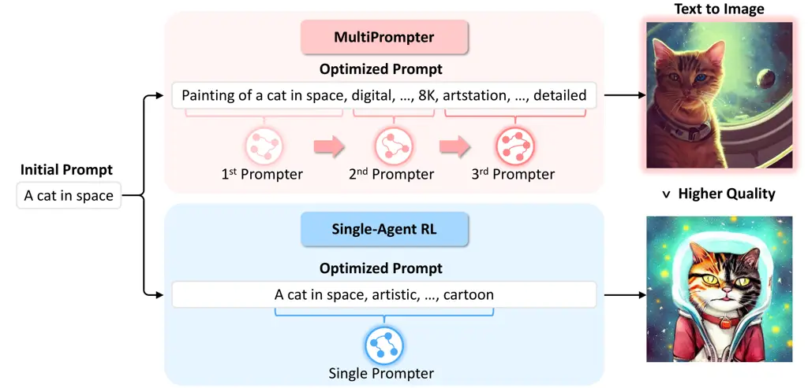
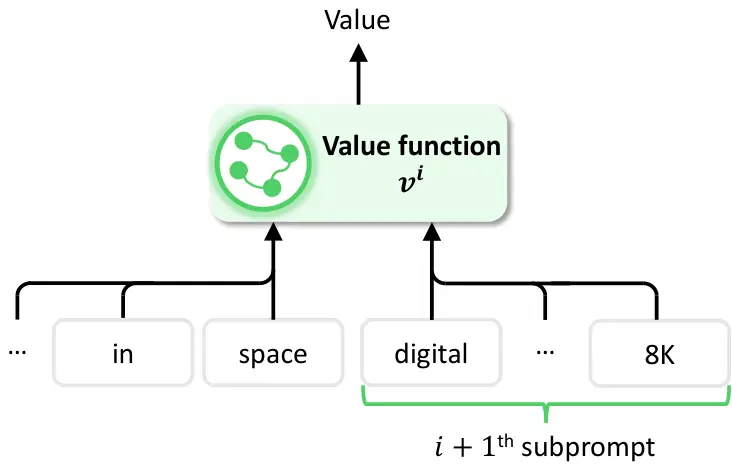
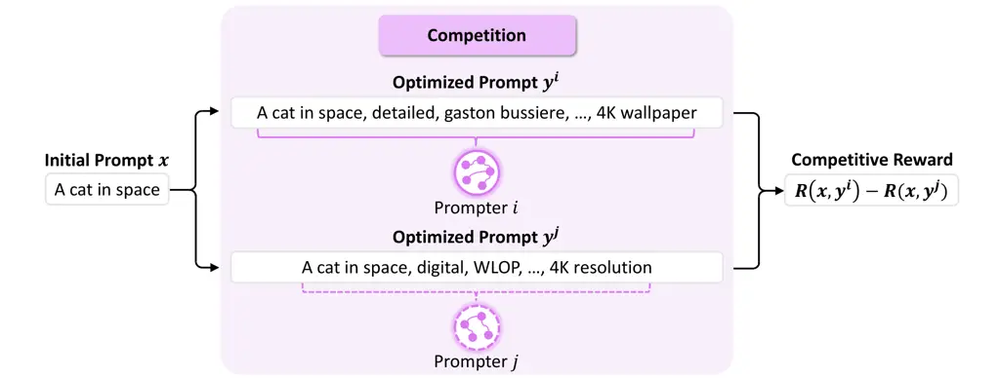
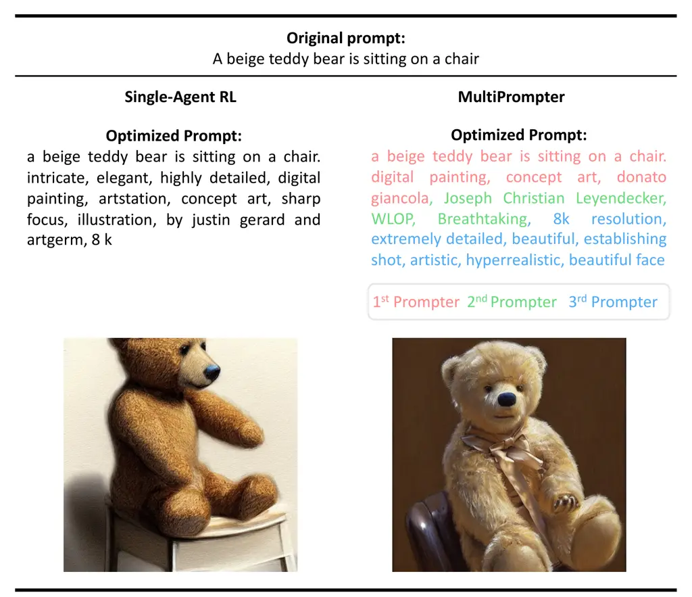

# MultiPrompter: Cooperative Prompt Optimization with Multi-Agent Reinforcement Learning

Dong-Ki Kim ^(†)^(†)thanks: LG AI Research  \$ˆ2\$University of
Michigan–Ann Arbor Email: [dkkim@lgresearch.ai](mailto:)    Sungryull
Sohn¹¹footnotemark: 1 Email: [srsohn@lgresearch.ai](mailto:)   
Lajanugen Logeswaran¹¹footnotemark: 1
Email: [llajan@lgresearch.ai](mailto:)    Dongsub Shim¹¹footnotemark: 1
Email: [dongsub.shim@lgresearch.ai](mailto:)    Honglak
Lee¹¹footnotemark: 1 ²²footnotemark: 2
Email: [honglak@lgresearch.ai](mailto:)

###### Abstract

Recently, there has been an increasing interest in automated prompt
optimization based on reinforcement learning (RL). This approach offers
important advantages, such as generating interpretable prompts and being
compatible with black-box foundation models. However, the substantial
prompt space size poses challenges for RL-based methods, often leading
to suboptimal policy convergence. This paper introduces MultiPrompter, a
new framework that views prompt optimization as a cooperative game
between prompters which take turns composing a prompt together. Our
cooperative prompt optimization effectively reduces the problem size and
helps prompters learn optimal prompts. We test our method on the
text-to-image task and show its ability to generate higher-quality
images than baselines.

## 1 Introduction

Foundation models are now an integral part of our daily lives, finding
applications across various tasks and domains \[1, 2, 3\]. The driving
force behind their widespread adoption is prompting. Unlike fine-tuning,
which involves a resource-intensive process of updating numerous model
parameters for a specific task, prompting effectively guides the model’s
behavior by refining initial prompts \[4, 5, 6\]. With the growing
availability of black-box models, prompting has emerged as an essential
tool for interacting with foundation models.

An important goal in prompting is automated prompt optimization,
removing the need for laborious manual trial-and-error efforts.
Reinforcement learning (RL) \[7\] presents a promising solution for
achieving this goal by discovering prompts that outperform manually
created ones through sequential optimization in the prompt space \[8, 9,
10, 11, 12, 13\]. Notably, RL-based methods generate interpretable
prompts and are compatible with black-box foundation models. These
attributes provide distinct advantages over alternative approaches like
soft prompts \[14, 15, 16, 17\], which produce less interpretable
prompts and require white-box access to the models. However, despite
these exciting outcomes, we note that existing work suffers from the
extensive size of the prompt space. This problem size is critical as it
hinders effective exploration and generally leads to suboptimal policy
convergence \[18\].

We propose a novel prompt optimization framework to address the
challenge posed by the extensive prompt space. Our key idea is to view
prompt optimization as a cooperative game between multiple prompters
which take turns composing a prompt together (see Figure 1). In this new
setting, prompters cooperatively decompose the prompt space into smaller
subspaces and sequentially optimize their respective parts. As a result,
our approach significantly reduces problem complexity compared to prior
work that rely on a single prompter to optimize the entire prompt. To
effectively learn cooperative policies within our framework, we develop
a practical multi-agent RL algorithm, named MultiPrompter. Specifically,
we enable each prompter to consider the behaviors of subsequent
prompters through a centralized critic \[19, 20, 21, 22\] designed for
cooperative prompt optimization. We show that MultiPrompter generates
more optimal prompts than those produced by baselines.

Our contribution. In summary, this paper makes the following main
contributions:

- •
  Formulation of cooperative prompt optimization (Section 2). We
  introduce a new cooperative game in which multiple prompters work as a
  team to enhance a prompt by sequentially optimizing it. This
  cooperative approach effectively reduces problem complexity in
  contrast to a single-agent RL approach and facilitates the process of
  finding optimal prompts.
- •
  Algorithm for learning cooperative prompt optimization (Section 3).
  Learning multiple prompters in our setting requires each prompter to
  take into account the behaviors of others. Otherwise, undesirable
  outcomes can arise as prompters may greedily optimize a prompt. To
  address this, MultiPrompter develops an actor-critic framework with a
  centralized critic that considers the next prompter’s actions to
  predict the value accurately.
- •
  Comprehensive evaluation of MultiPrompter (Section 4). Our results
  highlight that MultiPrompter outperforms a single-agent RL baseline in
  the text-to-image generation task, obtaining higher rewards and the
  ability to optimize longer prompts. Additionally, we consider a
  variant of MultiPrompter, which applies a competitive game between
  prompters, and show that this competitive prompt optimization is less
  effective than our cooperative formulation.



Figure 1: In MultiPrompter, a team of prompters learns to take turns
optimizing a prompt together, generating higher-quality images compared
to those produced by a single-agent RL method for a text-to-image task.
The images are generated using Stable Diffusion \[2\].

## 2 Problem Statement: Cooperative Prompt Optimization Game

Overview. We introduce the new concept of cooperative prompt
optimization: given an initial prompt $`\bm{x}`$, a team of $`n`$
prompters generates an optimized prompt that consists of multiple
subprompts $`\bm{y}\!=\!(\bm{\tilde{y}^{1}},...,\bm{\tilde{y}^{n}})`$
(see Figure 1). Specifically, the first prompter optimizes the initial
parts of a prompt and passes the baton to the next prompter as needed.
Then, the second prompter continues the optimization from where the
previous prompter left off. This process repeats until the last prompter
finishes its turn or the length of an optimized prompt exceeds a token
limit. The team’s objective is to generate an optimized prompt such that
it achieves a high score according to a performance metric.

Definition. We formally define a cooperative prompt optimization game
between $`n`$ prompters as a tuple
$`\mathcal{G}_{n}\!=\!\langle\mathbfcal{I},\mathcal{S},\mathcal{V},\mathcal{T},\mathcal{R}\rangle`$;
$`\mathbfcal{I}\!=\!(1,...,n)`$ is the set of $`n`$ prompters;
$`\mathcal{S}`$ is the prompt space; $`\mathcal{V}`$ is the vocabulary;
$`\mathcal{T}\!:\!\mathcal{S}\!\times\!\mathcal{V}\!\mapsto\!\mathcal{S}`$
is the deterministic prompt transition function; and $`\mathcal{R}`$ is
the reward function. We also define an index $`i\!\in\!\mathbfcal{I}`$
that points to the active prompter which is currently taking its turn.
At the beginning of the game, prompters are given an initial prompt
$`\bm{x}\!=\!(x_{1},...,x_{K})`$ and the index $`i`$ is reset to one. At
each timestep $`t`$, the $`i`$-th prompter decides a discrete token
$`y_{t}\!\in\!\mathcal{V}`$ according to its stochastic policy
$`y_{t}\!\sim\!\pi^{i}(\cdot|\bm{x},\bm{y_{1:t\shortminus 1}};\theta^{i})`$
parameterized by $`\theta^{i}`$, where
$`\bm{y_{1:t\shortminus 1}}\!=\!(y_{1},...,y_{t\shortminus 1})`$. An
action $`y_{t}`$ then yields the prompt transition from
($`\bm{x},\bm{y_{1:t\shortminus 1}}`$) to ($`\bm{x},\bm{y_{1:t}}`$). If
$`y_{t}`$ corresponds to an end-of-sequence token, then $`i`$-th
prompter finishes generating its subprompt $`\bm{\tilde{y}^{i}}`$. The
index $`i`$ is also updated to pass the turn to the next prompter (i.e.,
$`i\!\leftarrow\!i\!+\!1`$). The game ends when all prompters finish
their turns or the size of an optimized prompt $`\bm{y}`$ is over the
token limit $`T`$. The team shares a reward according to
$`\mathcal{R}(\bm{x},\bm{y})`$, which measures the quality of an
optimized prompt $`\bm{y}`$ at the end of the game.

Benefit of problem size reduction. The natural outcome of our
cooperative game is the generation of a decomposed optimized prompt,
which consists of subprompts:
$`\bm{y}\!=\!(\bm{\tilde{y}^{1}},...,\bm{\tilde{y}^{n}})`$. Thanks to
this cooperative prompt decomposition, each prompter $`i`$ in
MultiPrompter simply has to search for the desired tokens within its
subprompt $`\bm{\tilde{y}^{i}}`$, which contains fewer tokens than the
full prompt $`\bm{y}`$. As a result, we note that our formulation
substantially reduces problem complexity compared to optimizing a prompt
using single-agent RL methods \[8, 23\]:

```math
\displaystyle\begin{split}\underbrace{\textstyle\sum\limits_{i\in\mathbfcal{I}}|\mathcal{V}|^{|\bm{\tilde{y}^{i}}|}}_{\begin{subarray}{c}\text{Multi prompter}\\
\text{problem size}\end{subarray}}\;\;\;\ll\underbrace{\vphantom{\textstyle\sum\limits_{i\in\mathbfcal{I}}}|\mathcal{V}|^{|\bm{y}|}}_{\begin{subarray}{c}\text{Single prompter}\\
\text{problem size}\end{subarray}}\end{split} \tag{1}
```

where $`|\!\cdot\!|`$ denotes the size of a set. In the following
section, we leverage this inherent benefit of our cooperative prompt
optimization game and develop an algorithm for learning cooperative
policies.

## 3 MultiPrompter: Learning Cooperative Prompt Optimization Policies

This section introduces our multi-agent learning algorithm, named
MultiPrompter, designed to learn cooperative policies that decompose and
optimize a prompt together. We first outline each prompter’s objective
in our cooperative prompt optimization game. We then detail our
centralized critic that enables each prompter to consider the actions
and learning of others, thus facilitating successful cooperation. We
provide additional details, including pseudocode, in Appendix A.

MultiPrompter objective. The objective of each prompter’s policy
$`\pi^{i}`$ is to find policy parameters $`\theta^{i}`$ that maximize
the expected return:

```math
\displaystyle\max_{\theta^{i}}\mathbb{E}_{\bm{x},\bm{y}\sim p(\cdot|\bm{\theta})}\big[\mathcal{R}(\bm{x},\bm{y})\big],\text{ where }p(\bm{x},\bm{y}|\bm{\theta})=p(\bm{x})\prod\nolimits_{i=1}^{n}\prod\nolimits_{t=t^{i}_{\text{bos}}}^{t^{i}_{\text{eos}}}\pi^{i}(y_{t}|\bm{x},\bm{y_{1:t\shortminus 1}};\theta^{i}), \tag{2}
```

where $`t^{i}_{\text{bos}}`$ and $`t^{i}_{\text{eos}}`$ denote the
beginning and end timesteps of $`\bm{\tilde{y}^{i}}`$, respectively.
Leveraging REINFORCE \[24\], we derive a policy gradient with respect to
the objective in Equation 2:

```math
\displaystyle\begin{split}\nabla_{\theta^{i}}\mathbb{E}_{\bm{x},\bm{y}\sim p(\cdot|\bm{\theta})}\big[\textstyle\sum\limits\nolimits_{t=t^{i}_{\text{bos}}}^{t^{i}_{\text{eos}}}\log\pi^{i}(y_{t}|\bm{x},\bm{y_{1:t\shortminus 1}};\theta^{i})\mathcal{A}^{i}_{t}(\bm{x},\bm{y})\big],\end{split} \tag{3}
```

where $`\mathcal{A}^{i}_{t}(\bm{x},\bm{y})`$ denotes the advantage
function, which we will detail our choice in the next paragraph.



Figure 2: Our value function additionally considers a subprompt of the
next prompter $`\bm{\tilde{y}^{i\!+\!1}}`$.

Centralized critic. The generalized advantage estimation \[25\] shows
that the advantage function can be effectively estimated with low
variance using a value function. A single-agent RL approach uses a value
function $`v(\bm{x},\bm{y_{1:t\shortminus 1}};\phi)`$ parameterized by
$`\phi`$ \[9\], but this form neglects the presence of other prompters,
even though the reward is jointly affected by all of them. To consider
policies and learning of subsequent prompters, MultiPrompter uses a
value function
$`v^{i}(\bm{x},\bm{y_{1:t\shortminus 1}},\bm{\tilde{y}^{i+1}};\phi^{i})`$
that enables a prompter $`i`$ to consider a prompter $`i+1`$’s policy
(see Figure 2). We have a design choice regarding the number of next
prompters to consider in the value function, and we empirically find
that including the next prompter’s information results in effective
training. Note that the centralized value function is only utilized
during training, which takes additional information to accurately
predict the value. Each prompter’s policy remains decentralized, so
MultiPrompter follows the centralized training with decentralized
execution structure \[19, 20, 21, 22\]. Lastly, we provide value
function optimization and other related details in Appendix A.

## 4 Evaluation

Experiment setup. Following the experimental settings by \[9\], we use a
reward function $`\mathcal{R}(\bm{x},\bm{y})`$ that consists of the
relevance score (i.e., measures the degree of relevance between an
initial prompt $`\bm{x}`$ and an image generated $`\bm{y}`$) and the
aesthetic score (i.e., measures aesthetical preference of an image
generated by $`\bm{y}`$ over another image generated by $`\bm{x}`$). We
implement both policies and value functions using GPT-2 \[26\] and
initialize them from the weights fine-tuned with manually engineered
prompts \[9\]. We compare methods using the COCO dataset \[27\]. We
refer to Appendix B for more details. Baseline. We compare MultiPrompter
with the following baselines:

- •
  Manual prompt \[9\]. A fine-tuned method with human-engineered prompts
  from Lexica \[28\].
- •
  Promptist \[9\]. A single-agent RL method that trains a GPT-2 prompter
  based on PPO \[29\].
- •
  Competition. Our variant of MultiPrompter that applies competition
  between prompters \[30\].

We omit soft prompt methods \[14, 15, 16, 17\] in our evaluation,
because our work focuses on generating interpretable prompts without
access to foundation models.

|               |              |                |                           |
| ------------- | ------------ | -------------- | ------------------------- |
| Algorithm     | Multi-agent? | Collaborative? | Test reward               |
| Manual prompt | ✗            | ✗              | $`\shortminus`$ 0.68 0.06 |
| Promptist     | ✗            | ✗              | $`0.28`$0.11              |
| Competition   | ✓            | ✗              | $`0.36`$0.12              |
| MultiPrompter | ✓            | ✓              | 0.76 0.10                 |

Table 1: Test performance across various methods. MultiPrompter achieves
a statistically significant performance improvement through cooperative
prompt optimization.

Figure 3: MultiPrompter’s performance w.r.t. $`n`$ shows a trade-off
between problem size reduction and cooperation complexity.

Question 1. How effective is MultiPrompter compared to a single-agent RL
baseline?

Table 1 provides a summary of the test time performance. For the
training performance across multiple seeds, we refer to Figure 5 in the
Appendix. Our main observation is that MultiPrompter outperforms both
the single-agent RL and manual prompt baselines. To understand how
MultiPrompter generates more optimal prompts compared to Promptist, we
examine the number of optimized tokens by each method. While Promptist
converges to optimizing an average of $`57.01`$ tokens, MultiPrompter
optimizes an average of $`69.46`$ tokens (refer to Figure 6 in the
Appendix for an example). This result indicates that the single-agent RL
approach generally suffers from the extensive prompt space, converging
to a suboptimal policy that adds only a limited number of modifiers to
the original prompt. In contrast, MultiPrompter successfully overcomes
this challenge through cooperative prompt optimization and finds a
greater number of effective modifiers compared to Promptist.

Question 2. What about posing prompt optimization as a competitive game?

When considering prompt optimization from a multi-agent perspective,
cooperative optimization is not the only approach, but there is also the
alternative of competitive prompt optimization. We consider a
competitive setting in which each prompter optimizes a full prompt
individually and then compares its optimized prompt to the output of
another competing prompter (refer to Section B.1 for details). As
Table 1 shows, we find that competitive prompt optimization produces a
slight improvement over the single-agent RL method but it is not as
effective as cooperative prompt optimization, primarily due to its lack
of the ability to decompose the prompt space.

Question 3. How does MultiPrompter’s performance change with respect to
the number of prompters?

Figure 3 shows an analysis of MultiPrompter in relation to the number of
prompters $`n`$. There are two notable observations. First, we observe a
trend in which test performance increases with $`n`$, but then decreases
after $`n\!=\!3`$. This result suggests a general trade-off in
cooperative prompt optimization: while the prompt space size reduces as
$`n`$ increases (as discussed in Section 2), the complexity of learning
cooperation between prompters increases. Our future work includes
incorporating recent advances in multi-agent RL \[31, 32, 33, 34\] to
effectively address the learning complexity with increasing $`n`$.
Second, we note that MultiPrompter with any $`n\!>\!1`$ performs better
than a single-agent RL approach (i.e., $`n\!=\!1`$).

Question 4. How important is it to learn the prompt decomposition and
have the centralized critic?

|                        |                     |              |
| ---------------------- | ------------------- | ------------ |
| Learned decomposition? | Centralized critic? | Test reward  |
| ✗                      | ✗                   | $`0.40`$0.12 |
| ✓                      | ✗                   | $`0.39`$0.12 |
| ✗                      | ✓                   | $`0.59`$0.16 |
| ✓                      | ✓                   | 0.76 0.10    |

Table 2: Ablation study of MultiPrompter. By learning to collaboratively
decompose the prompt space and employing the centralized critic to take
into account the behaviors of the next prompter, MultiPrompter achieves
the best performance.

MultiPrompter achieves cooperative prompt optimization by learning the
dynamic decomposition of the prompt space. This process involves each
prompter learning the appropriate moment to finish its turn and pass the
baton to the next prompter, while taking into account the actions of the
following prompter through the centralized critic. Table 2 presents an
ablation analysis of MultiPrompter, examining its performance in
learning a flexible prompt space decomposition versus manual
decomposition (i.e., fixing each prompter’s token limit as $`T/n`$). We
also study the impact of using the centralized critic in learning
policies. Two notable observations emerge. First, without the
centralized critic, each prompter cannot consider the behaviors of other
prompters, resulting in ineffective collaboration. Second, while
utilizing the centralized critic improves performance, the combination
of this approach with the dynamic prompt space decomposition as in
MultiPrompter leads to the best performance.

## 5 Conclusion

In this paper, we have introduced MultiPrompter to address the extensive
prompt space size in RL-based prompt optimization. The key idea is to
learn multiple cooperative prompters that optimize a prompt together. We
tested our method on various settings and showed that MultiPrompter
consistently outperforms baseline approaches in the text-to-image
domain.

## References

- \[1\] OpenAI. Gpt-4 technical report. arXiv preprint
  arXiv:2303.08774, 2023.
- \[2\] Robin Rombach, Andreas Blattmann, Dominik Lorenz, Patrick Esser,
  and Björn Ommer. High-resolution image synthesis with latent diffusion
  models. In Proceedings of the IEEE/CVF Conference on Computer Vision
  and Pattern Recognition (CVPR), pages 10684–10695, June 2022.
- \[3\] Guanzhi Wang, Yuqi Xie, Yunfan Jiang, Ajay Mandlekar, Chaowei
  Xiao, Yuke Zhu, Linxi Fan, and Anima Anandkumar. Voyager: An
  open-ended embodied agent with large language models. arXiv preprint
  arXiv:2305.16291, 2023.
- \[4\] Tom Brown, Benjamin Mann, Nick Ryder, Melanie Subbiah, Jared D
  Kaplan, Prafulla Dhariwal, Arvind Neelakantan, Pranav Shyam, Girish
  Sastry, Amanda Askell, Sandhini Agarwal, Ariel Herbert-Voss, Gretchen
  Krueger, Tom Henighan, Rewon Child, Aditya Ramesh, Daniel Ziegler,
  Jeffrey Wu, Clemens Winter, Chris Hesse, Mark Chen, Eric Sigler,
  Mateusz Litwin, Scott Gray, Benjamin Chess, Jack Clark, Christopher
  Berner, Sam McCandlish, Alec Radford, Ilya Sutskever, and Dario
  Amodei. Language models are few-shot learners. In H. Larochelle,
  M. Ranzato, R. Hadsell, M.F. Balcan, and H. Lin, editors, Advances in
  Neural Information Processing Systems, volume 33, pages 1877–1901.
  Curran Associates, Inc., 2020.
- \[5\] Jason Wei, Xuezhi Wang, Dale Schuurmans, Maarten Bosma, brian
  ichter, Fei Xia, Ed Chi, Quoc V Le, and Denny Zhou. Chain-of-thought
  prompting elicits reasoning in large language models. In S. Koyejo,
  S. Mohamed, A. Agarwal, D. Belgrave, K. Cho, and A. Oh, editors,
  Advances in Neural Information Processing Systems, volume 35, pages
  24824–24837. Curran Associates, Inc., 2022.
- \[6\] Pengfei Liu, Weizhe Yuan, Jinlan Fu, Zhengbao Jiang, Hiroaki
  Hayashi, and Graham Neubig. Pre-train, prompt, and predict: A
  systematic survey of prompting methods in natural language processing.
  ACM Comput. Surv., 55(9), jan 2023.
- \[7\] Richard S. Sutton and Andrew G. Barto. Reinforcement Learning:
  An Introduction. The MIT Press, second edition, 2018.
- \[8\] Mingkai Deng, Jianyu Wang, Cheng-Ping Hsieh, Yihan Wang, Han
  Guo, Tianmin Shu, Meng Song, Eric Xing, and Zhiting Hu. RLPrompt:
  Optimizing discrete text prompts with reinforcement learning. In
  Proceedings of the 2022 Conference on Empirical Methods in Natural
  Language Processing, pages 3369–3391, Abu Dhabi, United Arab Emirates,
  December 2022. Association for Computational Linguistics.
- \[9\] Yaru Hao, Zewen Chi, Li Dong, and Furu Wei. Optimizing prompts
  for text-to-image generation. arXiv preprint arXiv:2212.09611, 2022.
- \[10\] Tianjun Zhang, Xuezhi Wang, Denny Zhou, Dale Schuurmans, and
  Joseph E. Gonzalez. TEMPERA: Test-time prompt editing via
  reinforcement learning. In The Eleventh International Conference on
  Learning Representations, 2023.
- \[11\] Yihong Dong, Kangcheng Luo, Xue Jiang, Zhi Jin, and Ge Li.
  Pace: Improving prompt with actor-critic editing for large language
  model. arXiv preprint arXiv:2308.10088, 2023.
- \[12\] Chengzhengxu Li, Xiaoming Liu, Yichen Wang, Duyi Li, Yu Lan,
  and Chao Shen. Dialogue for prompting: a policy-gradient-based
  discrete prompt optimization for few-shot learning. arXiv preprint
  arXiv:2308.07272, 2023.
- \[13\] Hoyoun Jung and Kyung-Joong Kim. Discrete prompt compression
  with reinforcement learning. arXiv preprint arXiv:2308.08758, 2023.
- \[14\] Guanghui Qin and Jason Eisner. Learning how to ask: Querying
  LMs with mixtures of soft prompts. In Proceedings of the 2021
  Conference of the North American Chapter of the Association for
  Computational Linguistics: Human Language Technologies, pages
  5203–5212, Online, June 2021. Association for Computational
  Linguistics.
- \[15\] Xiang Lisa Li and Percy Liang. Prefix-tuning: Optimizing
  continuous prompts for generation. In Proceedings of the 59th Annual
  Meeting of the Association for Computational Linguistics and the 11th
  International Joint Conference on Natural Language Processing (Volume
  1: Long Papers), pages 4582–4597, Online, August 2021. Association for
  Computational Linguistics.
- \[16\] Brian Lester, Rami Al-Rfou, and Noah Constant. The power of
  scale for parameter-efficient prompt tuning. In Proceedings of the
  2021 Conference on Empirical Methods in Natural Language Processing,
  pages 3045–3059, Online and Punta Cana, Dominican Republic,
  November 2021. Association for Computational Linguistics.
- \[17\] Xiao Liu, Kaixuan Ji, Yicheng Fu, Weng Tam, Zhengxiao Du,
  Zhilin Yang, and Jie Tang. P-tuning: Prompt tuning can be comparable
  to fine-tuning across scales and tasks. In Proceedings of the 60th
  Annual Meeting of the Association for Computational Linguistics
  (Volume 2: Short Papers), pages 61–68, Dublin, Ireland, May 2022.
  Association for Computational Linguistics.
- \[18\] Cosmin Paduraru, Daniel J. Mankowitz, Gabriel Dulac-Arnold,
  Jerry Li, Nir Levine, Sven Gowal, and Todd Hester. Challenges of
  real-world reinforcement learning:definitions, benchmarks & analysis.
  Machine Learning Journal, 2021.
- \[19\] Ryan Lowe, Yi Wu, Aviv Tamar, Jean Harb, OpenAI Pieter Abbeel,
  and Igor Mordatch. Multi-agent actor-critic for mixed
  cooperative-competitive environments. In I. Guyon, U. Von Luxburg,
  S. Bengio, H. Wallach, R. Fergus, S. Vishwanathan, and R. Garnett,
  editors, Advances in Neural Information Processing Systems, volume 30.
  Curran Associates, Inc., 2017.
- \[20\] Jakob Foerster, Gregory Farquhar, Triantafyllos Afouras, Nantas
  Nardelli, and Shimon Whiteson. Counterfactual multi-agent policy
  gradients. Proceedings of the AAAI Conference on Artificial
  Intelligence, 32(1), Apr. 2018.
- \[21\] Shayegan Omidshafiei, Dong-Ki Kim, Miao Liu, Gerald Tesauro,
  Matthew Riemer, Christopher Amato, Murray Campbell, and Jonathan P.
  How. Learning to teach in cooperative multiagent reinforcement
  learning. Proceedings of the AAAI Conference on Artificial
  Intelligence, 33(01):6128–6136, Jul. 2019.
- \[22\] Chao Yu, Akash Velu, Eugene Vinitsky, Jiaxuan Gao, Yu Wang,
  Alexandre Bayen, and Yi Wu. The surprising effectiveness of PPO in
  cooperative multi-agent games. In Thirty-sixth Conference on Neural
  Information Processing Systems Datasets and Benchmarks Track, 2022.
- \[23\] Marwa Abdulhai, Dong-Ki Kim, Matthew Riemer, Miao Liu, Gerald
  Tesauro, and Jonathan P. How. Context-specific representation
  abstraction for deep option learning. Proceedings of the AAAI
  Conference on Artificial Intelligence, 36(6):5959–5967, Jun. 2022.
- \[24\] Ronald J. Williams. Simple statistical gradient-following
  algorithms for connectionist reinforcement learning. Machine Learning,
  8(3):229–256, May 1992.
- \[25\] John Schulman, Philipp Moritz, Sergey Levine, Michael Jordan,
  and Pieter Abbeel. High-dimensional continuous control using
  generalized advantage estimation. arXiv preprint
  arXiv:1506.02438, 2018.
- \[26\] Alec Radford, Jeff Wu, Rewon Child, David Luan, Dario Amodei,
  and Ilya Sutskever. Language models are unsupervised multitask
  learners. 2019.
- \[27\] Tsung-Yi Lin, Michael Maire, Serge Belongie, James Hays, Pietro
  Perona, Deva Ramanan, Piotr Dollár, and C. Lawrence Zitnick. Microsoft
  coco: Common objects in context. In David Fleet, Tomas Pajdla, Bernt
  Schiele, and Tinne Tuytelaars, editors, Computer Vision – ECCV 2014,
  pages 740–755, Cham, 2014. Springer International Publishing.
- \[28\] The state of the art ai image generation engine.
  [https://lexica.art/](https://lexica.art/). Accessed: 2023-09-28.
- \[29\] John Schulman, Filip Wolski, Prafulla Dhariwal, Alec Radford,
  and Oleg Klimov. Proximal policy optimization algorithms. arXiv
  preprint arXiv:1707.06347, 2017.
- \[30\] Trapit Bansal, Jakub Pachocki, Szymon Sidor, Ilya Sutskever,
  and Igor Mordatch. Emergent complexity via multi-agent competition. In
  International Conference on Learning Representations, 2018.
- \[31\] Yaodong Yang, Rui Luo, Minne Li, Ming Zhou, Weinan Zhang, and
  Jun Wang. Mean field multi-agent reinforcement learning. In Jennifer
  Dy and Andreas Krause, editors, Proceedings of the 35th International
  Conference on Machine Learning, volume 80 of Proceedings of Machine
  Learning Research, pages 5571–5580. PMLR, 10–15 Jul 2018.
- \[32\] Neil Rabinowitz, Frank Perbet, Francis Song, Chiyuan Zhang,
  S. M. Ali Eslami, and Matthew Botvinick. Machine theory of mind. In
  Jennifer Dy and Andreas Krause, editors, Proceedings of the 35th
  International Conference on Machine Learning, volume 80 of Proceedings
  of Machine Learning Research, pages 4218–4227. PMLR, 10–15 Jul 2018.
- \[33\] Dong Ki Kim, Miao Liu, Matthew D Riemer, Chuangchuang Sun,
  Marwa Abdulhai, Golnaz Habibi, Sebastian Lopez-Cot, Gerald Tesauro,
  and Jonathan How. A policy gradient algorithm for learning to learn in
  multiagent reinforcement learning. In Marina Meila and Tong Zhang,
  editors, Proceedings of the 38th International Conference on Machine
  Learning, volume 139 of Proceedings of Machine Learning Research,
  pages 5541–5550. PMLR, 18–24 Jul 2021.
- \[34\] Dong-Ki Kim, Matthew Riemer, Miao Liu, Jakob Foerster, Michael
  Everett, Chuangchuang Sun, Gerald Tesauro, and Jonathan P How.
  Influencing long-term behavior in multiagent reinforcement learning.
  In S. Koyejo, S. Mohamed, A. Agarwal, D. Belgrave, K. Cho, and A. Oh,
  editors, Advances in Neural Information Processing Systems, volume 35,
  pages 18808–18821. Curran Associates, Inc., 2022.
- \[35\] Yu-han Chang, Tracey Ho, and Leslie Kaelbling. All learning is
  local: Multi-agent learning in global reward games. In S. Thrun,
  L. Saul, and B. Schölkopf, editors, Advances in Neural Information
  Processing Systems, volume 16. MIT Press, 2003.
- \[36\] Peter Sunehag, Guy Lever, Audrunas Gruslys, Wojciech Marian
  Czarnecki, Vinicius Zambaldi, Max Jaderberg, Marc Lanctot, Nicolas
  Sonnerat, Joel Z. Leibo, Karl Tuyls, and Thore Graepel.
  Value-decomposition networks for cooperative multi-agent learning
  based on team reward. In Proceedings of the 17th International
  Conference on Autonomous Agents and MultiAgent Systems, AAMAS ’18,
  page 2085–2087, Richland, SC, 2018. International Foundation for
  Autonomous Agents and Multiagent Systems.
- \[37\] Bowen Baker, Ingmar Kanitscheider, Todor Markov, Yi Wu, Glenn
  Powell, Bob McGrew, and Igor Mordatch. Emergent tool use from
  multi-agent autocurricula. In International Conference on Learning
  Representations, 2020.
- \[38\] Alec Radford, Jong Wook Kim, Chris Hallacy, Aditya Ramesh,
  Gabriel Goh, Sandhini Agarwal, Girish Sastry, Amanda Askell, Pamela
  Mishkin, Jack Clark, Gretchen Krueger, and Ilya Sutskever. Learning
  transferable visual models from natural language supervision. In
  Marina Meila and Tong Zhang, editors, Proceedings of the 38th
  International Conference on Machine Learning, volume 139 of
  Proceedings of Machine Learning Research, pages 8748–8763. PMLR, 18–24
  Jul 2021.
- \[39\] Aion-aesthetics.
  [https://laion.ai/blog/laion-aesthetics/](https://laion.ai/blog/laion-aesthetics/).
  Accessed: 2023-09-28.

## Appendix A Additional MultiPrompter Details

### A.1 Optimization

The advantage function $`\mathcal{A}^{i}_{t}(\bm{x},\bm{y})`$ in
Equation 3 can be effectively estimated using the generalized advantage
estimation \[25\] using a value function:

```math
\displaystyle\mathcal{A}^{i}_{t}(\bm{x},\bm{y})=\textstyle\sum\limits\nolimits_{l=0}^{|\bm{\tilde{y}^{i}}|-1}\lambda^{l}\delta^{i}_{t+l} \tag{4}
```

```math
\displaystyle\delta^{i}_{t+l}=\begin{cases}\mathcal{R}(\bm{x},\bm{y})\!-\!v^{i}(\bm{x},\bm{y_{1:t+l-1}},\bm{\tilde{y}^{i+1}};\phi^{i})\hskip 63.44952pt\text{if }t+l\!=\!t^{i}_{\text{eos}},\\
v^{i}(\bm{x},\bm{y_{1:t+l}},\bm{\tilde{y}^{i+1}};\phi^{i})\!-\!v^{i}(\bm{x},\bm{y_{1:t+l-1}},\bm{\tilde{y}^{i+1}};\phi^{i})\;\text{else,}\end{cases} \tag{5}
```

where we assume the discount factor $`\gamma\!=\!1`$ and sparse reward
function $`\mathcal{R}(\bm{x},\bm{y})`$. We update value function
parameters by minimizing the standard squared-error loss with the target
value $`v_{\text{target},t}`$:

```math
\displaystyle\begin{split}\mathcal{L}_{v}(\phi^{i})=\mathbb{E}_{\bm{x},\bm{y}\sim p(\cdot|\bm{\theta})}\big[\textstyle\sum\limits\nolimits_{t=t^{i}_{\text{bos}}}^{t^{i}_{\text{eos}}}(v(\bm{x},\bm{y_{1:t-1}},\bm{y^{i+1}};\phi^{i})-v_{\text{target},t})^{2}\big].\end{split} \tag{6}
```

In this work, we apply PPO \[29\] to update policies and value functions
with respect to Equation 3 and Equation 6, respectively.

### A.2 Reward Engineering

Since MultiPrompter is a multi-agent learning approach, our work is also
affected by the credit assignment issue in multi-agent RL \[20, 35,
36\], where certain agents do not actively participate in cooperation.
In particular, we observe that a prompter may optimize most or the
entire prompt by itself, thereby not providing opportunities to
subsequent teammates. To effectively address this issue, we add the
following cooperation reward, which computes the entropy with respect to
the lengths of the subprompts, to the original reward:

```math
\displaystyle\begin{split}\mathcal{R}_{\text{cooperation}}(\bm{y})=\mathcal{H}(\bm{y})=-\textstyle\sum\limits_{i\in\mathcal{I}}\big((|\bm{\tilde{y}^{i}}|/|\bm{y}|)\log(|\bm{\tilde{y}^{i}}|/|\bm{y}|)\big)/\log n.\end{split} \tag{7}
```

Intuitively, this reward function encourages prompters to evenly
decompose the prompt space such that they collectively optimize a
prompt.

### A.3 Pseudocode

1: policy parameters $`\bm{\theta}=(\theta^{1},...,\theta^{n})`$, value
parameters $`\bm{\phi}=(\phi^{1},...,\phi^{n})`$, token limit $`T`$

2: while not converged do

3:  \# perform episode reset

4:  get an initial prompt $`\bm{x}\sim p(\bm{x})`$

5:  reset index $`i=1`$ and timestep $`t=1`$

6:  \# start prompt optimization

7:  while $`i\leq n`$ do

8:   \# select current token $`y_{t}`$

9:   if $`t\leq T`$ then

10:    sample current token from an active prompter
$`y_{t}\sim\pi^{i}(\cdot|\bm{x},\bm{y_{1:t-1}};\theta^{i})`$

11:   else

12:    set current token as an EOS token $`y_{t}=y_{\text{eos}}`$

13:   end if

14:   \# update timestep $`t`$ and index $`i`$

15:   update timestep $`t\leftarrow t+1`$

16:   if $`y_{t}`$ corresponds to an EOS token $`y_{\text{eos}}`$ then

17:    update index $`i\leftarrow i+1`$

18:   end if

19:  end while

20:  compute a team reward $`\mathcal{R}(\bm{x},\bm{y})`$

21:  \# train prompters

22:  for $`i=1,...,n`$ do

23:   train policy parameters $`\theta^{i}`$ according to Equation 3

24:   train value function parameters $`\phi^{i}`$ according to
Equation 6

25:  end for

26: end while

Algorithm 1 MultiPrompter



Figure 4: We present a competitive prompt optimization approach, where a
prompter $`i`$ competes against another prompter $`j`$ by comparing
their respective optimized prompts.

## Appendix B Additional Evaluation Details

### B.1 Competition Baseline Details

In this work, we contrast our cooperative prompt optimization approach
with an alternative setting of competitive prompt optimization.
Specifically, we design a competitive setting, where a prompter $`i`$
generates its own full prompt $`\bm{y^{i}}`$ and then compares its
response against another prompter $`j`$’s optimized prompt
$`\bm{y^{j}}`$. A prompter $`i`$ receives a competitive reward, defined
as $`\mathcal{R}(\bm{x},\bm{y^{i}})-\mathcal{R}(\bm{x},\bm{y^{j}})`$, as
a result of the comparison (see Figure 4). We apply the self-play
technique \[30, 37\] to train a prompter that competes against its
former copies and comparable skill levels. We also use the centralized
critic with a form
$`v^{i}(\bm{x},\bm{y_{1:t\shortminus 1}},\bm{y^{j}};\phi^{i})`$ to
enable a prompter $`i`$ to consider another competition prompter $`j`$’s
policy.

### B.2 Reward and Hyperparameter Details

Reward details. We follow \[9\] and use a reward function that measures
the quality of an optimized prompt $`\bm{y}`$. Specifically, the reward
function $`\mathcal{R}(\bm{x},\bm{y})`$ first computes the relevance
score:

```math
\displaystyle\begin{split}\mathcal{R}_{\text{relevance}}(\bm{x},\bm{y})=\mathbb{E}_{img_{\bm{y}}\sim\mathcal{M}(\bm{y})}\big[\min(20f_{\text{CLIP}}(\bm{x},img_{\bm{y}})-5.6,0)\big],\end{split} \tag{8}
```

where $`img_{\bm{y}}`$ refers to an image generated according to
$`\bm{y}`$, $`\mathcal{M}`$ refers to a text-to-image model (e.g.,
Stable Diffusion \[2\]), and $`f_{\text{CLIP}}`$ refers to the CLIP
similarity function \[38\]. The relevance score measures the degree of
relevance between $`img_{\bm{y}}`$ and the initial prompt $`\bm{x}`$.
The reward function also computes the aesthetic score that measures the
aesthetical preference of $`img_{\bm{y}}`$ over $`img_{\bm{x}}`$:

```math
\displaystyle\begin{split}\mathcal{R}_{\text{aesthetic}}(\bm{x},\bm{y})=\mathbb{E}_{img_{\bm{x}}\sim\mathcal{M}(\bm{x}),img_{\bm{y}}\sim\mathcal{M}(\bm{y})}\big[f_{\text{aesthetic}}(img_{\bm{y}})-f_{\text{aesthetic}}(img_{\bm{x}})\big],\end{split} \tag{9}
```

where $`f_{\text{aesthetic}}`$ refers to the aesthetic predictor \[39\].
Finally, the reward function sums the two scores:
$`\mathcal{R}(\bm{x},\bm{y})\!=\!\mathcal{R}_{\text{relevance}}(\bm{x},\bm{y})\!+\!\mathcal{R}_{\text{aesthetic}}(\bm{x},\bm{y})`$.
For the case of cooperative prompt optimization, we also add the
cooperation reward in Section A.2 during training:
$`\mathcal{R}(\bm{x},\bm{y})\!=\!\mathcal{R}_{\text{relevance}}(\bm{x},\bm{y})\!+\!\mathcal{R}_{\text{aesthetic}}(\bm{x},\bm{y})\!+\!\alpha\mathcal{R}_{\text{cooperation}}(\bm{y})`$,
where $`\alpha`$ denotes a weight.

Hyperparameter details. We report important hyperparameter values in our
experiments:

|                                      |           |
| ------------------------------------ | --------- |
| Hyperparameter                       | Value     |
| Number of prompters $`n`$            | 1,2,3,4,5 |
| Batch size                           | 256       |
| Minibatch size                       | 128       |
| Stable Diffusion inference step      | 20        |
| Token limit $`T`$                    | 80        |
| Learning rate                        | 0.00001   |
| Entropy weight                       | 0.001     |
| Discount factor $`\gamma`$           | 1.0       |
| GAE $`\lambda`$                      | 0.95      |
| Cooperation reward weight $`\alpha`$ | 0.25      |

Table 3: Hyperparameter values used in our experiments.

### B.3 Additional Result

Train performance.

Figure 5: Training performance for each method. Thanks to our
cooperative prompt optimization, MultiPrompter converges to a more
optimal policy. The mean and standard deviation computed for 3 seeds are
shown in the figure.

Test example.



Figure 6: An example of an optimized prompt generated by a single-agent
RL baseline and MultiPrompter. This example highlights that
MultiPrompter adds a greater number of effective modifiers compared to
the baseline. These images are generated using Stable Diffusion \[2\].
