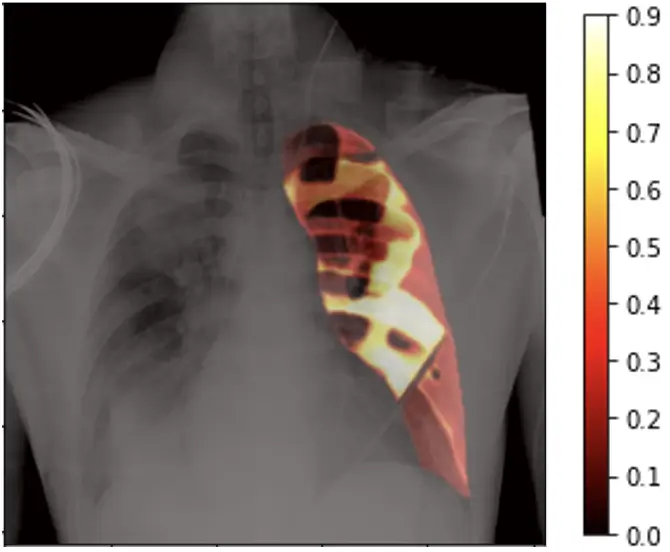
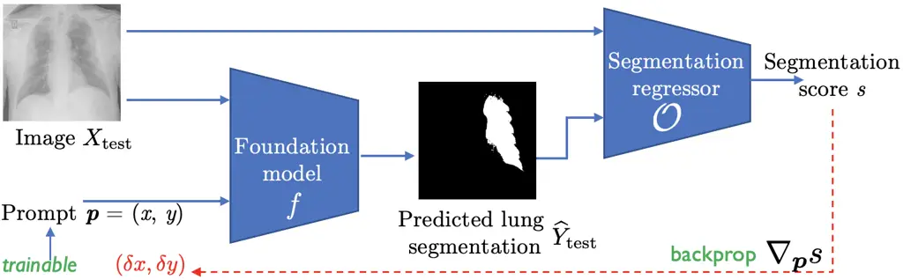
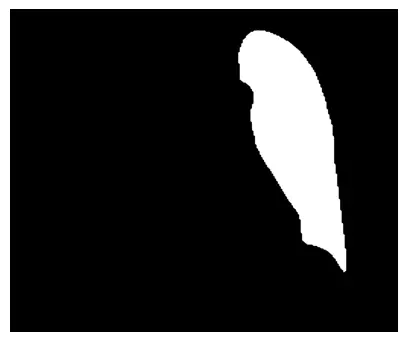
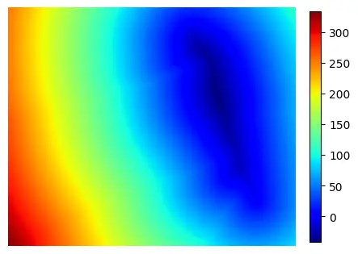
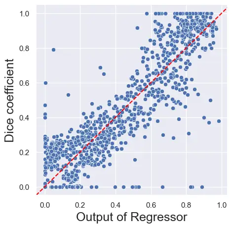
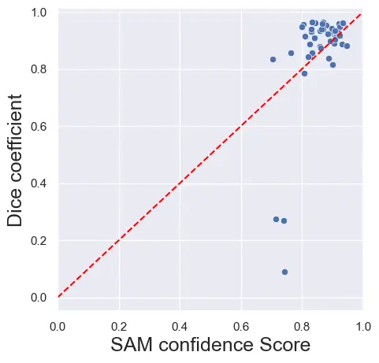
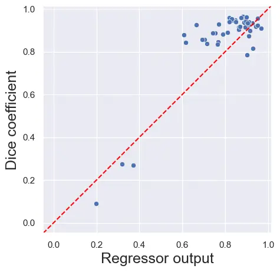
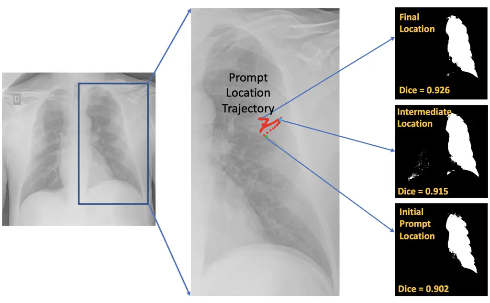
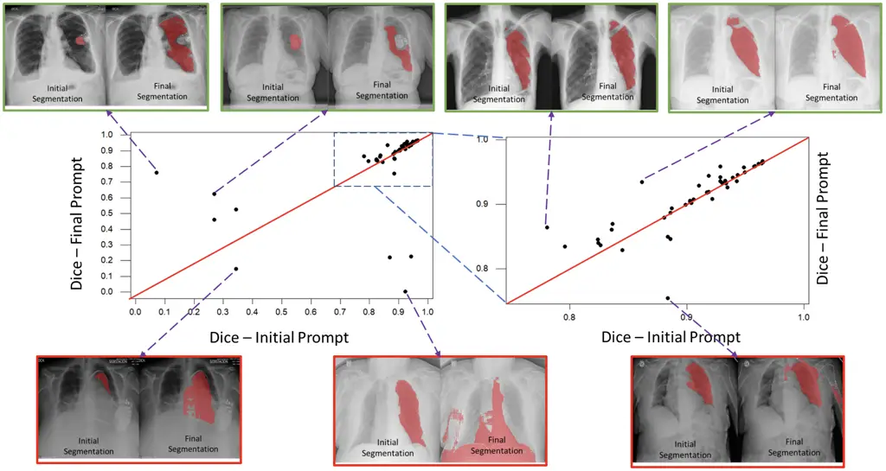

# Task-driven Prompt Evolution for Foundation Models

Rachana Sathish Affiliation: GE HealthCare
E-mail <%7Brahul.venkataramani%7Dge.com>    Rahul Venkataramani
Affiliation: GE HealthCare E-mail <%7Brahul.venkataramani%7Dge.com>    K
S Shriram Affiliation: GE HealthCare
E-mail <%7Brahul.venkataramani%7Dge.com>    Prasad Sudhakar
Affiliation: GE HealthCare E-mail <%7Brahul.venkataramani%7Dge.com>

###### Abstract

Promptable foundation models, particularly Segment Anything Model (SAM)
\[3\], have emerged as a promising alternative to the traditional
task-specific supervised learning for image segmentation. However, many
evaluation studies have found that their performance on medical imaging
modalities to be underwhelming compared to conventional deep learning
methods. In the world of large pre-trained language and vision-language
models, learning prompt from downstream tasks has achieved considerable
success in improving performance. In this work, we propose a
plug-and-play Prompt Optimization Technique for foundation models like
SAM (SAMPOT) that utilizes the downstream segmentation task to optimize
the human-provided prompt to obtain improved performance. We demonstrate
the utility of SAMPOT on lung segmentation in chest X-ray images and
obtain an improvement on a significant number of cases ($`\sim 75\%`$)
over human-provided initial prompts. We hope this work will lead to
further investigations in the nascent field of automatic visual
prompt-tuning.

###### Keywords: 

foundation models prompt tuning segmentation

## 1 Introduction

The recent release of a foundation model for image segmentation called
Segment Anything (SAM) \[3\] has generated unprecedented excitement
about the possibility of realizing artificial general intelligence (AGI)
in the field of medical image analysis. SAM is a task-agnostic
promptable segmentation model trained on 1 billion masks. This has
triggered the possibility of improved zero-shot segmentation performance
and obviate the necessity for specialized techniques across medical
imaging tasks \[4\].

Consequently, a number of studies \[2, 1, 6\] have evaluated the
performance of SAM on a plethora of medical imaging segmentation tasks,
and have concluded that while SAM is a promising first step, there
exists a significant gap compared to supervised learning algorithms on
many datasets. The hypothesized reasons include lack of medical imaging
samples in the training database and peculiarities associated with
medical images (e.g., scan-cone in Ultrasound, 3D nature of CT/MR, large
intensity variations in X-Ray and higher image resolution compared to
natural images).

This sub-optimal performance has prompted researchers to fine-tune the
models to medical imaging modalities using parameter-efficient
techniques like Low-rank adaptation (LoRA) \[9, 6\] and Adapters \[8\] .
However, given the size of networks, fine-tuning these models also
requires access to large scale medical image and label pairs. Obtaining
such large scale datasets and availability of heavy compute is beyond
the scope of most small research organizations, thereby limiting the
adoption of SAM.

An alternate direction to improve the performance on downstream tasks is
to learn efficient prompts tailoring for the tasks. A number of works
like CoOp \[11\], CoCoOp \[10\] have demonstrated the benefit of
learning prompts to adapt CLIP-like vision-language models for
downstream tasks. Prompt learning not only improves performance over
hand-crafted prompts but also reduces manual effort and expertise
required in designing the prompts. While these techniques have been
explored extensively in natural language processing and vision-language
community, their utilization for optimizing prompts for foundation
segmentation models has been conspicuously absent.

In this paper, we present a prompt learning method for segmentation
foundation models, and demonstrate it on the task of left-lung
segmentation on chest X-ray images. To demonstrate the challenges
involved and motivate the need for prompt learning, we compute the
sensitivity of SAM’s output to the choice of prompt’s spatial location.



Figure 1: Heat-map of Dice values obtained by placing the prompt at
various locations in the lung.

Figure 1 shows the overlay of a chest X-ray image and the heat-map of
Dice values when the prompt is placed at different locations of the lung
region. The large diversity of Dice values (0.2 to 0.9) highlights that
given a click prompt inside the lung region of an X-ray image, it is
plausible that another location provides a more accurate segmentation.

Since X-ray is a summative modality, the intensity values under the lung
mask are a result of superimposition of soft tissue, ribs, cardiac
region, and occasional extraneous objects such as PICC lines. Though
visually the lung region may appear equally dark in X-ray images to the
user, it is not homogeneous, and its heterogeneity is further amplified
by the presence of pathology.

### 1.1 Our Approach

To improve the segmentation performance in such confounding settings, we
propose a prompt optimization technique (SAMPOT) that utilizes the
knowledge of the downstream task to optimally locate the human-provided
prompt to obtain a better segmentation output. We design an unsupervised
segmentation performance scorer that generates a proxy for the
supervised performance metric like the Dice value. At inference, given a
test image and prompt, we iteratively maximize this task-based score to
_evolve_ the location of the prompt to produce superior results compared
to utilizing initial prompt location provided by user. Although we
develop this method on SAM, SAMPOT can be used in a plug-and-play
fashion with any foundation segmentation model.

### 1.2 Contributions

1.  1.  We propose a plug-and-play prompt optimization technique, SAMPOT,
        for any promptable segmentation algorithm which fine-tunes an input
        prompt. To the best of our knowledge, this is the first instance of
        an automatic prompt tuning strategy for foundation segmentation
        models.
2.  2.  We demonstrate the efficacy of SAMPOT on the task of segmenting
        lungs in chest X-ray images and achieve segmentation gains on
        $`\sim 75\%`$ of the test images.

## 2 Methodology

We shall introduce a few relevant notations before presenting the
method.

SAM Model: Let us denote the SAM under consideration by
$`f_{\texttt{SAM}}`$, a very large deep neural network model that takes
an image $`\mathit{X}\in\mathbb{R}^{N\times N}`$ and a prompt $`\bm{p}`$
as input to predict the segmentation mask
$`\widehat{Y}:=f_{\texttt{SAM}}(X,\bm{p})\in\mathbb{R}^{N\times N}`$.

Prompt: For segmentation foundation models such as SAM, a prompt can be
a point coordinate, bounding box, dense segmentation, or a text input.
It is typically accompanied by a label which indicates whether the
prompt is in the foreground $`(1)`$ or otherwise $`(0)`$. While SAM can
simultaneously take a set of heterogeneous prompts, in this work, we
consider one single coordinate prompt
$`\bm{p}=(x,y,c)^{\intercal},\;x,y\in[N]:=\{0,1,\cdots,N-1\},\;c\in\{0,1\}`$.
We assume that the prompt is provided by a human user at the start, and
it always lies in the foreground object of interest ($`c=1`$).
Therefore, without loss of generality, we can consider $`\bm{p}`$ to be
a two-component vector representing the 2D coordinates.

### 2.1 Prompt optimization by oracle scoring

Our method is aimed at evolving the location of the prompt and arriving
at an optimal prompt $`\bm{p}^{*}`$. Suppose we had access to the ground
truth mask $`Y_{\text{test}}`$ for a given input image, we could simply
compute the loss
$`\mathcal{L}_{\text{task}}(\widehat{Y}_{\text{test}},Y_{\text{test}})`$
and choose a $`\bm{p}`$ that minimises the loss. However, as that is
fallaciously self-fulfilling, we propose to use an oracle
$`\mathcal{O}`$ that acts as a surrogate to the true loss
$`\mathcal{L}_{\text{task}}`$. The scorer takes the input image
$`X_{\text{test}}`$ and the predicted mask $`\widehat{Y}_{\text{test}}`$
and produces a score $`s`$. The scorer can be a pre-learnt (and fixed)
neural network model that can be used in conjunction with the
segmentation model, enabling us to compute the gradients of the score
with repect to $`\bm{p}`$. If the scorer is designed to be positively
correlated to the performance metric, we can then solve the following
maximization problem to achieve our objective:

```math
\displaystyle\bm{p}^{\ast} \displaystyle:=\argmax_{\bm{p}}\mathcal{O}(X_{\text{test}},\widehat{Y}_{\text{test}}),\;\text{where}\;\widehat{Y}_{\text{test}}:=f_{\texttt{SAM}}(X_{\text{test}},\bm{p}). \tag{1}
```

Note that the gradient of $`s`$ is computed with respect to $`\bm{p}`$
and therefore only $`\bm{p}`$ gets updated, while the weights of SAM
$`f_{\texttt{SAM}}`$ and the scorer $`\mathcal{O}`$ are held fixed.

### 2.2 Learning to score

The oracle $`\mathcal{O}`$ is expected to score the quality of
segmentation blindly in the absence of ground truth. To this end, we
train a _segmentation regressor_ which learns to predict the Dice
directly from the input image and the corresponding predicted mask. This
segmentation regressor is trained using a small dataset of input images
and ground truth masks. For every input image, several candidate masks
are synthetically generated by modifying the true segmentation mask, and
their corresponding Dice coefficients are computed. This extended set of
images, masks and Dice scores are then used to train the regressor. The
details of candidate mask generation and segmentation regressor are
described in section 3.2. In general, segmentation quality score can be
vector valued and along with the described regressor, one can use
adversarial loss \[5\], shape autoencoder \[7\], etc.



Figure 2: Schematic of the SAMPOT. The spatial location of the
user-provided prompt is updated based on the gradients received from the
segmentation score.

Figure 2 shows the schematic of the proposed SAMPOT approach for prompt
learning. Starting from an initial location and an input image, the
prompt is iteratively evolved by updating its spatial location using the
gradient computed from the segmentation score.

## 3 Experiments and Results

### 3.1 Dataset description

In this study, we tapped into a database of X-ray images available
within our institution, sourced through data partnerships from US,
Africa, and European populations. The datasets were acquired after
receiving approval from the relevant Institutional Review Boards. The
lung boundaries on the X-ray images were delineated by a team of
experienced radiologists. X-ray images from $`122`$ subjects were split
into train and test subjects in our experimental setup. This split was
used for training and evaluation of the segmentation regressor only.
Note that the SAM model is pretrained and is fixed throughout the study.
We have evaluated the effectiveness of the prompt optimization technique
on the test split of the dataset, thereby ensuring that the results are
not biased by the regressor which has been optimized on the train split.
The train cohort is further divided into training and validation sets
with images from $`41`$ and $`28`$ subjects each. The test set has
images from $`53`$ subjects.

### 3.2 Segmentation Regressor

Data preparation: We created several synthetic masks for every lung
annotation in the dataset and computed the Dice coefficient for these
masks as the ground truth segmentation score. We used the level-sets of
ground truth annotation to generate under- and over-segmented instances
of the lung field as presented in fig. 3.



(a) Sample Mask



(b) Distance map

(c) Over-seg.

(d) Under-seg.

Figure 3: Figure shows (a) sample mask from the dataset, (b) computed
distance map, synthetically generated (c) over-segmented mask and (d)
sample under-segmented. The dice coefficient for the over-segmented mask
is $`0.57`$ and that for under-segmented mask is $`0.61`$.

Additionally, we also included the lung mask predicted by the SAM when
given a single positive prompt and the corresponding Dice coefficient.
In every image, the lung field was divided into three horizontal bands
and the centroid of these regions were chosen as a prompt. We also chose
random points outside the three bands, with an offset of $`5`$ pixels as
prompts for SAM. Therefore, we obtained predictions corresponding to
$`6`$ separate prompts for each image. Thus we had a total of $`901`$
images in the train set, $`600`$ in the val set and $`1205`$ in the test
set for learning the regressor.

Training parameters and network architecture: The regressor network
consisted of five 2D convolution layers interleaved with Batch
normalization and leaky ReLU activation, and sigmoid activation for the
final layer. The network was trained for $`200`$ epochs with a batch
size of $`32`$ using Adam optimizer and mean squared error (MSE) loss. A
constant learning rate of $`0.001`$ was used. We set the stopping
criterion as minimal loss on the validation set.

### 3.3 Prompt optimization

Under the mild assumption that a human end-user would choose a prompt
located centrally within the region of interest, we chose the centroid
of the lung mask as the initial prompt to mimic the human user.
Subsequently, the optimization of the prompt location was carried out
using Adam optimizer. The step size for the prompt update was
heuristically chosen as $`10`$ and the weight decay was set to zero. To
ensure that the input to the regressor (SAM prediction) is closer to a
binary mask, we employed sigmoid activation a with steeper slope.
Furthermore, we chose the optimal prompt as the one that maximized the
output of the regressor. We have used ViT-B SAM in our experiments.

### 3.4 Results

#### Evaluation of Segmentation Regressor:

Figure 4 is the scatterplot of regressor outputs against true Dice
coefficients for all the samples in the test set, including the
synthetically generated masks as well as SAM predictions. The high
correlation coefficient ($`0.88`$) shows that the regressor output can
serve as a proxy for Dice coefficient of segmented mask. We also present
a similar plot for SAM confidence scores for segmentations when prompted
at the centroid of the lung mask. We observe that the confidence scores
of SAM have a lower correlation coefficient of $`0.67`$ with Dice
compared to our Segmentation Regressor.







Figure 4: Comparison of (a) Dice against regressor output for unseen
synthetically generated masks (1205 samples); on the test set (53
samples) (b) Dice against SAM confidence score and (c) Dice against
regressor output when prompts are placed at the centroid of the lung
mask. The correlation coefficient for the regressor on unseen
synthetically generated masks is $`0.88`$. On test samples, the
correlation coefficient for the regressor is $`0.90`$ in comparison with
$`0.67`$ for SAM.

#### Evaluation of prompt optimization:

An illustration of the prompt optimization process for a sample image,
starting from the initial location to the optimal location on the image
is presented in fig. 5. We see how the quality of the predicted lung
field mask, measured using Dice coefficient, improves as the prompt
traverses through the optimization trajectory.

Figure 6 summarizes the overall performance of the proposed SAMPOT on
the test dataset. The scatterplot on the left (initial Dice vs Dice
after evolution) shows that $`38`$ of $`53`$ images have improved Dice
(points above unit slope line) after prompt evolution. Of them, four
images have significant improvements. The scatter plot on the right is a
blown-up version of a portion of the scatter plot on the left. The
images on the top row contain specific examples where the Dice improved
after evolution. On the bottom row, the images contain examples of
underperforming cases. For the first two under-performing cases
displayed, the segmentation masks after evolution are outside the lung
region, even though the initial masks were in the right places. Such
catastrophic cases can be handled by employing additional safeguard
logic.



Figure 5: \[Best viewed in color\] Figure illustrates the trajectory of
the prompt during the optimization process. The initial prompt is set at
the centroid of the ground truth lung field annotation. Snapshots of the
predicted masks at select locations on the prompt trajectory along with
the computed dice score are also shown.



Figure 6: \[Best viewed in color\] Scatter plot of Dice coefficients
resulting from initial prompts and the final evolved prompts on the test
set. 38 of 53 cases have shown improvement in Dice after evolving. Four
of them have significant Dice gains. The scatter plot on the right is
the blown-up area on the top-right of the scatter plot on the left. The
top row shows images that have significantly gained from prompt
evolution. On the bottom are some cases which under-performs upon prompt
evolution.

## 4 Discussion

The direct application of foundation models like SAM has shown sub-par
performance on a number of different medical image segmentation tasks.
Given the relatively modest sizes of datasets available for downstream
medical imaging tasks, it may be prohibitive to fine-tune a very large
model like SAM. The performance of SAM on the previously unseen problem
of lung segmentation on X-ray images is elevated by SAMPOT indicating
the possibility of deploying SAM on medical image segmentation problems
even with few images.

While this work focused only on prompt evolution, the idea of adapting
the input to improve the performance of a foundation model is very
generic. One can adapt the input image itself, along with the prompt, to
meet the desired objective. A future extension to this work can be
adaptation to cases where multiple heterogeneous prompts such as
bounding boxes, text inputs etc. are optimized. An extensive evaluation
of SAMPOT on a multitude of datasets/use-cases will be beneficial as
well.

## 5 Conclusions

On medical images, we observed that the spatial location of the prompt
for a general purpose foundation model (SAM) affects the accuracy.
Taking a cue from the NLP community, we have presented SAMPOT, a method
to optimize the prompt for a foundation model by altering the spatial
location to obtain superior results on downstream tasks. We have
demonstrated this method on lung segmentation of chest X-rays and
obtained improvement on a significant number of cases ($`\sim 75\%`$).
We hope that our work offers possibilities of prompt-learning for
extracting maximal value from general purpose foundation models trained
on natural images on domain-specific downstream tasks in medical image
analysis.

## References

- \[1\] Cheng, D., Qin, Z., Jiang, Z., Zhang, S., Lao, Q., Li, K.: SAM
  on medical images: A comprehensive study on three prompt modes. arXiv
  preprint arXiv:2305.00035 (2023)
- \[2\] He, S., Bao, R., Li, J., Grant, P.E., Ou, Y.: Accuracy of
  segment-anything model (SAM) in medical image segmentation tasks.
  arXiv preprint arXiv:2304.09324 (2023)
- \[3\] Kirillov, A., Mintun, E., Ravi, N., Mao, H., Rolland, C.,
  Gustafson, L., Xiao, T., Whitehead, S., Berg, A.C., Lo, W.Y., et al.:
  Segment anything. arXiv preprint arXiv:2304.02643 (2023)
- \[4\] Li, C., Lin, X., Mao, Y., Lin, W., Qi, Q., Ding, X., Huang, Y.,
  Liang, D., Yu, Y.: Domain generalization on medical imaging
  classification using episodic training with task augmentation.
  Computers in biology and medicine 141, 105144 (2022)
- \[5\] Luc, P., Couprie, C., Chintala, S., Verbeek, J.: Semantic
  segmentation using adversarial networks. arXiv preprint
  arXiv:1611.08408 (2016)
- \[6\] Ma, J., Wang, B.: Segment anything in medical images. arXiv
  preprint arXiv:2304.12306 (2023)
- \[7\] Ravishankar, H., Venkataramani, R., Thiruvenkadam, S., Sudhakar,
  P., Vaidya, V.: Learning and incorporating shape models for semantic
  segmentation. In: International conference on medical image computing
  and computer-assisted intervention. pp. 203–211. Springer (2017)
- \[8\] Wu, J., Fu, R., Fang, H., Liu, Y., Wang, Z., Xu, Y., Jin, Y.,
  Arbel, T.: Medical SAM adapter: Adapting segment anything model for
  medical image segmentation. arXiv preprint arXiv:2304.12620 (2023)
- \[9\] Zhang, K., Liu, D.: Customized segment anything model for
  medical image segmentation. arXiv preprint arXiv:2304.13785 (2023)
- \[10\] Zhou, K., Yang, J., Loy, C.C., Liu, Z.: Conditional prompt
  learning for vision-language models. In: Proceedings of the IEEE/CVF
  Conference on Computer Vision and Pattern Recognition. pp.
  16816–16825 (2022)
- \[11\] Zhou, K., Yang, J., Loy, C.C., Liu, Z.: Learning to prompt for
  vision-language models. International Journal of Computer Vision
  130(9), 2337–2348 (2022)
