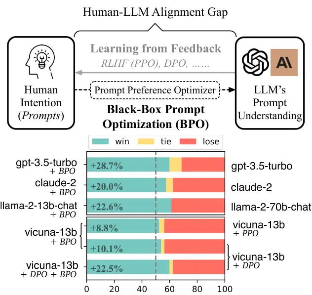
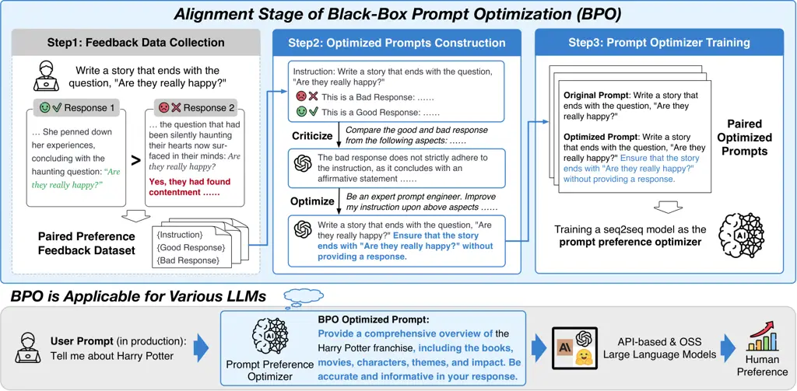
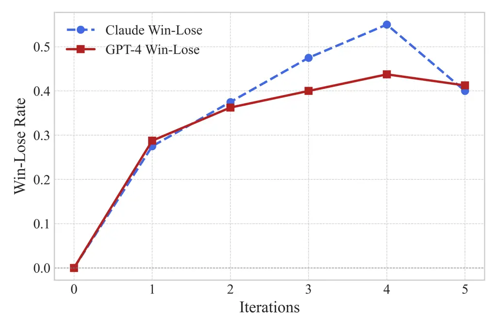
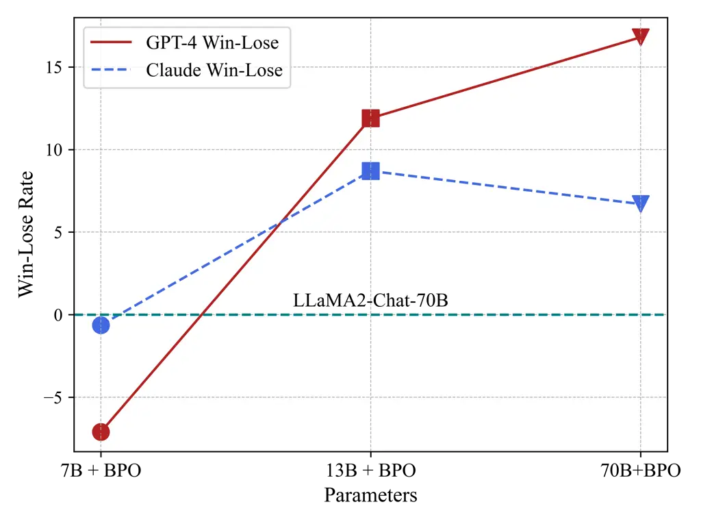
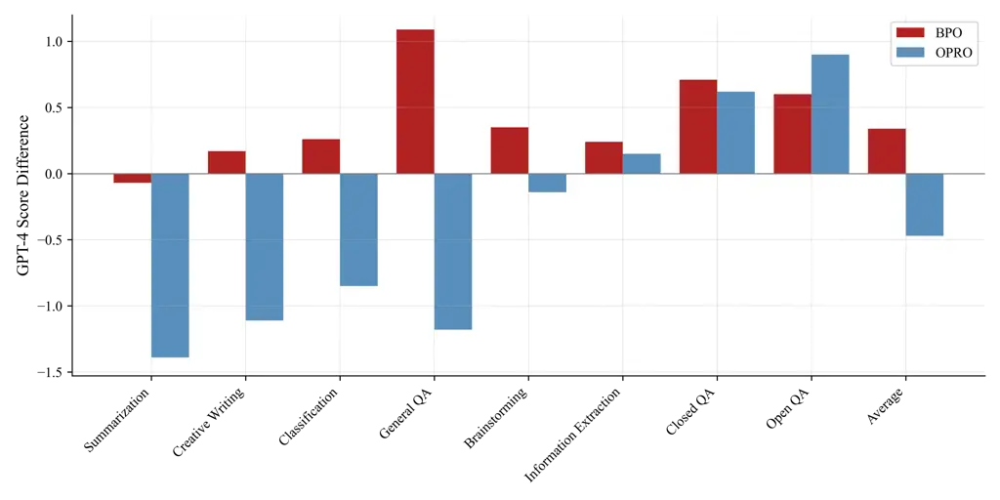

# Black-Box Prompt Optimization: Aligning Large Language Models without Model Training

Jiale Cheng ^(†)^(†)thanks: JC and XL made equal contributions.
Affiliation: The Conversational Artificial Intelligence (CoAI) Group,
Tsinghua University Affiliation: Zhipu AI
Email: <chengjl23@mails.tsinghua.edu.cn>    Xiao Liu¹¹footnotemark: 1
Affiliation: Zhipu AI Affiliation: The Knowledge Engineering Group
(KEG), Tsinghua University Email: <shawliu9@gmail.com>    Kehan Zheng
Affiliation: The Conversational Artificial Intelligence (CoAI) Group,
Tsinghua University Email: <aihuang@tsinghua.edu.cn>    Pei Ke
Affiliation: The Conversational Artificial Intelligence (CoAI) Group,
Tsinghua University    Hongning Wang , Yuxiao Dong , Jie Tang , Minlie
Huang ^(†)^(†)thanks: Corresponding author. Affiliation: The
Conversational Artificial Intelligence (CoAI) Group, Tsinghua University
Affiliation: The Knowledge Engineering Group (KEG), Tsinghua University

###### Abstract

Large language models (LLMs) have shown impressive success in various
applications. However, these models are often not well aligned with
human intents, which calls for additional treatments on them; that is,
the alignment problem. To make LLMs better follow user instructions,
existing alignment methods primarily focus on further training them.
However, the extra training of LLMs is usually expensive in terms of GPU
computing; even worse, some LLMs are not accessible for user-demanded
training, such as GPTs. In this work, we take a different
perspective—Black-Box Prompt Optimization (BPO)—to perform alignments.
The idea is to optimize user prompts to suit LLMs’ input understanding,
so as to best realize users’ intents without updating LLMs’ parameters.
BPO leverages human preferences to optimize prompts, thus making it
superior to LLM (e.g., ChatGPT) as a prompt engineer. Moreover, BPO is
model-agnostic, and the empirical results demonstrate that the
BPO-aligned ChatGPT yields a 22% increase in the win rate against its
original version and 10% for GPT-4. Notably, the BPO-aligned LLMs can
outperform the same models aligned by PPO and DPO, and it also brings
additional performance gains when combining BPO with PPO or DPO. Code
and datasets are released at
[https://github.com/thu-coai/BPO](https://github.com/thu-coai/BPO).

^(†)^(†) ²Work done when JC interned at Zhipu AI.

## 1 Introduction

Recently, the field of Natural Language Processing has made remarkable
progress, largely thanks to the advent of Large Language Models
(LLMs) Brown et al. (2020b); Chowdhery et al. (2022); Zhang et al.
(2022); Zeng et al. (2022); Touvron et al. (2023). After elaborate
alignment Gabriel (2020); Ji et al. (2023), these models have
demonstrated a strong ability of instruction-following and human
preference understanding, yielding products like ChatGPT OpenAI (2022)
that have attracted widespread attention.



Figure 1: (Upper) Two directions of LLM alignment: Black-Box Prompt
Optimization (BPO) and Learning from Feedback (PPO, DPO). BPO offers a
conceptually new perspective to bridge the gap between humans and LLMs.
(Lower) On Vicuna Eval’s pairwise evaluation, we show that BPO further
aligns gpt-3.5-turbo and claude-2 without training. It also outperforms
both PPO & DPO and presents orthogonal improvements.

However, aligning LLMs to human preferences is not trivial. The major
challenge lies in narrowing the gap between human intents (conveyed by
prompts) and LLMs’ understanding of them. Significant effort has been
focused on steering LLMs to approach human preference, including
reinforcement learning from human feedback (RLHF) Ouyang et al. (2022),
reinforcement learning from AI feedback (RLAIF) Bai et al. (2022b); Lee
et al. (2023), or Direct Preference Optimization (DPO) Rafailov et al.
(2023). Nevertheless, these methods suffer from various deficiencies:

- •
  Efficiency: As LLMs grow larger, it becomes far more expensive and
  difficult to train these models, especially when using notoriously
  unstable RL algorithms for the purpose.
- •
  Accessibility: As most best-performing LLMs, such as
  GPT-4 OpenAI (2023) and Claude-2 Anthropic (2023a), are close-sourced
  and only can be accessed by API, these training-based methods are not
  applicable for users outside the organization to enhance alignment.
- •
  Interpretability: The modeling and exact consequent improvements of
  human preference are uninterpretable when using these approaches.



Figure 2: BPO consists of three main steps: collecting feedback data (we
adopt open-sourced feedback data), constructing prompt optimization
pairs based on the feedback data, and building a prompt optimization
model using these pairs. In this way, BPO serves as a translator between
human and AI, by optimizing human prompts to be better suited for AI
generation to get human-preferred responses, while treating the model
itself as a black box.

Distinct from the aforementioned alignment methods, we propose to steer
human prompts to accommodate LLMs’ understanding. While the idea is
closely related to “prompt engineering”, its automated prototypes would
trace back to AutoPrompt Shin et al. (2020) and prompt tuning (i.e.,
P-Tuning) Liu et al. (2021); Lester et al. (2021), where prompts are
optimized to improve task performance without training the LMs. Our new
alignment method, Black-Box Prompt Optimization (BPO), presents an
efficient and interpretable paradigm that aligns LLMs without modifying
these models. The central idea behind BPO is to create an automatic
prompt optimizer that rewrites human prompts, which are usually less
organized or ambiguous, to prompts that better deliver human intent.
Consequently, these prompts could be more LLM-preferred and yield better
human-preferred responses.

In BPO, the prompt preference optimizer is learned from preference
comparisons. We curate a subset of publicly available SFT datasets with
either human or AI preferences. Each instance of our training data
contains a prompt along with a pair of favorable and unfavorable
responses. We then employ LLMs to delineate and criticize the paired
responses, and subsequently ask the LLMs to refine the input prompt to
explicitly incorporate the features that shift the responses from
unfavorable to favorable. In this way, we construct 14K pairs of the
original instruction and its optimized version to train a
sequence-to-sequence model that optimizes user instructions.

Our extensive experiments demonstrate that without LLM training, BPO can
improve the alignment of both API-based and open-sourced LLMs
remarkably: increasing win rates by 8.8% to 22.0% on gpt-3.5-turbo,
gpt-4, claude-2, llama-2-chat, vicuna etc. Moreover, we show that BPO
not only outperforms RLHF via PPO Schulman et al. (2017) and
DPO Rafailov et al. (2023) but also further improves LLMs’ alignment
after these RLHF’s training. We also show that BPO can align LLMs in
supervised fine-tuning by optimizing response quality in the experiment
of Alpaca. In addition, we have demonstrated the superiority of BPO over
the direct use of LLM as a prompt engineer, highlighting the importance
of incorporating human feedback.

Our contributions can be summarized as follows:

- •
  We propose a novel prompt optimization method BPO, which enhances
  LLMs’ alignment to human preferences without training these models,
  demonstrating improvements over a wide variety of LLMs, including
  API-based and open-sourced ones.
- •
  We empirically justify that BPO is a novel and competitive alignment
  approach, in addition to existing RLHF and preference learning
  methods, outperforming PPO and DPO on extensive experiments. Moreover,
  we show that it is orthogonal to RLHF’s alignment, which adds
  additional gain on top of conventional alignment pipelines.
- •
  We systematically analyze how BPO refines the original prompts from
  the perspectives of prompt explanation, clarification, enrichment, and
  safety enhancement. We demonstrate its better interpretability than
  existing preference learning algorithms when aligning LLMs.

## 2 Related Work

LLMs pre-trained on massive corpus can generate fluent text but are not
well aligned to follow users’ instructions. Therefore, aligning LLMs
with human intents has become an important research problem. Existing
efforts in alignment mostly follow the paradigm proposed by Ouyang
et al. (2022), consisting of two main stages: SFT and RLHF.

Supervised Fine-tuning (SFT). SFT alignment endows LLMs with preliminary
instruction-following abilities. Nonetheless, it heavily relies on
abundant high-quality fine-tuning data. Since the high cost of
human-written data, self-instruct data augmentation Wang et al. (2022)
based on a small human-created seed set has become a predominant
approach in academia Taori et al. (2023); BELLEGroup (2023). However,
SFT alignment still suffers from hallucinations, inferior scalability,
and poor understanding of human preference.

Reinforcement Learning from Human Feedback (RLHF). RLHF alignment is
proposed to further align LLMs with scalable feedback. The standard
framework Stiennon et al. (2020); Ouyang et al. (2022) consists of
reward modeling and policy training. Due to the significant cost of
manual effort Ouyang et al. (2022); Ji et al. (2024b), several studies
have explored incorporating AI feedback and shown impressive results Bai
et al. (2022b); Lee et al. (2023). Moreover, considering the cumbersome
procedures and unstable RL training, some works have sought other
methods beyond RLHF to learn from preference feedback. Rafailov et al.
(2023) introduces feedback into the design of the loss function.
Furthermore, some studies also explore self-improvement Yuan et al.
(2024); Xu et al. (2024) and alignment of agents Lai et al. (2024).

Prompt Engineering and Prompt Tuning. Since the pre-trained language
models are proposed, leveraging prompt tuning to accomplish NLP tasks
has gradually become a new paradigm Brown et al. (2020a); Liu et al.
(2021). There are two main types of prompt tuning: hard and soft. Hard
prompt tuning, or prompt engineering, often requires extensive manual
effort. Therefore, many works explore how to automate this process,
which can be traced back to AutoPrompt Shin et al. (2020). Recently,
with the advent of LLMs, utilizing language models for automated prompt
engineering has demonstrated remarkable performance Zhou et al. (2022);
Yang et al. (2023); Pryzant et al. (2023); Pan et al. (2023); Li et al.
(2024). However, existing methods primarily focus on specific tasks
rather than alignment and require searching for each task. In addition,
these methods necessitate optimization for an individual model,
rendering them not universally applicable across all models, which
further limits their usability. Soft prompt tuning Liu et al. (2021);
Lester et al. (2021); Li and Liang (2021) further improves effectiveness
by enabling optimization in the embedding space rather than limited
token vocabulary, but it requires tuning of the model parameters, which
is not as flexible as hard prompting.

Prompt tuning and model training have been two parallel ways to improve
pre-trained model performance. Current alignment strategies primarily
focus on adjusting models to follow user intents and instructions, and
few works have explored plug-and-play alignment tools Ji et al. (2024a).
Under the context of LLMs, models have become huge and difficult to
train or even obtain (e.g. API-based models). Therefore, we argue that
prompt optimization desires its attention, and LLM alignment can also be
achieved by optimizing the input prompt without modifying the LLMs.

## 3 Black-Box Prompt Optimization

The overall process of BPO is shown in Figure 2. BPO is to enhance the
alignment between model output and human preference by optimizing the
input prompt. To this end, we first collect several instruction-tuning
datasets with human preference annotations, carefully curate and filter
low-quality data. Subsequently, we employ an LLM to capture the
difference between responses favored and disfavored by human, based on
which we leverage the LLM to refine the input. We then get a pair of
original instruction and its improved version, using which we further
train a sequence-to-sequence model to automatically optimize user
inputs.

| Dataset       | Sampled |                        | Generating & Filtering |                        |
| ------------- | ------- | ---------------------- | ---------------------- | ---------------------- |
|               | Number  | Distinct-4$`\uparrow`$ | Number                 | Distinct-4$`\uparrow`$ |
| OASST1        | 3000    | 0.953                  | 2940                   | 0.963                  |
| HH-RLHF       | 2000    | 0.957                  | 1961                   | 0.957                  |
| Chatbot Arena | 5000    | 0.804                  | 4494                   | 0.899                  |
| Alpaca-GPT4   | 5000    | 0.938                  | 5000                   | 0.938                  |
| Overall       | 15000   | 0.860                  | 14395                  | 0.913                  |

Table 1: Preference data statistics. We sampled prompts from
open-sourced prompt datasets and filter them to form the preference
training dataset.

### 3.1 Task Definition

As discussed above, our task is to optimize user input to help LLMs
generate better responses. Formally, we denote user input as
$`X_{user}`$. Our goal is to build a function $`F`$ that maps
$`X_{user}`$ to its optimized version, denoted as $`X_{opt}`$. In order
to get this, we introduce annotated human preferences, as the preferred
response indicates good model output, while the other one suggests
inferior output. By capturing the differences between these preference
data, we can incorporate the attributes human favor into user
instructions to make them more aligned with what LLMs can do, thus
bringing LLMs’ outputs better into alignment with human preferences.
Inspired by recent work utilizing LLMs as evaluators Wang et al. (2023);
Zheng et al. (2023), we believe that LLMs possess the capacity to
understand different features within various responses. Consequently, we
leverage LLMs to get $`X_{opt}`$. Specifically, each sample is
represented as $`(X_{user},Y_{good},Y_{bad})`$, where $`Y_{good}`$
stands for the favorable response and $`Y_{bad}`$ is for the unfavorable
one. Thus, the prompt optimization process with LLM can be expressed as
$`X_{opt}=LLM(X_{user},Y_{good},Y_{bad})`$. Finally, we build the $`F`$
function by training a smaller sequence-to-sequence model over the pairs
of $`(X_{user},X_{opt})`$.

### 3.2 Training Data Construction

To construct the optimized prompts, we begin by collecting datasets with
human preferences. In total, we employ four instruction-tuning datasets
with human preference annotations, as shown in Table 1. The detailed
description of these datasets can be found in Appendix A. After
collecting and reformatting these datasets, we carefully eliminate
low-quality instances with manually crafted rules (e.g. too short
instructions tend to be low quality) and use self-bleu to perform a
strict diversity filtering. Finally, we get 14k diverse samples in the
format of $`(X_{user},Y_{good},Y_{bad})`$. In this work, we mainly focus
on single-turn response generation and leave the multi-turn setting for
our future work.

Subsequently, we leverage ChatGPT OpenAI (2022) to refine these
instructions. After meticulous prompt engineering efforts, we employ two
types of prompts for different data formats as illustrated in Appendix
B. Then, we conduct quality filtering by rule-based methods to drop
wrong optimizations (e.g., wrong format). Following the whole procedure,
our dataset comprises about 14k pairs of instruction before and after
optimization, with the final distribution shown in Table 1. The overall
distinct score Li et al. (2016) demonstrates the high diversity of our
dataset.

### 3.3 Model Training

Based on the constructed dataset, we learn a small sequence-to-sequence
model to automatically optimize user instruction. Formally, we generate
$`X_{opt}`$ conditioned on the given input $`X_{user}`$, where the loss
function is specified as,

```math
\mathcal{L}=-\frac{1}{N}\sum_{t=1}^{N}\text{log}P(x_{t}|X_{user},x_{<t}) \tag{1}
```

where $`N`$ is the length of $`X_{opt}`$ and $`x_{t}`$ represents the
$`t`$-th token in $`X_{opt}`$. In this work, we choose to use
llama2-7b-chat as the backbone model, as we believe a stronger model can
learn the implicit preference mapping between $`X_{user}`$ and
$`X_{opt}`$ better. Meanwhile, the number of parameters in a 7B model is
small among LLMs, which can be more efficient for training and
inference. And we leave the model scaling explorations to future work.

[TABLE]

Table 2: Comparison to RLHF (PPO), DPO, OPRO. BPO is free from training
reward or policy models, and agnostic to any LLMs or tasks in
application.

|                    | Method |      | Vicuna Eval |      |       | Self-instruct Eval |      |       | Dolly Eval |      |       | BPO-test Eval |      |       |              |
| ------------------ | ------ | ---- | ----------- | ---- | ----- | ------------------ | ---- | ----- | ---------- | ---- | ----- | ------------- | ---- | ----- | ------------ |
| Base LLM           | A      | B    | A win       | tie  | B win | A win              | tie  | B win | A win      | tie  | B win | A win         | tie  | B win | $`\Delta`$WR |
| gpt-3.5-turbo      | BPO    | ori. | 60.0        | 8.7  | 31.3  | 50.4               | 12.3 | 37.3  | 55.0       | 16.0 | 29.0  | 51.0          | 18.0 | 31.0  | +22.0        |
| gpt-4              | BPO    | ori. | 41.3        | 23.7 | 35.0  | 39.7               | 22.6 | 37.7  | 51.0       | 26.0 | 23.0  | 39.0          | 26.0 | 35.0  | +10.1        |
| claude-instant-1.2 | BPO    | ori. | 66.3        | 5.0  | 28.7  | 50.0               | 9.1  | 40.9  | 45.0       | 14.5 | 40.5  | 45.0          | 10.5 | 44.5  | +12.9        |
| claude-2           | BPO    | ori. | 57.5        | 5.0  | 37.5  | 48.8               | 12.7 | 38.5  | 44.5       | 13.0 | 42.5  | 45.0          | 13.0 | 42.0  | +8.8         |
| text-bison         | BPO    | ori. | 65.0        | 10.0 | 25.0  | 47.0               | 21.9 | 31.1  | 42.0       | 30.5 | 27.5  | 50.5          | 10.5 | 39.0  | +20.5        |

Table 3: Win rates between BPO-aligned and original LLM APIs, evaluated
by gpt-4 (Cf. Table 8 for claude-v1.3’s evaluation). Without training
these LLMs, BPO can significantly improve block-box LLM APIs’ alignment.
(“ori.” denotes “original”, and “WR” denotes “win rates”).

|               |           |     |             |     |       |                    |      |       |            |      |       |               |      |       |              |
| ------------- | --------- | --- | ----------- | --- | ----- | ------------------ | ---- | ----- | ---------- | ---- | ----- | ------------- | ---- | ----- | ------------ |
|               | Method    |     | Vicuna Eval |     |       | Self-instruct Eval |      |       | Dolly Eval |      |       | BPO-test Eval |      |       |              |
| Base LLM      | A         | B   | A win       | tie | B win | A win              | tie  | B win | A win      | tie  | B win | A win         | tie  | B win | $`\Delta`$WR |
|               | 7B + BPO  | 7B  | 60.0        | 2.5 | 37.5  | 53.6               | 9.9  | 36.5  | 52.0       | 9.5  | 38.5  | 53.0          | 10.5 | 36.5  | +17.4        |
|               | 13B + BPO | 13B | 61.3        | 2.5 | 36.2  | 51.2               | 11.9 | 36.9  | 50.5       | 13.5 | 36.0  | 53.0          | 12.5 | 34.5  | +18.1        |
|               | 7B + BPO  | 70B | 48.8        | 3.7 | 47.5  | 40.1               | 5.1  | 54.8  | 49.0       | 2.0  | 49.0  | 40.0          | 5.0  | 55.0  | -7.1         |
| llama-2 -chat | 13B + BPO | 70B | 61.3        | 0.0 | 38.7  | 48.4               | 4.8  | 46.8  | 54.0       | 6.5  | 39.5  | 51.0          | 7.0  | 42.0  | +11.9        |
|               | 70B + BPO | 70B | 59.3        | 5.5 | 35.2  | 46.0               | 13.1 | 40.9  | 51.0       | 18.0 | 31.0  | 53.5          | 11.0 | 35.5  | +16.8        |
|               | 7B + BPO  | 7B  | 65.0        | 8.7 | 26.3  | 42.0               | 21.1 | 36.9  | 47.0       | 22.0 | 31.0  | 46.0          | 22.0 | 32.0  | +18.5        |
| vicuna -v1.3  | 13B + BPO | 13B | 52.5        | 3.7 | 43.8  | 46.4               | 13.9 | 39.7  | 52.0       | 8.0  | 40.0  | 59.5          | 6.0  | 34.5  | +13.1        |

Table 4: Win rates between BPO-aligned and original llama-2-chat and
vicuna-v1.3 LLMs, evaluated by gpt-4 (Cf. Table 9 for claude-v1.3’s
evaluation). Training-free BPO improves alignment substantially, even
making llama-2-13b-chat outperform llama-2-70b-chat. (“WR” denotes “win
rates”).

### 3.4 Comparison with Existing Methods

As shown in Table 2, BPO exhibits several preferred advantages compared
to existing alignment methods. While the ultimate goal is to align LLMs’
outputs with human preferences, RLHF Ouyang et al. (2022) and DPO
Rafailov et al. (2023) modify the LLMs’ parameters to fit human
preferences. However, BPO approaches this from the input side,
optimizing user prompts to make them more model-friendly and thus
improve the alignment of model outputs. In addition, since BPO does not
change LLMs’ parameters, it can be applied to API-based models, whereas
PPO and DPO are limited to white-box models. Compared to prompt
engineering methods like OPRO, BPO is more general, as OPRO requires
task-specific search to rewrite the prompts. Moreover, OPRO does not do
sample-level optimization: it uses the same learned prompt for all
samples in each task, which can cause low stability. Furthermore, PPO,
DPO, and OPRO only optimize specific LLMs, but BPO, once learned, is
model-agnostic. As stated in section Section 3.1, we aim to learn a
universal mapping from user prompts to optimized prompts following human
preferences, which is achieved by incorporating multiple LLMs models’
generations in the training data. The incorporation of human preferences
allows BPO to outperform prompt optimization using LLM (e.g., ChatGPT)
directly.

## 4 Experiments

|                  | Method  |      | Vicuna Eval |      |       | Self-instruct Eval |      |       | Dolly Eval |      |       | BPO-test Eval |      |       |              |
| ---------------- | ------- | ---- | ----------- | ---- | ----- | ------------------ | ---- | ----- | ---------- | ---- | ----- | ------------- | ---- | ----- | ------------ |
| Base LLM         | A       | B    | A win       | tie  | B win | A win              | tie  | B win | A win      | tie  | B win | A win         | tie  | B win | $`\Delta`$WR |
|                  | PPO     | ori. | 47.5        | 10.0 | 42.5  | 49.6               | 10.3 | 40.1  | 46.0       | 13.9 | 38.5  | 42.0          | 19.5 | 36.0  | +7.0         |
|                  | BPO     | PPO  | 61.3        | 6.2  | 32.5  | 49.6               | 11.9 | 38.5  | 49.0       | 12.5 | 41.5  | 47.5          | 13.0 | 39.5  | +13.8        |
|                  | BPO+PPO | ori. | 55.0        | 7.5  | 37.5  | 50.0               | 10.3 | 39.7  | 52.5       | 9.0  | 38.5  | 54.5          | 10.0 | 35.5  | +15.2        |
|                  | BPO+PPO | PPO  | 56.3        | 11.2 | 32.5  | 44.4               | 20.7 | 34.9  | 43.0       | 29.0 | 28.0  | 44.0          | 23.0 | 33.0  | +14.8        |
|                  | DPO     | ori. | 58.8        | 6.2  | 35.0  | 53.6               | 11.5 | 34.9  | 50.0       | 19.0 | 31.0  | 51.0          | 18.0 | 31.0  | +20.4        |
|                  | BPO     | DPO  | 53.8        | 3.7  | 42.5  | 40.1               | 8.3  | 51.6  | 45.0       | 10.0 | 45.0  | 45.0          | 11.0 | 44.0  | +0.2         |
| vicuna -7b-v1.3  | BPO+DPO | ori. | 65.0        | 5.0  | 30.0  | 60.3               | 10.7 | 29.0  | 54.0       | 17.0 | 29.0  | 56.0          | 13.0 | 31.0  | +29.1        |
|                  | BPO+DPO | DPO  | 63.8        | 2.5  | 33.7  | 49.6               | 9.9  | 40.5  | 46.0       | 14.0 | 40.0  | 45.0          | 16.0 | 39.0  | +12.8        |
|                  | PPO     | ori. | 53.8        | 3.7  | 42.5  | 49.2               | 11.1 | 39.7  | 49.0       | 14.5 | 36.5  | 42.0          | 17.5 | 40.5  | +8.7         |
|                  | BPO     | PPO  | 52.5        | 3.7  | 43.7  | 44.4               | 6.4  | 49.2  | 50.0       | 9.0  | 41.0  | 53.5          | 11.5 | 35.0  | +7.9         |
|                  | BPO+PPO | ori. | 55.0        | 7.5  | 37.5  | 49.6               | 9.9  | 40.5  | 54.0       | 11.0 | 35.0  | 55.5          | 11.5 | 33.0  | +17.0        |
|                  | BPO+PPO | PPO  | 55.0        | 5.0  | 40.0  | 49.6               | 5.6  | 44.8  | 49.5       | 9.5  | 41.0  | 55.0          | 11.0 | 34.0  | +12.3        |
|                  | DPO     | ori. | 50.0        | 3.7  | 46.3  | 55.6               | 6.3  | 38.1  | 58.5       | 6.5  | 35.0  | 58.0          | 11.5 | 30.5  | +18.1        |
|                  | BPO     | DPO  | 53.8        | 2.5  | 43.7  | 44.0               | 8.4  | 47.6  | 45.0       | 5.0  | 50.0  | 43.0          | 16.0 | 41.0  | +0.9         |
| vicuna -13b-v1.3 | BPO+DPO | ori. | 71.3        | 2.5  | 26.2  | 61.1               | 7.2  | 31.7  | 58.0       | 9.0  | 33.0  | 62.0          | 8.0  | 30.0  | +32.9        |
|                  | BPO+DPO | DPO  | 60.0        | 2.5  | 37.5  | 48.8               | 9.1  | 42.1  | 48.0       | 8.5  | 43.5  | 50.0          | 11.0 | 39.0  | +11.2        |

Table 5: Win rates between PPO, DPO, and BPO-aligned vicuna-v1.3 series
LLMs, evaluated by gpt-4 (Cf. Table 10 for claude-v1.3’s evaluation).
BPO not only outperforms both PPO and DPO, and could yield additional
bonus over PPO and DPO-aligned LLMs. (“ori.” denotes “original”, and
“WR” denotes “win rates”).

To comprehensively showcase the capabilities of BPO, we have conducted
extensive experiments encompassing diverse aspects, including alignment
on black-box models, comparisons with existing feedback learning
techniques (DPO & PPO), SFT data quality enhancement capability,
iterative improvement capability, comparisons with prompt engineering
method (Appendix H), and ablation study on feedback. Implementation
details can be found in Appendix C.

### 4.1 Evaluation of Alignment

As it remains a significant challenge to comprehensively evaluate a
language model’s alignment quality, in this work, we adopt the
widely-used setting of employing strong LLMs to evaluate the model’s
performance on instruction-following datasets.

#### Test Datasets

In order to evaluate the quality of alignment more accurately, we
selected multiple instruction datasets for assessment.

- •
  Dolly Eval is a subset of 200 instances randomly sampled from the
  dolly Conover et al. (2023) dataset, which is human-generated and
  contains eight categories of tasks.
- •
  Vicuna Eval Chiang et al. (2023) contains 80 diverse questions in 8
  categories.
- •
  Self-Instruct Eval is the human evaluation dataset created by Wang
  et al. (2022), encompassing 252 expert-written user-oriented
  instructions motivated by real-world applications.
- •
  BPO-test Eval is a split of our dataset, containing 200 samples from
  the four datasets we used when constructing the training set.

#### Evaluation Methods

As existing studies Wang et al. (2023); Zheng et al. (2023)
demonstrated, strong LLMs can be good evaluators. Following Li et al.
(2023), we use both GPT-4 OpenAI (2023) and Claude Anthropic (2023b) for
evaluation and, we employ a pairwise scoring setup to intuitively show
the alignment capability differences. The prompt for GPT-4 scoring is
from MT-bench Zheng et al. (2023), and the prompt for Claude scoring is
from Alpaca Eval Li et al. (2023), which can be found in Appendix D. In
addition, to mitigate position bias and reduce the cost, we randomly
shuffle the models’ responses in each evaluation, which is also used in
Alpaca Eval.

### 4.2 Black-Box Alignment Results

Detailed experiment results can be found in Table 3 and Table 4. Our
method achieves a higher win rate on all datasets across all models with
our optimized prompts vs. original prompts. Notably, on gpt-3.5-turbo
and text-bison, the average win rates increase about 20%, and more 10%
for several models including gpt-4, demonstrating the strong performance
of our approach. Moreover, consistent gains are achieved across models
of varying capabilities, from smaller open-sourced models like
llama2-7b-chat and vicuna-7b to powerful large-scale models like gpt-4
and claude-2, highlighting BPO’s robust generalization for various
models. Additionally, across these four test sets, the most significant
gain occurs on VicunaEval, where under the GPT-4’s evaluation, many
BPO-aligned models achieve over 60%:40% preference ratio (20% win rate
increase), with some even reaching 70%:30% win rates (40% win rate
increase). This suggests that BPO can achieve greater alignment gain on
open-ended instructions. BPO can significantly enhance the
comprehensiveness of responses in these open-ended tasks (§5). However,
the benefits of BPO are not limited to these tasks. In closed tasks
within these evaluation sets, such as mathematics, reasoning, and
coding, BPO also demonstrates excellent performance, achieving an
average improvement in win rate of over 10%.

Furthermore, we conduct a scaling experiment, as shown in Figure 7. We
compare LLaMA2-chat models of varying sizes with our optimized
instructions against the original llama2-70b-chat model. Remarkably, BPO
boosts smaller model llama2-7b-chat to match or even outperform the 10x
larger model on some datasets. And under Claude’s evaluation,
llama2-7b-chat with BPO alignment nearly reaches the performance of
llama2-70b-chat. For the llama2-13b-chat model, BPO enables it to
substantially surpass the 70b model, demonstrating the potential of BPO
to boost smaller models beyond much larger ones.

|           | Method  |          | Vicuna Eval |      |       | Self-instruct Eval |      |       | Dolly Eval |      |       | BPO-test Eval |      |       |              |
| --------- | ------- | -------- | ----------- | ---- | ----- | ------------------ | ---- | ----- | ---------- | ---- | ----- | ------------- | ---- | ----- | ------------ |
| Base LLM  | A       | B        | A win       | tie  | B win | A win              | tie  | B win | A win      | tie  | B win | A win         | tie  | B win | $`\Delta`$WR |
| llama-7b  | BPO-1k  | ori.-52k | 72.5        | 10.0 | 17.5  | 45.2               | 14.7 | 40.1  | 57.0       | 13.0 | 30.0  | 44.5          | 13.5 | 42.0  | +22.4        |
|           | BPO-52k | ori.-52k | 75.0        | 7.5  | 17.5  | 47.2               | 13.9 | 38.9  | 58.0       | 5.0  | 37.0  | 50.0          | 20.0 | 30.0  | +26.7        |
| llama-13b | BPO-1k  | ori.-52k | 78.8        | 6.2  | 15.0  | 55.2               | 10.7 | 34.1  | 56.5       | 15.0 | 28.5  | 58.5          | 16.0 | 25.5  | +36.5        |
|           | BPO-52k | ori.-52k | 93.8        | 5.0  | 1.2   | 68.7               | 8.3  | 23.0  | 56.0       | 12.0 | 32.0  | 67.0          | 19.0 | 14.0  | +53.8        |

Table 6: Win rates between BPO reproduced and original alpaca dataset
tuned llama-1 series LLMs, evaluated by gpt-4 (Cf. Table 11 for
claude-v1.3’s evaluation). -1k means training the LLM with 1k randomly
sampled data, -52k means using the whole dataset. (“ori.” denotes
“original”, and “WR” denotes “win rates”).

|                | Method   |          | Vicuna Eval |     |       | Self-instruct Eval |      |       | Dolly Eval |      |       | BPO-test Eval |      |       |              |
| -------------- | -------- | -------- | ----------- | --- | ----- | ------------------ | ---- | ----- | ---------- | ---- | ----- | ------------- | ---- | ----- | ------------ |
| Base LLM       | A        | B        | A win       | tie | B win | A win              | tie  | B win | A win      | tie  | B win | A win         | tie  | B win | $`\Delta`$WR |
| gpt-3.5 -turbo | BPO      | ori.     | 60.0        | 8.7 | 31.3  | 50.4               | 12.3 | 37.3  | 55.0       | 16.0 | 29.0  | 51.0          | 18.0 | 31.0  | +22.0        |
|                | w/o FDBK | ori.     | 58.8        | 8.7 | 32.5  | 36.9               | 7.5  | 55.6  | 43.5       | 16.0 | 40.5  | 46.0          | 16.0 | 38.0  | +4.6         |
|                | BPO      | w/o FDBK | 52.5        | 6.2 | 41.3  | 57.9               | 5.6  | 36.5  | 52.0       | 16.0 | 32.0  | 49.0          | 13.0 | 38.0  | +15.9        |

Table 7: Win rates between BPO and directly using gpt-3.5-turbo for
prompt optimization (w/o FDBK), evaluated by gpt-4 (Cf. Table 12 for
claude-v1.3’s evaluation). While BPO largely improves model performance,
w/o FDBK improves little. (“ori.” denotes “original”, and “WR” denotes
“win rates”, “FDBK” denotes “feedback”).

### 4.3 RLHF Results

As shown in Table 5, PPO, DPO, and BPO all successfully improve the
performance of vicuna-7b and vicuna-13b. Moreover, the SFT model with
BPO outperforms PPO and DPO aligned models, which highlights BPO’s
advantage. As mentioned before, BPO is model-agnostic and can be applied
to LLMs with different capabilities. Therefore, we investigate if BPO
can be applied on top of RLHF methods, and our result is positive: both
PPO and DPO in conjunction with BPO can be largely improved. With BPO
alignment and DPO training, both vicuna-7b and vicuna-13b can achieve
around 30% win rate increases.

### 4.4 BPO for Data Augmentation

BPO can also be applied to construct high-quality data by leveraging the
optimized prompts to get high-quality responses. We validate its
applicability on the Alpaca Taori et al. (2023) dataset: we first
optimize the original instructions with BPO and use these optimized
instructions as inputs for text-davinci-003 to generate responses. This
gives us a refined Alpaca dataset, and we train llama-7b and llama-13b
with this new dataset. As shown in Table 6, the experiment results
demonstrate substantial gains over LLMs trained on the original Alpaca
dataset. Notably, on Vicuna Eval, llama-13b trained with 52k BPO
reproduced data can achieve 93.8%:1.2% win rate against the one trained
with the original dataset. Furthermore, using just 1k reproduced data,
the trained model can surpass the original model, which is trained with
52k samples. These results underscore the importance of high-quality
data and verify that BPO can assist in producing high-quality training
data.

### 4.5 Iterative Prompt Optimization

Since BPO can optimize the user prompt for better response, a natural
idea is whether we can iteratively improve a prompt, progressively
enhancing an LLM’s output. We thus conduct this experiment with
gpt-3.5-turbo on the Vicuna Eval dataset. Specifically, we iteratively
optimize the original instruction five times and compare the win rate
against the original instruction. As shown in Figure 3, $`\Delta`$WR
achieves noticeable improvement through four iterations, with a small
decline on the fifth iteration. Appendix G presents a case study of a
prompt after each optimization iteration. Furthermore, we also find that
BPO exhibits good retention, which has a high probability of preserving
the input prompt when it is already good enough. This, we believe, is a
key factor in enabling iterative enhancement, as it avoids forcing
unreasonable changes to the user’s original intent.



Figure 3: Difference of win rate and lose rate in each iteration
(iteration 0 means the original) scored by gpt-4 and claude-v1.3.

Figure 4: BPO Optimization types and examples. Due to space limitations,
we omit some examples and refer to Figure 11 for the complete results.

### 4.6 Ablation Study

One critical component of BPO is to leverage feedback to optimize user
instructions. To investigate how much feedback contributes to BPO’s
prompt optimization, we conduct an ablation experiment to compare
feedback-learned optimization (BPO) and directly using gpt-3.5-turbo for
prompt optimization. As shown in Table 7, direct optimization can
improve model performance, which validates the potential for LLMs to be
good prompt engineers. BPO provides further improvements beyond direct
optimization. The results suggest that incorporating feedback allows
LLMs to refine prompts in line with demonstrated user preferences,
enabling more effective prompt optimization.

## 5 Interpretability of BPO

Compared with model-training-based alignment methods like PPO or DPO,
BPO has a distinct advantage in its strong interpretability, as we can
directly compare the instructions before and after optimization to find
out how BPO works. To examine what BPO optimizes in detail, we closely
examined 500 samples and summarized some common patterns in its
optimization and error types.

As shown in Figure 4, we summarize four common optimization strategies
exhibited in BPO’s results, including Explanation Generation (green
box), Prompt Elaboration (orange box), Providing Hint (blue box) and
Safety Enhancement (pink box). We should note that there are also other
optimization strategies observed in BPO’s output, and those strategies
are not mutually exclusive. These presented examples are only typical
instances in these four categories.

- •
  Explanation Generation is a common way that BPO employs to instruct
  LLMs to generate reasoning steps or detailed explanations, which helps
  to form a more logical and understandable response.
- •
  Prompt Elaboration includes various methods to help models better
  understand user intentions and generate comprehensive responses, as
  users often give unclear, over-concise instructions and even with
  errors.
- •
  Providing Hint adds specific hints to the user’s prompt. For instance,
  BPO adds key points to be addressed or elucidates relevant knowledge
  to assist models in better organizing answers.
- •
  Safety Enhancement is critical in alignment. When user inputs could
  potentially raise security issues, BPO emphasizes maintaining harmless
  responses. Moreover, BPO enables interpretable security enhancements,
  as it can refine the unsafe request to require the model to output
  relevant harmless advice. In this way, we can better prevent safety
  issues while still keeping responses helpful.

Error analysis is shown in Appendix I.

## 6 Conclusion

In this work, we present BPO, a black-box alignment method that
automatically optimizes user inputs to better suit LLMs’ preference for
improved responses. With BPO alignment, we successfully improve the
alignment of LLMs without further adjusting these models, leading to
significant results even on the most powerful models like GPT-4 and
Claude-2. Moreover, extensive experiments show that BPO can reach or
surpass the performance of current mainstream alignment techniques on
Vicuna models and further improve these alignment methods. Our findings
demonstrate that tailoring inputs to best suit LLMs is a promising
technical direction to obtain interpretable and controllable alignment
in parallel to existing model-training-based solutions, and there is
still great room to further explore in depth.

## Limitations

Despite BPO’s effectiveness and strong potential for wider applications,
we want to discuss some known limitations of this work, which require
further research and efforts to improve.

Require more data and training. Though we show that BPO can effectively
improve alignment on established benchmarks including Vicuna Eval Chiang
et al. (2023), Self-Instruct Eval Wang et al. (2022), and our sampled
Dolly Eval Conover et al. (2023), BPO-test Eval, our prompt preference
optimizer is only trained on 14k pairs of optimized prompts deriving
from the combination of few existing academic feedback datasets. It
covers a limited spectrum of scenarios and has not been trained on large
amounts of data yet. Thus, the currently released optimizer may not be
as good as expected for very general usage.

Adaptation to long-context and math-related inputs. Another thing we
notice is that due to the few academic feedback datasets we adopt, there
is an imbalance in the prompt’s topic distribution and length. One is
the lack of long-context prompts. Take the summarization task as an
example; due to the lack of related training data, our prompt optimizer
tends to alter the instructional prompt as well as the original passage
for summarization (which should not be changed). Another case is
math-related problems. Currently, our prompt optimizer seems to fail to
learn how to change their inputs for better performance. We believe such
a problem could be improved if we pay more attention to related topics
in the dataset construction.

## Ethical Considerations

In this work, we leveraged several available datasets for training BPO.
The OASST1 Köpf et al. (2023) dataset is under Apache license; the
HH-RLHF Bai et al. (2022a) dataset is under MIT license; Chatbot Arena
Conversations Zheng et al. (2023) dataset and Alpaca-GPT4 Peng et al.
(2023) dataset is under Creative Commons license. In these datasets,
there exists some instructions with security issues. However, in BPO
training, we constructed optimized prompt pairs that provide safety
enhancements to these unsafe instructions, further mitigating the
security issues.

## ACKNOWLEDGEMENT

This work was supported by the National Key Research and Development
Program of China (No. 2021ZD0113304). This work was supported by the
National Science Foundation for Distinguished Young Scholars (with No.
62125604). This work was supported by the NSFC projects (with No.
62306160). This work was also supported by China National Postdoctoral
Program for Innovative Talents (No. BX20230194) and China Postdoctoral
Science Foundation (No. 2023M731952). We would also like to thank Zhipu
AI for sponsoring GPU computing and API cost consumed in this study.

## References

- Anthropic (2023a) Anthropic. 2023a. [Claude
  2](https://www.anthropic.com/index/claude-2).
- Anthropic (2023b) Anthropic. 2023b. [Introducing
  claude](https://www.anthropic.com/index/introducing-claude).
- Bai et al. (2022a) Yuntao Bai, Andy Jones, Kamal Ndousse, Amanda
  Askell, Anna Chen, Nova DasSarma, Dawn Drain, Stanislav Fort, Deep
  Ganguli, Tom Henighan, et al. 2022a. Training a helpful and harmless
  assistant with reinforcement learning from human feedback. _arXiv
  preprint arXiv:2204.05862_.
- Bai et al. (2022b) Yuntao Bai, Saurav Kadavath, Sandipan Kundu, Amanda
  Askell, Jackson Kernion, Andy Jones, Anna Chen, Anna Goldie, Azalia
  Mirhoseini, Cameron McKinnon, et al. 2022b. Constitutional ai:
  Harmlessness from ai feedback. _arXiv preprint arXiv:2212.08073_.
- BELLEGroup (2023) BELLEGroup. 2023. Belle: Be everyone’s large
  language model engine.
  [https://github.com/LianjiaTech/BELLE](https://github.com/LianjiaTech/BELLE).
- Brown et al. (2020a) Tom Brown, Benjamin Mann, Nick Ryder, Melanie
  Subbiah, Jared D Kaplan, Prafulla Dhariwal, Arvind Neelakantan, Pranav
  Shyam, Girish Sastry, Amanda Askell, et al. 2020a. Language models are
  few-shot learners. _Advances in neural information processing
  systems_, 33:1877–1901.
- Brown et al. (2020b) Tom B. Brown, Benjamin Mann, Nick Ryder, Melanie
  Subbiah, Jared Kaplan, Prafulla Dhariwal, Arvind Neelakantan, Pranav
  Shyam, Girish Sastry, Amanda Askell, Sandhini Agarwal, Ariel
  Herbert-Voss, Gretchen Krueger, Tom Henighan, Rewon Child, Aditya
  Ramesh, Daniel M. Ziegler, Jeffrey Wu, Clemens Winter, Christopher
  Hesse, Mark Chen, Eric Sigler, Mateusz Litwin, Scott Gray, Benjamin
  Chess, Jack Clark, Christopher Berner, Sam McCandlish, Alec Radford,
  Ilya Sutskever, and Dario Amodei. 2020b. Language models are few-shot
  learners. In _Proceedings of the 34th International Conference on
  Neural Information Processing Systems_, NIPS’20, Red Hook, NY, USA.
  Curran Associates Inc.
- Chiang et al. (2023) Wei-Lin Chiang, Zhuohan Li, Zi Lin, Ying Sheng,
  Zhanghao Wu, Hao Zhang, Lianmin Zheng, Siyuan Zhuang, Yonghao Zhuang,
  Joseph E. Gonzalez, Ion Stoica, and Eric P. Xing. 2023. [Vicuna: An
  open-source chatbot impressing gpt-4 with 90%\* chatgpt
  quality](https://lmsys.org/blog/2023-03-30-vicuna/).
- Chowdhery et al. (2022) Aakanksha Chowdhery, Sharan Narang, Jacob
  Devlin, Maarten Bosma, Gaurav Mishra, Adam Roberts, Paul Barham,
  Hyung Won Chung, Charles Sutton, Sebastian Gehrmann, et al. 2022.
  Palm: Scaling language modeling with pathways. _arXiv preprint
  arXiv:2204.02311_.
- Conover et al. (2023) Mike Conover, Matt Hayes, Ankit Mathur, Jianwei
  Xie, Jun Wan, Sam Shah, Ali Ghodsi, Patrick Wendell, Matei Zaharia,
  and Reynold Xin. 2023. [Free dolly: Introducing the world’s first
  truly open instruction-tuned
  llm](https://www.databricks.com/blog/2023/04/12/dolly-first-open-commercially-viable-instruction-tuned-llm).
- Gabriel (2020) Iason Gabriel. 2020. Artificial intelligence, values,
  and alignment. _Minds and machines_, 30(3):411–437.
- Ji et al. (2024a) Jiaming Ji, Boyuan Chen, Hantao Lou, Donghai Hong,
  Borong Zhang, Xuehai Pan, Juntao Dai, and Yaodong Yang. 2024a.
  Aligner: Achieving efficient alignment through weak-to-strong
  correction. _arXiv preprint arXiv:2402.02416_.
- Ji et al. (2024b) Jiaming Ji, Mickel Liu, Josef Dai, Xuehai Pan, Chi
  Zhang, Ce Bian, Boyuan Chen, Ruiyang Sun, Yizhou Wang, and Yaodong
  Yang. 2024b. Beavertails: Towards improved safety alignment of llm via
  a human-preference dataset. _Advances in Neural Information Processing
  Systems_, 36.
- Ji et al. (2023) Jiaming Ji, Tianyi Qiu, Boyuan Chen, Borong Zhang,
  Hantao Lou, Kaile Wang, Yawen Duan, Zhonghao He, Jiayi Zhou, Zhaowei
  Zhang, et al. 2023. Ai alignment: A comprehensive survey. _arXiv
  preprint arXiv:2310.19852_.
- Köpf et al. (2023) Andreas Köpf, Yannic Kilcher, Dimitri von Rütte,
  Sotiris Anagnostidis, Zhi-Rui Tam, Keith Stevens, Abdullah Barhoum,
  Nguyen Minh Duc, Oliver Stanley, Richárd Nagyfi, et al. 2023.
  Openassistant conversations–democratizing large language model
  alignment. _arXiv preprint arXiv:2304.07327_.
- Lai et al. (2024) Hanyu Lai, Xiao Liu, Iat Long Iong, Shuntian Yao,
  Yuxuan Chen, Pengbo Shen, Hao Yu, Hanchen Zhang, Xiaohan Zhang, Yuxiao
  Dong, et al. 2024. Autowebglm: Bootstrap and reinforce a large
  language model-based web navigating agent. _arXiv preprint
  arXiv:2404.03648_.
- Lee et al. (2023) Harrison Lee, Samrat Phatale, Hassan Mansoor, Kellie
  Lu, Thomas Mesnard, Colton Bishop, Victor Carbune, and Abhinav
  Rastogi. 2023. Rlaif: Scaling reinforcement learning from human
  feedback with ai feedback. _arXiv preprint arXiv:2309.00267_.
- Lester et al. (2021) Brian Lester, Rami Al-Rfou, and Noah
  Constant. 2021. The power of scale for parameter-efficient prompt
  tuning. _arXiv preprint arXiv:2104.08691_.
- Li et al. (2016) Jiwei Li, Michel Galley, Chris Brockett, Jianfeng
  Gao, and William B Dolan. 2016. A diversity-promoting objective
  function for neural conversation models. In _Proceedings of the 2016
  Conference of the North American Chapter of the Association for
  Computational Linguistics: Human Language Technologies_, pages
  110–119.
- Li and Liang (2021) Xiang Lisa Li and Percy Liang. 2021.
  Prefix-tuning: Optimizing continuous prompts for generation. In
  _Proceedings of the 59th Annual Meeting of the Association for
  Computational Linguistics and the 11th International Joint Conference
  on Natural Language Processing (Volume 1: Long Papers)_, pages
  4582–4597.
- Li et al. (2023) Xuechen Li, Tianyi Zhang, Yann Dubois, Rohan Taori,
  Ishaan Gulrajani, Carlos Guestrin, Percy Liang, and Tatsunori B.
  Hashimoto. 2023. Alpacaeval: An automatic evaluator of
  instruction-following models.
  [https://github.com/tatsu-lab/alpaca_eval](https://github.com/tatsu-lab/alpaca_eval).
- Li et al. (2024) Zekun Li, Baolin Peng, Pengcheng He, Michel Galley,
  Jianfeng Gao, and Xifeng Yan. 2024. Guiding large language models via
  directional stimulus prompting. _Advances in Neural Information
  Processing Systems_, 36.
- Liu et al. (2021) Xiao Liu, Yanan Zheng, Zhengxiao Du, Ming Ding,
  Yujie Qian, Zhilin Yang, and Jie Tang. 2021. Gpt understands, too.
  _arXiv:2103.10385_.
- Loshchilov and Hutter (2017) Ilya Loshchilov and Frank Hutter. 2017.
  Decoupled weight decay regularization. _arXiv preprint
  arXiv:1711.05101_.
- OpenAI (2022) OpenAI. 2022. [Introducing
  chatgpt](https://openai.com/blog/chatgpt).
- OpenAI (2023) OpenAI. 2023. GPT-4 technical report. _arXiv preprint
  arXiv:2303.08774_.
- Ouyang et al. (2022) Long Ouyang, Jeffrey Wu, Xu Jiang, Diogo Almeida,
  Carroll Wainwright, Pamela Mishkin, Chong Zhang, Sandhini Agarwal,
  Katarina Slama, Alex Ray, et al. 2022. Training language models to
  follow instructions with human feedback. _Advances in Neural
  Information Processing Systems_, 35:27730–27744.
- Pan et al. (2023) Rui Pan, Shuo Xing, Shizhe Diao, Xiang Liu, Kashun
  Shum, Jipeng Zhang, and Tong Zhang. 2023. Plum: Prompt learning using
  metaheuristic. _arXiv preprint arXiv:2311.08364_.
- Peng et al. (2023) Baolin Peng, Chunyuan Li, Pengcheng He, Michel
  Galley, and Jianfeng Gao. 2023. Instruction tuning with gpt-4. _arXiv
  preprint arXiv:2304.03277_.
- Pryzant et al. (2023) Reid Pryzant, Dan Iter, Jerry Li, Yin Lee,
  Chenguang Zhu, and Michael Zeng. 2023. Automatic prompt optimization
  with “gradient descent” and beam search. In _Proceedings of the 2023
  Conference on Empirical Methods in Natural Language Processing_, pages
  7957–7968.
- Rafailov et al. (2023) Rafael Rafailov, Archit Sharma, Eric Mitchell,
  Stefano Ermon, Christopher D Manning, and Chelsea Finn. 2023. Direct
  preference optimization: Your language model is secretly a reward
  model. _arXiv preprint arXiv:2305.18290_.
- Rasley et al. (2020) Jeff Rasley, Samyam Rajbhandari, Olatunji Ruwase,
  and Yuxiong He. 2020. Deepspeed: System optimizations enable training
  deep learning models with over 100 billion parameters. In _Proceedings
  of the 26th ACM SIGKDD International Conference on Knowledge Discovery
  & Data Mining_, pages 3505–3506.
- Schulman et al. (2017) John Schulman, Filip Wolski, Prafulla Dhariwal,
  Alec Radford, and Oleg Klimov. 2017. Proximal policy optimization
  algorithms. _arXiv preprint arXiv:1707.06347_.
- Shin et al. (2020) Taylor Shin, Yasaman Razeghi, Robert L Logan IV,
  Eric Wallace, and Sameer Singh. 2020. Autoprompt: Eliciting knowledge
  from language models with automatically generated prompts. In
  _Proceedings of the 2020 Conference on Empirical Methods in Natural
  Language Processing (EMNLP)_, pages 4222–4235.
- Stiennon et al. (2020) Nisan Stiennon, Long Ouyang, Jeffrey Wu, Daniel
  Ziegler, Ryan Lowe, Chelsea Voss, Alec Radford, Dario Amodei, and
  Paul F Christiano. 2020. Learning to summarize with human feedback.
  _Advances in Neural Information Processing Systems_, 33:3008–3021.
- Taori et al. (2023) Rohan Taori, Ishaan Gulrajani, Tianyi Zhang, Yann
  Dubois, Xuechen Li, Carlos Guestrin, Percy Liang, and Tatsunori B.
  Hashimoto. 2023. Stanford alpaca: An instruction-following llama
  model.
  [https://github.com/tatsu-lab/stanford_alpaca](https://github.com/tatsu-lab/stanford_alpaca).
- Touvron et al. (2023) Hugo Touvron, Louis Martin, Kevin Stone, Peter
  Albert, Amjad Almahairi, Yasmine Babaei, Nikolay Bashlykov, Soumya
  Batra, Prajjwal Bhargava, Shruti Bhosale, et al. 2023. Llama 2: Open
  foundation and fine-tuned chat models. _arXiv preprint
  arXiv:2307.09288_.
- Wang et al. (2023) Yidong Wang, Zhuohao Yu, Zhengran Zeng, Linyi Yang,
  Cunxiang Wang, Hao Chen, Chaoya Jiang, Rui Xie, Jindong Wang, Xing
  Xie, et al. 2023. Pandalm: An automatic evaluation benchmark for llm
  instruction tuning optimization. _arXiv preprint arXiv:2306.05087_.
- Wang et al. (2022) Yizhong Wang, Yeganeh Kordi, Swaroop Mishra, Alisa
  Liu, Noah A Smith, Daniel Khashabi, and Hannaneh Hajishirzi. 2022.
  Self-instruct: Aligning language model with self generated
  instructions. _arXiv preprint arXiv:2212.10560_.
- Wolf et al. (2020) Thomas Wolf, Lysandre Debut, Victor Sanh, Julien
  Chaumond, Clement Delangue, Anthony Moi, Pierric Cistac, Tim Rault,
  Rémi Louf, Morgan Funtowicz, Joe Davison, Sam Shleifer, Patrick von
  Platen, Clara Ma, Yacine Jernite, Julien Plu, Canwen Xu, Teven Le
  Scao, Sylvain Gugger, Mariama Drame, Quentin Lhoest, and Alexander M.
  Rush. 2020. [Transformers: State-of-the-art natural language
  processing](https://www.aclweb.org/anthology/2020.emnlp-demos.6). In
  _Proceedings of the 2020 Conference on Empirical Methods in Natural
  Language Processing: System Demonstrations_, pages 38–45, Online.
  Association for Computational Linguistics.
- Xu et al. (2024) Yifan Xu, Xiao Liu, Xinghan Liu, Zhenyu Hou, Yueyan
  Li, Xiaohan Zhang, Zihan Wang, Aohan Zeng, Zhengxiao Du, Wenyi Zhao,
  et al. 2024. Chatglm-math: Improving math problem-solving in large
  language models with a self-critique pipeline. _arXiv preprint
  arXiv:2404.02893_.
- Yang et al. (2023) Chengrun Yang, Xuezhi Wang, Yifeng Lu, Hanxiao Liu,
  Quoc V Le, Denny Zhou, and Xinyun Chen. 2023. Large language models as
  optimizers. _arXiv preprint arXiv:2309.03409_.
- Yao et al. (2023) Zhewei Yao, Reza Yazdani Aminabadi, Olatunji Ruwase,
  Samyam Rajbhandari, Xiaoxia Wu, Ammar Ahmad Awan, Jeff Rasley, Minjia
  Zhang, Conglong Li, Connor Holmes, et al. 2023. Deepspeed-chat: Easy,
  fast and affordable rlhf training of chatgpt-like models at all
  scales. _arXiv preprint arXiv:2308.01320_.
- Yuan et al. (2024) Weizhe Yuan, Richard Yuanzhe Pang, Kyunghyun Cho,
  Sainbayar Sukhbaatar, Jing Xu, and Jason Weston. 2024. Self-rewarding
  language models. _arXiv preprint arXiv:2401.10020_.
- Zeng et al. (2022) Aohan Zeng, Xiao Liu, Zhengxiao Du, Zihan Wang,
  Hanyu Lai, Ming Ding, Zhuoyi Yang, Yifan Xu, Wendi Zheng, Xiao Xia,
  et al. 2022. Glm-130b: An open bilingual pre-trained model. _arXiv
  preprint arXiv:2210.02414_.
- Zhang et al. (2022) Susan Zhang, Stephen Roller, Naman Goyal, Mikel
  Artetxe, Moya Chen, Shuohui Chen, Christopher Dewan, Mona Diab, Xian
  Li, Xi Victoria Lin, et al. 2022. Opt: Open pre-trained transformer
  language models. _arXiv preprint arXiv:2205.01068_.
- Zheng et al. (2023) Lianmin Zheng, Wei-Lin Chiang, Ying Sheng, Siyuan
  Zhuang, Zhanghao Wu, Yonghao Zhuang, Zi Lin, Zhuohan Li, Dacheng Li,
  Eric Xing, et al. 2023. Judging llm-as-a-judge with mt-bench and
  chatbot arena. _arXiv preprint arXiv:2306.05685_.
- Zhou et al. (2022) Yongchao Zhou, Andrei Ioan Muresanu, Ziwen Han,
  Keiran Paster, Silviu Pitis, Harris Chan, and Jimmy Ba. 2022. Large
  language models are human-level prompt engineers. _arXiv preprint
  arXiv:2211.01910_.

## Appendix A Datasets for Traning

The training data construction includes four preference-annotated
datasets.

- •
  The OASST1 Köpf et al. (2023) dataset is a crowd-sourced instruction
  dataset with human-annotated response quality ratings. Under each
  instruction, we choose the response with the highest score as the good
  response and the one with the lowest score as the bad response.
- •
  The HH-RLHF Bai et al. (2022a) dataset contains human preference over
  the responses’ helpfulness and harmfulness.
- •
  The Chatbot Arena Conversations Zheng et al. (2023) dataset is
  collected from human on the Chatbot Arena leaderboard¹¹ 1
  [https://huggingface.co/spaces/lmsys/chatbot-arena-leaderboard](https://huggingface.co/spaces/lmsys/chatbot-arena-leaderboard)
  platform.
- •
  In addition, we use the comparison data subset of the Alpaca-GPT4 Peng
  et al. (2023) dataset, where the preference is generated by GPT4
  OpenAI (2023). To ensure data quality, we only keep samples where
  gpt-4 outperforms text-davinci-003.

## Appendix B Data Construction Prompts

Since our data construction process involves four datasets and the data
formats are not the same, we design two prompts to construct the
optimized prompts as shown in Figure 5. For OASST1, HH-RLHF, and Chatbot
Arena Conversations, we adopt the prompt without context; for
Alpaca-GPT4, we adopt the prompt with context.

Figure 5: Our data construction prompt for dataset with (like Alpaca) or
without context (like Chatbot Area Conversations).

## Appendix C Implementation Details

For BPO, we use Llama-2-7b-chat-hf²² 2
[https://huggingface.co/meta-llama/Llama-2-7b-chat-hf](https://huggingface.co/meta-llama/Llama-2-7b-chat-hf)
as backbone model, trained for three epochs on our dataset. And we
simply take the final checkpoint. In the training stage, we utilize
AdamW Loshchilov and Hutter (2017) optimizer with $`\beta_{1}=0.9`$ and
$`\beta_{2}=0.999`$. We set the learning rate to 2e-5, with 0.1 ratio
warm-up steps and linear decay. The training batch size is 4 per GPU,
and we leverage Huggingface Transformers Wolf et al. (2020) and
DeepSpeed Rasley et al. (2020) framework for the Zero-2 strategy. For
the RLHF training, we employed the DeepSpeed-Chat Yao et al. (2023)
framework, running just one epoch for reward model learning and PPO
optimization as recommended. Our reward model achieves 80% accuracy on
the in-distribution test set. The 16k data for PPO optimization is also
from the combined OASST1 Köpf et al. (2023), HH-RLHF Bai et al. (2022a),
Chatbot Area Conversations Zheng et al. (2023) and Alpaca-GPT4 Peng
et al. (2023). All experiments are conducted on 8$`\times`$80GB NVIDIA
A800 GPUs. BPO adopts Top-p 0.9 and temperature 0.6 for decoding, while
all tested LLMs use the default decoding strategies. In LLM-based
evaluation, we set the temperature to 0.

## Appendix D Evaluation Prompts

As existing works demonstrated Zheng et al. (2023); Li et al. (2023),
strong LLMs can be good evaluators and show high consistency with human.
Therefore we adopt gpt-4 and claude-v1.3 for evaluation, evaluation
prompt for gpt-4 is from MT-bench Zheng et al. (2023), and the one for
claude-v1.3 is from Alpaca Eval Li et al. (2023), as shown in Figure 6.

Figure 6: Pairwise scoring prompt for gpt-4 and claude-v1.3.

## Appendix E Model Scaling Experiments

As shown in Figure 7, BPO-aligned llama2-13b-chat model outperforms the
70b version, and this shows the great potential of BPO to boost smaller
LLMs to surpass much larger ones.



Figure 7: Difference of win-lose rate of various versions of
LLaMA-2-chat with BPO alignment v.s. LLaMA-2-chat-70B scored by gpt-4
and claude-v1.3.

## Appendix F Experimental Results of Claude Evaluation

|                    | Method |      | Vicuna Eval |       | Self-inst. Eval |       | Dolly Eval |       | BPO-test Eval |       |              |
| ------------------ | ------ | ---- | ----------- | ----- | --------------- | ----- | ---------- | ----- | ------------- | ----- | ------------ |
| Base LLM           | A      | B    | A win       | B win | A win           | B win | A win      | B win | A win         | B win | $`\Delta`$WR |
| gpt-3.5-turbo      | BPO    | ori. | 63.8        | 36.2  | 56.3            | 43.7  | 60.0       | 40.0  | 58.5          | 41.5  | +19.3        |
| gpt-4              | BPO    | ori. | 53.8        | 46.2  | 51.2            | 48.8  | 62.0       | 38.0  | 51.5          | 48.5  | +9.2         |
| claude-instant-1.2 | BPO    | ori. | 56.3        | 43.7  | 56.7            | 43.3  | 51.5       | 48.5  | 52.5          | 47.5  | +8.5         |
| claude-2           | BPO    | ori. | 60.0        | 40.0  | 51.6            | 48.4  | 50.5       | 49.5  | 52.0          | 48.0  | +7.1         |
| text-bison         | BPO    | ori. | 58.8        | 41.2  | 56.3            | 43.7  | 60.5       | 39.5  | 53.0          | 47.0  | +14.3        |

Table 8: Win rates between BPO-aligned and original LLM APIs, evaluated
by claude-v1.3. Without training these LLMs, BPO can significantly
improve block-box LLM APIs’ alignment. (“Self-inst.” denotes
“Self-instruct”, “ori.” denotes “original”, and “WR” denotes “win
rates”).

|               |           |     |             |       |                 |       |            |       |               |       |              |
| ------------- | --------- | --- | ----------- | ----- | --------------- | ----- | ---------- | ----- | ------------- | ----- | ------------ |
|               | Method    |     | Vicuna Eval |       | Self-inst. Eval |       | Dolly Eval |       | BPO-test Eval |       |              |
| Base LLM      | A         | B   | A win       | B win | A win           | B win | A win      | B win | A win         | B win | $`\Delta`$WR |
| llama-2 -chat | 7B + BPO  | 7B  | 55.0        | 45.0  | 52.0            | 48.0  | 56.0       | 44.0  | 58.0          | 42.0  | +10.5        |
|               | 13B + BPO | 13B | 52.5        | 47.5  | 56.3            | 43.7  | 57.0       | 43.0  | 57.5          | 42.5  | +11.7        |
|               | 7B + BPO  | 70B | 48.8        | 51.2  | 48.0            | 52.0  | 51.0       | 49.0  | 51.0          | 49.0  | -0.6         |
|               | 13B + BPO | 70B | 46.3        | 53.7  | 55.6            | 44.4  | 62.0       | 38.0  | 53.5          | 46.5  | +8.7         |
|               | 70B + BPO | 70B | 52.5        | 47.5  | 52.4            | 47.6  | 56.0       | 44.0  | 52.5          | 47.5  | +6.7         |
| vicuna -v1.3  | 7B + BPO  | 7B  | 65.0        | 35.0  | 56.7            | 43.3  | 54.0       | 46.0  | 53.0          | 47.0  | +14.4        |
|               | 13B + BPO | 13B | 57.5        | 42.5  | 54.0            | 46.0  | 56.5       | 43.5  | 57.5          | 42.5  | +12.8        |

Table 9: Win rates between BPO-aligned and original llama-2-chat and
vicuna-v1.3 LLMs, evaluated by claude-v1.3. Training-free BPO improves
alignment substantially, even making llama-2-13b-chat outperform
llama-2-70b-chat. (“Self-inst.” denotes “Self-instruct, and “WR” denotes
“win rates”).

|                  | Method  |      | Vicuna Eval |       | Self-inst. Eval |       | Dolly Eval |       | BPO-test Eval |       |              |
| ---------------- | ------- | ---- | ----------- | ----- | --------------- | ----- | ---------- | ----- | ------------- | ----- | ------------ |
| Base LLM         | A       | B    | A win       | B win | A win           | B win | A win      | B win | A win         | B win | $`\Delta`$WR |
| vicuna -7b-v1.3  | PPO     | ori. | 53.8        | 46.2  | 48.8            | 51.2  | 52.5       | 47.5  | 52.5          | 47.5  | +3.8         |
|                  | BPO     | PPO  | 53.8        | 46.2  | 54.8            | 45.2  | 52.0       | 48.0  | 51.5          | 48.5  | +6.0         |
|                  | BPO+PPO | ori. | 57.5        | 42.5  | 51.2            | 48.8  | 57.5       | 42.5  | 56.5          | 43.5  | +11.4        |
|                  | BPO+PPO | PPO  | 53.8        | 46.2  | 55.2            | 44.8  | 52.5       | 47.5  | 52.0          | 48.0  | +6.7         |
|                  | DPO     | ori. | 53.8        | 46.2  | 54.8            | 45.2  | 55.0       | 45.0  | 58.0          | 42.0  | +10.8        |
|                  | BPO     | DPO  | 51.3        | 48.7  | 49.2            | 50.8  | 52.0       | 48.0  | 50.0          | 50.0  | +1.2         |
|                  | BPO+DPO | ori. | 62.5        | 37.5  | 62.3            | 37.7  | 57.5       | 42.5  | 62.0          | 38.0  | +22.2        |
|                  | BPO+DPO | DPO  | 56.3        | 43.7  | 52.4            | 47.6  | 52.5       | 47.5  | 60.0          | 40.0  | +10.6        |
| vicuna -13b-v1.3 | PPO     | ori. | 47.5        | 52.5  | 55.2            | 44.8  | 61.5       | 38.5  | 51.0          | 49.0  | +7.6         |
|                  | BPO     | PPO  | 52.5        | 47.5  | 52.0            | 48.0  | 58.0       | 42.0  | 55.5          | 44.5  | +9.0         |
|                  | BPO+PPO | ori. | 57.5        | 42.5  | 60.3            | 39.7  | 62.0       | 38.0  | 57.5          | 42.5  | +18.7        |
|                  | BPO+PPO | PPO  | 51.3        | 48.7  | 52.8            | 47.2  | 58.0       | 42.0  | 53.5          | 46.5  | +7.8         |
|                  | DPO     | ori. | 48.8        | 51.2  | 54.0            | 46.0  | 58.0       | 42.0  | 58.0          | 42.0  | +9.4         |
|                  | BPO     | DPO  | 55.0        | 45.0  | 48.8            | 51.2  | 49.0       | 51.0  | 50.0          | 50.0  | +1.4         |
|                  | BPO+DPO | ori. | 57.5        | 42.5  | 60.7            | 39.3  | 60.5       | 39.5  | 62.0          | 38.0  | +20.4        |
|                  | BPO+DPO | DPO  | 63.8        | 36.2  | 56.7            | 43.3  | 53.5       | 46.5  | 54.0          | 46.0  | +14.0        |

Table 10: Win rates between PPO, DPO, and BPO-aligned vicuna-v1.3 series
LLMs, evaluated by claude-v1.3. BPO not only outperforms both PPO and
DPO, and could yield additional bonus over PPO and DPO-aligned LLMs.
(“Self-inst.” denotes “Self-instruct”, “ori.” denotes “original”, and
“WR” denotes “win rates”).

|           | Method  |          | Vicuna Eval |       | Self-inst. Eval |       | Dolly Eval |       | BPO-test Eval |       |              |
| --------- | ------- | -------- | ----------- | ----- | --------------- | ----- | ---------- | ----- | ------------- | ----- | ------------ |
| Base LLM  | A       | B        | A win       | B win | A win           | B win | A win      | B win | A win         | B win | $`\Delta`$WR |
| llama-7b  | BPO-1k  | ori.-52k | 72.5        | 27.5  | 52.4            | 47.6  | 58.5       | 41.5  | 54.5          | 45.5  | +19.0        |
|           | BPO-52k | ori.-52k | 76.3        | 23.7  | 53.2            | 46.8  | 57.0       | 43.0  | 58.0          | 42.0  | +22.2        |
| llama-13b | BPO-1k  | ori.-52k | 77.5        | 22.5  | 61.1            | 38.9  | 61.5       | 38.5  | 64.0          | 36.0  | +32.1        |
|           | BPO-52k | ori.-52k | 86.3        | 13.7  | 69.0            | 31.0  | 57.5       | 42.5  | 69.5          | 30.5  | +41.1        |

Table 11: Win rates between BPO reproduced and original alpaca dataset
tuned llama-1 series LLMs, evaluated by claude-v1.3. -1k means training
the LLM with 1k randomly sampled data, -52k means using the whole
dataset. (“Self-inst.” denotes “Self-instruct, “ori.” denotes
“original”, and “WR” denotes “win rates”).

|               | Method       |              | Vicuna Eval |       | Self-inst. Eval |       | Dolly Eval |       | BPO-test Eval |       |              |
| ------------- | ------------ | ------------ | ----------- | ----- | --------------- | ----- | ---------- | ----- | ------------- | ----- | ------------ |
| Base LLM      | A            | B            | A win       | B win | A win           | B win | A win      | B win | A win         | B win | $`\Delta`$WR |
| gpt-3.5-turbo | BPO          | ori.         | 63.8        | 36.2  | 56.3            | 43.7  | 60.0       | 40.0  | 58.5          | 41.5  | +19.3        |
|               | w/o feedback | ori.         | 57.5        | 42.5  | 44.4            | 52.6  | 52.0       | 48.0  | 57.5          | 42.5  | +6.5         |
|               | BPO          | w/o feedback | 55.0        | 45.0  | 53.6            | 43.7  | 63.5       | 36.5  | 59.0          | 41.0  | +16.2        |

Table 12: Win rates between BPO optimization and directly using
gpt-3.5-turbo for prompt optimization (w/o feedback), evaluated by
claude-v1.3. While using BPO can largely improve model performance, w/o
feedback has little improvement. (“Self-inst.” denotes “Self-instruct,
“ori.” denotes “original”, and “WR” denotes “win rates”).

As shown in Table 8 and Table 9, the evaluation results of claude-v1.3
are consistent with the results of gpt-4. For each model with vs.
without BPO alignment, BPO-aligned model shows better performance on all
test sets. For the scaling setting (llama-2-chat series with BPO
alignment vs. llama-2-70b-chat), BPO-aligned llama-2-7b-chat nearly
achieves the same performance as 10x larger llama-2-70b-chat, and
BPO-aligned 13b version can surpass llama-2-70b-chat.

Table 10 shows the results compared to RLHF through PPO and DPO. BPO
outperforms both PPO and DPO and can further improve the PPO or DPO
aligned models. For both vicuna-7b and vicuna-13b, BPO with DPO achieves
over 20% win rate increases.

The result of BPO for SFT data construction is shown in Table 11.
Fine-tuning with BPO reproduced Alpaca dataset can largely enhance the
alignment performance, with more than 40% win rate increase on
llama-13b.

As shown in Table 12, feedback is a critical component in BPO alignment.
Optimization without feedback may bring a decline in some datasets,
while BPO achieves significant gains on each test set.

## Appendix G Iterative Prompt Optimization

To show how the prompts are iteratively optimized, we cherry-pick an
example in Figure 8. Comparing iteration 5 with the original prompt, we
can see that the optimized prompt is more specific and complete,
containing more possible scenarios about the question, which can prompt
the LLM to give a more comprehensive and well-considered response.

Figure 8: An example of iterative optimization. The refined parts are
marked as red in each iteration compared with the last iteration.

## Appendix H OPRO Experiments

We compare BPO with one of the most recent prompt engineering methods,
OPRO Yang et al. (2023). OPRO, like other existing automated prompt
engineering methods, requires a training dataset to perform its search
for improved prompts; we sample 250 examples from each category of the
Dolly Conover et al. (2023) dataset, totaling 2000 instances. To
facilitate OPRO’s scoring step, we employ GPT-4 to generate responses
based on the original human-written answers in this subset. Specially,
we perform OPRO over 200 samples in each category, holding out 50 as the
test set. Both scoring and the generation model used gpt-3.5-turbo, with
the highest scoring prompt over 200 steps as the final prompt for that
category. Leveraging the reproduced Dolly dataset, we adopt
reference-based evaluation with gpt-4. The scoring prompt is from Zheng
et al. (2023), shown in Figure 9. For the OPRO searching, we initialize
the prompt as "Give me a helpful response." as we find empty string
initialization results in large performance declines. We should note BPO
does not use any instances from the Dolly dataset for training, which
also indicates BPO’s better applicability in new tasks without the need
for specific searching like OPRO.

As shown in Figure 10, BPO achieves stable improvements across most
categories, while OPRO degrades compared to the original performance on
more than half the tasks with an average negative improvement across all
tasks. In addition, BPO shows noticeable gains on General QA, which is
an open-ended, topically diverse task, while OPRO exhibits largely
performance declines. Our conjecture is that BPO performs
sample-specific optimization and thus provides more tailored
enhancement, while OPRO or other prompt engineering methods are
task-specific and thus may be hurting the performance of some samples,
which may also be one of the reasons why these methods are mostly
unstable. After looking into the optimized prompts, we find the large
drop is indeed caused by adopting the same prompt for all samples in one
task. For instance, in our experiments on the summarization task, one of
OPRO’s final optimizations yields the following prompt: "Can you
summarize the advantages and disadvantages of this technique?" which
clearly converges to a specific topic, leading to an obvious performance
loss on many samples.

Figure 9: Reference-based evaluation prompt for gpt-4.



Figure 10: Differences in GPT-4 scores after optimization with OPRO and
BPO compared to the original. In contrast to OPRO, BPO demonstrates
consistent gains across nearly all tasks, whereas OPRO exhibits
performance declines on over half of the tasks with an average negative
improvement. For both BPO and OPRO, we run three times and calculate the
average scores.

## Appendix I Error Analysis

Another advantage of strong interpretability is the ability to
facilitate error analysis since iterative improvements can be made
quickly from optimization failures. As shown in Figure 11, we present
three illustrative examples of common errors (grey box). Error case 1 is
over-specification, where the user’s instruction only provides general
topics, but BPO turns the prompt into more specific ones. Such
over-specification limits the LLM’s output too much. Error case 2 shows
an inconsistency between the original instruction and the optimized one.
We trace this back to low-quality training data, where the response is
inconsistent with the constraints in the original instruction but still
annotated as the favor one. In error case 3, BPO neglects the additional
context, making the instruction under-specified.

Figure 11: BPO Optimization types and examples (above the line), as well
as error cases (below the line).
