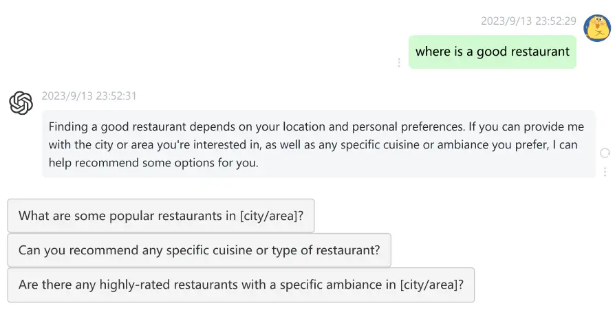
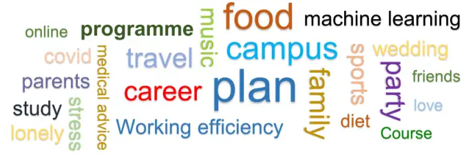
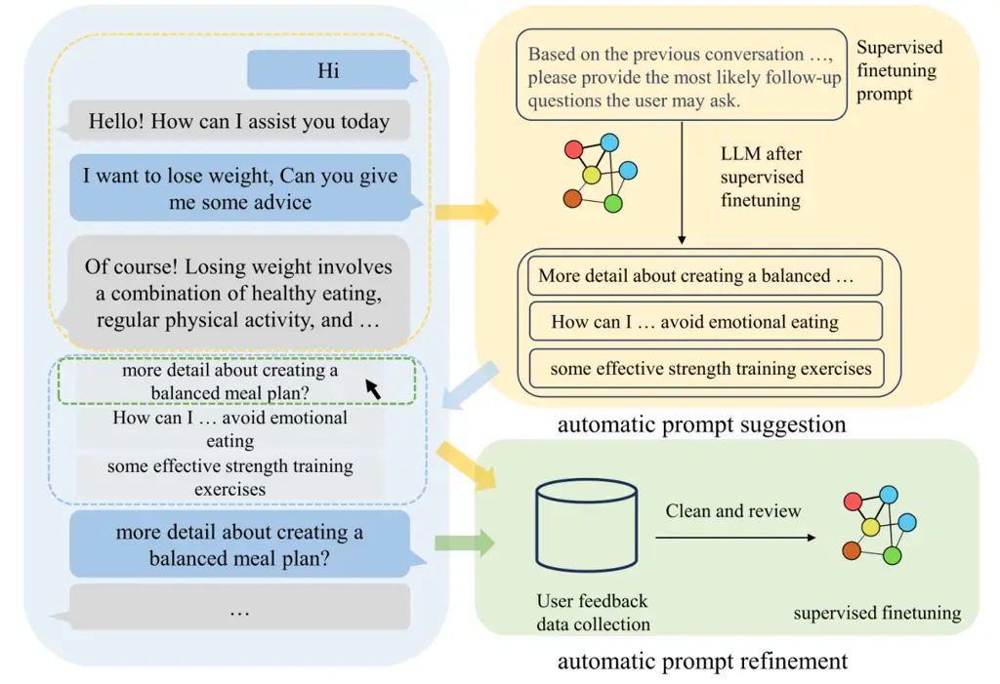
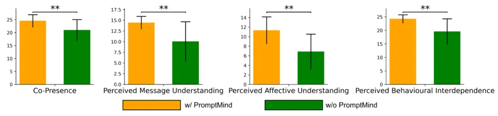
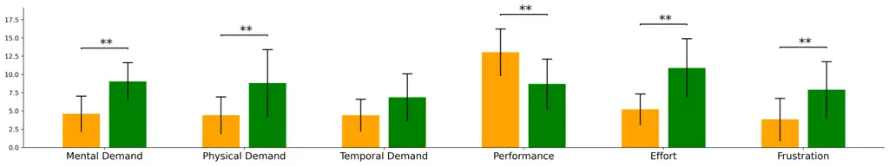
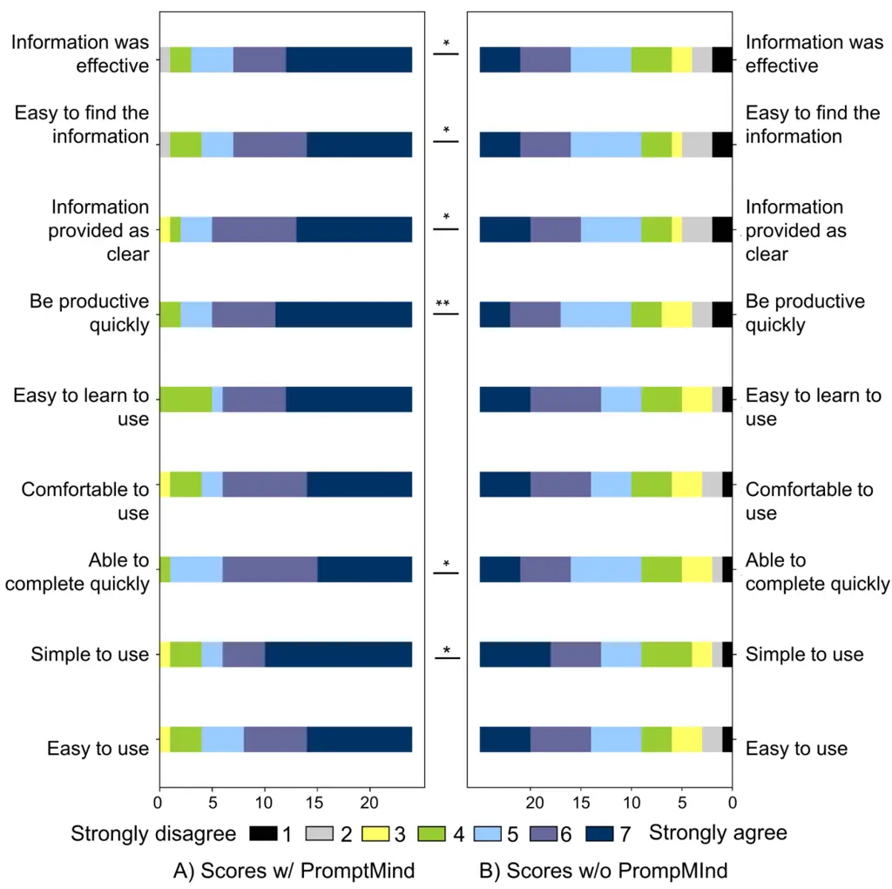

# Prompt Your Mind: Refine Personalized Text Prompts within Your Mind

DOI: [XXXXXXX.XXXXXXX](https://doi.org/XXXXXXX.XXXXXXX)Conference: Make
sure to enter the correct conference title from your rights confirmation
emai; May 11-16, 2024; Honolulu,
USACHIPrice: 15.00ISBN: 978-1-4503-XXXX-X/18/069802CCS: Human-centered
computing Natural language interfacesCCS: Human-centered
computing Web-based interactionCCS: Human-centered computing User
interface management systems

Guinan Su email: <guinansu33@gmail.com> Affiliation: Tencent Data
Platform, China , Yanwu Yang Affiliation: Harbin Institute of Technology
at Shenzhen, China and Jie Guo Affiliation: Peng Cheng Laboratory, China

2018

Figure 1. The PromptMind system UI. The ChatGPT-3.5 is used as the
backend. PromptMind utilizes automatic prompt refinement to consider
user feedback to improve prompt quality. Users can select from suggested
prompts that are categorized as good cases for future improvement of the
suggestion system.

###### Abstract.

Large language models (LLMs) have demonstrated remarkable potential in
natural language understanding and generation, making them valuable
tools for enhancing conversational interactions. However, LLMs encounter
challenges such as lacking multi-step reasoning capabilities, and heavy
reliance on prompts. In this regard, we introduce a prompt-refinement
system named PromptMind, also known as "Prompt Your Mind", to provide an
automated solution for generating contextually relevant prompts during
conversations. PromptMind enhances the overall interaction between
humans and chatbots through an automatic prompt suggestion and an
automatic prompt refinement. To assess the effectiveness of PromptMind,
we designed three interaction tasks to evaluate emotional support,
advice acquisition, and task-oriented interactions during human-chatbot
interactions. The results demonstrated that PromptMind reduced mental
demands during interactions and fostered enhanced performance and social
connections between users and chatbots. In summary, our findings
indicate that PromptMind acts as a bridge, facilitating smoother
information exchange and enhancing the usability of chatbot
interactions.

###### Keywords: 

Prompt, large language model, human-chatbot interaction, multi-turn
conversation

## 1. Introduction

Large language models (LLMs), such as GPT and LLaMA, have revolutionized
AI prototyping (Wu et al., 2022; Yang et al., 2020; Van Allen, 2018;
Fitria, 2023; Kocaballi, 2023). Chatbots, in particular, have witnessed
increasing applications across diverse domains like customer service,
personal assistants, and online education (Xu et al., 2017; Liu et al.,
2020; Følstad et al., 2018; Candello et al., 2018; Langevin et al.,
2021; Følstad et al., 2018; Xiao et al., 2020). These chatbot systems
engage users in conversational dialogues, providing valuable information
and support in various scenarios, including commercial transactions and
emotional support(Chen et al., 2019; Zhao et al., 2021; Cheng et al.,
2022; Xie et al., 2019).

The integration of natural language prompts with LLMs has emerged as a
critical technique for tailoring these models to complex tasks. This
synergy has shed light on natural language interactions, enabling
advanced pre-trained LLMs to engage in fluent multi-turn conversations.
This minimizes the hurdles related to data and programming skills,
making conversational user experiences more accessible to non-AI experts
(Zamfirescu-Pereira et al., 2023). Users can enhance LLM outputs by
adding prompts, which are textual instructions and examples of desired
interactions. These prompts directly influence the model’s output,
expanding the potential of conversational user experiences.

However, despite the widespread excitement, several challenges persist
in bridging the gap between chatbots and human understanding. LLMs
sometimes struggle to accurately infer conversation topics and lack
multi-step reasoning abilities (Li et al., 2022; Kojima et al., 2022).
Misleading or inaccurate responses in multi-turn conversations can be
detrimental. LLMs heavily rely on prompts, which can lead to
inconsistent responses, causing user confusion. Moreover, even advanced
chatbots may fall short of providing meaningful social benefits due to
their lack of genuine consciousness. This absence of agency can hinder
users from forming deep connections and limit their ability to offer
empathetic and emotionally appropriate responses in certain situations
(Folk et al., 2023).

One approach to tackle the previously mentioned issue is to develop
enhancements to the model’s context understanding, multi-step reasoning
capabilities, and consistency (Li et al., 2022; Zhang et al., 2018; Xu
et al., 2021). However, such studies rely on training with large-scale
data, which are constrained by expressive computational costs and
limitations related to scalability and generalizability. Another
strategy involves prompt guidance. Prompts serve as potent tools for
fostering interactive connections between humans and chatbots. Previous
studies on prompt engineering have addressed these challenges by
providing effective strategies for prompting (Liu et al., 2021; Wang
et al., 2023; Brade et al., 2023; White et al., 2023). Nevertheless,
these strategies have limitations when it comes to offering personalized
recommendations to users seeking specific topics and information.
Moreover, they have yet to effectively establish social connections
between chatbots and humans. Consequently, novice users lacking prior
experience in prompt writing and familiarity with relevant keywords may
still encounter difficulties in achieving their desired outcomes.

To meet these issues, we explore three research questions in this paper:

RQ1: How do laypersons perceive and engage with large language-based
chatbots?

RQ2: What techniques can be employed to automatically refine text
prompts for improved chatbot responses?

RQ3: How effective is the prompts refine approach in enhancing the
quality of human-chatbot interactions?

For RQ1, we conducted formative user interviews with 14 users to gain a
deeper understanding of the practices and challenges associated with
prompting LLMs. The details about this interview study are shown in
Section 3. These interviews highlighted common issues, including
misinterpretation, a lack of emotions and empathy, and deficiencies in
multi-step reasoning, consistency, and personalization.

For the common issues mentioned in the interview study, we introduce
Prompt Your Mind (PromptMind), an interactive system designed to
streamline the iterative process of prompt exploration and refinement
for LLMs (For RQ2). PromptMind facilitates the iterative workflow by
incorporating various steps, including suggestions, and refined prompts.
The automatic prompt suggestion step enables to provision of more
comprehensive and contextually relevant responses. The automatic prompt
refinement step utilizes user feedback to improve prompt quality. It
provides three questions that align with the users’ interests and
potential queries as enhanced prompts for each round of dialogue to
enhance the overall interaction between humans and chatbots. When users
interact with chatbots, they can choose to continue by selecting one of
the three questions offered by the system or by inputting their own
questions based on their ideas.

To evaluate the effectiveness of PromptMind, we conducted a user study
with 24 participants to compare PromptMind against the baseline tool,
ChatGPT-3.5 (For RQ3). Participants consistently found PromptMind
significantly more useful in assisting with the text-to-text generation
workflow compared to the baseline tool. It also excelled in establishing
social connections within the generated content. Additionally, users
reported lower mental demands and frustration as well as enhanced
efficiency and performance when using PromptMind. Importantly, these
improvements were achieved without altering the underlying model. In
summary, our work contributes the following:

- •
  An analysis of user perceptions of large language-based chatbots
  through an interview study ($`n=14`$).
- •
  The design and implementation of PromptMind, An LLM-based prompt
  suggestion engine that aids users in multi-turn conversation question
  prompting by providing personalized question recommendations.
- •
  The results of a user study involving 24 participants demonstrate the
  efficacy of the PromptMind system and its superiority in providing
  meaningful social benefits and improving information seeking for
  users.

## 2. Background and related works

Among the LLMs, ChatGPT-3.5 is a cutting-edge natural language
processing model developed by OpenAI, designed to facilitate human-like
conversations and interactions. GPT-3.5 is built upon advanced machine
learning algorithms and extensive training data, which enable it to
provide users with a seamless and engaging conversational experience. It
has been fine-tuned to handle a wide range of topics and adapt to
various conversational styles, making it an ideal tool for applications
such as customer support, virtual assistants, and chatbot development
(Hill-Yardin et al., 2023; Surameery and Shakor, 2023; Biswas, 2023).
Through continuous learning and improvement, GPT-3.5 strives to provide
accurate, relevant, and empathetic responses to user queries, ensuring a
satisfying and valuable user experience. Its impressive capabilities
have garnered significant attention and recognition in the AI community,
paving the way for future advancements in the field of natural language
processing. In addition, as part of Meta’s commitment to open science,
Meta has publicly released LLaMA (Touvron et al., 2023) (Large Language
Model Meta AI), a state-of-the-art foundational language model designed
to help researchers advance their work in this subfield of AI. Smaller,
more performant models like LLaMA enable broader access for the research
community, especially for those who may not have access to extensive
infrastructure, further democratizing the field. Training smaller
foundation models like LLaMA is advantageous in the large language model
space, as they require significantly less computing power and resources.
This makes it easier to test new approaches, validate others’ work, and
adapt them to specific domains. Llama, with its 7 billion parameters,
offers an efficient and scalable solution, making it ideal for
fine-tuning the automatic prompt suggestion model. In this study, we use
the 7B-LLaMA model for fine-tuning prompt models.

Based on these LLMs, Chatbots are proposed to handle conversation tasks.
In particular, chatbots engaging in multi-turn conversations have
emerged as powerful tools for HCI researchers to investigate lingual
interactions. To activate the desired functionality, users provide
natural language instructions or prompts (Lu et al., 2021; Liu et al.,
2023), tailored to the task at hand. Prompts are typically composed of a
task description and/or several canonical examples. (Brown et al., 2020)
showed that Prompts are surprisingly effective at modulating a frozen
LLM’s behavior through text prompts. Rather than requiring a separate
copy of the model for each downstream task, a single generalist model
can simultaneously serve many different tasks. (Lester et al., 2021)
further explores prompt tuning to perform specific downstream tasks.
(Jia et al., 2022) introduces a visual prompt tuning for vision models.
(Zhou et al., 2022) models a prompt’s context words with learnable
vectors for vision-language models. However, there still remains a lack
of prompt tuning studies on multi-turn conversations. Multiple turns in
a conversation can be used to understand the user information need more
effectively and serve as important tools for information seeking. For
instance, while searching for a new smartphone, the user and the machine
could discuss various features and options in multiple turns. However,
multi-turn natural language understanding still remains extremely
challenging, requiring the system to comprehend the conversation context
and reply in an informative and coincident manner (Cui et al., 2020;
Aliannejadi et al., 2020; Xu et al., 2021; Zhang et al., 2018).
Moreover, few studies have investigated user interactions with a machine
to help the system understand their information needs.

## 3. Interview Study

To understand current practices and limitations of how users of ChatGPT
interact with the chatbot. We first conducted an online interview study.
For our user studies, we manually built a website based on OPENAI API
(ope, 2023) for our participants. Therefore, we can save the generated
conversation through the website backend. We took several API keys due
to the request limit of ChatGPT3.5, which is necessary for real-time
user interaction.

### 3.1. Topic of Conversation

We have randomly selected 75 specific sample topics, which we have
divided into three categories: Emotional Support, Advice Acquisition,
and Task-Oriented. The keywords for these topics are displayed in Figure 2. Emotional Support topics are geared towards providing comfort and
guidance during challenging times, such as coping with grief, managing
stress, or maintaining a positive mindset during unemployment. Advice
Acquisition topics revolve around seeking suggestions and
recommendations for various situations, such as planning a trip,
improving time management skills, or adopting a healthier diet.
Task-oriented topics involve collaborating with the chatbot to
accomplish specific tasks or projects, such as planning a weekly fitness
routine, organizing a charity event, or creating a budget for a home
renovation. Participants have the option to choose from the provided
sample topics or select their own within these three categories. We
encourage participants to pick a topic that not only interests them but
also aligns with their goals or passions. This approach will contribute
to a more engaging and productive discussion with the chatbot.

### 3.2. Procedure

After obtaining informed consent from the participants, the experimenter
began by explaining the study’s purpose: to gain insight into user
perceptions and interactions with the system and to identify any
potential obstacles. The experimenter then guided the participants
through the following steps:

Step 1: Participants were asked to select an initial topic from the
provided sample topics or choose a topic of personal interest.

Step 2: Participants were instructed to engage in a conversation with
the chatbot within their chosen topic.

Step 3: After the conversation, participants were requested to review it
and verbally rate its quality on a scale of 0 to 100.

Step 4: Participants repeated this process twice more, selecting
different topic categories each time.

During these conversations, participants were provided with topics and
initiated discussions using the system. They were encouraged to freely
select topics that interested them, with the intention of prompting the
chatbot to provide advice and emotional support. The rating process was
designed to help participants critically assess the chatbot’s
effectiveness in addressing their concerns and meeting their
expectations. To familiarize themselves with the chatbot’s
functionality, participants were initially encouraged to engage in
casual conversations with it twice. At the conclusion of each interview,
participants were asked to reflect on their understanding of LLM-based
chatbots and rate their conversations accordingly.

Figure 2. Keywords of the sample topics.

### 3.3. Participants and Data Collection

We recruited 14 participants from a university, consisting of 6 males
and 8 females, aged between 18 and 39 years old. These participants
represented a variety of academic majors, including engineering,
business, psychology, computer science, pharmacy, and social science.
The experiment had a duration of 40 to 60 minutes and was conducted
online through a chatbot website. This website accessed the OpenAI API,
utilizing the GPT-3.5-Turbo model for the conversations. Participants
provided consent for their conversations to be recorded as part of the
study.

### 3.4. Results

#### 3.4.1. Participants’ Understandings of the Large Language Model-based chatbot

We identified four themes from the participants’ understandings of
ChatGPT from the interviews.

Lack of multi-step reasoning capabilities: ChatGPT may not excel in
tasks that demand multi-step reasoning or in-depth analysis, as its
primary focus is on generating reasonably coherent short-term responses.
Some participants noted that the chatbot tends to provide plausible
responses without delving into a comprehensive understanding of the
topic. Consequently, it often offers brief responses rather than
providing a detailed analysis.

Lack of personalization: ChatGPT may not be able to tailor its responses
to individual users’ preferences, backgrounds, or specific needs, which
could impact user satisfaction. Some participants assume that some
responses provide a brief explanation, but it’s not tailored to the
specific needs or preferences of the user, who might be looking for more
detailed guidance or step-by-step instructions as a beginner.

Sensitivity to prompt phrasing: The quality of ChatGPT’s responses can
be highly dependent on how the prompt is phrased, which might require
users to experiment with different phrasings to get the desired output.
ChatGPT provides two responses based on the slight variation in the
user’s prompt phrasing. For example: The first prompt, "How can I
improve my communication skills?" results in a more concise response
with general suggestions. However, when the user phrases the prompt as
"Tips for better communication skills," ChatGPT generates a list of more
specific tips. The change in phrasing has led to different forms of
advice, showcasing the model’s sensitivity to the way prompts are
phrased.

Absence of emotions and empathy: ChatGPT, being an AI model, lacks
genuine emotions and empathy, which could limit its ability to provide
truly empathetic and emotionally appropriate responses in certain
situations. For example, when a participant asks how to cope with the
loss of his pet passed away. While this response offers some general
suggestions for coping with the loss of a pet, it might not fully convey
the depth of empathy and emotional understanding that a human would be
able to provide in such a situation.

#### 3.4.2. Participants’ rate of the conversation

Participants rate the conversation based on the chatbot’s effectiveness
in addressing their concerns, accomplishing tasks, and providing true
empathy. There are some factors that most influence the score.

The conversation topic is familiar to the participants or not. We
discovered that when participants are familiar with the conversation
topic, they can supply more detailed prompts, leading to the chatbot
generating more effective responses and receiving higher satisfaction
scores. Conversely, when participants have limited knowledge of the
topic, the chatbot tends to provide brief explanations, and the
participants find it challenging to ask for in-depth guidance or
step-by-step instructions due to their lack of background knowledge.
This affects the participants’ experience and results in lower
satisfaction scores.

Objective response devoid of emotion: We found that ChatGPT cannot
exhibit genuine empathy or emotions. While it can simulate empathetic
and emotional language to a certain degree, it lacks the authentic
feelings and personal experiences that enable humans to empathize and
connect with others truly. This limitation leads to lower satisfaction
scores.

## 4. Technical method

Through our interviews, we gained insights into how laypersons interact
with chatbots and discovered that large language models heavily rely on
prompts to generate outputs. However, humans often have limited
knowledge, making it challenging to provide in-depth guidance or
step-by-step instructions to chatbots due to their lack of background
knowledge. This gap presents a significant obstacle in human-chatbot
interactions.

Figure 3. Workflow of PromptMind Automatic prompt suggestions generate
the most suitable next prompts for users to continue dialogue with
chatbots, it enables more comprehensive and contextually relevant
responses. Automatic prompt refinement utilizes user feedback to improve
prompt quality. Users can select from suggested prompts that are
categorized as good cases for future improvement of the suggestion
system.

In this section, we present PromptMind a novel prompt engineering method
that offers an automated way to generate the most suitable next prompt
in a conversation for the user. The primary objective of this approach
is to narrow the knowledge gap and elevate the overall interaction
experience between users and chatbots. By leveraging PromptMind, users
can enjoy a more seamless and engaging conversation with chatbots, as it
intelligently generates prompts that align with their ongoing dialogue.
This innovative technique acts as a bridge, enabling a smoother flow of
information and enhancing the overall usability of chatbot interactions.
Moreover, As illustrated in Figure 3, PromptMind improves the workflow
of human-chatbot interaction by offering two main features, including 1)
automatic prompt suggestion, and 2) automatic prompt refinement.

### 4.1. Automatic Prompt Suggestion

We aim to address the challenge of constructing effective prompts for
human-chatbot interaction through our prompt suggestion engine. Our
system utilizes a smaller foundation model called LLaMA (7B
parameters)(Touvron et al., 2023) and applies supervised fine-tuning to
develop the Automatic Prompt Suggestion model.

To enhance our training dataset, we employ few-shot prompting techniques
to expand the data generated by ChatGPT. Initially, we utilize
multi-turn conversation data from the interview study with high
satisfaction scores (\>85) as a starting point. However, we take
precautions to protect sensitive information by removing or replacing
personal identifiers like names, addresses, and phone numbers.
Subsequently, we expand this dataset using ChatGPT. Before creating the
supervised fine-tuning dataset, we define the scope of the conversation
topics and carefully select and balance the conversation topics. During
inference, we generate relevant text data by providing a few
demonstration conversations as conditioning. We use ChatGPT3.5 with a
temperature parameter set to 0.9 to encourage creative output. The
generated responses are thoroughly reviewed and edited to ensure their
accuracy and relevance to our research. This edited output serves as a
starting point for generating additional data to expand our dataset.

Once we have completed the supervised fine-tuning process on the LLaMA
model using the expanded conversation dataset, we can infer the model to
obtain automatic prompt suggestions. Specifically, at each round of
conversation, the system uses the previous conversation as input to
infer the model (Due to the input limitations of the language model, it
takes into account the four preceding rounds of conversation). and
generates suggested prompts based on this input, helping the user
further express their intention.

By using the preceding conversation as context, the model can better
understand the user’s current needs and the context of the conversation.
Consequently, the generated extended prompts will more accurately
reflect the user’s intent and provide targeted and coherent responses.
This contextual approach improves the fluency and comprehensibility of
the dialogue and generates effective prompts for chatbot interactions.
In summary, by leveraging the preceding conversation information to
generate extended prompts for user inference, we enhance our
understanding of the user’s needs and deliver more accurate and targeted
responses.

### 4.2. Automatic Prompt Refinement

The automatic prompt refinement process is a dynamic user-driven
feedback loop that empowers the continuous enhancement and optimization
of our prompt suggestion engine. When we provide users with suggested
prompts, they have the option to click on a button associated with each
prompt. Clicking on a suggested prompt triggers an automatic process
that sets the chosen prompt as the input for the chatbot. This indicates
that the chosen prompt has met the user’s expectations and is considered
a good case. We utilize these cases to improve and enhance the features
of our suggestion system in future iterations. By collecting user
feedback and identifying the prompts that successfully assist users in
achieving their desired outcomes, we can refine and optimize the prompt
suggestion engine. This iterative process allows us to continuously
learn from user interactions and improve the overall user experience.
Through this user-driven prompt refinement approach, we aim to ensure
that the suggested prompts are highly relevant and effective in helping
users express their intentions accurately. This ongoing improvement
helps create a more seamless and satisfying human-chatbot interaction.

## 5. Evaluation

After demonstrating our PromptMind method, we sought to answer Our third
research question: RQ3: How effective is the PromptMind approach in
enhancing the quality of human-chatbot interactions?

### 5.1. Experimental design

To validate the effectiveness of PromptMind, we conducted a
within-subject study to compare our system with the original prompt. The
experimental stimuli consisted of three types of dialogue topics,
including emotional support, advice acquisition, and task-oriented
topics. The prompt editing conditions have two levels: Original Prompt
and PromptMind. Emotional support includes expressions of care, concern,
love, and interest, and also encompasses helping distressed others work
through their upset by listening to, empathizing with, legitimizing, and
actively exploring their feelings (Burleson, 2003; Reblin and Uchino,
2008). The advice acquisition topics include information and advice
seeking. Task-oriented topics aim to complete certain tasks for users in
a specific domain, such as restaurant recommendation, and location
query, which makes it valuable for real-world business (Zhang et al.,
2020; Liu et al., 2017). Overall, each participant in this study needs
to complete an experiment with 2 prompt editing conditions, and each has
3 tasks.

The experiment was conducted online via an online chatbot website that
accesses the OpenAI API to utilize the GPT-3.5-Turbo model.

### 5.2. Experimental procedure

In this experiment, participants needed to complete 6 tasks (3 types
$`\times`$ 2 Prompt Editing Conditions). They are asked to choose one
task from the three categories of tasks to start their experiment. The
whole experiment last approximately 60-75 minutes.

Step 1: Introduction and Consent: Participants were introduced to the
objective of the experiment and asked for their consent to participate.

Step 2: Topic Selection: Participants selected an initial topic from the
provided sample topics or chose a topic of personal interest.

Step 3: Prompt Editing Condition: Participants were assigned one of the
Prompt Editing Conditions: Original Prompt or PromptMind.

Step 4: Conversation Engagement: Participants engaged in a conversation
with the chatbot within the chosen topic, utilizing the assigned Prompt
Editing Condition.

Step 5: Conversation Review and Questionnaire: After the conversation,
participants reviewed the conversation transcript and completed the
post-questionnaires. These questionnaires aimed to gather feedback on
their experience and evaluate the effectiveness of the conversation
under the assigned Prompt Editing Condition.

Step 6: Repeat Process: The above steps (2-5) were repeated twice more
with different topics to capture a wider range of experiences and
opinions.

### 5.3. Participant

24 participants (14 females and 10 males), recruited from a university,
took part in the experiments. They aged from 19 to 32 years old and had
a normal cognitive ability. The conversations and the questionnaires
were recorded with the participant’s consent.

### 5.4. Measures

In this study, we examined three topic categories (Emotional Support,
Advice Acquisition, and Task-Oriented topics) to evaluate two distinct
Prompt Editing Conditions: Original Prompt and PromptMind. We assessed
the social presence and task usability for both emotional support and
advice acquisition tasks. Meanwhile, for the Task-Oriented category, we
focused on measuring users’ perceived workload.

- 1.  Social presence  
      The social presence is measured by the social presence questionnaire
      designed by Harms and Biocca’s (Harms and Biocca, 2004). It
      conceptualizes social presence across 4 dimensions: co-presence,
      perceived message understanding, perceived affective understanding,
      and perceived behavioral interdependence. The questionnaire was
      translated into the participants’ native language. Participants were
      asked to indicate their level of agreement or disagreement for each
      item using a five-point Likert scale, where zero represents "totally
      disagree" and five signifies "totally agree".
- 2.  Workload  
      The users’ perceived workload is tested by the task load index
      (NASA-TLX) (Hart, 2006), which was developed by NASA. It consists of
      six subscales: mental demand, physical demand, temporal demand,
      performance, effort, and frustration. Each subscale is rated on a
      21-point scale, and the ratings are combined to calculate a total
      workload score.
- 3.  System usability  
      The system usability is tested by the post-study system usability
      questionnaire (PSSUQ) (Lewis, 1992). It consists of 9 items and each
      item rates on a 7-point Likert scale, ranging from 1 (strongly
      disagree) to 7 (strongly agree). The questionnaire aims to provide a
      comprehensive understanding of the user’s experience, such as ease of
      use, efficiency, effectiveness, and satisfaction with the system.

## 6. Result

### 6.1. Result of social presence

As depicted in Figure 4, PromptMind consistently received higher average
scores across all ratings in terms of social presence ($`Z=-1.207`$,
$`p=0.004`$). Specifically, within the dimension of co-presence, the
refined and extended prompts generated by PromptMind facilitated
improved interaction between users and the agent, enhancing their
awareness of each other’s presence. It is likely that these refined
prompts played a pivotal role in capturing users’ attention, which
contributed to these positive outcomes. In the category of perceived
message understanding, a larger number of users reported a clearer
understanding of the agent’s thought process when using PromptMind.
Additionally, most users affirmed that their own thoughts were
effectively conveyed to PromptMind. This trend also extended to the
dimension of perceived affective understanding. For instance, users
sometimes expressed surprise at how well the refined prompts aligned
with their thoughts. In the final dimension, perceived behavioral
interdependence, it became evident that the improved understanding
scores led to quicker responses during conversations. This suggests that
our PromptMind system has the potential to enhance dialogue efficiency.
Furthermore, a detailed analysis using a Mann-Whitney Test revealed that
our system significantly bridged the understanding gap between the
chatbot and the user. The differences between PromptMind and the
original prompt were found to be significant in terms of co-presence
($`Z=-1.505`$, $`p=0.0005`$), perceived message understanding
($`Z=-3.001,p=0.0002`$), and perceived affective understanding
($`Z=-1.584,p=0.0004`$). These results indicate that the PromptMind
system provides social benefits for users engaging with the agent and
fosters deeper connections with the system.

Figure 4. Results of the total scores of the ratings from the
comparative evaluation in terms of social presence. PromptMind receives
significant improvements compared with the baseline. Error bars
represent standard deviation. \* indicates $`p<0.05`$, and \*\*
indicates $`p<0.01`$.

### 6.2. Result of workload

Figure 5. Results of the total scores of the ratings from the
comparative evaluation in terms of TLX. PromptMind receives significant
improvements compared with the baseline. Error bars represent standard
deviation. \* indicates $`p<0.05`$, and \*\* indicates $`p<0.01`$.

Figure 5 illustrates the task load demands within the context of
information-seeking conversations. Across all dimensions, when
PromptMind is employed, there is a consistent reduction in task load
demands compared to when PromptMind is not used. Notably, statistically
significant differences are observed in five dimensions: mental demand
($`Z=1.829,p<0.0001`$), physical demand ($`Z=1.765,p=0.0004`$),
performance ($`Z=-1.356,p<0.0001`$), effort ($`Z=2.688,p<0.0001`$), and
frustration ($`Z=1.414,p=0.0004`$), with the exception of temporal
demand. It has been observed that users tend to prefer engaging in
longer conversations with the chatbot when PromptMind is utilized. This
preference can be attributed to several factors, including improved
affective understanding, which enhances the social connection between
the chatbot and users. Additionally, PromptMind generates more relevant
and subconscious questions that align with users’ interests, potentially
leading to longer conversations. In this context, the duration of the
conversations naturally tends to increase. In summary, the utilization
of PromptMind leads to an overall reduction in task load demands. This
underscores the effectiveness of PromptMind in enhancing the efficiency
of information-seeking interactions.

Figure 6. Results of the total scores of the ratings from the
comparative evaluation in terms of PSSUQ. PromptMind receives
significant improvements compared with the baseline. Error bars
represent standard deviation. \* indicates $`p<0.05`$, and \*\*
indicates $`p<0.01`$.

### 6.3. Result of system usability

We conducted an analysis of user feedback, utilizing questionnaire
responses and interview data to assess the user experience. Subjective
ratings of the user experience are presented in Figure 6, with the
statistical results from a Mann-Whitney Test indicated by asterisks (\*
for $`p<0.05`$ and \*\* for $`p<0.01`$). Initially, participants found
PromptMind’s refined prompts to be useful, scoring an average of 5.95
(STD=1.20), and perceived them as easier to use than the prompts without
PromptMind, which received an average score of 5.19 (STD=1.55). There
was a marginally significant difference in terms of ease of use
($`Z=-1.221,p=0.04`$). Additionally, PromptMind enabled users to locate
the required information more swiftly. This was particularly evident in
the dimension of productivity, where the score was 6.4 (STD=0.86) with
PromptMind compared to 4.63 (STD=1.65) in the baseline. A significant
difference was observed ($`Z=-2.063,p=0.0005`$). In the dimension of
completing quickly, PromptMind scored 6.10 (STD=1.30), while the
baseline achieved a score of 4.81 (STD=1.70). A marginally significant
difference was found ($`Z=-0.861,p=0.035`$). In summary, PromptMind not
only enhances information-seeking efficiency but also improves the
overall user experience.

## 7. summary

Our study has shed light on the current practices and limitations of how
users interact with ChatGPT. It has become evident that while ChatGPT is
an impressive language model, it still faces certain challenges. These
limitations include a lack of multi-step reasoning capabilities, limited
personalization, sensitivity to prompt phrasing, and the absence of
emotions and empathy.

To address the limitations and enhance the quality of human-chatbot
interactions, a novel approach called PromptMind has been proposed. This
method concentrates on automatically providing the most suitable next
prompts to generate improved chatbot responses. The approach offers
prompt suggestions that assist users in continuing conversations, even
when they lack specific knowledge or direction. Additionally, PromptMind
incorporates prompt refinement suggestions based on user feedback,
allowing for improved prompt quality and a more personalized interaction
experience.

To evaluate the effectiveness of the PromptMind approach in enhancing
human-chatbot interactions, a study was conducted. Three topic
categories were examined: Emotional Support, Advice Acquisition, and
Task-Oriented discussions. Two prompt editing conditions were compared:
Original Prompt and PromptMind. The results of the evaluation showed
significant improvements across different metrics. In terms of social
presence and task usability, the PromptMind approach outperformed the
Original Prompt condition. Additionally, users reported reduced
perceived workload when using the PromptMind approach.

Overall, the PromptMind approach offers a promising solution for
improving human-chatbot interactions. By addressing the limitations of
current practices, it provides users with a more personalized and
engaging experience. With continued advancements and refinements, this
approach has the potential to revolutionize the way we interact with
chatbots, opening up new possibilities for meaningful and effective
communication.

## References

- ope (2023) 2023. OpenAI API.
  [https://openai.com/blog/openai-api](https://openai.com/blog/openai-api)
- Aliannejadi et al. (2020) Mohammad Aliannejadi, Manajit Chakraborty,
  Esteban Andrés Ríssola, and Fabio Crestani. 2020. Harnessing evolution
  of multi-turn conversations for effective answer retrieval. In
  _Proceedings of the 2020 conference on human information interaction
  and retrieval_. 33–42.
- Biswas (2023) Som S Biswas. 2023. Role of chat gpt in public health.
  _Annals of biomedical engineering_ 51, 5 (2023), 868–869.
- Brade et al. (2023) Stephen Brade, Bryan Wang, Mauricio Sousa, Sageev
  Oore, and Tovi Grossman. 2023. Promptify: Text-to-Image Generation
  through Interactive Prompt Exploration with Large Language Models.
  _arXiv preprint arXiv:2304.09337_ (2023).
- Brown et al. (2020) Tom Brown, Benjamin Mann, Nick Ryder, Melanie
  Subbiah, Jared D Kaplan, Prafulla Dhariwal, Arvind Neelakantan, Pranav
  Shyam, Girish Sastry, Amanda Askell, et al. 2020. Language models are
  few-shot learners. _Advances in neural information processing systems_
  33 (2020), 1877–1901.
- Burleson (2003) Brant R Burleson. 2003. Emotional support skills. In
  _Handbook of communication and social interaction skills_. Routledge,
  569–612.
- Candello et al. (2018) Heloisa Candello, Claudio Pinhanez,
  Mauro Carlos Pichiliani, Melina Alberio Guerra, and Maira Gatti de
  Bayser. 2018. Having an Animated Coffee with a Group of Chatbots from
  the 19th Century. In _Extended abstracts of the 2018 CHI conference on
  human factors in computing systems_. 1–4.
- Chen et al. (2019) Meng Chen, Ruixue Liu, Lei Shen, Shaozu Yuan,
  Jingyan Zhou, Youzheng Wu, Xiaodong He, and Bowen Zhou. 2019. The jddc
  corpus: A large-scale multi-turn chinese dialogue dataset for
  e-commerce customer service. _arXiv preprint arXiv:1911.09969_ (2019).
- Cheng et al. (2022) Yi Cheng, Wenge Liu, Wenjie Li, Jiashuo Wang,
  Ruihui Zhao, Bang Liu, Xiaodan Liang, and Yefeng Zheng. 2022.
  Improving multi-turn emotional support dialogue generation with
  lookahead strategy planning. _arXiv preprint arXiv:2210.04242_ (2022).
- Cui et al. (2020) Leyang Cui, Yu Wu, Shujie Liu, Yue Zhang, and Ming
  Zhou. 2020. MuTual: A dataset for multi-turn dialogue reasoning.
  _arXiv preprint arXiv:2004.04494_ (2020).
- Fitria (2023) Tira Nur Fitria. 2023. Artificial intelligence (AI)
  technology in OpenAI ChatGPT application: A review of ChatGPT in
  writing English essay. In _ELT Forum: Journal of English Language
  Teaching_, Vol. 12. 44–58.
- Folk et al. (2023) Dunigan Folk, Stephanie Yu, and Elizabeth
  Dunn. 2023. Can chatbots ever provide more social connection than
  humans? (2023).
- Følstad et al. (2018) Asbjørn Følstad, Petter Bae Brandtzaeg, Tom
  Feltwell, Effie LC Law, Manfred Tscheligi, and Ewa A Luger. 2018. SIG:
  chatbots for social good. In _Extended Abstracts of the 2018 CHI
  Conference on Human Factors in Computing Systems_. 1–4.
- Harms and Biocca (2004) Chad Harms and Frank Biocca. 2004. Internal
  consistency and reliability of the networked minds measure of social
  presence. In _Seventh annual international workshop: Presence_,
  Vol. 2004. Universidad Politecnica de Valencia Valencia, Spain.
- Hart (2006) Sandra G Hart. 2006. NASA-task load index (NASA-TLX); 20
  years later. In _Proceedings of the human factors and ergonomics
  society annual meeting_, Vol. 50. Sage publications Sage CA: Los
  Angeles, CA, 904–908.
- Hill-Yardin et al. (2023) Elisa L Hill-Yardin, Mark R Hutchinson,
  Robin Laycock, and Sarah J Spencer. 2023. A Chat (GPT) about the
  future of scientific publishing. _Brain Behav Immun_ 110 (2023),
  152–154.
- Jia et al. (2022) Menglin Jia, Luming Tang, Bor-Chun Chen, Claire
  Cardie, Serge Belongie, Bharath Hariharan, and Ser-Nam Lim. 2022.
  Visual prompt tuning. In _European Conference on Computer Vision_.
  Springer, 709–727.
- Kocaballi (2023) A Baki Kocaballi. 2023. Conversational ai-powered
  design: Chatgpt as designer, user, and product. _arXiv preprint
  arXiv:2302.07406_ (2023).
- Kojima et al. (2022) Takeshi Kojima, Shixiang Shane Gu, Machel Reid,
  Yutaka Matsuo, and Yusuke Iwasawa. 2022. Large language models are
  zero-shot reasoners. _Advances in neural information processing
  systems_ 35 (2022), 22199–22213.
- Langevin et al. (2021) Raina Langevin, Ross J Lordon, Thi Avrahami,
  Benjamin R Cowan, Tad Hirsch, and Gary Hsieh. 2021. Heuristic
  evaluation of conversational agents. In _Proceedings of the 2021 CHI
  Conference on Human Factors in Computing Systems_. 1–15.
- Lester et al. (2021) Brian Lester, Rami Al-Rfou, and Noah
  Constant. 2021. The power of scale for parameter-efficient prompt
  tuning. _arXiv preprint arXiv:2104.08691_ (2021).
- Lewis (1992) James R Lewis. 1992. Psychometric evaluation of the
  post-study system usability questionnaire: The PSSUQ. In _Proceedings
  of the human factors society annual meeting_, Vol. 36. Sage
  Publications Sage CA: Los Angeles, CA, 1259–1260.
- Li et al. (2022) Jiatong Li, Bin He, and Fei Mi. 2022. Exploring
  Effective Information Utilization in Multi-Turn Topic-Driven
  Conversations. _arXiv preprint arXiv:2209.00250_ (2022).
- Liu et al. (2017) Huiting Liu, Tao Lin, Hanfei Sun, Weijian Lin,
  Chih-Wei Chang, Teng Zhong, and Alexander Rudnicky. 2017. Rubystar: A
  non-task-oriented mixture model dialog system. _arXiv preprint
  arXiv:1711.02781_ (2017).
- Liu et al. (2021) Jiachang Liu, Dinghan Shen, Yizhe Zhang, Bill Dolan,
  Lawrence Carin, and Weizhu Chen. 2021. What Makes Good In-Context
  Examples for GPT-$`3`$? _arXiv preprint arXiv:2101.06804_ (2021).
- Liu et al. (2020) Mingming Liu, Qicheng Ding, Yu Zhang, Guoguang Zhao,
  Changjian Hu, Jiangtao Gong, Penghui Xu, Yu Zhang, Liuxin Zhang, and
  Qianying Wang. 2020. Cold Comfort Matters-How Channel-Wise Emotional
  Strategies Help in a Customer Service Chatbot. In _Extended Abstracts
  of the 2020 CHI Conference on Human Factors in Computing Systems_.
  1–7.
- Liu et al. (2023) Pengfei Liu, Weizhe Yuan, Jinlan Fu, Zhengbao Jiang,
  Hiroaki Hayashi, and Graham Neubig. 2023. Pre-train, prompt, and
  predict: A systematic survey of prompting methods in natural language
  processing. _Comput. Surveys_ 55, 9 (2023), 1–35.
- Lu et al. (2021) Yao Lu, Max Bartolo, Alastair Moore, Sebastian
  Riedel, and Pontus Stenetorp. 2021. Fantastically ordered prompts and
  where to find them: Overcoming few-shot prompt order sensitivity.
  _arXiv preprint arXiv:2104.08786_ (2021).
- Reblin and Uchino (2008) Maija Reblin and Bert N Uchino. 2008. Social
  and emotional support and its implication for health. _Current opinion
  in psychiatry_ 21, 2 (2008), 201.
- Surameery and Shakor (2023) Nigar M Shafiq Surameery and Mohammed Y
  Shakor. 2023. Use chat gpt to solve programming bugs. _International
  Journal of Information Technology & Computer Engineering (IJITC) ISSN:
  2455-5290_ 3, 01 (2023), 17–22.
- Touvron et al. (2023) Hugo Touvron, Thibaut Lavril, Gautier Izacard,
  Xavier Martinet, Marie-Anne Lachaux, Timothée Lacroix, Baptiste
  Rozière, Naman Goyal, Eric Hambro, Faisal Azhar, et al. 2023. Llama:
  Open and efficient foundation language models. _arXiv preprint
  arXiv:2302.13971_ (2023).
- Van Allen (2018) Philip Van Allen. 2018. Prototyping ways of
  prototyping AI. _Interactions_ 25, 6 (2018), 46–51.
- Wang et al. (2023) Yunlong Wang, Shuyuan Shen, and Brian Y Lim. 2023.
  RePrompt: Automatic Prompt Editing to Refine AI-Generative Art Towards
  Precise Expressions. In _Proceedings of the 2023 CHI Conference on
  Human Factors in Computing Systems_. 1–29.
- White et al. (2023) Jules White, Quchen Fu, Sam Hays, Michael
  Sandborn, Carlos Olea, Henry Gilbert, Ashraf Elnashar, Jesse
  Spencer-Smith, and Douglas C Schmidt. 2023. A prompt pattern catalog
  to enhance prompt engineering with chatgpt. _arXiv preprint
  arXiv:2302.11382_ (2023).
- Wu et al. (2022) Tongshuang Wu, Ellen Jiang, Aaron Donsbach, Jeff
  Gray, Alejandra Molina, Michael Terry, and Carrie J Cai. 2022.
  Promptchainer: Chaining large language model prompts through visual
  programming. In _CHI Conference on Human Factors in Computing Systems
  Extended Abstracts_. 1–10.
- Xiao et al. (2020) Ziang Xiao, Michelle X Zhou, Q Vera Liao, Gloria
  Mark, Changyan Chi, Wenxi Chen, and Huahai Yang. 2020. Tell me about
  yourself: Using an AI-powered chatbot to conduct conversational
  surveys with open-ended questions. _ACM Transactions on Computer-Human
  Interaction (TOCHI)_ 27, 3 (2020), 1–37.
- Xie et al. (2019) Yubo Xie, Ekaterina Svikhnushina, and Pearl
  Pu. 2019. A multi-turn emotionally engaging dialog model. _arXiv
  preprint arXiv:1908.07816_ (2019).
- Xu et al. (2017) Anbang Xu, Zhe Liu, Yufan Guo, Vibha Sinha, and Rama
  Akkiraju. 2017. A new chatbot for customer service on social media. In
  _Proceedings of the 2017 CHI conference on human factors in computing
  systems_. 3506–3510.
- Xu et al. (2021) Yi Xu, Hai Zhao, and Zhuosheng Zhang. 2021.
  Topic-aware multi-turn dialogue modeling. In _Proceedings of the AAAI
  Conference on Artificial Intelligence_, Vol. 35. 14176–14184.
- Yang et al. (2020) Qian Yang, Aaron Steinfeld, Carolyn Rosé, and John
  Zimmerman. 2020. Re-examining whether, why, and how human-AI
  interaction is uniquely difficult to design. In _Proceedings of the
  2020 chi conference on human factors in computing systems_. 1–13.
- Zamfirescu-Pereira et al. (2023) JD Zamfirescu-Pereira, Bjoern
  Hartmann, and Qian Yang. 2023. Conversation Regression Testing: A
  Design Technique for Prototyping Generalizable Prompt Strategies for
  Pre-trained Language Models. _arXiv preprint arXiv:2302.03154_ (2023).
- Zhang et al. (2018) Zhuosheng Zhang, Jiangtong Li, Pengfei Zhu, Hai
  Zhao, and Gongshen Liu. 2018. Modeling multi-turn conversation with
  deep utterance aggregation. _arXiv preprint arXiv:1806.09102_ (2018).
- Zhang et al. (2020) Zheng Zhang, Ryuichi Takanobu, Qi Zhu, MinLie
  Huang, and XiaoYan Zhu. 2020. Recent advances and challenges in
  task-oriented dialog systems. _Science China Technological Sciences_
  63, 10 (2020), 2011–2027.
- Zhao et al. (2021) Nan Zhao, Haoran Li, Youzheng Wu, Xiaodong He, and
  Bowen Zhou. 2021. The JDDC 2.0 Corpus: A Large-Scale Multimodal
  Multi-Turn Chinese Dialogue Dataset for E-commerce Customer Service.
  _arXiv preprint arXiv:2109.12913_ (2021).
- Zhou et al. (2022) Kaiyang Zhou, Jingkang Yang, Chen Change Loy, and
  Ziwei Liu. 2022. Learning to prompt for vision-language models.
  _International Journal of Computer Vision_ 130, 9 (2022), 2337–2348.
