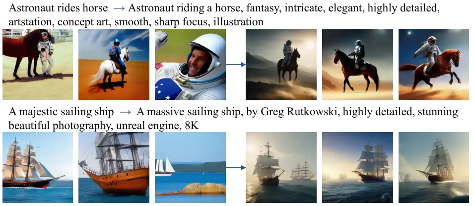
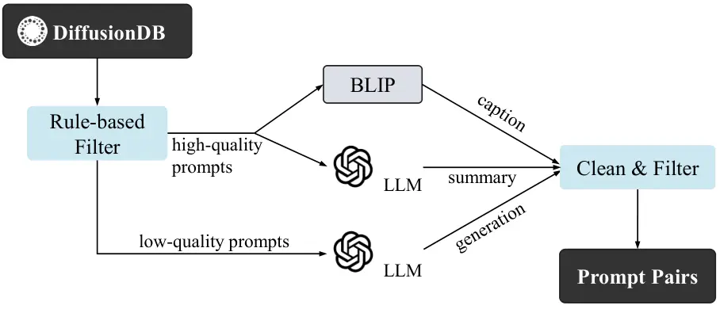
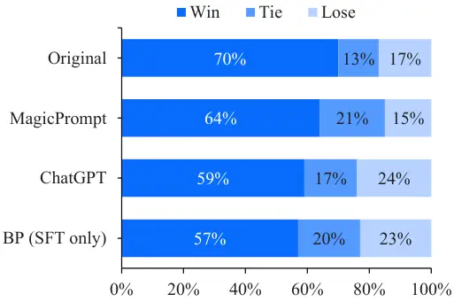
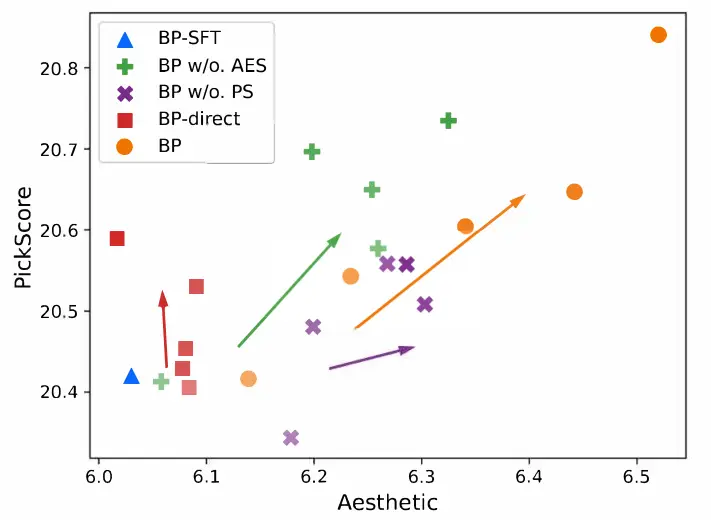
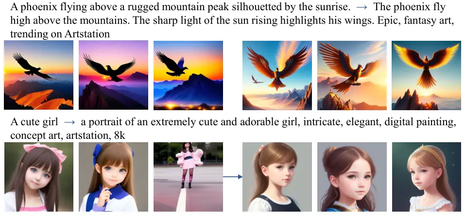
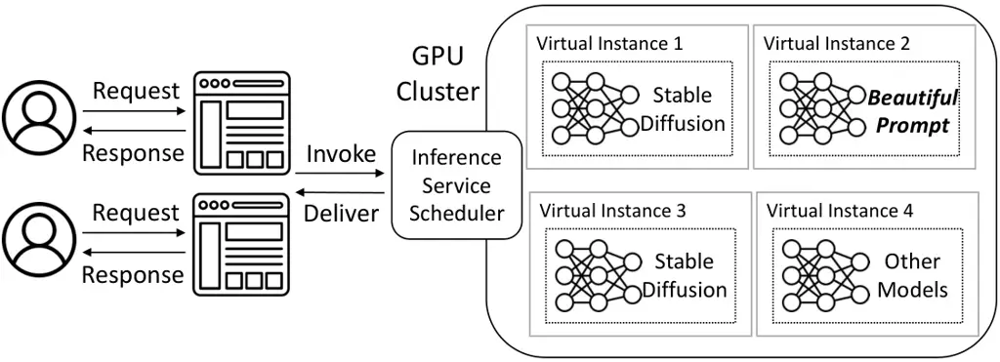
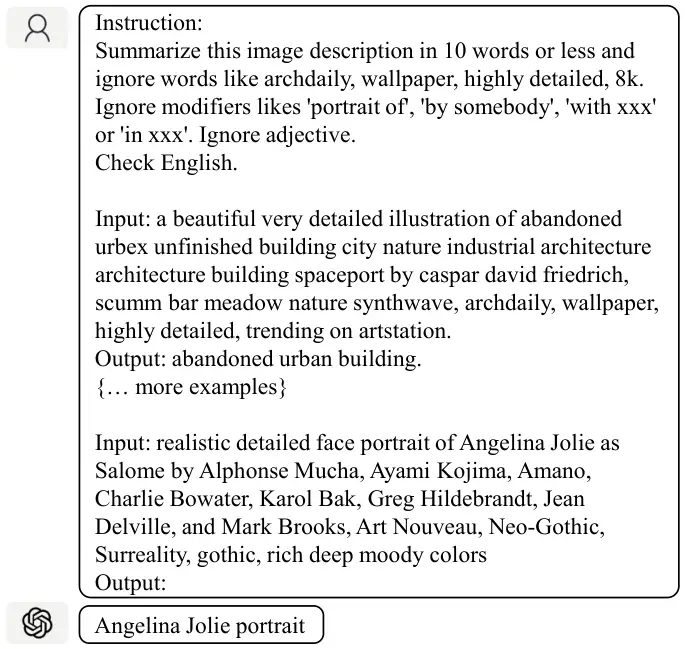
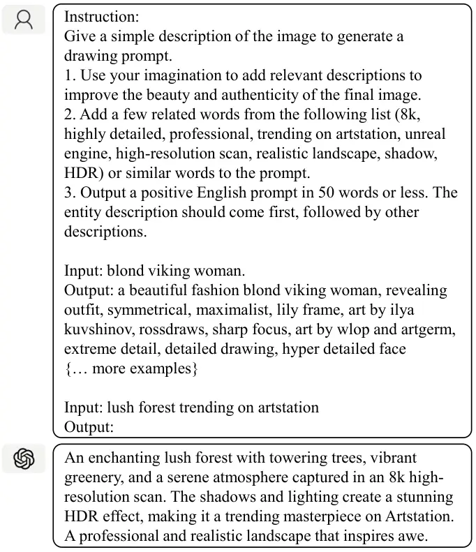
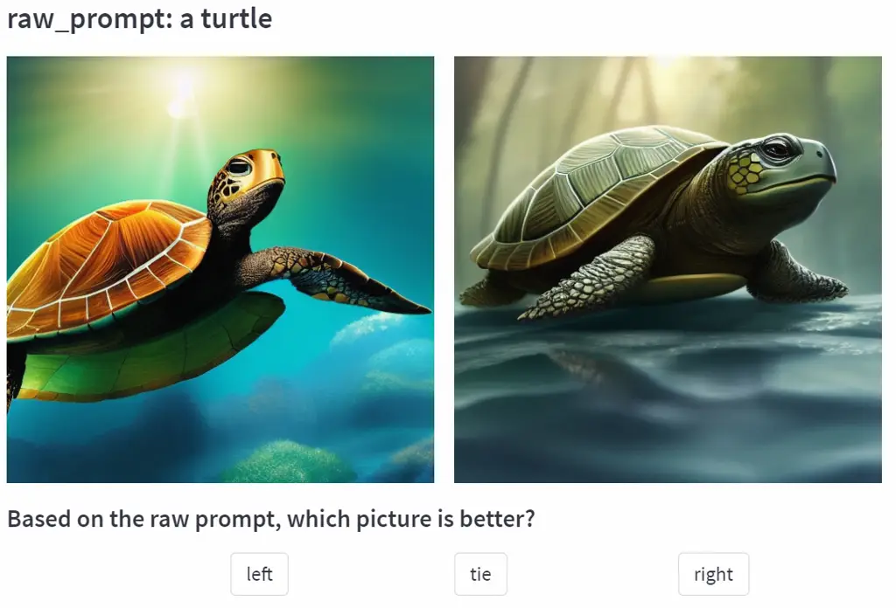
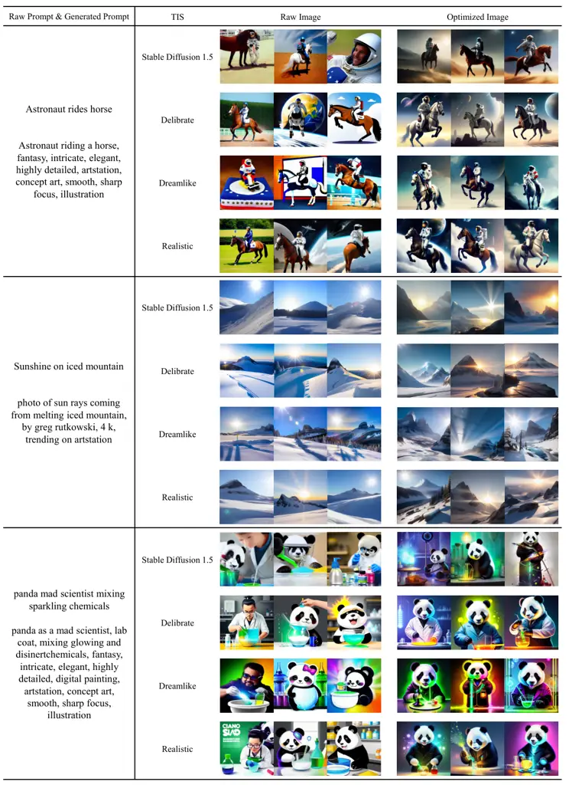

# _BeautifulPrompt_: Towards Automatic Prompt Engineering for Text-to-Image Synthesis

Tingfeng Cao ^(†)^(†)thanks: Work done during an internship at Alibaba.
Affiliation: South China University of Technology, China
Affiliation: Alibaba Group, China Affiliation: Key Laboratory of Big
Data and Intelligent Robot (South China University of
Technology)Ministry of Education, China{setingfengcao,
eeliubingyan}@mail.scut.edu.cn, csjhzhu@scut.edu.cn
Email: <chengyu.wcy@alibaba-inc.com>    Chengyu Wang ^(†)^(†)thanks: C.
Wang and J. Zhu are co-corresponding authors. Affiliation: Alibaba
Group, China Email: <zhoulou.wzh@alibaba-inc.com>    Bingyan Liu
Affiliation: South China University of Technology, China
Affiliation: Alibaba Group, China Email: <huangjun.hj@alibaba-inc.com>
   Ziheng Wu Affiliation: Alibaba Group, China    Jinhui Zhu
Affiliation: South China University of Technology, China    Jun Huang
Affiliation: Alibaba Group, China

###### Abstract

Recently, diffusion-based deep generative models (e.g., Stable
Diffusion) have shown impressive results in text-to-image synthesis.
However, current text-to-image models often require multiple passes of
prompt engineering by humans in order to produce satisfactory results
for real-world applications. We propose *BeautifulPrompt*, a deep
generative model to produce high-quality prompts from very simple raw
descriptions, which enables diffusion-based models to generate more
beautiful images. In our work, we first fine-tuned the *BeautifulPrompt*
model over low-quality and high-quality collecting prompt pairs. Then,
to ensure that our generated prompts can generate more beautiful images,
we further propose a Reinforcement Learning with Visual AI Feedback
technique to fine-tune our model to maximize the reward values of the
generated prompts, where the reward values are calculated based on the
PickScore and the Aesthetic Scores. Our results demonstrate that
learning from visual AI feedback promises the potential to improve the
quality of generated prompts and images significantly. We further
showcase the integration of *BeautifulPrompt* to a cloud-native AI
platform to provide better text-to-image generation service in the
cloud. ¹¹ 1 Datasets and source codes will be publicly available in the
EasyNLP framework Wang et al. (2022a). URL:
[https://github.com/alibaba/EasyNLP](https://github.com/alibaba/EasyNLP).
Models are released in HuggingFace under the names:
pai-bloom-1b1-text2prompt-sd
([https://huggingface.co/alibaba-pai/pai-bloom-1b1-text2prompt-sd](https://huggingface.co/alibaba-pai/pai-bloom-1b1-text2prompt-sd))
and pai-bloom-1b1-text2prompt-sd-v2
([https://huggingface.co/alibaba-pai/pai-bloom-1b1-text2prompt-sd-v2](https://huggingface.co/alibaba-pai/pai-bloom-1b1-text2prompt-sd-v2)),
where pai-bloom-1b1-text2prompt-sd is the model introduced in this work,
and pai-bloom-1b1-text2prompt-sd-v2 is the enhanced version trained with
a lareger dateset.

## 1 Introduction



Figure 1: Comparing the qualities of images generated from the original
prompts (left) with those from the prompts generated
by *BeautifulPrompt* (right). The underlying TIS model is Stable
Diffusion 1.5.

Text-to-Image Synthesis (TIS) is one of the most spectacularly developed
and widely applied techniques in generative Artificial Intelligence
(AI), aiming to create realistic images with texts as input. Recently,
with the advance of the modeling power of large models, TIS is
undergoing a revolution. Large-scale TIS models, such as DALLE Ramesh
et al. (2021), DALLE-2 Ramesh et al. (2022), latent diffusion
models Rombach et al. (2022) and Imagen Saharia et al. (2022),
significantly improve the state-of-the-art performance and allow users
without artistic expertise to create unprecedented images through
personal imagination.

Yet, TIS models require users to write text prompts before model
inference (e.g., “A majestic sailing ship”). Writing such prompts that
meet the designer’s or art worker’s needs is full of uncertainty, like
opening a surprise box Oppenlaender (2022); Liu and Chilton (2022). This
is due to the quality of the training data, leading to the need for
detailed descriptions to produce high-quality images. In real-world
scenarios, non-experts often find it difficult to write these prompts,
and need to do iterative modification through trials and errors to
re-generate the images, leading to a significant loss of time and
computing resources.

Prompt engineering is an emerging research field, aiming to explore how
to provide prompts for deep generative models and improve the efficiency
of direct interaction between humans and AI Oppenlaender (2022). For
example, a user can give a task-oriented prompt and ask ChatGPT OpenAI
(2023) to generate texts according to the prompt. For TIS, the user can
write a simple prompt and then ask ChatGPT to supplement the contents.
However, directly using ChatGPT to write prompts falls into the dilemma
of generating irrelevant and plausible images. Hence, the generated
prompts can be better in quality if the underlying language model is
optimized for the task. We can see that fine-tuning a language model
such as Brown et al. (2020); Scao et al. (2022); Touvron et al. (2023)
for TIS prompt generation will be a more worthwhile exploration.

In this paper, we propose a new generative model that can write
high-quality prompts for diffusion-based models, named
_BeautifulPrompt_. For better user experience, it re-writes and
optimizes the original, low-quality prompts into high-qualities ones to
generate better images. It also provides a good source of inspiration
for further manual prompt editing. Specifically, we first collect a
dataset for training _BeautifulPrompt_ using an automated data
collection pipeline based on existing AI models. The dataset is used for
supervised fine-tuning. We further propose a Reinforcement Learning with
Visual AI Feedback (RLVAIF) technique to maximize the reward values of
the generated prompts, which are determined by a couple of trained
reward models based on visual signals. The gradient update process of
RLVAIF makes the generated prompts more compatible with human
preferences without any manual labeling. A simple comparison of prompts
and the resulting images are shown in Figure 1. In summary, the main
contributions of this study are as follows:

- •
  We release a new dataset containing 143k prompt pairs and 2k test
  prompts, enabling researchers to develop prompt engineering models for
  their TIS applications.
- •
  We propose *BeautifulPrompt*, a novel generative model that can write
  high-quality prompts for diffusion-based TIS models. A Reinforcement
  Learning with Visual AI Feedback training scheme is further proposed
  for better visual alignment without human labeling.
- •
  Extensive experimental results show the superiority
  of *BeautifulPrompt* over strong baselines. We further showcase the
  integration of *BeautifulPrompt* to an industrial product to provide
  better image generation service.

## 2 Related Work

### 2.1 Text-to-Image Synthesis (TIS)

TIS is a multi-modal task of generating images conditioned on texts. In
the early years, popular image generation networks were mainly based on
Generative Adversarial Network (GAN) Goodfellow et al. (2014); Reed
et al. (2016). Recently, diffusion models Ho et al. (2020);
Sohl-Dickstein et al. (2015); Liu et al. (2023), such as DALLE-2 Ramesh
et al. (2022), Imagen Saharia et al. (2022), and Stable
Diffusion Rombach et al. (2022) have achieved remarkable results. Yet,
the qualities of generated images depend on prompts. In this paper, we
propose a prompt generation model, dedicated to optimizing input prompts
to generate more beautiful images.

### 2.2 TIS Evaluation

There are several metrics for evaluating TIS. CLIP score Radford et al.
(2021) measures the similarity between generated images and prompts.
Aesthetic score Schuhmann et al. (2022) evaluates the aesthetic quality
of individual images. There are also metrics trained to align with human
preferences, such as HPS Wu et al. (2023), Image Reward Xu et al.
(2023), and PickScore Kirstain et al. (2023). Human preferences can be
complex and may involve various dimensions, including the similarity
between text and images, as well as image fidelity, aesthetics, and
other factors. These evaluation metrics can all serve as visual feedback
to optimize the training of prompt engineering models. Among the human
preference metrics, PickScore stands out due to its stable scoring and
larger, more diverse training datasets, which includes a wider range of
implementations (e.g., model size, backbone, hyperparameters) Kirstain
et al. (2023). These factors can potentially contribute to more stable
training and facilitate easier extension to other TIS models.

### 2.3 Prompt Engineering for TIS

Due to the extraordinary potential of TIS, there is a surge of interest
in prompt engineering (i.e., creating good prompts). Liu and Chilton
(2022) conduct a series of experiments and propose several design
guidelines for text-to-image prompt engineering. Oppenlaender (2022)
identifies six types of prompt modifiers through a three-month
ethnographic study of the online generative art community. However,
these studies are limited to the long and tedious manual prompt
engineering.

BestPrompt Pavlichenko and Ustalov (2022) uses a genetic algorithm to
detect keywords to form prompts in order to achieve the best images
aesthetically. MagicPrompt²² 2
[https://huggingface.co/Gustavosta/MagicPrompt-Stable-Diffusion](https://huggingface.co/Gustavosta/MagicPrompt-Stable-Diffusion)
is a popular automatic prompt completion model trained from good prompts
collected from the Internet. But these models only serve to complete the
prompts. _BeautifulPrompt_, on the other hand, can re-write the original
prompts to give users a good source of inspiration and generate more
beautiful images.

## 3 Dataset Creation

In this section, we show the detailed data collection process
for *BeautifulPrompt* training.



Figure 2: The data collection process.

Collection of Prompt Pairs. The goal of this step is collecting pairs of
high-quality and low-quality prompts with similar semantics. As shown in
Figure 2, the original data source is DiffusionDB Wang et al. (2022b),
which contains un-paired prompts only. Heuristically, we split the
prompts into low-quality and high-quality ones according to the length
of the prompts, the certain tags contained in the prompts, etc. Next, we
i) use BLIP Li et al. (2022) to caption the images associated with
high-quality prompts and treat the results as the corresponding
low-quality prompts, as the captions are shorter and lack details; ii)
use ChatGPT to summarize the high-quality prompts and treat the
summaries as low-quality prompts; iii) use ChatGPT to generate better
prompts from low-quality prompts; the results are considered
high-quality prompts.³³ 3 The prompts and examples for invoking ChatGPT
can be found in Appendix A. Through the above three approaches, we
obtain a large number of prompt pairs; however, the quality of these
prompt pairs cannot be guaranteed. Hence, we need to do further data
cleaning and filtering.

Post-processing. We first filter out the examples that are non-English
and NSFW (Not Safe For Work). Next, we filter out examples of images
generated from high-quality prompts with low aesthetic scores Schuhmann
et al. (2022). For the prompt pairs generated by the mentioned
Approaches i) and ii), we use the aesthetic score model Schuhmann et al.
(2022) to score the images, as DiffusionDB already contains the images
corresponding to the high-quality prompts. For high-quality prompts
generated by the mentioned Approach iii), we use the reward model
$`r_{aes}`$ in Section 4.2 to compute the scores.

We also consider prompts’ consistency, calculate the text
similarity Reimers and Gurevych (2019) between low-quality and
high-quality prompts in a pair, and filter out examples with low
similarity. More details can be found in the Appendix B.

Statistics. We finally collect 143k prompt pairs as our training set. In
addition, we randomly extract 2k entries from low-quality prompts as our
testing set. For the training set, the average lengths of low-quality
and high-quality prompts are 40.3 and 197.8, respectively, indicating
that high-quality prompts contain more descriptions of details. More
statistics can be found in Table 1.

|       |            |      |           |      |      |       |
| ----- | ---------- | ---- | --------- | ---- | ---- | ----- |
| Split | Source     | Num  | Aesthetic | PC   | ALLP | ALOP  |
| Train | All        | 143k | 6.22      | 0.71 | 40.3 | 197.8 |
|       | Summary    | 134k | 6.23      | 0.71 | 39.8 | 194.5 |
|       | Generation | 2k   | 5.70      | 0.76 | 52.4 | 501.4 |
|       | Caption    | 7k   | 6.23      | 0.67 | 44.9 | 177.7 |
| Test  | \-         | 2k   | \-        | \-   | 36.7 | \-    |

Table 1: Dataset statistics. Note that, PC, ALLP and ALHP denote the
prompt consistency (i.e., text similarity), the average lengths of
low-quality and the high-quality prompts, respectively.

## 4 The *BeautifulPrompt* Model

Inspired by InstructGPT Ouyang et al. (2022) and ChatGPT, in this
section, we introduce the *BeautifulPrompt* training scheme in detail,
which contains three stages (Supervised Fine-tuning, Reward Modeling
training and Reinforcement Learning), as shown in Figure 3.

Figure 3: The three steps of training *BeautifulPrompt*. The color of
the arrows indicates three different stages.

### 4.1 Supervised Fine-tuning (SFT)

Given a dataset of prompt pairs $`D=\{(\mathbf{x},\mathbf{y})\}`$,
containing pairs of low-quality prompts $`\mathbf{x}`$ and high-quality
prompts $`\mathbf{y}`$, we fine-tune a decoder-only language model to
output a high-quality prompt of tokens
$`\mathbf{y}=\{y_{1},...,y_{n}\}`$ with a given instruction and a
low-quality prompt $`\mathbf{x}`$. We use the auto-regressive language
modeling objective to maximize the following likelihood Radford et al.
(2019):

```math
\mathcal{L}_{sft}=-\sum_{i}\log P(y_{i}\mid\mathbf{x},y_{1},...,y_{i-1}).
```

### 4.2 Reward Modeling (RM)

Human feedback instructs the training of Large Language Models (LLMs)
with promising results Ouyang et al. (2022). However, this requires
extensive and tedious labor efforts. Bai et al. (2022) propose to use AI
models to instruct the training of LLMs. Taking inspiration from this
and considering that our final generated prompts $`\mathbf{y}`$ are used
for drawing, we propose RLVAIF: a method that incorporates visual
feedback into the training of language models, thereby avoiding the cost
of expensive human labeling.

We focus on the quality of the final generated image and its similarity
to the low-quality prompt $`\mathbf{x}`$. Therefore, we consider
PickScore Kirstain et al. (2023) and the aesthetic score Schuhmann
et al. (2022) as our visual AI feedback to train reward models to fit
these scores.

Briefly, PickScore Kirstain et al. (2023) is a preference model trained
on a large dataset of text-to-image prompts and real user preferences.
In order to reduce the impact of random seeds on the quality of the
images generated by the TIS model, we use 8 different random seeds to
generate images and average the results. The calculated averaged
PickScore $`\mathbb{PS}`$ is used as the ground truth to train the
reward model. The loss function is:

```math
\mathcal{L}_{ps}=-\frac{1}{N}\sum_{i}^{N}\text{MSE}(r_{ps}(\mathbf{x},\mathbf{y}),\mathbb{PS}),
```

where $`r_{ps}(\mathbf{x},\mathbf{y})`$ is the scalar output of the
reward model for the prompt pair $`(\mathbf{x},\mathbf{y})`$. MSE is the
Mean Squared Error. $`N`$ is the total number of samples.

The aesthetic score model Schuhmann et al. (2022) is trained to predict
the rating that people give when asked “how much do you like this image
on a scale from 1 to 10”. Similarly, a reward model is trained to fit
the corresponding prompts from the images to the aesthetic scores
$`\mathbb{AES}`$:

```math
\mathcal{L}_{aes}=-\frac{1}{N}\sum_{i}^{N}\text{MSE}(r_{aes}(\mathbf{y}),\mathbb{AES}),
```

where $`r_{aes}(\mathbf{y})`$ is the scalar output of the reward model.
Finally, we use $`\alpha`$ as a balancing factor to combine the scores
of the two reward models as the final reward
$`r(\mathbf{x},\mathbf{y})`$:

```math
r(\mathbf{x},\mathbf{y})=\alpha\cdot r_{ps}(\mathbf{x},\mathbf{y})+(1-\alpha)\cdot r_{aes}(\mathbf{y}).
```

| Method                                  | PickScore | Aesthetic Score | HPS   | CLIP Score | Avg. Score |
| --------------------------------------- | --------- | --------------- | ----- | ---------- | ---------- |
| Original                                | 20.74     | 5.50            | 0.197 | 0.27       | 0.57       |
| MagicPrompt                             | 20.11     | 5.79            | 0.193 | 0.22       | 0.07       |
| ChatGPT                                 | 20.73     | 5.92            | 0.198 | 0.25       | 0.59       |
| _BeautifulPrompt_ (SFT only)            | 20.42     | 6.03            | 0.197 | 0.23       | 0.39       |
| _BeautifulPrompt_ (Full implementation) | 20.84     | 6.52            | 0.203 | 0.24       | 0.85       |

Table 2: Results on the testing set. The average score is calculated
with all scores normalized into \[0,1\]. “Original” refers to the method
that directly sends the original prompts to Stable Diffusion without
modification.

### 4.3 Reinforcement Learning

As the collected dataset inevitably contains some noise, for example,
the consistency between low-quality prompts and the corresponding
high-quality prompts is relatively low, the performance of the
supervising trained model $`\rho`$ can be unsatisfactory. To further
improve the model performance, we initialize a policy $`\pi=\rho`$, and
then fine-tune $`\pi`$ to perform the task using reinforcement learning.
We leverage the Proximal Policy Optimization (PPO) Schulman et al.
(2017) algorithm to directly optimize the expected reward:

```math
\mathbb{E}_{\pi}[r]=\mathbb{E}_{\mathbf{x}\sim D,\mathbf{y}\sim\pi(\cdot\mid\mathbf{x})}[r(\mathbf{x},\mathbf{y})-\beta\cdot\log\frac{\pi(\mathbf{y}\mid\mathbf{x})}{\rho(\mathbf{y}\mid\mathbf{x})}],
```

where $`\beta`$ is the Kullback-Leibler (KL) penalty coefficient. It
prevents the policy from moving too far from $`\rho`$. Following Ziegler
et al. (2019), we adopt an adaptive KL penalty here.

## 5 Experiments

Training Settings. We use the pre-trained checkpoint of BLOOM Scao
et al. (2022) (1.1B parameters with 24 transformer layers) as the
backbone.⁴⁴ 4 We choose a relatively small version of BLOOM as the
backbone to ensure the high inference speed of online deployment to
support real-world applications. In addition, we find that the 1.1B
model is sufficiently large to accomplish our task effectively with good
results. The BFLOAT16 formats are leveraged to save GPU memory and speed
up training. For the SFT and RM stages of training, we set the batch
size to 64, the maximum length to 384, and the learning rate to 1e-5
with warmup and cosine decay. We find that proper over-fitting benefits
PPO training, so we set the SFT training epoch to 4 and the weight decay
to 0. For PPO training, we set the learning rate to 5e-6, $`\alpha`$ to
0.7, the batch size to 32, the initial KL coefficient to 0.05, the
training step to 5000, and freeze two-thirds of the parameters. All the
experiments are implemented in PyTorch and run on a single server with
NVIDIA Tesla A100 GPUs.

Baselines. We consider two strong baselines: MagicPrompt and ChatGPT.
MagicPrompt is a popular automatic prompt completion model trained from
80,000 pieces of data crawls from Lexica.ai (refer to related work).
ChatGPT is almost the most powerful general-purpose LLM and serves as a
human-level prompt engineer here.

Evaluation Protocols. Systematically evaluating the goodness of a prompt
engineer is a challenging task. One of the most straightforward methods
is to evaluate the images generated by the prompts that models produce.
We use Stable Diffusion 1.5⁵⁵ 5
[https://huggingface.co/runwayml/stable-diffusion-v1-5](https://huggingface.co/runwayml/stable-diffusion-v1-5)
to generate images and calculate PickScore Kirstain et al. (2023), the
aesthetic score Schuhmann et al. (2022), HPS Wu et al. (2023) and CLIP
score Radford et al. (2021) for the images and the original prompts. In
addition, we conduct a human evaluation experiment on 200 randomly
selected examples from the testing set. Given the raw prompts, we ask 10
human experts to pick the most desirable images generated by the
different methods and report the win rates of *BeautifulPrompt* compared
against other methods. ⁶⁶ 6 Refer to the user interface in Appendix C.

### 5.1 Overall Results

From Table 2, our method consistently outperforms the other baselines in
most scores. As the CLIP score reflects the semantic consistency between
the text and image, it is natural that sending the original prompts to
Stable Diffusion unchanged obtains the highest score. Our method does
not decrease the CLIP score to a large extent, showing
that *BeautifulPrompt* well preserves the semantics of the original
input prompts. As shown in Figure 4, the human evaluation experiment
shows the superiority of our approach, with a win rate of over 57%
against all other baselines.



Figure 4: Results of human preference evaluation (i.e., win/lose/tie
rates of our method against others). “BP” is short
for *BeautifulPrompt*.

### 5.2 Detailed Analysis

Ablation Study. Figure 5 illustrates the training process using one
reward model alone, two reward models, and directly using existing
models to score the images as the reward. Using $`r_{ps}`$ alone can
drive an increase in aesthetic score, while using $`r_{aes}`$ alone does
not drive an increase in PickScore. This is consistent with the finding
that PickScore reflects real human preferences, incorporating various
factors such as image aesthetics, text-image matching, etc Kirstain
et al. (2023). Combining the two rewards allows for more rapid and
stable growth of both metrics and makes the training process more
stable. The training process is unstable and the gains obtained are
small when we directly use the models Schuhmann et al. (2022); Kirstain
et al. (2023) to compute rewards on the generated images instead of
additionally training the reward models. Consistent with Ziegler et al.
(2019), we observe that reward models need to understand languages to
better guide training.



Figure 5: Aesthetic-PickScore plot for *BeautifulPrompt* and its
variants. “BP” is short for *BeautifulPrompt*. We visualize checkpoints
every 1000 training steps. The color gradually darkens as the number of
training steps increases and the arrows indicate the training direction.
For both scores, higher numbers are better.



Figure 6: Comparing the qualities of images generated from the original
prompts (left) with those from the prompts generated
by *BeautifulPrompt* (right). The underlying TIS model is Delibrate.

Is *BeautifulPrompt* Transferable? We further explore the
transferability of *BeautifulPrompt* to the other diffusion-based TIS
models. Consider the popular model Deliberate⁷⁷ 7
[https://huggingface.co/XpucT/Deliberate](https://huggingface.co/XpucT/Deliberate).
As shown in Figure 6, although Deliberate already performs well in most
vanilla prompts, *BeautifulPrompt* is still able to make Deliberate
generate more beautiful images in most cases. This
shows *BeautifulPrompt* can also be applied to other TIS models. More
examples can be found in the Appendix D.

## 6 Industrial Application

In this section, we briefly discuss how our model benefits users in
real-world applications. Currently, we have integrated *BeautifulPrompt*
into a cloud-native AI platform (Platform of Artificial Intelligence,
Alibaba Cloud⁸⁸ 8
[https://www.alibabacloud.com/product/machine-learning](https://www.alibabacloud.com/product/machine-learning))
to assist users (especially designers and art workers) to create and
edit artistic images based on a variety of Stable Diffusion-style
models, together with other modules such as LoRA Hu et al. (2021) and
ControlNet Zhang et al. (2023). Users can freely perform any types of
image generation and editing operations through WebUI. During any
operation, users can invoke a *BeautifulPrompt* helper plug-in to assist
the design or art creation process. In addition, based on the Query Per
Second (QPS) requirements and the system workload, our inference service
can automatically scale to an adjustable number of machines on GPU
clusters.



Figure 7: Architecture of online deployment with *BeautifulPrompt* for
text-to-image generation service.

## 7 Conclusion

We propose a deep generative model named *BeautifulPrompt* to create
high-quality prompts, which can be feed to Stable Diffusion-style models
to produce more beautiful images. Specifically, we collect and release a
new dataset for training prompt engineering models. A Reinforcement
Learning with Visual AI Feedback technique is introduced to fine-turn
the LLMs based on our dataset. Extensive experimental results show
that *BeautifulPrompt* outperforms existing methods in terms of both
automatic and human evaluation.

## Limitations

Although *BeautifulPrompt* can generate more aesthetically pleasing
images, limited by the training data, it sometimes ignores part of the
information in the original prompts or generates meaningless prompts. In
a few cases, the generated images can be semantically inconsistent with
the original prompts, due to the auto-regressive and generative nature
of language models. These improvements are left to our subsequent work.
In addition, multiple open-source models are used in our training data
construction, and model training process, which may cause some degree of
bias as well as error accumulation.

## Ethical Considerations

The techniques for training the *BeautifulPrompt* model presented in
this work are fully methodological. Hence, there are no direct negative
social impacts of our method. As for the model, to ensure that the
generated contents are suitable for public release, we have also
filtered out NSFW prompts from our training data. However, since the
generative process is difficult to control, it is possible (although not
likely) for our model to create toxic contents. We suggest that in our
case, *BeautifulPrompt* should not be used to generate offensive or
inappropriate images for people intentionally. Users should carefully
deal with the potential risks for online deployment.

## Acknowledgements

This work is partially supported by Alibaba Cloud Group through Research
Talent Program with South China University of Technology.

## References

- Bai et al. (2022) Yuntao Bai, Saurav Kadavath, Sandipan Kundu, Amanda
  Askell, Jackson Kernion, Andy Jones, Anna Chen, Anna Goldie, Azalia
  Mirhoseini, Cameron McKinnon, et al. 2022. Constitutional ai:
  Harmlessness from ai feedback. _arXiv preprint arXiv:2212.08073_.
- Brown et al. (2020) Tom Brown, Benjamin Mann, Nick Ryder, Melanie
  Subbiah, Jared D Kaplan, Prafulla Dhariwal, Arvind Neelakantan, Pranav
  Shyam, Girish Sastry, Amanda Askell, et al. 2020. Language models are
  few-shot learners. _Advances in neural information processing
  systems_, 33:1877–1901.
- Goodfellow et al. (2014) Ian Goodfellow, Jean Pouget-Abadie, Mehdi
  Mirza, Bing Xu, David Warde-Farley, Sherjil Ozair, Aaron Courville,
  and Yoshua Bengio. 2014. Generative adversarial nets. In _Advances in
  Neural Information Processing Systems_, volume 27. Curran Associates,
  Inc.
- Ho et al. (2020) Jonathan Ho, Ajay Jain, and Pieter Abbeel. 2020.
  Denoising diffusion probabilistic models. _Advances in Neural
  Information Processing Systems_, 33:6840–6851.
- Hu et al. (2021) Edward J Hu, Yelong Shen, Phillip Wallis, Zeyuan
  Allen-Zhu, Yuanzhi Li, Shean Wang, Lu Wang, and Weizhu Chen. 2021.
  Lora: Low-rank adaptation of large language models. _arXiv preprint
  arXiv:2106.09685_.
- Kirstain et al. (2023) Yuval Kirstain, Adam Polyak, Uriel Singer,
  Shahbuland Matiana, Joe Penna, and Omer Levy. 2023. Pick-a-pic: An
  open dataset of user preferences for text-to-image generation. _arXiv
  preprint arXiv:2305.01569_.
- Li et al. (2022) Junnan Li, Dongxu Li, Caiming Xiong, and Steven
  Hoi. 2022. Blip: Bootstrapping language-image pre-training for unified
  vision-language understanding and generation. In _International
  Conference on Machine Learning_, pages 12888–12900. PMLR.
- Liu et al. (2023) Bingyan Liu, Weifeng Lin, Zhongjie Duan, Chengyu
  Wang, Ziheng Wu, Zhang Zipeng, Kui Jia, Lianwen Jin, Cen Chen, and Jun
  Huang. 2023. Rapid diffusion: Building domain-specific text-to-image
  synthesizers with fast inference speed. In _Proceedings of the The
  61st Annual Meeting of the Association for Computational Linguistics:
  Industry Track_, pages 295–304. Association for Computational
  Linguistics.
- Liu and Chilton (2022) Vivian Liu and Lydia B Chilton. 2022. Design
  guidelines for prompt engineering text-to-image generative models. In
  _Proceedings of the 2022 CHI Conference on Human Factors in Computing
  Systems_, pages 1–23.
- OpenAI (2023) OpenAI. 2023. ChatGPT.
  [https://openai.com/chatgpt](https://openai.com/chatgpt).
- Oppenlaender (2022) Jonas Oppenlaender. 2022. A taxonomy of prompt
  modifiers for text-to-image generation. _arXiv preprint
  arXiv:2204.13988_.
- Ouyang et al. (2022) Long Ouyang, Jeffrey Wu, Xu Jiang, Diogo Almeida,
  Carroll Wainwright, Pamela Mishkin, Chong Zhang, Sandhini Agarwal,
  Katarina Slama, Alex Ray, et al. 2022. Training language models to
  follow instructions with human feedback. _Advances in Neural
  Information Processing Systems_, 35:27730–27744.
- Pavlichenko and Ustalov (2022) Nikita Pavlichenko and Dmitry
  Ustalov. 2022. Best prompts for text-to-image models and how to find
  them. _arXiv preprint arXiv:2209.11711_.
- Radford et al. (2021) Alec Radford, Jong Wook Kim, Chris Hallacy,
  Aditya Ramesh, Gabriel Goh, Sandhini Agarwal, Girish Sastry, Amanda
  Askell, Pamela Mishkin, Jack Clark, et al. 2021. Learning transferable
  visual models from natural language supervision. In _International
  conference on machine learning_, pages 8748–8763. PMLR.
- Radford et al. (2019) Alec Radford, Jeffrey Wu, Rewon Child, David
  Luan, Dario Amodei, Ilya Sutskever, et al. 2019. Language models are
  unsupervised multitask learners. _OpenAI blog_, 1(8):9.
- Ramesh et al. (2022) Aditya Ramesh, Prafulla Dhariwal, Alex Nichol,
  Casey Chu, and Mark Chen. 2022. Hierarchical text-conditional image
  generation with clip latents. _arXiv preprint arXiv:2204.06125_.
- Ramesh et al. (2021) Aditya Ramesh, Mikhail Pavlov, Gabriel Goh, Scott
  Gray, Chelsea Voss, Alec Radford, Mark Chen, and Ilya Sutskever. 2021.
  Zero-shot text-to-image generation. In _International Conference on
  Machine Learning_, pages 8821–8831. PMLR.
- Reed et al. (2016) Scott Reed, Zeynep Akata, Xinchen Yan, Lajanugen
  Logeswaran, Bernt Schiele, and Honglak Lee. 2016. Generative
  adversarial text to image synthesis. In _International conference on
  machine learning_, pages 1060–1069. PMLR.
- Reimers and Gurevych (2019) Nils Reimers and Iryna Gurevych. 2019.
  Sentence-bert: Sentence embeddings using siamese bert-networks. In
  _Proceedings of the 2019 Conference on Empirical Methods in Natural
  Language Processing and the 9th International Joint Conference on
  Natural Language Processing (EMNLP-IJCNLP)_, pages 3982–3992.
- Rombach et al. (2022) Robin Rombach, Andreas Blattmann, Dominik
  Lorenz, Patrick Esser, and Björn Ommer. 2022. High-resolution image
  synthesis with latent diffusion models. In _Proceedings of the
  IEEE/CVF Conference on Computer Vision and Pattern Recognition_, pages
  10684–10695.
- Saharia et al. (2022) Chitwan Saharia, William Chan, Saurabh Saxena,
  Lala Li, Jay Whang, Emily L Denton, Kamyar Ghasemipour, Raphael
  Gontijo Lopes, Burcu Karagol Ayan, Tim Salimans, et al. 2022.
  Photorealistic text-to-image diffusion models with deep language
  understanding. _Advances in Neural Information Processing Systems_,
  35:36479–36494.
- Scao et al. (2022) Teven Le Scao, Angela Fan, Christopher Akiki, Ellie
  Pavlick, Suzana Ilić, Daniel Hesslow, Roman Castagné, Alexandra Sasha
  Luccioni, François Yvon, Matthias Gallé, et al. 2022. Bloom: A
  176b-parameter open-access multilingual language model. _arXiv
  preprint arXiv:2211.05100_.
- Schuhmann et al. (2022) Christoph Schuhmann, Romain Beaumont, Richard
  Vencu, Cade W Gordon, Ross Wightman, Mehdi Cherti, Theo Coombes,
  Aarush Katta, Clayton Mullis, Mitchell Wortsman, et al. 2022.
  Laion-5b: An open large-scale dataset for training next generation
  image-text models. In _Thirty-sixth Conference on Neural Information
  Processing Systems Datasets and Benchmarks Track_.
- Schulman et al. (2017) John Schulman, Filip Wolski, Prafulla Dhariwal,
  Alec Radford, and Oleg Klimov. 2017. Proximal policy optimization
  algorithms. _arXiv preprint arXiv:1707.06347_.
- Sohl-Dickstein et al. (2015) Jascha Sohl-Dickstein, Eric Weiss, Niru
  Maheswaranathan, and Surya Ganguli. 2015. Deep unsupervised learning
  using nonequilibrium thermodynamics. In _International Conference on
  Machine Learning_, pages 2256–2265. PMLR.
- Touvron et al. (2023) Hugo Touvron, Thibaut Lavril, Gautier Izacard,
  Xavier Martinet, Marie-Anne Lachaux, Timothée Lacroix, Baptiste
  Rozière, Naman Goyal, Eric Hambro, Faisal Azhar, et al. 2023. Llama:
  Open and efficient foundation language models. _arXiv preprint
  arXiv:2302.13971_.
- Wang et al. (2022a) Chengyu Wang, Minghui Qiu, Taolin Zhang, Tingting
  Liu, Lei Li, Jianing Wang, Ming Wang, Jun Huang, and Wei Lin. 2022a.
  Easynlp: A comprehensive and easy-to-use toolkit for natural language
  processing. In _Proceedings of the The 2022 Conference on Empirical
  Methods in Natural Language Processing: System Demonstrations_, pages
  22–29.
- Wang et al. (2022b) Zijie J Wang, Evan Montoya, David Munechika,
  Haoyang Yang, Benjamin Hoover, and Duen Horng Chau. 2022b.
  Diffusiondb: A large-scale prompt gallery dataset for text-to-image
  generative models. _arXiv preprint arXiv:2210.14896_.
- Wu et al. (2023) Xiaoshi Wu, Keqiang Sun, Feng Zhu, Rui Zhao, and
  Hongsheng Li. 2023. Better aligning text-to-image models with human
  preference. _arXiv preprint arXiv:2303.14420_.
- Xu et al. (2023) Jiazheng Xu, Xiao Liu, Yuchen Wu, Yuxuan Tong, Qinkai
  Li, Ming Ding, Jie Tang, and Yuxiao Dong. 2023. Imagereward: Learning
  and evaluating human preferences for text-to-image generation. _arXiv
  preprint arXiv:2304.05977_.
- Zhang et al. (2023) Lvmin Zhang, Anyi Rao, and Maneesh Agrawala. 2023.
  Adding conditional control to text-to-image diffusion models. In
  _Proceedings of the IEEE/CVF International Conference on Computer
  Vision_, pages 3836–3847.
- Ziegler et al. (2019) Daniel M Ziegler, Nisan Stiennon, Jeffrey Wu,
  Tom B Brown, Alec Radford, Dario Amodei, Paul Christiano, and Geoffrey
  Irving. 2019. Fine-tuning language models from human preferences.
  _arXiv preprint arXiv:1909.08593_.



Figure 8: An example of “ChatGPT summary” for data collection.

## Appendix A ChatGPT Templates

Figure 8 and Figure 9 show examples of using ChatGPT to generate part of
the training set.



Figure 9: An example of “ChatGPT prompt generation” for data collection.



Figure 10: Screenshot of the user inferface for the human evaluation
experiment.

## Appendix B Data Post-processing Details

For NSFW filtering, we use a trained NSFW classifier⁹⁹ 9
[https://huggingface.co/michellejieli/NSFW_text_classifier](https://huggingface.co/michellejieli/NSFW_text_classifier).
For consistency filtering, we first use the trained sentence encoder¹⁰¹⁰
10
[https://huggingface.co/sentence-transformers/all-mpnet-base-v2](https://huggingface.co/sentence-transformers/all-mpnet-base-v2)
to obtain sentence representations and then compute their cosine
similarity:

```math
\text{cos\_sim}(\mathbf{r}_{x},\mathbf{r}_{y})=\frac{\mathbf{r}_{x}^{\top}\mathbf{r}_{y}}{\parallel\mathbf{r}_{x}\parallel\cdot\parallel\mathbf{r}_{y}\parallel},
```

where $`\mathbf{r}_{x}`$ and $`\mathbf{r}_{y}`$ are sentence
representations of low- and high-quality prompts.

## Appendix C Human Preference Evaluation

Figure 10 shows a screenshot of the human evaluation experiment.

## Appendix D More Cases

In Figure 11, we apply _BeautifulPrompt_ to more Stable Diffusion-style
models (i.e., Stable Diffusion 1.5, Delibrate, Dreamlike¹¹¹¹ 11
[https://huggingface.co/dreamlike-art/dreamlike-photoreal-2.0](https://huggingface.co/dreamlike-art/dreamlike-photoreal-2.0)
and Realistic¹²¹² 12
[https://huggingface.co/SG161222/Realistic_Vision_V1.4](https://huggingface.co/SG161222/Realistic_Vision_V1.4)).



Figure 11: Examples of images generated by various Stable
Diffusion-style models w/ and w/o *BeautifulPrompt*.
