# Plum: Prompt Learning using Metaheuristic

Rui Pan ^(†)^(†)thanks:   Equal contribution. Affiliation: The Hong Kong
University of Science and Technology Email: [rpan@ust.hk](mailto:)   
Shuo Xing¹¹footnotemark: 1 Affiliation: Texas A&M University
Email: [sdiaoaa@ust.hk](mailto:)    Shizhe Diao¹¹footnotemark: 1
Affiliation: The Hong Kong University of Science and Technology
Email: [ksshumab@ust.hk](mailto:)    Wenhe Sun¹¹footnotemark: 1
^(†)^(†)thanks:  Work done during internship at the Hong Kong University
of Science and Technology. Affiliation: The Hong Kong University of
Science and Technology Email: [jzhanggr@ust.hk](mailto:)    Xiang
Liu²²footnotemark: 2 Affiliation: The Hong Kong University of Science
and Technology Email: [rpi@ust.hk](mailto:)    Kashun Shum
Affiliation: The Hong Kong University of Science and Technology
Email: [shuoxing@tamu.edu](mailto:)    Jipeng Zhang Affiliation: The
Hong Kong University of Science and Technology
Email: <sunwenhe@mail.nankai.edu.cn>    Renjie Pi Affiliation: The Hong
Kong University of Science and Technology
Email: <xliu886@connect.hkust-gz.edu.cn>    Tong Zhang
Affiliation: University of Illinois Urbana-Champaign
Email: [tongzhang@tongzhang-ml.org](mailto:)

###### Abstract

Since the emergence of large language models, prompt learning has become
a popular method for optimizing and customizing these models. Special
prompts, such as Chain-of-Thought, have even revealed previously unknown
reasoning capabilities within these models. However, the progress of
discovering effective prompts has been slow, driving a desire for
general prompt optimization methods. Unfortunately, few existing prompt
learning methods satisfy the criteria of being truly "general", i.e.,
automatic, discrete, black-box, gradient-free, and interpretable all at
once. In this paper, we introduce metaheuristics, a branch of discrete
non-convex optimization methods with over 100 options, as a promising
approach to prompt learning. Within our paradigm, we test six typical
methods: hill climbing, simulated annealing, genetic algorithms
with/without crossover, tabu search, and harmony search, demonstrating
their effectiveness in white-box and black-box prompt learning.
Furthermore, we show that these methods can be used to discover more
human-understandable prompts that were previously unknown in both
reasoning and image generation tasks, opening the door to a cornucopia
of possibilities in prompt optimization. We release all the codes in
[https://github.com/research4pan/Plum](https://github.com/research4pan/Plum).

## 1 Introduction

The advent of powerful large language models (LLMs) (Devlin et al.,
2018; Radford et al., 2019; Brown et al., 2020; Team et al., 2023;
Roziere et al., 2023; Touvron et al., 2023a; Touvron et al., 2023b) has
paved the way for numerous real-world applications, including
multi-round chat (OpenAI, 2023; Touvron et al., 2023b), instruction
following (Ouyang et al., 2022) and reasoning (Roziere et al., 2023;
Azerbayev et al., 2023). To further enhance the performance of LLMs in
specific domains, additional optimization techniques are commonly
employed, such as finetuning (Chiang et al., 2023), adapter methods (Hu
et al., 2021; Dettmers et al., 2023), alignment approaches (Ouyang
et al., 2022; Dong et al., 2023), and prompt learning (Sun et al.,
2022b; Diao et al., 2022). Notably, prompt learning distinguishes itself
from other methods by eliminating the need for gradient information from
models, resulting in substantially reduced memory consumption and
computational resource requirements. Furthermore, prompt learning often
yields interpretable outcomes, which help researchers and engineers
intuitively understand its effectiveness, thereby being beneficial in
inspiring more generalizable prompts for various tasks (Prasad et al.,
2022; Guo et al., 2023; Yu et al., 2023).

Since the introduction of prompt engineering and prompt learning,
significant advancements have been made in the discovery of effective
prompts. A noteworthy illustration is Chain-of-Thought (COT), whereby
the simple inclusion of accurate deduction steps for few-shot examples
within the original prompt empowers LLMs to achieve substantial
performance improvements in reasoning tasks (Wei et al., 2022b). An even
more impressive result is Zero-shot-COT Kojima et al. (2022), where
adding the magic phrase “Let’s think step by step” produces a remarkable
accuracy gain of over 10% across multiple models engaged in a diverse
spectrum of reasoning tasks.

However, the quest for such highly effective prompts remains
unfulfilled, underscoring the need for tools that accelerate the
discovery process. Ideally, these prompt learning tools should possess a
notable level of generality, while simultaneously meeting the following
criteria:

- •
  Automatic: since human involvements are normally expensive and
  time-consuming.
- •
  Discrete: as commercial LLMs usually provide APIs that only accept
  discrete inputs (OpenAI, 2023; Team et al., 2023).
- •
  Black-box: applicable to black-box LLMs.
- •
  Gradient-free: hence still possess the good property of low memory
  cost and time cost.
- •
  Interpretable: thus researchers can understand the logics behind its
  effectiveness and extend its applications with ease.

Regretfully, to the best of our knowledge, only a limited number of
prompt learning methods meet the criteria for being considered “general”
as per the aforementioned definition. Manual prompt engineering
techniques employing handcrafted prompts (Mishra et al., 2021; Kojima
et al., 2022; Bsharat et al., 2023) lack automation, while continuous
prompt learning approaches (Liu et al., 2021a; Li and Liang, 2021) fail
to satisfy the requirements of discreteness and interpretability. Prompt
learning methods employing reinforcement learning (Deng et al., 2022)
often necessitate an additional neural network, the learning process of
which is typically non-interpretable, and their theoretical guarantees
are only attainable under stringent assumptions.

In this paper, we present a novel approach to simultaneously achieve
these desirable properties by integrating prompt learning with
metaheuristics. By treating prompt learning as a non-convex discrete
optimization problem within a black-box framework, we harness the
potential of metaheuristics, which offer interpretable and automated
optimization processes. Moreover, this domain of optimization research
encompasses a vast array of over 100 distinct algorithms (Hussain
et al., 2019), ushering in a new paradigm for prompt learning. Many of
these algorithms even boast robust theoretical guarantees, ensuring the
discovery of both local and even global optimal solutions within limited
time frames (Locatelli, 2000; Glover and Hanafi, 2002; Schmitt, 2004;
Dorigo et al., 2006; He et al., 2018).

## 2 Related Work

### 2.1 Prompt Learning

Prompt-based learning is an effective approach that harnesses the power
of large language models (LLMs) to facilitate downstream tasks by
extracting relevant knowledge. This approach offers several advantages,
notably in terms of computational efficiency, as only a small set of
parameters needs to be optimized, in contrast to traditional methods
that require fine-tuning the entire LLM for each task. Prompting methods
can be categorized into discrete prompts (Davison et al., 2019; Wallace
et al., 2019; Jiang et al., 2020; Shin et al., 2020; Haviv et al., 2021;
Yuan et al., 2021; Gao et al., 2021; Ben-David et al., 2022; Su et al.,
2022a; Diao et al., 2022; Datta et al., 2023; Pan et al., 2024) and
continuous prompts (Hambardzumyan et al., 2021; Zhong et al., 2021; Han
et al., 2021; Li and Liang, 2021; Qin and Eisner, 2021; Liu et al.,
2021a) based on the format of prompts. Discrete prompts are typically
represented as token sequences or natural language phrases, while
continuous prompts are designed as sequences of vectors. Significant
advancements have been made in leveraging LLMs for reasoning tasks using
chain-of-thought prompting techniques. Notable progress is evidenced by
the research of  Wei et al. (2022a); Wang et al. (2022); Zhou et al.
(2023); Zhang et al. (2022); Shum et al. (2023); Diao et al. (2023), in
which well-structured prompts guide the models to showcase superior
reasoning capabilities, surpassing previous benchmarks. Further studies
in prompt attacks (Yu et al., 2023; Zhu et al., 2023) have also utilized
several of these advancements to improve the robustness of modern LLMs.
However, most of the prior studies on prompting have been limited to a
white-box setting, requiring access to all parameters of a large
language model. The reliance on white-box optimization methods has
become less practical in light of the widespread use of closed-source
black-box models.

### 2.2 Black-Box Prompt Learning

Black-box prompt learning (BPL) (Diao et al., 2022; Sun et al., 2022b;
Sun et al., 2022a) represents a promising research direction that tunes
prompts without requiring access to the parameters and gradients of the
underlying LLMs. BPL proves particularly valuable for closed-source
models, which have demonstrated superior performance compared to
open-source models (Liang et al., 2022). This advancement allows for the
effective optimization of closed-source models, overcoming the previous
limitations posed by the unavailability of model parameters. Similar to
white-box prompts, black-box prompts can be categorized into discrete
prompts (Diao et al., 2022; Prasad et al., 2022; Deng et al., 2022; Hou
et al., 2022; Cheng et al., 2023) and continuous prompts (Sun et al.,
2022b; Sun et al., 2022a; Su et al., 2022b). However, in the black-box
setting, discrete prompts prove more practical as the interface of LLMs
only accepts discrete inputs and cannot process continuous vectors.

### 2.3 Metaheuristics

There have been efforts combining the power of metaheuristics with
black-box prompt learning in the past literature. For instance,
GrIPS (Prasad et al., 2022) applied greedy search methods, as well as
simulated annealing (Kirkpatrick et al., 1983), to search better prompts
with simple edit operations such as addition, swap, paraphrase, and
deletion. GPS (Xu et al., 2022) utilized genetic algorithms for few-shot
prompt learning, improving handcrafted prompts on multiple tasks.
Additionally, Kumar and Talukdar (2021) and Lu et al. (2021)
investigated the impact of example orders in few-shot learning settings,
respectively improving performance through the use of genetic algorithms
and alternate search heuristics. However, these methods are limited in
their applicability, focusing on specific prompt learning settings and
failing to fully explore the inherent potential of discrete
optimization, which is a bridge between black-box prompt learning and
general metaheuristics. As an attempt to overcome this limitation, (Guo
et al., 2023) investigated the performance of combining the rephrasing
power of LLMs with Genetic Algorithm and Differential Evolution, showing
superior performance over hand-crafted prompts. However, compared with
our work, Guo et al. (2023) focused more on leveraging the paraphrasing
ability of LLMs and restricted search strategy to only evolutionary
algorithms, which is a subset of metaheuristics.

Metaheuristics is a well-established and versatile branch of discrete
optimization, known for its effectiveness in solving various non-convex
optimization problems. This field has witnessed the development of over
100 different methods (Hussain et al., 2019), which have been
successfully applied to a wide range of problem domains. For instance,
they have been utilized in Neural Architecture Search (Elsken et al.,
2019; Liu et al., 2021b), Travelling Salesman Problem (Ouaarab et al.,
2014; Hussain et al., 2017; Grabusts et al., 2019), and Program
Search (Chen et al., 2023). Prominent algorithms in this field include
simulated annealing (Kirkpatrick et al., 1983), genetic
algorithms (Holland, 1992), tabu search (Glover, 1986), harmony
search (Geem et al., 2001), ant colony optimization (Dorigo and
Gambardella, 1997), among others. However, the integration of these
powerful metaheuristics with black-box prompt learning remains largely
unexplored, presenting rich opportunities for further research in this
direction.

## 3 Methods

In this paper, we propose Prompt learning using metaheuristic (Plum), a
general paradigm that enables the application of numerous metaheuristics
in the setting of discrete black-box prompt learning. Based on this
framework, the flexible composition of different techniques becomes
possible, leading to a “template” for designing general prompt learning
algorithms, guaranteed to simultaneously satisfy the properties of
automatic, discrete, black-box, gradient-free, and interpretable.

### 3.1 Plum in General

Required:  
(1) A well-defined neighbor set $`\mathcal{N}(\mathbf{p})`$ for
$`\forall\mathbf{p}\in\Omega`$;  
(2) a metaheuristics algorithm $`\mathcal{A}`$;  
(3) metaheuristics-dependent hyperparameters $`\theta`$ and functions
$`\mathcal{F}`$.

Input: An initialized prompt $`\mathbf{p}_{0}`$ and an objective
$`f(\mathbf{p})`$ to be maximized (or minimized).

1: $`\mathbf{p}_{\ast}\leftarrow`$
$`\mathcal{A}_{\mathcal{N},\theta,\mathcal{F},f}`$($`\mathbf{p}_{0},\mathcal{M}`$)

2: return $`\mathbf{p}_{\ast}`$

Algorithm 1 Plum in General

The framework of Plum is outlined in Algorithm 1, which encompasses four
fundamental and orthogonal elements. The first element is a well-defined
neighborhood $`\mathcal{N}(\cdot)`$ in the discrete prompt search space.
In practice, any operations that transform a prompt into another prompt
can be used to define such neighborhoods. For instance, edit operations
in GrIPS (Prasad et al., 2022) can convert a prompt
$`\mathbf{p}=[\text{Let},\text{us},\text{think}]`$ to a new prompt
$`\mathbf{p}^{\prime}=[\text{Let},\text{us},\text{brainstorm}]`$ via
paraphrase, and all such possible conversions form prompt
$`\mathbf{p}`$’s neighborhood

```math
\displaystyle\mathcal{N}(\mathbf{p})=\{\mathbf{p}^{\prime}|\exists e\in\mathcal{E},s.t.\ \mathbf{p}^{\prime}=\texttt{edit}(\mathbf{p},e)\}.
```

This abstraction of neighborhood decouples prompt transformations and
search algorithms, making the flexible combination of those techniques
possible.

The second part is the core metaheuristics $`\mathcal{A}`$, such as
simulated annealing (Kirkpatrick et al., 1983), tabu search (Glover,
1986), genetic algorithms (Holland, 1992). Any discrete optimization
metaheuristics can fit into this part.

Notably, various metaheuristics come with their own specific
hyperparameters and functions that need to be considered within the Plum
paradigm. For instance, in the case of simulated annealing, a
temperature scheduler is required for regulating the annealing speed,
where an appropriate schedule can greatly improve the search efficiency.
Similarly, general genetic algorithms incorporate a “crossover”
operation, which swaps segments of two prompts and serves as a global
search mechanism to expand its search scope.

|                                                |                                     |                                                                                                                                                                     |                                                                                          |           |
| ---------------------------------------------- | ----------------------------------- | ------------------------------------------------------------------------------------------------------------------------------------------------------------------- | ---------------------------------------------------------------------------------------- | --------- |
| Neighborhood $`\mathcal{N}(\mathbf{p})`$       | Metaheuristics $`\mathcal{A}`$      | Hyperparameter $`\theta`$                                                                                                                                           | $`\mathcal{F}`$                                                                          | Name      |
| Candidates after editing (Prasad et al., 2022) | Hill Climbing                       | -                                                                                                                                                                   | -                                                                                        | Plum-HC   |
|                                                | Simulated Annealing                 | -                                                                                                                                                                   | Temperature schedule $`T(i)`$                                                            | Plum-SA   |
|                                                | Genetic Algorithms (mutation only)  | $`k`$ tournament selections                                                                                                                                         | -                                                                                        | Plum-GA-M |
|                                                | Genetic Algorithms (with crossover) | 1) $`k`$ tournament selections; 2) $`p_{\text{mutation}}`$: mutation rate                                                                                           | Crossover function: $`\langle\mathbf{p}_{1},\mathbf{p}_{2}\rangle\rightarrow\mathbf{p}`$ | Plum-GA-C |
|                                                | Tabu Search                         | $`N_{\text{tabu}}`$ slots in Tabu list                                                                                                                              | Tabu function: $`\langle\mathcal{T},\mathbf{p}\rangle\to\{0,1\}`$                        | Plum-TS   |
|                                                | Harmony Search                      | 1) $`N_{H}`$ harmony search memory; 2) $`k_{s}`$ number of segments; 3) $`HMCR\in[0,1]`$: harmony memory considering rate; 4) $`PAR\in[0,1]`$: pitching adjust rate | -                                                                                        | Plum-HS   |

Table 1: Implemented Plum algorithms.

During the optimization process, the objective is to maximize (or
minimize) a provided function $`f(\mathbf{p})`$, which typically
corresponds to task-specific performance metrics of the target LLM. For
instance, under the setting of GPT-3-babbage (Brown et al., 2020) on
Commonsense Question Answering (Talmor et al., 2019), the function
$`f(\mathbf{p})`$ represents the final accuracy achieved by augmenting
GPT-3-babbage with the prompt $`\mathbf{p}`$. The primary goal of the
metaheuristics is to search for the optimum $`\mathbf{p}`$ which
maximizes this accuracy.

By clearly stating those key components in Plum, we are now prepared to
instantiate Plum with specific metaheuristics and neighborhood
definitions that can perform real-world prompt learning tasks.

### 3.2 Plum in Practice

As a proof of concept, we realize Plum with several popular
metaheuristics, as listed in Table 1. Detailed pseudocodes of those
methods are available in Appendix C.

All those algorithms are successful products of metaheuristics under the
setting of prompt learning. By combining the edit operations employed in
GrIPS (Prasad et al., 2022) with simulated annealing (Kirkpatrick
et al., 1983), we developed an algorithm capable of recovering global
optimum with proper temperature scheduler  (Granville et al., 1994). In
this context, we define the global optimum as the prompt that maximizes
the objective function $`f(\mathbf{p})`$ within the set of reachable
prompts starting from the initial prompt $`\mathbf{p}_{0}`$.

Furthermore, replacing simulated annealing with genetic algorithms gives
birth to Plum-GA-M and Plum-GA-C, whose metaheuristics prototypes are
proven to converge to global optimum given specific mutation and
crossover operations (Schmitt, 2004). Compared with Plum-GA-M, Plum-GA-C
adopts an extra operation of crossover, which enables more aggressive
searches. Intuitively, Plum-GA-C \> Plum-GA-M \> Plum-SA \> Plum-HC in
terms of their exploration power, which is at the expense of increased
search steps and the number of evaluations of the objective function
$`f(\mathbf{p})`$.

Similarly, adopting Tabu Search (Glover, 1986) and Harmony Search (Geem
et al., 2001) brings forth Plum-TS and Plum-HS, both are API-efficient
methods according to our experiments. Here Tabu Search introduces a Tabu
list to prohibit certain candidates from being revisited, hence avoids
the search process from getting stuck in a local optimum. Meanwhile,
Harmony Search obtains its inspiration from musical composition,
utilizing a harmony search memory with past prompts and generates the
new prompt by combining segments from them.

Figure 1: Illustration of Plum-GA-C and its possible extension with
LLMs.

### 3.3 Plum-GA-C

Here we illustrate one specific algorithm Plum-GA-C as an example of
instantiating a Plum algorithm. Plum-GA-C contains three stages:
parsing, editing, and scoring, which are described as follows.

#### 3.3.1 Stage 1: Parsing

Initially, we parse the initial prompt $`I`$ into a sequence of phrases
using a CRF-based constituency parser (Zhang et al., 2020a).
Subsequently, we iteratively merge the leaf nodes of the obtained
constituency tree until several disjoint phrase-level constituents are
generated.

#### 3.3.2 Stage 2: Editing

##### Mutation

Mutation is a combination of edit operations inside the prompt.
Following Prasad et al. (2022), we introduce four mutation operations
including: delete, add, swap, and paraphrase. delete randomly drops some
phrases while addition adds some randomly sampled phrases back at a
random position. swap swaps two phrases, and paraphrase replaces a
phrase with a new phrase generated by a paraphrasing model. We apply
PEGASUS (Zhang et al., 2020b) as the paraphrase model to obtain new
phrases. The upper right corner of Figure 1 provides an illustrative
depiction of the mutation process.

##### Crossover

Crossover is a combination of edit operations across two prompts. To
perform crossover, we divide each prompt into two sub-sequences at a
randomly selected position. From each prompt, we randomly choose one
sub-sequence and these selected sub-sequences are then combined to
create a new sequence as the prompt. The upper left corner of Figure 1
provides a visual representation of the crossover process.

#### 3.3.3 Stage 3: Scoring

The optimization process relies on performance signals acquired through
the scoring process. Initially, we construct a score set
$`S=\{(x_{1},y_{1}),(x_{2},y_{2}),`$ $`...,(x_{n},y_{n})\}`$ by randomly
sampling $`n`$ examples from the training split. Subsequently, a score
function is computed based on the accuracy of predictions.

### 3.4 Plum-HS

We also introduce Plum-HS, a novel algorithm that integrates Harmony
Search into prompt learning. Notably, it marks the first instance of
Harmony Search being successfully applied to prompt optimization tasks.
The process is quite similar to composing new songs, where new prompts
are generated by combining segments from past prompts together. The
procedure starts with a base prompt pending to be optimized, which is
first divided into segments of words, and inserted into the harmony
memory.

At each iteration, a new prompt is generated by composing $`k_{s}`$
segments from prompts in the harmony search memory, where the $`j`$-th
segment is the exact copy of the $`j`$-th segment from a randomly
sampled prompt in the memory. After this composition procedure, a pitch
finetuning process is then applied, which edits the segment with a small
probability in a similar manner as the mutation operation in
Section 3.3.2. The only difference is that it utilizes two kinds of
pitch change operations: small pitch changes which only do paraphrasing,
and big pitch changes which include all editing operators. The generated
new prompt is then evaluated and inserted back into the harmony search
memory, where the memory only retains $`N_{H}`$ prompts with top scores.

Intuitively speaking, Plum-HS has a similar exploration power as
Plum-GA-C and adopts a more flexible manner to replace long segments in
the middle of the prompt. According to our experiments, it is also
API-efficient, which achieves better performance while consuming
significantly fewer API calls compared to other methods.

Besides Plum-GA-C and Plum-HS, details of other algorithms are also
available in Appendix C.

## 4 Experiments

We conduct three types of experiments to demonstrate the empirical
superiority of proposed algorithms. As a starting point, we first show
Plum’s computational efficiency by applying them to general prompt
learning tasks with white-box models, where Plum produces nontrivial
improvements over baselines within a fixed time limit. We further
investigate Plum on prompt learning tasks with black-box models, where
only discrete-input APIs are available. On these tasks, Plum also
obtains significant performance gains with much fewer API calls.
Eventually, we show that Plum is capable of discovering effective prompt
patterns in both Chain-of-Thought and text-to-image generation tasks,
making it a promising paradigm for boosting research in prompt learning.

### 4.1 Plum for White-Box Prompt Learning

##### Dataset

Our experiments are conducted on a subset of the Natural-Instructions
datasets v2.6 release (Mishra et al., 2022), specifically focusing on
eight binary classification tasks (task 019, task 021, task 022, task
050, task 069, task 137, task 139, and task 195). This dataset evaluates
the instruction following ability of models, where proper prompt design
plays an important role.

##### Baselines

We compare our method with three popular prompt learning methods:

- •
  BDPL (Diao et al., 2022): using variance-reduced policy gradient
  algorithm to estimate the gradients of parameters in the categorical
  distribution of each discrete prompt.
- •
  BBT (Sun et al., 2022b): optimizing continuous prompts by covariance
  matrix adaptation evolution strategy.
- •
  GrIPS (Prasad et al., 2022): generating discrete prompts by performing
  phrase-level operations, and selecting the best ones.
- •
  APO (Pryzant et al., 2023): automatically improve the initial prompt
  using beam search guided by textual “gradient”.

##### Experiment Setup

To make the comparison fair for all algorithms, we follow the same
editing operators as GrIPS (Prasad et al., 2022), which generally
generates discrete prompts by performing phrase-level operations and
selecting the best ones. We utilize GPT2-large (Radford et al., 2019)
for the backbone model of prompt learning. To accommodate computational
resource limitations, we set the batch size to $`1`$ and the time-out
threshold of the searching process to $`45`$ minutes for all methods.
All methods are given a task-agnostic instruction: You will be given a
task. Read and understand the task carefully, and appropriately answer
\[list_of_labels\]. Here \[list_of_labels\] serves as a placeholder to
be replaced by an actual list of labels.

##### Results

As demonstrated in Table 2, with limited time resources, Plum can
provide generally on-par or better performance than baseline prompt
learning methods. It is worth noticing that this is achieved even
without the need for model gradients or any assistance from external
LLMs, which shows the potential of Plum for offline prompt optimization
scenarios where efficiency is of great importance. More experimental
results are available in Appendix B.1.

|                             |                      |
| --------------------------- | -------------------- |
| Methods                     | Accuracy(%)          |
| BBT (Sun et al., 2022b)     | 53.67$`\pm`$1.71^(‡) |
| BDPL (Diao et al., 2022)    | 53.13$`\pm`$0.61     |
| GrIPS (Prasad et al., 2022) | 53.67$`\pm`$0.87     |
| APO (Pryzant et al., 2023)  | 54.63$`\pm`$0.37     |
| Plum-HC                     | 53.83$`\pm`$0.46     |
| Plum-SA                     | 53.92$`\pm`$0.41     |
| Plum-GA-M                   | 53.21$`\pm`$0.60     |
| Plum-GA-C                   | 54.38$`\pm`$0.47     |
| Plum-TS                     | 54.18$`\pm`$0.05     |
| Plum-HS                     | 55.04$`\pm`$0.56     |

Table 2: Impact of different search strategies with task-agnostic
instruction and Instruction-Only prompts with gpt2-large as backbones.
Here we set the time limit to 45 minutes for all methods.  
^(‡) We incorporate error bars for all reported results in this paper to
illustrate the variability, where $`\pm`$ represents a plus or minus the
standard deviation.

### 4.2 Plum for Black-Box Prompt Learning

##### Experimental Setup

The experimental setup follows the same setting as white-box prompt
learning, except for the backbone model, where we adopt GPT3-babbage
instead. Notice that BBT (Sun et al., 2022b) is no longer applicable in
this setting since it requires continuous gradients in its prompt
learning processes.

|                                          |                             |               |            |                  |           |
| ---------------------------------------- | --------------------------- | ------------- | ---------- | ---------------- | --------- |
| Backbone                                 | Methods                     | Max Iteration | Batch Size | Accuracy(%)      | API Calls |
| GPT3-babbage (without API Calls limit)   | BDPL (Diao et al., 2022)    | 50            | 32         | 57.38            | 10000     |
|                                          | GrIPS (Prasad et al., 2022) | 10            | 4          | 54.41$`\pm`$0.55 | 7740      |
|                                          | Plum-HC                     | 50            | 20         | 56.25$`\pm`$0.27 | 10588     |
|                                          | Plum-SA                     | 50            | 20         | 54.92$`\pm`$0.78 | 13900     |
|                                          | Plum-GA-M                   | 50            | 20         | 56.04$`\pm`$0.97 | 10098     |
|                                          | Plum-GA-C                   | 50            | 20         | 56.63$`\pm`$0.97 | 13367     |
|                                          | Plum-TS                     | 50            | 20         | 54.63$`\pm`$0.83 | 1752      |
|                                          | Plum-HS                     | 50            | 20         | 59.63$`\pm`$0.80 | 5494      |
| GPT3-babbage (with API Calls limit 8000) | BDPL                        | 40            | 32         | 56.25            | –         |
|                                          | GrIPS                       | 10            | 4          | 54.41$`\pm`$0.55 | –         |
|                                          | Plum-HC                     | 50            | 20         | 55.21$`\pm`$0.48 | –         |
|                                          | Plum-SA                     | 50            | 20         | 56.87$`\pm`$1.62 | –         |
|                                          | Plum-GA-M                   | 50            | 20         | 55.63$`\pm`$0.47 | –         |
|                                          | Plum-GA-C                   | 50            | 20         | 57.75$`\pm`$0.74 | –         |
|                                          | Plum-TS                     | 50            | 20         | 54.92$`\pm`$1.26 | –         |
|                                          | Plum-HS                     | 50            | 20         | 59.75$`\pm`$0.81 | –         |

Table 3: Impact of different search strategies with task-agnostic
instruction and Instruction-Only prompts with GPT3 as backbone.

##### Results

Table 3 lists the performance of Plum-series algorithms, where under
both scenarios of a limited number of iterations and API calls, Plum-HS
achieves the best performance. Specifically, Plum-HS obtains this
superior performance at a cost of much fewer API calls, rendering it a
promising candidate for other prompt-tuning tasks. It is also worth
noticing that given approximately the same amount of API calls, all Plum
algorithms surpass GrIPS by a non-trivial margin.

### 4.3 Plum for Prompt Discovery

##### Text-to-Image Generation

As demonstrated by images in Table 4, Plum can also be applied to
text-to-image generation tasks and obtain non-trivial improvements even
without the assistance of external LLMs like GPT-3 (Brown et al., 2020).
By utilizing an offline image evaluator called PickScore (Kirstain
et al., 2023), optimizing image relevance to the original prompt can be
formulated as a black-box prompt learning problem, where a prompt’s
score is defined as the averaged PickScore of the images generated from
the prompt. PickScore is a CLIP-based scoring function trained on a
corpus of high-quality image text pair dataset. This makes improving the
image quality quantitatively possible. For example, in the fourth image
of Table 4, where the image topic is “cat in a library”, Plum-HS
augments the original prompt “A cat prowling in a library at night,
books and shadows, silent observer”, and replaces it with a high-score
prompt “A Is that true? Not at all cat prowling in shadows And books
shadows”. Notice the resultant prompt highlights the key information
“cat, books, shadows” and appends a prefix “Is that true?” with a sense
of mystery. To the best of our knowledge, this pattern was unexplored
before and can be beneficial for future prompt engineering development
in this field. More experimental results and details are available in
Appendix A.

|                                                                                         |
| --------------------------------------------------------------------------------------- |
| ![[Uncaptioned image]](arxiv-2311-08364v3--d774fcbef372.figures/figure-1.webp)          |
| \(a\) SD-2.1 ($`768\times 768`$ resolution, Average PickScore = 50.0)                   |
| ![[Uncaptioned image]](arxiv-2311-08364v3--d774fcbef372.figures/figure-2.webp)          |
| \(b\) Plum-HS augmented SD-2.1 ($`768\times 768`$ resolution, Average PickScore = 80.6) |

Table 4: Plum-HS augmented prompts for stable-diffusion-2-1. Image
topics: Top: 1) Starry night, 2) An underwater city, 3) Reflection, 4)
Cat in a library, 5) Moonlight bathes blossom; Bottom: 1) Moonlight and
city lights, 2) Boundary, 3) Sun glare on a skyscraper, 4) Fiery beast, 5) Sunflower.

##### Reasoning

Another important feature of Plum is its compatibility with external LLM
search operators for paraphrasing, which allows the discovery of
interpretable prompt patterns. We apply this version of Plum to improve
task-oriented LLMs’ performance, where the detailed cases are presented
in Table 6 of Appendix A. Via studying the characteristics of the
searched prompts, we found that the performance of initial prompts can
be boosted by further completion of the logical chain. This way, the
logical coherence of prompts can be improved while still retaining their
intended meaning. For instance, ‘If there are 3 cars in the parking lot
and 2 more cars arrive, how many cars are in the parking lot (total
number of cars in the parking lot + 2)’, where GPT-3 completes the
content inside the parentheses, leading to an easier Chain-of-Thought
reasoning for LLMs.

Furthermore, it is observed that the quality of the prompts can be
enhanced by incorporating a more comprehensive and lucid explanation of
the statement. To illustrate, in a case of prompting for AQuA, GPT3.5
provides an initial explanation of the term ‘keystrokes’ with ‘(the act
of pressing a key on a keyboard)’ to ensure clarity, and further gives a
precise description for the range ‘from 1 to 500’ with ‘(inclusive)’.
This suggests that knowledge-augmented prompt learning methods can be
beneficial for black-box prompt tuning.

## 5 Discussion

##### Plum with LLM-driven Mutators

LLM-based prompt tuning methods are emerging as one of the most
competitive approaches in prompt learning. Recent works like Pryzant
et al. (2023); Guo et al. (2023) have shown significant performance
improvements through utilizing the LLM-driven prompt mutators,
highlighting the success of such approaches. Compared with them, Plum
offers a complementary and orthogonal paradigm. For example, by
incorporating the LLM-based operators in Plum algorithms, our
Chain-of-Thought task experiments in Appendix B.2 demonstrate
effectiveness in generating high-quality, interpretable few-shot-CoT
prompts for reasoning tasks (as shown in Table 6). This suggests that
LLMs can be a powerful tool for prompt exploration within the Plum
paradigm, particularly when computational resources are abundant.

##### Strengths of Different Plum Algorithms

In both white-box and black-box settings, our experiments demonstrate
that Plum-HS achieves significant performance gains on prompt tuning
tasks against baselines and the other Plum algorithms. This is because
it takes into account the composability of different prompt segments,
which can be seen as an extension of evolutionary algorithms. Notably,
in tasks like image generation (detailed in Section 4.3), we observe
that updates to different segments can occur in parallel, highlighting
this approach’s efficiency.

On the other hand, while two baseline methods may have superior
performance over most other Plum algorithms, those metaheuristics
possess nice properties that can be beneficial for the community.

- •
  Plum-HC stands out for its simplicity and efficiency among Plum
  family. It shares the same form of GrIPS (Prasad et al., 2022) and is
  one of the most commonly adopted paradigms in LLM-based methods.
  Plum-HC can serve as a foundational algorithm for developing new
  mutators. Its straightforward nature allows for easier debugging and
  comparison when developing more complex algorithms in the Plum family.
- •
  For Plum-SA, it boasts a quite simple form, which only differs one
  line from Plum-HC. Crucially, it guarantees to find the global optimum
  with the infinite time horizon. This characteristic makes it valuable
  for future theoretical analyses of discrete prompt learning.
- •
  Plum-GA-M and Plum-GA-C, the genetic algorithm, can be considered one
  of the most widely adopted algorithms in evolutionary search, whose
  results can be useful for future comparisons on the same tasks for
  other researchers. Additionally, our experiments also demonstrate that
  these algorithms achieve superior performance compared to baseline
  approaches.
- •
  For Plum-TS, although its performance is not the best, it achieves
  on-par performance as GrIPS in  4 times fewer API calls (as shown in
  Table 3). This advantage makes Plum-TS an extremely favorable choice
  for applications with limited budgets or API call quotas.

## 6 Conclusion

In this paper, a novel paradigm of prompt learning is proposed. By
formulating prompt learning as a black-box discrete optimization
problem, we are able to apply various metaheuristics algorithms to help
discover effective prompts, while guaranteeing the whole process to be
automatic, discrete, gradient-free, interpretable, and applicable to
black-box models. Six typical Plum algorithms, Hill Climbing, Simulated
Annealing, Genetic Algorithm (Mutation Only), Genetic Algorithm (with
Crossover), Tabu Search, and Harmony Search all obtain non-trivial
improvements over GrIPS on instruction following tasks. Furthermore,
with the assistance of metaheuristics-based prompt learning, we are
capable of discovering new patterns of effective prompts unexplored in
the past.

## Limitations

As an early step of bridging metaheuristics and prompt learning in a
unified paradigm, we only implement six algorithms to prove the validity
of this concept. Nevertheless, there are still a bunch of other
potential metaheuristics that can be incorporated into this framework,
producing more empirically useful methods for solving real-world
problems. We hope Plum is just a starting point, more metaheuristics,
such as Particle Swarm Optimization (Kennedy and Eberhart, 1995), Ant
Colony Optimization (Dorigo and Gambardella, 1997) and Cuckoo
search (Yang and Deb, 2009) can be combined with more neighborhood
definitions, like retrieval-based completions and multimodal, to inspire
more practical algorithms, which can eventually help us find a way to
properly communicate with Large Language Models.

The potential risks of this work are the general risks of black prompt
tuning methods, where more powerful prompt learning algorithms enable
more powerful prompt attack approaches. Nevertheless, the silver lining
is that most prompt attack methods normally in term generate adversarial
samples that help improve the robustness of models, which can be
considered beneficial in the long term.

## References

- Azerbayev et al. (2023) Zhangir Azerbayev, Hailey Schoelkopf, Keiran
  Paster, Marco Dos Santos, Stephen McAleer, Albert Q Jiang, Jia Deng,
  Stella Biderman, and Sean Welleck. Llemma: An open language model for
  mathematics. _arXiv preprint arXiv:2310.10631_, 2023.
- Ben-David et al. (2022) Eyal Ben-David, Nadav Oved, and Roi Reichart.
  PADA: Example-based prompt learning for on-the-fly adaptation to
  unseen domains. _Transactions of the Association for Computational
  Linguistics_, 10:414–433, 2022. doi: 10.1162/tacl_a_00468. URL
  [https://aclanthology.org/2022.tacl-1.24](https://aclanthology.org/2022.tacl-1.24).
- Brown et al. (2020) Tom Brown, Benjamin Mann, Nick Ryder, Melanie
  Subbiah, Jared D Kaplan, Prafulla Dhariwal, Arvind Neelakantan, Pranav
  Shyam, Girish Sastry, Amanda Askell, et al. Language models are
  few-shot learners. _Advances in neural information processing
  systems_, 33:1877–1901, 2020.
- Bsharat et al. (2023) Sondos Mahmoud Bsharat, Aidar Myrzakhan, and
  Zhiqiang Shen. Principled instructions are all you need for
  questioning llama-1/2, gpt-3.5/4. _arXiv preprint
  arXiv:2312.16171_, 2023.
- Chen et al. (2023) Xiangning Chen, Chen Liang, Da Huang, Esteban Real,
  Kaiyuan Wang, Yao Liu, Hieu Pham, Xuanyi Dong, Thang Luong, Cho-Jui
  Hsieh, et al. Symbolic discovery of optimization algorithms. _arXiv
  preprint arXiv:2302.06675_, 2023.
- Cheng et al. (2023) Jiale Cheng, Xiao Liu, Kehan Zheng, Pei Ke,
  Hongning Wang, Yuxiao Dong, Jie Tang, and Minlie Huang. Black-box
  prompt optimization: Aligning large language models without model
  training. _arXiv preprint arXiv:2311.04155_, 2023.
- Chiang et al. (2023) WL Chiang, Z Li, Z Lin, Y Sheng, Z Wu, H Zhang,
  L Zheng, S Zhuang, Y Zhuang, JE Gonzalez, et al. Vicuna: An
  open-source chatbot impressing gpt-4 with 90%\* chatgpt quality, mar.
  2023, 2023.
- Cobbe et al. (2021) Karl Cobbe, Vineet Kosaraju, Mohammad Bavarian,
  Mark Chen, Heewoo Jun, Lukasz Kaiser, Matthias Plappert, Jerry Tworek,
  Jacob Hilton, Reiichiro Nakano, Christopher Hesse, and John Schulman.
  Training Verifiers to Solve Math Word Problems. _arXiv_, October 2021.
  doi: 10.48550/arXiv.2110.14168.
- Datta et al. (2023) Siddhartha Datta, Alexander Ku, Deepak
  Ramachandran, and Peter Anderson. Prompt expansion for adaptive
  text-to-image generation. _arXiv preprint arXiv:2312.16720_, 2023.
- Davison et al. (2019) Joe Davison, Joshua Feldman, and Alexander Rush.
  Commonsense knowledge mining from pretrained models. In _Proceedings
  of the 2019 Conference on Empirical Methods in Natural Language
  Processing and the 9th International Joint Conference on Natural
  Language Processing (EMNLP-IJCNLP)_, pages 1173–1178, Hong Kong,
  China, 2019. Association for Computational Linguistics. doi:
  10.18653/v1/D19-1109. URL
  [https://aclanthology.org/D19-1109](https://aclanthology.org/D19-1109).
- Deng et al. (2022) Mingkai Deng, Jianyu Wang, Cheng-Ping Hsieh, Yihan
  Wang, Han Guo, Tianmin Shu, Meng Song, Eric P Xing, and Zhiting Hu.
  Rlprompt: Optimizing discrete text prompts with reinforcement
  learning. _arXiv preprint arXiv:2205.12548_, 2022.
- Dettmers et al. (2023) Tim Dettmers, Artidoro Pagnoni, Ari Holtzman,
  and Luke Zettlemoyer. Qlora: Efficient finetuning of quantized llms.
  _arXiv preprint arXiv:2305.14314_, 2023.
- Devlin et al. (2018) Jacob Devlin, Ming-Wei Chang, Kenton Lee, and
  Kristina Toutanova. Bert: Pre-training of deep bidirectional
  transformers for language understanding. _arXiv preprint
  arXiv:1810.04805_, 2018.
- Diao et al. (2022) Shizhe Diao, Zhichao Huang, Ruijia Xu, Xuechun Li,
  Yong Lin, Xiao Zhou, and Tong Zhang. Black-box prompt learning for
  pre-trained language models. _arXiv preprint arXiv:2201.08531_, 2022.
- Diao et al. (2023) Shizhe Diao, Pengcheng Wang, Yong Lin, and Tong
  Zhang. Active prompting with chain-of-thought for large language
  models, 2023.
- Dong et al. (2023) Hanze Dong, Wei Xiong, Deepanshu Goyal, Rui Pan,
  Shizhe Diao, Jipeng Zhang, Kashun Shum, and Tong Zhang. Raft: Reward
  ranked finetuning for generative foundation model alignment. _arXiv
  preprint arXiv:2304.06767_, 2023.
- Dorigo and Gambardella (1997) Marco Dorigo and Luca Maria Gambardella.
  Ant colony system: a cooperative learning approach to the traveling
  salesman problem. _IEEE Transactions on evolutionary computation_,
  1(1):53–66, 1997.
- Dorigo et al. (2006) Marco Dorigo, Mauro Birattari, and Thomas
  Stutzle. Ant colony optimization. _IEEE computational intelligence
  magazine_, 1(4):28–39, 2006.
- Elsken et al. (2019) Thomas Elsken, Jan Hendrik Metzen, and Frank
  Hutter. Neural architecture search: A survey. _The Journal of Machine
  Learning Research_, 20(1):1997–2017, 2019.
- Gao et al. (2021) Tianyu Gao, Adam Fisch, and Danqi Chen. Making
  pre-trained language models better few-shot learners. In _Proceedings
  of the 59th Annual Meeting of the Association for Computational
  Linguistics and the 11th International Joint Conference on Natural
  Language Processing (Volume 1: Long Papers)_, pages 3816–3830,
  Online, 2021. Association for Computational Linguistics. doi:
  10.18653/v1/2021.acl-long.295. URL
  [https://aclanthology.org/2021.acl-long.295](https://aclanthology.org/2021.acl-long.295).
- Geem et al. (2001) Zong Woo Geem, Joong Hoon Kim, and
  Gobichettipalayam Vasudevan Loganathan. A new heuristic optimization
  algorithm: harmony search. _simulation_, 76(2):60–68, 2001.
- Geva et al. (2021) Mor Geva, Daniel Khashabi, Elad Segal, Tushar Khot,
  Dan Roth, and Jonathan Berant. Did Aristotle Use a Laptop? A Question
  Answering Benchmark with Implicit Reasoning Strategies. _Transactions
  of the Association for Computational Linguistics_, 9:346–361,
  December 2021. doi: 10.1162/tacl_a_00370.
- Glover (1986) Fred Glover. Future paths for integer programming and
  links to artificial intelligence. _Computers & operations research_,
  13(5):533–549, 1986.
- Glover and Hanafi (2002) Fred Glover and Saıd Hanafi. Tabu search and
  finite convergence. _Discrete Applied Mathematics_,
  119(1-2):3–36, 2002.
- Grabusts et al. (2019) Peter Grabusts, Jurijs Musatovs, and Vladimir
  Golenkov. The application of simulated annealing method for optimal
  route detection between objects. _Procedia Computer Science_,
  149:95–101, 2019.
- Granville et al. (1994) Vincent Granville, Mirko Krivánek, and J-P
  Rasson. Simulated annealing: A proof of convergence. _IEEE
  transactions on pattern analysis and machine intelligence_,
  16(6):652–656, 1994.
- Guo et al. (2023) Qingyan Guo, Rui Wang, Junliang Guo, Bei Li, Kaitao
  Song, Xu Tan, Guoqing Liu, Jiang Bian, and Yujiu Yang. Connecting
  large language models with evolutionary algorithms yields powerful
  prompt optimizers. _arXiv preprint arXiv:2309.08532_, 2023.
- Hambardzumyan et al. (2021) Karen Hambardzumyan, Hrant Khachatrian,
  and Jonathan May. WARP: Word-level Adversarial ReProgramming. In
  _Proceedings of the 59th Annual Meeting of the Association for
  Computational Linguistics and the 11th International Joint Conference
  on Natural Language Processing (Volume 1: Long Papers)_, pages
  4921–4933, Online, 2021. Association for Computational Linguistics.
  doi: 10.18653/v1/2021.acl-long.381. URL
  [https://aclanthology.org/2021.acl-long.381](https://aclanthology.org/2021.acl-long.381).
- Han et al. (2021) Xu Han, Weilin Zhao, Ning Ding, Zhiyuan Liu, and
  Maosong Sun. PTR: Prompt Tuning with Rules for Text Classification.
  _ArXiv preprint_, abs/2105.11259, 2021. URL
  [https://arxiv.org/abs/2105.11259](https://arxiv.org/abs/2105.11259).
- Haviv et al. (2021) Adi Haviv, Jonathan Berant, and Amir Globerson.
  BERTese: Learning to speak to BERT. In _Proceedings of the 16th
  Conference of the European Chapter of the Association for
  Computational Linguistics: Main Volume_, pages 3618–3623,
  Online, 2021. Association for Computational Linguistics. doi:
  10.18653/v1/2021.eacl-main.316. URL
  [https://aclanthology.org/2021.eacl-main.316](https://aclanthology.org/2021.eacl-main.316).
- He et al. (2018) Xing-Shi He, Fan Wang, Yan Wang, and Xin-She Yang.
  Global convergence analysis of cuckoo search using markov theory. In
  _Nature-inspired algorithms and applied optimization_, pages 53–67.
  Springer, 2018.
- Holland (1992) John H Holland. Genetic algorithms. _Scientific
  american_, 267(1):66–73, 1992.
- Hou et al. (2022) Bairu Hou, Joe O’Connor, Jacob Andreas, Shiyu Chang,
  and Yang Zhang. Promptboosting: Black-box text classification with ten
  forward passes. _arXiv preprint arXiv:2212.09257_, 2022.
- Hu et al. (2021) Edward J Hu, Yelong Shen, Phillip Wallis, Zeyuan
  Allen-Zhu, Yuanzhi Li, Shean Wang, Lu Wang, and Weizhu Chen. Lora:
  Low-rank adaptation of large language models. _arXiv preprint
  arXiv:2106.09685_, 2021.
- Hussain et al. (2017) Abid Hussain, Yousaf Shad Muhammad,
  M Nauman Sajid, Ijaz Hussain, Alaa Mohamd Shoukry, Showkat Gani,
  et al. Genetic algorithm for traveling salesman problem with modified
  cycle crossover operator. _Computational intelligence and
  neuroscience_, 2017, 2017.
- Hussain et al. (2019) Kashif Hussain, Mohd Najib Mohd Salleh, Shi
  Cheng, and Yuhui Shi. Metaheuristic research: a comprehensive survey.
  _Artificial intelligence review_, 52(4):2191–2233, 2019.
- Javaheripi and Bubeck (2024) Mojan Javaheripi and Sébastien Bubeck.
  Phi-2: The surprising power of small language models. 2024. URL
  [https://www.microsoft.com/en-us/research/blog/phi-2-the-surprising-power-of-small-language-models/](https://www.microsoft.com/en-us/research/blog/phi-2-the-surprising-power-of-small-language-models/).
- Jiang et al. (2020) Zhengbao Jiang, Frank F. Xu, Jun Araki, and Graham
  Neubig. How can we know what language models know? _Transactions of
  the Association for Computational Linguistics_, 8:423–438, 2020. doi:
  10.1162/tacl_a_00324. URL
  [https://aclanthology.org/2020.tacl-1.28](https://aclanthology.org/2020.tacl-1.28).
- Kennedy and Eberhart (1995) James Kennedy and Russell Eberhart.
  Particle swarm optimization. In _Proceedings of ICNN’95-international
  conference on neural networks_, volume 4, pages 1942–1948. IEEE, 1995.
- Kirkpatrick et al. (1983) Scott Kirkpatrick, C Daniel Gelatt Jr, and
  Mario P Vecchi. Optimization by simulated annealing. _science_,
  220(4598):671–680, 1983.
- Kirstain et al. (2023) Yuval Kirstain, Adam Polyak, Uriel Singer,
  Shahbuland Matiana, Joe Penna, and Omer Levy. Pick-a-pic: An open
  dataset of user preferences for text-to-image generation. _arXiv
  preprint arXiv:2305.01569_, 2023.
- Kojima et al. (2022) Takeshi Kojima, Shixiang Shane Gu, Machel Reid,
  Yutaka Matsuo, and Yusuke Iwasawa. Large language models are zero-shot
  reasoners. _arXiv preprint arXiv:2205.11916_, 2022.
- Koncel-Kedziorski et al. (2016) Rik Koncel-Kedziorski, Subhro Roy,
  Aida Amini, Nate Kushman, and Hannaneh Hajishirzi. MAWPS: A math word
  problem repository. In _Proceedings of the 2016 Conference of the
  North American Chapter of the Association for Computational
  Linguistics: Human Language Technologies_, pages 1152–1157, San Diego,
  California, June 2016. Association for Computational Linguistics. doi:
  10.18653/v1/N16-1136. URL
  [https://aclanthology.org/N16-1136](https://aclanthology.org/N16-1136).
- Kumar and Talukdar (2021) Sawan Kumar and Partha Talukdar. Reordering
  examples helps during priming-based few-shot learning. _arXiv preprint
  arXiv:2106.01751_, 2021.
- Li and Liang (2021) Xiang Lisa Li and Percy Liang. Prefix-tuning:
  Optimizing continuous prompts for generation. _arXiv preprint
  arXiv:2101.00190_, 2021.
- Liang et al. (2022) Percy Liang, Rishi Bommasani, Tony Lee, Dimitris
  Tsipras, Dilara Soylu, Michihiro Yasunaga, Yian Zhang, Deepak
  Narayanan, Yuhuai Wu, Ananya Kumar, et al. Holistic evaluation of
  language models. _arXiv preprint arXiv:2211.09110_, 2022.
- Liu et al. (2021a) Xiao Liu, Yanan Zheng, Zhengxiao Du, Ming Ding,
  Yujie Qian, Zhilin Yang, and Jie Tang. Gpt understands, too. _arXiv
  preprint arXiv:2103.10385_, 2021a.
- Liu et al. (2021b) Yuqiao Liu, Yanan Sun, Bing Xue, Mengjie Zhang,
  Gary G Yen, and Kay Chen Tan. A survey on evolutionary neural
  architecture search. _IEEE transactions on neural networks and
  learning systems_, 2021b.
- Locatelli (2000) Marco Locatelli. Convergence of a simulated annealing
  algorithm for continuous global optimization. _Journal of Global
  Optimization_, 18(3):219–233, 2000.
- Lu et al. (2021) Yao Lu, Max Bartolo, Alastair Moore, Sebastian
  Riedel, and Pontus Stenetorp. Fantastically ordered prompts and where
  to find them: Overcoming few-shot prompt order sensitivity. _arXiv
  preprint arXiv:2104.08786_, 2021.
- Miao et al. (2020) Shen-yun Miao, Chao-Chun Liang, and Keh-Yih Su. A
  diverse corpus for evaluating and developing English math word problem
  solvers. In _Proceedings of the 58th Annual Meeting of the Association
  for Computational Linguistics_, pages 975–984, Online, July 2020.
  Association for Computational Linguistics. doi:
  10.18653/v1/2020.acl-main.92. URL
  [https://aclanthology.org/2020.acl-main.92](https://aclanthology.org/2020.acl-main.92).
- Mishra et al. (2021) Swaroop Mishra, Daniel Khashabi, Chitta Baral,
  Yejin Choi, and Hannaneh Hajishirzi. Reframing instructional prompts
  to gptk’s language. _arXiv preprint arXiv:2109.07830_, 2021.
- Mishra et al. (2022) Swaroop Mishra, Daniel Khashabi, Chitta Baral,
  and Hannaneh Hajishirzi. Cross-task generalization via natural
  language crowdsourcing instructions. In _Proceedings of the 60th
  Annual Meeting of the Association for Computational Linguistics
  (Volume 1: Long Papers)_, pages 3470–3487, 2022.
- OpenAI (2023) OpenAI. Gpt-4 technical report, 2023.
- Ouaarab et al. (2014) Aziz Ouaarab, Belaïd Ahiod, and Xin-She Yang.
  Discrete cuckoo search algorithm for the travelling salesman problem.
  _Neural Computing and Applications_, 24(7):1659–1669, 2014.
- Ouyang et al. (2022) Long Ouyang, Jeffrey Wu, Xu Jiang, Diogo Almeida,
  Carroll Wainwright, Pamela Mishkin, Chong Zhang, Sandhini Agarwal,
  Katarina Slama, Alex Ray, et al. Training language models to follow
  instructions with human feedback. _Advances in Neural Information
  Processing Systems_, 35:27730–27744, 2022.
- Pan et al. (2024) Shilong Pan, Zhiliang Tian, Liang Ding, Zhen Huang,
  Zhihua Wen, and Dongsheng Li. Pomp: Probability-driven meta-graph
  prompter for llms in low-resource unsupervised neural machine
  translation, 2024.
- Patel et al. (2021) Arkil Patel, Satwik Bhattamishra, and Navin Goyal.
  Are NLP Models really able to Solve Simple Math Word Problems?
  _arXiv_, March 2021. doi: 10.48550/arXiv.2103.07191.
- Prasad et al. (2022) Archiki Prasad, Peter Hase, Xiang Zhou, and Mohit
  Bansal. Grips: Gradient-free, edit-based instruction search for
  prompting large language models. _arXiv preprint
  arXiv:2203.07281_, 2022.
- Pryzant et al. (2023) Reid Pryzant, Dan Iter, Jerry Li, Yin Tat Lee,
  Chenguang Zhu, and Michael Zeng. Automatic prompt optimization with"
  gradient descent" and beam search. _arXiv preprint
  arXiv:2305.03495_, 2023.
- Qin and Eisner (2021) Guanghui Qin and Jason Eisner. Learning how to
  ask: Querying LMs with mixtures of soft prompts. In _Proceedings of
  the 2021 Conference of the North American Chapter of the Association
  for Computational Linguistics: Human Language Technologies_, pages
  5203–5212, Online, 2021. Association for Computational Linguistics.
  doi: 10.18653/v1/2021.naacl-main.410. URL
  [https://aclanthology.org/2021.naacl-main.410](https://aclanthology.org/2021.naacl-main.410).
- Radford et al. (2019) Alec Radford, Jeffrey Wu, Rewon Child, David
  Luan, Dario Amodei, Ilya Sutskever, et al. Language models are
  unsupervised multitask learners. _OpenAI blog_, 1(8):9, 2019.
- Roziere et al. (2023) Baptiste Roziere, Jonas Gehring, Fabian
  Gloeckle, Sten Sootla, Itai Gat, Xiaoqing Ellen Tan, Yossi Adi, Jingyu
  Liu, Tal Remez, Jérémy Rapin, et al. Code llama: Open foundation
  models for code. _arXiv preprint arXiv:2308.12950_, 2023.
- Schmitt (2004) Lothar M Schmitt. Theory of genetic algorithms ii:
  models for genetic operators over the string-tensor representation of
  populations and convergence to global optima for arbitrary fitness
  function under scaling. _Theoretical Computer Science_,
  310(1-3):181–231, 2004.
- Shin et al. (2020) Taylor Shin, Yasaman Razeghi, Robert L. Logan IV,
  Eric Wallace, and Sameer Singh. AutoPrompt: Eliciting Knowledge from
  Language Models with Automatically Generated Prompts. In _Proceedings
  of the 2020 Conference on Empirical Methods in Natural Language
  Processing (EMNLP)_, pages 4222–4235, Online, 2020. Association for
  Computational Linguistics. doi: 10.18653/v1/2020.emnlp-main.346. URL
  [https://aclanthology.org/2020.emnlp-main.346](https://aclanthology.org/2020.emnlp-main.346).
- Shum et al. (2023) KaShun Shum, Shizhe Diao, and Tong Zhang. Automatic
  prompt augmentation and selection with chain-of-thought from labeled
  data, 2023.
- Su et al. (2022a) Hongjin Su, Jungo Kasai, Chen Henry Wu, Weijia Shi,
  Tianlu Wang, Jiayi Xin, Rui Zhang, Mari Ostendorf, Luke Zettlemoyer,
  Noah A Smith, et al. Selective annotation makes language models better
  few-shot learners. _ArXiv preprint_, abs/2209.01975, 2022a. URL
  [https://arxiv.org/abs/2209.01975](https://arxiv.org/abs/2209.01975).
- Su et al. (2022b) Hsuan Su, Pohan Chi, Shih-Cheng Huang, Chung Ho Lam,
  Saurav Sahay, Shang-Tse Chen, and Hung-yi Lee. Few-shot prompting
  toward controllable response generation. _arXiv preprint
  arXiv:2206.03931_, 2022b.
- Sun et al. (2022a) Tianxiang Sun, Zhengfu He, Hong Qian, Yunhua Zhou,
  Xuan-Jing Huang, and Xipeng Qiu. Bbtv2: Towards a gradient-free future
  with large language models. In _Proceedings of the 2022 Conference on
  Empirical Methods in Natural Language Processing_, pages 3916–3930,
  2022a.
- Sun et al. (2022b) Tianxiang Sun, Yunfan Shao, Hong Qian, Xuanjing
  Huang, and Xipeng Qiu. Black-box tuning for
  language-model-as-a-service. In _International Conference on Machine
  Learning_, pages 20841–20855. PMLR, 2022b.
- Talmor et al. (2019) Alon Talmor, Jonathan Herzig, Nicholas Lourie,
  and Jonathan Berant. CommonsenseQA: A question answering challenge
  targeting commonsense knowledge. In _Proceedings of the 2019
  Conference of the North American Chapter of the Association for
  Computational Linguistics: Human Language Technologies, Volume 1 (Long
  and Short Papers)_, pages 4149–4158, Minneapolis, Minnesota,
  June 2019. Association for Computational Linguistics. doi:
  10.18653/v1/N19-1421. URL
  [https://aclanthology.org/N19-1421](https://aclanthology.org/N19-1421).
- Team et al. (2023) Gemini Team, Rohan Anil, Sebastian Borgeaud,
  Yonghui Wu, Jean-Baptiste Alayrac, Jiahui Yu, Radu Soricut, Johan
  Schalkwyk, Andrew M Dai, Anja Hauth, et al. Gemini: a family of highly
  capable multimodal models. _arXiv preprint arXiv:2312.11805_, 2023.
- Touvron et al. (2023a) Hugo Touvron, Thibaut Lavril, Gautier Izacard,
  Xavier Martinet, Marie-Anne Lachaux, Timothée Lacroix, Baptiste
  Rozière, Naman Goyal, Eric Hambro, Faisal Azhar, et al. Llama: Open
  and efficient foundation language models. _arXiv preprint
  arXiv:2302.13971_, 2023a.
- Touvron et al. (2023b) Hugo Touvron, Louis Martin, Kevin Stone, Peter
  Albert, Amjad Almahairi, Yasmine Babaei, Nikolay Bashlykov, Soumya
  Batra, Prajjwal Bhargava, Shruti Bhosale, et al. Llama 2: Open
  foundation and fine-tuned chat models. _arXiv preprint
  arXiv:2307.09288_, 2023b.
- Wallace et al. (2019) Eric Wallace, Shi Feng, Nikhil Kandpal, Matt
  Gardner, and Sameer Singh. Universal adversarial triggers for
  attacking and analyzing NLP. In _Proceedings of the 2019 Conference on
  Empirical Methods in Natural Language Processing and the 9th
  International Joint Conference on Natural Language Processing
  (EMNLP-IJCNLP)_, pages 2153–2162, Hong Kong, China, 2019. Association
  for Computational Linguistics. doi: 10.18653/v1/D19-1221. URL
  [https://aclanthology.org/D19-1221](https://aclanthology.org/D19-1221).
- Wang et al. (2022) Xuezhi Wang, Jason Wei, Dale Schuurmans, Quoc Le,
  Ed Chi, and Denny Zhou. Self-consistency improves chain of thought
  reasoning in language models. _arXiv preprint arXiv:2203.11171_, 2022.
- Wei et al. (2022a) Jason Wei, Xuezhi Wang, Dale Schuurmans, Maarten
  Bosma, Ed Chi, Quoc Le, and Denny Zhou. Chain of thought prompting
  elicits reasoning in large language models. _arXiv preprint
  arXiv:2201.11903_, 2022a.
- Wei et al. (2022b) Jason Wei, Xuezhi Wang, Dale Schuurmans, Maarten
  Bosma, Brian Ichter, Fei Xia, Ed Chi, Quoc Le, and Denny Zhou.
  Chain-of-Thought Prompting Elicits Reasoning in Large Language Models.
  _arXiv_, January 2022b. doi: 10.48550/arXiv.2201.11903.
- Xu et al. (2022) Hanwei Xu, Yujun Chen, Yulun Du, Nan Shao, Yanggang
  Wang, Haiyu Li, and Zhilin Yang. Gps: Genetic prompt search for
  efficient few-shot learning. _arXiv preprint arXiv:2210.17041_, 2022.
- Yang and Deb (2009) Xin-She Yang and Suash Deb. Cuckoo search via lévy
  flights. In _2009 World congress on nature & biologically inspired
  computing (NaBIC)_, pages 210–214. Ieee, 2009.
- Yu et al. (2023) Jiahao Yu, Xingwei Lin, and Xinyu Xing. Gptfuzzer:
  Red teaming large language models with auto-generated jailbreak
  prompts. _arXiv preprint arXiv:2309.10253_, 2023.
- Yuan et al. (2021) Weizhe Yuan, Graham Neubig, and Pengfei Liu.
  BARTScore: Evaluating generated text as text generation. In _Advances
  in Neural Information Processing Systems_, 2021. URL
  [https://openreview.net/forum?id=5Ya8PbvpZ9](https://openreview.net/forum?id=5Ya8PbvpZ9).
- Zhang et al. (2020a) Biao Zhang, Ivan Titov, and Rico Sennrich. Fast
  interleaved bidirectional sequence generation. In _Proceedings of the
  Fifth Conference on Machine Translation_, pages 503–515, 2020a.
- Zhang et al. (2020b) Jingqing Zhang, Yao Zhao, Mohammad Saleh, and
  Peter Liu. Pegasus: Pre-training with extracted gap-sentences for
  abstractive summarization. In _International Conference on Machine
  Learning_, pages 11328–11339. PMLR, 2020b.
- Zhang et al. (2024) Peiyuan Zhang, Guangtao Zeng, Tianduo Wang, and
  Wei Lu. Tinyllama: An open-source small language model, 2024.
- Zhang et al. (2022) Zhuosheng Zhang, Aston Zhang, Mu Li, and Alex
  Smola. Automatic chain of thought prompting in large language
  models, 2022.
- Zhong et al. (2021) Zexuan Zhong, Dan Friedman, and Danqi Chen.
  Factual probing is \[MASK\]: Learning vs. learning to recall. In
  _Proceedings of the 2021 Conference of the North American Chapter of
  the Association for Computational Linguistics: Human Language
  Technologies_, pages 5017–5033, Online, 2021. Association for
  Computational Linguistics. doi: 10.18653/v1/2021.naacl-main.398. URL
  [https://aclanthology.org/2021.naacl-main.398](https://aclanthology.org/2021.naacl-main.398).
- Zhou et al. (2023) Denny Zhou, Nathanael Schärli, Le Hou, Jason Wei,
  Nathan Scales, Xuezhi Wang, Dale Schuurmans, Claire Cui, Olivier
  Bousquet, Quoc V Le, and Ed H. Chi. Least-to-most prompting enables
  complex reasoning in large language models. In _The Eleventh
  International Conference on Learning Representations_, 2023. URL
  [https://openreview.net/forum?id=WZH7099tgfM](https://openreview.net/forum?id=WZH7099tgfM).
- Zhu et al. (2023) Kaijie Zhu, Qinlin Zhao, Hao Chen, Jindong Wang, and
  Xing Xie. Promptbench: A unified library for evaluation of large
  language models. _arXiv preprint arXiv:2312.07910_, 2023.

## Appendix A Discovered Prompt Patterns

##### Text-to-Image Generation

Several detailed prompts in text-to-image generation tasks are presented
in Table 5. It can be observed that those improved prompts have a
tendency to focus more on key descriptive elements in the image, such as
“shadows”, “shimmer in petals” or “sunset”. The augmented prompts also
use “There is” or “They have” to emphasize the main theme of the image
and remove other distractive words.

|                          |                                                                                 |                                                                                 |                                                                           |                                                                       |
| ------------------------ | ------------------------------------------------------------------------------- | ------------------------------------------------------------------------------- | ------------------------------------------------------------------------- | --------------------------------------------------------------------- |
| Topic                    | Original Image                                                                  | Resultant Image                                                                 | Original Prompt                                                           | Augmented Prompt                                                      |
| Cat in a library         | ![[Uncaptioned image]](arxiv-2311-08364v3--d774fcbef372.figures/figure-3.webp)  | ![[Uncaptioned image]](arxiv-2311-08364v3--d774fcbef372.figures/figure-4.webp)  | A cat prowling in a library at night, books and shadows, silent observer. | A Is that true? Not at all cat prowling in shadows And books shadows, |
| Moonlight bathes blossom | ![[Uncaptioned image]](arxiv-2311-08364v3--d774fcbef372.figures/figure-5.webp)  | ![[Uncaptioned image]](arxiv-2311-08364v3--d774fcbef372.figures/figure-6.webp)  | Moonlight bathes blossom grove, petals shimmer in silvery luminescence    | Moonlight bathes blossom silvery There is shimmer in petals           |
| Sunflower                | ![[Uncaptioned image]](arxiv-2311-08364v3--d774fcbef372.figures/figure-7.webp)  | ![[Uncaptioned image]](arxiv-2311-08364v3--d774fcbef372.figures/figure-8.webp)  | Sunflower field at sunset, golden hour, endless summer.                   | Sunflower endless field sunset, at sunset,                            |
| Moonlight bathes blossom | ![[Uncaptioned image]](arxiv-2311-08364v3--d774fcbef372.figures/figure-9.webp)  | ![[Uncaptioned image]](arxiv-2311-08364v3--d774fcbef372.figures/figure-10.webp) | Moonlight illuminating at night, distant city lights.                     | Moonlight illuminating at night distant city They have lights         |
| Glowing Mushroom Forest  | ![[Uncaptioned image]](arxiv-2311-08364v3--d774fcbef372.figures/figure-11.webp) | ![[Uncaptioned image]](arxiv-2311-08364v3--d774fcbef372.figures/figure-12.webp) | Illuminated fungi cast ethereal light in dense woodland                   | Illuminated fungi cast It’s something The and It is ethereal in dense |

.

Table 5: Plum-HS augmented prompts for stable-diffusion-2-1

##### Reasoning

Here we present several typical cases of discovered prompt patterns for
reasoning tasks, as shown in Table 6. It turns out that 1) completing
the logical chain, 2) explaining the meaning of a term, or 3) providing
additional clarification of a statement all help LLMs improve
performance in reasoning tasks.

|            |                                                                                                                                                                                                                                                                                                                                                                                |
| ---------- | ------------------------------------------------------------------------------------------------------------------------------------------------------------------------------------------------------------------------------------------------------------------------------------------------------------------------------------------------------------------------------ |
| Tasks      | Searched Prompts                                                                                                                                                                                                                                                                                                                                                               |
| GSM8K      | Initial: $`\cdots`$ If there are 3 cars in the parking lot and 2 more cars arrive, how many cars are in the parking lot? $`\cdots`$                                                                                                                                                                                                                                            |
|            | GPT3: $`\cdots`$ If there are 3 cars in the parking lot and 2 more cars arrive, how many cars are in the parking lot (total number of cars in the parking lot + 2)? $`\cdots`$                                                                                                                                                                                                 |
| ASDiv      | Initial: $`\cdots`$ Leah had 32 chocolates and her sister had 42. If they ate 35, how many pieces do they have left in total? $`\cdots`$                                                                                                                                                                                                                                       |
|            | GPT3.5: $`\cdots`$ Leah had 32 chocolates and her sister had 42 (total number of chocolates owned by Leah and her sister). If they ate 35 (total number of chocolates eaten by Leah and her sister), how many pieces do they have left in total (total number of chocolates remaining with Leah and her sister)? $`\cdots`$                                                    |
| AQuA       | Initial: $`\cdots`$ How many keystrokes are needed to type the numbers from 1 to 500? Answer Choices: (a) 1156 (b) 1392 (c) 1480 (d) 1562 (e) 1788.$`\cdots`$                                                                                                                                                                                                                  |
|            | GPT3.5: $`\cdots`$ How many keystrokes (the act of pressing a key on a keyboard) are needed to type the numbers from 1 to 500 (inclusive)? Answer Choices: (a) 1156 (b) 1392 (c) 1480 (d) 1562 (e) 1788.$`\cdots`$                                                                                                                                                             |
| CSQA       | Initial: $`\cdots`$ What do people use to absorb extra ink from a fountain pen? Answer Choices: (a) shirt pocket (b) calligrapher’s hand (c) inkwell (d) desk drawer (e) blotter $`\cdots`$                                                                                                                                                                                    |
|            | GPT3.5: $`\cdots`$ What do people use to absorb extra ink (liquid used for writing or printing) from a fountain pen (a pen that uses a reservoir of liquid ink to write)? Answer Choices: (a) shirt pocket (b) calligrapher’s hand (c) inkwell (d) desk drawer (e) blotter (a piece of absorbent material used to soak up excess ink or to dry freshly written ink) $`\cdots`$ |
| StrategyQA | Initial: $`\cdots`$ Yes or no: Hydrogen’s atomic number squared exceeds number of Spice Girls? $`\cdots`$                                                                                                                                                                                                                                                                      |
|            | GPT3.5: $`\cdots`$ Yes or no: Does hydrogen have an atomic number of 1 (the number of protons in the nucleus of an atom)?$`\cdots`$                                                                                                                                                                                                                                            |

Table 6: Examples of initially given prompts and the corresponding
searched prompts searched by Evo-CoT

## Appendix B Additional Experimental Results

### B.1 Plum for White-Box Prompt Learning

More experimental results on Phi-2 \[Javaheripi and Bubeck, 2024\] and
TinyLlama \[Zhang et al., 2024\] are shown in Table 7, where we still
observe on-par or better performance when compare Plum with baseline
methods. Additionally, Figure 2 illustrates the performance (accuracy)
of Plum-HS on the Natural-Instructions dataset subtasks as the number of
iterations increases, highlighting the effectiveness and efficiency of
our proposed paradigm.

|                                |                  |                  |
| ------------------------------ | ---------------- | ---------------- |
| Methods                        | Phi-2            | TinyLlama        |
| BDPL  \[Diao et al., 2022\]    | 53.88$`\pm`$1.02 | 51.08$`\pm`$0.58 |
| GrIPS  \[Prasad et al., 2022\] | 54.41$`\pm`$0.32 | 51.17$`\pm`$0.78 |
| APO \[Pryzant et al., 2023\]   | 55.04$`\pm`$0.12 | 47.58$`\pm`$0.05 |
| Plum-HC                        | 54.46$`\pm`$1.55 | 51.71$`\pm`$0.77 |
| Plum-SA                        | 54.54$`\pm`$1.50 | 52.25$`\pm`$1.24 |
| Plum-GA-M                      | 53.67$`\pm`$0.79 | 51.13$`\pm`$1.24 |
| Plum-GA-C                      | 54.38$`\pm`$1.08 | 52.08$`\pm`$0.33 |
| Plum-TS                        | 54.25$`\pm`$1.89 | 52.38$`\pm`$1.64 |
| Plum-HS                        | 55.25$`\pm`$0.91 | 51.54$`\pm`$0.35 |

Table 7: Additional Experiments on white-box prompt learning tasks.
BBT \[Sun et al., 2022b\]’s codebase is not fully compatible with Phi-2
and TinyLlama, hence the corresponding result is not available.

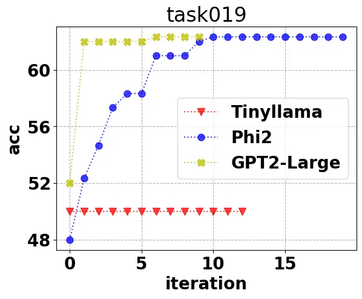

(a) Task 019

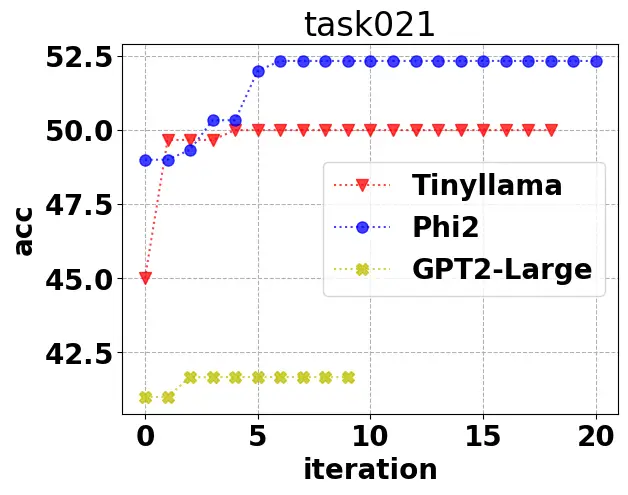

(b) Task 021

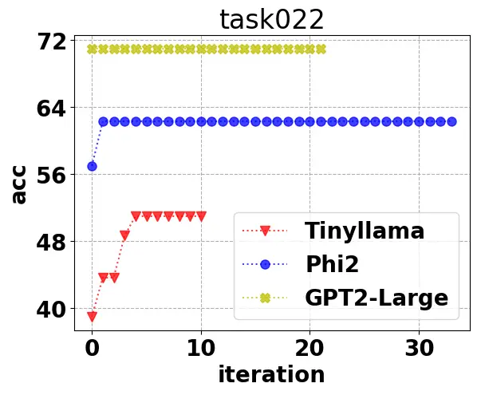

(c) Task 022

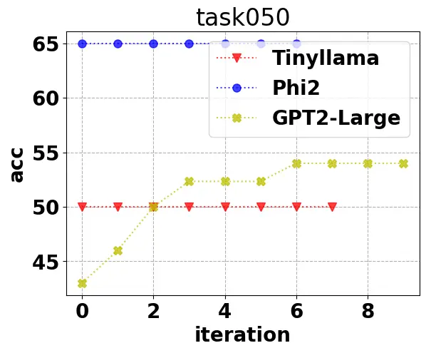

(d) Task 050

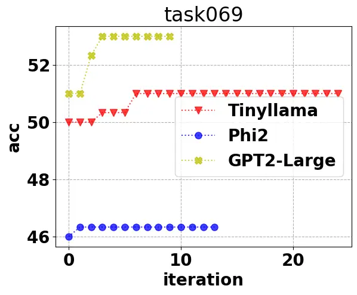

(e) Task 069

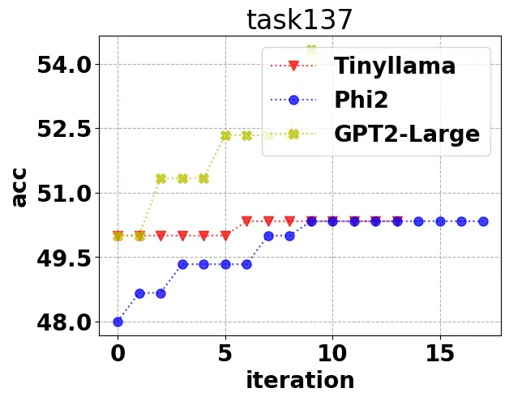

(f) Task 137

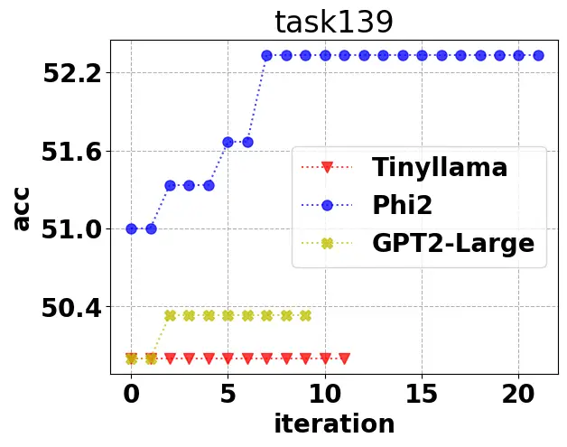

(g) Task 139

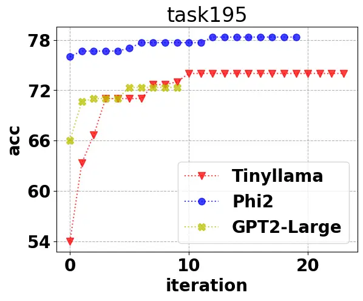

(h) Task 195

Figure 2: Performance of Plum-HS across different iterations on subtasks
of Natural-Instructions dataset.

### B.2 Plum for Chain-of-Thought

The Plum paradigm offers a natural approach to obtaining high-quality
few-shot-CoT prompts for improving LLM’s reasoning performances. To
ensure that this class of prompts still remains logical and
interpretable after optimization, we have made further improvements to
the search process by introducing an additional LLM. Specifically, we
encourage the language models to provide additional information and
details in the add operation and introduce a teaching mechanism to guide
the language models in revising prompts. On top of that, we empower the
language models to autonomously split the prompts into phrases based on
their own comprehension of the underlying text structure.

|                               |             |                  |                  |                  |                  |                  |                  |
| ----------------------------- | ----------- | ---------------- | ---------------- | ---------------- | ---------------- | ---------------- | ---------------- |
|                               | Prompting   | GSM8K            | ASDiv            | SVAMP            | AQuA             | CSQA             | StrategyQA       |
| GPT3 (_text-curie-001_)       | CoT         | 0.00             | 7.17             | 6.67             | 20.83            | 24.00            | 52.33            |
|                               | Plum-GA-M\* | 4.66$`\pm`$0.47  | 9.67$`\pm`$1.25  | 11.67$`\pm`$0.94 | 22.00$`\pm`$0.82 | 29.00$`\pm`$0.82 | 61.00$`\pm`$1.63 |
|                               | Plum-HS\*   | 4.33$`\pm`$0.47  | 12.33$`\pm`$1.25 | 11.00$`\pm`$0.82 | 21.66$`\pm`$0.47 | 30.00$`\pm`$0.82 | 54.00$`\pm`$0.00 |
| GPT3.5 (_gpt-3.5-turbo-0301)_ | CoT         | 85.00            | 92.00            | 85.17            | 59.83            | 73.17            | 72.50            |
|                               | Plum-GA-M\* | 87.33$`\pm`$0.94 | 94.67$`\pm`$0.94 | 88.00$`\pm`$0.82 | 67.67$`\pm`$1.25 | 77.33$`\pm`$0.47 | 78.00$`\pm`$1.41 |
|                               | Plum-HS\*   | 85.33$`\pm`$0.47 | 92.33$`\pm`$0.47 | 87.00$`\pm`$0.82 | 67.67$`\pm`$1.89 | 77.00$`\pm`$0.82 | 73.00$`\pm`$0.82 |

Table 8: Improvements of optimization performance for the few-shot-CoT
prompts searched by Plum-GA-M\* and Plum-HS\* as the searching
strategies on math word solving and commonsense reasoning tasks.

Figure 3: Illustration of the improved add operation and revision by
language models

As depicted in Figure 3), these enhancements utilize the power of modern
LLMs, aiming to accelerate the searching process of interpretable and
target-model-friendly prompts via improved neighborhood definitions.

##### Dataset

We test our methods on math word solving and commonsense reasoning
tasks, including GSM8k \[Cobbe et al., 2021\], ASDiv \[Miao et al.,
2020\], SVAMP \[Patel et al., 2021\], AQuA \[Koncel-Kedziorski et al.,
2016\], CSQA \[Talmor et al., 2019\], and StrategyQA \[Geva et al.,
2021\]. Those tasks evaluate models’ reasoning ability, where prompts
are expected to elicit their logical thinking skills.

##### Experiment Setup

Plum is applied to improving the performance of two backbones: GPT3
(text-curie-001) and GPT3.5 (gpt-turbo-3.5-0301) on aforementioned five
reasoning tasks. Specifically, we employ Plum-GA-M\* and Plum-HS\* for
this setting, majorly based on two reasons: 1) The effectiveness of both
algorithms has been demonstrated in the previous general prompt learning
setting, making them reasonable candidates for further extensions; 2)
Compared with Plum-GA-C, both algorithms have lower computational
complexity and similar exploration ability. Moreover, considering the
API budgets and the extensive size of the test set for both math word
solving and commonsense reasoning tasks, we chose to exclusively
showcase the optimization performance of Plum-GA-M\* and Plum-HS\* on
the training sets for reference.

##### Results

In this section, we present the enhancement achieved by the few-shot-CoT
prompts searched by Plum across five demanding downstream tasks, as
shown in Table 8. These results clearly demonstrate the superiority of
Plum-GA-M\* and Plum-HS\* over standard few-shot-CoT prompts used for
GPT3 and GPT3.5. In particular, our methods achieve universal
improvements across those five tasks on almost all the backbone models.

In addition, despite the already impressive performance of GPT3.5 with
standard few-shot-CoT prompts, we continue to observe even greater
average improvements compared to GPT3. This is due to two key factors.
Firstly, the edit operations we have developed in this section allow
GPT3.5 to generate better prompts for itself. Secondly, GPT3.5 exhibits
stronger capabilities in comprehending and leveraging the enhanced
prompts, further improving its overall performance.

##### Experimental Details

The initial few-shot-CoT prompts provided followed the Instruction +
Examples format, consisting of a task-agnostic instruction and several
positive examples (details are shown in Figure 4, which is consistent
with the setting described in \[Prasad et al., 2022\]. The Examples part
of the initial prompts is the same as the few-shot exemplars by Wei
et al. \[2022b\]. The Instruction provides a general description of the
downstream task, although its specific content may vary depending on the
backbone models used. The new prompt candidates are generated by
applying edits to both the instruction and examples with equal
probability during the searching process, i.e
$`Prob\{\text{edit the instruction}\}=Prob\{\text{edit the examples}\}=1/2`$.

For GPT3, the Instruction part of the prompt follows the zero-shot-CoT
approach proposed by Kojima et al. \[2022\]. Meanwhile, for GPT3.5, the
Instruction part of the initial prompts is manually crafted by referring
to the API reference documentation available on the GPT3.5 in the OpenAI
Platform¹¹ 1
https://platform.openai.com/docs/guides/gpt/chat-completions-api.

Figure 4: Illustration of the initial prompt for GSM8K with GPT3 (left)
and GPT3.5 (right) as backbone model

Moreover, Figure 5 illustrates the template for the prompt used of the
improved add operation and revisions, leveraging the GPT3.5 as the
underlying model.

Figure 5: Illustration of the improved add operation and revision with
GPT3.5 as backbone model

##### Experimental Cost

While producing few-shot-CoT prompts, we do not consider the API call
limit; however, we still take into account the estimated cost of the
experiments. The costs for GPT3 (text-curie-001) and GPT3.5
(gpt-3.5-turbo-0301) are nearly identical as they share the same pricing
structure (\$0.002 per 1k tokens). On average, each task typically
involves a cost of approximately \$25 and concludes after approximately
12 hours of execution when searching for few-shot-CoT prompts with a
single thread.

## Appendix C Algorithm Details

To help users better understand and utilize the package, here we present
the main idea and pseudo-codes of all included algorithms so far.

### C.1 Hill Climbing

Hill climbing is a greedy algorithm that aims to find the local optimum
of a given objective, e.g. the score function. Each time the algorithm
explores a fraction of possible prompt changes and selects one that
improves the score.

In our version, we select the one with the most improvements to further
speed up the optimization process, as shown in Algorithm 23. Notice that
in the paradigm of EvoPrompt, GrIPS can also be viewed as a special
version of Hill Climbing, given it greedily improves the prompt via edit
operations.

1: $`base\leftarrow init`$ $`\triangleright`$ Initialize base candidate

2: $`s_{base}\leftarrow\texttt{score}(base)`$ $`\triangleright`$ Score
using examples in $`\mathcal{S}`$

3:
$`\Omega\leftarrow\{\texttt{del},\texttt{swap},\texttt{par},\texttt{add}\}`$
$`\triangleright`$ Set of edit operations

4: $`\rho\leftarrow P`$ $`\triangleright`$ Patience for early-stop

5: for $`i=1,\cdots,n`$ do $`\triangleright`$ $`n`$: number of
iterations

6:   for $`j=1,\cdots,m`$ do $`\triangleright`$ $`m`$: number of
candidates

7:    Sample $`e_{1},\cdots,e_{l}\in\Omega`$ $`\triangleright`$ $`l`$
edits per candidate

8:
   $`\mathcal{C}[j]\leftarrow\texttt{edit}(base,e_{1}\circ\cdots\circ e_{l})`$

9:    $`s[j]\leftarrow\texttt{score}(\mathcal{C}[j])`$
$`\triangleright`$ Score above candidate   

10:   $`k\leftarrow\text{argmax}_{j}s[j]`$

11:   $`best\leftarrow\mathcal{C}[k]`$ $`\triangleright`$ Chosen
Candidate

12:   $`s_{best}\leftarrow s[k]`$ $`\triangleright`$ Score of chosen
candidate

13:   if $`s_{best}>s_{base}`$ then $`\triangleright`$ Candidate better
than base

14:    $`base\leftarrow best`$ $`\triangleright`$ Use this candidate in
the next step

15:    $`s_{base}\leftarrow s_{best}`$ $`\triangleright`$ Update base
score

16:    $`\rho\leftarrow P`$ $`\triangleright`$ Refresh patience

17:   else

18:    if $`\rho>0`$ then $`\triangleright`$ Patience not exhausted

19:      decrement $`\rho`$

20:      continue $`\triangleright`$ Continue search with same base

21:    else

22:      return base $`\triangleright`$ Early-stop criteria met      

23: return base $`\triangleright`$ Search terminates after the last
iteration

Algorithm 2 GrIPS / Hill Climbing

### C.2 Simulated Annealing

Different from hill climbing, simulated annealing \[Kirkpatrick et al.,
1983\] allows a small probability of deviation when the prompt change
does not yield instant improvement, thus capable of escaping from local
optimums and finding better solutions. The probability of deviation is
controlled by a hyperparameter called “temperature” $`T(i)`$ at
iteration $`i`$, where the lower temperature is, smaller the deviation
probability is, less random the algorithm behavior becomes. When the
temperature $`T(i)=0`$, simulated annealing becomes deterministic and
degenerates to hill climbing.

As shown in Algorithm 23, it only differs from hill climbing in one
line, where it utilizes the provided temperature $`T(i)`$ to decide the
deviation probability. We use exponential decay $`T(i)=10\exp(-i/5)`$ as
our default temperature schedule in the package.

1: $`base\leftarrow init`$ $`\triangleright`$ Initialize base candidate

2: $`s_{base}\leftarrow\texttt{score}(base)`$ $`\triangleright`$ Score
using examples in $`\mathcal{S}`$

3:
$`\Omega\leftarrow\{\texttt{del},\texttt{swap},\texttt{par},\texttt{add}\}`$
$`\triangleright`$ Set of edit operations

4: $`\rho\leftarrow P`$ $`\triangleright`$ Patience for early-stop

5: for $`i=1,\cdots,n`$ do $`\triangleright`$ $`n`$: number of
iterations

6:   for $`j=1,\cdots,m`$ do $`\triangleright`$ $`m`$: number of
candidates

7:    Sample $`e_{1},\cdots,e_{l}\in\Omega`$ $`\triangleright`$ $`l`$
edits per candidate

8:
   $`\mathcal{C}[j]\leftarrow\texttt{edit}(base,e_{1}\circ\cdots\circ e_{l})`$

9:    $`s[j]\leftarrow\texttt{score}(\mathcal{C}[j])`$
$`\triangleright`$ Score above candidate   

10:   $`k\leftarrow\text{argmax}_{j}s[j]`$

11:   $`best\leftarrow\mathcal{C}[k]`$ $`\triangleright`$ Chosen
Candidate

12:   $`s_{best}\leftarrow s[k]`$ $`\triangleright`$ Score of chosen
candidate

13:   if $`s_{best}>s_{base}`$ or
$`\exp(\frac{s_{best}-s_{base}}{T(i)})\geq\texttt{Random}(\mathcal{U}(0,1))`$
then $`\triangleright`$ Candidate better than base

14:    $`base\leftarrow best`$ $`\triangleright`$ Use this candidate in
the next step

15:    $`s_{base}\leftarrow s_{best}`$ $`\triangleright`$ Update base
score

16:    $`\rho\leftarrow P`$ $`\triangleright`$ Refresh patience

17:   else

18:    if $`\rho>0`$ then $`\triangleright`$ Patience not exhausted

19:      decrement $`\rho`$

20:      continue $`\triangleright`$ Continue search with same base

21:    else

22:      return base $`\triangleright`$ Early-stop criteria met      

23: return base $`\triangleright`$ Search terminates after the last
iteration

Algorithm 3 Simulated Annealing

### C.3 Genetic Algorithm (Mutation Only)

Genetic algorithm \[Holland, 1992\] was inspired by biological evolution
during the nature selection process, where each prompt is treated as a
“gene” and the score function serves as the criterion of nature
selection.

In a simplified version of genetic algorithm, as illustrated in
Algorithm 4, only mutation operations are adopted to change the prompt.
A population of prompts $`\mathbf{W}`$ are maintained during the
optimization process, indicating all the possible exploring directions
of the algorithm. At each iteration, we select a high-quality prompt
from all those exploring directions via tournament selection.
Intuitively, the more tournament round $`k`$ we adopt, the higher
quality of the selected prompt, but the less explorative the algorithm
behavior becomes. The selected prompt is then mutated to generate a new
prompt.

As the algorithm proceeds, the average quality of prompts in the
population is expected to improve. In fact, given sufficient number of
iterations, the algorithm is capable of finding the global optimum.

1: $`base\leftarrow init`$ $`\triangleright`$ Initialize base candidate

2: $`s_{base}\leftarrow\texttt{score}(base)`$ $`\triangleright`$ Score
using examples in $`\mathcal{S}`$

3:
$`\Omega\leftarrow\{\texttt{del},\texttt{swap},\texttt{par},\texttt{add}\}`$
$`\triangleright`$ Set of edit operations

4: $`\rho\leftarrow P`$ $`\triangleright`$ Patience for early-stop

5: $`\mathbf{W}\leftarrow\{\langle base,s_{base}\rangle\}`$

6: $`result\leftarrow base`$ $`\triangleright`$ Initialize population

7: for $`i=1,2,\cdots,n`$ do $`\triangleright`$ $`n`$: number of
iterations

8:   $`\mathbf{S}\leftarrow\emptyset`$ $`\triangleright`$ Examples that
are going to battle in the tournament

9:   for $`j=1,2,\cdots,k`$ do $`\triangleright`$ $`k`$: tournament
selection hyperparameter

10:
   $`\langle parent,s_{parent}\rangle\leftarrow\texttt{Random}(\mathbf{W})`$

11:
   $`\mathbf{S}\leftarrow\mathbf{S}+\{\langle parent,s_{parent}\rangle\}`$

  

12:
  $`base\leftarrow\text{argmax}_{\{parent|\langle parent,s_{parent}\rangle\in\mathbf{S}\}}s_{parent}`$

13:   for $`j=1,\cdots,m`$ do $`\triangleright`$ $`m`$: number of
candidates

14:    Sample $`e_{1},\cdots,e_{l}\in\Omega`$ $`\triangleright`$ $`l`$
edits per candidate

15:
   $`\mathcal{C}[j]\leftarrow\texttt{edit}(base,e_{1}\circ\cdots\circ e_{l})`$

16:    $`s[j]\leftarrow\texttt{score}(\mathcal{C}[j])`$
$`\triangleright`$ Score above candidate   

17:   $`k\leftarrow\text{argmax}_{j}s[j]`$

18:   $`best\leftarrow\mathcal{C}[k]`$ $`\triangleright`$ Chosen
Candidate

19:   $`s_{best}\leftarrow s[k]`$ $`\triangleright`$ Score of chosen
candidate

20:
  $`\mathbf{W}\leftarrow\mathbf{W}+\{\langle best,s_{best}\rangle\}`$

21:   if $`s_{best}>s_{result}`$ then $`\triangleright`$ Candidate
better than best result so far

22:    $`result\leftarrow best`$

23:    $`s_{result}\leftarrow s_{best}`$

24:    $`\rho\leftarrow P`$ $`\triangleright`$ Refresh patience

25:   else

26:    if $`\rho>0`$ then $`\triangleright`$ Patience not exhausted

27:      decrement $`\rho`$

28:      continue $`\triangleright`$ Continue search with same base

29:    else

30:      return $`result`$ $`\triangleright`$ Early-stop criteria met

     

31: return $`result`$ $`\triangleright`$ Search terminates after the
last iteration

Algorithm 4 Genetic Algorithm (mutation only)

### C.4 Genetic Algorithm (with Crossover)

The general version of genetic algorithm \[Holland, 1992\] is realized
in Algorithm 5. Besides the mutation operation, a different operation
called “crossover” is introduced, where we allow new prompts to be
generated from two “parent prompts”. The new prompts will inherit
partial segments from both parent prompts and be further changed with
mutation operations.

Intuitively speaking, crossover operation represents “global” changes in
the search space, while mutation operation represents “local” changes,
hence it is to be expected that the genetic algorithm with crossover is
less efficient than its simplified counterpart, but more explorative and
capable of finding better solutions with sufficient iterations.

Hyperparameters: Number of iterations $`n`$, population size $`N_{p}`$,
number of offsprings each generation $`N_{\text{offspring}}`$, mutation
probability $`p_{mutation}`$.

1: $`base\leftarrow init`$ $`\triangleright`$ Initialize base candidate

2: $`s_{base}\leftarrow\texttt{score}(base)`$ $`\triangleright`$ Score
using examples in $`\mathcal{S}`$

3:
$`\Omega\leftarrow\{\texttt{del},\texttt{swap},\texttt{par},\texttt{add}\}`$
$`\triangleright`$ Set of edit operations

4: $`\rho\leftarrow P`$ $`\triangleright`$ Patience for early-stop

5:
$`\mathbf{W}_{0}\leftarrow\{\langle base,s_{base}\rangle\times N_{p}\}`$
$`\triangleright`$ $`N_{p}`$ copies of the initial prompt

6: $`result\leftarrow base`$

7: for $`i=1,2,\cdots,n`$ do $`\triangleright`$ $`n`$: number of
iterations

8:    $`\mathbf{W}_{i}\leftarrow\mathbf{W}_{i-1}`$

9:    for $`j=1,2,\cdots,N_{\text{offspring}}`$ do $`\triangleright`$
===== Crossover

10:     $`\langle parent_{1},s_{parent_{1}}\rangle\leftarrow`$
binary*tournament_selection($`\mathbf{W}*{i-1}`$)

11:     $`\langle parent_{2},s_{parent_{2}}\rangle\leftarrow`$
binary*tournament_selection($`\mathbf{W}*{i-1}`$)

12:     $`\text{offspring}\leftarrow`$
crossover($`parent_{1},parent_{2}`$)

13:     if $`\text{offspring}\not\in\mathbf{W}_{i}`$ then

14:
      $`s_{\text{offspring}}\leftarrow\texttt{score}(\text{offspring})`$

15:
      $`\mathbf{W}_{i}\leftarrow\mathbf{W}_{i}+\{\langle\text{offspring},s_{\text{offspring}}\rangle\}`$

       

16:    $`\mathbf{W}_{i}\leftarrow\texttt{top-}N_{p}(\mathbf{W}_{i})`$
$`\triangleright`$ Removes prompts with bad scores, reserves only best
$`N_{p}`$ prompts

17:    $`\rho,result,flag_{stop}\leftarrow`$
update*result($`\rho,result,\mathbf{W}*{i}`$)

18:    if $`flag_{stop}`$ then return $`result`$    

19:

20:    $`\mathbf{W}^{\prime}_{i}\leftarrow\mathbf{W}_{i}`$

21:    for $`\forall\langle base,s_{base}\rangle\in\mathbf{W}_{i}`$ do
$`\triangleright`$ ===== Mutation

22:     if $`p_{mutation}\geq\texttt{Random}([0,1])`$ then

23:       Sample $`e_{1},\cdots,e_{l}\in\Omega`$ $`\triangleright`$
$`l`$ edits per candidate

24:
      $`mutated\leftarrow\texttt{edit}(base,e_{1}\circ\cdots\circ e_{l})`$

25:       $`s_{mutated}\leftarrow\texttt{score}(mutated)`$
$`\triangleright`$ Score above candidate

26:
      $`\mathbf{W}^{\prime}_{i}\leftarrow\mathbf{W}^{\prime}_{i}+\{\langle mutated,s_{mutated}\rangle\}`$

       

27:
   $`\mathbf{W}_{i}\leftarrow\texttt{top-}N_{p}(\mathbf{W}^{\prime}_{i})`$
$`\triangleright`$ Removes prompts with bad scores, reserves only best
$`N_{p}`$ prompts

28:    $`\rho,result,flag_{stop}\leftarrow`$
update*result($`\rho,result,\mathbf{W}*{i}`$)

29:    if $`flag_{stop}`$ then return $`result`$    

30: return $`result`$ $`\triangleright`$ Search terminates after last
iteration

31:

32: function binary_tournament_selection($`\mathbf{W}`$)

33:    $`\mathbf{S}\leftarrow\emptyset`$

34:    for $`i=1,2`$ do

35:
    $`\langle parent,s_{parent}\rangle\leftarrow\texttt{Random}(\mathbf{W})`$

36:
    $`\mathbf{S}\leftarrow\mathbf{S}+\{\langle parent,s_{parent}\rangle\}`$

   

37:    return
$`\text{argmax}_{\{parent|\langle parent,s_{parent}\rangle\in\mathbf{S}\}}s_{parent}`$

38:

39: function crossover($`parent_{1},parent_{2}`$)

40:
   $`[\mathbf{t}_{1,1},\mathbf{t}_{1,2},\dots,\mathbf{t}_{1,L_{1}}]\leftarrow parent_{1}`$

41:
   $`[\mathbf{t}_{2,1},\mathbf{t}_{2,2},\dots,\mathbf{t}_{2,L_{2}}]\leftarrow parent_{2}`$

42:
   $`split\leftarrow\texttt{Random}(\{0,1,2,\dots,\max(L_{1},L_{2})\})`$

43:
   $`\text{offspring}\leftarrow[\mathbf{t}_{1,1},\dots,\mathbf{t}_{1,split},\mathbf{t}_{2,split+1},\dots,\mathbf{t}_{2,L_{2}}]`$

44:    return offspring

45:

46: function update_result($`\rho,result,\mathbf{W}`$)

47:    $`flag_{stop}\leftarrow\textbf{false}`$

48:
   $`best\leftarrow\text{argmax}_{\{prompt|\langle prompt,s_{prompt}\rangle\in\mathbf{W}\}}s_{prompt}`$

49:    if $`s_{best}>s_{result}`$ then $`\triangleright`$ Candidate
better than best result so far

50:     $`result\leftarrow best`$

51:     $`s_{result}\leftarrow s_{best}`$

52:     $`\rho\leftarrow P`$ $`\triangleright`$ Refresh patience

53:    else

54:     if $`\rho>0`$ then $`\triangleright`$ Patience not exhausted

55:       decrement $`\rho`$

56:     else

57:       $`flag_{stop}\leftarrow\textbf{true}`$ $`\triangleright`$
Early-stop criteria met        

58:    return $`\rho,result,flag_{stop}`$

Algorithm 5 Genetic Algorithm (with crossover)

### C.5 Tabu Search

Greedy search algorithms tend to be stuck in a local optimum or near a
local optimum. Tabu Search \[Glover, 1986\] effectively compensates for
this shortcoming by introducing the Tabu list: any candidate that was
visited recently is forbidden to visit again. This allows the
optimization process to leave the local “tabu” area and explore more.

In Algorithm 6 we adopt a simple Tabu rule of direct comparison: with a
high probability, a generated prompt that exactly matches any prompts in
the Tabu list will be treated as invalid and discarded, where the Tabu
list only retains the $`N_{tabu}`$ latest generated prompts.

1: $`base\leftarrow init`$ $`\triangleright`$ Initialize base candidate

2: $`s_{base}\leftarrow\texttt{score}(base)`$ $`\triangleright`$ Score
using examples in $`\mathcal{S}`$

3:
$`\Omega\leftarrow\{\texttt{del},\texttt{swap},\texttt{par},\texttt{add}\}`$
$`\triangleright`$ Set of edit operations

4: $`\rho\leftarrow P`$ $`\triangleright`$ Patience for early-stop

5: $`result\leftarrow base`$ $`\triangleright`$ Initialize population

6: $`w_{0}\leftarrow base`$

7: $`\mathcal{T}\leftarrow\{w_{0}\}`$ $`\triangleright`$ Initialize
$`\mathcal{T}`$

8: for $`i=1,2,\cdots,K`$ do $`\triangleright`$ $`n`$: number of
iterations

9:   for $`j=1,2,\cdots,n`$ do $`\triangleright`$ $`k`$: number of the
new candidate

10:    Sample $`e_{1},\cdots,e_{l}\in\Omega`$ $`\triangleright`$ $`l`$
edits per candidate

11:
   $`\mathcal{C}[j]\leftarrow\texttt{edit}(base,e_{1}\circ\cdots\circ e_{l})`$

12:    $`s[j]\leftarrow\texttt{score}(\mathcal{C}[j])`$
$`\triangleright`$ Score above candidate   

13:   $`\mathcal{W}^{\prime}_{j}\leftarrow`$
Tabu($`\mathcal{T},s[j],TEMP`$) = 0

14:   $`k\leftarrow\text{argmax}_{l\in\mathcal{W}^{\prime}_{j}}s[j]`$

15:   $`best\leftarrow\mathcal{C}[k]`$ $`\triangleright`$ Chosen
Candidate

16:   $`s_{best}\leftarrow s[k]`$ $`\triangleright`$ Score of chosen
candidate

17:   $`\mathcal{T}\leftarrow\mathcal{T}+s[k]`$ $`\triangleright`$
Update $`\mathcal{T}`$

18:   if $`s_{best}>s_{result}`$ then $`\triangleright`$ Candidate
better than best result so far

19:    $`result\leftarrow best`$

20:    $`s_{result}\leftarrow s_{best}`$

21:    $`\rho\leftarrow P`$ $`\triangleright`$ Refresh patience

22:   else

23:    if $`\rho>0`$ then $`\triangleright`$ Patience not exhausted

24:      decrement $`\rho`$

25:      continue $`\triangleright`$ Continue search with same base

26:    else

27:      return $`result`$ $`\triangleright`$ Early-stop criteria met

     

28:   if $`|\mathcal{T}|>N_{tabu}`$ then

29:
   $`\mathcal{T}\leftarrow\mathcal{T}-w_{k-N_{tabu}}`$$`\triangleright`$
Keep Short-term tabus   

30: return $`result`$ $`\triangleright`$ Search terminates after last
iteration

31: function Tabu($`\mathcal{T}`$,$`w`$, $`TEMP`$)

32:   if $`w\in\mathcal{T}`$ then

33:    if $`TEMP\geq\texttt{Random}(\mathcal{U}(0,1))`$ then

34:      return 0

35:    else

36:      return 1    

37:   else

38:    return 0   

Algorithm 6 Tabu Search

### C.6 Harmony Search

Harmony Search \[Geem et al., 2001\] mimics the improvision procedure of
musicians, where a new prompt is generated via combining segments of all
stored prompts in the harmony memory. A pitch finetuning process is then
conducted, allowing further refinement of the prompt. The full details
are available in Algorithm 7.

1: $`base\leftarrow init`$ $`\triangleright`$ Initialize base candidate

2: $`s_{base}\leftarrow\texttt{score}(base)`$ $`\triangleright`$ Score
using examples in $`\mathcal{S}`$

3:
$`\Omega\leftarrow\{\texttt{del},\texttt{swap},\texttt{par},\texttt{add}\}`$

4: $`\Omega_{small}\leftarrow\{\texttt{par}\}`$ $`\triangleright`$ Set
of edit operations

5: $`\rho\leftarrow P`$ $`\triangleright`$ Patience for early-stop

6: $`\mathbf{W}_{0}\leftarrow\{\langle base,s_{base}\rangle\}`$

7: $`result\leftarrow base`$ $`\triangleright`$ Initialize population

8: for $`i=1,2,\cdots,n`$ do $`\triangleright`$ $`n`$: number of
iterations

9:   $`\mathbf{W}^{\prime}\leftarrow\emptyset`$ $`\triangleright`$
Candidates generated at this iteration

10:   for $`c=1,2,\cdots,k`$ do

11:    $`\mathbf{w}^{\prime}\leftarrow`$
generate*candidate($`\mathbf{W}*{i-1},\Omega\_{small},\Omega`$)

12:
   $`s_{\mathbf{w}^{\prime}}\leftarrow\texttt{score}(\mathbf{w}^{\prime})`$
$`\triangleright`$ Score the new candidate

13:
   $`\mathbf{W}^{\prime}\leftarrow\mathbf{W}^{\prime}+\{\langle\mathbf{w}^{\prime},s_{\mathbf{w}^{\prime}}\rangle\}`$

  

14:   $`\rho,result,flag_{stop}\leftarrow`$
update_result($`\rho,result,\mathbf{W}^{\prime}`$)

15:   if $`flag_{stop}`$ then return $`result`$   

16:
  $`\mathbf{W}_{i}\leftarrow\texttt{top-}N_{H}(\mathbf{W}_{i-1}\cup\mathbf{W}^{\prime})`$
$`\triangleright`$ Removes prompts with bad scores, reserves only best
$`N_{H}`$ prompts

17: return $`result`$ $`\triangleright`$ Search terminates after last
iteration

18: function generate*candidate($`\mathbf{W},\Omega*{small},\Omega`$)

19:   $`\mathbf{w}^{\prime}\leftarrow[\ ]`$ $`\triangleright`$ Empty
string/list

20:   for $`j=1,2,\cdots,k_{s}`$ do $`\triangleright`$ $`k_{s}`$: number
of segments (pitches)

21:
   $`\langle\mathbf{w},*\rangle\leftarrow\texttt{Random}(\mathbf{W})`$
$`\triangleright`$ Randomly sample an existing prompt for $`j`$-th
segment

22:    $`L\leftarrow|\mathbf{w}|`$ $`\triangleright`$ Length of the
reference prompt

23:    $`[w_{0},w_{1},\dots,w_{L-1}]\leftarrow\mathbf{w}`$

24:    $`start\leftarrow\lceil\frac{j-1}{k_{s}}\cdot L\rceil`$

25:    $`end\leftarrow\lceil\frac{j}{k_{s}}\cdot L\rceil-1`$

26:
   $`\mathbf{w}_{segment}\leftarrow[w_{start},w_{start+1},\dots,w_{end}]`$

27:    if $`HMCR\geq\texttt{Random}(\mathcal{U}(0,1))`$ then

28:      if $`PAR\geq\texttt{Random}(\mathcal{U}(0,1))`$ then
$`\triangleright`$ A little different random segment (pitch)

29:       Sample $`e_{1},\cdots,e_{l}\in\Omega_{small}`$
$`\triangleright`$ Only replace phrases with their synonyms

30:       $`\mathbf{w}_{segment}\leftarrow`$
$`\texttt{edit}(\mathbf{w}_{segment},e_{1}\circ\cdots\circ e_{l})`$

     

31:    else$`\triangleright`$ A largely different random segment (pitch)

32:      Sample $`e_{1},\cdots,e_{l}\in\Omega`$ $`\triangleright`$ A big
change in the original segment

33:
     $`\mathbf{w}_{segment}\leftarrow\texttt{edit}(\mathbf{w}_{segment},e_{1}\circ\cdots\circ e_{l})`$

   

34:    $`\mathbf{w}^{\prime}=\mathbf{w}^{\prime}+\mathbf{w}_{segment}`$
$`\triangleright`$ Here “$`+`$” means concatenation.   

35:   return $`\mathbf{w}^{\prime}`$

36: function update_result($`\rho,result,\mathbf{W}`$)

37:   $`flag_{stop}\leftarrow\textbf{false}`$

38:
  $`best\leftarrow\text{argmax}_{\{prompt|\langle prompt,s_{prompt}\rangle\in\mathbf{W}\}}s_{prompt}`$

39:   if $`s_{best}>s_{result}`$ then $`\triangleright`$ Candidate
better than best result so far

40:    $`result\leftarrow best`$

41:    $`s_{result}\leftarrow s_{best}`$

42:    $`\rho\leftarrow P`$ $`\triangleright`$ Refresh patience

43:   else

44:    if $`\rho>0`$ then $`\triangleright`$ Patience not exhausted

45:      decrement $`\rho`$

46:    else

47:      $`flag_{stop}\leftarrow\textbf{true}`$ $`\triangleright`$
Early-stop criteria met      

48:   return $`\rho,result,flag_{stop}`$

Algorithm 7 Harmony Search

## Appendix D Hyperparameter Setting

For all the experiments, the number of edits that performs on the
candidate prompts ($`num\_compose`$) and the number of the newly
generated candidates ($`num\_candidate`$) in each iteration follows
$`num\_compose\in\{1,2\}`$ and $`num\_candidate\in\{5,10\}`$. The
population sizes, and tournament selections $`k`$ of Plum-GA-M,
Plum-GA-C and Plum-GA-M\* are all set to $`10`$ and $`3`$ respectively.
Meanwhile, the mutation rate $`p_{\text{mutation}}`$ is set to $`0.5`$
for Plum-GA-C. The $`N_{\text{tabu}}`$ is configured to $`5`$ for
Plum-TS. Additionally, the configuration for the harmony search memory
($`N_{H}`$), the number of segments ($`k_{s}`$), harmony memory
considering rate ($`HMCR`$), and pitching adjust rate ($`PAR`$) of
Plum-HS and Plum-HS\* is as follows: $`10`$, $`5`$, $`0.4`$, and
$`0.5`$, respectively. Furthermore, the temperatures of GPT-3 are
configured to $`0`$ in our experiments.

In the context of general prompt learning, disregarding the API call
limit allows us to set the maximum iteration and patience parameters to
$`50`$ and $`7`$ respectively, which ensures that Plum-GA-M and
Plum-GA-C have a sufficient number of iterations to generate relatively
optimal solutions.

When it comes to few-shot-CoT prompt learning, setting a very large
value for the maximum iterations is not recommended due to the potential
cost implications, which is primarily because the number of tokens
generated in each iteration tends to be substantial. And for Plum-GA-M\*
and Plum-HS\*, effective results can be obtained with maximum iterations
ranging from $`5`$ to $`15`$, coupled with a patience level ranging from
$`2`$ to $`5`$. For the experimental results shown in Table 8, we
configured the maximum iterations to be $`10`$ and deactivated the
patience parameter.

For text-to-image generation tasks, to accommodate a wide range of
application scenarios, the initial prompts for image generation are kept
short (merely $`5`$-$`15`$ words). Given that stable diffusion requires
approximately $`15`$ seconds (on a NVIDIA A40 GPU) to produce each
image, and the scoring process necessitates the generation of two images
for direct comparison, it has been observed that after $`6`$-$`7`$
iterations, most prompts reach a point of convergence where the best
score is achieved. Consequently, it is advisable to limit the number of
iterations to $`5`$-$`15`$ and set the patience parameter between
$`2`$-$`5`$. In the experimental results presented in Table 5, we set
the maximum iterations to $`10`$ and deactivated the patience parameter.
Furthermore, considering the prompt’s brevity, the initial $`k_{s}`$
value was set to $`2`$ in the experiments to guarantee that each segment
targeted for modification includes at least one tag. Additionally, the
Harmony Memory Considering Rate ($`HMCR`$), Pitch Adjustment Rate
($`PAR`$), and Harmony Search Memory ($`n_{H}`$) were set to $`0.4`$,
$`0.5`$, and $`10`$ respectively.

##### Sensitiveness of Plum-HS Hyperparameters

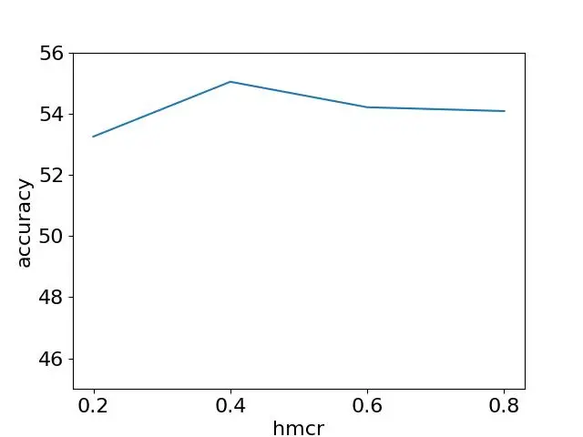

(a) $`HMCR`$

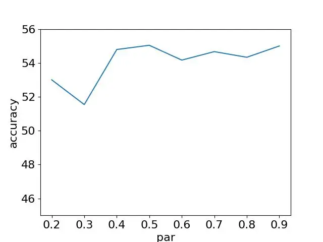

(b) $`PAR`$

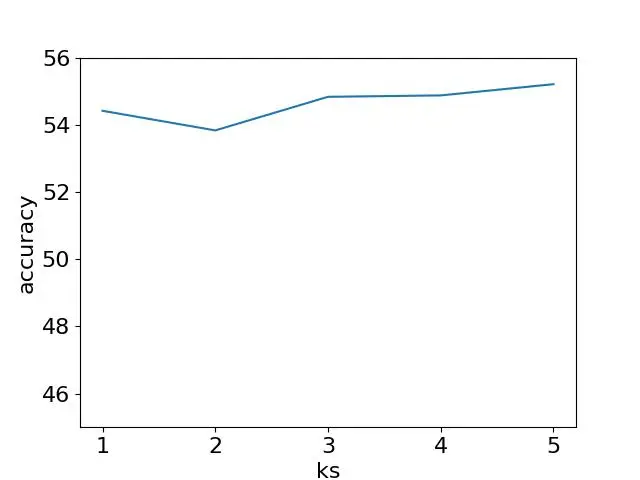

(c) $`k_{s}`$

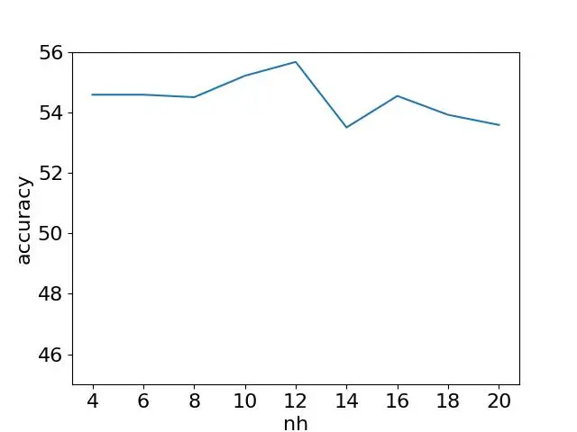

(d) $`N_{H}`$

Figure 6: The effects of the parameters of Plum-HS with GPT2-large as
backbone.

To gain deeper insights into the impact of key hyperparameters in
Harmony Search and guide their effective tuning, we conducted an
ablation study on $`HMCR`$, $`k_{s}`$ and $`N_{H}`$ for Plum-HS with
GPT2-large as the backbone model. As shown in Figure 6, both the Harmony
Memory Consideration Rate $`HMCR`$ and the Harmony Memory size $`N_{H}`$
achieve optimal performance with a moderate value. This trend aligns
with the core principles of Harmony Search (Algorithm 7). Low $`HMCR`$
encourages the algorithm perform random modifications, which results in
introducing too much difference. Conversely, high $`HMCR`$ over-relies
on past prompts in the harmony memory, which lacks diversity. As for
Harmony Memory size $`N_{H}`$, it is similar to the population size in
genetic algorithms. Small $`N_{H}`$ restricts exploration such that the
algorithm behaves similarly to greedy search and lacks diversity. While,
large $`N_{H}`$ deteriorates the quality of memorized prompts, and slows
down the search efficiency. Notably, the performance exhibits stable and
high performance when $`PAR`$ is set to $`0.4`$ or above.

For $`k_{s}`$, we find that a larger value introduces superior
performance. This is because larger $`k_{s}`$ leads to finer granularity
of segments, which allows a finer level of tuning on prompts. In this
paper, the upper bound of $`k_{s}`$ is considered as $`5`$ since the
shortest sample in our datasets only contains $`5`$ segments of words.

## Appendix E Licenses

For general prompt learning tasks, the dataset Natural-Instructions
v2.6 \[Mishra et al., 2022\] is released under Apache-2.0 license. While
for Chain-of-Thought prompt learning, the datasets ASDiv \[Miao et al.,
2020\], SVAMP \[Patel et al., 2021\], CSQA \[Talmor et al., 2019\] are
released under CC-BY-NC 4.0, MIT, and CC BY-SA 4.0 licenses
respectively.
