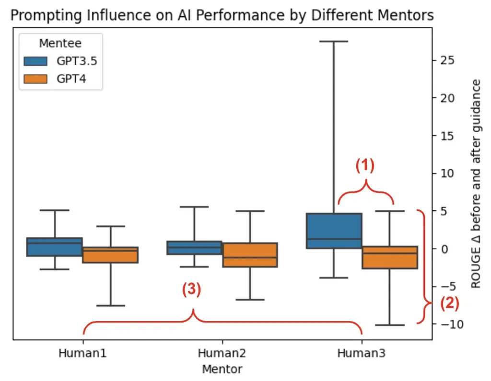
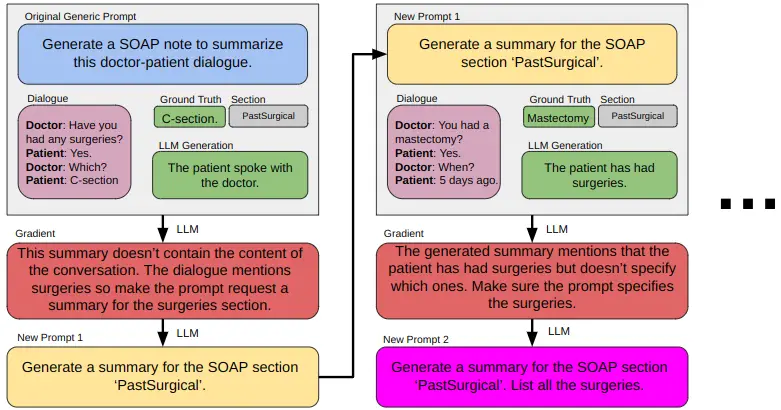
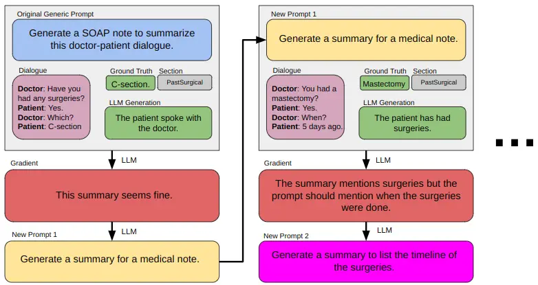

# Do Clinicians Know How to Prompt? The Need for Automatic Prompt Optimization Help in Clinical Note Generation

Zonghai Yao ^(†)^(†)thanks: \* Indicates equal contribution Email:
<zonghaiyao@umass.edu>    Ahmed Jaafar¹¹footnotemark: 1 Email:
<ajaafar@umass.edu>    Beining Wang    Zhichao Yang    Hong Yu   
University of Massachusetts Amherst    Fudan University

###### Abstract

This study examines the effect of prompt engineering on the performance
of Large Language Models (LLMs) in clinical note generation. We
introduce an Automatic Prompt Optimization (APO) framework to refine
initial prompts and compare the outputs of medical experts, non-medical
experts, and APO-enhanced GPT3.5 and GPT4. Results highlight GPT4-APO’s
superior performance in standardizing prompt quality across clinical
note sections. A human-in-the-loop approach shows that experts maintain
content quality post-APO, with a preference for their own modifications,
suggesting the value of expert customization. We recommend a two-phase
optimization process, leveraging APO-GPT4 for consistency and expert
input for personalization ¹¹ 1
[https://github.com/seasonyao/Automatic_Prompt_Optimization_Physician_Prompting](https://github.com/seasonyao/Automatic_Prompt_Optimization_Physician_Prompting).

## 1 Introduction

^(†)^(†) To appear in BioNLP 2024

Large Language Models (LLMs), including iterations of the Generative
Pre-trained Transformer (GPT) series, have dramatically expanded the
scope of natural language processing (NLP). Their applications now range
from simple Q&A to the intricate demands of clinical documentation,
necessitating the craft of prompt engineering Brown et al. (2020); Sanh
et al. (2021); Chowdhery et al. (2022); Longpre et al. (2023); OpenAI
(2023); Wang et al. (2023a); Yang et al. (2023b). The quality of a
prompt is paramount, as it is typically created by a human mentor to
guide an LLM mentee to generate the document. Yet, this prompt creation
process is encumbered by the complexities of human expression—rich in
subtleties and cultural nuance—that often surpass the computational
confines of LLMs, resulting in a cognitive gap Zamfirescu-Pereira et al.
(2023). Variances in prompt quality lead to differences in prompt
efficacy, which can fluctuate considerably (1) when switching between
LLM mentees (As shown in Figure 1, ‘mentor’ modifies the prompt to allow
‘mentee’ to perform the targeted task better) and (2) across various
sections of the documentation or (3) among different human mentors, as
illustrated in Figure 1. This inherent variability underscores the need
for a consistent tool that standardizes prompt quality to achieve
reliable uniformity in LLM performance.

Figure 1: Influence of different mentors on AI mentee performance
enhancement. This figure illustrates the changes in AI mentee
performance following prompting by three individual human mentors and an
APO system, represented on the x-axis. The y-axis measures the variation
in ROUGE scores before and after prompting, with blue bars indicating
GPT3.5 and orange bars denoting GPT4 as mentee to generate clinical note
content according to different prompt groups. The results indicate the
differential impact of human versus APO prompting on AI content
generation quality.

In the clinical domain, where the stakes are particularly high,
optimizing prompt engineering is critical to help busy clinicians most
efficiently use LLMs for clinical practice. Our study adopts Automatic
Prompt Optimization (APO) Prasad et al. (2022) as a novel solution to
address these challenges. APO refines the initial prompts provided by
clinicians, adapting them to the nuanced requirements of different
clinical note sections for AI-assisted clinical documentation. Thus, the
resulting clinical notes are significantly enhanced in quality and
efficiency.

Through a comprehensive comparative analysis, our research elucidates
how APO, when used with human experts, substantially elevates the
refinement process of prompts. Our first experimental set pits generic
prompts, modified by medical experts, non-medical experts, and
APO-enhanced GPT3.5 and GPT4, against each other. The results highlight
APO-GPT4’s remarkable ability to elevate content generation, revealing
an inherent capacity for self-improvement that aligns with recent
academic discourse. Our second experimental set delves into the
potential of human-in-the-loop systems. Here, we further refine
APO-generated prompts with human experts. Contrary to non-expert
interventions, which often detracted from the quality of the content,
expert modifications maintained the high standards set by APO. Moreover,
our human preference feedback suggests that, while experts may not
significantly alter the content quality, they prefer the results of
their own modifications, pointing to a personalized touch without
sacrificing the quality of the content.

In light of our findings, we advocate a two-pronged approach to prompt
optimization: initially employing APO-GPT4 to standardize prompt
quality, followed by expert-led customization based on preference. This
strategy offers a pragmatic balance, effectively harnessing the power of
AI while respecting the nuances of human expertise.

## 2 Related Work

Soft prompts and parameter adjustments offer promising results for
open-source LLMs Li and Liang (2021); Lester et al. (2021); Hu et al.
(2021), while discrete prompt searches Shin et al. (2020); Wen et al.
(2023) and reinforcement learning Deng et al. (2022); Zhang et al.
(2022) push the boundaries further. Closed-source LLMs, conversely,
necessitate gradient-free optimization, relying on iterative prompt
refinement and natural language feedback for efficacy Prasad et al.
(2022); Xu et al. (2022); Guo et al. (2023); Fernando et al. (2023);
Zhou et al. (2022); Xu et al. (2023); Pryzant et al. (2023); Yang et al.
(2023a); Wang et al. (2023d); Dong et al. (2023); Li et al. (2023); Sun
et al. (2023).

In the clinical context, synthesizing such optimization techniques has
been pivotal. Foundational work in automated note generation Krishna et
al. (2020); Song et al. (2020); Yim and Yetisgen-Yildiz (2021); Su et
al. (2022); Giorgi et al. (2023); Wang et al. (2023b); Wang et al.
(2023c); Yao et al. (2023) informs our approach, integrating APO to
streamline medical documentation. This research leverages both iterative
enhancement and expert feedback, embodying the iterative, gradient-free
optimization approach to improve the precision of clinical LLM
applications.

## 3 Method

We are given a dataset $`D`$ of $`n`$ i.i.d training clinical data,
comprised of $`f`$ features ($`D\in\mathbb{R}^{n\times f}`$) including
the doctor-patient dialogue, the name of a SOAP Podder et al. (2021);
Podder et al. (2023) note section ²² 2 SOAP structure details can be
found in the Appendix A.1., the ground truth section clinical note
summary, the model-generated section clinical note summary, etc. Our
method broadly consists of a “forward pass” (3.1) and a “backward pass”
(3.2). First, an LLM generates summaries for a batch $`h`$ from a
section $`s\in S`$ using a generic prompt $`p_{0}`$ provided by the
user. An LLM is then asked via a fixed prompt $`p_{\nabla}`$ to provide
suggestions to make $`p_{0}`$ more suitable for $`s`$ given the ground
truth and generated summaries, producing an answer $`g`$. Afterward,
another fixed prompt, $`p_{\delta}`$, is used to command the LLM to use
$`g`$ to fix $`p_{0}`$, outputting a new prompt $`p^{\prime}`$.
$`p^{\prime}`$ should now be slightly more tailored to generate better
summaries for $`s`$, closer to the theoretical optimal prompt $`p^{*}`$.
This is executed for all $`S`$ utilizing a random sample of data $`h`$
(batch) from each section, where $`h\subseteq n`$. This process is
illustrated in Figure 2 and detailed in Algorithm 1 ³³ 3 Algorithm 1 is
simplified to use one data point’s dialogue ($`x`$). In reality, a batch
($`h`$) of data is used. Note that iterations for batch h involve a
single type but not multiple types of sections..

### 3.1 Forward Pass

The forward pass utilizes an LLM to generate summaries ($`\hat{y}`$) for
$`h`$ from section $`s`$ by passing in a generic user-provided prompt
($`p_{0}`$), doctor-patient dialogue ($`x`$), and $`s`$. We use black
box LLMs via API, denoted as $`LLMp(i)`$ ⁴⁴ 4 $`i`$ is defined as all
the inputs to the prompt (dialogue, section, etc.).. This API yields a
probable text continuation, symbolized as $`\hat{y}`$, given a prompt.
This prompt is a fusion of $`p`$ and $`i`$. Mathematically, $`LLMp(i)`$
is approximated by
$`\text{argmax}_{\hat{y}\in L}P_{\text{LLM}}(\hat{y}|p,i)`$, where it
selects the most likely continuation $`\hat{y}`$ from the set of natural
language tokens $`L`$. The ones used for our method are OpenAI’s GPT3.5
and GPT4 ⁵⁵ 5 We use OpenAI’s gpt-3.5-turbo-0613 and gpt-4-0613 in our
experiments..

$`p_{0}`$ is a generic prompt such as the one shown in Figure 2 or
Appendix A.4 that, in our use case, would be provided by a medical
professional such as a clinician. It is a prompt that only instructs the
model, in this step LLM $`a`$. $`p_{0}`$ and $`x`$ are passed into $`a`$
to output a generated summary $`\hat{y}`$. This first $`\hat{y}`$ is
likely to be very suboptimal for $`s`$.

1: $`p_{0}=`$ “Generate a SOAP summary.”

2: $`p_{\nabla}=`$ “What’s wrong with $`p_{0}`$?”

3: $`p_{\delta}=`$ “Use $`g`$ to fix $`p_{0}`$.”

4: procedure forward($`s,x`$)

5:   $`p_{0}=p_{0}+s+x`$

6:   return a($`p_{0}`$) $`\triangleright`$ LLM $`a`$

7: end procedure

8: procedure backward($`s,x,y,\hat{y}`$)

9:   $`p_{\nabla}=p_{\nabla}+p_{0}+s+x+y+\hat{y}`$

10:   $`g=`$ b($`p_{\nabla}`$) $`\triangleright`$ LLM $`b`$

11:   $`p_{\delta}=p_{\delta}+p_{0}+g`$

12:   return b($`p_{\delta}`$) $`\triangleright`$ LLM $`b`$

13: end procedure

14: procedure main

15:   for $`i=1`$ to $`k`$ do

16:    for $`c=1`$ to $`j`$ do

17:      $`\hat{y}=\textsc{forward}(x,s)`$

18:      $`p^{\prime}=\textsc{backward}(s,x,y,\hat{y})`$

19:      $`p_{0}=p^{\prime}`$

20:    end for

21:   end for

22: end procedure

Algorithm 1 SOAP Note Prompt Optimization

### 3.2 Backward Pass

This segment of the algorithm represents the key transformational stage.
The backward pass consists of (1) utilizing the same or a different LLM
as before to provide suggestions on what is wrong with $`\hat{y}`$, (2)
utilizing the LLM in step 1 to fix $`p_{0}`$ using the suggestions
provided in step 1. Step 1 generates “gradients” and step 2 performs
“backpropagation”.

The backward pass starts by passing in a fixed prompt ($`p_{\nabla}`$),
$`p_{0}`$, $`x`$, $`s`$, the ground truth summaries ($`y`$), and
$`\hat{y}`$ into an LLM $`b`$ to generate suggestions ($`g`$) on how to
fix $`p_{0}`$ to make it more suitable for generating summaries for
$`s`$. An example is shown in Appendix A.4. These suggestions are named
“gradients”, the reason $`p`$ is labeled with $`\nabla`$. Note that
$`a\stackrel{{\scriptstyle?}}{{=}}b`$, i.e. $`a`$ may or may not be
equal to $`b`$.

Next, a fixed prompt ($`p_{\delta}`$), like the one shown in Appendix
A.4, commands $`b`$ to use $`g`$ to fix $`p_{0}`$. $`g`$, $`p_{0}`$, and
$`p_{\delta}`$ are passed into $`b`$. “gradient descent” happens here.
$`p_{\delta}`$ resembles differentiation in traditional neural network
training by using $`g`$ (the “gradient”) to guide the model toward a
lower “loss”. Hence the $`p`$ is labeled with $`\delta`$. A new prompt
$`p^{\prime}`$ is outputted by $`b`$, which should be closer to the
optimal prompt $`p^{*}`$. $`p^{*}=\text{argmax}_{p\in L}\{m(p,T)\}`$,
where $`m(\cdot)`$ represents a metric function and $`T`$ is all the
training data for $`s`$. $`p^{\prime}`$ should be an edited version of
$`p_{0}`$ that is in the opposite semantic direction.

### 3.3 Iterations & Validation

At this point in the algorithm, the same $`h`$ is summarized again using
$`a`$, but this time with $`p^{\prime}`$. The new summaries are
evaluated against $`y`$.

$`p^{\prime}`$ is set to $`p_{0}`$ and the “iteration” restarts,
repeating $`j`$ times. After $`j`$ iterations, the “epoch” is finished,
and the final prompt, $`p^{\prime}_{final}`$, is used to generate
summaries for a validation dataset $`E`$. These summaries are evaluated
against $`y`$ to check the performance of $`p^{\prime}_{final}`$. The
epochs are repeated $`k`$ times.

### 3.4 Human-in-the-Loop Prompt Refinement

Enhancing the APO framework, we incorporate a human-in-the-loop
component for prompt refinement. Post-APO, medical experts and
laypersons review and adjust $`p^{\prime}_{final}`$ for each $`s`$,
adding clinical acumen to the AI’s output. These revised prompts,
$`p^{\prime}_{final-human}`$, are then evaluated by generating new
summaries and scoring them against ground truths. The goal is to
determine if there is a potential for human-AI collaboration on this
task, and whether it should be with experts or not.

## 4 Experiments

### 4.1 Dataset

With 1.7k total doctor-patient dialogues and summaries, MTS-Dialog
supports advances in automatic clinical note generation Abacha et al.
(2023b); Abacha et al. (2023a). For our initial exploration of which GPT
variants are the best across most sections (more details in Section
4.4), we use the original evaluation split of 100 data points. For APO,
since the evaluation split is small, we merge the training and
evaluation data into a single pool. The data is comprised of 20 SOAP
sections. We discard sections with less than 10 data points, resulting
in 14 sections that meet the criteria for further experimentation. Then,
we randomly sample 5 data points from each section as training data.
Detailed data distribution for these sections is outlined in the
Appendix Table 3.

### 4.2 Metrics

Models are evaluated with full-length F1-scores of ROUGE Lin (2004) and
METEOR Banerjee and Lavie (2005). We use QuickUMLS⁶⁶ 6
https://github.com/Georgetown-IR-Lab/QuickUMLS to extract medical
concepts from both model-generated and ground truth summaries and then
calculate F1-scores for these two lists of concepts, which is named
UMLS-F1 Adams et al. (2023). We also add human preferences in Experiment
Set-2.

| Mentor     | R1              | R2    | RL    | M     | U-f   |
| ---------- | --------------- | ----- | ----- | ----- | ----- |
|            | X guides GPT3.5 |       |       |       |       |
| Gen        | 23.50           | 8.05  | 21.69 | 22.58 | 32.83 |
| Exp        | 23.99           | 8.55  | 22.18 | 23.69 | 32.79 |
| NoExp      | 25.77           | 7.96  | 23.96 | 22.69 | 33.27 |
| APO-GPT3.5 | 24.22           | 9.17  | 22.45 | 22.82 | 32.53 |
| APO-GPT4   | 27.92           | 11.32 | 26.14 | 25.00 | 36.89 |
|            | X guides GPT4   |       |       |       |       |
| Gen        | 24.99           | 8.94  | 23.74 | 24.82 | 33.13 |
| Exp        | 24.06           | 8.43  | 21.74 | 25.12 | 31.84 |
| NoExp      | 23.87           | 7.56  | 22.21 | 23.32 | 31.88 |
| APO-GPT3.5 | 23.19           | 8.31  | 21.59 | 23.79 | 28.94 |
| APO-GPT4   | 30.00           | 11.14 | 27.86 | 26.35 | 35.27 |

Table 1: Performance across different prompting groups for GPT3.5 and
GPT4. ‘Gen’ denotes the baseline generic prompts, ‘Exp’ and ‘NoExp’
represent expert and non-expert human modifications, respectively, while
‘APO-GPT3.5’ and ‘APO-GPT4’ indicate prompts refined through APO.

### 4.3 Experimental Setup

We put the details of our dataset in Appendix 4.1. First, we designed
the experiment to use the generic prompt, outlined in Appendix A.4, on
six different GPT models ⁷⁷ 7 text-ada-001, text-babbage-001,
text-curie-001, text-davinci-003, gpt-3.5-turbo-0613, and gpt-4-0613.
This objective was to evaluate which variants are the best across most
sections, thereby guiding our selection for use in APO. We then divided
our experiments into two sets ⁸⁸ 8 After we got the different sets’
prompts, we then ran gpt-3.5-turbo-0613 or gpt-4-0613 API with
self-consistency and zero-shot settings Wang et al. (2022), where
temperature=0.3, run numbers=5. We used the default numbers for all
other parameters in OpenAI API.:

Set-1: Comparative Analysis of APO and Human Contributions in Clinical
Note Generation. This experiment aims to assess how APO, compared with
humans, can assist in improving content generation for different
sections of clinical notes. Specifically, we introduce a generic prompt
and training data for distinct sections. The goal is to aid AI systems,
such as GPT3.5 and GPT4, in identifying suitable section prompts that
enhance content generation in each section. Our experiment involves four
groups of prompters: medical experts ⁹⁹ 9 One licensed physician,
non-medical experts ¹⁰¹⁰ 10 One has a master’s degree, and one has a
bachelor’s degree. They do not have any medical background., GPT3.5
(with APO), and GPT4 (with APO). Each group modifies the generic prompt
based on the training data for each section. We then compare the
effectiveness of these modified prompts in assisting AI to generate
summaries for different sections, using the results of the generic
prompt as a baseline.

Set-2: Enhancing AI-Generated Clinical Content through Humans Prompt
Modification Post-APO. In this set of experiments, we take the results
of GPT3.5 (with APO) and GPT4 (with APO) as new baselines and invite
medical experts and non-medical experts to further modify the prompts
based on their knowledge and preferences. This approach examines how
human intervention, post-APO implementation, affects the quality of
AI-generated content in various clinical note sections. We analyze the
effectiveness of these modifications by comparing them against the
baseline established by APO-modified prompts, focusing on the nuances
introduced by the domain-specific knowledge and preferences of the two
human groups.

| Mentor    | R1              | R2    | RL    | M     | U-f   |
| --------- | --------------- | ----- | ----- | ----- | ----- |
|           | X guides GPT3.5 |       |       |       |       |
| APO-GPT4  | 27.92           | 11.32 | 26.14 | 25.00 | 36.89 |
| Exp-APO   | 26.89           | 10.82 | 25.39 | 25.46 | 36.62 |
| NoExp-APO | 26.71           | 9.07  | 24.89 | 21.68 | 33.44 |
|           | X guides GPT4   |       |       |       |       |
| APO-GPT4  | 30.00           | 11.14 | 27.86 | 26.35 | 35.27 |
| Exp-APO   | 28.83           | 10.70 | 27.20 | 26.48 | 35.57 |
| NoExp-APO | 28.28           | 9.78  | 26.60 | 24.25 | 32.68 |

Table 2: Comparative effectiveness of post-APO-GPT4 human prompt
modifications. This table shows the results of human intervention after
APO-GPT4 prompts, where ‘Exp-APO’ and ‘NoExp-APO’ denote the
post-APO-GPT4 modifications by experts and non-experts.

### 4.4 Results

For our initial experiment, the findings indicate that GPT-4 and GPT3.5
emerged as the most effective variants, in descending order of
performance, as detailed in Appendix A.5. As a result, they were used
for our proposed algorithm.

Set-1: Comparative Analysis of APO and Human Contributions in Clinical
Note Generation. Upon examining the ‘X guides GPT3.5’ results from Table
1 ¹¹¹¹ 11 The details can be found in Appendix Table 5, we observed that
expert and non-expert modifications resulted in slight improvements
compared to the generic (baseline) results. However, according to the
ROUGE and METEOR scores, ‘expert guides GPT3.5’ did not yield better
outcomes than ‘non-expert guides GPT3.5’; non-experts led regarding
factuality (UMLS-f1) scores. The performance of APO-GPT3.5 did not
significantly differ from the baseline, whereas APO-GPT4 markedly
surpassed all other methods. Compared to human modifications, APO-GPT4
enhanced summary quality, a feat APO-GPT3.5 did not achieve. For the
same Table 1 ‘X guides GPT3.5’ experiment, the results indicated that
prompts modified by experts, non-experts, and APO-GPT3.5 all fell short
of the generic prompt across various sections, with expert modifications
slightly outperforming non-experts, and both human groups surpassing
APO-GPT3.5, especially in terms of factuality score. Consistent with the
‘X guides GPT3.5’ findings, APO-GPT4 again significantly elevated the
scores across the board. Finally, the results in the Appendix Table 5
show the helpful effect of APO-GPT4 on problem (2) and (3) in Figure 1.
These results further demonstrate GPT4’s emergent abilities in
self-critique Madaan et al. (2023), self-feedback Huang et al. (2022),
and self-explanation Zhao et al. (2023).

Set-2: Enhancing AI-Generated Clinical Content through Humans Prompt
Modification Post-APO. In this experiment, we continued to explore the
outcomes of the human-in-the-loop paradigm on top of APO. From the
previous experiments in Table 1, it was evident that APO-GPT4
significantly boosted the summary quality, raising the lower bound of AI
performance on this task and providing a new baseline for users to
engage in further prompt engineering. We refer to the process of experts
post-editing APO-refined APO-GPT4 prompts as ‘Exp-APO’ and the analogous
post-editing by non-experts as ‘NoExp-APO’. We compared Exp-APO and
NoExp-APO modifications, with the term ‘APO’ now exclusively referring
to the results achieved by APO-GPT4. In Table 2, we found that for both
‘X guides GPT3.5’ and ‘X guides GPT4’, Exp-APO modifications did not
significantly differ from APO-GPT4 in terms of ROUGE, METEOR, and
UMLS-f1 scores, whereas NoExp-APO modifications notably degraded summary
quality, particularly factuality scores, suggesting a loss of key
information or the introduction of hallucinations.

In a detailed comparison between Exp-APO and APO-GPT4, we curated a
human evaluation dataset from 100 randomly selected instances within the
evaluation set. This allowed experts who contributed to Exp-APO to
assess and provide feedback on their preference for summaries generated
from their revised prompts compared to those produced by the original
APO-GPT4 prompts. The outcome showed a preference distribution where 75%
favored Exp-APO, 3% indicated no preference, and 22% preferred APO-GPT4.
These results show that while factuality scores remained closely
comparable, there was a slight decrease in ROUGE scores for Exp-APO, yet
the expert preference was markedly in favor of Exp-APO. This can be
attributed to how APO tends to enforce certain structural elements
within prompts, such as explicitly stating ‘None’ in the absence of
information. Experts tended to remove such repetitive formulations,
which, although potentially reducing the strict adherence to format and
the ROUGE score, did not impact the factuality score. Moreover, experts’
preferences are less influenced by rigid formatting and more by their
own knowledge and experience. These expert insights, incorporated
through the human-in-the-loop approach, may have introduced a degree of
personalization to the prompts, aligning the AI-generated content more
closely with human evaluative criteria and contributing to the overall
preference for Exp-APO. This suggests that while expert post-editing
prompts may not markedly enhance the quality of APO-GPT4 summaries, they
align more closely with user preferences, offering a more personalized
result without sacrificing summary quality.

## 5 Conclusion

Our investigation has demonstrated the profound impact of prompt
engineering on the effectiveness of LLMs, specifically in clinical note
generation. Implementing our APO framework has notably advanced the
standardization of prompt quality, particularly with GPT4, which has
shown superior performance in generating clinical notes. Incorporating a
human-in-the-loop approach further validated the importance of expert
involvement, indicating a clear preference for expert-modified prompts,
suggesting that personalized tweaks to APO-generated prompts yield
user-preferred outcomes without compromising the content’s integrity.

## 6 Limitations

Our research, while insightful, acknowledges several limitations. The
task-specific nature of our findings implies that even if prompts
perform well within our dataset, this does not guarantee similar success
in real-world, complex scenarios. The MTS-Dialog dataset’s limitations
also pose challenges; many sections had insufficient data, leading to
exclusion and a lack of comprehensive coverage. Even after preprocessing
and filtering, data imbalance remains a concern. Moreover, our
evaluation metrics—ROUGE, METEOR, and UMLS-f1—may not fully encapsulate
the qualitative subtleties of clinical note generation, potentially
overlooking nuances apparent to human experts. The number of human
mentors involved was constrained by time and financial resources,
possibly introducing bias into the results.

Recent advancements in APO have seen the development of more
sophisticated algorithms aimed at enhancing efficacy and stability
Fernando et al. (2023); Wang et al. (2023d); Dong et al. (2023); Li et
al. (2023); Sun et al. (2023); Opsahl-Ong et al. (2024); however, these
were not compared in our study. Additionally, our approach to prompting
with APO and human experts primarily focused on general quality without
targeting specific aspects such as hallucination Huang et al. (2023).
Tailoring the APO algorithm to improve particular model performances
(e.g., factuality) could yield more targeted enhancements. The
integration of external resources, like databases, information retrieval
systems, or writing assistant tools, could also provide additional
information to aid AI in making more accurate suggestions during the
forward pass and refinements during the backward pass, overcoming some
of the AI’s knowledge limitations Petroni et al. (2019); Sung et al.
(2021); Yao et al. (2022a); Yao et al. (2022b); Singhal et al. (2022).

Moving forward, we plan to delve deeper into the nuances of prompt
engineering, exploring the boundaries of personalization and the
potential for even more sophisticated AI-human collaboration models. We
aim to expand the diversity of expert input and examine the impact of
such variations on the overall system performance. Furthermore, future
work will also investigate the scalability of our approach to other
domains within NLP, testing the generalizability and robustness of the
APO framework. In addition, we are also interested in the emergent
ability of GPT4 that can perform APO for other AI and itself well, and
we plan to distill this ability into trainable LLMs, such as the LLaMA
family Touvron et al. (2023a); Touvron et al. (2023b), by creating a
batch of synthetic instruction learning data Wang et al. (2022); Tran et
al. (2023).

## 7 Ethics Statement

In conducting this research, we have adhered to ethical guidelines,
ensuring that all patient data used in the dataset was anonymized and
used strictly for research purposes. We have also considered the
potential implications of our work on clinical practice, emphasizing the
enhancement of AI tools as assistive rather than replacement
technologies to support medical professionals. As we progress, we remain
committed to upholding these ethical standards and continuously
assessing the societal impacts of our research.

## References

- Abacha et al. (2023a) Asma Ben Abacha, Wen-wai Yim, Griffin Adams,
  Neal Snider, and Meliha Yetisgen-Yildiz. 2023a. Overview of the
  mediqa-chat 2023 shared tasks on the summarization & generation of
  doctor-patient conversations. In _Proceedings of the 5th Clinical
  Natural Language Processing Workshop_, pages 503–513.
- Abacha et al. (2023b) Asma Ben Abacha, Wen-wai Yim, Yadan Fan, and
  Thomas Lin. 2023b. An empirical study of clinical note generation from
  doctor-patient encounters. In _Proceedings of the 17th Conference of
  the European Chapter of the Association for Computational
  Linguistics_, pages 2283–2294.
- Adams et al. (2023) Griffin Adams, Jason Zucker, and Noémie
  Elhadad. 2023. A meta-evaluation of faithfulness metrics for long-form
  hospital-course summarization. _arXiv preprint arXiv:2303.03948_.
- Banerjee and Lavie (2005) Satanjeev Banerjee and Alon Lavie. 2005.
  [METEOR: An automatic metric for MT evaluation with improved
  correlation with human
  judgments](https://www.aclweb.org/anthology/W05-0909). In _Proceedings
  of the ACL Workshop on Intrinsic and Extrinsic Evaluation Measures for
  Machine Translation and/or Summarization_, pages 65–72, Ann Arbor,
  Michigan. Association for Computational Linguistics.
- Brown et al. (2020) Tom B. Brown, Benjamin Mann, Nick Ryder, Melanie
  Subbiah, Jared Kaplan, Prafulla Dhariwal, Arvind Neelakantan, Pranav
  Shyam, Girish Sastry, Amanda Askell, Sandhini Agarwal, Ariel
  Herbert-Voss, Gretchen Krueger, Tom Henighan, Rewon Child, Aditya
  Ramesh, Daniel M. Ziegler, Jeffrey Wu, Clemens Winter, Christopher
  Hesse, Mark Chen, Eric Sigler, Mateusz Litwin, Scott Gray, Benjamin
  Chess, Jack Clark, Christopher Berner, Sam McCandlish, Alec Radford,
  Ilya Sutskever, and Dario Amodei. 2020. [Language models are few-shot
  learners](https://proceedings.neurips.cc/paper/2020/file/1457c0d6bfcb4967418bfb8ac142f64a-Paper.pdf).
  In _Advances in Neural Information Processing Systems_, volume 33,
  pages 1877–1901.
- Chowdhery et al. (2022) Aakanksha Chowdhery, Sharan Narang, Jacob
  Devlin, Maarten Bosma, Gaurav Mishra, Adam Roberts, Paul Barham, Hyung
  Won Chung, Charles Sutton, Sebastian Gehrmann, Parker Schuh, Kensen
  Shi, Sasha Tsvyashchenko, Joshua Maynez, Abhishek Rao, Parker Barnes,
  Yi Tay, Noam Shazeer, Vinodkumar Prabhakaran, Emily Reif, Nan Du, Ben
  Hutchinson, Reiner Pope, James Bradbury, Jacob Austin, Michael Isard,
  Guy Gur-Ari, Pengcheng Yin, Toju Duke, Anselm Levskaya, Sanjay
  Ghemawat, Sunipa Dev, Henryk Michalewski, Xavier Garcia, Vedant Misra,
  Kevin Robinson, Liam Fedus, Denny Zhou, Daphne Ippolito, David Luan,
  Hyeontaek Lim, Barret Zoph, Alexander Spiridonov, Ryan Sepassi, David
  Dohan, Shivani Agrawal, Mark Omernick, Andrew M. Dai, Thanumalayan
  Sankaranarayana Pillai, Marie Pellat, Aitor Lewkowycz, Erica Moreira,
  Rewon Child, Oleksandr Polozov, Katherine Lee, Zongwei Zhou, Xuezhi
  Wang, Brennan Saeta, Mark Diaz, Orhan Firat, Michele Catasta, Jason
  Wei, Kathy Meier-Hellstern, Douglas Eck, Jeff Dean, Slav Petrov, and
  Noah Fiedel. 2022. [PaLM: Scaling language modeling with
  pathways](https://doi.org/10.48550/ARXIV.2204.02311). _arXiv preprint
  arXiv:2204.02311_.
- Deng et al. (2022) Mingkai Deng, Jianyu Wang, Cheng-Ping Hsieh, Yihan
  Wang, Han Guo, Tianmin Shu, Meng Song, Eric P Xing, and Zhiting
  Hu. 2022. Rlprompt: Optimizing discrete text prompts with
  reinforcement learning. _arXiv preprint arXiv:2205.12548_.
- Dong et al. (2023) Yihong Dong, Kangcheng Luo, Xue Jiang, Zhi Jin, and
  Ge Li. 2023. Pace: Improving prompt with actor-critic editing for
  large language model. _arXiv preprint arXiv:2308.10088_.
- Fernando et al. (2023) Chrisantha Fernando, Dylan Banarse, Henryk
  Michalewski, Simon Osindero, and Tim Rocktäschel. 2023. Promptbreeder:
  Self-referential self-improvement via prompt evolution. _arXiv
  preprint arXiv:2309.16797_.
- Giorgi et al. (2023) John Giorgi, Augustin Toma, Ronald Xie, Sondra
  Chen, Kevin An, Grace Zheng, and Bo Wang. 2023. Wanglab at mediqa-chat
  2023: Clinical note generation from doctor-patient conversations using
  large language models. In _Proceedings of the 5th Clinical Natural
  Language Processing Workshop_, pages 323–334.
- Guo et al. (2023) Qingyan Guo, Rui Wang, Junliang Guo, Bei Li, Kaitao
  Song, Xu Tan, Guoqing Liu, Jiang Bian, and Yujiu Yang. 2023.
  Connecting large language models with evolutionary algorithms yields
  powerful prompt optimizers. _arXiv preprint arXiv:2309.08532_.
- Hu et al. (2021) Edward J Hu, Yelong Shen, Phillip Wallis, Zeyuan
  Allen-Zhu, Yuanzhi Li, Shean Wang, Lu Wang, and Weizhu Chen. 2021.
  Lora: Low-rank adaptation of large language models. _arXiv preprint
  arXiv:2106.09685_.
- Huang et al. (2022) Jiaxin Huang, Shixiang Shane Gu, Le Hou, Yuexin
  Wu, Xuezhi Wang, Hongkun Yu, and Jiawei Han. 2022. Large language
  models can self-improve. _arXiv preprint arXiv:2210.11610_.
- Huang et al. (2023) Lei Huang, Weijiang Yu, Weitao Ma, Weihong Zhong,
  Zhangyin Feng, Haotian Wang, Qianglong Chen, Weihua Peng, Xiaocheng
  Feng, Bing Qin, et al. 2023. A survey on hallucination in large
  language models: Principles, taxonomy, challenges, and open questions.
  _arXiv preprint arXiv:2311.05232_.
- Krishna et al. (2020) Kundan Krishna, Sopan Khosla, Jeffrey P Bigham,
  and Zachary C Lipton. 2020. Generating soap notes from doctor-patient
  conversations using modular summarization techniques. _arXiv preprint
  arXiv:2005.01795_.
- Lester et al. (2021) Brian Lester, Rami Al-Rfou, and Noah
  Constant. 2021. The power of scale for parameter-efficient prompt
  tuning. _arXiv preprint arXiv:2104.08691_.
- Li et al. (2023) Cheng Li, Mingyang Zhang, Qiaozhu Mei, Weize Kong,
  and Michael Bendersky. 2023. Automatic prompt rewriting for
  personalized text generation. _arXiv preprint arXiv:2310.00152_.
- Li and Liang (2021) Xiang Lisa Li and Percy Liang. 2021.
  Prefix-tuning: Optimizing continuous prompts for generation. _arXiv
  preprint arXiv:2101.00190_.
- Lin (2004) Chin-Yew Lin. 2004. ROUGE: A package for automatic
  evaluation of summaries. In _Text summarization branches out_, pages
  74–81.
- Longpre et al. (2023) Shayne Longpre, Le Hou, Tu Vu, Albert Webson,
  Hyung Won Chung, Yi Tay, Denny Zhou, Quoc V. Le, Barret Zoph, Jason
  Wei, and Adam Roberts. 2023. [The flan collection: Designing data and
  methods for effective instruction
  tuning](https://doi.org/10.48550/ARXIV.2301.13688).
- Madaan et al. (2023) Aman Madaan, Niket Tandon, Prakhar Gupta, Skyler
  Hallinan, Luyu Gao, Sarah Wiegreffe, Uri Alon, Nouha Dziri, Shrimai
  Prabhumoye, Yiming Yang, et al. 2023. Self-refine: Iterative
  refinement with self-feedback. _arXiv preprint arXiv:2303.17651_.
- OpenAI (2023) OpenAI. 2023. Gpt-4 technical report. _arXiv preprint
  arXiv:2303.08774_.
- Opsahl-Ong et al. (2024) Krista Opsahl-Ong, Michael J Ryan, Josh
  Purtell, David Broman, Christopher Potts, Matei Zaharia, and Omar
  Khattab. 2024. Optimizing instructions and demonstrations for
  multi-stage language model programs. _arXiv preprint
  arXiv:2406.11695_.
- Petroni et al. (2019) Fabio Petroni, Tim Rocktäschel, Patrick Lewis,
  Anton Bakhtin, Yuxiang Wu, Alexander H Miller, and Sebastian
  Riedel. 2019. Language models as knowledge bases? _arXiv preprint
  arXiv:1909.01066_.
- Podder et al. (2021) V Podder, V Lew, and S Ghassemzadeh. 2021. Soap
  notes.\[updated 2021 sep 2\]. _StatPearls \[Internet\]. StatPearls
  Publishing. Available from: https://www. ncbi. nlm. nih.
  gov/books/NBK482263_.
- Podder et al. (2023) V Podder, V Lew, and S Ghassemzadeh. 2023. [Soap
  notes](https://www.ncbi.nlm.nih.gov/books/NBK482263/). _StatPearls
  \[Internet\]_. PMID: 29489268.
- Prasad et al. (2022) Archiki Prasad, Peter Hase, Xiang Zhou, and Mohit
  Bansal. 2022. Grips: Gradient-free, edit-based instruction search for
  prompting large language models. _arXiv preprint arXiv:2203.07281_.
- Pryzant et al. (2023) Reid Pryzant, Dan Iter, Jerry Li, Yin Tat Lee,
  Chenguang Zhu, and Michael Zeng. 2023. Automatic prompt optimization
  with" gradient descent" and beam search. _arXiv preprint
  arXiv:2305.03495_.
- Sanh et al. (2021) Victor Sanh, Albert Webson, Colin Raffel,
  Stephen H. Bach, Lintang Sutawika, Zaid Alyafeai, Antoine Chaffin,
  Arnaud Stiegler, Teven Le Scao, Arun Raja, Manan Dey, M. Saiful Bari,
  Canwen Xu, Urmish Thakker, Shanya Sharma, Eliza Szczechla, Taewoon
  Kim, Gunjan Chhablani, Nihal V. Nayak, Debajyoti Datta, Jonathan
  Chang, Mike Tian-Jian Jiang, Han Wang, Matteo Manica, Sheng Shen,
  Zheng Xin Yong, Harshit Pandey, Rachel Bawden, Thomas Wang, Trishala
  Neeraj, Jos Rozen, Abheesht Sharma, Andrea Santilli, Thibault Févry,
  Jason Alan Fries, Ryan Teehan, Stella Biderman, Leo Gao, Tali Bers,
  Thomas Wolf, and Alexander M. Rush. 2021. [Multitask prompted training
  enables zero-shot task
  generalization](https://arxiv.org/abs/2110.08207). _CoRR_,
  abs/2110.08207.
- Shin et al. (2020) Taylor Shin, Yasaman Razeghi, Robert L Logan IV,
  Eric Wallace, and Sameer Singh. 2020. Autoprompt: Eliciting knowledge
  from language models with automatically generated prompts. _arXiv
  preprint arXiv:2010.15980_.
- Singhal et al. (2022) Karan Singhal, Shekoofeh Azizi, Tao Tu, S Sara
  Mahdavi, Jason Wei, Hyung Won Chung, Nathan Scales, Ajay Tanwani,
  Heather Cole-Lewis, Stephen Pfohl, et al. 2022. Large language models
  encode clinical knowledge. _arXiv preprint arXiv:2212.13138_.
- Song et al. (2020) Yan Song, Yuanhe Tian, Nan Wang, and Fei Xia. 2020.
  Summarizing medical conversations via identifying important
  utterances. In _Proceedings of the 28th International Conference on
  Computational Linguistics_, pages 717–729, Barcelona, Spain (Online).
- Su et al. (2022) Jing Su, Longxiang Zhang, Hamidreza Hassanzadeh, and
  Thomas Schaaf. 2022. Extract and abstract with bart for clinical notes
  from doctor-patient conversations. In _Interspeech_.
- Sun et al. (2023) Hong Sun, Xue Li, Yinchuan Xu, Youkow Homma, Qi Cao,
  Min Wu, Jian Jiao, and Denis Charles. 2023. Autohint: Automatic prompt
  optimization with hint generation. _arXiv preprint arXiv:2307.07415_.
- Sung et al. (2021) Mujeen Sung, Jinhyuk Lee, Sean Yi, Minji Jeon,
  Sungdong Kim, and Jaewoo Kang. 2021. Can language models be biomedical
  knowledge bases? _arXiv preprint arXiv:2109.07154_.
- Touvron et al. (2023a) Hugo Touvron, Thibaut Lavril, Gautier Izacard,
  Xavier Martinet, Marie-Anne Lachaux, Timothée Lacroix, Baptiste
  Rozière, Naman Goyal, Eric Hambro, Faisal Azhar, et al. 2023a. Llama:
  Open and efficient foundation language models. _arXiv preprint
  arXiv:2302.13971_.
- Touvron et al. (2023b) Hugo Touvron, Louis Martin, Kevin Stone, Peter
  Albert, Amjad Almahairi, Yasmine Babaei, Nikolay Bashlykov, Soumya
  Batra, Prajjwal Bhargava, Shruti Bhosale, et al. 2023b. Llama 2: Open
  foundation and fine-tuned chat models. _arXiv preprint
  arXiv:2307.09288_.
- Tran et al. (2023) Hieu Tran, Zhichao Yang, Zonghai Yao, and Hong
  Yu. 2023. Bioinstruct: Instruction tuning of large language models for
  biomedical natural language processing. _arXiv preprint
  arXiv:2310.19975_.
- Wang et al. (2023a) Jiaqi Wang, Enze Shi, Sigang Yu, Zihao Wu, Chong
  Ma, Haixing Dai, Qiushi Yang, Yanqing Kang, Jinru Wu, Huawen Hu, et
  al. 2023a. Prompt engineering for healthcare: Methodologies and
  applications. _arXiv preprint arXiv:2304.14670_.
- Wang et al. (2023b) Junda Wang, Zonghai Yao, Avijit Mitra, Samuel
  Osebe, Zhichao Yang, and Hong Yu. 2023b. Umass_bionlp at mediqa-chat
  2023: Can llms generate high-quality synthetic note-oriented
  doctor-patient conversations? _arXiv preprint arXiv:2306.16931_.
- Wang et al. (2023c) Junda Wang, Zonghai Yao, Zhichao Yang, Huixue
  Zhou, Rumeng Li, Xun Wang, Yucheng Xu, and Hong Yu. 2023c. Notechat: A
  dataset of synthetic doctor-patient conversations conditioned on
  clinical notes. _arXiv preprint arXiv:2310.15959_.
- Wang et al. (2023d) Xinyuan Wang, Chenxi Li, Zhen Wang, Fan Bai,
  Haotian Luo, Jiayou Zhang, Nebojsa Jojic, Eric P Xing, and Zhiting Hu.
  2023d. Promptagent: Strategic planning with language models enables
  expert-level prompt optimization. _arXiv preprint arXiv:2310.16427_.
- Wang et al. (2022) Yizhong Wang, Yeganeh Kordi, Swaroop Mishra, Alisa
  Liu, Noah A Smith, Daniel Khashabi, and Hannaneh Hajishirzi. 2022.
  Self-instruct: Aligning language model with self generated
  instructions. _arXiv preprint arXiv:2212.10560_.
- Wen et al. (2023) Yuxin Wen, Neel Jain, John Kirchenbauer, Micah
  Goldblum, Jonas Geiping, and Tom Goldstein. 2023. Hard prompts made
  easy: Gradient-based discrete optimization for prompt tuning and
  discovery. _arXiv preprint arXiv:2302.03668_.
- Xu et al. (2022) Hanwei Xu, Yujun Chen, Yulun Du, Nan Shao, Yanggang
  Wang, Haiyu Li, and Zhilin Yang. 2022. Gps: Genetic prompt search for
  efficient few-shot learning. _arXiv preprint arXiv:2210.17041_.
- Xu et al. (2023) Weijia Xu, Andrzej Banburski-Fahey, and Nebojsa
  Jojic. 2023. Reprompting: Automated chain-of-thought prompt inference
  through gibbs sampling. _arXiv preprint arXiv:2305.09993_.
- Yang et al. (2023a) Chengrun Yang, Xuezhi Wang, Yifeng Lu, Hanxiao
  Liu, Quoc V Le, Denny Zhou, and Xinyun Chen. 2023a. Large language
  models as optimizers. _arXiv preprint arXiv:2309.03409_.
- Yang et al. (2023b) Zhichao Yang, Zonghai Yao, Mahbuba Tasmin, Parth
  Vashisht, Won Seok Jang, Beining Wang, Dan Berlowitz, and Hong Yu.
  2023b. [Performance of multimodal gpt-4v on usmle with image:
  Potential for imaging diagnostic support with
  explanations](https://doi.org/10.1101/2023.10.26.23297629). _medRxiv_.
- Yao et al. (2022a) Zonghai Yao, Yi Cao, Zhichao Yang, Vijeta
  Deshpande, and Hong Yu. 2022a. Extracting biomedical factual knowledge
  using pretrained language model and electronic health record context.
  _arXiv preprint arXiv:2209.07859_.
- Yao et al. (2022b) Zonghai Yao, Yi Cao, Zhichao Yang, and Hong Yu.
  2022b. Context variance evaluation of pretrained language models for
  prompt-based biomedical knowledge probing. _arXiv preprint
  arXiv:2211.10265_.
- Yao et al. (2023) Zonghai Yao, Benjamin J Schloss, and Sai P
  Selvaraj. 2023. Improving summarization with human edits. _arXiv
  preprint arXiv:2310.05857_.
- Yim and Yetisgen-Yildiz (2021) Wen-wai Yim and Meliha
  Yetisgen-Yildiz. 2021. Towards automating medical scribing: Clinic
  visit dialogue2note sentence alignment and snippet summarization. In
  _Proceedings of the Second Workshop on Natural Language Processing for
  Medical Conversations_, pages 10–20.
- Zamfirescu-Pereira et al. (2023) JD Zamfirescu-Pereira, Richmond Y
  Wong, Bjoern Hartmann, and Qian Yang. 2023. Why johnny can’t prompt:
  how non-ai experts try (and fail) to design llm prompts. In
  _Proceedings of the 2023 CHI Conference on Human Factors in Computing
  Systems_, pages 1–21.
- Zhang et al. (2022) Tianjun Zhang, Xuezhi Wang, Denny Zhou, Dale
  Schuurmans, and Joseph E Gonzalez. 2022. Tempera: Test-time prompt
  editing via reinforcement learning. In _The Eleventh International
  Conference on Learning Representations_.
- Zhao et al. (2023) Jiachen Zhao, Zonghai Yao, Zhichao Yang, and Hong
  Yu. 2023. Self-explain: Teaching large language models to reason
  complex questions by themselves. _arXiv preprint arXiv:2311.06985_.
- Zhou et al. (2022) Yongchao Zhou, Andrei Ioan Muresanu, Ziwen Han,
  Keiran Paster, Silviu Pitis, Harris Chan, and Jimmy Ba. 2022. Large
  language models are human-level prompt engineers. _arXiv preprint
  arXiv:2211.01910_.

## Appendix A Appendix

### A.1 SOAP Structure

The SOAP (Subjective, Objective, Assessment, and Plan) structure is
commonly used by providers Podder et al. (2021).

1.  $`\ast`$
    The Chief Complaint section is a brief description of a patient’s
    conditions and the reasons for the visit.
2.  $`\ast`$
    The Subjective section is a detailed report of the patient’s current
    conditions, such as source, onset, and duration of symptoms, mainly
    based on the patient’s self-report. This section usually includes a
    history of present illness and symptoms, current medications, and
    allergies.
3.  $`\ast`$
    The Objective section documents the results of physical exam
    findings, laboratory data, vital signs, and descriptions of imaging
    results.
4.  $`\ast`$
    The Assessment section typically contains medical diagnoses and
    reasons that lead to medical diagnoses. The assessment is typically
    based on the content of the chief complaint and the subjective and
    objective sections.
5.  $`\ast`$
    The Plan section addresses treatment plans based on the assessment.

### A.2 Human Annotation Guideline

| SOAP sections | \# Data |
| ------------- | ------- |
| ASSESSMENT    | 33      |
| PLAN          | 9       |
| EDCOURSE      | 6       |
| DISPOSITION   | 12      |
| PASTSURGICAL  | 66      |
| PASTMEDICALHX | 117     |
| ROS           | 66      |
| GENHX         | 297     |
| ALLERGY       | 59      |
| MEDICATIONS   | 55      |
| FAM SOCHX     | 368     |
| DIAGNOSIS     | 15      |
| CC            | 75      |
| EXAM          | 19      |
| Overall       | 1197    |

Table 3: The data distribution across sections in our evaluation
dataset.

Figure 2: Overview and example of a correct APO on clinical note
generation. While training on a batch, all the data instances start from
the updated prompt based on suggestions from its immediate prior data
instance.

Figure 3: Overview and example of an incorrect APO on clinical note
generation.

|            |                                |                                                                                                                 |
| ---------- | ------------------------------ | --------------------------------------------------------------------------------------------------------------- |
| Section    | Subsection                     | Definition                                                                                                      |
| Subjective |                                |                                                                                                                 |
|            | Chief Complaint                | Patient’s primary motivation for the visit and type of visit                                                    |
|            | Review of Systems              | Patient’s report of system-related health and symptoms                                                          |
|            | Past Medical History           | Patient’s reported diagnoses/conditions (when and what, excluding laboratory and imaging results and surgeries) |
|            | Past Surgical History          | Patient’s reported prior surgeries (what, when, where)                                                          |
|            | Family Medical History         | Conditions affecting patient’s close genetic relatives                                                          |
|            | Social History                 | Patient’s alcohol, tobacco, and drug-related behaviors                                                          |
|            | Medications                    | Patient’s list of medications (not prescribed during visit)                                                     |
|            | Allergies                      | Patient’s list of allergies (primarily medicinal)                                                               |
|            | Miscellaneous                  | Patient’s clinically relevant social and other circumstances                                                    |
| Objective  |                                |                                                                                                                 |
|            | Immunizations                  | Vaccination record (not frequently discussed)                                                                   |
|            | Laboratory and Imaging Results | Clinician’s discussion of laboratory/imaging results                                                            |
| Assessment |                                |                                                                                                                 |
|            | Assessment                     | Synthesis of the reason for the visit and pertinent diagnosis                                                   |
| Plan       |                                |                                                                                                                 |
|            | Diagnostics & Appointments     | Plan for future tests, appointments, or surgeries                                                               |
|            | Prescriptions & Therapeutics   | Plan for medications and therapeutics                                                                           |

Table 4: Details of the SOAP structure used in our CC and CCUser
datasets.

|                   | X guides GPT3.5     |        |        |        |            | X guides GPT4 |        |        |        |        |
| ----------------- | ------------------- | ------ | ------ | ------ | ---------- | ------------- | ------ | ------ | ------ | ------ |
| SOAP sections     | GEN                 | Human1 | Human2 | Human3 | APO        | GEN           | Human1 | Human2 | Human3 | APO    |
| ASSESSMENT        | 18.77               | +1.27  | -0.16  | +0.09  | +0.37      | 17.44         | -1.67  | -5.33  | -0.97  | -1.7   |
| PLAN              | 17.64               | +5.05  | +5.42  | +5.12  | +5.59      | 22.01         | +0.17  | -1.59  | +0.21  | +4.12  |
| EDCOURSE          | 31.16               | -2.87  | +0.3   | +3.16  | +3.34      | 38.2          | -3.51  | -2.66  | -2.87  | -2.68  |
| DISPOSITION       | 16.00               | +3.48  | -1.71  | -0.07  | +4.92      | 17.14         | +2.88  | +4.86  | -1.19  | -1.07  |
| PASTSURGICAL      | 22.42               | +1.28  | +4.89  | +11.53 | +4.36      | 23.06         | -2.05  | -0.86  | -0.41  | +1.9   |
| PASTMEDICALHX     | 23.62               | +0.64  | +0.61  | +2.79  | +2.78      | 25.19         | +0.07  | -0.19  | +0.1   | +0.4   |
| ROS               | 29.01               | +0.58  | -0.04  | +0.14  | +0.61      | 29.79         | +0.06  | -6.86  | -2.77  | -1.45  |
| GENHX             | 40.21               | +1.66  | -2.53  | +2.16  | +0.74      | 43.27         | +0.1   | -4.93  | -2.44  | -3.95  |
| ALLERGY           | 21.48               | -1.89  | -0.94  | +8.93  | +24.58     | 28.29         | -0.8   | +0.96  | +0.26  | +14.2  |
| MEDICATIONS       | 20.14               | -1.15  | +0.82  | +27.44 | +6.78      | 19.81         | -7.59  | -2.07  | +4.87  | +24.72 |
| FAM SOCHX         | 31.63               | -0.64  | -1.66  | -3.92  | -1.3       | 30.71         | -0.71  | -0.82  | -7.91  | -0.19  |
| DIAGNOSIS         | 17.81               | -1.54  | +0.93  | +0.35  | -0.13      | 16.4          | -2.93  | +4.35  | +0.59  | +8.87  |
| CC                | 16.09               | -0.64  | -0.54  | -0.68  | +3.99      | 15.17         | +1.85  | +2.92  | +3.7   | +22.12 |
| EXAM              | 23.30               | +1.4   | +2.71  | -1.86  | +4.94      | 23.47         | +1.04  | -1.92  | -10.2  | +4.85  |
| Overall           | 23.50               | +0.49  | +0.59  | +3.96  | +4.42      | 24.99         | -0.93  | -0.88  | -1.36  | +5.01  |

Table 5: Different sections’ performance across different prompting
groups for GPT3.5 and GPT4. This is the ROUGE1 full table for Figure 1,
and Table 1.‘Gen’ denotes the baseline generic prompts. ‘Human1’,
‘Human2’, and ‘Human3’ denote different humans’s prompting engineering
results over the generic prompt. The number here is the increment
compared to GEN after prompting. Orange/red represents an increase, blue
represents a decrease. The darker the color, the greater the increment.

| ROUGE1            |           | X guides GPT3.5     |        |        |        |           | X post-edit APO-guides-GPT3.5 |        |        |
| ----------------- | --------- | ------------------- | ------ | ------ | ------ | --------- | ----------------------------- | ------ | ------ |
|                   | GEN       | Human1              | Human2 | Human3 | GPT3.5 | GPT4      | Human1                        | Human2 | Human3 |
| ASSESSMENT        | 18.77     | 20.04               | 18.61  | 18.86  | 19.39  | 19.14     | 18.99                         | 19.52  | 19.13  |
| PLAN              | 17.46     | 22.69               | 23.06  | 22.76  | 23.45  | 23.23     | 22.42                         | 20.69  | 23.1   |
| EDCOURSE          | 31.16     | 28.29               | 31.46  | 34.32  | 35.15  | 34.5      | 34.84                         | 26.61  | 32.83  |
| DISPOSITION       | 16        | 19.48               | 14.29  | 15.93  | 19.34  | 20.92     | 19.18                         | 14.58  | 16.67  |
| PASTSURGICAL      | 22.42     | 23.7                | 27.31  | 33.95  | 25.93  | 26.78     | 26.21                         | 30.8   | 32.94  |
| PASTMEDICALHX     | 23.62     | 24.26               | 24.23  | 26.41  | 19.85  | 26.4      | 25.78                         | 22.06  | 26.16  |
| ROS               | 29.01     | 29.59               | 28.97  | 29.15  | 14.31  | 29.62     | 25.78                         | 24.59  | 30.34  |
| GENHX             | 40.21     | 41.87               | 37.68  | 42.37  | 42.76  | 40.95     | 40.83                         | 39.14  | 42.01  |
| ALLERGY           | 21.48     | 19.59               | 20.54  | 30.41  | 34.66  | 46.06     | 44.86                         | 45.27  | 31.76  |
| MEDICATIONS       | 20.14     | 18.99               | 20.96  | 47.58  | 17.25  | 26.92     | 27.15                         | 20.27  | 48.78  |
| FAM SOCHX         | 31.63     | 30.99               | 29.97  | 27.71  | 30.96  | 30.33     | 30.13                         | 29.79  | 30.49  |
| DIAGNOSIS         | 17.81     | 16.27               | 18.74  | 18.16  | 15.22  | 17.68     | 17.57                         | 16.33  | 17.27  |
| CC                | 16.09     | 15.45               | 15.55  | 15.41  | 17.61  | 20.08     | 18.05                         | 15.02  | 21.24  |
| EXAM              | 23.3      | 24.7                | 26.01  | 21.44  | 23.29  | 28.24     | 24.67                         | 26.15  | 24.51  |
| Overall           | 23.5      | 23.99               | 24.09  | 27.46  | 24.22  | 27.92     | 26.89                         | 25.06  | 28.37  |
| ROUGE2            |           | X guides GPT3.5     |        |        |        |           | X post-edit APO-guides-GPT3.5 |        |        |
|                   | GEN       | Human1              | Human2 | Human3 | GPT3.5 | GPT4      | Human1                        | Human2 | Human3 |
| ASSESSMENT        | 5.94      | 6.45                | 7.05   | 5.52   | 6.79   | 6.52      | 5.75                          | 6.69   | 6.21   |
| PLAN              | 5.76      | 8.11                | 7.78   | 9.3    | 8.99   | 7.45      | 10.26                         | 8.1    | 7.75   |
| EDCOURSE          | 12.11     | 12                  | 11.46  | 14.15  | 12.89  | 13.35     | 13.36                         | 11.04  | 12.09  |
| DISPOSITION       | 3.46      | 7.46                | 2.84   | 4.5    | 7.53   | 13.86     | 8.02                          | 3.71   | 1.75   |
| PASTSURGICAL      | 8.63      | 10.12               | 12.18  | 9.34   | 10.18  | 11.59     | 10.83                         | 8.98   | 9.65   |
| PASTMEDICALHX     | 8.7       | 8.19                | 8.49   | 9.86   | 6.1    | 9.73      | 9.09                          | 6.92   | 10.08  |
| ROS               | 8.24      | 8.54                | 8.21   | 8.34   | 3.93   | 8.71      | 8.88                          | 6.86   | 8.86   |
| GENHX             | 14.11     | 14.86               | 12.28  | 15.21  | 15.73  | 14.37     | 14.33                         | 13.62  | 14.94  |
| ALLERGY           | 8.41      | 8.55                | 7.06   | 2.74   | 22.34  | 29.83     | 30.2                          | 30.55  | 3.11   |
| MEDICATIONS       | 7.51      | 6.46                | 7.37   | 4.87   | 5.24   | 9.3       | 9.74                          | 6.85   | 11.55  |
| FAM SOCHX         | 13.26     | 12.85               | 11.8   | 10.19  | 12.74  | 11.83     | 11.61                         | 11.97  | 11.85  |
| DIAGNOSIS         | 5.37      | 5.6                 | 5.63   | 5.48   | 4.33   | 6.04      | 6.04                          | 4.75   | 5.51   |
| CC                | 4.49      | 3.68                | 3.81   | 3.59   | 5.1    | 6.87      | 5.14                          | 4.37   | 8.23   |
| EXAM              | 6.71      | 6.86                | 8.06   | 5.86   | 6.48   | 9.11      | 8.27                          | 8.75   | 9.26   |
| Overall           | 8.05      | 8.55                | 8.14   | 7.78   | 9.17   | 11.32     | 10.82                         | 9.51   | 8.63   |
| ROUGEL            |           | X guides GPT3.5     |        |        |        |           | X post-edit APO-guides-GPT3.5 |        |        |
|                   | GEN       | Human1              | Human2 | Human3 | GPT3.5 | GPT4      | Human1                        | Human2 | Human3 |
| ASSESSMENT        | 17.24     | 18.31               | 17.65  | 16.95  | 17.73  | 17.62     | 17.47                         | 17.51  | 17.76  |
| PLAN              | 15.73     | 19.53               | 19.97  | 20.58  | 20.84  | 20.5      | 20.48                         | 18.01  | 20.55  |
| EDCOURSE          | 28.17     | 27.02               | 29.86  | 31.84  | 33.15  | 33.17     | 33.21                         | 25.14  | 29.95  |
| DISPOSITION       | 16        | 19.27               | 14.05  | 15.93  | 19.11  | 20.92     | 19.18                         | 14.58  | 16.67  |
| PASTSURGICAL      | 20.51     | 21.6                | 25.35  | 32.59  | 24.11  | 24.9      | 24.24                         | 28.79  | 31.08  |
| PASTMEDICALHX     | 21.27     | 21.86               | 21.74  | 23.46  | 18.39  | 24.32     | 23.56                         | 20.25  | 24.03  |
| ROS               | 25.36     | 26.37               | 25.54  | 25.83  | 12.86  | 26.35     | 26.59                         | 22.4   | 27.02  |
| GENHX             | 37.4      | 38.94               | 34.88  | 39.4   | 39.68  | 38        | 37.98                         | 36.38  | 39.02  |
| ALLERGY           | 20.79     | 19.2                | 19.92  | 30.2   | 34.42  | 45.9      | 44.62                         | 44.91  | 31.65  |
| MEDICATIONS       | 19.18     | 18.19               | 20.05  | 47.37  | 16.18  | 25.49     | 25.74                         | 19.37  | 47.83  |
| FAM SOCHX         | 29.6      | 29.16               | 28.02  | 25.69  | 29.03  | 28.16     | 27.95                         | 27.98  | 28.45  |
| DIAGNOSIS         | 15.2      | 13.31               | 15.88  | 14.81  | 12.02  | 14.45     | 14.34                         | 13.1   | 13.72  |
| CC                | 14.89     | 14.42               | 14.42  | 14.39  | 16.55  | 18.67     | 16.88                         | 14.12  | 19.73  |
| EXAM              | 22.32     | 23.44               | 24.6   | 20.09  | 20.23  | 27.51     | 23.22                         | 23.76  | 23.35  |
| Overall           | 21.69     | 22.18               | 22.28  | 25.65  | 22.45  | 26.14     | 25.39                         | 23.31  | 26.48  |

Table 6: Different sections’ performance across different prompting
groups for GPT3.5. This is the ROUGE1, 2, L full table for Table 1, and
Table 2 .

| METEOR            |           | X guides GPT3.5     |        |        |        |           | X post-edit APO-guides-GPT3.5 |        |        |
| ----------------- | --------- | ------------------- | ------ | ------ | ------ | --------- | ----------------------------- | ------ | ------ |
|                   | GEN       | Human1              | Human2 | Human3 | GPT3.5 | GPT4      | Human1                        | Human2 | Human3 |
| ASSESSMENT        | 20.99     | 22.57               | 24.6   | 20.95  | 22.41  | 22.95     | 19.61                         | 21.77  | 22.83  |
| PLAN              | 17.31     | 23.09               | 22.57  | 25.03  | 20.57  | 19.53     | 23.54                         | 19.98  | 21.8   |
| EDCOURSE          | 20.57     | 19.48               | 22.93  | 23.32  | 23.52  | 24.08     | 24.65                         | 19.43  | 23.55  |
| DISPOSITION       | 23.52     | 28.33               | 23.23  | 28.82  | 27.14  | 12.32     | 25.34                         | 20.61  | 3.89   |
| PASTSURGICAL      | 22.54     | 24.76               | 26.53  | 17.19  | 22.89  | 29.07     | 27.1                          | 19.36  | 3.89   |
| PASTMEDICALHX     | 21.25     | 22.04               | 22.03  | 23.15  | 19.6   | 22.84     | 21.98                         | 20.15  | 23.26  |
| ROS               | 21.63     | 22.17               | 21.37  | 21     | 9.32   | 22.73     | 23.08                         | 16.54  | 22.84  |
| GENHX             | 26.39     | 28.68               | 23.91  | 28.96  | 29.33  | 27.6      | 27.58                         | 26.77  | 28.69  |
| ALLERGY           | 23.04     | 23.33               | 21.99  | 10.93  | 31.49  | 42.76     | 42.63                         | 39.36  | 9.61   |
| MEDICATIONS       | 22.09     | 22.08               | 23.01  | 10.34  | 15.57  | 22.01     | 22.15                         | 21.47  | 18.84  |
| FAM SOCHX         | 28.75     | 29.28               | 26.88  | 25.39  | 28.49  | 26.33     | 26.16                         | 28.45  | 26.54  |
| DIAGNOSIS         | 22.99     | 22.37               | 27.53  | 27.24  | 20.91  | 25.08     | 24.97                         | 26.11  | 23.79  |
| CC                | 21.06     | 19.48               | 19.29  | 21.21  | 24.45  | 24.9      | 22.33                         | 20.59  | 24.04  |
| EXAM              | 24.04     | 24.1                | 25.23  | 20.73  | 23.88  | 27.82     | 25.28                         | 26.44  | 26.47  |
| Overall           | 22.58     | 23.69               | 23.65  | 21.73  | 22.82  | 25        | 25.46                         | 23.36  | 20     |
| UMLS-F1           |           | X guides GPT3.5     |        |        |        |           | X post-edit APO-guides-GPT3.5 |        |        |
|                   | GEN       | Human1              | Human2 | Human3 | GPT3.5 | GPT4      | Human1                        | Human2 | Human3 |
| ASSESSMENT        | 29.43     | 30.78               | 26.29  | 26.28  | 26.87  | 28.78     | 32.66                         | 27.29  | 29.48  |
| PLAN              | 28.94     | 32.57               | 32.54  | 30.81  | 35.08  | 33.98     | 31.86                         | 32.56  | 35.29  |
| EDCOURSE          | 29.83     | 31.7                | 36.98  | 32.04  | 38.5   | 37.25     | 38.31                         | 31.37  | 35.62  |
| DISPOSITION       | 33.43     | 33.34               | 37.47  | 38.32  | 38.62  | 29.72     | 27.23                         | 26.4   | 36.11  |
| PASTSURGICAL      | 29.66     | 29.02               | 32.75  | 34.39  | 29.9   | 35.18     | 35.29                         | 32.7   | 31.27  |
| PASTMEDICALHX     | 33.93     | 34.3                | 34.2   | 36.26  | 28.99  | 37.22     | 37.01                         | 32.84  | 37.35  |
| ROS               | 36.71     | 37.84               | 34.66  | 34.86  | 14.36  | 37.95     | 38.13                         | 25.7   | 36.75  |
| GENHX             | 43.97     | 45.42               | 40.66  | 45.97  | 45.72  | 44.91     | 44.67                         | 41.66  | 45.75  |
| ALLERGY           | 27.4      | 18.66               | 25.29  | 12.75  | 39.51  | 46.57     | 46.59                         | 47.14  | 12.85  |
| MEDICATIONS       | 39.88     | 38.07               | 39.84  | 49.73  | 33.08  | 45.43     | 45.99                         | 38.47  | 41.45  |
| FAM SOCHX         | 34.48     | 35.23               | 33.12  | 30.39  | 33.81  | 33.88     | 33.65                         | 32.9   | 33.59  |
| DIAGNOSIS         | 36.11     | 37.73               | 34.5   | 37.83  | 35.35  | 40        | 38.73                         | 30.7   | 41.17  |
| CC                | 28.49     | 27.95               | 29     | 25.2   | 31.57  | 33.73     | 31.76                         | 27.35  | 36.17  |
| EXAM              | 27.4      | 26.5                | 31.29  | 28.22  | 24.13  | 31.84     | 30.86                         | 24.99  | 31.62  |
| Overall           | 32.83     | 32.79               | 33.47  | 33.07  | 32.53  | 36.89     | 36.62                         | 32.29  | 34.6   |

Table 7: Different sections’ performance across different prompting
groups for GPT3.5. This is the METEOR and UMLS-F1 full table for Table
1, and Table 2 .

| ROUGE1            |           | X guides GPT4     |        |        |        |           | X post-edit APO-guides-GPT4 |        |        |
| ----------------- | --------- | ----------------- | ------ | ------ | ------ | --------- | --------------------------- | ------ | ------ |
|                   | GEN       | Human1            | Human2 | Human3 | GPT3.5 | GPT4      | Human1                      | Human2 | Human3 |
| ASSESSMENT        | 17.44     | 15.77             | 12.11  | 16.47  | 17.28  | 15.74     | 16.72                       | 15.16  | 15.49  |
| PLAN              | 22.01     | 22.18             | 20.42  | 22.22  | 22.88  | 26.13     | 25.9                        | 25.9   | 25.86  |
| EDCOURSE          | 38.2      | 34.69             | 35.54  | 35.33  | 24.91  | 35.52     | 37.43                       | 34.98  | 34.35  |
| DISPOSITION       | 17.14     | 20.02             | 22.01  | 15.95  | 11.97  | 16.07     | 19.31                       | 15.45  | 16.3   |
| PASTSURGICAL      | 23.06     | 21.04             | 22.2   | 22.65  | 28.12  | 24.96     | 22.14                       | 26.9   | 33.94  |
| PASTMEDICALHX     | 25.19     | 25.26             | 25     | 25.29  | 20.37  | 25.59     | 25.19                       | 19.58  | 24.84  |
| ROS               | 29.79     | 29.85             | 22.93  | 27.02  | 28.85  | 28.34     | 28.54                       | 28.91  | 28.23  |
| GENHX             | 43.27     | 43.37             | 38.34  | 40.83  | 40.97  | 39.32     | 39.63                       | 37.7   | 40.88  |
| ALLERGY           | 28.29     | 27.49             | 29.25  | 28.55  | 42.23  | 42.49     | 42.58                       | 42.64  | 33.57  |
| MEDICATIONS       | 19.81     | 12.22             | 19.54  | 24.68  | 14.33  | 44.53     | 44.28                       | 40.92  | 46.36  |
| FAM SOCHX         | 30.71     | 30                | 29.89  | 22.8   | 25.8   | 30.52     | 24.22                       | 24.62  | 31.25  |
| DIAGNOSIS         | 15.17     | 17.02             | 18.09  | 18.87  | 13.76  | 37.29     | 37.15                       | 29.14  | 21.43  |
| CC                | 16.4      | 13.47             | 20.75  | 16.99  | 13.96  | 25.27     | 16.08                       | 22.15  | 29.11  |
| EXAM              | 23.47     | 24.51             | 21.55  | 13.27  | 19.27  | 28.32     | 24.49                       | 28.16  | 18.11  |
| Overall           | 24.99     | 24.06             | 24.11  | 23.63  | 23.19  | 30        | 28.83                       | 28.01  | 28.55  |
| ROUGE2            |           | X guides GPT4     |        |        |        |           | X post-edit APO-guides-GPT4 |        |        |
|                   | GEN       | Human1            | Human2 | Human3 | GPT3.5 | GPT4      | Human1                      | Human2 | Human3 |
| ASSESSMENT        | 4.8       | 5.01              | 2.8    | 4.88   | 5.13   | 5.28      | 5.36                        | 4.58   | 4.78   |
| PLAN              | 9.29      | 9.86              | 8.23   | 9.02   | 9      | 12.27     | 12.9                        | 12.82  | 12.98  |
| EDCOURSE          | 16.04     | 13.59             | 15.92  | 13.5   | 8.25   | 14.49     | 15.32                       | 12.87  | 14.2   |
| DISPOSITION       | 3.22      | 5.3               | 6.57   | 3.47   | 1.3    | 3.99      | 5.4                         | 3.99   | 4.8    |
| PASTSURGICAL      | 9.94      | 8.43              | 9.06   | 6.54   | 10.16  | 11.65     | 8.69                        | 12.41  | 11.98  |
| PASTMEDICALHX     | 8.48      | 8.43              | 8.59   | 9.19   | 6.35   | 8.9       | 8.72                        | 6.16   | 8.34   |
| ROS               | 8.59      | 8.86              | 6.48   | 7.22   | 8.5    | 8.33      | 8.13                        | 8.16   | 8.79   |
| GENHX             | 15.96     | 15.99             | 12.55  | 14.1   | 14.52  | 12.65     | 12.88                       | 12.24  | 13.63  |
| ALLERGY           | 5.69      | 6.09              | 5.78   | 4.05   | 3.22   | 9.02      | 13.31                       | 9.58   | 6.14   |
| MEDICATIONS       | 12.56     | 12.59             | 13.36  | 1.67   | 29.29  | 29.49     | 29.29                       | 28.62  | 3.1    |
| FAM SOCHX         | 6.67      | 3.65              | 6.63   | 0.89   | 4.24   | 8.91      | 8.76                        | 6.78   | 9.38   |
| DIAGNOSIS         | 12.6      | 11.75             | 11.63  | 8.07   | 9.23   | 11.85     | 8.35                        | 7.43   | 12.48  |
| CC                | 4.16      | 3.34              | 5.78   | 5.62   | 3.11   | 10.6      | 4.56                        | 8.16   | 14.08  |
| EXAM              | 7.22      | 5.15              | 5.68   | 4.67   | 4.08   | 8.52      | 8.23                        | 8.94   | 6.66   |
| Overall           | 8.94      | 8.43              | 8.5    | 6.63   | 8.31   | 11.14     | 12.07                       | 10.19  | 9.38   |
| ROUGEL            |           | X guides GPT4     |        |        |        |           | X post-edit APO-guides-GPT4 |        |        |
|                   | GEN       | Human1            | Human2 | Human3 | GPT3.5 | GPT4      | Human1                      | Human2 | Human3 |
| ASSESSMENT        | 15.78     | 5.15              | 11.57  | 14.64  | 15.39  | 8.52      | 15.09                       | 13.58  | 13.84  |
| PLAN              | 19.46     | 20.12             | 17.44  | 19.16  | 19.8   | 23.06     | 22.84                       | 22.84  | 23.16  |
| EDCOURSE          | 36.83     | 33.57             | 33.69  | 34.45  | 23.08  | 34.62     | 35.47                       | 33.51  | 33.34  |
| DISPOSITION       | 16.91     | 19.79             | 21.78  | 15.95  | 11.57  | 16.07     | 19.07                       | 15.45  | 16.3   |
| PASTSURGICAL      | 21.63     | 19.32             | 20.86  | 21.94  | 26.34  | 23.25     | 20.43                       | 25.28  | 32.14  |
| PASTMEDICALHX     | 21.63     | 23.03             | 22.81  | 22.56  | 18.74  | 22.96     | 22.81                       | 17.64  | 22.15  |
| ROS               | 21.63     | 26.86             | 20.97  | 24     | 25.67  | 25.98     | 26.32                       | 26.22  | 26.21  |
| GENHX             | 40.11     | 40.17             | 35.44  | 37.72  | 37.98  | 36.42     | 36.52                       | 34.88  | 37.68  |
| ALLERGY           | 40.11     | 27.13             | 28.9   | 28.42  | 41.94  | 42.22     | 42.32                       | 42.39  | 33.4   |
| MEDICATIONS       | 18.73     | 11.6              | 18.39  | 24.61  | 13.85  | 44.11     | 43.86                       | 39.88  | 45.92  |
| FAM SOCHX         | 28.54     | 27.87             | 27.81  | 21.11  | 24.12  | 28.32     | 22.54                       | 22.9   | 29.12  |
| DIAGNOSIS         | 13.9      | 15.64             | 14.64  | 16.58  | 12.94  | 35.18     | 35.94                       | 27.49  | 18.75  |
| CC                | 15.3      | 12.31             | 18.62  | 14.55  | 12.6   | 23.24     | 15                          | 20.02  | 27.31  |
| EXAM              | 21.92     | 21.93             | 21.14  | 12.31  | 18.28  | 26.18     | 22.62                       | 26.12  | 17.33  |
| Overall           | 23.74     | 21.74             | 22.43  | 22     | 21.59  | 27.86     | 27.2                        | 26.3   | 26.9   |

Table 8: Different sections’ performance across different prompting
groups for GPT4. This is the ROUGE1, 2, L full table for Table 1, and
Table 2 .

| METEOR            |           | X guides GPT4     |        |        |        |           | X post-edit APO-guides-GPT4 |        |        |
| ----------------- | --------- | ----------------- | ------ | ------ | ------ | --------- | --------------------------- | ------ | ------ |
|                   | GEN       | Human1            | Human2 | Human3 | GPT3.5 | GPT4      | Human1                      | Human2 | Human3 |
| ASSESSMENT        | 19.69     | 18.77             | 15.05  | 17.67  | 19.1   | 19.06     | 20.28                       | 18.04  | 18.81  |
| PLAN              | 22.62     | 25.27             | 21.66  | 26.74  | 22.49  | 23.07     | 23.81                       | 23.8   | 24.3   |
| EDCOURSE          | 26.72     | 26.07             | 26.7   | 28.43  | 18.78  | 25.55     | 26.67                       | 25.57  | 26.55  |
| DISPOSITION       | 22.81     | 25.35             | 31.92  | 19.23  | 19.34  | 25.65     | 26.24                       | 24.78  | 25.03  |
| PASTSURGICAL      | 27.59     | 25.68             | 26.87  | 11.21  | 26.28  | 27.67     | 26.84                       | 30.59  | 25.24  |
| PASTMEDICALHX     | 23.38     | 24.91             | 23.79  | 24.3   | 20.49  | 24.07     | 23.88                       | 15.96  | 23.49  |
| ROS               | 24.13     | 23.36             | 20.68  | 20.09  | 22.7   | 23.7      | 23.82                       | 23.55  | 23.33  |
| GENHX             | 30.48     | 30.87             | 29.44  | 28.65  | 30.13  | 29.52     | 29.69                       | 29.14  | 30.6   |
| ALLERGY           | 30.48     | 37.42             | 40.43  | 5.86   | 43.96  | 41.56     | 44.3                        | 42.55  | 4.32   |
| MEDICATIONS       | 22.77     | 16.67             | 40.43  | 2.99   | 20.22  | 19.48     | 19.61                       | 21.07  | 17     |
| FAM SOCHX         | 29.33     | 30.19             | 29.1   | 21.52  | 26.64  | 29.01     | 25.8                        | 20.67  | 29.45  |
| DIAGNOSIS         | 22.16     | 26.86             | 26.57  | 30.39  | 22.55  | 32.69     | 35.95                       | 34.53  | 32.16  |
| CC                | 22.16     | 16.79             | 23.82  | 23.79  | 18.95  | 23.77     | 20.74                       | 24.81  | 19.73  |
| EXAM              | 23.24     | 23.57             | 22.8   | 12.85  | 21.52  | 24.22     | 23.08                       | 24.05  | 19.99  |
| Overall           | 24.82     | 25.12             | 27.09  | 19.55  | 23.79  | 26.35     | 26.48                       | 25.65  | 22.85  |
| UMLS-F1           |           | X guides GPT4     |        |        |        |           | X post-edit APO-guides-GPT4 |        |        |
|                   | GEN       | Human1            | Human2 | Human3 | GPT3.5 | GPT4      | Human1                      | Human2 | Human3 |
| ASSESSMENT        | 32.1      | 25.84             | 19.55  | 3.09   | 27.71  | 26.28     | 30.68                       | 26.16  | 26.57  |
| PLAN              | 31.91     | 29.73             | 24.87  | 30.55  | 31.22  | 27.15     | 20.28                       | 20.28  | 19.99  |
| EDCOURSE          | 37.12     | 39.34             | 39.99  | 34.46  | 23.85  | 37.26     | 37.3                        | 38.41  | 37.54  |
| DISPOSITION       | 27.53     | 31.8              | 36.7   | 34.54  | 19.75  | 25.78     | 35.87                       | 20.95  | 27.54  |
| PASTSURGICAL      | 29.79     | 30.07             | 36.7   | 36     | 25.76  | 31.65     | 35.87                       | 32.87  | 34.12  |
| PASTMEDICALHX     | 33.35     | 33.74             | 32.99  | 34.35  | 28.49  | 35.59     | 33.64                       | 30.61  | 33.68  |
| ROS               | 35.69     | 37.34             | 25.95  | 34.39  | 33.57  | 36.51     | 35.34                       | 34.57  | 34.92  |
| GENHX             | 45.63     | 45.03             | 39.13  | 44.27  | 42.72  | 41.11     | 41.41                       | 39.33  | 43.41  |
| ALLERGY           | 25.01     | 22.78             | 27.26  | 8.58   | 4.48   | 44.62     | 45.68                       | 43.33  | 13.11  |
| MEDICATIONS       | 38.37     | 22.72             | 37.19  | 35.89  | 28.32  | 40.26     | 39.72                       | 30.95  | 41.58  |
| FAM SOCHX         | 33.66     | 34.43             | 32.61  | 27.17  | 28.89  | 33.74     | 27.87                       | 27.45  | 33.04  |
| DIAGNOSIS         | 31.54     | 35.48             | 32.61  | 34.86  | 29.2   | 52.42     | 50.33                       | 47.7   | 44.94  |
| CC                | 30.4      | 28.36             | 33.24  | 30.07  | 26.25  | 31.91     | 32.54                       | 34.67  | 39.14  |
| EXAM              | 30.76     | 23.21             | 25.04  | 19.63  | 13.52  | 29.61     | 31.56                       | 30.33  | 27.97  |
| Overall           | 33.13     | 31.84             | 32.63  | 31.13  | 28.94  | 35.27     | 35.57                       | 32.68  | 32.68  |

Table 9: Different sections’ performance across different prompting
groups for GPT4. This is the METEOR, UMLS-F1 full table for Table 1, and
Table 2 .

### A.3 Prompts

| Type           | Prompt                                                                                                                                                                                                                                                                                                                                                                                                                                                                                                                                                                                                                                                                                                                                                                                                                                                                                                                                                                                                                                                                                                                                                                                                                                                                                                                                                                                                                                                                                                                                                                                                                                                                                                                                                                                                                                                                                                                                                                                                                                                                                                                                                                                       |
| -------------- | -------------------------------------------------------------------------------------------------------------------------------------------------------------------------------------------------------------------------------------------------------------------------------------------------------------------------------------------------------------------------------------------------------------------------------------------------------------------------------------------------------------------------------------------------------------------------------------------------------------------------------------------------------------------------------------------------------------------------------------------------------------------------------------------------------------------------------------------------------------------------------------------------------------------------------------------------------------------------------------------------------------------------------------------------------------------------------------------------------------------------------------------------------------------------------------------------------------------------------------------------------------------------------------------------------------------------------------------------------------------------------------------------------------------------------------------------------------------------------------------------------------------------------------------------------------------------------------------------------------------------------------------------------------------------------------------------------------------------------------------------------------------------------------------------------------------------------------------------------------------------------------------------------------------------------------------------------------------------------------------------------------------------------------------------------------------------------------------------------------------------------------------------------------------------------------------- |
| “Forward Pass” | \[Initial generic prompt or prompt iterations\] SOAP note section: \[section\] Conversation snippet: \[Conversation snippet\] Output your summary. Return the output as a dictionary object, adhering to the following structure: {"summary": ...} Please provide your response solely in the dictionary format without including any additional text.                                                                                                                                                                                                                                                                                                                                                                                                                                                                                                                                                                                                                                                                                                                                                                                                                                                                                                                                                                                                                                                                                                                                                                                                                                                                                                                                                                                                                                                                                                                                                                                                                                                                                                                                                                                                                                       |
| $`p_{0}`$      | In this task, we ask for your expertise in writing SOAP notes from the doctor-patient conversation. Mainly we provide the target section in the SOAP note and the conversation snippet. We need you to generate a summary for the respective snippet.                                                                                                                                                                                                                                                                                                                                                                                                                                                                                                                                                                                                                                                                                                                                                                                                                                                                                                                                                                                                                                                                                                                                                                                                                                                                                                                                                                                                                                                                                                                                                                                                                                                                                                                                                                                                                                                                                                                                        |
| $`p_{\nabla}`$ | In this task, you need to provide suggestions to modify the instruction in our SOAP notes writing system, which uses a model to generate SOAP notes from the doctor-patient conversation according to manually created instructions. Specifically, we feed the AI a conversation snippet and the target section in the SOAP note and ask it to generate the corresponding summary. But we found that the instruction in the current system is not perfect, so we need you to modify the instruction for this model to improve our system. The instruction now in our rating system: \[Intial generic prompt or prompt iterations\] SOAP note section for summary: \[section\] Conversation snippet for the model: \[Conv_snippet\] Current AI summary: \[AI_summary\] Reference summary: \[label_summary\] Here are some of the requirements you need to be aware of when suggesting the instruction modification in our system: 1) For better generalization, what you suggest should be abstracted as high-level criteria as much as possible instead of only describing the details 2) We will improve the instructions based on your suggestions. If I re-provide the system with the conversation snippet and the target section in the SOAP note, it needs to be able to generate the reference summary using your new suggested instructions. 3) The instruction now in our system is for the zero-shot setting, don’t try to add any examples to the instruction. 4) We are currently only focusing on this target section, so you don’t need to consider the situation of other sections in the SOAP note, just optimize the instructions completely for this section. Let’s think step by step. First, output your reasons for why the current instruction in the system cannot generate the correct reference summary, then output your suggestions to modify the instruction for our system. Return the output as a dictionary object, adhering to the following structure: {"reasons": ..., "suggestions": ...} Ensure the ’suggestions’ only includes text but not a list. Please provide your response solely in the dictionary format without including any additional text. |
| $`p\delta`$    | In this task, you need to provide suggestions to modify the instruction in our SOAP notes writing system, which uses a model to generate SOAP notes from the doctor-patient conversation according to manually created instructions. Specifically, we feed the AI a conversation snippet and the target section in the SOAP note and ask it to generate the corresponding summary. But we found that the instruction in the current system is not perfect, so we need you to modify the instruction for this model to improve our system. The instruction now in our system: \[Intial generic prompt or prompt iterations\] Suggestions from summary \[i\]: \[suggestions\] Here are some of the requirements you need to be aware of when modifying the instruction in our system: 1) For better generalization, what you suggest should be abstracted as high-level criteria as much as possible instead of only describing the details 2) We will improve the instructions based on your suggestions. If I re-provide the system with the conversation snippet and the target section in the SOAP note, it needs to be able to generate the reference summary using your new suggested instructions. 3) The instruction now in our system is for the zero-shot setting, don’t try to add any examples to the instruction. 4) We are currently only focusing on this target section, so you don’t need to consider the situation of other sections in the SOAP note, just optimize the instructions completely for this section. Let’s think step by step. First, briefly summarize the suggestions of all the data to get a final suggestion containing only the highest priority requirement, then output your modified instruction for our system based on the final suggestion. Return the output as a dictionary object, adhering to the following structure: {"final suggestion": ..., "new instruction": ...} Please provide your response solely in the dictionary format without including any additional text.                                                                                                                                                                   |

Table 10: All prompts used in our proposed algorithm.

### A.4 APO Iterations Examples

| Scores                         | Suggestions & Prompt                                                                                                                                                                                                                                                                                                                                                                                                                                                                                                                                                                                                                                                                                                                                                                                                                                                                                                                                                                                                                                                                                                                                                                                                                                                                                                                                                                                                                                                                                                                                                                                                                                                                                                                                                                                                                                                                                                     |
| ------------------------------ | ------------------------------------------------------------------------------------------------------------------------------------------------------------------------------------------------------------------------------------------------------------------------------------------------------------------------------------------------------------------------------------------------------------------------------------------------------------------------------------------------------------------------------------------------------------------------------------------------------------------------------------------------------------------------------------------------------------------------------------------------------------------------------------------------------------------------------------------------------------------------------------------------------------------------------------------------------------------------------------------------------------------------------------------------------------------------------------------------------------------------------------------------------------------------------------------------------------------------------------------------------------------------------------------------------------------------------------------------------------------------------------------------------------------------------------------------------------------------------------------------------------------------------------------------------------------------------------------------------------------------------------------------------------------------------------------------------------------------------------------------------------------------------------------------------------------------------------------------------------------------------------------------------------------------ |
| Initial:                       |                                                                                                                                                                                                                                                                                                                                                                                                                                                                                                                                                                                                                                                                                                                                                                                                                                                                                                                                                                                                                                                                                                                                                                                                                                                                                                                                                                                                                                                                                                                                                                                                                                                                                                                                                                                                                                                                                                                          |
| summary_rouge1 0.1041          |                                                                                                                                                                                                                                                                                                                                                                                                                                                                                                                                                                                                                                                                                                                                                                                                                                                                                                                                                                                                                                                                                                                                                                                                                                                                                                                                                                                                                                                                                                                                                                                                                                                                                                                                                                                                                                                                                                                          |
| summary_rouge2 0.0085          |                                                                                                                                                                                                                                                                                                                                                                                                                                                                                                                                                                                                                                                                                                                                                                                                                                                                                                                                                                                                                                                                                                                                                                                                                                                                                                                                                                                                                                                                                                                                                                                                                                                                                                                                                                                                                                                                                                                          |
| summary_rougeL 0.1041          |                                                                                                                                                                                                                                                                                                                                                                                                                                                                                                                                                                                                                                                                                                                                                                                                                                                                                                                                                                                                                                                                                                                                                                                                                                                                                                                                                                                                                                                                                                                                                                                                                                                                                                                                                                                                                                                                                                                          |
| summary_meteor 0.0926          | In this task, we ask for your expertise in writing SOAP notes from the doctor-patient conversation. Mainly we provide the target section in the SOAP note and the conversation snippet. We need you to generate a summary for the respective snippet                                                                                                                                                                                                                                                                                                                                                                                                                                                                                                                                                                                                                                                                                                                                                                                                                                                                                                                                                                                                                                                                                                                                                                                                                                                                                                                                                                                                                                                                                                                                                                                                                                                                     |
| First epoch (good direction):  |                                                                                                                                                                                                                                                                                                                                                                                                                                                                                                                                                                                                                                                                                                                                                                                                                                                                                                                                                                                                                                                                                                                                                                                                                                                                                                                                                                                                                                                                                                                                                                                                                                                                                                                                                                                                                                                                                                                          |
| summary_rouge1 0.1674          |                                                                                                                                                                                                                                                                                                                                                                                                                                                                                                                                                                                                                                                                                                                                                                                                                                                                                                                                                                                                                                                                                                                                                                                                                                                                                                                                                                                                                                                                                                                                                                                                                                                                                                                                                                                                                                                                                                                          |
| summary_rouge2 0.0462          |                                                                                                                                                                                                                                                                                                                                                                                                                                                                                                                                                                                                                                                                                                                                                                                                                                                                                                                                                                                                                                                                                                                                                                                                                                                                                                                                                                                                                                                                                                                                                                                                                                                                                                                                                                                                                                                                                                                          |
| summary_rougeL 0.151           |                                                                                                                                                                                                                                                                                                                                                                                                                                                                                                                                                                                                                                                                                                                                                                                                                                                                                                                                                                                                                                                                                                                                                                                                                                                                                                                                                                                                                                                                                                                                                                                                                                                                                                                                                                                                                                                                                                                          |
| summary_meteor 0.2417          |                                                                                                                                                                                                                                                                                                                                                                                                                                                                                                                                                                                                                                                                                                                                                                                                                                                                                                                                                                                                                                                                                                                                                                                                                                                                                                                                                                                                                                                                                                                                                                                                                                                                                                                                                                                                                                                                                                                          |
|                                | final suggestion in this step: The instruction should ask the model to generate a concise summary of the patient’s chief complaint based on the doctor-patient dialogue. The summary should focus on the main reason for the visit, excluding unnecessary details unless they are directly relevant to the chief complaint. The use of medical terminology should be appropriate and not overused, with the focus being on clear and accurate communication. after curr epoch, the target_trainable_instruction is: Based on the doctor-patient dialogue, please generate a concise summary of the patient’s chief complaint, which is the primary reason for their visit to the doctor. The summary should be straightforward and focus on the main issue, excluding any unnecessary details unless they are directly relevant to the chief complaint. Use medical terminology appropriately, but ensure the summary remains clear and accurate. Remember, you are a smart doctor and a professional medical scribe, your goal is to accurately reflect the conversation.                                                                                                                                                                                                                                                                                                                                                                                                                                                                                                                                                                                                                                                                                                                                                                                                                                               |
| Second epoch (good direction): |                                                                                                                                                                                                                                                                                                                                                                                                                                                                                                                                                                                                                                                                                                                                                                                                                                                                                                                                                                                                                                                                                                                                                                                                                                                                                                                                                                                                                                                                                                                                                                                                                                                                                                                                                                                                                                                                                                                          |
| summary_rouge1 0.2079          |                                                                                                                                                                                                                                                                                                                                                                                                                                                                                                                                                                                                                                                                                                                                                                                                                                                                                                                                                                                                                                                                                                                                                                                                                                                                                                                                                                                                                                                                                                                                                                                                                                                                                                                                                                                                                                                                                                                          |
| summary_rouge2 0.0704          |                                                                                                                                                                                                                                                                                                                                                                                                                                                                                                                                                                                                                                                                                                                                                                                                                                                                                                                                                                                                                                                                                                                                                                                                                                                                                                                                                                                                                                                                                                                                                                                                                                                                                                                                                                                                                                                                                                                          |
| summary_rougeL 0.1897          |                                                                                                                                                                                                                                                                                                                                                                                                                                                                                                                                                                                                                                                                                                                                                                                                                                                                                                                                                                                                                                                                                                                                                                                                                                                                                                                                                                                                                                                                                                                                                                                                                                                                                                                                                                                                                                                                                                                          |
| summary_meteor 0.2376          | final suggestion in this step: The summary should be a succinct reflection of the patient’s chief complaint based on the doctor-patient dialogue. It should focus solely on the main issue, excluding any details that do not directly contribute to understanding the chief complaint. The summary should be as brief as possible without losing the essence of the complaint. Use standard medical terminology appropriately, but ensure the summary remains clear and accurate. The goal is to distill the conversation into the most brief, yet comprehensive summary possible, using appropriate medical language. after curr epoch, the target_trainable_instruction is: Please generate a succinct summary of the patient’s chief complaint, which is the primary reason for their visit, based on the doctor-patient dialogue. The summary should focus solely on the main issue, excluding any details that do not directly contribute to understanding the chief complaint. While using medical terminology appropriately, ensure the summary is as brief as possible, without losing the essence of the complaint. The goal is to distill the conversation into the most brief, yet comprehensive summary possible, using appropriate medical language. Remember, you are a smart doctor and a professional medical scribe, your task is to accurately and succinctly reflect the conversation.                                                                                                                                                                                                                                                                                                                                                                                                                                                                                                               |
| Third epoch (good direction):  |                                                                                                                                                                                                                                                                                                                                                                                                                                                                                                                                                                                                                                                                                                                                                                                                                                                                                                                                                                                                                                                                                                                                                                                                                                                                                                                                                                                                                                                                                                                                                                                                                                                                                                                                                                                                                                                                                                                          |
| summary_rouge1 0.2224          |                                                                                                                                                                                                                                                                                                                                                                                                                                                                                                                                                                                                                                                                                                                                                                                                                                                                                                                                                                                                                                                                                                                                                                                                                                                                                                                                                                                                                                                                                                                                                                                                                                                                                                                                                                                                                                                                                                                          |
| summary_rouge2 0.0927          |                                                                                                                                                                                                                                                                                                                                                                                                                                                                                                                                                                                                                                                                                                                                                                                                                                                                                                                                                                                                                                                                                                                                                                                                                                                                                                                                                                                                                                                                                                                                                                                                                                                                                                                                                                                                                                                                                                                          |
| summary_rougeL 0.2051          |                                                                                                                                                                                                                                                                                                                                                                                                                                                                                                                                                                                                                                                                                                                                                                                                                                                                                                                                                                                                                                                                                                                                                                                                                                                                                                                                                                                                                                                                                                                                                                                                                                                                                                                                                                                                                                                                                                                          |
| summary_meteor 0.255           | final suggestion in this step: The summary should be a concise reflection of the patient’s chief complaint, capturing the essence of the doctor’s inquiries and the patient’s responses. It should focus on the main issue, excluding any extraneous details that do not directly contribute to understanding the chief complaint. The use of standard medical terminology is crucial, but the summary should remain brief and comprehensive. The goal is to distill the conversation into a succinct summary that accurately reflects the doctor’s understanding of the chief complaint. after curr epoch, the target_trainable_instruction is: Please generate a concise summary of the patient’s chief complaint, which is the primary reason for their visit, based on the doctor-patient dialogue. The summary should capture the essence of the doctor’s inquiries and the patient’s responses, focusing solely on the main issue and excluding any details that do not directly contribute to understanding the chief complaint. Use standard medical terminology to describe the complaint, ensuring the summary is as brief as possible, without losing the essence of the complaint. The goal is to distill the conversation into the most brief, yet comprehensive summary possible, using appropriate medical language. Remember, you are a smart doctor and a professional medical scribe, your task is to accurately and succinctly reflect the conversation using standard medical terms.                                                                                                                                                                                                                                                                                                                                                                                                                 |
| Third epoch (bad direction):   |                                                                                                                                                                                                                                                                                                                                                                                                                                                                                                                                                                                                                                                                                                                                                                                                                                                                                                                                                                                                                                                                                                                                                                                                                                                                                                                                                                                                                                                                                                                                                                                                                                                                                                                                                                                                                                                                                                                          |
| summary_rouge1 0.1851          |                                                                                                                                                                                                                                                                                                                                                                                                                                                                                                                                                                                                                                                                                                                                                                                                                                                                                                                                                                                                                                                                                                                                                                                                                                                                                                                                                                                                                                                                                                                                                                                                                                                                                                                                                                                                                                                                                                                          |
| summary_rouge2 0.0595          |                                                                                                                                                                                                                                                                                                                                                                                                                                                                                                                                                                                                                                                                                                                                                                                                                                                                                                                                                                                                                                                                                                                                                                                                                                                                                                                                                                                                                                                                                                                                                                                                                                                                                                                                                                                                                                                                                                                          |
| summary_rougeL 0.1715          |                                                                                                                                                                                                                                                                                                                                                                                                                                                                                                                                                                                                                                                                                                                                                                                                                                                                                                                                                                                                                                                                                                                                                                                                                                                                                                                                                                                                                                                                                                                                                                                                                                                                                                                                                                                                                                                                                                                          |
| summary_meteor 0.2537          | final suggestion in this step: The instruction should guide the model to generate a concise summary of the patient’s chief complaint based on the doctor-patient dialogue, focusing on the main issue and excluding irrelevant details. The summary should reflect the level of certainty or uncertainty expressed in the conversation, and accurately represent any symptoms or conditions the patient denies experiencing. The use of standard medical terminology is important, but it should not lead to verbosity. The summary should be written from the doctor’s perspective, reflecting the doctor’s role in the patient’s care. after curr epoch, the target_trainable_instruction is: Please generate a concise summary of the patient’s chief complaint, which is the primary reason for their visit, based on the doctor-patient dialogue. The summary should capture the essence of the doctor’s inquiries and the patient’s responses, focusing solely on the main issue. Exclude any details that do not directly contribute to understanding the chief complaint. Reflect the level of certainty or uncertainty expressed in the conversation. If the patient denies experiencing certain symptoms or conditions, ensure to reflect this accurately in the summary. Use standard medical terminology to describe the complaint, ensuring the summary is as brief as possible, without losing the essence of the complaint. Avoid verbosity in the use of medical terminology. The summary should be written from the doctor’s perspective, reflecting the doctor’s role in the patient’s care. The goal is to distill the conversation into the most brief, yet comprehensive summary possible, using appropriate medical language. Remember, you are a smart doctor and a professional medical scribe, your task is to accurately and succinctly reflect the conversation using standard medical terms. |

Table 11: APO iterations of good and bad examples from the ‘CC’ section.

### A.5 GPT Variants Per Section

| Section       | Variant            | Average        | Best Variant             |
| ------------- | ------------------ | -------------- | ------------------------ |
| MEDICATIONS   | text-ada-001       | 0.02255639098  | text-davinci-003         |
| MEDICATIONS   | text-babbage-001   | 0.1096938776   | text-davinci-003         |
| MEDICATIONS   | text-curie-001     | 0.09467405383  | text-davinci-003         |
| MEDICATIONS   | text-davinci-003   | 0.2071920384   | text-davinci-003         |
| MEDICATIONS   | gpt-3.5-turbo-0613 | 0.2035366419   | text-davinci-003         |
| MEDICATIONS   | gpt-4              | 0.1999162675   | text-davinci-003         |
| PASTSURGICAL  | text-ada-001       | 0.03455261137  | gpt-3.5-turbo-0613       |
| PASTSURGICAL  | text-babbage-001   | 0.02777777778  | gpt-3.5-turbo-0613       |
| PASTSURGICAL  | text-curie-001     | 0.08775603992  | gpt-3.5-turbo-0613       |
| PASTSURGICAL  | text-davinci-003   | 0.1024338849   | gpt-3.5-turbo-0613       |
| PASTSURGICAL  | gpt-3.5-turbo-0613 | 0.1309354758   | gpt-3.5-turbo-0613       |
| PASTSURGICAL  | gpt-4              | 0.1283720208   | gpt-3.5-turbo-0613       |
| ALLERGY       | text-ada-001       | 0.04682662539  | gpt-4                    |
| ALLERGY       | text-babbage-001   | 0              | gpt-4                    |
| ALLERGY       | text-curie-001     | 0.1891025641   | gpt-4                    |
| ALLERGY       | text-davinci-003   | 0.1002458291   | gpt-4                    |
| ALLERGY       | gpt-3.5-turbo-0613 | 0.2307379782   | gpt-4                    |
| ALLERGY       | gpt-4              | 0.2795421063   | gpt-4                    |
| FAM/SOCHX     | text-ada-001       | 0.02921216026  | gpt-4                    |
| FAM/SOCHX     | text-babbage-001   | 0.03212721942  | gpt-4                    |
| FAM/SOCHX     | text-curie-001     | 0.1216424461   | gpt-4                    |
| FAM/SOCHX     | text-davinci-003   | 0.1441214133   | gpt-4                    |
| FAM/SOCHX     | gpt-3.5-turbo-0613 | 0.2415016373   | gpt-4                    |
| FAM/SOCHX     | gpt-4              | 0.26145789     | gpt-4                    |
| ASSESSMENT    | text-ada-001       | 0.0388869863   | text-curie-001           |
| ASSESSMENT    | text-babbage-001   | 0.005281690141 | text-curie-001           |
| ASSESSMENT    | text-curie-001     | 0.1543199765   | text-curie-001           |
| ASSESSMENT    | text-davinci-003   | 0.1242746478   | text-curie-001           |
| ASSESSMENT    | gpt-3.5-turbo-0613 | 0.106788819    | text-curie-001           |
| ASSESSMENT    | gpt-4              | 0.1281340914   | text-curie-001           |
| CC            | text-ada-001       | 0.03660714286  | gpt-4                    |
| CC            | text-babbage-001   | 0              | gpt-4                    |
| CC            | text-curie-001     | 0.1886569845   | gpt-4                    |
| CC            | text-davinci-003   | 0.2283677945   | gpt-4                    |
| CC            | gpt-3.5-turbo-0613 | 0.2139382547   | gpt-4                    |
| CC            | gpt-4              | 0.2475876016   | gpt-4                    |
| EXAM          | text-ada-001       | 0.08333333333  | text-curie-001           |
| EXAM          | text-babbage-001   | 0              | text-curie-001           |
| EXAM          | text-curie-001     | 0.2142857143   | text-curie-001           |
| EXAM          | text-davinci-003   | 0.08333333333  | text-curie-001           |
| EXAM          | gpt-3.5-turbo-0613 | 0.15           | text-curie-001           |
| EXAM          | gpt-4              | 0.18           | text-curie-001           |
| EDCOURSE      | text-ada-001       | 0.1304407442   | text-davinci-003         |
| EDCOURSE      | text-babbage-001   | 0.02094356261  | text-davinci-003         |
| EDCOURSE      | text-curie-001     | 0.1772495791   | text-davinci-003         |
| EDCOURSE      | text-davinci-003   | 0.2750014022   | text-davinci-003         |
| EDCOURSE      | gpt-3.5-turbo-0613 | 0.2590712521   | text-davinci-003         |
| EDCOURSE      | gpt-4              | 0.2440284049   | text-davinci-003         |
| ROS           | text-ada-001       | 0.03748626835  | gpt-4                    |
| ROS           | text-babbage-001   | 0.0340848458   | gpt-4                    |
| ROS           | text-curie-001     | 0.08547537401  | gpt-4                    |
| ROS           | text-davinci-003   | 0.0952141002   | gpt-4                    |
| ROS           | gpt-3.5-turbo-0613 | 0.1714490651   | gpt-4                    |
| ROS           | gpt-4              | 0.1762812153   | gpt-4                    |
| DISPOSITION   | text-ada-001       | 0              | gpt-3.5-turbo-0613/gpt-4 |
| DISPOSITION   | text-babbage-001   | 0.1584821429   | gpt-3.5-turbo-0613/gpt-4 |
| DISPOSITION   | text-curie-001     | 0.2519607843   | gpt-3.5-turbo-0613/gpt-4 |
| DISPOSITION   | text-davinci-003   | 0.2091346154   | gpt-3.5-turbo-0613/gpt-4 |
| DISPOSITION   | gpt-3.5-turbo-0613 | 0.2608359133   | gpt-3.5-turbo-0613/gpt-4 |
| DISPOSITION   | gpt-4              | 0.2608359133   | gpt-3.5-turbo-0613/gpt-4 |
| DIAGNOSIS     | text-ada-001       | 0.05555555556  | gpt-3.5-turbo-0613       |
| DIAGNOSIS     | text-babbage-001   | 0              | gpt-3.5-turbo-0613       |
| DIAGNOSIS     | text-curie-001     | 0.05555555556  | gpt-3.5-turbo-0613       |
| DIAGNOSIS     | text-davinci-003   | 0.2532051282   | gpt-3.5-turbo-0613       |
| DIAGNOSIS     | gpt-3.5-turbo-0613 | 0.3211143695   | gpt-3.5-turbo-0613       |
| DIAGNOSIS     | gpt-4              | 0.245994832    | gpt-3.5-turbo-0613       |
| PASTMEDICALHX | text-ada-001       | 0              | gpt-3.5-turbo-0613       |
| PASTMEDICALHX | text-babbage-001   | 0              | gpt-3.5-turbo-0613       |
| PASTMEDICALHX | text-curie-001     | 0.07830882353  | gpt-3.5-turbo-0613       |
| PASTMEDICALHX | text-davinci-003   | 0.14375        | gpt-3.5-turbo-0613       |
| PASTMEDICALHX | gpt-3.5-turbo-0613 | 0.2317706867   | gpt-3.5-turbo-0613       |
| PASTMEDICALHX | gpt-4              | 0.2045185666   | gpt-3.5-turbo-0613       |
| PLAN          | text-ada-001       | 0.05696640316  | gpt-4                    |
| PLAN          | text-babbage-001   | 0              | gpt-4                    |
| PLAN          | text-curie-001     | 0.07544836116  | gpt-4                    |
| PLAN          | text-davinci-003   | 0.1067404817   | gpt-4                    |
| PLAN          | gpt-3.5-turbo-0613 | 0.2096407229   | gpt-4                    |
| PLAN          | gpt-4              | 0.2272458144   | gpt-4                    |
| GENHX         | text-ada-001       | 0.05855827354  | gpt-4                    |
| GENHX         | text-babbage-001   | 0.0200537811   | gpt-4                    |
| GENHX         | text-curie-001     | 0.09488431364  | gpt-4                    |
| GENHX         | text-davinci-003   | 0.1421504194   | gpt-4                    |
| GENHX         | gpt-3.5-turbo-0613 | 0.3101982791   | gpt-4                    |
| GENHX         | gpt-4              | 0.3141274328   | gpt-4                    |

Table 11a: The best GPT variant for each section when using the generic
prompt. Note: The Average column is the mean of the Rouge1, Rouge2,
RougeL, and RougeLsum scores.

| Variant                  | Count |
| ------------------------ | ----- |
| text-curie-001           | 2     |
| text-davinci-003         | 2     |
| gpt-3.5-turbo-0613       | 3     |
| gpt-4                    | 6     |
| gpt-3.5-turbo-0613/gpt-4 | 1     |

Table11b: The number of sections where

each variant is the best. Note: The last row

is where two variants are tied for the

“Disposition” section.
