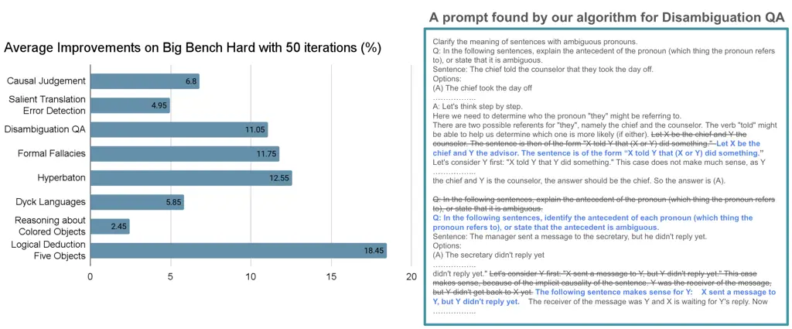
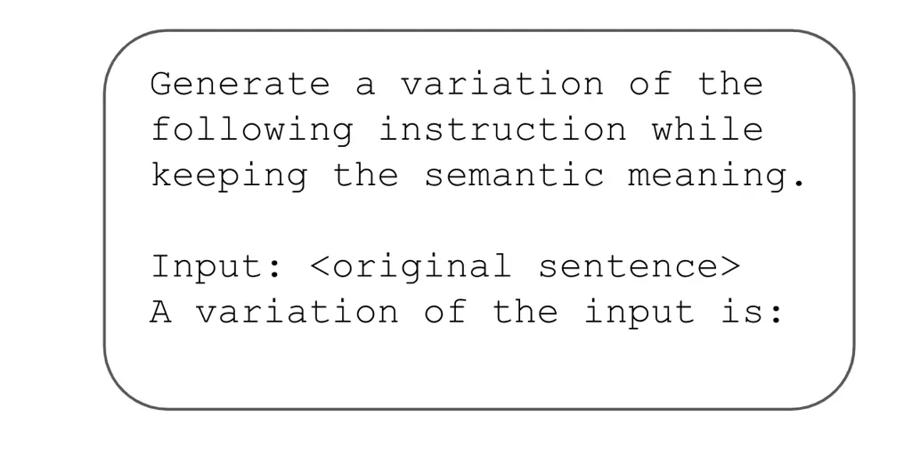
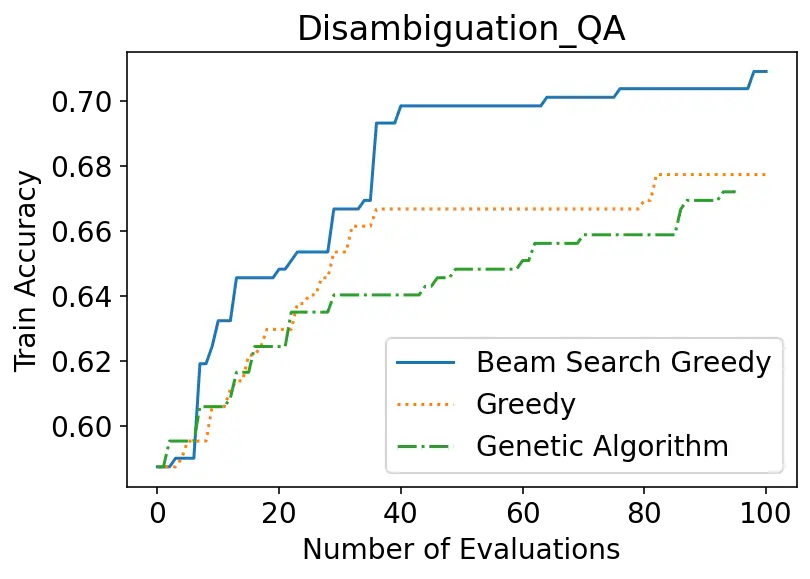
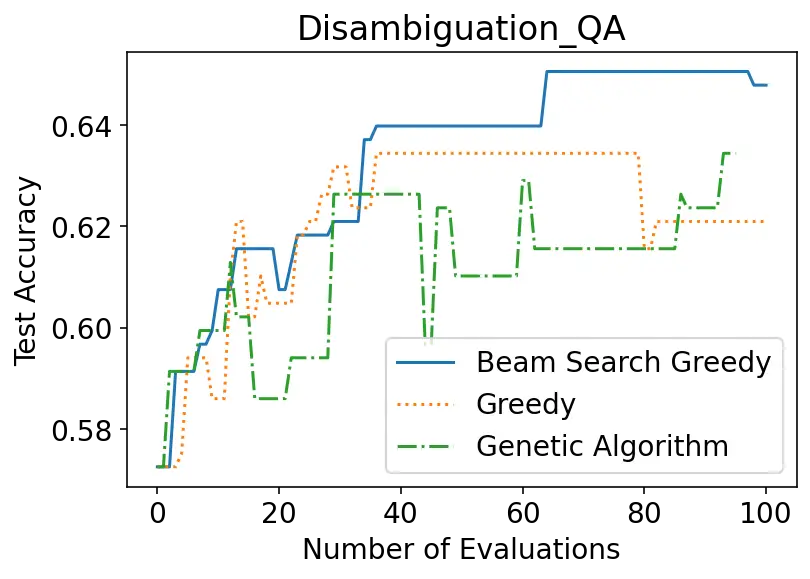
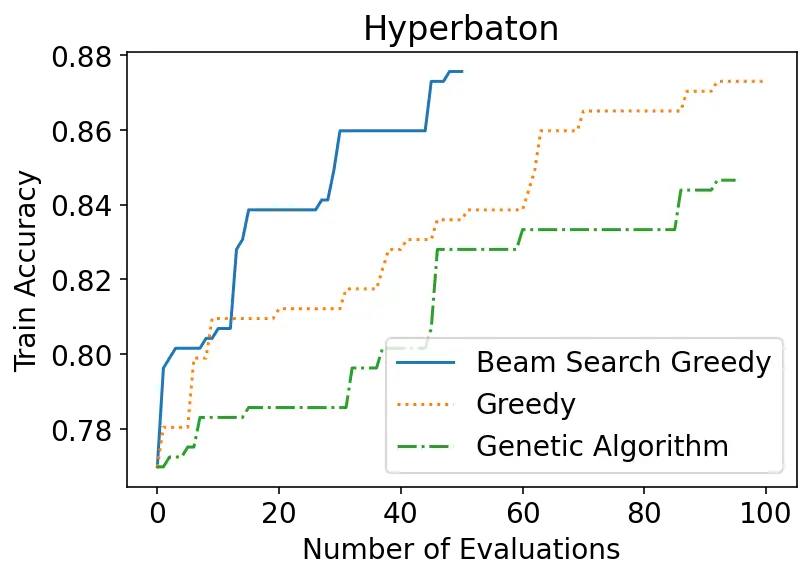
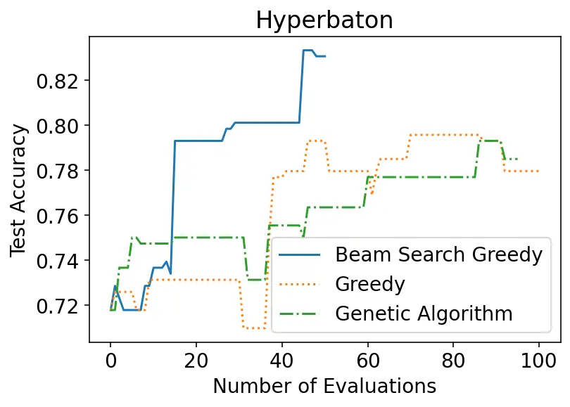
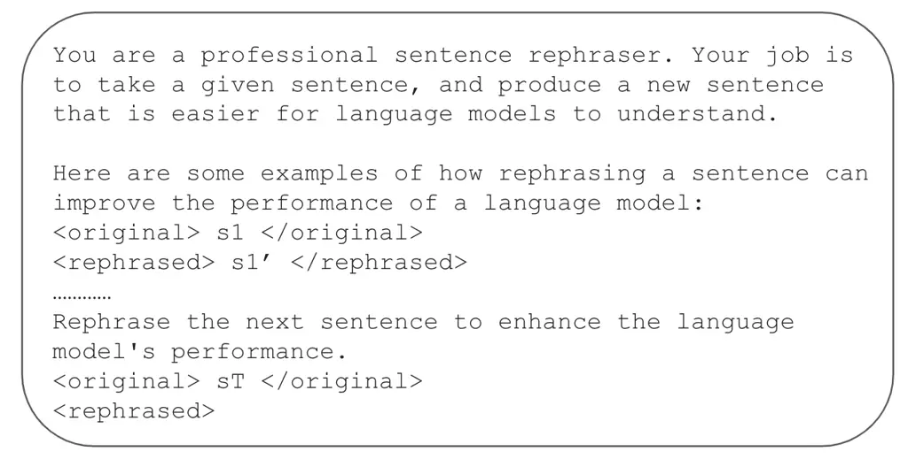

# Automatic Engineering of Long Prompts

Cho-Jui Hsieh    Si Si    Felix X. Yu    Inderjit S. Dhillon
Affiliation: Google Inc. Affiliation: {cjhsieh, sisidaisy, felixyu,
isd}@google.com

###### Abstract

Large language models (LLMs) have demonstrated remarkable capabilities
in solving complex open-domain tasks, guided by comprehensive
instructions and demonstrations provided in the form of prompts.
However, these prompts can be lengthy, often comprising hundreds of
lines and thousands of tokens, and their design often requires
considerable human effort. Recent research has explored automatic prompt
engineering for short prompts, typically consisting of one or a few
sentences. However, the automatic design of long prompts remains a
challenging problem due to its immense search space. In this paper, we
investigate the performance of greedy algorithms and genetic algorithms
for automatic long prompt engineering. We demonstrate that a simple
greedy approach with beam search outperforms other methods in terms of
search efficiency. Moreover, we introduce two novel techniques that
utilize search history to enhance the effectiveness of LLM-based
mutation in our search algorithm. Our results show that the proposed
automatic long prompt engineering algorithm achieves an average of 9.2%
accuracy gain on eight tasks in Big Bench Hard, highlighting the
significance of automating prompt designs to fully harness the
capabilities of LLMs.

## 1 Introduction

Large language models (LLMs) have exhibited remarkable capabilities when
trained on large datasets, demonstrating the ability to comprehend
complex and lengthy instructions for diverse tasks without the need for
fine-tuning Wei et al. (2022a); Brown et al. (2020); Chowdhery et al.
(2022); Ouyang et al. (2022). Several prompt design principles have
emerged in recent years, suggesting that incorporating more complex
instructions, demonstrations, and chain-of-thought reasoning into
prompts can boost the performance on challenging tasks Brown et al.
(2020); Wei et al. (2022b), including those involving mathematical
problem-solving Cobbe et al. (2021) and reasoning Suzgun et al. (2022);
Srivastava et al. (2022). However, effective prompts for tackling
complex tasks often contain thousands of tokens, posing challenges in
designing and optimizing them. Figure 1 demonstrates a long prompt for a
task in Big Bench Hard Suzgun et al. (2022), which contains an
instruction and several demos, each with human-written
chain-of-thoughts.



Figure 1: Left panel: the average accuracy improvements of the proposed
method over 3 runs with 50 iterations on the training set. We report the
accuracy on the whole set (including training and test sets). More
detailed results can be found in Table 2. Right panel: An example of a
long prompt in BBH (Disambiguation task) which consists of an
instruction, several demo examples and chain-of-thought reasoning. We
show that by rewriting a few selected sentences in this long prompt with
our proposed method, we can improve the accuracy by more than 10%.

Numerous studies have demonstrated the sensitivity of LLMs to prompts,
revealing that minor modifications, such as adding or removing a few
tokens or rephrasing the prompt, can significantly impact LLM
performance Liu et al. (2023); Zhu et al. (2023); Jiang et al. (2020).
Therefore, prompt design has become a labor-intensive endeavor. Further
complicating the matter is the rapid evolution of LLMs, rendering
prompts crafted for a specific LLM ineffective when applied to a newer
version of LLM. This highlights the need for automatic prompt
engineering techniques.

While automatic prompt engineering has been studied recently, existing
research Deng et al. (2022); Xu et al. (2022); Guo et al. (2023);
Fernando et al. (2023) focuses on optimizing short instructions with one
or a few sentences. These methods either evolve prompts by searching for
word replacements or utilize LLMs to rewrite the entire prompt Xu et al.
(2022); Fernando et al. (2023); Guo et al. (2023); Yang et al. (2023).
It is challenging to apply them for evolving a long prompt like
Figure 1. For long prompts, word replacement-based search faces an
immense search space, while rewriting the entire prompt using a single
LLM query is extremely difficult. Although it is possible to apply these
methods to individual sentences within a prompt, we have observed that
tuning a single sentence may not sufficiently improve the performance of
long prompts (see Section 4). Therefore, how to automatically find
better long pompts and what’s the potential performance gain by tuning
long prompts remain unanswered in the literature.

The main operation in our automatic prompt engineering technique is to
replace a sentence by a semantically equivalent sentence, which can be
done by queries to LLMs. By comparing the pros and cons of greedy
algorithm and genetic algorithm, two representative algorithms for
discrete optimization, we show that a simple greedy algorithm with beam
search is more effective. Further, for long prompt engineering it is
important to identify which sentence to change, and to what direction.
We thus propose two novel techniques that utilize search history to
enhance the effectiveness of LLM-based mutation in our algorithm.

Our contributions can be summarized below:

- •
  To the best of our knowledge, this paper presents the first formal
  discussion of automatic long prompt engineering, demonstrating
  substantial performance gains on multiple tasks.
- •
  We propose a greedy algorithm with beam search that can rapidly
  optimize prompts. Furthermore, a novel guided mutation method is
  introduced to enhance convergence.
- •
  We conducted experiments on the Big Bench Hard (BBH) benchmark Suzgun
  et al. (2022); Srivastava et al. (2022), where prompts comprise
  thousands of tokens, including instructions and chain-of-thought
  reasoning. Our results demonstrate that the proposed automatic long
  prompt engineering method significantly enhances performance. Notably,
  we achieved an average of 9.2% absolute accuracy improvements on 8
  tasks selected from BBH, as shown in Figure 1, with only 50
  evaluations on the training set.

## 2 Related Work

The remarkable ability of large language models (LLMs) to perform
complex tasks without fine-tuning through prompting has significantly
broadened their applicability. As a result, designing effective prompts
to fully exploit the capabilities of LLMs has become an important topic.
Many principal ways for prompt design have been studied
recently Reynolds and McDonell (2021); Brown et al. (2020); Wei et al.
(2022b); Wang et al. (2022a); Wang et al. (2023a). For instance, a
well-designed prompt may include a system prompt (e.g., "you are an AI
programming assistant"), an instruction prompt outlining the task,
multiple contextual examples, and a chain-of-thoughts reasoning section
that explains the step-by-step thought process behind the examples. By
incorporating these elements, effective prompts often have tens of
sentences and thousands of tokens.

An orthogonal line of previous work has explored soft-prompt tuning, a
technique that optimizes prompts within a continuous embedding space
using standard continuous optimization algorithms Lester et al. (2021);
Zhang et al. (2021); Wang et al. (2022b). While capable of achieving
satisfactory performance, soft-prompts lack interpretability and cannot
be applied via LLM APIs. Additionally, these parameter-efficient
fine-tuning methods demand large training sets, making them unsuitable
for applications with limited data, such as those with only tens or
hundreds of samples.

Given the limited availability of training data (\<1000 samples), our
focus lies in exploring strategies for optimizing hard prompts, which
are semantically equivalent to the original prompts but yield superior
performance. In the context of automated prompt engineering, the
literature considers two primary settings. The first setting, which
aligns with our work, assumes the existence of an initial human-crafted
prompt and aims to refine or improve it to achieve enhanced performance.
Several discrete search algorithms have been proposed for this setting:
Xu et al. (2022) employs a genetic algorithm for prompt tuning,
utilizing back translation, cloze tasks, and sentence continuation to
mutate the initial instruction. More recently, Fernando et al. (2023);
Guo et al. (2023) proposed leveraging LLMs for mutation and crossover
operations in evolutionary searches, while Yang et al. (2023)
demonstrated the optimization capabilities of LLMs in generating
improved prompt variations based on previous fitness scores. However,
these prompt evolution techniques are designed for short sentences or
paragraphs within a long prompt. For example, many of them try to evolve
only the instruction part or the sentence “Let’s think step by step” in
the prompt. Our work aims to provide complete freedom to evolve the
entire long prompt, opening up more avenues for improvement but also
introducing challenges in determining how and where to change the
original prompt.

Another setting focuses on automatic prompt generation without a
pre-existing prompt. Honovich et al. (2022) demonstrated the ability of
LLMs to generate brief task descriptions when provided with input-output
pairs. Building upon this technique and incorporating random search,
Zhou et al. (2022) proposed an automatic prompt engineering (APE)
algorithm capable of generating prompts from given pairs. Pryzant et al.
(2023) explored the utilization of input-output pair feedback to refine
instructions, while Chen et al. (2023) developed a continuous relaxation
approach employing Bayesian optimization for search within a continuous
space.

## 3 Proposed Method

In this paper, we address the challenge of automatic long prompt
engineering for language models. Given a language model $`\mathcal{L}`$
and an initial prompt $`p_{\text{init}}`$ designed by human for a
particular task, our goal is to refine the prompt to achieve superior
performance. To enhance the prompt, we are provided with a limited
training set (e.g., 100 input-output pairs)
$`\{(x_{i},y_{i})\}_{i=1}^{n}`$ for performance evaluation.
Specifically, for each sample we conduct prediction by
$`\mathcal{L}([p,x_{i}])`$ and assess its agreement with the
corresponding ground truth label $`y_{i}`$. We define
$`\text{score}(p)`$ as the performance metric of prompt $`p`$ on the
training set. We consider the scenario where the number of available
samples $`n`$ is limited, which is a common situation where individuals
lack sufficient data for model fine-tuning but can still utilize the
data to design an improved hard prompt. We will evaluate generalization
performance on a hold-out test set that is not used in prompt search.

In this section, we will first introduce the search space of our
algorithm and an exploration of how to use LLM to navigate this space
(Section 3.1). We then delve into the proposed greedy algorithm with
beam search, highlighting its advantages over both vanilla greedy
algorithms and genetic algorithms in Section 3.2. Finally, Section 3.3
shows how to leverage search history to guide the proposed framework to
improve its performance.

### 3.1 Search space

Our goal is to generate a new prompt that is semantically similar to the
original prompt while achieving enhanced performance. Further, we avoid
introducing non-interpretable tokens, such as adversarial triggers Zou
et al. (2023). These restrictions offer two advantages: 1) the prompts
discovered by our algorithm are interpretable, facilitating the
verification that the prompt still performs the intended task, and 2)
since we are only provided with a limited set (e.g., 100) of training
samples, constraining the search space can mitigate the issue of
overfitting.

To conduct prompt search within this space, we decompose the long prompt
into $`m`$ individual sentences:

```math
p=[s_{(1)},s_{(2)},\dots,s_{(m)}].
```

We then allow each sentence to be rephrased while preserving its
semantic meaning. Since LLMs excel at sentence rephrasing, particularly
when provided with prompts like "Generate a variation of the following
instruction while keeping the semantic meaning," we employ an
LLM-Mutator equipped with such a prompt to identify alternative
formulations for each sentence. The prompt we used for vanilla LLM
mutator can be found in Figure 2. An improved version of LLM-Mutator
will be introduced later in Section 3.3.



Figure 2: The vanilla LLM-Mutator used in our search.

### 3.2 Search algorithm

A straightforward approach to conducting the search using the
LLM-Mutator is the following greedy algorithm. At each iteration, we
randomly select a sentence, denoted by $`s_{(i)}`$, and utilize the
LLM-Mutator to generate an alternative sentence $`s_{(i)}^{\prime}`$. We
then replace $`s_{(i)}`$ by $`s_{(i)}^{\prime}`$ in the old prompt $`p`$
if the new resulting prompt improves the performance. However, we
observed that this vanilla greedy approach can be easily trapped in
local optima. In our problem, the training set is so limited that
sometimes a detrimental modification is not reflected in the training
score. As a result, unfavorable edit are sometimes accepted due to
insufficient evaluation, which hurts the prompt’s future improvement.

To address this issue, we propose conducting a beam search by
maintaining a pool of $`k`$ top-performing prompts, denoted as
$`p^{*}_{1},p^{*}_{2},\dots,p^{*}_{k}`$. At each iteration, we randomly
select one of these $`k`$ prompts and refine the chosen prompt. We then
evaluate this new candidate and maintain the top-$`k`$ prompt pool. This
approach ensures that even with the introduction of detrimental edits,
recovery from such errors is still possible as we retain not only the
top prompt. Our experiments reveal that this approach leads to
significantly improved training and test performance compared to the
pure greedy algorithm, as demonstrated in Figure 3.

|                                                             |                                                             |
| ----------------------------------------------------------- | ----------------------------------------------------------- |
|  |  |
|  |  |

Figure 3: Comparison between beam-search greedy, greedy, and genetic
algorithm. This is the average results over three runs. Beam-search
greedy outperforms both greedy algorithm and genetic algorithm.

It is worth noting that our method is closely related to the Genetic
Algorithm (GA). GA is a widely recognized method for discrete
optimization involving black-box functions. Assuming
$`P=\{p_{1},\dots,p_{k}\}`$ represents the solutions in the current
pool, GA applies mutation and crossover operations to this pool to
generate a set of newly proposed candidates
$`P^{\prime}=\{p^{\prime}_{1},\dots,p^{\prime}_{k}\}`$. The fitness
scores (performance of the solutions) of these newly proposed candidates
are then evaluated. Subsequently, only the top $`k`$ solutions in
$`P\cup P^{\prime}`$ are retained before proceeding to the next
iteration.

While GA possesses a high exploration capability, its convergence rate
is considerably slower during the initial stages. Given the vastness of
our search space and the reasonably good quality of the human-written
initial prompt, a majority of mutations and crossovers performed in the
first few iterations yield poorly performing candidates. Evaluating each
of these candidates is computationally expensive, even though it can
enhance solution diversity.

Our algorithm is effectively a “greedy” version of GA. We maintain a
candidate set of size $`k`$ and update the candidate pool immediately
upon generating each new candidate, rather than waiting for the
evaluation of the entire generation of offspring before updating the
pool. As a result, our solution pool remains more up-to-date, leading to
faster convergence compared to GA. Figure 3 further verifies this
observation, demonstrating the slower initial growth of GA’s learning
curve.

### 3.3 History-guided search

Randomly rephrasing a sentence in a prompt is akin to conducting a
random mutation within the space of semantically equivalent sentences,
potentially requires a significant amount of trials to obtain a good
solution. In this subsection, we demonstrate how the search history can
be employed to guide the mutation in a more purposeful direction.

#### Guided mutation for a single sentence.

At iteration $`T`$, we can denote the search history as
$`\{(s_{t}^{\text{before}},s_{t}^{\text{after}},r_{t})\}_{t=1}^{T-1}`$,
where $`s_{t}^{\text{before}}`$ is the sentence before mutation,
$`s_{t}^{\text{after}}`$ is the sentence after mutation, and the reward
$`r_{t}`$ indicates the change in the score ($`r_{t}`$ is positive if
the mutation enhances the performance, and negative if it deteriorates
performance). Assume $`s_{T}`$ is the current sentence that is selected
for mutation, we can then use the history to guide the mutation towards
more positive reward. For example, if we know rephrasing the sentence
“So, it is true that Lesley is a great-grandfather of Leroy” to
“Therefore Leslie is Leroy’s great-grandfather.” can improve the
performance, then for another sentence “So, it is true that everyone who
is an ancestor of Dana is a stepbrother of Brian” we may want to rewrite
it as “Therefore everyone that is an ancestor of Dana is Brian’s
stepbrother.”

It has been shown that LLMs are able to learn from in-context
examples Zhang et al. (2021). Therefore, we propose to let the
LLM-Mutator in-context learn from the history. This can be done by
listing history in the prompt: if $`r_{t}>0`$, we include an in-context
example $`s_{t}^{\text{before}}\Rightarrow s_{t}^{\text{after}}`$, and
if $`r_{t}<0`$ we include
$`s_{t}^{\text{after}}\Rightarrow s_{t}^{\text{before}}`$. The prompt
for LLM-Evolver is shown in Figure 4.



Figure 4: The guided LLM-mutator used in our search.

Since the history can be long and it has been shown that putting too
many in-context learning examples can be harmful for the performance, we
only retrieve a small set of relevant history entries when rephrasing a
sentence. Specifically, when evolving $`s_{T}`$, we compute the
similarity between $`s_{T}`$ and each $`s_{t}^{\text{before}}`$, which
is calculated by $`\phi(s_{T})^{T}\phi(s_{t}^{\text{before}})`$ and
$`\phi`$ is a sentence encoder (we use a T5 Raffel et al. (2020)
sentence encoder in our experiments). We then only select entries that
pass a certain threshold to include as in-context examples.

#### Guided sampling for sentence selection.

A challenge in automatic long prompt engineering lies in identifying
which sentences in the prompt should be modified to improve performance.
Our experiments demonstrate that altering only a few sentences in a long
prompt can significantly enhance its effectiveness, but the changes need
to be at right places. It is thus beneficial to bias the sampling
distribution towards selecting more impactful sentences for
modification.

We model sentence selection as a contextual bandit problem Langford and
Zhang (2007); Li et al. (2010). In contextual bandit problem, at each
iteration a learner is faced with $`m`$ arms associante with feature
vectors $`x_{1},\dots,x_{m}`$, and the learner is trying to pull an arm
at each round to optimize the overall reward. In our case, $`m`$ arms
correspond to the $`m`$ sentences $`s_{(1)},\dots,s_{(m)}`$ in a prompt,
and features can be obtained by $`\phi(s_{(i)})`$ where $`\phi`$ is a
text encoder. Utilizing feature information is crucial because if
modifying a particular sentence can lead to performance improvement, it
is likely that modifying similar sentences will also yield positive
results.

We then adopt the Lin-UCB algorithm Li et al. (2010), a widely
recognized algorithm for contextual bandit problems, to guide sentence
selection. Given the history
$`\{(s_{t}^{\text{before}},s_{t}^{\text{after}},r_{t})\}_{t=1}^{T-1}`$,
we compute a linear estimator of the underlying reward model

```math
w_{T}^{*}=(H^{T}H+\lambda I)^{-1}H^{T}r, \tag{1}
```

where $`H`$ is a $`(T-1)`$-by-$`d`$ matrix with each row being
$`\phi(s_{t}^{\text{before}})`$, and $`r=[r_{1},\dots,r_{T-1}]^{T}`$.
This is simply a solution of a ridge regression with feature matrix
$`H`$ and reward $`r`$. The following UCB rule is then used to select
the sentence for mutation:

```math
\arg\max_{i}\phi(s_{(i)})^{T}w_{T}^{*}+\alpha\sqrt{\phi(s_{(i)})^{T}A^{-1}\phi(s_{(i)})}, \tag{2}
```

where $`A=H^{T}H+\lambda I`$. Since this Lin-UCB estimation may not be
accurate, we let the algorithm has probability $`P`$ to choose a arm by
purely random and $`1-P`$ to choose the sentence based on Eq. (2).

## 4 Experimental Results

In this section, we present empirical evidence demonstrating that the
proposed long prompt tuning method can significantly enhance performance
on the Big-Bench Hard (BBH) benchmark Suzgun et al. (2022); Srivastava
et al. (2022). We then conduct ablation studies to analyze the proposed
algorithm’s effectiveness and show qualitative results on how the
proposed algorithm refines human-written prompts.

### 4.1 Experimental Settings

We consider the prompt developed in Suzgun et al. (2022) for the BBH
tasks, where prompts consist of two parts: Task Description and Demos.
The Task Description provides instructions describing the task, while
each demo includes the question, a chain-of-thoughts demonstration
illustrating the problem-solving process step-by-step, and the final
answer. During prompt tuning, the format (e.g., “Question. ”, “Answer.
”) are retained, while the tuning algorithm is allowed to modify any
other parts including the instruction part and the chain-of-thoughts
part. Table 1 summarizes the statistics of the datasets used in this
study. The full prompts for each data can be downloaded from
[https://github.com/suzgunmirac/BIG-Bench-Hard](https://github.com/suzgunmirac/BIG-Bench-Hard).

Each task consists of 250 samples, randomly divided into 50% for
training and 50% for testing. Only training samples are utilized for
prompt tuning. All tasks are multi-class classification problems, and we
report accuracy on training data, test data, and the combined dataset
when comparing different tuning methods.

For the main experiments, we evaluated the performance on the text-bison
model and utilized the instruction-tuned PaLM 2-L model as the LLM
mutator. Both models belong to the PaLM 2-model family Anil et al.
(2023). Following the previous prompt tuning works, we set temperature
as $`0`$. However, to enhance the diversity of sentence mutation, we set
the temperature of the LLM-Mutator to $`0.5`$.

|                     |                 |                   |
| ------------------- | --------------- | ----------------- |
| Dataset             | Number of Words | Number of         |
|                     |                 | Mutable Sentences |
| Causal Judgement    | 678             | 20                |
| Salient Translation | 745             | 34                |
| Disambiguation      | 671             | 37                |
| Formal Fallacies    | 741             | 32                |
| Hyperbaton          | 539             | 19                |
| Dyck Language       | 679             | 22                |
| Color Reasoning     | 435             | 17                |
| Logical Five        | 461             | 25                |

Table 1: Initial prompt statistics for each dataset. When calculating
the “number of mutable sentences,” we only consider sentences that can
be modified during the search phase.

|                     |          |                   |                |                       |                |                |                |                |                |
| ------------------- | -------- | ----------------- | -------------- | --------------------- | -------------- | -------------- | -------------- | -------------- | -------------- |
| Task                | Original | Genetic Algorithm |                | Evolve “Step-by-step” |                | Greedy         |                | Our Method     |                |
|                     | Prompt   | Train             | Test           | Train                 | Test           | Train          | Test           | Train          | Test           |
| Causal Judgment     | 58.9     | 63.1$`\pm`$1.3    | 59.2$`\pm`$0.5 | 63.1$`\pm`$0.5        | 58.2$`\pm`$0.5 | 63.0$`\pm`$1.0 | 59.6$`\pm`$2.9 | 67.7$`\pm`$1.5 | 63.7$`\pm`$1.3 |
| Salient Translation | 54.4     | 58.7$`\pm`$2.0    | 56.5$`\pm`$4.3 | 57.1$`\pm`$0.4        | 55.7$`\pm`$0.4 | 59.5$`\pm`$1.5 | 53.6$`\pm`$3.3 | 60.0$`\pm`$3.5 | 58.7$`\pm`$2.6 |
| Disambiguation      | 58.0     | 64.8$`\pm`$1.6    | 61.0$`\pm`$0.7 | 64.6$`\pm`$1.5        | 61.8$`\pm`$1.0 | 66.7$`\pm`$0.6 | 63.4$`\pm`$2.7 | 70.1$`\pm`$1.9 | 68.0$`\pm`$2.1 |
| Formal Fallacies    | 60.0     | 63.5$`\pm`$1.1    | 64.5$`\pm`$0.7 | 60.6$`\pm`$1.0        | 62.4$`\pm`$1.7 | 68.5$`\pm`$2.6 | 68.8$`\pm`$3.0 | 70.4$`\pm`$3.9 | 73.1$`\pm`$3.6 |
| Hyperbaton          | 74.4     | 82.8$`\pm`$1.3    | 76.3$`\pm`$2.5 | 84.9$`\pm`$0.0        | 79.6$`\pm`$0.3 | 83.5$`\pm`$3.3 | 79.3$`\pm`$5.3 | 88.4$`\pm`$2.6 | 85.5$`\pm`$1.1 |
| Dyck Language       | 16.0     | 20.2$`\pm`$1.7    | 16.4$`\pm`$0.4 | 18.25$`\pm`$0.0       | 20.4$`\pm`$0.1 | 19.0$`\pm`$0.4 | 17.3$`\pm`$0.6 | 22.8$`\pm`$0.7 | 20.9$`\pm`$0.4 |
| Color Reasoning     | 82.0     | 85.1$`\pm`$0.4    | 78.9$`\pm`$1.7 | 86.2$`\pm`$0.7        | 81.5$`\pm`$1.3 | 85.1$`\pm`$0.7 | 81.1$`\pm`$0.4 | 85.4$`\pm`$0.4 | 83.5$`\pm`$0.4 |
| Logical Five        | 38.8     | 49.3$`\pm`$2.7    | 48.2$`\pm`$1.6 | 54.5$`\pm`$1.0        | 50.3$`\pm`$0.4 | 53.9$`\pm`$3.9 | 51.3$`\pm`$1.2 | 59.8$`\pm`$2.2 | 54.7$`\pm`$0.9 |
| Average             | 55.3     | 60.94             | 57.6           | 61.2                  | 58.7           | 62.4           | 59.3           | 65.6           | 63.5           |

Table 2: Main results on BBH benchmark. The search budget is limited to
50 evaluations over the training set for each method. We ran each
experiment 3 times and report the mean and standard deviation.

### 4.2 Main results

We compare the proposed algorithm with the following baselines:

- •
  Original Prompt: Performance of the original human-designed prompt
  developed in Suzgun et al. (2022), which also serves as the
  initialization for other tuning methods.
- •
  Genetic Algorithm: An implementation of the genetic algorithm for long
  prompt tuning. To facilitate a more comparable comparison with our
  method, we set the pool size to $`4`$. At each step, $`8`$ new
  candidates are generated by randomly mutating and performing crossover
  on the top candidates within the pool.
- •
  Evolve “step-by-step”: Several recent prompt tuning studies have
  explored the concept of evolving a prompt using a single sentence,
  such as the ’Let’s think step by step’ sentence employed in
  chain-of-thought prompts Kojima et al. (2022). We adopted one of the
  state-of-the-art methods for single sentence optimization Yang
  et al. (2023) to optimize all of the ’Let’s think step by step’
  sentences within the chain-of-thought prompt.
- •
  Greedy: A simple greedy approach mentioned in Section 3.2, where we
  only store the top performing candidate in the pool and generating new
  candidate on top of it.

For our method, we use the same hyper-parameters for all the
experiments. We set the pool size (beam size) to $`4`$ for all
experiments. When applying guided mutation in Section 3.3, we use a T5
encoder to encode both the current entry and the history and normalize
the embeddings to have a unit $`\ell_{2}`$ norm. We retrieve only the
top $`4`$ history entries and require the $`\ell_{2}`$ distance between
the encoded history and the current sentence to be below $`0.5`$. When
applying the sentence selection algorithm described in Section 3.3, we
set $`\alpha=0.05`$ in Eq. (2) and set $`P=0.5`$. Note that those
hyper-parameters are not well tuned.

For this experiment, we limited the computational budget to 50
evaluations on the training set and reported the training, test, and
combined accuracy achieved by each method. All the experiments are run
three times and we report the mean and standard deviation. The results
are summarized in Table 2. Our proposed algorithm outperformed the other
methods, demonstrating significant improvements in accuracy across all
tasks. We also compute the improvements of accuracy on the whole dataset
(including both training and testing) and report the accuracy gain in
Figure 1.

Across all 8 tasks, our algorithm achieves an average of 8.2% gain in
test accuracy and 9.2% gain in the accuracy of full evaluation set
(train + test). Among these tasks, we achieve the largest performance
gain (18.45%) on the logical deduction task, and the smallest gain
(2.45%) on reasoning about colored objects (Color Reasoning). One
potential reason of small performance gain on color reasoning is that
the original prompt already achieves very high accuracy, so there is not
much room for improvements.

Comparing the baselines, it becomes evident that evolving a single
sentence (Evolve ’step-by-step’) fails to achieve substantial
improvements in long prompt tuning. This is mainly due to the fact that
long prompt tuning typically involves over 20 sentences with detailed
instructions and explanations, and thus naively modifying “Let’s think
step by step” is unlikely to lead to significant enhancements.
Furthermore, the Genetic Algorithm and Greedy Algorithm each exhibit
their own limitations, as discussed in Section 3.2, which are reflected
in their inferior performance compared to our method.

Despite being able to significantly boost the performance, we also
observe some degree of overfitting in our search procedure. Although the
proposed beam search method can partially mitigate overfitting (see
Section 3.2), we still observe higher training accuracy than testing in
most cases. However, as the performance gain is substantial, the prompts
found by the algorithm are still significantly better than the original
one, even on the test set.

### 4.3 Ablation Study

We conduct an ablation study on the two techniques introduced in
Section 3.3: the history-guided mutation and the contextual bandit
algorithm for sentence selection. The results are presented in Table 3.
We can observe that both components are contributing to the final
performance of the model.

|                                         |                |      |                  |      |            |      |              |      |
| --------------------------------------- | -------------- | ---- | ---------------- | ---- | ---------- | ---- | ------------ | ---- |
| Task                                    | Disambiguation |      | Formal Fallacies |      | Hyperbaton |      | Logical Five |      |
|                                         | Train          | Test | Train            | Test | Train      | Test | Train        | Test |
| Our method (no history-guided mutation) | 67.4           | 66.9 | 61.1             | 66.1 | 83.6       | 78.1 | 55.6         | 53.2 |
| Our method (no sentence selection)      | 68.2           | 63.1 | 71.2             | 72.8 | 81.4       | 80.3 | 54.2         | 50.4 |
| Our method                              | 70.1           | 68.0 | 70.4             | 73.1 | 88.4       | 85.5 | 59.8         | 54.7 |

Table 3: Ablation Study on the two components introduced in Section 3.3.

Original prompt: 38.8% accuracy New prompt found at iteration 48: 56%
accuracy (train 57.9% / test 54.0%) A: Let’s think step by step. A:
Let’s think things through one step at a time. (2) Eli finished below
Amy: "(above) ? Amy ? Eli ? (below)". (2) Amy was above Eli: "(above) ?
Amy ? Eli ? (below)". Eli finished last. Eli came in last place. Q: The
following paragraphs each describe a set of three objects arranged in a
fixed order. The statements are logically consistent within each
paragraph. On a shelf, there are three books: a white book, a green
book, and an orange book. The green book is to the right of the white
book. The orange book is the rightmost. Q: Each paragraph below
describes three objects arranged in a fixed order, and the statements
are logically consistent in each paragraph. There are three books on a
shelf: a white, green, and orange book. The green book is to the right
of the white book, and the orange book is in the far right position. A:
Let’s think step by step. A: Let’s think through things one step at a
time. The white book is the leftmost. The white book is at the far left.
A: Let’s think step by step. A: Let’s think one step at a time.

Table 4: An example that our method improves the performance on Logical
Deduction Five Objects from 38.8% to 56%.

Original promp: 60% accuracy New prompt found at iteration 91: 76%
accuracy (train 92.1%, test 83.1%) Distinguish deductively valid
arguments from formal fallacies. Identify deductively valid arguments
from formal fallacies. So, it is true that Lesley is a great-grandfather
of Leroy. So it’s true that Lesley is Leroy’s great-grandfather. Whoever
is not a great-grandfather of Clyde is a stepbrother of Brian: If X =
NOT (great-grandfather(Clyde)), then X = stepbrother(Brian). \* If
someone is a stepbrother of Brian then they are not a great-grandfather
of Clyde. Furthermore, by (1), we have if X = NOT
(great-grandfather(Clyde)), then X = stepbrother(Brian). Additionally,
according to (1) we have that if X = NOT (great-grandfather(Clyde)),
then X = stepbrother(Brian). By the transitive relation rule in
first-order logic, we then have: if X = ancestor(Dana), then X =
stepbrother(Brian). Using the transitive relation rule in first-order
logic, we have: if X = ancestor(Dana), then X = stepbrother(Brian).
Let’s see whether the Hypothesis can be deduced from the arguments (1)
and (2) by logical reasoning? Let’s see whether the Hypothesis is a
logical consequence of the arguments (1) and (2)? So, from (1) and (2),
we cannot necessarily deduce the Hypothesis. So, given (1) and (2), we
are not always entitled to infer the Hypothesis.

Table 5: An example demonstrating how our method changes the original
prompt. By conducting these changes the combined accuracy on Formal
Fallacies can be improved from 60% to 76%. Interestingly, there’s one
line

### 4.4 Qualitative results

One important benefit of automatic hard prompt engineering is that the
resulting prompts remain interpretable by humans, allowing users to
easily verify the modifications. We provide some successful examples
found by our search in Table 4 and Table 5. In each table, we show only
the different parts of the initial prompt from BBH and the changes made
by our method.

The first example demonstrated in Table 4 is for the logic deduction
task on five objects. The initial prompt achieves 38.8% accuracy while
the revised prompt found at iteration 48 improves the performance to
57.9% train accuracy and 54.0% test accuracy. We observed that most of
the changes involve minor revisions to the original sentence without
altering its meaning. These seemingly insignificant modifications can
lead to substantial improvements in LLM accuracy, showcasing the
important of automatic long prompt engineering.

The second prompt in Table 5 is for the Formal Fallacies task, designed
to identify whether a given logic statement is valid. The initial prompt
achieves 60% accuracy while the revised prompt found at iteration 91
improves the train accuracy to 92.1% and test accuracy to 83.1%. Similar
to the previous case, most of the changes involve minor revisions. In
this case, we also want to highlight a potential limitation of the
proposed method that could be addressed in future work. In the sentence
marked as \*, the revised sentence is not semantically equivalent to the
original one. The original and revised sentences represent different
logical statements (original sentence: not A $`\rightarrow`$ B; new
sentence: B $`\rightarrow`$ not A). However, the LLM appears incapable
of detecting this subtle distinction, leading to an erroneous
rephrasing. Although this change leads to improve training accuracy, it
actually hurts test accuracy. Therefore, incorrect mutations can lead to
overfitting, and developing strategies to mitigate these errors during
the search process would be an interesting area of future research.

## 5 Conclusions, Limitations, and Future Work

We study the problem of automatic prompt engineering for long prompts,
often comprising thousands of tokens. We investigate the performance of
the standard greedy algorithm and genetic algorithm, and develop a novel
search algorithm that yields superior performance. With only 50
evaluations on the training set, our method achieves an average absolute
accuracy improvement of 9.2% across 8 tasks from Big Bench Hard. This
demonstrates the significant potential benefits of automatic long prompt
tuning and underscores the importance of this emerging area.

As the first paper focusing on automatic engineering of the entire long
prompts, we identify several limitations of the current methods which
can lead to interesting future research:

- •
  The current algorithm relies on using another LLM to rephrase a
  sentence. As illustrated in Section 4.4, this LLM-mutator may
  introduce errors during sentence rewriting, particularly for intricate
  sentences (e.g., CoT in complicated logical deduction tasks).
  Therefore, improving the “correctness” of LLM-Mutator is an
  interesting future area of research, which has not been fully
  addressed in our work as well as other recent studies Fernando et al.
  (2023); Guo et al. (2023).
- •
  Similar to any other training or tuning algorithms, automatic prompt
  engineering can suffer from overfitting to the training data, as
  discussed in Section 4. This overfitting can be potentially alleviated
  by applying additional regularization techniques, such as imposing
  sparsity constraints by reducing the number of modified sentences.
  However, further research is required to identify the most effective
  regularization strategies for automatic prompt engineering.
- •
  In the current implementation, we break down the long prompt into
  individual sentences and modify one sentence at a time. However, it
  might be beneficial to manipulate multiple sentences simultaneously
  during mutation or consolidate multiple sentences into a single one.
  An automated mechanism for carrying out this process would be an
  interesting direction for enhancing our method.
- •
  Although our algorithm is able to find a good solution with less than
  100 evaluations on the training set, the cost is still not negligible
  especially when tuning prompts using APIs with cost or rate limits.
  Employing early stopping techniques, where the evaluation of poorly
  performing candidates are terminated early, could potentially reduce
  the number of queries.
- •
  Although automatic prompt engineering can achieve significant gain,
  the search space of hard prompt has limited representation power which
  hinders further performance improvements. It has been shown that soft
  prompt tuning has limited representation power Wang et al. (2023b),
  and our search space is a small subset of soft prompts. Therefore,
  when provided with sufficient data, computational resources, and
  white-box access to the LLM, (parameter-efficient) fine-tuning may
  still achieve superior performance.

## Acknowledgements

We thank Ruochen Wang, Vineet Gupta, Kedar Dhamdhere, Daliang Li for
valuable discussions and feedback.

## References

- Anil et al. (2023) Rohan Anil, Andrew M Dai, Orhan Firat, Melvin
  Johnson, Dmitry Lepikhin, Alexandre Passos, Siamak Shakeri, Emanuel
  Taropa, Paige Bailey, Zhifeng Chen, et al. 2023. Palm 2 technical
  report. _arXiv preprint arXiv:2305.10403_.
- Brown et al. (2020) Tom Brown, Benjamin Mann, Nick Ryder, Melanie
  Subbiah, Jared D Kaplan, Prafulla Dhariwal, Arvind Neelakantan, Pranav
  Shyam, Girish Sastry, Amanda Askell, et al. 2020. Language models are
  few-shot learners. _Advances in neural information processing
  systems_, 33:1877–1901.
- Chen et al. (2023) Lichang Chen, Jiuhai Chen, Tom Goldstein, Heng
  Huang, and Tianyi Zhou. 2023. Instructzero: Efficient instruction
  optimization for black-box large language models. _arXiv preprint
  arXiv:2306.03082_.
- Chowdhery et al. (2022) Aakanksha Chowdhery, Sharan Narang, Jacob
  Devlin, Maarten Bosma, Gaurav Mishra, Adam Roberts, Paul Barham,
  Hyung Won Chung, Charles Sutton, Sebastian Gehrmann, et al. 2022.
  Palm: Scaling language modeling with pathways. _arXiv preprint
  arXiv:2204.02311_.
- Cobbe et al. (2021) Karl Cobbe, Vineet Kosaraju, Mohammad Bavarian,
  Mark Chen, Heewoo Jun, Lukasz Kaiser, Matthias Plappert, Jerry Tworek,
  Jacob Hilton, Reiichiro Nakano, et al. 2021. Training verifiers to
  solve math word problems. _arXiv preprint arXiv:2110.14168_.
- Deng et al. (2022) Mingkai Deng, Jianyu Wang, Cheng-Ping Hsieh, Yihan
  Wang, Han Guo, Tianmin Shu, Meng Song, Eric P Xing, and Zhiting
  Hu. 2022. Rlprompt: Optimizing discrete text prompts with
  reinforcement learning. _arXiv preprint arXiv:2205.12548_.
- Fernando et al. (2023) Chrisantha Fernando, Dylan Banarse, Henryk
  Michalewski, Simon Osindero, and Tim Rocktäschel. 2023. Promptbreeder:
  Self-referential self-improvement via prompt evolution. _arXiv
  preprint arXiv:2309.16797_.
- Guo et al. (2023) Qingyan Guo, Rui Wang, Junliang Guo, Bei Li, Kaitao
  Song, Xu Tan, Guoqing Liu, Jiang Bian, and Yujiu Yang. 2023.
  Connecting large language models with evolutionary algorithms yields
  powerful prompt optimizers. _arXiv preprint arXiv:2309.08532_.
- Honovich et al. (2022) Or Honovich, Uri Shaham, Samuel R Bowman, and
  Omer Levy. 2022. Instruction induction: From few examples to natural
  language task descriptions. _arXiv preprint arXiv:2205.10782_.
- Jiang et al. (2020) Zhengbao Jiang, Frank F Xu, Jun Araki, and Graham
  Neubig. 2020. How can we know what language models know? _Transactions
  of the Association for Computational Linguistics_, 8:423–438.
- Kojima et al. (2022) Takeshi Kojima, Shixiang Shane Gu, Machel Reid,
  Yutaka Matsuo, and Yusuke Iwasawa. 2022. Large language models are
  zero-shot reasoners. _Advances in neural information processing
  systems_, 35:22199–22213.
- Langford and Zhang (2007) John Langford and Tong Zhang. 2007. The
  epoch-greedy algorithm for contextual multi-armed bandits. _Advances
  in neural information processing systems_, 20(1):96–1.
- Lester et al. (2021) Brian Lester, Rami Al-Rfou, and Noah
  Constant. 2021. The power of scale for parameter-efficient prompt
  tuning. _arXiv preprint arXiv:2104.08691_.
- Li et al. (2010) Lihong Li, Wei Chu, John Langford, and Robert E
  Schapire. 2010. A contextual-bandit approach to personalized news
  article recommendation. In _Proceedings of the 19th international
  conference on World wide web_, pages 661–670.
- Liu et al. (2023) Pengfei Liu, Weizhe Yuan, Jinlan Fu, Zhengbao Jiang,
  Hiroaki Hayashi, and Graham Neubig. 2023. Pre-train, prompt, and
  predict: A systematic survey of prompting methods in natural language
  processing. _ACM Computing Surveys_, 55(9):1–35.
- Ouyang et al. (2022) Long Ouyang, Jeffrey Wu, Xu Jiang, Diogo Almeida,
  Carroll Wainwright, Pamela Mishkin, Chong Zhang, Sandhini Agarwal,
  Katarina Slama, Alex Ray, et al. 2022. Training language models to
  follow instructions with human feedback. _Advances in Neural
  Information Processing Systems_, 35:27730–27744.
- Pryzant et al. (2023) Reid Pryzant, Dan Iter, Jerry Li, Yin Tat Lee,
  Chenguang Zhu, and Michael Zeng. 2023. Automatic prompt optimization
  with" gradient descent" and beam search. _arXiv preprint
  arXiv:2305.03495_.
- Raffel et al. (2020) Colin Raffel, Noam Shazeer, Adam Roberts,
  Katherine Lee, Sharan Narang, Michael Matena, Yanqi Zhou, Wei Li, and
  Peter J Liu. 2020. Exploring the limits of transfer learning with a
  unified text-to-text transformer. _The Journal of Machine Learning
  Research_, 21(1):5485–5551.
- Reynolds and McDonell (2021) Laria Reynolds and Kyle McDonell. 2021.
  Prompt programming for large language models: Beyond the few-shot
  paradigm. In _Extended Abstracts of the 2021 CHI Conference on Human
  Factors in Computing Systems_, pages 1–7.
- Srivastava et al. (2022) Aarohi Srivastava, Abhinav Rastogi, Abhishek
  Rao, Abu Awal Md Shoeb, Abubakar Abid, Adam Fisch, Adam R Brown, Adam
  Santoro, Aditya Gupta, Adrià Garriga-Alonso, et al. 2022. Beyond the
  imitation game: Quantifying and extrapolating the capabilities of
  language models. _arXiv preprint arXiv:2206.04615_.
- Suzgun et al. (2022) Mirac Suzgun, Nathan Scales, Nathanael Schärli,
  Sebastian Gehrmann, Yi Tay, Hyung Won Chung, Aakanksha Chowdhery,
  Quoc V Le, Ed H Chi, Denny Zhou, et al. 2022. Challenging big-bench
  tasks and whether chain-of-thought can solve them. _arXiv preprint
  arXiv:2210.09261_.
- Wang et al. (2023a) Lei Wang, Wanyu Xu, Yihuai Lan, Zhiqiang Hu,
  Yunshi Lan, Roy Ka-Wei Lee, and Ee-Peng Lim. 2023a. Plan-and-solve
  prompting: Improving zero-shot chain-of-thought reasoning by large
  language models. _arXiv preprint arXiv:2305.04091_.
- Wang et al. (2022a) Xuezhi Wang, Jason Wei, Dale Schuurmans, Quoc Le,
  Ed Chi, Sharan Narang, Aakanksha Chowdhery, and Denny Zhou. 2022a.
  Self-consistency improves chain of thought reasoning in language
  models. _arXiv preprint arXiv:2203.11171_.
- Wang et al. (2023b) Yihan Wang, Jatin Chauhan, Wei Wang, and Cho-Jui
  Hsieh. 2023b. Universality and limitations of prompt tuning. _arXiv
  preprint arXiv:2305.18787_.
- Wang et al. (2022b) Yihan Wang, Si Si, Daliang Li, Michal Lukasik,
  Felix Yu, Cho-Jui Hsieh, Inderjit S Dhillon, and Sanjiv Kumar. 2022b.
  Preserving in-context learning ability in large language model
  fine-tuning. _arXiv preprint arXiv:2211.00635_.
- Wei et al. (2022a) Jason Wei, Yi Tay, Rishi Bommasani, Colin Raffel,
  Barret Zoph, Sebastian Borgeaud, Dani Yogatama, Maarten Bosma, Denny
  Zhou, Donald Metzler, et al. 2022a. Emergent abilities of large
  language models. _arXiv preprint arXiv:2206.07682_.
- Wei et al. (2022b) Jason Wei, Xuezhi Wang, Dale Schuurmans, Maarten
  Bosma, Fei Xia, Ed Chi, Quoc V Le, Denny Zhou, et al. 2022b.
  Chain-of-thought prompting elicits reasoning in large language models.
  _Advances in Neural Information Processing Systems_, 35:24824–24837.
- Xu et al. (2022) Hanwei Xu, Yujun Chen, Yulun Du, Nan Shao, Yanggang
  Wang, Haiyu Li, and Zhilin Yang. 2022. Gps: Genetic prompt search for
  efficient few-shot learning. _arXiv preprint arXiv:2210.17041_.
- Yang et al. (2023) Chengrun Yang, Xuezhi Wang, Yifeng Lu, Hanxiao Liu,
  Quoc V Le, Denny Zhou, and Xinyun Chen. 2023. Large language models as
  optimizers. _arXiv preprint arXiv:2309.03409_.
- Zhang et al. (2021) Ningyu Zhang, Luoqiu Li, Xiang Chen, Shumin Deng,
  Zhen Bi, Chuanqi Tan, Fei Huang, and Huajun Chen. 2021. Differentiable
  prompt makes pre-trained language models better few-shot learners.
  _arXiv preprint arXiv:2108.13161_.
- Zhou et al. (2022) Yongchao Zhou, Andrei Ioan Muresanu, Ziwen Han,
  Keiran Paster, Silviu Pitis, Harris Chan, and Jimmy Ba. 2022. Large
  language models are human-level prompt engineers. _arXiv preprint
  arXiv:2211.01910_.
- Zhu et al. (2023) Kaijie Zhu, Jindong Wang, Jiaheng Zhou, Zichen Wang,
  Hao Chen, Yidong Wang, Linyi Yang, Wei Ye, Neil Zhenqiang Gong, Yue
  Zhang, et al. 2023. Promptbench: Towards evaluating the robustness of
  large language models on adversarial prompts. _arXiv preprint
  arXiv:2306.04528_.
- Zou et al. (2023) Andy Zou, Zifan Wang, J Zico Kolter, and Matt
  Fredrikson. 2023. Universal and transferable adversarial attacks on
  aligned language models. _arXiv preprint arXiv:2307.15043_.
