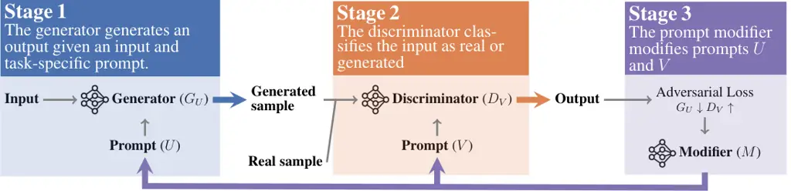
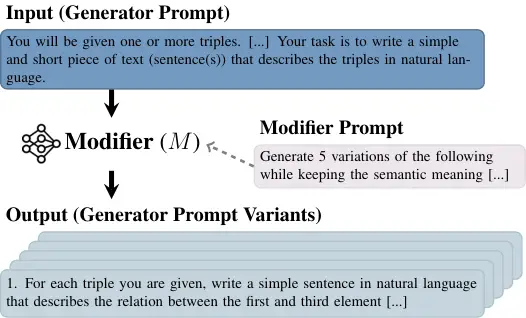

# Prompt Optimization via Adversarial In-Context Learning

Xuan Long Do¹¹footnotemark: 1 ^(†)^(†)thanks:   Equal contribution.
Affiliation: National University of Singapore
Email: [xuanlong.do@u.nus.edu](mailto:)    Yiran Zhao¹¹footnotemark: 1
Affiliation: National University of Singapore
Email: [zhaoyiran@u.nus.edu](mailto:)    Hannah Brown¹¹footnotemark: 1
Affiliation: National University of Singapore
Email: [hsbrown@u.nus.edu](mailto:)    Yuxi Xie Affiliation: National
University of Singapore Email: [xieyuxi@u.nus.edu](mailto:)    James Xu
Zhao Affiliation: National University of Singapore
Email: [xu.zhao@u.nus.edu](mailto:)    Nancy F. Chen
Email: [kenji@nus.edu.sg](mailto:)    Kenji Kawaguchi
Affiliation: National University of Singapore
Email: [michaelshieh@nus.edu.sg](mailto:)    Michael
Shieh²²footnotemark: 2 ^(†)^(†)thanks:   Equal advising.
Affiliation: National University of Singapore
Email: [junxianh@cse.ust.hk](mailto:)    Junxian He²²footnotemark: 2
Affiliation: Hong Kong University of Science and Technology
Affiliation: Institute for Infocomm Research (IR), A\*STAR
Email: [nfychen@i2r.a-star.edu.sg](mailto:)

###### Abstract

We propose a new method, Adversarial In-Context Learning (adv-ICL¹¹ 1
Our codes will available at
[https://github.com/zhaoyiran924/Adv-In-Context-Learning](https://github.com/zhaoyiran924/Adv-In-Context-Learning).),
to optimize prompts for in-context learning (ICL). Inspired by
adversarial learning, adv-ICL is implemented as a two-player game
between a generator and discriminator, with LLMs acting as both. In each
round, given an input prefixed by task instructions and several
exemplars, the generator produces an output. The discriminator then
classifies the generator’s input-output pair as model-generated or real
data. Based on the discriminator’s loss, a prompt modifier LLM proposes
possible edits to the generator and discriminator prompts, and the edits
that most improve the adversarial loss are selected. We show that
applying adv-ICL results in significant improvements over
state-of-the-art prompt optimization techniques for both open and
closed-source models on $`13`$ generation and classification tasks
including summarization, arithmetic reasoning, machine translation,
data-to-text generation, and the MMLU and big-bench hard benchmarks. In
addition, our method is computationally efficient, easily extensible to
other LLMs and tasks, and effective in low-resource settings

## 1 Introduction

Generative Adversarial Networks (GANs) and adversarial
learning (Goodfellow et al., 2014) have driven significant progress
across a range of domains, including image generation (Goodfellow
et al., 2014; Radford et al., 2015; Arjovsky et al., 2017), domain
adaptation (Ganin et al., 2016; Tzeng et al., 2017; Xie et al., 2017;
Louppe et al., 2017), and enhancing model robustness (Szegedy et al.,
2013; Biggio et al., 2013; Carlini & Wagner, 2017; Madry et al., 2018).
At its core, adversarial learning frames training as a minimax game
between a _generator_ and a _discriminator_. The generator aims to
generate output realistic enough that the discriminator classifies it as
real (i.e., not generated), while the discriminator aims to accurately
differentiate between generator output and real training samples. After
each round, the parameters of both models are updated based on an
adversarial loss, and the process repeats. As the generator improves,
the discriminator improves alongside it, finding “weak spots" in
generator output that may go undiscovered in non-adversarial training,
ultimately resulting in better generator outputs.

Despite success in other domains, applying adversarial learning to
pre-training LLMs is impractical due to the data and computational
overheads associated with training two models. Particularly for novel
tasks where data is often scarce, it is desirable to have methods that
can improve model performance using limited data. In this work, we solve
this problem by applying adversarial learning to *in-context learning
(ICL)* (Brown et al., 2020; Chowdhery et al., 2022; Touvron et al.,
2023a; Beltagy et al., 2022; Liu et al., 2023), which has shown to be an
effective method to improve model performance with few training samples.
Though, effective, ICL has shown to be sensitive to changes in
prompts Deng et al. (2022); Pryzant et al. (2023). We introduce
_Adversarial In-Context Learning_ (adv-ICL), which applies insights from
adversarial learning to prompt optimization for ICL. adv-ICL keeps model
parameters fixed and instead updates model prompts in an adversarial
manner. This alleviates compute and data requirements, while still
allowing improvements in model performance.



Figure 1: adv-ICL orchestrates a minimax game between a Generator and a
Discriminator, both powered by LLMs with few-shot prompts. The Generator
crafts responses to unlabeled examples, while the Discriminator
distinguishes between generated and ground truth outputs. Updates are
made by a Prompt Modifier which modifies prompts based on the
adversarial loss.

adv-ICL uses an adversarial objective and three main modules,
implemented as LLMs, to optimize a model’s prompt for a given task, as
shown in Figure 1. The first module is a generator ($`G`$), which is
tasked with generating realistic, task appropriate output given a task
instruction and an input. The second is a discriminator ($`D`$) which
has the goal of classifying its inputs as real or produced by $`G`$.
Finally, there is a prompt modifier $`M`$ which is responsible for
updating the prompts to $`G`$ and $`D`$. As in typical adversarial
learning, the learning objective is set up as a minimax game between
$`G`$ and $`D`$. In each round, $`G`$ produces an output based on an
input and a prompt consisting of a task instruction and several example
inputs and outputs. $`D`$ then classifies the pair constructed of the
original input and $`G`$’s output as generated or real. Finally, $`M`$
produces a number of possible updates to $`G`$ and $`D`$’s prompts, the
updates that most improve the adversarial loss from $`D`$’s
classification are selected, and the procedure repeats. Through this
iterative update procedure adv-ICL is able to improve $`G`$’s prompt,
improving task performance.

We evaluate adv-ICL on $`13`$ tasks with various open and closed-source
LLMs, finding that adv-ICL outperforms other prompt optimization
techniques by large margins across model configurations and tasks. For
instance, we increase the accuracy of ChatGPT (OpenAI, 2022) from 71.0%
to 74.0% on MMLU (Hendrycks et al., 2021), 79.9% to 82.3% on
GSM8K (Cobbe et al., 2021), and 72.1% to 74.0% on BBH (Suzgun et al.,
2022). Importantly, adv-ICL requires very few iterations and training
samples, increasing performance significantly after only five rounds of
training on twenty data points. Finally, adv-ICL is easy to implement,
encouraging its use in real-world applications.

## 2 Adversarial In-Context Learning

Figure 2: An example of a task prompt for the discriminator $`D_{V}`$
with prompt components labeled.

### 2.1 Background: In-Context Learning

Large Language Models (LLMs) (Brown et al., 2020; Chowdhery et al.,
2022; Touvron et al., 2023a; OpenAI, 2023) have demonstrated strong
downstream task performance through conditioning on a small number of
demonstrations in the input prompt, a paradigm referred as _in-context
learning (ICL)_ (Beltagy et al., 2022; Liu et al., 2023). ICL
streamlines the adaptation of a general-purpose LLM to a specific task
without the need for feature engineering or additional model training.
Formally, given a specific task, consider an LLM $`G_{U}`$ (the
generator), driven by a prompt
$`U=(I^{G},x^{G}_{1},y^{G}_{1},\cdots,x^{G}_{k},y^{G}_{k})`$, where
$`I^{G}`$ is the task instruction, $`x^{G}_{i}`$ is a sample input, and
$`y^{G}_{i}`$ is the corresponding sample output. $`G_{U}`$’s output for
a new input $`x`$, then, is determined by the instruction and the
exemplars in $`U`$, making the choice of $`U`$ crucial in determining
$`G_{U}`$’s downstream performance (Deng et al., 2022; Pryzant et al.,
2023).

### 2.2 Adversarial Training Objective

adv-ICL optimizes the generator’s prompt using an adversarial approach
inspired by GANs (Goodfellow et al., 2014)—in particular cGAN (Mirza &
Osindero, 2014) and BiGAN (Donahue et al., 2016) where the discriminator
deals with the conditional and joint distribution of an input and
output. As for GANs, it is essential to optimize both the discriminator
and generator in the adv-ICL framework concurrently, to make sure they
reach a desired optimal state. To assess the output of $`G_{U}`$, we
employ a discriminator, $`D_{V}`$, which attempts to classify
$`G_{U}`$’s output as real or generated.

Like $`G_{U}`$, $`D_{V}`$ is an LLM driven by a prompt
$`V=(I^{D},x^{D}_{1},y^{D}_{1},z^{D}_{1},\cdots,x^{D}_{k},y^{D}_{k},z^{D}_{k})`$,
where $`I^{D}`$ is a task instruction, $`x^{D}_{i}`$ a sample input,
$`y^{D}_{i}`$ its corresponding output, and $`z^{D}_{i}`$ a label of
“real” or “generated” representing whether $`y^{D}_{i}`$ is from a real
sample or generated by $`G_{U}`$. $`D_{V}`$ uses a GAN-inspired loss
function $`\mathcal{J}`$, formally defined as:

```math
\begin{multlined}\mathcal{J}(D_{V},G_{U})=\mathbb{E}_{x,y\sim p_{data}}\log\Big(D_{V}(x,y)\Big)\\
+\mathbb{E}_{x\sim p_{data}}\log\Big(1-D_{V}\big(x,G_{U}(x)\big)\Big)\end{multlined} \tag{1}
```

where $`p_{data}`$ is the distribution of real data. Note that $`D_{V}`$
is designed for the binary decision problem of classifying the input as
generated or real. As shown in Figure 2, in our prompt, we represent the
choices as two options: “(A) real” or “(B) generated”. This allows us to
evaluate the classification probability using the generation probability
of option (A), where $`D_{V}(x,y)=1`$ indicates a real sample.
Therefore, in order for $`G_{U}`$ to improve its performance, its goal
is for $`D_{V}`$ to mis-classify its outputs as real as often as
possible (i.e. minimizing $`\mathcal{J}`$). In contrast, $`D_{V}`$’s
objective is to increase $`\mathcal{J}`$, indicating improved
classification ability. Formally, this adversarial training objective
can be expressed as the following minimax game:

```math
\min_{U}\max_{V}\mathcal{J}(D_{V},G_{U}) \tag{2}
```

Since the discriminator is powered by a large language model with enough
capacity, achieving the optimal solution for this minimax objective
indicates that the generator’s output, when paired with its input, is
indistinguishable from a real sample.

0:  $`U=(I^{G},x^{G}_{1},y^{G}_{1},\cdots,x^{G}_{k},y^{G}_{k})`$,
$`V=(I^{D},x^{D}_{1},y^{D}_{1},z^{D}_{1},\cdots,x^{D}_{k},y^{D}_{k},z^{D}_{k})`$.

0:  Generator $`G_{U}`$, Discriminator $`D_{V}`$, Prompt Modifier $`M`$.

0:  Prompts for $`M`$ to sample new instructions or demonstrations
$`P_{i}/P_{d}`$.

0:  Training iterations $`T`$, samples used per iteration $`m`$, number
of new sampled prompts $`r`$.

0:  Set of limited samples $`S`$

1:  for $`T`$ training iterations do

2:   Sample $`m`$ data points from $`S`$ to compute
$`J(G_{U},D_{V},m)`$.

3:   // Optimize the instruction $`I^{D}`$ for $`D_{V}`$

4:   Generate $`r`$ new instructions: {$`I_{1}`$, $`I_{2}`$,…,$`I_{r}`$}
$`=M(I^{D},P_{i})`$.

5:   Substitute $`I_{n}`$ to $`V`$ $`\forall n\in\{1,2,...,r\}`$ to
compute the loss $`J_{n}(G_{U},D_{V},m)`$

6:   $`J_{j}=\max_{n}J_{n}(G_{U},D_{V},m)`$

7:   Update $`I^{D}`$ by $`I_{j}`$ if $`J_{j}>J`$.

8:   // Optimize the demonstrations ($`x^{D}_{i},y^{D}_{i},z^{D}_{i}`$)
$`\forall i`$ for $`D_{V}`$

9:   for $`i\in range(k)`$ do

10:    Generate $`r`$ new demonstrations:
{($`x_{i1},y_{i1},z_{i1}`$),…,($`x_{ir},y_{ir},z_{ir}`$)}
$`=M((x^{D}_{i},y^{D}_{i},z^{D}_{i}),P_{d})`$.

11:    Substitute ($`x_{in},y_{in},z_{in}`$) to $`V`$
$`\forall n\in\{1,2,...,r\}`$ to compute the loss
$`J_{in}(G_{U},D_{V},m)`$

12:    $`J_{jn}=\max_{i}J_{in}`$

13:    Update ($`x^{D}_{i},y^{D}_{i},z^{D}_{i}`$) by
($`x_{ij},y_{ij},z_{ij}`$) if $`J_{jn}>J`$.

14:   end for

15:   // Similarly optimize $`U`$ for $`G_{U}`$ so that
$`J(G_{U},D_{V},m)`$ decreases.

16:   …

17:  end for

17:  The optimized prompt $`U`$ for the Generator $`G_{U}`$.

Algorithm 1 Adversarial In-Context Learning Optimization

### 2.3 Adversarial In-Context Learning Optimization

Whereas GANs optimize model parameters with backpropagation, adv-ICL
does not update $`G_{U}`$ and $`D_{V}`$’s parameters, instead updating
their prompts in each training iteration. This requires a number of
differences in our optimization process. First, we consider a setting
where we have access only to model outputs and generation probabilities,
making it impossible to use backpropagation to update $`U`$ and $`V`$.
Therefore, we employ a third LLM to serve as the _prompt modifier_,
$`M`$. Given a prompt’s task instruction $`I`$ or demonstration
$`(x,y)`$ as input, $`M`$ generates $`r`$ possible variations. The
adversarial loss is recomputed for each variation by substituting the
variation into the original prompt, and the modification that improves
the adversarial loss the most is returned, following Gonen et al.
(2022).

We refer to our optimization algorithm as _Adversarial In-Context
Learning Optimization_ (adv-ICL; Algorithm 1), which can be seen in
pseudocode form in Algorithm 1. The entire process is as follows: Given
the initial generator prompt $`U`$, and discriminator prompt $`V`$, we
run $`T`$ training iterations. At each iteration, we first sample $`m`$
pairs of data points from our training samples to compute the
adversarial training loss $`\mathcal{J}(G_{U},D_{V},m)`$. We then
optimize the loss by using $`M`$ to modify both the task instruction and
demonstration portions of the prompts for the discriminator and
generator.

### 2.4 Theoretical Analysis

In this section, we present an analysis of whether a minimax objective
can achieve equilibrium in in-context learning as is possible in the
original GAN scenario. Let $`p_{data}`$ be the distribution of the
training data, and $`p_{g}`$ be of the generated data from $`G`$. We
assume $`D`$, $`G`$, and $`M`$ are models with infinite capacity and
strong enough in-context learning capabilities, where the prompts
powering $`D`$ and $`G`$ are iteratively updated using $`M`$ following
algorithm 1. We further assume that: _(i) $`M`$ is powerful enough to
modify the initial prompt of $`D/G`$, covering all possible prompt
variants; (ii) There exists a prompt $`\mathcal{P}`$ for $`D/G`$ that
given $`\mathcal{P}`$, $`D/G`$ can achieve the globally optimal result;
(iii) $`M`$ can generate $`\mathcal{P}`$ by which $`D/G`$ achieves the
globally optimal result_. We prove the following:

###### Proposition 1.

(Motivated by Goodfellow et al. (2014)) If $`G`$ and $`D`$ have enough
capacity, and at each training step, the discriminator is allowed to
reach its optimum $`D^{*}`$ given $`G`$, and $`p_{g}`$ is updated so as
to improve the criterion

```math
\begin{multlined}\mathcal{J}(D^{*},G)=\mathbb{E}_{x,y\sim p_{data}}\log\Big(D^{*}(x,y)\Big)\\
+\mathbb{E}_{x\sim p_{data}}\log\Big(1-D^{*}\big(x,G(x)\big)\Big)\end{multlined} \tag{3}
```

then $`p_{g}`$ converges to $`p_{data}`$.

The full proof for proposition 1 can be found in Section A.1. We
conclude that with strong enough in-context learning LLMs $`D,G,M`$,
adv-ICL converges. In practice, convergence in adversarial training must
be studied empirically.

### 2.5 Zero-shot Prompt Modification



Figure 3: Example of how the prompt modifier generates new versions of
$`G_{U}`$’s prompt $`U`$ including new task instructions and new data
examples. Full prompts used for $`M`$ are in Section A.3.

We leverage LLM instruction-following abilities to generate $`r`$
variants of a task instruction/demonstration in a zero-shot manner. We
use different prompt templates for generating instructions, open-ended
question-answer pairs, and multiple-choice question pairs. Specifically,
suppose that $`P`$ is an input task instruction or demonstration
(open-ended or multiple choice) to be modified and $`M`$ is the prompt
modifier generating the variants, with its modifier prompt $`P_{M}`$.
Then, $`M`$ is prompted to generate $`r`$ variants of $`P`$:
$`\{P_{1},...,P_{r}\}=M(P,P_{M})`$. An example is shown in Figure 3,
with full prompts in Section A.3. We also tested using successful
prompts from previous optimizations as feedback for the next iteration
(Section A.5), following Pryzant et al. (2023); Yang et al. (2023a), but
found that performance fell short compared to not integrating them.

## 3 Experimentation

### 3.1 Experimental Setup

#### Datasets.

We test adv-ICL on $`13`$ traditional NLP tasks in four main categories:
_generation_, _classification_, _reasoning_, and challenging NLP
_evaluation suites_. For generation, we select XSUM (Narayan et al., 2018) and CNN/Daily Mail (CNN for short) (Nallapati et al., 2016) as our
_text summarization_ benchmarks; WebNLG (Gardent et al., 2017) and E2E
NLG (Novikova et al., 2017) as our _data-to-text generation_ datasets;
and LIRO (RO → EN) (Dumitrescu et al., 2021) and TED Talks (IT→ JA) (Ye
et al., 2018) as our _machine translation_ benchmarks. In the
classification category, we use YELP-5 (Zhang et al., 2015),
COPA (Roemmele et al., 2011) and WSC (Levesque et al., 2012). For
reasoning tasks, GSM8K (Cobbe et al., 2021) and SVAMP (Patel et al., 2021) are chosen as arithmetic reasoning benchmarks. Finally, we also
evaluate our method on two challenging _evaluation suites_:
MMLU (Hendrycks et al., 2021) and BIG-bench Hard (BBH) (Suzgun et al.,
2022). Due to computational and budget limitations, except for GSM8K and
SVAMP, each benchmark is evaluated on a maximum of 1,000 test samples
randomly chosen from the test set. In our preliminary experiments, we
found that the empirical results on the sampled test set is aligned with
performance on the whole test set. The exact number of testing samples
for each task is presented in Section A.3.

A main advantage of ICL is that it can generalize to new tasks with
limited training examples, as may be the case for novel tasks. To make
our method applicable in such settings, we use 20 labeled samples during
training. For our baseline methods, we assume access to at most 100
labeled data samples for each benchmark except BBH, similar to previous
prompt optimization works (Xu et al., 2022; Pryzant et al., 2023). For
BBH, we assume access to three chain-of-thought data samples per task.

#### Backbone Models.

We test widely-used open and closed-source LLMs as our backbone models.
For open-source, we use _Vicuna-13B v1.5_ (Zheng et al., 2023) —a chat
model fine-tuned on top of _LLaMa-2_ (Touvron et al., 2023b). For
closed-source, we use _text-davinci-002_ and *ChatGPT
(gpt-3.5-turbo-0613)* (OpenAI, 2022) built on top of _GPT-3_ (Brown
et al., 2020). For each backbone model except ChatGPT, we use the same
model for the generator, discriminator, and prompt modifier in the
adv-ICL setup. Since ChatGPT does not provide the probabilities of its
generated tokens, which is required for computing the adversarial loss,
we employ _text-davinci-002_ as the discriminator, and ChatGPT is the
generator and the prompt modifier.

#### Baselines.

We compare adv-ICL with six baselines: (i) _Few-shot_ prompting, with
Chain-of-Thought (CoT) (Wei et al., 2022) for reasoning tasks; (ii)
Utilizing ROUGE-L score (Lin, 2004) (_ROUGE-L_) as the criteria to
optimize the instruction and demonstrations for each task on a small
sampled labeled set; (iii) Similarly, using Perplexity (_Perplexity_) as
the criteria following Gonen et al. (2022); (iv) Genetic Prompt Search
(_GPS_) (Xu et al., 2022), a genetic optimization method based on the
log-logits or accuracy; (v) Automatic Prompt Optimization (_APO_)
(Pryzant et al., 2023), which uses data to generate text “gradients”
evaluating the current prompt, and then utilize them to signal the
models to edit the prompt in the opposite semantic direction. (vi)
Automatic Prompt Engineer (APE) (Zhou et al., 2022), which automatically
generates instructions and selects via evaluation scores.²² 2 As APE
only polishes task instruction, we compare APE with Adv-ICL on GSM8K,
MMLU and WebNLG.

We ensure that all methods use a similar number of labeled samples,
while the exact number of training samples depends on the specific
algorithm. For GPS and APO, we sample $`32`$ and $`50`$ labeled data
examples for validation, following (Xu et al., 2022; Pryzant et al.,
2023). For ROUGE-L and Perplexity, we sample $`80`$ data examples for
validation. For YELP, WSC, GSM8K, SVAMP, where the benchmarks do not
have enough labeled examples, we sample from their limited training set
instead. APO requires additional training data for error samples. For
fair comparisons, we use the same training data with adv-ICL. More
implementation details for baselines are presented in Section A.2.

#### Prompt Initialization.

We follow prior works to employ a set of initialized prompts. For MMLU
and BBH, we employ the open-sourced prompts that come with the original
papers. For GSM8K and SVAMP, we follow the chain-of-thought paper Wei
et al. (2022) which employs human-written prompts. For the remaining
benchmarks, we utilize prompts from Super-NaturalInstructions (Wang
et al., 2022), in which instructions and demonstrations are chosen by
domain experts. All the initial prompts are also used for our baseline
_few-shot_ experiments. The exact number of shots used for each
benchmark is presented in Section A.3.

#### Evaluation Metrics.

For the generation tasks, we evaluate the performance by ROUGE-L score
(Lin, 2004), following Wang et al. (2022). For classification tasks, we
use accuracy as the evaluation metric. For MMLU and BBH, we follow
Hendrycks et al. (2021); Suzgun et al. (2022) and report the averaged
performance among tasks.

#### Hyperparameters.

Following the hyperparameter selection results in Section 4, we set
number of training iterations $`T=3`$ and training samples per iteration
$`m=5`$ for all tasks except BBH, where we set $`T=3,m=3`$ given that
the training set contains only $`3`$ samples. In all experiments, the
prompt modifier samples from $`r=5`$ prompts.

### 3.2 Main Results

We present the main empirical results on a set of classification,
generation and reasoning tasks in Table 1, MMLU in Table 2, and BBH in
Figure 4.

| Models           | Method     | Summarization           |                         | Data-to-Text            |                         | Translation             |                         | Classification           |                          |                         | Reasoning                |                          |
| ---------------- | ---------- | ----------------------- | ----------------------- | ----------------------- | ----------------------- | ----------------------- | ----------------------- | ------------------------ | ------------------------ | ----------------------- | ------------------------ | ------------------------ |
|                  |            | XSUM                    | CNN                     | WebNLG                  | E2E NLG                 | LIRO                    | TED Talks               | YELP Review              | COPA                     | WSC                     | GSM8K                    | SVAMP                    |
| text-davinci-002 | Few-shot   | 25.5                    | 20.8                    | 60.8                    | 47.1                    | 78.3                    | 37.7                    | 71.1                     | 87.9                     | 67.7                    | 47.3                     | 70.0                     |
|                  | ROUGE-L    | 25.8                    | 21.1                    | 61.1                    | 47.5                    | 77.6                    | 38.2                    | 70.6                     | 87.8                     | 66.9                    | 47.1                     | 69.8                     |
|                  | Perplexity | 26.2                    | 21.4                    | 62.2                    | 49.3                    | 78.5                    | 39.0                    | 70.9                     | 88.6                     | 67.3                    | 47.5                     | 70.4                     |
|                  | GPS        | 27.1                    | 21.5                    | 61.9                    | 49.1                    | 78.8                    | 39.4                    | 71.3                     | 87.4                     | 67.1                    | 48.1                     | 70.5                     |
|                  | APO        | 26.8                    | 22.1                    | 62.3                    | 49.2                    | 78.9                    | 40.2                    | 71.1                     | 88.8                     | 68.3                    | 46.9                     | 69.3                     |
|                  | adv-ICL    | 30.9$`\uparrow`$$`3.8`$ | 23.4$`\uparrow`$$`1.3`$ | 65.4$`\uparrow`$$`3.1`$ | 50.8$`\uparrow`$$`1.5`$ | 81.2$`\uparrow`$$`2.3`$ | 42.1$`\uparrow`$$`1.9`$ | 74.4 $`\uparrow`$$`3.1`$ | 92.2 $`\uparrow`$$`3.4`$ | 73.8$`\uparrow`$$`5.5`$ | 50.8 $`\uparrow`$$`2.7`$ | 72.5 $`\uparrow`$$`2.0`$ |
| Vicuna v1.5      | Few-shot   | 18.9                    | 16.4                    | 52.5                    | 35.3                    | 72.1                    | 32.6                    | 71.0                     | 77.8                     | 54.4                    | 40.7                     | 45.1                     |
|                  | ROUGE-L    | 18.9                    | 16.6                    | 52.7                    | 35.2                    | 72.6                    | 32.9                    | 70.9                     | 76.7                     | 54.1                    | 40.4                     | 44.8                     |
|                  | Perplexity | 19.1                    | 16.9                    | 52.8                    | 35.0                    | 72.7                    | 33.0                    | 71.0                     | 77.9                     | 54.7                    | 41.4                     | 46.2                     |
|                  | GPS        | 19.7                    | 16.9                    | 53.0                    | 35.9                    | 73.2                    | 33.0                    | 71.3                     | 78.2                     | 55.0                    | 41.7                     | 45.7                     |
|                  | APO        | 19.5                    | 17.1                    | 53.7                    | 36.3                    | 73.1                    | 32.9                    | 70.2                     | 78.3                     | 54.4                    | 41.4                     | 46.3                     |
|                  | adv-ICL    | 21.1$`\uparrow`$$`1.4`$ | 19.3$`\uparrow`$$`2.2`$ | 59.3$`\uparrow`$$`5.6`$ | 41.9$`\uparrow`$$`5.6`$ | 73.4$`\uparrow`$$`0.2`$ | 35.2$`\uparrow`$$`2.2`$ | 73.6$`\uparrow`$$`2.3`$  | 81.6$`\uparrow`$$`3.3`$  | 58.2$`\uparrow`$$`3.2`$ | 43.9$`\uparrow`$$`3.2`$  | 48.4$`\uparrow`$$`3.3`$  |
| ChatGPT          | Few-shot   | 25.2                    | 21.3                    | 60.9                    | 48.3                    | 78.8                    | 41.7                    | 69.8                     | 94.4                     | 69.8                    | 79.4                     | 79.3                     |
|                  | ROUGE-L    | 25.1                    | 21.2                    | 60.7                    | 48.6                    | 78.5                    | 41.3                    | 68.2                     | 93.7                     | 69.1                    | 78.7                     | 78.9                     |
|                  | Perplexity | 24.9                    | 20.9                    | 61.8                    | 48.6                    | 78.9                    | 41.8                    | 68.8                     | 91.3                     | 66.9                    | 75.5                     | 78.1                     |
|                  | GPS        | 26.6                    | 21.5                    | 61.5                    | 48.9                    | 78.9                    | 42.0                    | 70.0                     | 94.6                     | 69.8                    | 79.4                     | 80.0                     |
|                  | APO        | 27.1                    | 22.1                    | 61.5                    | 49.3                    | 79.4                    | 42.3                    | 70.3                     | 94.8                     | 70.1                    | 79.9                     | 79.7                     |
|                  | adv-ICL    | 28.2$`\uparrow`$$`1.1`$ | 22.5$`\uparrow`$$`0.4`$ | 63.6$`\uparrow`$$`1.8`$ | 51.1$`\uparrow`$$`1.8`$ | 80.4$`\uparrow`$$`1.0`$ | 43.2$`\uparrow`$$`0.9`$ | 71.9$`\uparrow`$$`0.6`$  | 95.8$`\uparrow`$$`1.0`$  | 71.9$`\uparrow`$$`1.8`$ | 82.3 $`\uparrow`$$`2.4`$ | 81.1 $`\uparrow`$$`1.1`$ |

Table 1: Main experimental results on generation, classification and
reasoning tasks. Details of the selected few-shot prompts and the
baselines are described in Section 3.1.

#### Generation Tasks.

As shown in Table 1, adv-ICL significantly outperforms all baseline
methods across all backbone models, achieving $`2.3\%,2.9\%,1.2\%`$
average absolute improvements for text-davinci-002, Vicuna, and ChatGPT
respectively. We observe that adv-ICL achieves the most significant
improvements for Summarization and Data-to-Text. Specifically, for
_text-davinci-002_, adv-ICL outperforms the best baseline by 3.8% on
XSUM and 3.1% on WebNLG. For Vicuna v1.5, adv-ICL achieves an
improvement of 5.6% on the two data-to-text generation tasks WebNLG and
E2E NLG. For ChatGPT, we achieve an improvement of 3.0% on XSUM and 2.8%
on the E2E NLG generation task when compared to the vanilla few-shot
baseline with no prompt optimization applied. We hypothesize that
ChatGPT may obtain smaller absolute improvements when compared to other
prompt optimization methods due to the misalignment between the backbone
models of the generator and the discriminator. However, given that
ChatGPT is the most widely used LLM and undergoes constant upgrades, it
should be expected that improving ChatGPT is more difficult.

#### Classification Tasks.

For classification tasks, adv-ICL also brings significant improvements
over all SOTA prompt optimization techniques across all models with
$`4.0\%,2.9\%,0.8\%`$ average absolute improvements respectively. The
most significant performance improvement is obtained using the
text-davinci-002 backbone. The 2.9% improvements with Vicuna also
illustrate the effectiveness of our proposed method on open-sourced
models. The improvements of the three backbone models on classification
tasks are relatively balanced.

#### Reasoning Tasks.

For reasoning tasks, we observe a $`2.7\%`$ and $`2.0\%`$ absolute
improvement on GSM8K and SVAMP, with text-davinci-002. Likewise,
significant gains are observed with ChatGPT, achieving a $`2.4\%`$
increase on GSM8K and a $`1.1\%`$ boost on SVAMP. In the case of Vicuna,
it achieves $`3.2\%`$ absolute improvement on GSM8K and $`3.3\%`$
absolute improvement on SVAMP. The effectiveness of adv-ICL for
reasoning tasks, particularly when coupled with CoT prompting, where the
prompt includes detailed intermediate reasoning steps, demonstrates its
ability to optimize complex prompts. This hints at potential for
applying adv-ICL to more advanced prompting methods.

|             | Method     | Humanity                              | STEM                                  | Scocial Sciences                      | Others                                | Avg                                   |
| ----------- | ---------- | ------------------------------------- | ------------------------------------- | ------------------------------------- | ------------------------------------- | ------------------------------------- |
| Vicuna v1.5 | Few-shot   | $`55.8`$                              | $`38.7`$                              | $`63.3`$                              | $`61.5`$                              | $`54.6`$                              |
|             | ROUGE-L    | $`55.5`$                              | $`39.5`$                              | $`63.7`$                              | $`61.1`$                              | $`55.0`$                              |
|             | Perplexity | $`55.2`$                              | $`39.5`$                              | $`64.1`$                              | $`61.9`$                              | $`55.2`$                              |
|             | GPS        | $`56.9`$                              | $`40.4`$                              | $`64.1`$                              | $`62.3`$                              | $`55.9`$                              |
|             | APO        | $`57.2`$                              | $`40.0`$                              | $`63.7`$                              | $`62.7`$                              | $`55.9`$                              |
|             | adv-ICL    | $`\mathbf{58.9}`$ $`\uparrow`$$`1.7`$ | $`\mathbf{44.1}`$ $`\uparrow`$$`3.7`$ | $`\mathbf{64.8}`$ $`\uparrow`$$`0.7`$ | $`\mathbf{64.5}`$ $`\uparrow`$$`1.8`$ | $`\mathbf{58.1}`$ $`\uparrow`$$`2.2`$ |
| ChatGPT     | Few-shot   | $`73.9`$                              | $`57.5`$                              | $`79.2`$                              | $`73.5`$                              | $`71.0`$                              |
|             | ROUGE-L    | $`74.2`$                              | $`56.7`$                              | $`78.4`$                              | $`73.9`$                              | $`70.8`$                              |
|             | Perplexity | $`74.8`$                              | $`56.3`$                              | $`79.6`$                              | $`71.2`$                              | $`70.5`$                              |
|             | GPS        | $`74.6`$                              | $`57.9`$                              | $`80.0`$                              | $`74.3`$                              | $`71.7`$                              |
|             | APO        | $`75.6`$                              | $`58.3`$                              | $`80.7`$                              | $`73.9`$                              | $`72.1`$                              |
|             | adv-ICL    | $`\mathbf{76.7}`$ $`\uparrow`$$`1.1`$ | $`\mathbf{61.3}`$ $`\uparrow`$$`3.0`$ | $`\mathbf{82.3}`$ $`\uparrow`$$`1.6`$ | $`\mathbf{75.8}`$ $`\uparrow`$$`1.5`$ | $`\mathbf{74.0}`$ $`\uparrow`$$`1.9`$ |

Table 2: Results of ChatGPT using 5-shot prompts on MMLU.

Figure 4: Results on selected tasks from BBH with ChatGPT using 5-shot
Chain-of-Thought prompting. Full results can be found in Section A.5

#### MMLU & BBH.

We summarize the results on MMLU in Table 2. We improve the average
performance from 69.8% to 73.1%, achieving performance improvements on
51 subjects out of 57 subjects with ChatGPT. For BBH, as shown in Figure
4, adv-ICL achieves an accuracy of 70.6% where the baseline method
achieves an accuracy of 68.2% with ChatGPT and chain-of-thought
prompting. The detailed results on MMLU and BBH are in Appendix A.5.
Note that for BBH, only three data examples are provided with the
dataset. Consequently, we use the same three examples as the initial
data for both the generator and discriminator. Additionally, these 3
examples are the only real data examples utilized when estimating the
objective. Despite this, we achieve substantial improvements on this
task. This demonstrates the broad applicability of our method. In
real-world scenarios with limited access to training samples our
approach can still be effectively applied.

## 4 Analysis

In this section, we examine several design choices of adv-ICL. We
further discuss the necessity of the discriminator in Section A.4, as
well as an extended set of analyses in Section A.5.

#### Optimizing Instruction / Demonstration Only.

As instruction and demonstration data are both widely used in prompts,
we examine the importance of optimizing both components. We use ChatGPT
and compare our method with the prompt optimization method APE (Zhou
et al., 2023). We measure performance on WebNLG, GSM8K (with CoT), and
MMLU. As shown in Figure 5, we find that updating only the instruction
or demonstrations makes the model perform suboptimally. Additionally,
optimizing demonstrations is more effective than optimizing instructions
for WebNLG and MMLU while the reverse is true for GSM8k. We hypothesize
that this is because generated reasoning chains may contain errors and
the correctness of the generated answers with respect to questions is
critical for the model’s performance (Min et al., 2022). That said,
adv-ICL achieves significant performance improvements for GSM8k in both
cases.

Figure 5: Ablation study on ChatGPT with adv-ICL in which we only update
the task instruction or demonstrations.

#### Choosing Different Models for the Discriminator and Generator.

Given a generator, it is also important to answer how we can select a
suitable discriminator to deploy our framework. In our main experiments,
we chose the same model as the generator for all the base models, except
ChatGPT. We hypothesize that since both discriminator and generator
compete with each other in adv-ICL, it is essential to balance their
learning. To understand more whether we can use a discriminator
different from the generator, we conducted experiments in Table 7
dividing into two groups of using a stronger generator and a stronger
discriminator in adv-ICL. We observe with a stronger generator the
performance is likely improved contrasting to with a stronger
discriminator, the performance is potentially harmed. Overall, we
suggest that the discriminator and generator should be chosen such that
they are on the same performing level. A significant difference in their
performance can drastically lower the overall framework’s outcome.

#### Ablation Studies on Number of Iterations and Data Samples.

As shown in Algorithm 1, adv-ICL involves three main hyperparameters:
the number of training iterations $`T`$, the number of data points used
per iteration $`m`$, and the number of new versions sampled for each
instruction/demonstration $`r`$. We fix $`r=5`$ and analyze the best
performing combination of $`T`$ and $`m`$ using grid search for
$`T\in\{1,3,5\}`$ and $`m\in\{1,2,5,10\}`$.

We measure adv-ICL’s performance on a validation set $`S`$ constructed
from one representative task per category: WebNLG for generation, GSM8K
for reasoning, and MMLU for classification. We use $`80`$ data samples
from both WebNLG and GSM8K³³ 3 GSM8K does not come with a validation
set, so we sample from the training set instead.. For MMLU, we sample
$`16,16,17,19`$ from the validation sets of abstract_algebra,
business_ethics, econometrics, formal_logic resulting in $`228`$ total
samples in $`S`$.

We conduct experiments with ChatGPT and Vicuna as the backbone models.
As shown in Table 3, we observe the best performance with $`T=3`$ and
$`m=5`$ for both settings. This demonstrates that our method works
effectively without requiring many training iterations and data samples.
We further supplement $`S`$ with summarization and translation tasks
($`80`$ samples each) to conduct additional hyperparameter search
experiments with Vicuna, as detailed in Appendix-Table 11. The results
also indicate that the optimal settings are $`T=3`$ and $`m=5`$. We
provide an explanation of why training with too large $`T`$ or $`m`$
might harm model performance in Section A.5.

| $`m`$ \\ $`T`$ | $`T=1`$            | $`T=3`$            | $`T=5`$            |
| -------------- | ------------------ | ------------------ | ------------------ |
| $`m=1`$        | 61.3 / 78.8 / 42.6 | 63.8 / 80.0 / 47.1 | 62.5 / 80.0 / 48.5 |
| $`m=3`$        | 62.5 / 81.3 / 45.6 | 65.0 / 81.3 / 52.9 | 62.5 / 76.3 / 50.0 |
| $`m=5`$        | 63.8 / 82.5 / 54.4 | 66.3 / 82.5 / 55.9 | 63.8 / 77.5 / 54.4 |
| $`m=10`$       | 60.0 / 80.0 / 51.5 | 62.5 / 81.3 / 51.5 | 63.8 / 78.8 / 47.1 |

(a) ChatGPT as $`G`$, text-davinci-002 as $`D`$.

| $`m`$ \\ $`T`$ | $`T=1`$            | $`T=3`$            | $`T=5`$            |
| -------------- | ------------------ | ------------------ | ------------------ |
| $`m=1`$        | 52.5 / 40.0 / 50.0 | 53.8 / 43.8 / 55.9 | 53.8 / 42.5 / 54.4 |
| $`m=3`$        | 55.0 / 42.5 / 48.5 | 60.0 / 43.8 / 54.4 | 57.5 / 45.0 / 51.5 |
| $`m=5`$        | 55.0 / 41.4 / 48.5 | 61.3 / 45.0 / 54.4 | 57.5 / 42.5 / 51.5 |
| $`m=10`$       | 53.8 / 42.5 / 52.9 | 55.0 / 42.5 / 50.0 | 55.0 / 41.3 / 45.6 |

(b) Vicuna as $`G`$, Vicuna as $`D`$.

Table 3: Ablation studies on number of iterations $`T`$ and number of
samples used per iteration $`m`$. The results are ROUGE-L / Acc / Acc
scores on WebNLG / GSM8K / MMLU.

#### Qualitative Analysis.

For an intuitive understanding of how our prompt optimization
progresses, we show examples of prompts for WebNLG changing over
iterations in Section A.5. The prompt modifier significantly alters the
generator’s prompt in two iterations by simplifying the instruction and
adding a more specific requirement. The demonstrations are either
replaced with a completely new one or are refined.

## 5 Related Work

#### Adversarial Training.

Adversarial training has been widely used in image
generation (Goodfellow et al., 2014; Radford et al., 2015; Arjovsky
et al., 2017), domain adaptation (Ganin et al., 2016; Tzeng et al.,
2017; Xie et al., 2017; Louppe et al., 2017), and improving model
robustness (Szegedy et al., 2013; Biggio et al., 2013; Carlini & Wagner,
2017; Madry et al., 2018). However, previous work shows that it often
harms generalization (Raghunathan et al., 2019; Min et al., 2021). In
NLP, there is an increasing interest in adversarial training; however,
most current research focuses on its effect on generalization (Cheng
et al., 2019; Wang et al., 2019; Jiang et al., 2020), and finetunes
models (Jin et al., 2020; Liu et al., 2020), which is impractical for
LLMs. In contrast, adv-ICL optimizes prompts and demonstrates strong
generalization under different conditions.

#### Prompt Optimization.

In-context learning (Liu et al., 2023) has sparked interest in prompt
optimization (PO) techniques (Qin & Eisner, 2021; Deng et al., 2022; Lu
et al., 2022; Xu et al., 2022; Pryzant et al., 2023; Yang et al., 2023a;
Wang et al., 2024) for enhancing the performance of large language
models (LLMs). Previous PO works fall into two categories: (1)
continuous prompts; and (2) discrete textual prompts. Notable works
optimizing continuous prompts include (Qin & Eisner, 2021; Liu et al.,
2021; Lester et al., 2021). However, as model sizes increase, this
approach becomes more computationally expensive. For very large language
models, Xu et al. (2022) propose Genetic Prompt Search (GPS), a
gradient-free prompt optimization method. Additionally, Pryzant et al.
(2023) introduce Automatic Prompt Optimization (APO), utilizing text
“gradients" to evaluate and modify prompts. We compare adv-ICL with GPS
and APO. Other techniques like Automatic Prompt Engineer (Zhou et al., 2023) optimize only task instructions. We compare this with a variant of
adv-ICL. RL-based prompt optimization baselines like (Deng et al., 2022;
Lu et al., 2022) are excluded due to involving additional MLP training
and lacking a universal reward. Finally, PO algorithms have been
recently developed to defend against jailbreaking attacks, for example,
Zou et al. (2023); Zhu et al. (2023); Zhou et al. (2024), but use
different problem settings and are not directly comparable. Finally, our
method is indirectly related to demonstration selection works for ICL Li
et al. (2023); Yang et al. (2023b). Since adv-ICL does not focus on
selecting the optimal combination and order of demonstrations, we do not
compare our method with these approaches. However, demonstration
selection algorithms can be developed concurrently and integrated with
our method.

## 6 Conclusion

In this work, we introduce adv-ICL, an adversarial training framework
for in-context learning using large language models. Our method has
demonstrated empirical success across a diverse range of tasks and
outperforms previous SOTA prompt optimization methods significantly.
Effective with limited data samples and a very small number of training
iterations, adv-ICL holds promise for a wide array of real-world
applications.

## Limitations

One limitation of our work is that adv-ICL requires the component LLMs
to follow human instructions well in performing their subtasks. However,
we foresee that this limitation is going to be tackled by cutting-edge
LLMs in the present and near future as LLMs are going to be more
powerful. Additionally, choosing a good combination of {Discriminator,
Generator} may require empirical experiments. In this work, we suggest
that the same model can be used as both Discriminator and Generator.
This offers strong performance as observed because both models are going
to learn together well. However, in reality, many closed-source models
like ChatGPT can be used as the Generator, but not the Discriminator.
Choosing an optimal Discriminator in these cases requires deeper
understanding as well as empirical experiments. We leave this
exploration for future works.

## Ethical Considerations

It is possible that this method could be used to optimize prompts for
harmful purposes such as mis/disinformation generation, hatespeech, or
privacy violating use cases. While this is not what our method is
designed for, there is no way to prevent this type of misuse. While our
method could also improve the efficiency and efficacy of bad actors, we
do not anticipate that there is anything inherent to adv-ICL allowing it
to be more effective in these settings than in other, positive,
settings.

## Acknowledgements

This research is partially supported by the National Research Foundation
Singapore under the AI Singapore Programme (AISG Award No:
AISG2-TC-2023-010-SGIL) and the Singapore Ministry of Education Academic
Research Fund Tier 1 (Award No: T1 251RES2207). Do Xuan Long is
supported by the A\*STAR Computing and Information Science (ACIS)
scholarship. We thank the anonymous reviewers for the constructive and
helpful feedback.

## References

- Arjovsky et al. (2017) Martin Arjovsky, Soumith Chintala, and Léon
  Bottou. Wasserstein generative adversarial networks. In _International
  conference on machine learning_, pp. 214–223. PMLR, 2017.
- Beltagy et al. (2022) Iz Beltagy, Arman Cohan, Robert Logan IV, Sewon
  Min, and Sameer Singh. Zero- and few-shot NLP with pretrained language
  models. In _Proceedings of the 60th Annual Meeting of the Association
  for Computational Linguistics: Tutorial Abstracts_, pp. 32–37, Dublin,
  Ireland, May 2022. Association for Computational Linguistics. doi:
  10.18653/v1/2022.acl-tutorials.6. URL
  [https://aclanthology.org/2022.acl-tutorials.6](https://aclanthology.org/2022.acl-tutorials.6).
- Biggio et al. (2013) Battista Biggio, Igino Corona, Davide Maiorca,
  Blaine Nelson, Nedim Šrndić, Pavel Laskov, Giorgio Giacinto, and Fabio
  Roli. Evasion attacks against machine learning at test time. In
  _Machine Learning and Knowledge Discovery in Databases: European
  Conference, ECML PKDD 2013, Prague, Czech Republic, September 23-27,
  2013, Proceedings, Part III 13_, pp. 387–402. Springer, 2013.
- Brown et al. (2020) Tom Brown, Benjamin Mann, Nick Ryder, Melanie
  Subbiah, Jared D Kaplan, Prafulla Dhariwal, Arvind Neelakantan, Pranav
  Shyam, Girish Sastry, Amanda Askell, et al. Language models are
  few-shot learners. _Advances in neural information processing
  systems_, 33:1877–1901, 2020.
- Carlini & Wagner (2017) Nicholas Carlini and David Wagner. Towards
  evaluating the robustness of neural networks. In _2017 ieee symposium
  on security and privacy (sp)_, pp. 39–57. Ieee, 2017.
- Cheng et al. (2019) Yong Cheng, Lu Jiang, and Wolfgang Macherey.
  Robust neural machine translation with doubly adversarial inputs. In
  _Proceedings of the 57th Annual Meeting of the Association for
  Computational Linguistics_, pp. 4324–4333, Florence, Italy, July 2019.
  Association for Computational Linguistics. doi: 10.18653/v1/P19-1425.
  URL
  [https://aclanthology.org/P19-1425](https://aclanthology.org/P19-1425).
- Chowdhery et al. (2022) Aakanksha Chowdhery, Sharan Narang, Jacob
  Devlin, Maarten Bosma, Gaurav Mishra, Adam Roberts, Paul Barham,
  Hyung Won Chung, Charles Sutton, Sebastian Gehrmann, et al. Palm:
  Scaling language modeling with pathways. _arXiv preprint
  arXiv:2204.02311_, 2022.
- Cobbe et al. (2021) Karl Cobbe, Vineet Kosaraju, Mohammad Bavarian,
  Mark Chen, Heewoo Jun, Lukasz Kaiser, Matthias Plappert, Jerry Tworek,
  Jacob Hilton, Reiichiro Nakano, et al. Training verifiers to solve
  math word problems. _arXiv preprint arXiv:2110.14168_, 2021.
- Deng et al. (2022) Mingkai Deng, Jianyu Wang, Cheng-Ping Hsieh, Yihan
  Wang, Han Guo, Tianmin Shu, Meng Song, Eric P Xing, and Zhiting Hu.
  Rlprompt: Optimizing discrete text prompts with reinforcement
  learning. _arXiv preprint arXiv:2205.12548_, 2022.
- Donahue et al. (2016) Jeff Donahue, Philipp Krähenbühl, and Trevor
  Darrell. Adversarial feature learning. _arXiv preprint
  arXiv:1605.09782_, 2016.
- Dumitrescu et al. (2021) Stefan Daniel Dumitrescu, Petru Rebeja, Beata
  Lorincz, Mihaela Gaman, Andrei Avram, Mihai Ilie, Andrei Pruteanu,
  Adriana Stan, Lorena Rosia, Cristina Iacobescu, et al. Liro: Benchmark
  and leaderboard for romanian language tasks. In _Thirty-fifth
  Conference on Neural Information Processing Systems Datasets and
  Benchmarks Track (Round 1)_, 2021.
- Ganin et al. (2016) Yaroslav Ganin, Evgeniya Ustinova, Hana Ajakan,
  Pascal Germain, Hugo Larochelle, François Laviolette, Mario Marchand,
  and Victor Lempitsky. Domain-adversarial training of neural networks.
  _The journal of machine learning research_, 17(1):2096–2030, 2016.
- Gardent et al. (2017) Claire Gardent, Anastasia Shimorina, Shashi
  Narayan, and Laura Perez-Beltrachini. Creating training corpora for
  nlg micro-planning. In _55th annual meeting of the Association for
  Computational Linguistics (ACL)_, 2017.
- Gonen et al. (2022) Hila Gonen, Srini Iyer, Terra Blevins, Noah A
  Smith, and Luke Zettlemoyer. Demystifying prompts in language models
  via perplexity estimation. _arXiv preprint arXiv:2212.04037_, 2022.
- Goodfellow et al. (2014) Ian J. Goodfellow, Jean Pouget-Abadie, Mehdi
  Mirza, Bing Xu, David Warde-Farley, Sherjil Ozair, Aaron Courville,
  and Yoshua Bengio. Generative adversarial networks, 2014.
- Hendrycks et al. (2021) Dan Hendrycks, Collin Burns, Steven Basart,
  Andy Zou, Mantas Mazeika, Dawn Song, and Jacob Steinhardt. Measuring
  massive multitask language understanding. 2021.
- Holtzman et al. (2020) Ari Holtzman, Jan Buys, Li Du, Maxwell Forbes,
  and Yejin Choi. The curious case of neural text degeneration. In
  _International Conference on Learning Representations_, 2020. URL
  [https://openreview.net/forum?id=rygGQyrFvH](https://openreview.net/forum?id=rygGQyrFvH).
- Jiang et al. (2020) Haoming Jiang, Pengcheng He, Weizhu Chen, Xiaodong
  Liu, Jianfeng Gao, and Tuo Zhao. Smart: Robust and efficient
  fine-tuning for pre-trained natural language models through principled
  regularized optimization. In _Proceedings of the 58th Annual Meeting
  of the Association for Computational Linguistics_, pp.
  2177–2190, 2020.
- Jin et al. (2020) Di Jin, Zhijing Jin, Joey Tianyi Zhou, and Peter
  Szolovits. Is bert really robust? a strong baseline for natural
  language attack on text classification and entailment. In _Proceedings
  of the AAAI conference on artificial intelligence_, volume 34, pp.
  8018–8025, 2020.
- Lester et al. (2021) Brian Lester, Rami Al-Rfou, and Noah Constant.
  The power of scale for parameter-efficient prompt tuning. _arXiv
  preprint arXiv:2104.08691_, 2021.
- Levesque et al. (2012) Hector Levesque, Ernest Davis, and Leora
  Morgenstern. The winograd schema challenge. In _Thirteenth
  International Conference on the Principles of Knowledge Representation
  and Reasoning_. Citeseer, 2012.
- Li et al. (2023) Xiaonan Li, Kai Lv, Hang Yan, Tianyang Lin, Wei Zhu,
  Yuan Ni, Guotong Xie, Xiaoling Wang, and Xipeng Qiu. Unified
  demonstration retriever for in-context learning. In Anna Rogers,
  Jordan Boyd-Graber, and Naoaki Okazaki (eds.), _Proceedings of the
  61st Annual Meeting of the Association for Computational Linguistics
  (Volume 1: Long Papers)_, pp. 4644–4668, Toronto, Canada, July 2023.
  Association for Computational Linguistics. doi:
  10.18653/v1/2023.acl-long.256. URL
  [https://aclanthology.org/2023.acl-long.256](https://aclanthology.org/2023.acl-long.256).
- Lin (2004) Chin-Yew Lin. Rouge: A package for automatic evaluation of
  summaries. In _Text summarization branches out_, pp. 74–81, 2004.
- Liu et al. (2023) Pengfei Liu, Weizhe Yuan, Jinlan Fu, Zhengbao Jiang,
  Hiroaki Hayashi, and Graham Neubig. Pre-train, prompt, and predict: A
  systematic survey of prompting methods in natural language processing.
  _ACM Computing Surveys_, 55(9):1–35, 2023.
- Liu et al. (2021) Xiao Liu, Yanan Zheng, Zhengxiao Du, Ming Ding,
  Yujie Qian, Zhilin Yang, and Jie Tang. Gpt understands, too. _arXiv
  preprint arXiv:2103.10385_, 2021.
- Liu et al. (2020) Xiaodong Liu, Hao Cheng, Pengcheng He, Weizhu Chen,
  Yu Wang, Hoifung Poon, and Jianfeng Gao. Adversarial training for
  large neural language models. _arXiv preprint arXiv:2004.08994_, 2020.
- Louppe et al. (2017) Gilles Louppe, Michael Kagan, and Kyle Cranmer.
  Learning to pivot with adversarial networks. _Advances in neural
  information processing systems_, 30, 2017.
- Lu et al. (2022) Pan Lu, Liang Qiu, Kai-Wei Chang, Ying Nian Wu,
  Song-Chun Zhu, Tanmay Rajpurohit, Peter Clark, and Ashwin Kalyan.
  Dynamic prompt learning via policy gradient for semi-structured
  mathematical reasoning. _arXiv preprint arXiv:2209.14610_, 2022.
- Madry et al. (2018) Aleksander Madry, Aleksandar Makelov, Ludwig
  Schmidt, Dimitris Tsipras, and Adrian Vladu. Towards deep learning
  models resistant to adversarial attacks. In _International Conference
  on Learning Representations_, 2018. URL
  [https://openreview.net/forum?id=rJzIBfZAb](https://openreview.net/forum?id=rJzIBfZAb).
- Min et al. (2022) Sewon Min, Xinxi Lyu, Ari Holtzman, Mikel Artetxe,
  Mike Lewis, Hannaneh Hajishirzi, and Luke Zettlemoyer. Rethinking the
  role of demonstrations: What makes in-context learning work? In
  _Proceedings of the 2022 Conference on Empirical Methods in Natural
  Language Processing_, pp. 11048–11064, Abu Dhabi, United Arab
  Emirates, December 2022. Association for Computational Linguistics.
  doi: 10.18653/v1/2022.emnlp-main.759. URL
  [https://aclanthology.org/2022.emnlp-main.759](https://aclanthology.org/2022.emnlp-main.759).
- Min et al. (2021) Yifei Min, Lin Chen, and Amin Karbasi. The curious
  case of adversarially robust models: More data can help, double
  descend, or hurt generalization. In _Uncertainty in Artificial
  Intelligence_, pp. 129–139. PMLR, 2021.
- Mirza & Osindero (2014) Mehdi Mirza and Simon Osindero. Conditional
  generative adversarial nets. _arXiv preprint arXiv:1411.1784_, 2014.
- Nallapati et al. (2016) Ramesh Nallapati, Bowen Zhou, Cicero dos
  Santos, Calar GulCehre, and Bing Xiang. Abstractive text summarization
  using sequence-to-sequence rnns and beyond. In _Proceedings of the
  20th SIGNLL Conference on Computational Natural Language Learning_,
  pp. 280–290, 2016.
- Narayan et al. (2018) Shashi Narayan, Shay B Cohen, and Mirella
  Lapata. Don’t give me the details, just the summary! topic-aware
  convolutional neural networks for extreme summarization. _arXiv
  preprint arXiv:1808.08745_, 2018.
- Novikova et al. (2017) Jekaterina Novikova, Ondřej Dušek, and Verena
  Rieser. The e2e dataset: New challenges for end-to-end generation. In
  _Proceedings of the 18th Annual SIGdial Meeting on Discourse and
  Dialogue_, pp. 201–206, 2017.
- OpenAI (2022) OpenAI. Introducing chatgpt, 2022.
- OpenAI (2023) OpenAI. Gpt-4 technical report, 2023.
- Patel et al. (2021) Arkil Patel, Satwik Bhattamishra, and Navin Goyal.
  Are nlp models really able to solve simple math word problems? In
  _Proceedings of the 2021 Conference of the North American Chapter of
  the Association for Computational Linguistics: Human Language
  Technologies_, pp. 2080–2094, 2021.
- Pryzant et al. (2023) Reid Pryzant, Dan Iter, Jerry Li, Yin Tat Lee,
  Chenguang Zhu, and Michael Zeng. Automatic prompt optimization with"
  gradient descent" and beam search. _arXiv preprint
  arXiv:2305.03495_, 2023.
- Qin & Eisner (2021) Guanghui Qin and Jason Eisner. Learning how to
  ask: Querying lms with mixtures of soft prompts. _arXiv preprint
  arXiv:2104.06599_, 2021.
- Radford et al. (2015) Alec Radford, Luke Metz, and Soumith Chintala.
  Unsupervised representation learning with deep convolutional
  generative adversarial networks. _arXiv preprint
  arXiv:1511.06434_, 2015.
- Raghunathan et al. (2019) Aditi Raghunathan, Sang Michael Xie, Fanny
  Yang, John Duchi, and Percy Liang. Adversarial training can hurt
  generalization. In _ICML 2019 Workshop on Identifying and
  Understanding Deep Learning Phenomena_, 2019. URL
  [https://openreview.net/forum?id=SyxM3J256E](https://openreview.net/forum?id=SyxM3J256E).
- Roemmele et al. (2011) Melissa Roemmele, Cosmin Adrian Bejan, and
  Andrew S Gordon. Choice of plausible alternatives: An evaluation of
  commonsense causal reasoning. In _AAAI spring symposium: logical
  formalizations of commonsense reasoning_, pp. 90–95, 2011.
- Schick & Schütze (2021) Timo Schick and Hinrich Schütze. Generating
  datasets with pretrained language models. In _Proceedings of the 2021
  Conference on Empirical Methods in Natural Language Processing_, pp.
  6943–6951, Online and Punta Cana, Dominican Republic, November 2021.
  Association for Computational Linguistics. doi:
  10.18653/v1/2021.emnlp-main.555. URL
  [https://aclanthology.org/2021.emnlp-main.555](https://aclanthology.org/2021.emnlp-main.555).
- Suzgun et al. (2022) Mirac Suzgun, Nathan Scales, Nathanael Schärli,
  Sebastian Gehrmann, Yi Tay, Hyung Won Chung, Aakanksha Chowdhery,
  Quoc V Le, Ed H Chi, Denny Zhou, , and Jason Wei. Challenging
  big-bench tasks and whether chain-of-thought can solve them. _arXiv
  preprint arXiv:2210.09261_, 2022.
- Szegedy et al. (2013) Christian Szegedy, Wojciech Zaremba, Ilya
  Sutskever, Joan Bruna, Dumitru Erhan, Ian Goodfellow, and Rob Fergus.
  Intriguing properties of neural networks. _arXiv preprint
  arXiv:1312.6199_, 2013.
- Touvron et al. (2023a) Hugo Touvron, Thibaut Lavril, Gautier Izacard,
  Xavier Martinet, Marie-Anne Lachaux, Timothée Lacroix, Baptiste
  Rozière, Naman Goyal, Eric Hambro, Faisal Azhar, et al. Llama: Open
  and efficient foundation language models. _arXiv preprint
  arXiv:2302.13971_, 2023a.
- Touvron et al. (2023b) Hugo Touvron, Louis Martin, Kevin Stone, Peter
  Albert, Amjad Almahairi, Yasmine Babaei, Nikolay Bashlykov, Soumya
  Batra, Prajjwal Bhargava, Shruti Bhosale, et al. Llama 2: Open
  foundation and fine-tuned chat models. _arXiv preprint
  arXiv:2307.09288_, 2023b.
- Tzeng et al. (2017) Eric Tzeng, Judy Hoffman, Kate Saenko, and Trevor
  Darrell. Adversarial discriminative domain adaptation. In _Proceedings
  of the IEEE conference on computer vision and pattern recognition_,
  pp. 7167–7176, 2017.
- Wang et al. (2019) Dilin Wang, Chengyue Gong, and Qiang Liu. Improving
  neural language modeling via adversarial training. In _International
  Conference on Machine Learning_, pp. 6555–6565. PMLR, 2019.
- Wang et al. (2024) Xinyuan Wang, Chenxi Li, Zhen Wang, Fan Bai,
  Haotian Luo, Jiayou Zhang, Nebojsa Jojic, Eric Xing, and Zhiting Hu.
  Promptagent: Strategic planning with language models enables
  expert-level prompt optimization. In _The Twelfth International
  Conference on Learning Representations_, 2024. URL
  [https://openreview.net/forum?id=22pyNMuIoa](https://openreview.net/forum?id=22pyNMuIoa).
- Wang et al. (2022) Yizhong Wang, Swaroop Mishra, Pegah
  Alipoormolabashi, Yeganeh Kordi, Amirreza Mirzaei, Atharva Naik, Arjun
  Ashok, Arut Selvan Dhanasekaran, Anjana Arunkumar, David Stap, et al.
  Super-naturalinstructions: Generalization via declarative instructions
  on 1600+ nlp tasks. In _Proceedings of the 2022 Conference on
  Empirical Methods in Natural Language Processing_, pp.
  5085–5109, 2022.
- Wei et al. (2022) Jason Wei, Xuezhi Wang, Dale Schuurmans, Maarten
  Bosma, Fei Xia, Ed H Chi, Quoc V Le, Denny Zhou, et al.
  Chain-of-thought prompting elicits reasoning in large language models.
  In _Advances in Neural Information Processing Systems_, 2022.
- Xie et al. (2017) Qizhe Xie, Zihang Dai, Yulun Du, Eduard Hovy, and
  Graham Neubig. Controllable invariance through adversarial feature
  learning. _Advances in neural information processing systems_,
  30, 2017.
- Xu et al. (2022) Hanwei Xu, Yujun Chen, Yulun Du, Nan Shao, Wang
  Yanggang, Haiyu Li, and Zhilin Yang. GPS: Genetic prompt search for
  efficient few-shot learning. In _Proceedings of the 2022 Conference on
  Empirical Methods in Natural Language Processing_, pp. 8162–8171, Abu
  Dhabi, United Arab Emirates, December 2022. Association for
  Computational Linguistics. doi: 10.18653/v1/2022.emnlp-main.559. URL
  [https://aclanthology.org/2022.emnlp-main.559](https://aclanthology.org/2022.emnlp-main.559).
- Yang et al. (2023a) Chengrun Yang, Xuezhi Wang, Yifeng Lu, Hanxiao
  Liu, Quoc V Le, Denny Zhou, and Xinyun Chen. Large language models as
  optimizers. _arXiv preprint arXiv:2309.03409_, 2023a.
- Yang et al. (2023b) Zhao Yang, Yuanzhe Zhang, Dianbo Sui, Cao Liu, Jun
  Zhao, and Kang Liu. Representative demonstration selection for
  in-context learning with two-stage determinantal point process. In
  Houda Bouamor, Juan Pino, and Kalika Bali (eds.), _Proceedings of the
  2023 Conference on Empirical Methods in Natural Language Processing_,
  pp. 5443–5456, Singapore, December 2023b. Association for
  Computational Linguistics. doi: 10.18653/v1/2023.emnlp-main.331. URL
  [https://aclanthology.org/2023.emnlp-main.331](https://aclanthology.org/2023.emnlp-main.331).
- Ye et al. (2018) Qi Ye, Sachan Devendra, Felix Matthieu, Padmanabhan
  Sarguna, and Neubig Graham. When and why are pre-trained word
  embeddings useful for neural machine translation. In
  _HLT-NAACL_, 2018.
- Zhang et al. (2015) Xiang Zhang, Junbo Zhao, and Yann LeCun.
  Character-level convolutional networks for text classification.
  _Advances in neural information processing systems_, 28, 2015.
- Zheng et al. (2023) Lianmin Zheng, Wei-Lin Chiang, Ying Sheng, Siyuan
  Zhuang, Zhanghao Wu, Yonghao Zhuang, Zi Lin, Zhuohan Li, Dacheng Li,
  Eric Xing, et al. Judging llm-as-a-judge with mt-bench and chatbot
  arena. _arXiv preprint arXiv:2306.05685_, 2023.
- Zhou et al. (2024) Andy Zhou, Bo Li, and Haohan Wang. Robust prompt
  optimization for defending language models against jailbreaking
  attacks. _arXiv preprint arXiv:2401.17263_, 2024.
- Zhou et al. (2022) Yongchao Zhou, Andrei Ioan Muresanu, Ziwen Han,
  Keiran Paster, Silviu Pitis, Harris Chan, and Jimmy Ba. Large language
  models are human-level prompt engineers. _arXiv preprint
  arXiv:2211.01910_, 2022.
- Zhou et al. (2023) Yongchao Zhou, Andrei Ioan Muresanu, Ziwen Han,
  Keiran Paster, Silviu Pitis, Harris Chan, and Jimmy Ba. Large language
  models are human-level prompt engineers. In _The Eleventh
  International Conference on Learning Representations_, 2023. URL
  [https://openreview.net/forum?id=92gvk82DE-](https://openreview.net/forum?id=92gvk82DE-).
- Zhu et al. (2023) Sicheng Zhu, Ruiyi Zhang, Bang An, Gang Wu, Joe
  Barrow, Zichao Wang, Furong Huang, Ani Nenkova, and Tong Sun. Autodan:
  Automatic and interpretable adversarial attacks on large language
  models. _arXiv preprint arXiv:2310.15140_, 2023.
- Zou et al. (2023) Andy Zou, Zifan Wang, J Zico Kolter, and Matt
  Fredrikson. Universal and transferable adversarial attacks on aligned
  language models. _arXiv preprint arXiv:2307.15043_, 2023.

## Appendix A Appendix

### A.1 Theoretical Proofs of the Convergence

In this section, we theoretically analyze whether such a minimax
objective in the form of in-context learning can achieve the desired
equilibrium as in the original GAN scenario. We assume access to models
with infinite capacities powering the discriminator $`D`$, generator
$`G`$, and prompt modifier $`M`$ and that in each iteration, we sample a
sufficient number of prompts from $`M`$ to update both $`G`$ and $`D`$.
Let $`p_{data}`$ be the distribution of the training data, and $`p_{g}`$
be the distribution of the generated data from $`G`$.

Considering a language model which can be $`D`$ or $`G`$ with powerful
enough in-context learning capabilities, given a task, we further assume
that:

1.  1.  $`M`$ is powerful enough to modify the initial prompt of $`D/G`$,
        covering all possible prompt variants.
2.  2.  There exists a prompt $`\mathcal{P}`$ for $`D/G`$ that given
        $`\mathcal{P}`$, $`D/G`$ can achieve the globally optimal result.
3.  3.  $`M`$ can generate $`\mathcal{P}`$ by which $`D/G`$ achieves the
        globally optimal result.

The assumption 3 is a result of assumptions 1, and 2, and the assumption
about our access to infinite capacities language models. Indeed, given
$`D/G`$, from assumption 2, there exists a globally optimized prompt
$`\mathcal{P}`$ for it such that it can achieve the globally optimal
state for a given task. Furthermore, since $`M`$ is powerful enough in
modifying the initial prompt (ass. 1), plus $`M`$ samples a sufficiently
large number of prompts for each iteration (ass. 2), $`M`$ can generate
$`\mathcal{P}`$ with a non-zero probability, which concludes the
assumption 3.

With the above assumptions, we prove the following results.

###### Proposition 2.

(Goodfellow et al., 2014) For $`G`$ fixed, the optimal discriminator
$`D`$ can be described in a closed form, denoted as $`D^{*}`$.

###### Proof for Proposition 2.

Adapted from (Goodfellow et al., 2014): For a fixed $`G`$, the training
objective for the discriminator $`D`$ is maximizing the adversarial loss
$`\mathcal{J}(D,G)`$ (Equation 1)

```math
\begin{split}\mathcal{J}(D,G)&=\!\begin{multlined}\mathbb{E}_{x,y\sim p_{data}}\log\Big(D(x,y)\Big)\\
+\mathbb{E}_{x\sim p_{data}}\log\Big(1-D\big(x,G(x)\big)\Big)\end{multlined}\\
&=\!\begin{multlined}\mathbb{E}_{x,y\sim p_{data}}\log\Big(D(x,y)\Big)\\
+\mathbb{E}_{x,y\sim p_{g}}\log\Big(1-D\big(x,y\big)\Big)\end{multlined}\\
&=\!\begin{multlined}\int_{x}p_{data}(x)\log D(x,y)\Big)\,dx\\
+\int_{x}p_{g}(x)\log\Big(1-D\big(x,y\big)\Big)\,dx\end{multlined}\\
&=\!\begin{multlined}\int_{x}p_{data}(x)\log D(x,y)\\
+p_{g}(x)\log\Big(1-D\big(x,y\big)\Big)\,dx\end{multlined}\end{split}
```

The function $`y=a\log(x)+b\log(1-x)`$ for
$`(a,b)\in\mathbb{R}^{2}and(a,b)\neq\{0,0\}`$ achieves its maximum in
$`[0,1]`$ at $`\frac{a}{a+b}`$. Therefore, $`D^{*}(x)`$ has a closed
form, which is $`D^{*}(x)=\frac{p_{data}(x)}{p_{data}(x)+p_{g}(x)}`$.

∎

###### Proposition 3.

(Motivated by Goodfellow et al. (2014)) If $`G`$ and $`D`$ have enough
capacity, and at each training step, the discriminator is allowed to
reach its optimum $`D^{*}`$ given $`G`$, and $`p_{g}`$ is updated so as
to improve the criterion

```math
\begin{multlined}\mathcal{J}(D^{*},G)=\mathbb{E}_{x,y\sim p_{data}}\log\Big(D^{*}(x,y)\Big)\\
+\mathbb{E}_{x\sim p_{data}}\log\Big(1-D^{*}\big(x,G(x)\big)\Big)\end{multlined} \tag{4}
```

then $`p_{g}`$ converges to $`p_{data}`$.

###### Proof for Proposition 3.

At each training step, the optimal $`D^{*}`$ can be achieved via editing
its input prompt by $`M`$. Considering the loss function
$`\mathcal{J}(D^{*},G)`$ as a function in $`p_{g}`$, then
$`\mathcal{J}(D^{*},G)`$ is convex in $`p_{g}`$. Since $`G`$ is powerful
enough that there exists a prompt $`\mathcal{P}`$ sampled by $`M`$ such
that $`G`$ can achieve the globally optimal loss $`\mathcal{J}`$
(assumption 2), with an optimal $`D^{*}`$, we can obtain the
corresponding best $`G`$. Furthermore, $`\mathcal{J}(D^{*},G)`$ is
convex in $`p_{g}`$, plus the global optimal of $`G`$ can be obtained,
with a sufficiently large enough number of prompts sampled and training
iterations, $`p_{g}`$ converges to $`p_{data}`$. ∎

### A.2 Baseline Implementation

In this section, we present our implementation details for the
baselines. First, among the benchmarks we used, the following datasets
do not have any validation set with sizes larger than or equal to
$`80`$: YELP, WSC, GSM8K, SVAPM. Therefore, we randomly sample $`100`$
data cases from their training sets, to create their validation sets.

Each baseline requires a development set to decide which prompt(s)
is/are the best at each optimization iteration. For GPS and APO, we
sample $`32`$ and $`50`$ data samples respectively from the validation
set of each benchmark, following Xu et al. (2022); Pryzant et al.
(2023). For ROUGE-L and Perplexity, we sample $`80`$ data samples, also
from each validation set. Additionally, among the baselines, only APO
requires training data for error messages. For a fair comparison with
adv-ICL, we use the same training data samples with adv-ICL as training
data for APO.

#### ROUGE-L & Perplexity (Gonen et al., 2022).

For these baselines, we utilize ROUGE-L (Lin, 2004) or Perplexity Gonen
et al. (2022) as the measurement to optimize the input instruction and
demonstrations sequentially. For the instruction, we sample $`15`$ new
instructions by paraphrasing following the template: ’Write for me 15
paraphrases of the {initial_instruction}:’. We then select the version
which achieves the best result on $`S`$ as the final instruction.
Similarly, for each demonstration, we use the template ’Write 15
paraphrases for the following example. Keep the format as Input: and
Output:. End the answer by So the answer is:’ to sample $`15`$ versions
of the original demonstrations, and select the best one on $`S`$
sequentially until all the demonstrations are optimized. We sample
$`15`$ versions for comparisons because our proposed adv-ICL also
samples a maximum of $`15`$ versions for the instruction and each
demonstration.

#### GPS (Xu et al., 2022).

We run GPS (Xu et al., 2022) on $`3`$ iterations to optimize the
instruction and each demonstration sequentially. Denote the original
instruction/demonstration to be optimized as $`O`$. In the initial step,
given the original human-written $`O`$, we paraphrase it into $`10`$
versions using ’Write for me 10 paraphrases of the
{initial_instruction}:’ for instruction, and ’Write 10 paraphrases for
the following example. Keep the format as Input: and Output:. End the
answer with \<END\>. So the answer is:’ for demonstration. We then
select the top-$`5`$ generated $`O`$ to pass to the first iteration. At
each iteration, for each $`O`$ in the current top$`-5`$ $`Os`$, we
sample $`5`$ new $`Os`$ by Sentence Continuation strategy (Schick &
Schütze, 2021) via using the backbone LLM itself, and select the
top$`-5`$ $`Os`$ among $`25`$ $`Os`$ to the next iteration. Finally, the
best-performing $`O`$ on $`S`$ is selected as the output
instruction/demonstration of the method. It is worth noting that in the
original paper from Xu et al. (2022), top$`-k`$ with $`k=25`$ was used.
However, in our reimplementation, we use $`k=5`$ so that it can be
relatively fair to compare GPS with our method (we use $`r=5`$) and
other baselines. The template for sampling new prompts via the Sentence
Continuation strategy that we used is exactly the same as Xu et al.
(2022) provided.

#### APO (Pryzant et al., 2023).

Since our setting assumes that we have access to limited training data
samples, we reimplemented a simplified version of the original APO in
which the selection step (Pryzant et al., 2023) only be called once, and
the samples that we used to train adv-ICL are returned. For simplicity,
we call the original instruction/demonstration as $`O`$. We run APO to
optimize the instruction and each demonstration sequentially in a given
prompt. Given an initial $`O`$, and the error samples, we use the
backbone LLM to generate feedback consisting of $`5`$ comments as the
text "gradient". Integrating this gradient as feedback, we ask the LLM
to generate $`10`$ prompt samples. We further utilize the backbone LLM
to generate $`5`$ paraphrase versions of the original $`O`$, resulting
in a total of $`15`$ new $`Os`$. Finally, we select the best $`O`$
evaluated on $`S`$. All the prompt templates for generating gradients,
integrating feedback, and generating paraphrased prompts are adopted
from Pryzant et al. (2023). For selecting error samples, in the original
implementation, Pryzant et al. (2023) compared the generated answer with
the ground-truth answer, and the error samples are the ones that have
the generated answer different from the ground-truth answers. This is
applicable for classification and numerical question-answering tasks,
but not the text generation tasks such as summarization, this strategy
of selecting error samples is not suitable. Therefore, for
summarization, data-to-text, and translation tasks, we select one sample
that the current prompt brings the lowest ROUGE-L score as the sole
error sample.

#### APE (Zhou et al., 2023).

For APE, we adopt the implementation on the GitHub⁴⁴ 4
github.com/keirp/automatic_prompt_engineer/tree/main from Zhou et al.
(2023). We limit the number of instructions sampled to $`15`$ to have
fair comparisons with adv-ICL. For the training samples for each task,
we use the same samples that we train adv-ICL for APE.

### A.3 Supplementary Experiment Details

In this section, we provide more details used in the experiments.

#### Number of Demonstrations for Few-shot Experiments.

Number of demonstrations for few-shot experiments of all datasets is
listed in Table 4. For generation tasks and classification tasks, We
follow the expert-written prompts from Super-NaturalInstruction (Wang
et al., 2022). For reasoning tasks, MMLU and BBH, we follow the standard
prompts that they propose in their paper or open-source code.

|         |               |     |              |         |                       |                      |                |      |     |           |       |                  |     |
| ------- | ------------- | --- | ------------ | ------- | --------------------- | -------------------- | -------------- | ---- | --- | --------- | ----- | ---------------- | --- |
|         | Summarization |     | Data-to-Text |         | Translation           |                      | Classification |      |     | Reasoning |       | Evaluation Suits |     |
|         | XSUM          | CNN | WebNLG       | E2E NLG | RO $`\rightarrow`$ EN | IT$`\rightarrow`$ JA | YELP Review    | COPA | WSC | GSM8K     | SVAMP | MMLU             | BBH |
| \#shots | 3             | 2   | 3            | 2       | 3                     | 3                    | 3              | 3    | 3   | 5         | 5     | 5                | 3   |

Table 4: Number of shots used for _few-shot_ experiments.

#### Test Set Statistics.

As mentioned in the main paper, we sample a subset of the test set for
efficient evaluation. In Table 5, we show the exact numbers of testing
samples we used for each task.

|                |               |         |              |          |                       |                      |                |         |         |           |          |
| -------------- | ------------- | ------- | ------------ | -------- | --------------------- | -------------------- | -------------- | ------- | ------- | --------- | -------- |
|                | Summarization |         | Data-to-Text |          | Translation           |                      | Classification |         |         | Reasoning |          |
|                | XSUM          | CNN     | WebNLG       | E2E NLG  | RO $`\rightarrow`$ EN | IT$`\rightarrow`$ JA | YELP Review    | COPA    | WSC     | GSM8K     | SVAMP    |
| \#test samples | $`1000`$      | $`950`$ | $`1000`$     | $`1000`$ | $`1000`$              | $`1000`$             | $`1000`$       | $`496`$ | $`285`$ | $`1319`$  | $`1000`$ |

Table 5: Test set statistics.

#### Prompt Modifier Prompts.

Here, we also provide the prompt used in the prompt modifier. The prompt
is as follows:

- •
  Modifying instructions: Generate 5 variations of the following
  instruction while keeping the semantic meaning. Keep the generated
  instructions as declarative. Wrap each with \<START\> and \<END\>..
- •
  Modifying open-ended QA pairs: Generate 5 variations of the following
  example to make them more representative. Keep the format as Input:
  and Output:. Wrap each with \<START\> and \<END\>..
- •
  Modifying MCQ pairs: Generate 5 variations of the following
  multiple-choice question and the answer to make them more
  representative. Keep the format as multiple-choice question and the
  answer. Keep the format as Input: and Output:. Wrap each with
  \<START\> and \<END\>..

#### Extended Experimental Details.

For OpenAI API models, ChatGPT (gpt-3.5-turbo-0613) with chat completion
mode and text-davinci-002 with text completion mode were called at
temperature 0.6. For open-source baselines, Vicuna v1.5 13B was used
with a window size of 1024. We use Nucleus Sampling Holtzman et al.
(2020) as our decoding strategy for all the models with a p value of
$`0.9`$.

### A.4 Why the Discriminator Works?

We further conduct experiments (Table 6) to verify whether the prompt
modifier module work as expected. Specifically, we remove the
discriminator and only employ a prompt modifier to repeatedly optimize
the prompt.

|                              | WebNLG | RO $`\rightarrow`$ EN | YELP | GSM8K |
| ---------------------------- | ------ | --------------------- | ---- | ----- |
| Vicuna 13B                   | 52.5   | 72.1                  | 71.0 | 40.7  |
| adv-ICL _w.o. discriminator_ | 50.1   | 71.4                  | 72.1 | 40.2  |
| adv-ICL                      | 59.3   | 73.4                  | 73.6 | 43.9  |
| ChatGPT                      | 60.9   | 78.8                  | 69.8 | 79.4  |
| adv-ICL _w.o. discriminator_ | 61.2   | 77.4                  | 64.5 | 71.6  |
| adv-ICL                      | 63.6   | 80.4                  | 71.9 | 82.3  |

Table 6: Experimental results with Vicuna and ChatGPT with adv-ICL when
being removed the discriminator.

In most cases, removing the discriminator and relying solely on the
prompt modifier under Vicuna and ChatGPT leads to a decline in
performance. This observation highlights the importance of the
discriminator and adversarial loss in the optimization process.

### A.5 Extended Experiments

#### Choosing Different Models for the Discriminator and Generator.

Table 7 presents our experimental results.

| Group                  | Models                                | WebNLG | LIRO | YELP | GSM8K |
| ---------------------- | ------------------------------------- | ------ | ---- | ---- | ----- |
|                        | text-davinci-002                      | 65.4   | 81.2 | 74.4 | 50.8  |
| adv-ICL                | vicuna 13B                            | 59.3   | 73.4 | 73.6 | 43.9  |
|                        | ChatGPT                               | 63.6   | 80.4 | 71.9 | 82.3  |
|                        | vicuna 7B (D) + vicuna 13B (G)        | 61.1   | 72.9 | 72.4 | 41.9  |
|                        | vicuna 7B (D) + text-davinci-002 (G)  | 62.3   | 77.9 | 71.2 | 44.1  |
| Stronger Generator     | vicuna 7B (D) + ChatGPT (G)           | 62.1   | 78.8 | 70.6 | 80.9  |
|                        | vicuna 13B (D) + text-davinci-002 (G) | 63.9   | 79.6 | 72.9 | 49.8  |
|                        | vicuna 13B (D) + ChatGPT (G)          | 63.6   | 78.9 | 71.4 | 81.2  |
|                        | vicuna 13B (D) + vicuna 7B (G)        | 58.9   | 73.3 | 63.6 | 22.3  |
| Stronger Discriminator | text-davinci-002 (D) + vicuna 7B (G)  | 58.5   | 72.2 | 62.8 | 20.6  |
|                        | text-davinci-002 (D) + vicuna 13B (G) | 58.8   | 72.4 | 73.4 | 44.2  |

Table 7: Experiments of using different discriminators and generators.

#### Reliability of The Results.

We rerun our experiments with adv-ICL three times on WebNLG, RO
$`\rightarrow`$ EN, YELP, GSM8K. The results are presented in Table 8.

|            | WebNLG         | RO $`\rightarrow`$ EN | YELP           | GSM8K          |
| ---------- | -------------- | --------------------- | -------------- | -------------- |
| Vicuna 13B | 59.3/59.2/59.5 | 73.4/74.1/73.2        | 73.6/73.6/73.5 | 43.9/44.3/44.1 |
| ChatGPT    | 63.6/63.5/63.8 | 80.4/80.6/80.6        | 71.9/71.8/71.9 | 82.3/82.5/82.2 |

Table 8: Our experimental results with adv-ICL on three different runs.

The results clearly demonstrate that adv-ICL consistently delivers
stable outcomes, thereby highlighting its reliability in faithfully
reproducing our experimental findings.

#### Providing More Feedback to the Prompt Modifier.

We conducted an experiment that involved integrating the most successful
prompts from previous iterations as feedback for the next iteration. In
this process, we utilized previous best-performing prompts, namely
$`P_{1},P_{2},...,P_{k}`$, as inputs to the prompt constructor module in
order to generate the $`(k+1)`$-th prompt, denoted as
$`\{P_{1},...,P_{k}\}`$. The template for optimizing task instruction is
shown as follows, similar to the prompt for optimizing demonstrations.

Diversify the task instruction to be clearer. Keep the task instruction
as declarative.

Task instruction: $`P_{0}`$

Improved task instruction: $`P_{1}`$

…

Task instruction: $`P_{k-1}`$

Improved task instruction: $`P_{k}`$

Task instruction: $`P_{k}`$

Improved task instruction:

We applied the method to four representative tasks WebNLG, RO
$`\rightarrow`$ EN, YELP, GSM8K using both Vicuna and ChatGPT models.
The obtained results for are illustrated in Table 9.

|                                        | WebNLG | RO $`\rightarrow`$ EN | YELP | GSM8K |
| -------------------------------------- | ------ | --------------------- | ---- | ----- |
| Vicuna 13B                             | 52.5   | 72.1                  | 71.0 | 40.7  |
| adv-ICL (prompt modifier with history) | 56.9   | 74.0                  | 74.2 | 42.2  |
| adv-ICL                                | 59.3   | 73.4                  | 73.6 | 43.9  |
| ChatGPT                                | 60.9   | 78.8                  | 69.8 | 79.4  |
| adv-ICL (prompt modifier with history) | 62.1   | 79.8                  | 72.1 | 80.9  |
| adv-ICL                                | 63.6   | 80.4                  | 71.9 | 82.3  |

Table 9: Experimental results with Vicuna and ChatGPT with the feedback
to the prompt modifier.

In the case of Vicuna, incorporating additional feedback into the prompt
modifier proves effective for tasks such as translation and
classification. However, this approach falls short when applied to
data-to-text and reasoning tasks. On the other hand, for ChatGPT,
augmenting the prompt modifier with more feedback does not yield
improved performance. This can be attributed to ChatGPT’s strong
zero-shot prompt capabilities, which outshine its ability to perform
effectively with few-shot prompts.

#### Ablation Studies on Number of Generated Samples $`r`$.

We investigate whether generating fewer / more samples in each prompt
modification would affect the model’s performance. Due to the limited
resources, we only conducted the experiment on the WebNLG and GSM8k
dataset, with $`r\in\{1,3,5,10,20\}`$. The results are shown in
Figure 7. We observe that increasing $`r`$ lead to comparable results.

#### Why Might too Many Iterations $`T`$ or Samples $`m`$ Harm the Performance of Models?

We observed this phenomenon in the experiments and were also curious
about it. We hypothesize that first, training with too many iterations
can cause the model to be overfitting to the task, leading to worse
performance on the test samples. Second, adv-ICL, a specialized form of
in-context learning, plays a crucial role in enhancing the performance
of LLMs by enabling them to learn from the training examples and
generate improved prompts. While in-context learning holds great
promise, it is essential to acknowledge that increasing the number of
training examples does not necessarily guarantee better performance. As
demonstrated by Min et al. (2022), a critical threshold exists for the
number of training examples, and surpassing this threshold leads to a
decline in performance. Thus, in our specific settings, augmenting the
training examples did not yield better results.

Given its inherent complexity and non-deterministic nature, we have put
forward a hyper-parameter tuning approach, presented in Table 3, aimed
at determining these hyper-parameters for new configuration settings.

#### Prompt Modifier Temperature.

Lastly, we examine the influence of the generation temperature for the
prompt modifier. Ideally, the prompt modifier should have enough
diversity to generate potential improvements for the prompts of both the
generator and discriminator. Intuitively, this means we should not use
greedy decoding with a temperature of 0 for the prompt modifier. As
demonstrated in Figure 7, a temperature of 0.6 works well, providing a
sufficiently large search space while still generating high-quality
prompts.

Figure 6: Ablation study on the number of sampled prompt $`r`$.

Figure 7: Ablation study on temperature of the prompt modifier.

Here we present the detailed results of human evaluation on generated
instructions and demonstrations respectively. Details are shown in Table 10. text-davinci-002 and ChatGPT achieve similar performance with the
zero-shot prompt modifier, while Vicuna performs a little bit worse but
also achieves an acceptable correctness ($`\geq 80`$).

| Model            | 30 instructions | 70 demonstrations | Overall |
| ---------------- | --------------- | ----------------- | ------- |
| text-davinci-002 | 93.3            | 85.7              | 88.0    |
| Vicuna v1.5      | 90.0            | 80.0              | 83.0    |
| ChatGPT          | 96.7            | 88.6              | 91.0    |

Table 10: Human evaluation results for each specific type of
modifications.

#### Using More Tasks To Select Hyperparameters.

Table 11 presents our hyperparameter selection experiments for Vicuna,
expanding on the tasks included in Table 3 by adding summarization and
translation tasks. We observe that ($`T=3`$, $`m=5`$) is also the best
combination.

| $`m`$ \\ $`T`$ | $`T=1`$                            | $`T=3`$                            | $`T=5`$                            |
| -------------- | ---------------------------------- | ---------------------------------- | ---------------------------------- |
| $`m=1`$        | 19.92 / 52.5 / 71.88 / 40.0 / 50.0 | 20.89 / 53.8 / 72.02 / 43.8 / 55.9 | 21.01 / 53.8 / 72.66 / 42.5 / 54.4 |
| $`m=3`$        | 20.68 / 55.0 / 70.15 / 42.5 / 48.5 | 21.11 / 60.0 / 71.89 / 43.8 / 54.4 | 21.80 / 57.5 / 72.15 / 45.0 / 51.5 |
| $`m=5`$        | 22.20 / 55.0 / 72.78 / 41.4 / 48.5 | 22.18 / 61.3 / 73.06 / 45.0 / 54.4 | 21.88 / 57.5 / 72.44 / 42.5 / 51.5 |
| $`m=10`$       | 18.89 / 53.8 / 66.82 / 42.5 / 52.9 | 19.03 / 55.0 / 68.90 / 42.5 / 50.0 | 19.90 / 55.0 / 71.56 / 41.3 / 45.6 |

(a) Vicuna as $`G`$, Vicuna as $`D`$.

Table 11: Ablation studies on number of iterations $`T`$ and number of
samples used per iteration $`m`$. The results are ROUGE-L / Acc / Acc
scores on XSUM / WebNLG / LIRO / GSM8K / MMLU.

#### More Qualitative Analysis.

We show one example in Figure 8. We also show an additional case of
qualitative analysis on Yelp. As shown in 9, the optimization follows a
similar pattern with that on the data-to-text task.

Figure 8: Optimization for the prompt on the data-to-text task WebNLG.

Figure 9: Qualitative analysis on the classification task Yelp.

#### Detailed Results on MMLU.

In Figure 10, we show the detailed results on MMLU with ChatGPT. As
shown in the graph, adv-ICL achieves significant improvements on most
tasks.

Figure 10: Results on MMLU using ChatGPT, where the y-axis begins at
$`25\%`$, representing the baseline of random choices.

#### Detailed Results on BBH.

In Figure 11, we show the full results of ChatGPT on BIG-Bench Hard
using 5-shot Chain-of-Thought prompting. The baseline achieves an
average of 68.2% accuracy while adv-ICL reaches an average of accuracy
of 70.6% and never performs worse than the baseline.

Figure 11: Full results on BBH using ChatGPT and 5-shot CoT prompting.
