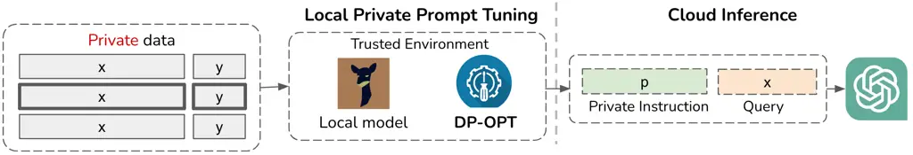

# DP-OPT: Make Large Language Model Your Privacy-Preserving Prompt Engineer

Junyuan Hong¹    Jiachen T. Wang²    Chenhui Zhang³    Zhangheng Li¹   
Bo Li⁴    Zhangyang Wang¹ Affiliation: ¹University of Texas at Austin,
²Princeton University, ³MIT, ⁴University of Chicago
Affiliation: {jyhong,zoharli,atlaswang}@utexas.edu,
tianhaowang@princeton.edu Affiliation: chenhui5@mit.edu,
bol@uchicago.edu

###### Abstract

Large Language Models (LLMs) have emerged as dominant tools for various
tasks, particularly when tailored for a specific target by prompt
tuning. Nevertheless, concerns surrounding data privacy present
obstacles due to the tuned prompts’ dependency on sensitive private
information. A practical solution is to host a local LLM and optimize a
soft prompt privately using data. Yet, hosting a local model becomes
problematic when model ownership is protected. Alternative methods, like
sending data to the model’s provider for training, intensify these
privacy issues facing an untrusted provider. In this paper, we present a
novel solution called Differentially-Private Offsite Prompt Tuning
(DP-OPT) to address this challenge. Our approach involves tuning a
discrete prompt on the client side and then applying it to the desired
cloud models. We demonstrate that prompts suggested by LLMs themselves
can be transferred without compromising performance significantly. To
ensure that the prompts do not leak private information, we introduce
the first private prompt generation mechanism, by a
differentially-private (DP) ensemble of in-context learning with private
demonstrations. With DP-OPT, generating privacy-preserving prompts by
Vicuna-7b can yield competitive performance compared to non-private
in-context learning on GPT3.5 or local private prompt tuning. Codes are
available at
[https://github.com/VITA-Group/DP-OPT](https://github.com/VITA-Group/DP-OPT).

|     |
| --- |
|     |

## 1 Introduction

When Large Language Models gain vast knowledge and versatile ability
from large-scale pre-training, prompt engineering has surfaced as the
most effective, cost-efficient, and adaptable method to tailor LLMs for
a range of downstream applications. In contrast to the resource-heavy
optimization of model parameters, prompt engineering merely necessitates
API access and iteratively refines prompts based on the validation of
training instances. Though manual prompt engineering has achieved
impressive performance in various tasks (Petroni et al., 2019; Zhou
et al., 2022), it often requires decent human experience in prompt
designing and domain knowledge for downstream tasks, including legal
judgement (Trautmann et al., 2022), healthcare (Wang et al., 2023b) and
art (Oppenlaender et al., 2023). To mitigate the high costs, data-driven
prompt tuning was proposed to automate the process. The most prominent
example of this is soft prompt tuning, where prompts are characterized
as trainable embedding vectors and are refined using a collection of
training instances (Houlsby et al., 2019; Roberts et al., 2019; Brown
et al., 2020; Chen et al., 2022).

However, one major barrier to the applications of prompt tuning is data
privacy. When searching for a validate prompt for an LLM API, such as
ChatGPT, there is a need to upload a multitude of training samples for
evaluation queries. In privacy-sensitive scenarios, the operation could
be prohibited due to two concerns. 1) *Data Confidentiality*. Certain
data, like medical histories, proprietary system logs, and personal
messages, are inherently confidential and should not be transmitted
beyond local devices, internal computing systems, and mobile phones.
2) *Information Leakage*. Resources derived from private data might
inadvertently contain personally identifiable information. For instance,
personal identifiers like names, residential addresses, and contact
numbers present in the fine-tuning data (Lukas et al., 2023) or during
the pre-training phase (Carlini et al., 2021) might be retrievable from
the adjusted parameters. Even with a limited parameter set, such as
prompts, the potential for data breaches remains significant (Duan
et al., 2023a).



Figure 1: Differentially-Private Offsite Prompt Tuning (DP-OPT) works as
an intermediate layer between local data and cloud models. Leveraging a
local model, DP-OPT can fine-tune a differentially-private prompt that
can transfer to the target model.

A straightforward approach would be to manage the entire prompt process
on the local device and offer services via an API. However, this becomes
impractical when there’s a preference for a sophisticated closed-source
model, not to mention the substantial costs involved in hosting and
overseeing an LLM locally. For example, there is a high demand for
serving prompts with the most powerful LLMs, e.g., GPT-3.5, to leverage
the state-of-the-art generation ability. Yet, the specifics and
structure of GPT-3.5 remain proprietary and undisclosed for protecting
Intelligent Property (IP). Even if GPT proprietors are willing to
support local prompt tuning by dispatching compressed models (Xiao
et al., 2023), they could be confronted with the potential peril of
losing their model’s ownership.

In this paper, we propose Differentially-Private Offsite Prompt Tuning
(DP-OPT) to make LLM engineer private and transferable prompts for
cloud-hosted LLMs, which is illustrated in Fig. 1. The crux of privacy
protection is that DP-OPT operates exclusively on the client. Given a
confidential training dataset, DP-OPT uses a few samples as
demonstrations to guide a local LLM to generate prompts. The local
assistant LLM may be significantly smaller than the intended cloud-based
LLMs. Such a prompt generation process is facilitated by a
Differentially-Private (DP) ensemble of in-context learning with
disjoint private demonstration subsets. Our contributions are summarized
as follows:

- •
  We proposed the first end-to-end framework where DP-OPT operates on
  client devices and data and yields a front-end prompt for inference on
  the privacy-untrusted cloud. Our framework is the first solution that
  simultaneously protects (i) data confidentiality by keeping data
  local; (ii) information privacy by the DP noise mechanism; and (iii)
  cloud model ownership and IP by eliminating the parameter exposure of
  cloud models from local training.
- •
  We first show that discrete prompts automatically tuned by LLMs are
  transferable across models with favorable performance on cloud models.
  The finding motivates the offsite prompt tuning (OPT) framework with
  local prompt tuning and cloud inference.
- •
  We then provide the first Differentially-Private mechanism for
  generating private prompts without gradients or public data. The
  privacy costs can be tightly bounded during prompt tuning.
- •
  Empirically, our method presents an outstanding performance on
  multiple language tasks. Prompts tuned on open-source
  Vicuna-7b (Chiang et al., 2023) can achieve significant performance
  gains across 4 tasks after transfer to closed-source
  heterogeneous-architecture models (GPT3.5) or open-source models
  (Llama-2 (Touvron et al., 2023) or Vicuna-33b).

## 2 Related Work

Discrete Prompt Tuning. On the rise of pre-trained generative language
models, discrete prompt tuning (Shin et al., 2020) was introduced to
amplify the inference capability of LLMs through demonstrations (Brown
et al., 2020) or informative instructions (Prasad et al., 2022; Shin
et al., 2020). The method is orthogonal to the soft prompt
tuning (Lester et al., 2021; Liu et al., 2021) that optimizes continuous
prepended embeddings instead of discrete tokens and is therefore not
favored for API-only models. One line of the discrete prompt tuning aims
to improve the search efficiency by gradient-free phrase editing (Prasad
et al., 2022), reinforcement learning (Deng et al., 2022), embedding
optimization (Shi et al., 2022), and projected-gradient
optimization (Wen et al., 2023). Another line of work does not rely on
search or optimization algorithms and was initiated by Automatic Prompt
Engineering (APE) (Zhou et al., 2022) that employed LLM to prompt
themselves. Later, Deep Language Network (DLN) (Sordoni et al., 2023)
improves APE by backward updates and stacked language models. Though
these methods achieve great progress in discrete prompt tuning
approaching the soft prompt results, the privacy risks or protection of
the generated prompts have not been studied yet. In our work, we first
highlight the advantage of DLN prompts in transfer learning. Essentially
different from the negative transfer effect presented in recent
work (Wen et al., 2023), we show that DLN prompts can transfer to and
work better on larger models than on the source models, namely positive
transfer. Meanwhile, we provide the first solution to ensure the privacy
of the gradient-free algorithms that demonstrate strong empirical
performance compared to in-context learning and previous private
gradient-based competitors.

Privacy Risks in Prompt Tuning. LLMs have been shown to possess the
ability to memorize data, not just from extensive pre-training
datasets (Carlini et al., 2021; Carlini et al., 2022b; Wang et al.,
2023a), but also from more concise private prompt-tuning datasets (Duan
et al., 2023a). Consequently, it becomes imperative to shield private
data from potential exposure in released prompts. To illustrate this
vulnerability, Duan et al. (2023a) employed a membership-inference
attack (Shokri et al., 2017; Carlini et al., 2022a) to probe the
susceptibilities of tuned soft prompts, revealing a significant success
rate for the attacks. Though the risk of soft prompt tuning has been
highlighted, it is unclear how the discrete prompts exemplified by DLN
will leak private information. Our research uncovers direct data leakage
via prompts crafted by DLN, underscoring the need for novel discrete
defense mechanisms.

Mitigating Privacy Leakage in Prompt Tuning. As a golden standard for
bounding privacy risks, there is increasing interest to incorporate
differential privacy (DP) (Dwork, 2006) into prompt tuning for privacy
protection. Closely related to our work, PromptPATE utilized a DP
ensemble approach to label public data. Using these as in-context
examples, they devised a discrete prompt tailored for few-shot learning
on designated models (Duan et al., 2023a). However, the work assumes a
set of non-private data which may not hold in practice. In the absence
of public datasets, Duan et al. (2023a) also showed the viability of
DP-SGD (Abadi et al., 2016) in the realm of soft prompt tuning. In
parallel, DP In-Context Learning (ICL) (Wu et al., 2023) advocated for
ensembling multiple in-context samples to predict classification labels
directly, which limits the query times by the number of available
private samples. Instead of prediction, Tang et al. (2023) proposed
ensemble generation by prompting LLMs with examples. The generated
samples can be used for ICL and enable infinitely many queries. Yet,
these approaches were used with the full exposure of private samples to
the target model, rendering it infeasible when a model vendor is
untrustworthy. From a technical standpoint, our strategy differs from
these methods on ensembling outputs to produce instructional prompts.
Specifically, we ensemble in-context examples to produce instructional
prompts rather than labels. This design facilitates the effortless
migration of trained prompts to many models, eliminating the need for
extra training on cloud models.

Another focal point among the community is the sanitization of texts
(Feyisetan et al., 2020; Xu et al., 2020; Carvalho et al., 2023; Du
et al., 2023; Utpala et al., 2023). These works introduce randomness at
the word level and are able to achieve the privacy guarantee in terms of
local differential privacy (LDP) (Kasiviswanathan et al., 2011) or a
similar definition called _metric differential privacy._ Recent
advancements in this field (Mattern et al., 2022; Utpala et al., 2023)
combine the idea of perturbation with paraphrasing based on fine-tuning
or zero-shot prompts.

Prompt Ensemble. In our work, we use a prompt ensemble together with a
noise mechanism for privatization. Previously, ensembling multiple
prompts has been explored for improving inference quality with large
language models. Pitis et al. (2023) proposed to boost the in-context
learning by ensembling multiple few-shot prompts, which is effective on
classification tasks. Similarly, Hou et al. (2023) query an LLM by
samples enveloped in diverse prompt templates, exhibiting
state-of-the-art classification performance. Yet the line of works
focuses on few-token prediction instead of long-context generation. As a
pioneering effort, the ensemble technique was harnessed for
sequence-to-sequence linguistic generation, leveraging long short-term
memory networks equipped with attention mechanisms (Juraska et al.,
2018). Subsequently, this ensemble paradigm found its application in
large language transformers. Hewitt et al. (2021) orchestrated an
ensemble of token logits sourced from a lightweight-finetuned language
model and a fully-fintuned one to generate texts, thereby bolstering the
robustness of the generated content. Different from (Hewitt et al.,
2021), our method leans on a voting-based ensemble of prompts from
multiple prompts, which facilitates the application of differential
privacy. Novel to this work, we show that the ensemble of hundreds of
prompts can be effective in generating a long context with DP noise.

## 3 Preliminaries

Large Language Models (LLMs) and Prompt Tuning. LLMs like GPT(Radford
et al., 2018; OpenAI, 2023), Llama (Touvron et al., 2023), and
OPT (Zhang et al., 2022) are pre-trained to generate tokens conditioned
on previous context. Generally, the language generation can be
represented as a conditional probability $`p_{\text{LM}}^{t}(y|x)`$
where $`x`$ is a prompt and $`y`$ is the corresponding output. The
temperature $`t\geq 0`$ can be increased to generate more diverse
responses. We use $`\pi`$ to represent a front-end prompt, e.g., a task
instruction that guides the LLM to think and conclude a response.
_Prompt tuning_ optimizes a prompt $`\pi`$ that can be wrapped with the
input query $`x`$ in a template $`F(\pi,x)`$ and improves the response
quality of LLM $`p_{\text{LM}}^{t}(y|F(\pi,x))`$, e.g., the accuracy on
text classification.

Differential Privacy (Dwork et al., 2006) stands as the gold standard
for assessing the privacy guarantee of machine learning algorithms. DP
has gained significant attention among the privacy community as a
robust, quantifiable privacy notion, thereby becoming the de-facto
choice in privacy protection. Formally, we use
$`D,D^{\prime}\in\mathbb{N}^{\mathcal{X}}`$ to denote two datasets with
an unspecified size over space $`{\mathcal{X}}`$. We call two datasets
$`D`$ and $`D^{\prime}`$ _adjacent_ (denoted as $`D\sim D^{\prime}`$) if
we can construct one by adding/removing one data point from the other,
e.g., $`D=D^{\prime}\cup\{z\}`$ for some $`z\in{\mathcal{X}}`$.

###### Definition 3.1 (Differential Privacy (Dwork et al., 2006)).

For $`{\epsilon},\delta\geq 0`$, a mechanism
$`\mathcal{M}:\mathbb{N}^{\mathcal{X}}\rightarrow{\mathcal{Y}}`$ is
$`({\epsilon},\delta)`$-differentially private if for every pair of
adjacent datasets $`D\sim D^{\prime}`$ and for every subset of possible
outputs $`E\subseteq{\mathcal{Y}}`$, we have
$`\Pr_{\mathcal{M}}[\mathcal{M}(D)\in E]\leq e^{\epsilon}\Pr_{\mathcal{M}}[\mathcal{M}(D^{\prime})\in E]+\delta`$
here the randomness is over the coin flips of $`\mathcal{M}`$.

The above definition indicates that for an arbitrary pair of neighboring
datasets, a DP algorithm should yield statistically indistinguishable
output distribution, preventing adversaries from distinguishing between
the outcomes from the datasets. In our study, the mechanism
$`\mathcal{M}`$ being considered is the prompt generation algorithm.

## 4 Method

Assumptions. Due to the convenience and high performance of cloud
models, it is a common interest for a client to tune a prompt that can
be served on the cloud. We assume that a client has a set of data $`D`$
that will be used for prompt tuning but has strict constraints on the
data usage as follows. _1) Data Confidentiality._ The client data cannot
be shared with the cloud-model vendor. _2) Information Privacy._ The
tuned prompt should not leak private information about the client data,
including but not limited to enclosing private contents, and inferrable
private information. _3) Model Ownership._ On the cloud, model ownership
could be a concern and therefore parameters should not be shared with
the client.

Threat Model. We assume an adversary on the cloud-model vendor side
which aims to gain private information (e.g., membership information)
from the private dataset stored in the client device. The adversary can
only get a tuned prompt provided by the client but can leverage any
available LLMs for attacking. The real-world consequence of privacy
leakage through released prompts could result in violation of privacy
regulation, e.g., GDPR (2016). Concretely, private identifiable
information (e.g., names) could be exposed in prompts. Empirically, the
privacy risks have been identified in existing works using viable
attacks (Wang et al., 2023a; Duan et al., 2023b). Especially, Liu (2023)
shows that private instructions behind Bing can be extracted merely by
adversarial prompts.

Main Idea. To preserve the data confidentiality and privacy, we propose
Differentially-Private Offsite Prompt Tuning (DP-OPT) which isolates the
prompt tuning and data from the cloud model. The general idea of DP-OPT
includes two steps: _1) Private Prompt Engineering_: Engineer a private
prompt $`\pi`$ by fully localized model and datasets, i.e.,
$`\pi\sim\operatorname{DP-OPT}(D,p_{\text{LM}}^{t}(\cdot))`$; _2) Prompt
Transfer_: Deploy prompts on cloud model for public inference, i.e.,
$`y\leftarrow p_{\text{cloud-LM}}^{t}(y|F(x,\pi))`$, where $`F()`$ is a
forward template.

To achieve the goal, the two major technical challenges are: (1) How to
engineer a model-transferable prompt? (2) How to guarantee that the
prompts do not leak private information? We will answer the two
questions sequentially in the following two sections.

### 4.1 Transferable Discrete Prompts Enable Offsite Prompt Tuning

To make a prompt transferable across models, it is necessary to have a
discrete prompt that is not bonded with any model-specific embeddings or
tokenization strategies. Importantly, recent advances show that discrete
prompts are naturally transferable (to some extent) across domains. Wen
et al. (2023) demonstrated that the projected soft prompts tuned by
their method, _PEZ_, on GPT-2 (755M) can be used on larger GPT-2
variants (1.3B) or different architectures, like OPT (6.7B). However,
such a transfer was shown to suffer from a significant loss of
performance. As reported in their paper, the prompt tuned on GPT-2
(755M) would lose $`10.9\%`$ absolute accuracy on SST-2 if transferred
to OPT (2.7B) and $`15.7\%`$ to OPT (6.7B). We extend the same
experiment to training on Vicuna-7b and testing on DaVinci-003.
Similarly, we observe a $`6.9\%`$ loss of accuracy upon transfer. The
situation could worsen on smaller datasets according to our extended
experiments in Section B.2.

As discussed in (Wen et al., 2023), the key reason for the poor
transferability of projected prompt tuning is the incoherence of the
tuned prompts. For example, the method for SST-2 with the fluency
constraint produced “_negative vibeThis immatureollywood
MandarinollywoodThis energetic screenplay._”. This means that the method
does not generate a semantically transferable but might still heavily
hinge on the embedding space to prompt the training model.

Observing the limitation of projected prompt tuning, we intend to find a
semantically transferable prompt. To avoid the pitfalls of the embedding
space, we look for a method that does not backward the signal through
the embeddings but produces a fluent and coherent prompt. Inspired by
the automatic prompt engineering (APE) (Zhou et al., 2022; Sordoni
et al., 2023), we conjecture that the LLM itself is an ideal tool for
this purpose. Given a well-trained LLM, APE uses samples as context and
prompts the LLM to generate a task instruction, which is naturally
fluent, coherent, and perhaps transferable. As the task instruction is
not optimized in the embedding space but in the output space, it barely
relies on hidden neural connections for enhancing inference accuracy.
Instead, it captures the explicit and generalizable task semantics that
may be reused and strengthened by stronger LLMs. Therefore, we
hypothesize that _discrete prompts crafted by one LLM may transfer to
another with target-model-dependent performance on the same task_.

|          | Source        | Target        |                   |               |                   |
| -------- | ------------- | ------------- | ----------------- | ------------- | ----------------- |
| Task     | Vicuna-7b     | Llama-2-70b   | $`\Delta`$        | DaVinci-003   | $`\Delta`$        |
| SST-2    | $`92.8(0.2)`$ | $`93.3(1.8)`$ | $`\mathbf{0.5}`$  | $`92.7(0.3)`$ | $`-0.1`$          |
| Trec     | $`59.9(5.7)`$ | $`65.2(7.5)`$ | $`\mathbf{5.3}`$  | $`70.7(3.9)`$ | $`\mathbf{11.2}`$ |
| Mpqa     | $`75.8(6.2)`$ | $`78.0(2.3)`$ | $`\mathbf{2.2}`$  | $`81.4(1.6)`$ | $`\mathbf{5.6}`$  |
| Disaster | $`61.7(3.2)`$ | $`73.1(1.6)`$ | $`\mathbf{11.4}`$ | $`77.0(1.9)`$ | $`\mathbf{15.3}`$ |

Table 1: DLN-1 can produce transferable prompts, bringing non-trivial
gains ($`\Delta`$). Accuracy (%) on test sets is reported with standard
deviation in the brackets.

Make LLM Prompt Engineer. To gain the best performance, we consider the
state-of-the-art APE method, Deep Language Network (DLN) (Sordoni
et al., 2023), that mimics gradient-based optimization to use forward
and backward to train prompts on a dataset $`D=\{(x,y)\}`$ with
input-output pairs $`(x,y)`$. _1) Prompt Generation._ In the forward
pass, an LLM is prompted via a forward template $`F(x,\pi)`$ to predict
labels on a small batch of training samples
$`S\leftarrow\{(x,y)\sim D\}`$, i.e.,
$`\hat{y}\sim p^{t}_{\text{LM}}(y|F(x,\pi))`$. Then in the backward
pass, the correct and incorrect predictions will be used as in-context
examples for LLM to generate a task instruction $`\pi`$. Formally,
$`\pi`$ is sampled from
$`p^{t}_{\text{LM}}(\pi|B_{\pi}(\{(x,y,\hat{y})\},\pi))`$ where
$`B_{\pi}`$ is a backward template. _2) Prompt Selection._ With a set of
candidate prompts, DLN-1 yields the best prompt with the highest log
probability on the training set.

LLM-Engineered Prompts Are Transferrable. To verify our hypothesis that
the prompts generated by DLN-1 are transferable across models and gain
better accuracy, we let DLN-1 train prompts using a relatively small
LLM, Vicuna-7b (Chiang et al., 2023). Then, the generated prompt is then
applied to a larger homogeneous-architecture model, Llama-2-70b, and a
heterogeneous-architecture and closed-source model, DaVinc-003.
Experiments are carried out on four sentiment classification tasks. In
Table 1, DLN-1 demonstrates a competitive performance on the target
model. Different from traditional observation, DLN-1 even attains
$`8\%`$ accuracy gains after transfer to DaVinci-003 on average and
$`4.9\%`$ to Llama-2-70b. Not surprisingly, the transferrable prompts
generated by DLN-1 are also coherent and fluent as exemplified in
Fig. 2.

### 4.2 Differentially-Private Offsite Prompt Tuning (DP-OPT)

Though leveraging DLN-1 can keep data confidential against the cloud
model by transferring prompts, it does not provide any provable
guarantee for privacy protection. Notice that DLN-1 feeds private
samples to LLM to generate instruction prompts, which may leak private
information. To unveil the risk, we present an example prompt from DLN-1
in Fig. 2, where three private examples are verbatim copies from the
training set. The only difference between the generated examples and
private examples is the capitalization, as LLM tends to make the
sentence grammatically correct. Since LLMs are known to repeat words
from prompts, it is not surprising that LLMs copy private in-content
examples into generated prompts.


Figure 2: A DLN-1-generated prompt is coherent but suffers from privacy
leakage. We highlight the potential leakage in the prompt and
semantically-nearest $`\blacktriangleright`$\[leaked sample\] from the
training set.

To defend the risk, we develop a DP variant of DLN-1, termed DP-OPT,
which provides provable privacy protection through the DP noise
mechanism. In DP-OPT, we privatize the two core operations in DLN-1:
prompt generation and prompt selection, that directly access private
data.

Input: Training datasets $`D=\{(x,y)\}`$ and
$`D_{\text{val}}=\{(x,y)\}`$, LLM $`p_{\text{LM}}^{t}(\cdot)`$ with
generation temperature $`t`$, number of prompts $`N`$, and privacy
parameters $`\epsilon_{0},\delta_{0}`$.

1: Initialize $`\pi_{0}`$ with a task description or empty and
$`\Pi\leftarrow\emptyset`$

2:
$`D^{\prime}\leftarrow\{(x,y,\hat{y})|\hat{y}=p_{\text{LM}}^{0}(y|F(x,\pi)),~\forall(x,y)\in D\}`$
$`\triangleright`$ Forward pass

3: for $`n\in\{1,\dots,N\}`$ do

4:
  $`\pi^{n}\sim\operatorname{DP-EnsGen}(\pi,D^{\prime},\epsilon_{0},\delta_{0})`$
$`\triangleright`$ Private Prompt Generation

5:   $`\Pi\leftarrow\Pi\cup\{\pi^{n}\}`$

6:
$`\hat{\pi}\leftarrow\operatorname{DP-Argmax}^{\epsilon_{0}}_{\pi\in\Pi}\operatorname{Accuracy}(\pi;D_{\text{val}})\cdot|D_{\text{val}}|`$
$`\triangleright`$ Private Prompt Selection

7: Output $`\hat{\pi}`$

Algorithm 1 DP-OPT ($`\epsilon_{0}<\infty`$) or OPT
($`\epsilon_{0}=\infty`$)

Input: Max number of new tokens $`L`$, privacy parameters:
$`\epsilon_{0},\delta_{0}`$, subsampling rate $`q`$, and predicted
dataset $`D^{\prime}`$.

1: Initialize output $`z\leftarrow[\ ]`$ and $`l\leftarrow 0`$

2: for $`l<L`$ do

3:   if $`\epsilon<\infty`$ or $`l=0`$ then

4:    Sample a batch $`S\leftarrow\{(x,y,\hat{y})\sim D^{\prime}\}`$ by
Poisson sampling with probability $`q`$

5:    Partition $`S^{\prime}`$ into disjoint subsets of equal size
($`\cup_{j=1}^{J}S_{j}=S^{\prime}`$)   

6:
  $`h=\operatorname{Histogram}(\{\tau_{j}\leftarrow p^{t}_{\text{LM}}(\pi|B_{\pi}(S_{j},\pi,z))`$
for $`j\in[J]\})`$ $`\triangleright`$ Histogram of the next token

7:   if $`\epsilon<\infty`$ then

8:
   $`\tau_{l}\leftarrow\operatorname{LimitedDomain}(h;\bar{k}=10,\epsilon_{0},\delta_{0})`$
(Algorithm 4) $`\triangleright`$ Select private top-1 token

9:   else

10:    $`\tau_{l}=\argmax_{i}h_{i}`$   

11:   if $`\tau`$ is EOS then Break $`\triangleright`$ Append generation

12:   if $`\tau_{l}=\perp`$ then

13:    if $`l>0`$ and $`\tau_{l-1}=\perp`$ then Break

14:   else

15:    $`l\leftarrow l+1`$   

16: Output $`[z_{0},\cdots,z_{l}]`$

Algorithm 2 DP-EnsGen: Differentially-Private Ensemble Generation

Private Prompt Generation. As demonstrated above, the main privacy
leakage comes from non-private prompt proposals. In Algorithm 2, we
develop a privatized version of the prompt generation. Specifically, we
leverage the classic _sample-and-aggregate_ paradigm (Nissim et al.,
2007), where we partition the full batch of data into disjoint subsets.
We then generate each token based on the voting results formed by
querying the language model with each disjoint subset. While we can
simply apply the commonly used Exponential Mechanism (EM) (McSherry &
Talwar, 2007) to privately release the token with the maximum count, the
naive application of EM may result in high variance and poor performance
as the token space can be as large as 30,000 Chiang et al. (2023).
Fortunately, extending EM on large domain space has been studied in the
DP community. In this work, we leverage the LimitedDomain mechanism
(Durfee & Rogers, 2019) which reduces the domain space to only those
tokens with top-$`\bar{k}`$ vote counts (with some privacy budget). We
note that LimitedDomain has a small failure probability that will not
output any token for the scenario where the highest vote count is not
too high compared with the $`\bar{k}`$th highest vote count. In this
case, we retry to generate using the next batch of data. If we run into
more than one failure case for generating a single token, it means that
the disjoint partitions do not have a majority agreement on a single
token choice and we terminate the token generation for this prompt.

Private Selection among Generated Prompts. With the generated prompt
candidates, DLN-1 selects the best one by contradicting their
performance on training samples. This may leak private information about
the validation set when some private samples significantly affect the
evaluation. To defend against such risks, we use the exponential
mechanism to select the best-generated prompt that achieves the highest
count of correct predictions on the validation set in a differentially
private manner. Formally, given a histogram $`h`$, we define
DP-Argmax^(ϵ) as
$`\Pr[\text{DP-Argmax}^{\epsilon}(h)=j]\propto\exp\left({\epsilon}h_{j}\right)`$.
Note that this part protects the privacy of the validation set, which is
disjoint with the training set. Hence, the privacy cost of this part
does not add up to the privacy cost of prompt generation.

We adopt the commonly used Rényi differential privacy (RDP) (Mironov, 2017) to track the privacy cost of Algorithm 1 for generating prompts
and ensure that the total privacy cost is within a prespecified budget.
To understand the asymptotic behavior of the number of generated tokens
$`m`$, we provide Theorem A.3 in the appendix showing that the growth of
$`\epsilon`$ is of the order of $`\sqrt{m}\epsilon_{0}`$. We defer the
detailed privacy analysis to Appendix A.2.

## 5 Experiments

Tasks. Our study focuses on sentiment classification tasks. We use SST-2
from the GLUE benchmark (Wang et al., 2018) which includes
$`6.7\times 10^{4}`$ samples. Trec and Mpqa (Lu et al., 2021) and
Disaster (Bansal et al., 2019) are smaller datasets consisting of fewer
training samples. Both SST2 and Mpqa are sentiment classification tasks
for positive or negative reviews. Trec is to predict a $`6`$-option
label for question types. Disaster analyzes if the sentence is relevant
to disaster.

Setup. We use Vicuna-7b as the local model to train prompts by default.
For DP algorithms, we follow the common practice to set the privacy
budget as $`\epsilon=8`$ and $`\delta=1/|D|`$ where $`|D|`$ is the
training size (De et al., 2022; Sander et al., 2023; Duan et al.,
2023a). More experiment details are deferred to Section B.1.

### 5.1 Private Offsite Prompt Tuning

| Method                  | SST-2                             | Trec                              | Mpqa                              | Disaster                          | Average |
| ----------------------- | --------------------------------- | --------------------------------- | --------------------------------- | --------------------------------- | ------- |
| ICL                     | $`94.7(0.4)`$                     | $`79.1(0.5)`$                     | $`88.8(0.1)`$                     | $`69.0(5.9)`$                     | 82.9    |
| PromptSGD (Vicuna-7b)   | $`\mathbf{93.7(1.1)}`$            | $`\underline{\smash{56.1(6.7)}}`$ | $`\mathbf{88.1(0.8)}`$            | $`\mathbf{79.4(1.2)}`$            | 79.3    |
| DLN-1                   | $`\underline{\smash{92.7(0.3)}}`$ | $`70.7(3.9)`$                     | $`81.4(1.6)`$                     | $`77.0(1.9)`$                     | 80.4    |
| OPT (ours)              | $`92.4(0.5)`$                     | $`\mathbf{71.5(0.8)}`$            | $`\underline{\smash{85.8(1.2)}}`$ | $`\underline{\smash{79.0(0.9)}}`$ | 82.2    |
| PromptDPSGD (Vicuna-7b) | $`90.4(1.7)`$                     | $`32.3(3.1)`$                     | $`84.2(4.0)`$                     | $`\underline{\smash{78.5(0.4)}}`$ | 70.5    |
| 0-shot                  | $`\mathbf{92.4(0.0)}`$            | $`\underline{\smash{51.8(0.2)}}`$ | $`\underline{\smash{84.5(0.1)}}`$ | $`76.4(0.2)`$                     | 76.3    |
| DP-OPT (ours)           | $`\underline{\smash{92.2(0.8)}}`$ | $`\mathbf{68.7(6.5)}`$            | $`\mathbf{85.8(0.7)}`$            | $`\mathbf{78.9(0.3)}`$            | 81.4    |

Table 2: Test accuracy (%) with standard deviation in the brackets. All
trainable methods are trained on Vicuna-7b. Bold methods are
model-transferable and therefore are tested on DaVinci-003. PromptSGD
and PromptDPSGD are not transferable and, thereby are tested on
Vicuna-7b. The non-confidential baseline uses private data in prompts.
Confidential and confidential-and-private prompts are trained on local
Vicuna-7b. We highlight the best and the second-best results in each
setting as bold and underlined numbers, respectively.

In Table 2, we evaluate the effectiveness of DP-OPT in generating
private prompts for DaVinci-003. Our private baseline is the
_PromptDPSGD_ which uses DPSGD (Abadi et al., 2016) to tune soft
prompts (Duan et al., 2023a). We also include the non-private variant of
_PromptDPSGD_, _PromptSGD_, for comparison. As a non-private baseline,
we follow (Sordoni et al., 2023) to include the In-Context Learning
(_ICL_) with 5 class-balanced demonstrations that have secondary best
performance compared to DLN-1 in the sentiment classification. To show
the improvement of training, we evaluate the initial instruction
(_0-shot_) wrapped in the forward template. DLN-1 serves as the
state-of-the-art LLM-driven tuning method for offsite transfer.

We demonstrate that offsite prompt tuning via OPT and DP-OPT can
significantly enhance prompt efficacy compared to the initial
instruction (0-shot). For three tasks (SST-2, Mpqa, and Disaster), OPT
and DP-OPT approach the performance of the non-private baseline, ICL. In
the absence of DP, OPT boosts performance for these three tasks relative
to DLN-1, likely due to the ensemble’s ability to bolster model
generalization.

While automatic discrete prompts often fall short compared to soft
prompts in the literature (Wen et al., 2023), our research indicates
that using transfer prompts with DaVinci-003 can somewhat alleviate this
discrepancy. When operating within the same DP budget, both OPT and
DP-OPT demonstrate superior results compared to PromptDPSGD and are
nearly on par with the non-private PromptSGD. On the SST-2 dataset,
DP-OPT matches the accuracy of PromptSGD. For Trec, discrete prompts
consistently surpass the performance of soft prompts. The underwhelming
results of PromptDPSGD can be traced back to weak zero-shot performance
on Trec and the noisy gradient descent. However, when the zero-shot
approach excels, as seen in our other three datasets, PromptDPSGD will
yield better accuracy.

| Task     | Method | Vicuna-7b                         | Vicuna-33b                         | Llama-2-13b                        | Llama-2-70b                        | DaVinci-003                       | Average                      |
| -------- | ------ | --------------------------------- | ---------------------------------- | ---------------------------------- | ---------------------------------- | --------------------------------- | ---------------------------- |
| SST-2    | ICL    | $`90.1(1.5)`$                     | $`94.2(0.1)`$                      | $`94.9(0.4)`$                      | $`95.5(0.6)`$                      | $`94.7(0.4)`$                     | $`93.9`$                     |
|          | DLN-1  | $`\mathbf{92.8(0.2)}`$            | $`\mathbf{92.5(2.2)}`$             | $`\mathbf{93.5(1.0)}`$             | $`\underline{\smash{93.3(1.8)}}`$  | $`\mathbf{92.7(0.3)}`$            | $`\mathbf{93.1}`$            |
|          | OPT    | $`\underline{\smash{89.7(2.7)}}`$ | $`91.8(1.7)`$                      | $`\underline{\smash{92.1(0.9)}}`$  | $`\mathbf{94.2(1.3)}`$             | $`\underline{\smash{92.4(0.5)}}`$ | $`\underline{\smash{92.0}}`$ |
|          | DP-OPT | $`89.5(2.6)`$                     | $`\underline{\smash{92.5(0.3)}}`$  | $`92.7(1.5)`$                      | $`93.0(1.6)`$                      | $`92.2(0.8)`$                     | $`\underline{\smash{92.0}}`$ |
| Trec     | ICL    | $`49.8(18.9)`$                    | $`66.9(3.9)`$                      | $`77.8(7.8)`$                      | $`72.7(8.7)`$                      | $`79.1(5.1)`$                     | $`69.2`$                     |
|          | DLN-1  | $`59.9(5.7)`$                     | $`55.2(8.2)`$                      | $`38.6(0.5)`$                      | $`\mathbf{65.2(7.5)}`$             | $`\mathbf{70.7(3.9)}`$            | $`57.9`$                     |
|          | OPT    | $`\underline{\smash{62.1(1.2)}}`$ | $`\mathbf{72.5(10.2)}`$            | $`\underline{\smash{53.7(14.1)}}`$ | $`52.3(1.6)`$                      | $`\underline{\smash{70.4(2.7)}}`$ | $`\underline{\smash{62.2}}`$ |
|          | DP-OPT | $`\mathbf{65.3(4.3)}`$            | $`\underline{\smash{69.7(15.1)}}`$ | $`\mathbf{61.9(2.2)}`$             | $`\underline{\smash{53.6(3.8)}}`$  | $`68.7(6.5)`$                     | $`\mathbf{63.8}`$            |
| Mpqa     | ICL    | $`85.4(2.0)`$                     | $`85.6(0.9)`$                      | $`86.0(0.9)`$                      | $`87.8(0.2)`$                      | $`88.8(0.1)`$                     | $`86.7`$                     |
|          | DLN-1  | $`75.8(6.2)`$                     | $`64.8(8.7)`$                      | $`66.3(10.3)`$                     | $`78.0(2.3)`$                      | $`81.4(1.6)`$                     | $`73.2`$                     |
|          | OPT    | $`\mathbf{80.8(1.2)}`$            | $`\mathbf{75.6(1.6)}`$             | $`\underline{\smash{69.5(9.8)}}`$  | $`\mathbf{84.5(1.1)}`$             | $`\mathbf{85.8(1.2)}`$            | $`\underline{\smash{79.2}}`$ |
|          | DP-OPT | $`\underline{\smash{80.7(3.3)}}`$ | $`\underline{\smash{67.8(6.7)}}`$  | $`\mathbf{82.8(1.6)}`$             | $`\underline{\smash{81.7(3.1)}}`$  | $`\mathbf{85.8(0.7)}`$            | $`\mathbf{79.8}`$            |
| Disaster | ICL    | $`58.9(1.3)`$                     | $`52.0(4.2)`$                      | $`61.2(3.4)`$                      | $`69.6(4.5)`$                      | $`69.0(5.9)`$                     | $`62.1`$                     |
|          | DLN-1  | $`61.7(3.2)`$                     | $`\mathbf{62.4(4.3)}`$             | $`\underline{\smash{66.3(8.3)}}`$  | $`\mathbf{73.1(1.6)}`$             | $`77.0(1.9)`$                     | $`\mathbf{68.1}`$            |
|          | OPT    | $`\mathbf{67.4(5.1)}`$            | $`\underline{\smash{60.6(9.1)}}`$  | $`57.8(10.0)`$                     | $`\underline{\smash{49.1(12.0)}}`$ | $`\mathbf{79.0(0.9)}`$            | $`\underline{\smash{62.8}}`$ |
|          | DP-OPT | $`\underline{\smash{65.6(0.3)}}`$ | $`53.7(0.0)`$                      | $`\mathbf{67.9(1.5)}`$             | $`42.9(0.3)`$                      | $`\underline{\smash{78.9(0.3)}}`$ | $`61.8`$                     |

Table 3: Transfer test accuracy (%) on different models with standard
deviation in brackets. Trainable methods (bold) are executed on
Vicuna-7b. ICL is represented as an upper bound without confidentiality.
We highlight the $`\mathbf{best}`$ and the second-best _confidential_
methods as bold and underlined numbers, respectively.

In Table 3, we assess the transferability of the prompts produced by
Vicuan-7b on various larger models including Vicuna-33b, Llama-2-13b,
Llama-2-70b (Touvron et al., 2023) and DaVinci-003 (text generation
version of GPT3.5) (Ouyang et al., 2022). The experiment yields several
intriguing implications. 1) The closed-source model, DaVinci-003,
exhibits greater stability in transfer compared to its open-sourced
counterparts, where DP-OPT presents competitive performance compared to
non-private baselines. Such stability offers more reliable predictions
in various applications and therefore encourages clients to pair DP-OPT
with the closed-source DaVinci-003. 2) Without the DP noise mechanism,
the ensemble method (OPT) itself enhances prompt quality relative to
DLN-1 on Vicuna-33b and Llama-2-13b. 2) We observe a discrepancy in
DLN-1’s performance on Trec, which is considerably lower than the
figures presented in (Sordoni et al., 2023). It seems that Vicuna-7b
struggles with the complexities of the $`5`$-way classification task
present in the Trec dataset when engineering prompts. This limitation
could be a result of architectural constraints or training nuances
specific to Vicuna-7b.

### 5.2 Ablation Studies


Figure 3: Examples of Generated Prompts. OPT/DP-OPT tends to generate
pseudo examples (blue text) which do not belong to the training set. We
highlight potentially-leaked samples and semantically-nearest retrieved
$`\blacktriangleright`$\[training samples\] (there might be multiple
such samples). More examples are in Table 10.

Privacy-utility Trade-off. In order to examine the privacy-utility
trade-off of DP-OPT, we conduct an ablation study with varying privacy
parameters $`\epsilon`$ and report the test accuracy of DP-OPT on the
SST-2 dataset with different test models, shown in Fig. 4. In the
smallest model, Vicuna-7b, we observe a trade-off between accuracy and
privacy: when the privacy budget ($`\epsilon`$) reduces to 1, the
accuracy drops to $`86\%`$ approximately. The accuracy drops because
when the budget is limited, the LimitedDomain will prohibit DP-OPT from
generating any new content.

Figure 4: Privacy-utility trade-off of DP-OPT. Smaller $`\epsilon`$
indicates stricter privacy protection.

Interestingly, such a trade-off is greatly mitigated when scaling up
model sizes. We notice that the LLM can still repeat the initial
instructions even if under a very limited budget. Thus, the mitigation
can be attained when larger LLMs present a strong zero-shot ability.

Examples of Privacy Leakage in Generated Prompts. In Fig. 2 and Fig. 3,
we present examples of generated prompts that potentially leak private
samples from the training dataset. To find such examples, we perform a
semantic similarity search to retrieve the training sentence closest to
each forged demonstration (details in Section B.1). In the prompts
generated by DLN-1 (Fig. 2), we observe verbatim copies of training
examples. In contrast, OPT and DP-OPT will modify a few words when
generation, potentially due to the randomness of the ensemble. In
Fig. 3, The word “is” in training example “the movie is a disaster” is
replaced with “was” in an OPT-generated prompt. Actually, “the movie is”
is a common format in the training set, for example, “the movie is
amateurish”. On the other hand, DP-OPT-generated prompts exhibit
privacy-preserving behaviors due to their formal privacy guarantee.
Especially, when $`\epsilon`$ get smaller, there are fewer word copies.
Our observations of the generated prompts imply that verbatim copies of
training examples are diminished by reducing $`\epsilon`$ in DP-OPT.

## 6 Discussion and Conclusion

With the rising popularity of prompt tuning, our research endeavors to
extend this tool to applications with heightened privacy concerns. We
introduce the pioneering end-to-end system designed to derive
differentially-private prompts from confidential training datasets and
deploy these prompts on cloud models. Our approach is underpinned by
theoretical validations of its privacy assurances, and through empirical
analysis, we highlight the advantageous balance it strikes between
utility and data privacy caused by the strong performance of scaled
LLMs.

#### Acknowledgments

The work of Z. Wang is in part supported by the National Science
Foundation under Grant IIS-2212176. This work is partially supported by
the National Science Foundation under grant No. 1910100, No. 2046726,
No. 2229876, DARPA GARD, the National Aeronautics and Space
Administration (NASA) under grant No. 80NSSC20M0229, the Alfred P. Sloan
Fellowship, the Michael Hammer Fellowship at MIT, and Princeton’s Gordon
Y. S. Wu Fellowship. Portions of this research were conducted with the
advanced computing resources provided by Texas A&M High Performance
Research Computing¹¹ 1
[https://hprc.tamu.edu/aces/](https://hprc.tamu.edu/aces/), a composable
computing cluster (He et al., 2023). We also want to thank anonymous
reviewers for their constructive suggestions and comments.

## References

- Abadi et al. (2016) Martin Abadi, Andy Chu, Ian Goodfellow, H. Brendan
  McMahan, Ilya Mironov, Kunal Talwar, and Li Zhang. Deep Learning with
  Differential Privacy. In _CCS: Proceedings of the 2016 ACM SIGSAC
  Conference on Computer and Communications Security_, CCS ’16, pp.
  308–318, New York, NY, USA, 2016. ACM. ISBN 978-1-4503-4139-4. doi:
  10.1145/2976749.2978318.
- Bansal et al. (2019) Trapit Bansal, Rishikesh Jha, and Andrew
  McCallum. Learning to few-shot learn across diverse natural language
  classification tasks. _arXiv preprint arXiv:1911.03863_, 2019.
- Brown et al. (2020) Tom Brown, Benjamin Mann, Nick Ryder, Melanie
  Subbiah, Jared D Kaplan, Prafulla Dhariwal, Arvind Neelakantan, Pranav
  Shyam, Girish Sastry, Amanda Askell, et al. Language models are
  few-shot learners. _Advances in neural information processing
  systems_, 33:1877–1901, 2020.
- Bun & Steinke (2016) Mark Bun and Thomas Steinke. Concentrated
  Differential Privacy: Simplifications, Extensions, and Lower Bounds.
  In Martin Hirt and Adam Smith (eds.), _Theory of Cryptography_, volume
  9985, pp. 635–658. Springer Berlin Heidelberg, Berlin,
  Heidelberg, 2016. ISBN 978-3-662-53640-7 978-3-662-53641-4. doi:
  10.1007/978-3-662-53641-4_24.
- Carlini et al. (2021) Nicholas Carlini, Florian Tramer, Eric Wallace,
  Matthew Jagielski, Ariel Herbert-Voss, Katherine Lee, Adam Roberts,
  Tom Brown, Dawn Song, Ulfar Erlingsson, et al. Extracting training
  data from large language models. In _30th USENIX Security Symposium
  (USENIX Security 21)_, pp. 2633–2650, 2021.
- Carlini et al. (2022a) Nicholas Carlini, Steve Chien, Milad Nasr,
  Shuang Song, Andreas Terzis, and Florian Tramer. Membership inference
  attacks from first principles. In _2022 IEEE Symposium on Security and
  Privacy (SP)_, pp. 1897–1914. IEEE, 2022a.
- Carlini et al. (2022b) Nicholas Carlini, Daphne Ippolito, Matthew
  Jagielski, Katherine Lee, Florian Tramer, and Chiyuan Zhang.
  Quantifying memorization across neural language models. _arXiv
  preprint arXiv:2202.07646_, 2022b.
- Carvalho et al. (2023) Ricardo Silva Carvalho, Theodore Vasiloudis,
  Oluwaseyi Feyisetan, and Ke Wang. Tem: High utility metric
  differential privacy on text. In _Proceedings of the 2023 SIAM
  International Conference on Data Mining (SDM)_, pp. 883–890.
  SIAM, 2023.
- Chen et al. (2022) Yulong Chen, Yang Liu, Li Dong, Shuohang Wang,
  Chenguang Zhu, Michael Zeng, and Yue Zhang. Adaprompt: Adaptive model
  training for prompt-based nlp. _arXiv preprint
  arXiv:2202.04824_, 2022.
- Chiang et al. (2023) Wei-Lin Chiang, Zhuohan Li, Zi Lin, Ying Sheng,
  Zhanghao Wu, Hao Zhang, Lianmin Zheng, Siyuan Zhuang, Yonghao Zhuang,
  Joseph E. Gonzalez, Ion Stoica, and Eric P. Xing. Vicuna: An
  open-source chatbot impressing gpt-4 with 90%\* chatgpt quality,
  March 2023. URL
  [https://lmsys.org/blog/2023-03-30-vicuna/](https://lmsys.org/blog/2023-03-30-vicuna/).
- De et al. (2022) Soham De, Leonard Berrada, Jamie Hayes, Samuel L
  Smith, and Borja Balle. Unlocking high-accuracy differentially private
  image classification through scale. _arXiv preprint
  arXiv:2204.13650_, 2022.
- Deng et al. (2022) Mingkai Deng, Jianyu Wang, Cheng-Ping Hsieh, Yihan
  Wang, Han Guo, Tianmin Shu, Meng Song, Eric P Xing, and Zhiting Hu.
  Rlprompt: Optimizing discrete text prompts with reinforcement
  learning. _arXiv preprint arXiv:2205.12548_, 2022.
- Du et al. (2023) Minxin Du, Xiang Yue, Sherman SM Chow, and Huan Sun.
  Sanitizing sentence embeddings (and labels) for local differential
  privacy. In _Proceedings of the ACM Web Conference 2023_, pp.
  2349–2359, 2023.
- Duan et al. (2023a) Haonan Duan, Adam Dziedzic, Nicolas Papernot, and
  Franziska Boenisch. Flocks of stochastic parrots: Differentially
  private prompt learning for large language models. _Conference on
  Neural Information Processing Systems_, 2023a.
- Duan et al. (2023b) Haonan Duan, Adam Dziedzic, Mohammad Yaghini,
  Nicolas Papernot, and Franziska Boenisch. On the privacy risk of
  in-context learning. In _The 61st Annual Meeting Of The Association
  For Computational Linguistics_, 2023b.
- Durfee & Rogers (2019) David Durfee and Ryan M Rogers. Practical
  differentially private top-k selection with pay-what-you-get
  composition. _Advances in Neural Information Processing Systems_,
  32, 2019.
- Dwork (2006) Cynthia Dwork. Differential privacy. In _International
  colloquium on automata, languages, and programming_, pp. 1–12.
  Springer, 2006.
- Dwork et al. (2006) Cynthia Dwork, Frank McSherry, Kobbi Nissim, and
  Adam Smith. Calibrating Noise to Sensitivity in Private Data Analysis.
  In Shai Halevi and Tal Rabin (eds.), _Theory of Cryptography_, Lecture
  Notes in Computer Science, pp. 265–284. Springer Berlin
  Heidelberg, 2006. ISBN 978-3-540-32732-5.
- Dwork et al. (2010) Cynthia Dwork, Guy N Rothblum, and Salil Vadhan.
  Boosting and differential privacy. In _2010 IEEE 51st Annual Symposium
  on Foundations of Computer Science_, pp. 51–60. IEEE, 2010.
- Feyisetan et al. (2020) Oluwaseyi Feyisetan, Borja Balle, Thomas
  Drake, and Tom Diethe. Privacy-and utility-preserving textual analysis
  via calibrated multivariate perturbations. In _Proceedings of the 13th
  international conference on web search and data mining_, pp.
  178–186, 2020.
- GDPR (2016) GDPR. Gdpr, 2016. URL
  [https://gdpr-info.eu/](https://gdpr-info.eu/).
- He et al. (2023) Zhenhua He, Aditi Saluja, Richard Lawrence, Dhruva
  Chakravorty, Francis Dang, Lisa Perez, and Honggao Liu. Performance of
  distributed deep learning workloads on a composable
  cyberinfrastructure. In _Practice and Experience in Advanced Research
  Computing_, pp. 60–67. 2023.
- Hewitt et al. (2021) John Hewitt, Xiang Lisa Li, Sang Michael Xie,
  Benjamin Newman, and Percy Liang. Ensembles and cocktails: Robust
  finetuning for natural language generation. 2021.
- Hou et al. (2023) Bairu Hou, Joe O’connor, Jacob Andreas, Shiyu Chang,
  and Yang Zhang. Promptboosting: Black-box text classification with ten
  forward passes. In _International Conference on Machine Learning_, pp.
  13309–13324. PMLR, 2023.
- Houlsby et al. (2019) Neil Houlsby, Andrei Giurgiu, Stanislaw
  Jastrzebski, Bruna Morrone, Quentin De Laroussilhe, Andrea Gesmundo,
  Mona Attariyan, and Sylvain Gelly. Parameter-efficient transfer
  learning for nlp. In _International Conference on Machine Learning_,
  pp. 2790–2799. PMLR, 2019.
- Johnson et al. (2019) Jeff Johnson, Matthijs Douze, and Hervé Jégou.
  Billion-scale similarity search with GPUs. _IEEE Transactions on Big
  Data_, 7(3):535–547, 2019.
- Juraska et al. (2018) Juraj Juraska, Panagiotis Karagiannis, Kevin K
  Bowden, and Marilyn A Walker. A deep ensemble model with slot
  alignment for sequence-to-sequence natural language generation. _arXiv
  preprint arXiv:1805.06553_, 2018.
- Kasiviswanathan et al. (2011) Shiva Prasad Kasiviswanathan, Homin K
  Lee, Kobbi Nissim, Sofya Raskhodnikova, and Adam Smith. What can we
  learn privately? _SIAM Journal on Computing_, 40(3):793–826, 2011.
- Lester et al. (2021) Brian Lester, Rami Al-Rfou, and Noah Constant.
  The power of scale for parameter-efficient prompt tuning. _arXiv
  preprint arXiv:2104.08691_, 2021.
- Lewis et al. (2019) Mike Lewis, Yinhan Liu, Naman Goyal, Marjan
  Ghazvininejad, Abdelrahman Mohamed, Omer Levy, Ves Stoyanov, and Luke
  Zettlemoyer. Bart: Denoising sequence-to-sequence pre-training for
  natural language generation, translation, and comprehension. _arXiv
  preprint arXiv:1910.13461_, 2019.
- Liu et al. (2021) Jiachang Liu, Dinghan Shen, Yizhe Zhang, Bill Dolan,
  Lawrence Carin, and Weizhu Chen. What makes good in-context examples
  for gpt-$`3`$? _arXiv preprint arXiv:2101.06804_, 2021.
- Liu (2023) Kevin Liu. The entire prompt of microsoft bing chat?! (hi,
  sydney.), 2023. URL
  [https://twitter.com/kliu128/status/1623472922374574080](https://twitter.com/kliu128/status/1623472922374574080).
- Lu et al. (2021) Yao Lu, Max Bartolo, Alastair Moore, Sebastian
  Riedel, and Pontus Stenetorp. Fantastically ordered prompts and where
  to find them: Overcoming few-shot prompt order sensitivity. _arXiv
  preprint arXiv:2104.08786_, 2021.
- Lukas et al. (2023) Nils Lukas, Ahmed Salem, Robert Sim, Shruti Tople,
  Lukas Wutschitz, and Santiago Zanella-Béguelin. Analyzing leakage of
  personally identifiable information in language models. _arXiv
  preprint arXiv:2302.00539_, 2023.
- Mattern et al. (2022) Justus Mattern, Benjamin Weggenmann, and Florian
  Kerschbaum. The limits of word level differential privacy. _arXiv
  preprint arXiv:2205.02130_, 2022.
- McSherry & Talwar (2007) Frank McSherry and Kunal Talwar. Mechanism
  design via differential privacy. In _48th Annual IEEE Symposium on
  Foundations of Computer Science (FOCS’07)_, pp. 94–103. IEEE, 2007.
- Mireshghallah et al. (2022) Fatemehsadat Mireshghallah, Kartik Goyal,
  Archit Uniyal, Taylor Berg-Kirkpatrick, and Reza Shokri. Quantifying
  privacy risks of masked language models using membership inference
  attacks. _arXiv preprint arXiv:2203.03929_, 2022.
- Mironov (2017) Ilya Mironov. Rényi differential privacy. In _2017 IEEE
  30th computer security foundations symposium (CSF)_, pp. 263–275.
  IEEE, 2017.
- Nissim et al. (2007) Kobbi Nissim, Sofya Raskhodnikova, and Adam
  Smith. Smooth sensitivity and sampling in private data analysis. In
  _Proceedings of the thirty-ninth annual ACM symposium on Theory of
  computing_, pp. 75–84, 2007.
- OpenAI (2023) R OpenAI. Gpt-4 technical report. _arXiv_, pp.
  2303–08774, 2023.
- Oppenlaender et al. (2023) Jonas Oppenlaender, Rhema Linder, and
  Johanna Silvennoinen. Prompting ai art: An investigation into the
  creative skill of prompt engineering. _arXiv preprint
  arXiv:2303.13534_, 2023.
- Ouyang et al. (2022) Long Ouyang, Jeffrey Wu, Xu Jiang, Diogo Almeida,
  Carroll Wainwright, Pamela Mishkin, Chong Zhang, Sandhini Agarwal,
  Katarina Slama, Alex Ray, et al. Training language models to follow
  instructions with human feedback. _Advances in Neural Information
  Processing Systems_, 35:27730–27744, 2022.
- Petroni et al. (2019) Fabio Petroni, Tim Rocktäschel, Patrick Lewis,
  Anton Bakhtin, Yuxiang Wu, Alexander H Miller, and Sebastian Riedel.
  Language models as knowledge bases? _arXiv preprint
  arXiv:1909.01066_, 2019.
- Pitis et al. (2023) Silviu Pitis, Michael R Zhang, Andrew Wang, and
  Jimmy Ba. Boosted prompt ensembles for large language models. _arXiv
  preprint arXiv:2304.05970_, 2023.
- Prasad et al. (2022) Archiki Prasad, Peter Hase, Xiang Zhou, and Mohit
  Bansal. Grips: Gradient-free, edit-based instruction search for
  prompting large language models. _arXiv preprint
  arXiv:2203.07281_, 2022.
- Radford et al. (2018) Alec Radford, Karthik Narasimhan, Tim Salimans,
  Ilya Sutskever, et al. Improving language understanding by generative
  pre-training. 2018.
- Roberts et al. (2019) Adam Roberts, Colin Raffel, Katherine Lee,
  Michael Matena, Noam Shazeer, Peter J Liu, Sharan Narang, Wei Li, and
  Yanqi Zhou. Exploring the limits of transfer learning with a unified
  text-to-text transformer. 2019.
- Sander et al. (2023) Tom Sander, Pierre Stock, and Alexandre
  Sablayrolles. Tan without a burn: Scaling laws of dp-sgd. In
  _International Conference on Machine Learning_, pp. 29937–29949.
  PMLR, 2023.
- Shi et al. (2022) Weijia Shi, Xiaochuang Han, Hila Gonen, Ari
  Holtzman, Yulia Tsvetkov, and Luke Zettlemoyer. Toward human readable
  prompt tuning: Kubrick’s the shining is a good movie, and a good
  prompt too? _arXiv preprint arXiv:2212.10539_, 2022.
- Shin et al. (2020) Taylor Shin, Yasaman Razeghi, Robert L Logan IV,
  Eric Wallace, and Sameer Singh. Autoprompt: Eliciting knowledge from
  language models with automatically generated prompts. _arXiv preprint
  arXiv:2010.15980_, 2020.
- Shokri et al. (2017) Reza Shokri, Marco Stronati, Congzheng Song, and
  Vitaly Shmatikov. Membership inference attacks against machine
  learning models. In _2017 IEEE symposium on security and privacy
  (SP)_, pp. 3–18. IEEE, 2017.
- Sordoni et al. (2023) Alessandro Sordoni, Xingdi Yuan, Marc-Alexandre
  Côté, Matheus Pereira, Adam Trischler, Ziang Xiao, Arian Hosseini,
  Friederike Niedtner, and Nicolas Le Roux. Deep language networks:
  Joint prompt training of stacked llms using variational inference.
  _arXiv preprint arXiv:2306.12509_, 2023.
- Tang et al. (2023) Xinyu Tang, Richard Shin, Huseyin A Inan, Andre
  Manoel, Fatemehsadat Mireshghallah, Zinan Lin, Sivakanth Gopi,
  Janardhan Kulkarni, and Robert Sim. Privacy-preserving in-context
  learning with differentially private few-shot generation. _arXiv
  preprint arXiv:2309.11765_, 2023.
- Touvron et al. (2023) Hugo Touvron, Louis Martin, Kevin Stone, Peter
  Albert, Amjad Almahairi, Yasmine Babaei, Nikolay Bashlykov, Soumya
  Batra, Prajjwal Bhargava, Shruti Bhosale, et al. Llama 2: Open
  foundation and fine-tuned chat models. _arXiv preprint
  arXiv:2307.09288_, 2023.
- Trautmann et al. (2022) Dietrich Trautmann, Alina Petrova, and Frank
  Schilder. Legal prompt engineering for multilingual legal judgement
  prediction. _arXiv preprint arXiv:2212.02199_, 2022.
- Utpala et al. (2023) Saiteja Utpala, Sara Hooker, and Pin Yu Chen.
  Locally differentially private document generation using zero shot
  prompting. _arXiv preprint arXiv:2310.16111_, 2023.
- Wang et al. (2018) Alex Wang, Amanpreet Singh, Julian Michael, Felix
  Hill, Omer Levy, and Samuel R Bowman. Glue: A multi-task benchmark and
  analysis platform for natural language understanding. _arXiv preprint
  arXiv:1804.07461_, 2018.
- Wang et al. (2023a) Boxin Wang, Weixin Chen, Hengzhi Pei, Chulin Xie,
  Mintong Kang, Chenhui Zhang, Chejian Xu, Zidi Xiong, Ritik Dutta,
  Rylan Schaeffer, et al. Decodingtrust: A comprehensive assessment of
  trustworthiness in gpt models. _arXiv preprint arXiv:2306.11698_,
  2023a.
- Wang et al. (2023b) Jiaqi Wang, Enze Shi, Sigang Yu, Zihao Wu, Chong
  Ma, Haixing Dai, Qiushi Yang, Yanqing Kang, Jinru Wu, Huawen Hu,
  et al. Prompt engineering for healthcare: Methodologies and
  applications. _arXiv preprint arXiv:2304.14670_, 2023b.
- Wen et al. (2023) Yuxin Wen, Neel Jain, John Kirchenbauer, Micah
  Goldblum, Jonas Geiping, and Tom Goldstein. Hard prompts made easy:
  Gradient-based discrete optimization for prompt tuning and discovery.
  _Conference on Neural Information Processing Systems_, 2023.
- Wu et al. (2023) Tong Wu, Ashwinee Panda, Jiachen T Wang, and Prateek
  Mittal. Privacy-preserving in-context learning for large language
  models. In _The Twelfth International Conference on Learning
  Representations_, 2023.
- Wutschitz et al. (2022) Lukas Wutschitz, Huseyin A. Inan, and Andre
  Manoel. dp-transformers: Training transformer models with differential
  privacy.
  [https://www.microsoft.com/en-us/research/project/dp-transformers](https://www.microsoft.com/en-us/research/project/dp-transformers),
  August 2022.
- Xiao et al. (2023) Guangxuan Xiao, Ji Lin, and Song Han.
  Offsite-tuning: Transfer learning without full model. _arXiv preprint
  arXiv:2302.04870_, 2023.
- Xu et al. (2020) Zekun Xu, Abhinav Aggarwal, Oluwaseyi Feyisetan, and
  Nathanael Teissier. A differentially private text perturbation method
  using a regularized mahalanobis metric. _arXiv preprint
  arXiv:2010.11947_, 2020.
- Zhang et al. (2022) Susan Zhang, Stephen Roller, Naman Goyal, Mikel
  Artetxe, Moya Chen, Shuohui Chen, Christopher Dewan, Mona Diab, Xian
  Li, Xi Victoria Lin, et al. Opt: Open pre-trained transformer language
  models. _arXiv preprint arXiv:2205.01068_, 2022.
- Zhou et al. (2022) Yongchao Zhou, Andrei Ioan Muresanu, Ziwen Han,
  Keiran Paster, Silviu Pitis, Harris Chan, and Jimmy Ba. Large language
  models are human-level prompt engineers. _International Conference on
  Learning Representations_, 2022.
- Zhu & Wang (2022) Yuqing Zhu and Yu-Xiang Wang. Adaptive
  private-k-selection with adaptive k and application to multi-label
  pate. In _International Conference on Artificial Intelligence and
  Statistics_, pp. 5622–5635. PMLR, 2022.

## Appendix A Method

### A.1 Deep Language Network

In Algorithm 3, we present the DLN-1 algorithm from (Sordoni et al., 2023) where we highlight the potential privacy leakage.

Input: Client datasets $`D=\{(x,y)\}`$, number of prompts $`N`$, number
of iterations $`T`$

1: Initialize $`\pi`$ with a task description or empty

2: for $`t\in\{1,\dots,T\}`$ do

3:   $`S\leftarrow\{(x,y)\sim D\}`$ $`\triangleright`$ Sample minibatch

4:   $`\hat{y}\leftarrow p_{\text{LM}}^{0}(y|F(x,\pi))`$ for all
$`(x,y)`$ in $`S`$ $`\triangleright`$ Foward pass

5:
  $`\Pi\leftarrow\{\pi^{n}\sim p^{0.7}_{\text{LM}}(\pi|B_{\pi}(\{x,y,\hat{y}\},\pi))\}_{n=1}^{N}`$
$`\triangleright`$ Sample $`N`$ candidate prompts

6:
  $`\pi\leftarrow\argmax_{\pi\in\Pi}\mathbb{E}_{(x,y)\sim D}\log p_{\text{LM}}(y|F(x,\pi))`$
$`\triangleright`$ Select the best prompt

7: Output $`\pi`$

Algorithm 3 Deep Language Network (DLN-1) (Sordoni et al., 2023) and
potential privacy leakage.

### A.2 Privacy Analysis

Rényi differential privacy (RDP) (Mironov, 2017) is a variant of the
standard $`({\epsilon},\delta)`$-DP that uses Rényi-divergence as a
distance metric between the output distributions of $`\mathcal{M}(D)`$
and $`\mathcal{M}(D^{\prime})`$, which is particularly useful in
training differentially private machine learning models.

###### Definition A.1 (Rényi Differential Privacy (Mironov, 2017)).

We say that a mechanism $`\mathcal{M}`$ is
$`(\alpha,{\epsilon}_{\mathcal{M}}(\alpha))`$-RDP with order
$`\alpha\in(1,\infty)`$ if for every neighboring dataset
$`D\sim D^{\prime}`$, we have:

```math
\displaystyle D_{\alpha}\left(\mathcal{M}(D)\|\mathcal{M}\left(D^{\prime}\right)\right):=\frac{1}{\alpha-1}\log\mathbb{E}_{o\sim\mathcal{M}\left(D^{\prime}\right)}\left[\left(\frac{\mu_{\mathcal{M}(D)}(o)}{\mu_{\mathcal{M}\left(D^{\prime}\right)}(o)}\right)^{\alpha}\right]\leq{\epsilon}_{\mathcal{M}}(\alpha) \tag{1}
```

where $`\mu_{\mathcal{M}}(\cdot)`$ denotes the density function of
$`\mathcal{M}`$’s distribution.

Next, we introduce a strict relaxation of RDP which allows for a small
failure probability $`\delta`$. It is analog to the $`\delta`$ term in
the standard DP definition.

###### Definition A.2 (Approximate RDP (Bun & Steinke, 2016; Zhu & Wang, 2022)).

We say a randomized algorithm $`\mathcal{M}`$ is
$`\delta`$-approximately
$`(\alpha,{\epsilon}_{\mathcal{M}}(\alpha))`$-RDP with order
$`\alpha\geq 1`$, if for all neighboring dataset $`D,D^{\prime}`$, there
exist events $`E`$ (depending on $`\mathcal{M}(D)`$) and $`E^{\prime}`$
(depending on $`\mathcal{M}(D^{\prime})`$) such that
$`\Pr[E]\geq 1-\delta`$ and $`\Pr[E^{\prime}]\geq 1-\delta`$, and
$`\forall\alpha\geq 1`$, we have

```math
\displaystyle D_{\alpha}\left(\mathcal{M}(D)|E~\|~\mathcal{M}\left(D^{\prime}\right)|E^{\prime}\right)\leq{\epsilon}_{\mathcal{M}}(\alpha) \tag{2}
```

In this work, we use RDP and approximate RDP for a tighter measure of
the privacy cost, as the composition for both privacy notions is
trivial. After we obtain the approximate RDP guarantee for the overall
mechanism, we can then convert the privacy guarantee back into the
standard DP definition (see Bun & Steinke (2016) and Mironov (2017) for
the composition and conversion formula for RDP and approximate RDP). In
the following, we state the privacy guarantee of individual building
blocks for private prompt generation and selection in terms of
(approximate) RDP.

#### A.2.1 Privacy analysis for private prompt generation

The exponential mechanism takes a utility function
$`q:\mathbb{N}^{\mathcal{X}}\times{\mathcal{Y}}\to\mathbb{R}`$ and can
be thought of as evaluating how good $`q(D,y)`$ is for an outcome
$`y\in{\mathcal{Y}}`$ on dataset $`D`$. In our context,
$`y\in{\mathcal{Y}}`$ is a potential token to be released and $`q(D,y)`$
is the vote count for the token $`y`$ from the disjoint partitions.

###### Definition A.3 (Exponential Mechanism (McSherry & Talwar, 2007)).

Let $`\textbf{EM}_{q}:\mathbb{N}^{\mathcal{X}}\to{\mathcal{Y}}`$ be a
mechanism where for all outputs $`y\in{\mathcal{Y}}`$ we have

```math
\Pr[\textbf{EM}_{q}(D)=y]\propto\exp\left(\frac{{\epsilon}}{2\Delta(q)}q(D,y)\right)
```

where $`\Delta(q)`$ is the sensitivity of the quality score, i.e. for
all neighboring inputs $`D,D^{\prime}`$ we have
$`\sup_{y\in{\mathcal{Y}}}|q(D,y)-q(D^{\prime},y)|\leq\Delta(q)`$

###### Theorem A.1 (Bun & Steinke (2016)).

The exponential mechanism is $`{\epsilon}`$-DP, and
$`(\alpha,{\epsilon}_{EM}(\alpha))`$-RDP s.t.
$`{\epsilon}_{EM}(\alpha):=\frac{\alpha}{2}{\epsilon}^{2}`$.

We now state the privacy guarantee for LimitedDomain algorithm.

###### Theorem A.2.

Algorithm 4 satisfy $`({\epsilon},\delta)`$-DP and
$`\delta`$-approximately $`(\alpha,{\epsilon}_{EM}(\alpha))`$-RDP.

###### Proof.

This immediately follows from the proof of Theorem 1 from Durfee &
Rogers (2019), as LimitedDomain algorithm is essentially an exponential
mechanism with an extra step of reducing the domain size, whose privacy
cost is being added to the $`\delta`$ term. ∎

Input: Histogram $`h`$, top-$`k`$ (by default, $`k=1`$) from the
$`\bar{k}\in[k,d)`$ limited domain, privacy parameters
$`\epsilon_{0},\delta_{0}`$

1: Sort $`h`$ such that $`h_{(1)}\geq h_{(2)}\geq\dots`$

2:
$`h_{\perp}\leftarrow h_{\bar{k}+1}+1+2\ln(\min\{\Delta_{0},\bar{k},d-\bar{k}\}/\delta_{0})/\epsilon_{0}`$

3:
$`v_{\perp}\leftarrow h_{\perp}+\operatorname{Gumbel}(2\Delta_{\infty}/\epsilon_{0})`$

4: for $`j\leq\bar{k}`$ do

5:
  $`v_{(j)}\leftarrow h_{(j)}+\operatorname{Gumbel}(2\Delta_{\infty}/\epsilon_{0})`$

6: Sort $`\{v_{(j)}\}\cup v_{\perp}`$ and let
$`v_{i_{(1)}},\dots,v_{i_{(j)}},v_{\perp}`$ be the sorted list up until
$`v_{\perp}`$

7: Output $`\{i_{(1)},\dots,i_{(j)},\perp\}`$ if $`j<k`$, otherwise
$`\{i_{(1)},\dots,i_{(k)}\}`$

Algorithm 4 LimitedDomain$`(h;k,\bar{k},\epsilon_{0},\delta_{0})`$ from
(Durfee & Rogers, 2019), where $`\Delta_{0}`$ is the $`\ell_{0}`$
sensitivity of the utility function, and $`\Delta_{\infty}`$ is the
$`\ell_{\infty}`$ sensitivity of the utility function.

##### Asymptotic Privacy Analysis.

Below, we provide an asymptotic analysis for the overall privacy bound
that may facilitate the understanding of the capability of DP-OPT.
Theorem A.3 shows the number of generated tokens is essentially limited
by the privacy budget.

###### Theorem A.3.

Suppose we set the privacy parameters of LimitedDomain as
$`{\epsilon}_{0},\delta_{0}`$, then the total privacy bound of our
private prompt generation algorithm for generating $`m`$ tokens is
$`({\epsilon},m\delta_{0}+\delta^{\prime})`$-DP with any
$`\delta^{\prime}>0`$ and

```math
\displaystyle{\epsilon}=O(\sqrt{m\log(1/\delta^{\prime})}{\epsilon}_{0})
```

###### Proof.

This immediately follows from the advanced composition theorem of
differential privacy (Dwork et al., 2010). ∎

We stress that Theorem A.3 is only used for illustrating the asymptotic
growth rate of the $`{\epsilon}`$ with the number of tokens being
generated. We use the RDP-based privacy accountant to numerically
calculate $`{\epsilon}`$ in the actual implementation, which leads to a
much tighter bound and therefore allows generating more tokens.

#### A.2.2 Private Selection among Generated Prompts

While our private selection algorithm is simply an exponential
mechanism, we can actually obtain a tighter privacy bound than what is
stated in Theorem A.1. We first state the definition of the monotonic
utility function.

###### Definition A.4 (Monotonic Utility Function).

We say that a utility function $`q(\cdot,\cdot)`$ is monotonic in the
dataset if the addition of a data record can either increase (decrease)
or remain the same with any outcome, e.g. $`q(D,y)\leq q(D\cup\{x\},y)`$
for any input and outcome $`y`$.

Clearly, in our context, since the utility function is defined as the
count of correct predictions on the validation set, the addition of a
validation point will not decrease the utility function, and hence our
utility function is monotonic in this case. We now have the following
tighter privacy guarantee.

###### Theorem A.4 (Durfee & Rogers (2019)).

The exponential mechanism is $`{\epsilon}/2`$-DP, and
$`(\alpha,{\epsilon}_{mEM}(\alpha))`$-RDP s.t.
$`{\epsilon}_{mEM}(\alpha):=\frac{\alpha}{8}{\epsilon}^{2}`$ if the
utility function $`q`$ is monotonic.

### A.3 Discussion of Computational Efficiency

Our method is quite efficient and feasible for black-box models. Since
we do not require gradients but only the forward pass which mimics
zeroth order gradients, our method is much more memory efficient for any
gradient-based method, including soft prompt tuning. The main
computation bottleneck comes from the ensemble. Here, we provide
detailed memory and computation analysis of the ensemble.
_1) Computation efficiency._ Our method will do ensemble prediction per
token which has a similar complexity as inference. Parallelizing the
process could speed up the training. _2) Memory efficiency of training._
As we only do inference, the complexity only depends on the context
length. We use $`k`$ demonstrations in meta-prompts, whose complexity is
close to a $`k`$-shot in-context learning. _3) Memory efficiency of
inference._ Compared to ICL, our generated prompts are short resulting
in low overhead for memory at inference time.

## Appendix B Experimental Supplementaries

### B.1 Exmperiment Details

We present the detailed statistics of all four tasks in Table 4.
Disaster has the smallest volume of training data. But Trec is short on
samples per class, making it a harder task.

| Task     | \# Train   | \# Valid     | \# Test   | \# Class | Description                                             |
| -------- | ---------- | ------------ | --------- | -------- | ------------------------------------------------------- |
| SST-2    | $`66,674`$ | $`673`$ (1%) | $`1,820`$ | $`2`$    | Sentiment analysis on movie reviews                     |
| Trec     | $`5,452`$  | $`272`$ (5%) | $`500`$   | $`6`$    | Question type classification                            |
| Mpqa     | $`8,603`$  | $`430`$ (5%) | $`2,000`$ | $`2`$    | Sentiment analysis                                      |
| Disaster | $`4,430`$  | $`221`$ (5%) | $`1,000`$ | $`2`$    | Determine whether a sentence is relevant to a disaster. |

Table 4: Task statistics. Note that different from (Sordoni et al.,
2023), we use the full set rather than a small fixed 250-sample subset
of the original dataset for testing. The validation set is selected from
the training set per random seed. The ratio of validation with respect
to the training set is included in brackets.

Hyperparametes. For DP algorithms, we limit the DP budget as
$`\epsilon=8.`$ and $`\delta=1/|D|`$. Detailed parameters for DP-OPT are
given in Table 5. As the total $`\delta`$ is determined by sample size,
we mainly tune the $`\epsilon_{0}`$ and $`\delta_{0}`$ for each dataset
such that enough tokens can be generated in DP-OPT. For DP-OPT and OPT
on Mpqa, we set the repetition penalty to be $`1.1`$ to avoid repeated
words. For DPSGD, we adopt dp-transformers package to reduce the memory
overhead caused by gradient clipping (Wutschitz et al., 2022) and tune
the hyper-parameters for each dataset. We follow (Duan et al., 2023a) to
use the same templates for soft prompt tuning. For all our experiments,
we report average and standard deviation from three repetitions with
seeds, $`\{1,2,3\}`$. For ICL, the randomness is on the selection of
in-context examples. We notice the most influential factor in ICL is the
balance of examples in our experiment. We follow DLN-1 to implement the
ICL where we sample 5 balanced examples. Our results are comparable to
those reported in (Sordoni et al., 2023) in Trec and Mpqa. ICL results
on Disaster are different because we used a much larger test set (using
the standard test set of Disaster) while Sordoni _et al._ selected a
small 100-sample subset for the test. For all trainable methods, we hold
out $`5\%`$ of training data for validation and report accuracy on the
original test set.

| Experiment | Max new tokens | Batch size      | $`\epsilon_{0}`$ | $`\delta_{0}`$      | temperature |
| ---------- | -------------- | --------------- | ---------------- | ------------------- | ----------- |
| SST-2      | $`50`$         | $`5\times 205`$ | $`1.8`$          | $`5\times 10^{-7}`$ | $`1.1`$     |
| Trec       | $`50`$         | $`3\times 102`$ | $`0.8`$          | $`4\times 10^{-6}`$ | $`1.1`$     |
| Mpqa       | $`50`$         | $`3\times 102`$ | $`1.6`$          | $`5\times 10^{-6}`$ | $`1.1`$     |
| Disaster   | $`50`$         | $`3\times 102`$ | $`0.8`$          | $`4\times 10^{-6}`$ | $`1.1`$     |

Table 5: Hyperparamters for DP-OPT and OPT. For batch size,
$`5\times 205`$ means $`205`$ $`5`$-demo meta-prompts. $`\epsilon_{0}`$
and $`\delta_{0}`$ are the parameters for LimitedDomain in Algorithm 4.

In Table 6, we list the initial instructions that we used in OPT,
DP-OPT, and DLN-1 following (Sordoni et al., 2023).

| Task     | Classes                                                    | Instruction                                                                                                                |
| -------- | ---------------------------------------------------------- | -------------------------------------------------------------------------------------------------------------------------- |
| SST-2    | {negative, positive}                                       | Classify the input text as positive or negative.                                                                           |
| Trec     | {description, entity, expression, human, location, number} | Read the following question, then choose whether it is about a description, entity, expression, human, location or number. |
| Mpqa     | {negative, positive}                                       | Read the following review, then choose whether it is negative or positive.                                                 |
| Disaster | {not relevant, relevant}                                   | Read the following sentence, then choose whether it is relevant to a disaster.                                             |

Table 6: Initial instructions for tasks.

In Fig. 5, we list the templates used for DLN-1, OPT and DP-OPT. The
templates are slightly different from those in (Sordoni et al., 2023)
since we use Vicuna-7b instead of GPT to handle the instructions.

Finding privacy leakage in prompts. To find strings leaked from the
training set, we perform a semantic similarity search to retrieve the
training sentence closest to each forged demonstration. Concretely, we
perform mean-pooling of the hidden states of the last layer of the
BART-large decoder  (Lewis et al., 2019) over the token dimension to
obtain sentence embeddings for both training examples and the
demonstrations generated by prompt tuning. We use Faiss (Johnson et al., 2019) to retrieve the top-5 training examples closest to the
demonstrations that appeared in the generated prompts in terms of the
$`\ell_{2}`$ distance between their embeddings. We then manually examine
the retrieved examples to identify training example leakage.


Figure 5: Templates for DLN-1, OPT and DP-OPT.

### B.2 Additional Experiments

|          | Source        | Target        |            |               |            |
| -------- | ------------- | ------------- | ---------- | ------------- | ---------- |
| Task     | Vicuna-7b     | Llama-2-70b   | $`\Delta`$ | DaVinci-003   | $`\Delta`$ |
| SST-22   | $`80.4(4.0)`$ | $`83.9(1.5)`$ | $`3.5`$    | $`73.5`$      | $`-6.9`$   |
| Trec     | $`46.1(0.8)`$ | $`25.1(3.5)`$ | $`-21`$    | $`46.0(1.4)`$ | $`-0.1`$   |
| Mpqa     | $`74.2(5.7)`$ | $`60.8(5.6)`$ | $`-13.4`$  | $`71.8(7.6)`$ | $`-2.4`$   |
| Disaster | $`59.9(2.0)`$ | $`45.9(4.1)`$ | $`-14`$    | $`55.4(4.0)`$ | $`-4.5`$   |

Table 7: PEZ cannot produce transferable prompts, bringing non-trivial
losses ($`\Delta`$) on multiple tasks. Average accuracy (%) on test sets
is reported with standard deviation in the brackets.

Negative Transfer of Projected Prompt Tuning. In Table 7, we evaluate
the transferability of projected prompts, dubbed PEZ, proposed by Wen
et al. (2023). We did not report standard deviation on DaVinci-003 and
SST-2 since two prompts are not tokenizable by Davinci-003. On both
DaVinci-003 and Llama-2-70b, the PEZ-engineered prompts loses a great
portion of accuracy after transfer.

Figure 6: Ablation of the number of ensemble prompts.

Sensitivity to Ensemble Number. We ablate the number of ensemble prompts
in Fig. 6. For larger models, the number of ensembles seems less
influential when the number is larger than 30. Only for Vicuan-7b, the
parameter is critical and it is essential to have more prompts in the
ensemble. We attribute the stability to the robustness of larger models.
Larger models could be less sensitive to words replacement.

Empirical Evaluation of Privacy Risks. We evaluate the privacy risks
empirically by membership inference attack (MIA) using Likelihood Ratio
test (LiRA) (Mireshghallah et al., 2022). Results are reported in
Table 8. For SST-2, because of the distributional bias between the
training and test sets, we subsample the training set to include samples
with more than $`20`$ tokens, in which case only $`15`$ test samples are
eliminated. The data filtering can avoid undesired high MIA AUC due to
lack of short samples in test sets. We observe non-trivial AUCs for
DLN-1 on Mpqa and SST-2. In comparison, both DP-OPT and OPT has very low
AUC. OPT has slightly higher risks than DP-OPT when applied on the Trec
dataset.

| Method | Disaster | Mpqa  | SST2  | Trec  |
| ------ | -------- | ----- | ----- | ----- |
| DLN-1  | 0.498    | 0.772 | 0.773 | 0.446 |
| OPT    | 0.511    | 0.443 | 0.510 | 0.494 |
| DP-OPT | 0.497    | 0.456 | 0.518 | 0.468 |

Table 8: Average MIA AUC of Likelihood Ratio attacks. Bold numbers
indicate the highest leakage risks (over 0.5).

Comparison to Text Sanitization. Distinct from our work, text
sanitization, for example, Mattern et al. (2022); Utpala et al. (2023),
sanitizes text samples before input into LLMs. In Table 9, we compare
our method to DLN-1 using sanitized data (Mattern et al., 2022), denoted
as _Private DLN-1_. The implementation includes three steps: (1) First,
the embedding of each token will be perturbed and projected into the
original embedding space. This step can be extended to other
sanitization methods (Utpala et al., 2023; Feyisetan et al., 2020). (2)
We use DLN-1 to tune prompts on these samples. DLN-1 is selected here
due to its similarity to our method but can be replaced by other
prompt-tuning algorithms in practice. (3) We use the generated prompts
for inference. Note that the text sanitization is measured under the
metric Differential Privacy instead of standard DP. Because of the
different privacy assumptions, we emphasize that the meaning of
$`\epsilon`$ is different. We show that our method can outperform
Private DLN-1 significantly on three datasets and has similar
performance as Private DLN-1 on Disaster.

| Data     | Private DLN-1 ($`\epsilon=8`$) | DP-OPT ($`\epsilon=8`$) |
| -------- | ------------------------------ | ----------------------- |
| SST-2    | 0.868                          | 0.895                   |
| Trec     | 0.311                          | 0.653                   |
| Mpqa     | 0.690                          | 0.807                   |
| Disaster | 0.657                          | 0.656                   |

Table 9: Comparison between DP-OPT and DLN-1 using sanitized
data (Mattern et al., 2022). Test accuracy averaged over 3 repetitions
are reported on SST-2 using Vicuna-7B.

Generated Prompts. In Tables 10 and 11, we give more examples of prompts
generated by LLMs. DLN-1 is able to generate a very semantic prompt
(e.g., seed 1 in SST-2 task) but may fail to transfer (with a $`3.5\%`$
drop). Consistent with the conclusions in the main content, the DLN-1
tends to leak more private information and DP-OPT presents much less
visible leakage. In the hardest task, Trec, DLN-1 extensively overfits
the source model with semantically favored prompts but transfers poorly
to DaVinci where two prompts suffer from negative transfer.

Interestingly, we see that “# Student successes Input:” does not provide
useful task information but often occurs to enjoy positive transfer,
e.g., DP-OPT on SST-2 and Disaster. We conjecture that the prompt
induces the LLM to produce “success” output.

We notice that the prompt engineering degrades to generating dummy
samples sometimes. However, our method can create prompts without
samples and promote the performance, as well. For example, DP-OPT may
only slightly change the prompt by appending “ \# Student successes
Input:” to an initial instruction. Intuitively, the modification prompts
LLMs to generate “successful” responses. We notice such minor
modifications can improve the accuracy of the Disaster dataset from
76.4% (0-shot) to 78.9% (DP-OPT) tested by DaVinci-003. It even
outperforms more complicated prompts generated by DLN-1 (77%).

Avoid Privacy Leakage via Instruction. When we notice the direct breach
of training samples in generated prompts, a straightforward fixture
could be to instruct LLMs to keep secrets. We tried two of such
instructions in experiments: (1) Instruction 1: Do not provide examples
in the prompt. (2) Instruction 2: Do not use existing samples but create
dummy samples as examples in the prompt. For DLN-1 and (DP-)OPT, we all
append the privatization instruction to the instruction in the backward
template. We test the instructions on SST-2 following the same setting
in the main experiment and report the generated prompts in Table 12. We
notice Instruction 1 still leaks private samples and the AUC measured by
Likelihood Ratio MIA attack is as high as $`73\%`$. Interestingly, the
second instruction only generates dummy examples that have no similar
examples in the training set. However, the prompt will present
non-trivial risks ($`69\%`$ AUC) measured by Likelihood Ratio MIA
attack.

In conclusion, though privatization instruction could remove private
examples, it still suffers from information leakage. The method is
orthogonal to our method that provides theoretical guarantees and can be
combined with our DP-OPT to reduce the chance of explicit leakage.

|        |      |              |              |                                                                                                                                                                                                                                                                                                                                                                                                                                                                                                                                                                                                                                                     |
| ------ | ---- | ------------ | ------------ | --------------------------------------------------------------------------------------------------------------------------------------------------------------------------------------------------------------------------------------------------------------------------------------------------------------------------------------------------------------------------------------------------------------------------------------------------------------------------------------------------------------------------------------------------------------------------------------------------------------------------------------------------- |
| Method | Seed | Src Test Acc | Trg Test Acc | Generated Prompts                                                                                                                                                                                                                                                                                                                                                                                                                                                                                                                                                                                                                                   |
| SST-2  |      |              |              |                                                                                                                                                                                                                                                                                                                                                                                                                                                                                                                                                                                                                                                     |
| DLN-1  | 1    | $`92.7\%`$   | $`89.2\%`$   | 1. Classify the text as positive or negative. 2. The correct output for positive text is positive. 3. The correct output for negative text is negative. 4. Do not classify texts that are a mix of positive and negative as either positive or negative. 5. Pay attention to the nuances of the words used in the text, as some words can be used in both positive and negative contexts. Examples: \* Input: The film is a thr                                                                                                                                                                                                                     |
|        | 2    | $`92.7\%`$   | $`93.5\%`$   | 1. Film with a small budget Input: \* small, personal film with emotional wallop (turn out a small , personal film with an emotional wallop) Output: positive \| \* Input: nightmare about bad cinema ( nightmare about bad cinema ) Output: negative \| \* Input: film with their charisma (the film with their charisma ) Output: positive \| \* Input: who feels acting is heart and soul of cinema (who feels acting is the heart and soul of cinema ) Output: positive \| \* Input: easily one of the best and most exciting movies of the year (easily one of the best and most exciting movies of the year . ) Output: positive \| \* Input: |
|        | 3    | $`93.0\%`$   | $`93.0\%`$   | Classify the input text as positive or negative. Use the correct output for each input. Avoid phrases like "might" or "probably", "carnage and", "i recommend" or words like "barely". Input: Actor Michel Serrault (actor michel serrault ) - Correct Output: positive Input: Unique residences (unique residences ) - Correct Output: positive Input: Buy the movie milk when the TV cow is free (buy the movie milk when the tv cow is free) - Correct Output: negative Input: A                                                                                                                                                                 |
| OPT    | 1    | $`91.7\%`$   | $`92.0\%`$   | Classify the input text as positive or negative. \# Student successes Input: "a movie that is a movie that is a movie" (a movie is more than a movie . ) Correct Output: negative Input: "a movie that is a movie that is                                                                                                                                                                                                                                                                                                                                                                                                                           |
|        | 2    | $`86.6\%`$   | $`92.3\%`$   | Classify the input text as positive or negative.                                                                                                                                                                                                                                                                                                                                                                                                                                                                                                                                                                                                    |
|        | 3    | $`90.7\%`$   | $`93.0\%`$   | Classify the input text as positive or negative. \# Student successes Input: "the movie was a masterpiece" (the movie is hardly a masterpiece ) Correct Output: positive Input: "the movie was a disaster" (the movie is a disaster . ) Correct Output                                                                                                                                                                                                                                                                                                                                                                                              |
| DP-OPT | 1    | $`90.1\%`$   | $`91.4\%`$   | Classify the input text as positive or negative. \# Student successes Input:                                                                                                                                                                                                                                                                                                                                                                                                                                                                                                                                                                        |
|        | 2    | $`85.6\%`$   | $`92.4\%`$   | Classify the input text as positive or negative.                                                                                                                                                                                                                                                                                                                                                                                                                                                                                                                                                                                                    |
|        | 3    | $`91.7\%`$   | $`92.9\%`$   | Classify the input text as positive or negative. \# Student successes Input: "a movie that is a masterpiece" (a great movie it is not ) Correct Output: positive Input: the movie was a disaster (the movie is a disaster . ) Correct Output: negative Input                                                                                                                                                                                                                                                                                                                                                                                        |
| Trec   |      |              |              |                                                                                                                                                                                                                                                                                                                                                                                                                                                                                                                                                                                                                                                     |
| DLN-1  | 1    | $`57.6\%`$   | $`58.0\%`$   | 1. Read the question carefully. 2. Determine the correct output type based on the prompt. 3. Select the correct output category from the list of options. 4. If the question doesn’t have a single correct output, provide a brief description. 5. Avoid ambiguity in the question prompt.                                                                                                                                                                                                                                                                                                                                                          |
|        | 2    | $`55.8\%`$   | $`51.6\%`$   | \* Read the question \* Choose the correct output from the following options: + Description (D) + Entity (E) + Expression (EX) + Human (H) + Location (L) + Number (N) Correct Outputs: \* Human (H) \* Human (H) \* Human (H) \* Number (N) \* Human (H) \*                                                                                                                                                                                                                                                                                                                                                                                        |
|        | 2    | $`66.4\%`$   | $`58.0\%`$   | 1. Read the text input carefully. 2. Identify the type of question from the options provided. 3. Choose the correct output type from the list of options. 4. Compare your choice with the correct output provided. 5. If your choice is correct, proceed to the next input. If not, go back to step 2.                                                                                                                                                                                                                                                                                                                                              |
| OPT    | 1    | $`60.4\%`$   | $`70.6\%`$   | \* Read the following question, then choose the correct type of output: description, entity, expression, human, location, or number. \* For each question, you will be given a text input. Your task is to produce the correct                                                                                                                                                                                                                                                                                                                                                                                                                      |
|        | 2    | $`60.4\%`$   | $`72.0\%`$   | \* Read the following question, then choose the correct type of output: description, entity, expression, human, location, or number. \* For each question, there is only one correct output. \* The student must read the question                                                                                                                                                                                                                                                                                                                                                                                                                  |
|        | 3    | $`62.8\%`$   | $`72.0\%`$   | \* Read the following question, then choose the correct type of output: description, entity, expression, human, location, or number. \* For example, if the question is "What is the capital of France?" (What is the capital of Italy ?) (What is the capital of California ?) (What is the largest city in Germany ?), the correct output                                                                                                                                                                                                                                                                                                         |
| DP-OPT | 1    | $`63.0\%`$   | $`72.2\%`$   | \* Read the following question, then choose the correct type of output: description, entity, expression, human, location, or number. \* For example, if the question is "What is the capital of France?" (What is the capital of Italy ?) (What is the capital of California ?) (What is the largest city in Germany ?), the correct output                                                                                                                                                                                                                                                                                                         |
|        | 2    | $`70.2\%`$   | $`61.2\%`$   | Read the following question, then choose the correct type of output                                                                                                                                                                                                                                                                                                                                                                                                                                                                                                                                                                                 |
|        | 3    | $`63.0\%`$   | $`72.4\%`$   | \* Read the following question, then choose the correct type of output: description, entity, expression, human, location, or number. \* For example, if the question is "What is the capital of France?" (What is the capital of Italy ?) (What is the capital of California ?) (What is the largest city in Germany ?), the correct output                                                                                                                                                                                                                                                                                                         |

Table 10: Generated prompts. We present test accuracy on Vicuna-7b (Src
Val Acc) and DaVinci-003 (Trg Test Acc). Samples found in training sets
that best match the generated samples are marked as red text.

|          |      |              |              |                                                                                                                                                                                                                                                                                                                                                                                                                                                                                                                                                                                 |
| -------- | ---- | ------------ | ------------ | ------------------------------------------------------------------------------------------------------------------------------------------------------------------------------------------------------------------------------------------------------------------------------------------------------------------------------------------------------------------------------------------------------------------------------------------------------------------------------------------------------------------------------------------------------------------------------- |
| Method   | Seed | Src Test Acc | Trg Test Acc | Generated Prompts                                                                                                                                                                                                                                                                                                                                                                                                                                                                                                                                                               |
| Mpqa     |      |              |              |                                                                                                                                                                                                                                                                                                                                                                                                                                                                                                                                                                                 |
| DLN-1    | 1    | $`82.8\%`$   | $`79.8\%`$   | Read the following review, then choose whether it is negative or positive by identifying the correct output for each input based on the following examples: \* Displayed unrelenting resolve and confidence (has displayed unrelenting resolve and confidence): positive \* Protests (protests): negative \* Constructive and cooperative ties (constructive and cooperative ties): positive \* Increasingly angry (increasingly angry): negative \* Positive and optimistic views: positive \* Denied (denied): negative \* Advanced: negative \* United States is threatening |
|          | 2    | $`73.7\%`$   | $`82.9\%`$   | 1. Read the following review. 2. Identify each sentence that requires the student to choose the correct output based on the given input. 3. For each identified sentence, write the correct output based on the given input. 4. Compare your output with the correct output provided in the instructions and make sure they match. 5. If the student’s output is incorrect, revise it based on the correct output provided in the instructions.                                                                                                                                 |
|          | 2    | $`70.9\%`$   | $`81.6\%`$   | 1. Read the following review. 2. Choose whether it is negative or positive. 3. Correct Output: positive 4. Correct Output: positive 5. Correct Output: negative 6. Correct Output: negative 7. Correct Output: negative 8. Correct Output: negative 9. Correct Output: negative 10. Correct Output: negative 11. Correct Output: negative 12. Correct Output: negative 13. Correct Output                                                                                                                                                                                       |
| OPT      | 1    | $`82.3\%`$   | $`87.3\%`$   | Read the following review, then choose whether it is negative or positive. \* For each statement, determine if it is negative or positive.                                                                                                                                                                                                                                                                                                                                                                                                                                      |
|          | 2    | $`80.1\%`$   | $`85.2\%`$   | Read the following review, then choose whether it is negative or positive. \* For each statement, determine if it is a positive or negative sentiment.                                                                                                                                                                                                                                                                                                                                                                                                                          |
|          | 3    | $`80.1\%`$   | $`85.1\%`$   | Read the following review, then choose whether it is negative or positive. \* For each statement, determine if it is a positive or negative sentiment.                                                                                                                                                                                                                                                                                                                                                                                                                          |
| DP-OPT   | 1    | $`84.6\%`$   | $`85.0\%`$   | Read the following review and determine if it is positive or negative based on the words used in the text.                                                                                                                                                                                                                                                                                                                                                                                                                                                                      |
|          | 2    | $`78.8\%`$   | $`86.3\%`$   | Read the following review and determine if it is positive or negative.                                                                                                                                                                                                                                                                                                                                                                                                                                                                                                          |
|          | 3    | $`78.8\%`$   | $`86.1\%`$   | Read the following review and determine if it is positive or negative.                                                                                                                                                                                                                                                                                                                                                                                                                                                                                                          |
| Disaster |      |              |              |                                                                                                                                                                                                                                                                                                                                                                                                                                                                                                                                                                                 |
| DLN-1    | 1    | $`58.9\%`$   | $`76.0\%`$   | Read the sentence and determine if the information is relevant to a disaster. The relevant information is when the sentence mentions a disaster or its effects. Please choose "yes" if the sentence discusses a disaster or its effects, and "no" otherwise.                                                                                                                                                                                                                                                                                                                    |
|          | 2    | $`65.2\%`$   | $`75.8\%`$   | 1. Read each sentence carefully, and ensure it relates to a disaster or not. Choose "yes" or "no" as the correct output. Produce the correct output for each sentence.                                                                                                                                                                                                                                                                                                                                                                                                          |
|          | 2    | $`60.9\%`$   | $`79.2\%`$   | 1. Read the given sentence. 2. Determine if the sentence is relevant to a disaster. 3. If the sentence is relevant to a disaster, select "yes." If not, select "no."                                                                                                                                                                                                                                                                                                                                                                                                            |
| OPT      | 1    | $`66.8\%`$   | $`79.2\%`$   | Read the following sentence, then choose whether it is relevant to a disaster. \# Student successes Input: @syeda_khan Wow! I’m so glad I found this! Correct Output:                                                                                                                                                                                                                                                                                                                                                                                                           |
|          | 2    | $`47.0\%`$   | $`78.1\%`$   | Read the following sentence, then choose whether it is relevant to a disaster. \# Student successes Input: @Airbnb is a great way to make money. Correct Output: no Input: The world                                                                                                                                                                                                                                                                                                                                                                                            |
|          | 3    | $`59.6\%`$   | $`79.8\%`$   | Read the following sentence, then choose whether it is relevant to a disaster. \# Student successes Input: @#\$%&̂\*()\_+-=\[\];’:\<\>\|  /.? 123                                                                                                                                                                                                                                                                                                                                                                                                                                |
| DP-OPT   | 1    | $`65.4\%`$   | $`78.6\%`$   | Read the following sentence, then choose whether it is relevant to a disaster. \# Student successes Input:                                                                                                                                                                                                                                                                                                                                                                                                                                                                      |
|          | 2    | $`65.4\%`$   | $`78.9\%`$   | Read the following sentence, then choose whether it is relevant to a disaster. \# Student successes Input:                                                                                                                                                                                                                                                                                                                                                                                                                                                                      |
|          | 3    | $`65.9\%`$   | $`79.2\%`$   | Read the following sentence and determine whether it is relevant to a disaster. \# Student successes Input:                                                                                                                                                                                                                                                                                                                                                                                                                                                                     |

Table 11: Generated prompts. We present test accuracy on Vicuna-7b (Src
Val Acc) and DaVinci-003 (Trg Test Acc).

|               |      |              |              |                                                                                                                                                                                                                                                                                                                                                                                                                                                                                                                                                                                                                                                                                           |
| ------------- | ---- | ------------ | ------------ | ----------------------------------------------------------------------------------------------------------------------------------------------------------------------------------------------------------------------------------------------------------------------------------------------------------------------------------------------------------------------------------------------------------------------------------------------------------------------------------------------------------------------------------------------------------------------------------------------------------------------------------------------------------------------------------------- |
| Method        | Seed | Src Test Acc | Trg Test Acc | Generated Prompts                                                                                                                                                                                                                                                                                                                                                                                                                                                                                                                                                                                                                                                                         |
| Instruction 1 |      |              |              |                                                                                                                                                                                                                                                                                                                                                                                                                                                                                                                                                                                                                                                                                           |
| DLN-1         | 1    | $`91.8\%`$   | $`91.8\%`$   | 1. For each input, produce a corresponding correct output. 2. The input is given first, followed by the correct output. 3. The correct output is a simple and clear statement of the sentiment expressed in the input, for example "positive," "negative," "interesting," etc. 4. Label student errors in red and provide an alternate correct output in blue. 5. Provide examples in parentheses. Examples: \# Student successes                                                                                                                                                                                                                                                         |
|               | 2    | $`86.1\%`$   | $`93.9\%`$   | Instruction: Classify the input text as positive or negative. For example: \* real-life persona (real-life persona): positive \* by a pack of dogs who are smarter than him (by a pack of dogs who are smarter than him): negative \* candid, archly funny and deeply authentic (candid , archly funny and deeply authentic): positive \* brian tufano ’s handsome widescreen photography and paul grabowsky ’s excellent music turn this fairly parochial melodrama into something really rather special . (brian tufano ’s handsome widescreen photography and paul grabowsky ’s excellent music turn this fairly parochial melodrama into something really rather special .): positive |
|               | 3    | $`91.9\%`$   | $`93.9\%`$   | 1. Classify the input text as positive or negative. 2. Correct Output: (choose one) positive, negative 3. Input: (provide the text input) 4. Correct Output: (choose one) positive, negative. Example: \* Input: "The movie is a masterpiece." Output: positive \* Input: "This movie is terrible." Output: negative \* Input: "I hated the movie                                                                                                                                                                                                                                                                                                                                         |
| Instruction 2 |      |              |              |                                                                                                                                                                                                                                                                                                                                                                                                                                                                                                                                                                                                                                                                                           |
| DLN-1         | 1    | $`90.3\%`$   | $`93.1\%`$   | \* Classify each input text as positive or negative based on the given output. Instruction: \* Classify the input text as positive or negative. Improved Instruction: \* Classify each input text as positive or negative based on the given output. Instruction: \* Classify the input text as positive or negative and provide the correct output. Instruction: \* Classify each input text as positive                                                                                                                                                                                                                                                                                 |
|               | 2    | $`92.2\%`$   | $`94.7\%`$   | 1. Classify the text as positive or negative by identifying the sentiment expressed in the text. 2. Identify the main keywords in the text that indicate the sentiment. 3. For each input, provide a clear example of the correct output. For example: \* Correct Output: negative 1. "I can’t stand this movie. It’s so boring and poorly made." (so poorly plotted and scripted . ) \* Correct Output: positive 2. "I find the concept of infinity fasc                                                                                                                                                                                                                                 |
|               | 3    | $`91.0\%`$   | $`91.8\%`$   | Classify the input text as positive or negative.                                                                                                                                                                                                                                                                                                                                                                                                                                                                                                                                                                                                                                          |

Table 12: Generated prompts. We present test accuracy on Vicuna-7b (Src
Val Acc) and DaVinci-003 (Trg Test Acc).
