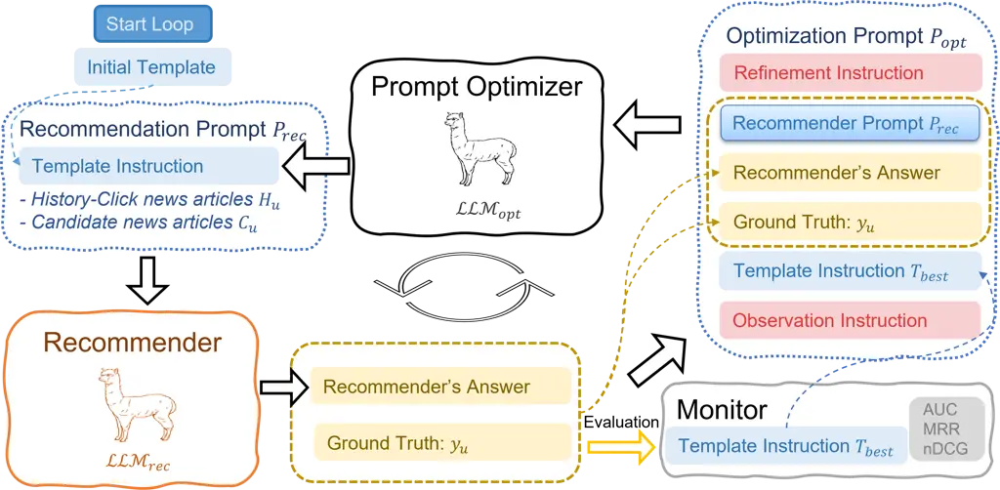
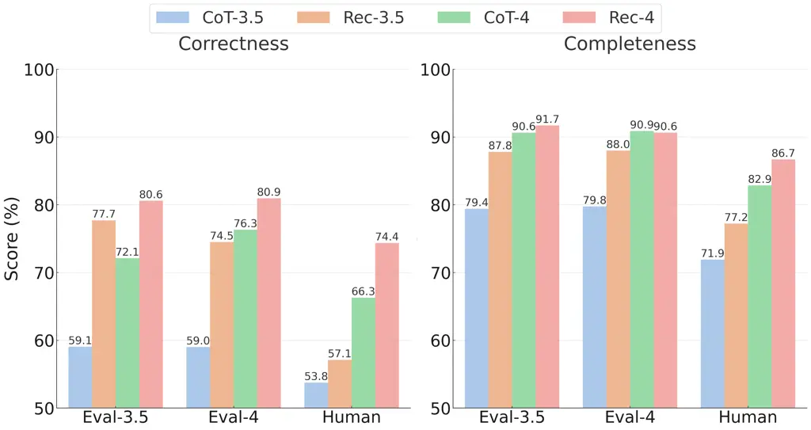

# RecPrompt: A Self-tuning Prompting Framework for News Recommendation Using Large Language Models

Conference: Proceedings of the 33rd ACM International Conference on
Information and Knowledge Management; October 21–25, 2024; Boise, ID,
USAProceedings of the 33rd ACM International Conference on Information
and Knowledge Management (CIKM ’24), October 21–25, 2024, Boise, ID,
USADOI: [10.1145/3627673.3679987](https://doi.org/10.1145/3627673.3679987)ISBN: 979-8-4007-0436-9/24/10CCS: Information
systems Recommender systemsCCS: Information
systems PersonalizationCCS: Information systems Language models

Dairui Liu
[](https://orcid.org/0000-0002-8573-3857)
Affiliation: University College Dublin, Dublin, Ireland email:
<dairui.liu@ucdconnect.ie> , Boming Yang
[](https://orcid.org/0009-0004-6298-5711)
Affiliation: The University of Tokyo, Tokyo, Japan email:
<boming.yang@weblab.t.u-tokyo.ac.jp> , Honghui Du
[](https://orcid.org/0000-0001-8758-0092)
Affiliation: University College Dublin, Dublin, Ireland email:
<honghui.du@insight-centre.org> , Derek Greene Affiliation: University
College Dublin, Dublin, Ireland , Neil Hurley Affiliation: University
College Dublin, Dublin, Ireland , Aonghus Lawlor Affiliation: University
College Dublin, Dublin, Ireland , Ruihai Dong Affiliation: University
College Dublin, Dublin, Ireland and Irene Li
[](https://orcid.org/0000-0002-1851-5390)
Affiliation: University of Tokyo, Tokyo, Japan email:
<ireneli@ds.itc.u-tokyo.ac.jp>

© rightsretained

###### Abstract.

News recommendations heavily rely on Natural Language Processing (NLP)
methods to analyze, understand, and categorize content, enabling
personalized suggestions based on user interests and reading behaviors.
Large Language Models (LLMs) like GPT-4 have shown promising performance
in understanding natural language. However, the extent of their
applicability to news recommendation systems remains to be validated.
This paper introduces RecPrompt¹¹ 1 Source
code:[https://github.com/Ruixinhua/rec-prompt](https://github.com/Ruixinhua/rec-prompt).
This work was supported and funded by the Science Foundation Ireland
through the Insight Centre for Data Analytics (Grant no.
SFI/12/RC/2289_P2), EU Horizon Europe SEDIMARK (SEcure Decentralised
Intelligent Data MARKetplace) project (Grant no. 101070074), and the
Japan Society for the Promotion of Science (JSPS) KAKENHI (Grant no.
24K20832)., the first self-tuning prompting framework for news
recommendation, leveraging the capabilities of LLMs to perform complex
news recommendation tasks. This framework incorporates a news
recommender and a prompt optimizer that applies an iterative
bootstrapping process to enhance recommendations through automatic
prompt engineering. Extensive experimental results with 400 users show
that RecPrompt can achieve an improvement of 3.36% in AUC, 10.49% in
MRR, 9.64% in nDCG@5, and 6.20% in nDCG@10 compared to deep neural
models. Additionally, we introduce TopicScore, a novel metric to assess
explainability by evaluating LLM’s ability to summarize topics of
interest for users. The results show LLM’s effectiveness in accurately
identifying topics of interest and delivering comprehensive topic-based
explanations.

###### Keywords: 

News Recommendation, Automatic Prompt Engineering, Large Language Models

## 1. Introduction

The rise of personalized news recommendation systems, like Google News
and Microsoft News, has revolutionized how people access and consume
news by making it more tailored to individual preferences (Wu et al.,
2023). Achieving high-quality news recommendations necessitates
precisely understanding the semantics within news articles (Xiao et al.,
2022). Recent advancements in natural language processing, particularly
through Large Language Models (LLMs) such as GPT-4 (OpenAI, 2023), have
shown considerable potential in this area. These models leverage
extensive linguistic and world knowledge from large-scale corpora to
understand and generate human-like language, making them valuable for
aligning news content with user preferences and enhancing explainability
in recommendation systems (Fan et al., 2023).

Despite the promise of LLMs, current implementations in news
recommendation systems face challenges. Initial methods by integrating
LLMs into conventional deep neural models (Liu et al., 2023a; Runfeng
et al., 2023) have shown good recommendation performance but often lose
the advantages of LLMs. Fine-tuning LLMs (Li et al., 2023; Naffakh
et al., 2024) is a way to retain these advantages, but it requires large
sets of high-quality rationales, which are complex and
resource-intensive to produce (Wei et al., 2022). An alternative
approach is to leverage the inherent capabilities of LLMs using
prompts—text templates to guide model responses (Xu et al., 2024; Yang
et al., 2024) with different prompting strategies. For instance, Dai et
al. (Dai et al., 2023) explore using LLMs with a simple input-output
(IO) prompting strategy for direct textual responses in recommendations.
RecRanker (Luo et al., 2023) enhances the prompt through instruction
tuning with auxiliary information from recommendation models.
LLM-Rec (Lyu et al., 2023) employs diverse prompting strategies with
LLM-augmented text to enhance recommendations. These prompting
strategies have demonstrated effectiveness in complex tasks but do not
surpass well-trained deep neural methods (An et al., 2019; Wu et al.,
2019a; Wu et al., 2019c; Wu et al., 2019b; Wang et al., 2018; Yang
et al., 2023; Liu et al., 2023b) in performance. Additionally, they
require significant human effort for tuning and evaluation (Liu et al.,
2023c; Fan et al., 2023; Gao et al., 2023a; Song et al., 2023). The
nature of LLMs makes them well-suited for generating explanations for
recommendations. For example, ChatRec (Gao et al., 2023b) adopts
pre-trained LLMs to provide more interactive and explainable
recommendations. However, evaluating recommender systems has primarily
focused on ranking-based metrics (Wu et al., 2020). Few works focus on
studying the generation of explanations for recommendations and their
evaluation due to the lack of ground truth.

To overcome these limitations, we introduce RecPrompt, a self-tuning
prompting framework specifically designed for news recommendations.
RecPrompt operates through an iterative bootstrapping process involving
two LLMs: a news recommender and a prompt optimizer. The recommender
generates recommendations with text prompts, and these are then fed into
the optimizer, which refines the prompt based on the instructions,
enhancing the prompt’s alignment with user preferences and topics of
interest. Additionally, we propose TopicScore, a new metric addressing
the shortcomings of existing metrics by focusing on the semantic
relevance of topics. Extensive experiments demonstrate significant
improvements in recommendation performance with an increment of 3.36% in
AUC, 10.49% in MRR, 9.64% in nDCG@5, and 6.20% in nDCG@10 over
traditional deep neural methods and validate RecPrompt’s superiority in
generating relevant topics.



Figure 1. RecPrompt: a self-tuning prompting Framework.

## 2. Proposed Method: RecPrompt

The goal of news recommendation is to predict a list of candidate news
articles for users based on their reading history. We define the history
for a user $`u`$ as $`\bm{H}_{u}=\{nw_{i}\}`$, where each news article
$`nw`$ includes a title and a category. The candidate news is defined as
$`\bm{D}_{u}=\{(nw_{j},y_{j})\}`$, with each news article accompanied by
a label $`y_{j}\in\{0,1\}`$. A value of 1 indicates that the user is
interested in the candidate news, while 0 indicates no interest. The
objective is to learn a news recommender, and for any unseen user
$`u^{\prime}`$, the output is a ranked list of the candidate news
$`\bm{R}_{u^{\prime}}`$.

We propose the RecPrompt framework to achieve this recommendation
objective by improving the prompt to enhance the LLM’s ability to
summarize topics of the user’s interests, thus improving recommendations
performance. As shown in Figure 1, RecPrompt consists of three main
components: a News Recommender ($`\bm{LLM}_{rec}`$), a Prompt Optimizer
($`\bm{LLM}_{opt}`$), and a Monitor. The LLM-based recommender takes
recommendation prompts $`P_{rec}`$ as inputs and outputs not only a
ranked list $`\bm{R}_{u}`$ of candidate news articles but also
explanations summarizing the topics $`\bm{TP}_{u}`$ of interest based on
user reading history. The monitor evaluates recommendations and records
the best template instruction for the prompt optimizer. Also, the
prediction of the news recommender and the recommendation prompt,
$`P_{rec}`$, are then fed into the LLM-based Prompt Optimizer with an
optimization prompt to generate a refined template instruction used to
form next-round recommendation prompts.

### 2.1. RecPrompt Components

#### 2.1.1. News Recommender

We utilize an LLM to make recommendations, so the recommendation prompt,
$`P_{rec}`$ is required. This prompt contains a template instruction
$`T`$, as well as two input placeholders,“\${history}” and
“\${candidate}”, for $`\bm{H}_{u}`$ and $`\bm{C}_{u}`$ for each user.
This template can be initialized by any prompting strategy, such as
Input-Output (IO) prompting or Chain of Thoughts (Kojima et al., 2022)
prompting. An example of using the IO-prompting template is:

```ltx_verbatim
You serve as a personalized news recommendation system.
# Input Format
## User’s History News
${history}
## Candidate News
${candidate}
# Output Format
Rank candidate news based on the user’s history news in
the format: "Ranked news: <START>C#, C#,..., C#<END>".
```

The output of the news recommender contains a ranked news sequence
($`\bm{R}_{u}`$) and explanation ($`TP_{u}`$). The explanation is a
sequence of preference topics summarized from the user’s reading history
and the corresponding news list for each topic.

#### 2.1.2. Prompt Optimizer

The task of Prompt Optimizer is to generate a better recommendation
prompt. We utilize another LLM to achieve this by taking an optimization
prompt as input. This prompt contains a refinement instruction, the
recommendation prompt ($`P_{rec}`$) for a user $`u`$, the ranked news
sequence ($`\bm{R}_{u}`$) and the explanation ($`TP_{u}`$), as well as
the ground truth ($`y_{u}`$), best template recorded by the Monitor, and
an observation instruction. The refinement and observation instructions
are crucial in guiding the optimizer to a specific direction. The
refinement instruction typically starts with a sentence like "You should
generate an improved template instruction based on the provided
information." at the beginning. The observation instruction is designed
to focus on topics for the news recommendation task. An example
observation instruction could be:

You should focus on how well the recommender’s response aligns with the
user’s click behavior by examining if the topics from the user’s news
history and candidate news are accurately summarized and matched to the
user’s interests. Specifically, evaluate the clarity of topics in the
recommender’s answer, review the task description for adequacy, and
check the detail in the recommendation process to ensure it reflects an
analysis and summary of user-interest topics.

These instructions direct the optimizer to effectively summarize the
topics of news articles to aid in making accurate recommendations and
explanations with topics. The optimizer uses the optimization prompt to
update the current recommendation prompt, which can be used for
next-round recommendations.

#### 2.1.3. Monitor

It evaluates the recommender’s performance using the templates generated
by the optimizer. It observes recommendation performance by computing
metrics such as MRR (Mean Reciprocal Rank) and nDCG (normalized
Discounted Cumulative Gain) (Wu et al., 2020) to determine whether the
current template represents an improvement over previous ones. These
metrics are calculated based on the ranked list $`\bm{R}_{u}`$ and
clicked ground truth $`y_{u}`$ for all users. By continuously assessing
these metrics, the Monitor ensures that the most effective template is
identified and retained for further use, thereby enhancing the overall
performance of the news recommendation system.

### 2.2. Tuning Procedure

As shown in Figure 1, the recommender and optimizer operate in a loop.
The process starts with an initial template filled with specific data to
form the complete recommendation prompt to start the iteration loop. The
recommender LLM generates recommendations based on this initial
template, using the user’s history of clicked news articles and a set of
candidate news articles. After the recommender generates its
recommendations, the optimizer updates the current template. This
refined template is then provided to the recommender in the next
iteration to make a new prediction. The template will only be updated if
the Monitor evaluates and confirms a performance improvement. The
iteration loop continues until a specified number of iterations ($`l`$)
is reached, ensuring continuous enhancement of the recommendation
system.

### 2.3. Evaluating Explanation: TopicScore

RecPrompt generates enhanced prompts that enable $`\bm{LLM}_{rec}`$ to
explain its recommendations by summarizing topics of interest (Liu
et al., 2023b; Liu et al., 2022). The explanation is a list of topics
summarizing the user’s reading history and a sequence of news articles
that are classified to the specific topic. For example, a topic of
interest for the user is sports, and the related history news articles
are H1, H3. A good explanation should correctly recognize user interest
on the topics, and accurately classify the history news articles. The
existing methods like BERTScore (Zhang et al., 2019) are inadequate to
measure how an explanation can correctly recognize topics of user’s
interest, so we propose TopicScore to assess these topics, which
evaluates the correctness and completeness of topics within
explanations. To evaluate TopicScore, we use LLM evaluator
$`\bm{LLM}_{eval}`$ and human annotations to provide ground truth for
scoring.

Correctness measures how accurately the generated topics of
$`\bm{LLM}{rec}`$ reflect the news articles:

```math
TS_{correctness}=\frac{\sum_{u\in U}\sum_{tp\in TP_{u}}\mathbb{I}(tp)}{\sum_{u\in U}|TP_{u}|} \tag{1}
```

where $`\mathbb{I}(\cdot)`$ is an indicator function that equals 1 if
the topic $`tp`$ matches the corresponding news article and 0 otherwise,
and $`|TP_{u}|`$ is the number of summarized topics for the user.

Completeness evaluates how well the summarized topics cover the user’s
interests according to historical records:

```math
TS_{completeness}=\frac{\sum_{u\in U}|H_{m}^{u}|}{\sum_{u\in U}|H^{u}|} \tag{2}
```

where $`|H_{m}^{u}|`$ is the number of history news articles covered by
the topics for user $`u`$, $`|H^{u}|`$ is the number of historical
clicks for user $`u`$.

LLM Evaluator. We collect a set of topic summaries generated by
$`\bm{LLM}_{rec}`$ for various news articles. The LLM evaluator,
$`\bm{LLM}_{eval}`$, uses an evaluation prompt to check if each
summarized topic accurately reflects the content of the corresponding
news article.

Human annotation. Mirroring the evaluation by $`\bm{LLM}_{eval}`$, we
establish a workflow for human annotators to select all relevant topics
that correctly match the given news content.

## 3. Experiments

### 3.1. Experimental Settings

We evaluate our proposed model on a benchmark news recommendation
dataset, the MIcrosoft News Dataset (MIND) collection (Wu et al., 2020).
From MIND, we randomly select 100 users to form the validation set for
optimizing RecPrompt and 400 users to constitute the test set. Each user
is given 10 candidate news articles that are shown in an impression and
only one of them is clicked by the user, where each news item includes
headlines and its category tag. All experiments are conducted 3 times on
the test set, with the average performance metrics reported to ensure
consistency. The recommender component is represented as
$`\bm{LLM}_{rec}`$, the optimizer component as $`\bm{LLM}_{opt}`$, and
the evaluator component as $`\bm{LLM}_{eval}`$. Each component can
operate with either GPT-3.5 or GPT-4, indicated by subscripts -3.5 and
-4 respectively. We limit the number of iterations $`l`$ for RecPrompt
to 10 and apply a zero-shot prompt (Sileo et al., 2021) for
$`\bm{LLM}_{rec}`$. We utilize OpenAI’s API versions gpt-3.5-turbo-1106
for GPT-3.5 and gpt-4-1106-preview for GPT-4, respectively, applying for
$`\bm{LLM}_{rec}`$, $`\bm{LLM}_{opt}`$, and $`\bm{LLM}_{eval}`$.
Following previous work (Wu et al., 2020), we use the same pipeline to
train deep neural models and consider four metrics to evaluate the
performance of news recommendations: AUC, MRR, nDCG@5 (N@5), and N@10.
We apply two prompting strategies, Input-Output (IO) (Dai et al., 2023)
and Chain of Thoughts (CoT) (Kojima et al., 2022) for the template.

|                                   |            |            |            |            |
| --------------------------------- | ---------- | ---------- | ---------- | ---------- |
| Model                             | AUC        | MRR        | nDCG@5     | nDCG@10    |
| Random                            | 50.89±2.23 | 30.30±1.17 | 30.47±1.99 | 46.22±0.99 |
| MostPop                           | 52.47±0.04 | 34.99±0.01 | 34.68±0.05 | 49.77±0.01 |
| TopicPop                          | 64.64±0.04 | 39.35±0.07 | 44.39±0.08 | 53.59±0.05 |
| Deep Model                        |            |            |            |            |
| LSTUR (An et al., 2019)           | 67.17±0.22 | 43.76±0.30 | 47.84±0.23 | 57.00±0.23 |
| DKN (Wang et al., 2018)           | 66.28±0.43 | 42.31±0.50 | 46.43±0.37 | 55.88±0.38 |
| NAML (Wu et al., 2019a)           | 66.79±0.10 | 44.03±0.46 | 48.03±0.35 | 57.18±0.34 |
| NPA (Wu et al., 2019b)            | 65.52±0.78 | 43.16±0.40 | 46.53±0.47 | 56.47±0.32 |
| NRMS (Wu et al., 2019c)           | 66.25±0.12 | 43.60±0.30 | 46.86±0.25 | 56.82±0.21 |
| Prompt LLM                        |            |            |            |            |
| IO-$`\bm{LLM}_{rec\text{-}3.5}`$  | 59.08±0.23 | 38.55±0.15 | 40.35±0.38 | 52.74±0.21 |
| CoT-$`\bm{LLM}_{rec\text{-}3.5}`$ | 58.67±0.14 | 37.66±0.35 | 39.12±0.26 | 52.06±0.41 |
| IO-$`\bm{LLM}_{rec\text{-}4}`$    | 65.06±0.14 | 43.62±0.13 | 46.66±0.24 | 56.78±0.06 |
| CoT-$`\bm{LLM}_{rec\text{-}4}`$   | 66.06±0.18 | 44.01±0.29 | 48.02±0.34 | 57.12±0.17 |
| RecPrompt                         |            |            |            |            |
| IO-$`\bm{LLM}_{rec\text{-}3.5}`$  | 62.28±0.14 | 39.53±0.12 | 43.65±0.32 | 53.65±0.25 |
| CoT-$`\bm{LLM}_{rec\text{-}3.5}`$ | 64.73±0.32 | 42.22±0.23 | 46.33±0.11 | 55.75±0.19 |
| IO-$`\bm{LLM}_{rec\text{-}4}`$    | 69.39±0.21 | 48.2±0.34  | 52.01±0.37 | 60.39±0.29 |
| CoT-$`\bm{LLM}_{rec\text{-}4}`$   | 69.43±0.04 | 48.65±0.32 | 52.66±0.43 | 60.73±0.24 |
| Increment-\>DM                    | (+3.36%)   | (+10.49%)  | (+9.64%)   | (+6.20%)   |

Table 1. Recommendation performance of models regarding AUC, MRR,
nDCG@5, and nDCG@10.

### 3.2. Results and Discussion

Table 1 summarizes the results of all methods on the test dataset,
leading to several key observations. Firstly, among traditional
baselines, TopicPop achieves the best performance. This success can be
attributed to its use of category tags from the news data, which provide
more tailored recommendations. This demonstrates the effectiveness of
leveraging topical information to match user interests. Secondly, all
deep neural models outperform TopicPop. These models benefit from their
advanced capabilities in processing and representing the textual content
of news articles. In particular, NAML outperforms other baselines
because it extracts comprehensive information from news text,
categories, and subcategories, resulting in more informative
representations. In terms of the impact of the prompting strategy, it
shows a clear advantage of the CoT strategy over IO in improving
recommendation performance across most configurations. Regarding our
proposed RecPrompt methods, the results indicate that
CoT-$`\bm{LLM}_{rec\text{-}3.5}`$ outperforms all traditional methods.
Notably, it slightly surpasses TopicPop, illustrating that
$`\bm{LLM}_{rec\text{-}3.5}`$ is more effective in summarizing user
topics from headlines and category tags. Lastly,
CoT-$`\bm{LLM}_{rec\text{-}4}`$ achieves superior results compared to
all deep neural models using zero-shot prompting, without any training
on news recommendation data. This highlights RecPrompt’s ability to
effectively understand news content and provide accurate
recommendations.

### 3.3. Ablation Study

We systematically examine the impact of key components within the
RecPrompt framework to understand their contributions to enhancing the
performance of news recommendation systems. The study focuses on the use
of different LLMs as the recommender and the optimizer, and the
inclusion of category information in the model inputs. The performance
outcomes are detailed in Table 2.

|                                   |              |       |       |               |       |       |
| --------------------------------- | ------------ | ----- | ----- | ------------- | ----- | ----- |
| Strategy                          | w/o Category |       |       | with Category |       |       |
|                                   | AUC          | MRR   | N@5   | AUC           | MRR   | N@5   |
| $`\bm{LLM}_{rec\text{-}3.5}`$     |              |       |       |               |       |       |
| IO-$`\bm{LLM}_{opt\text{-}3.5}`$  | 58.97        | 35.85 | 39.17 | 61.24         | 39.23 | 41.97 |
| CoT-$`\bm{LLM}_{opt\text{-}3.5}`$ | 58.96        | 37.46 | 39.62 | 64.06         | 41.26 | 44.55 |
| IO-$`\bm{LLM}_{opt\text{-}4}`$    | 59.32        | 36.15 | 39.42 | 62.28         | 39.53 | 43.65 |
| CoT-$`\bm{LLM}_{opt\text{-}4}`$   | 60.03        | 38.18 | 40.89 | 64.73         | 42.22 | 46.33 |
| $`\bm{LLM}_{rec\text{-}4}`$       |              |       |       |               |       |       |
| IO-$`\bm{LLM}_{opt\text{-}4}`$    | 66.69        | 45.89 | 49.09 | 69.39         | 48.20 | 52.01 |
| CoT-$`\bm{LLM}_{opt\text{-}4}`$   | 66.92        | 46.65 | 49.58 | 69.43         | 48.65 | 52.66 |

Table 2. Performance comparison of $`\bm{LLM}_{rec}`$ and
$`\bm{LLM}_{opt}`$ on RecPrompt, considering various settings.

The use of both $`\bm{LLM}_{opt\text{-}3.5}`$ and
$`\bm{LLM}_{opt\text{-}4}`$ significantly enhances the effectiveness of
the initial prompting strategy, validating RecPrompt’s ability to
generate refined recommendation prompts. Notably,
$`\bm{LLM}_{opt\text{-}4}`$ shows greater performance improvements over
$`\bm{LLM}_{opt\text{-}3.5}`$, particularly when paired with
$`\bm{LLM}_{rec\text{-}3.5}`$. This highlights the incremental benefits
of employing more advanced LLMs as optimizers. Integrating category
information results in significant improvements across all evaluated
performance metrics, underscoring the importance of topical relevance in
achieving accurate recommendations. This finding supports RecPrompt’s
strategic focus on leveraging $`\bm{LLM}_{rec}`$ to extract and
summarize topics that reflect user interests and provide explanations
for click behavior from a topical perspective.



Figure 2. TopicScore evaluation between general CoT strategies and
RecPrompt-CoT (Rec-3.5 and Rec-4), utilizing
$`\bm{LLM}_{rec\text{-}3.5}`$ and $`\bm{LLM}_{rec\text{-}4}`$, optimized
by $`\bm{LLM}_{opt\text{-}4}`$.

### 3.4. TopicScore Analysis

In evaluating TopicScore, we used a dataset of 272 news articles and
their associated 688 topics generated by $`\bm{LLM}_{rec}`$ under
different settings. Due to substantial redundancy among the extracted
topics, we consolidated similar topics, focusing on 214 unique topics
for further evaluation. The evaluation metrics measured the precision of
these topics in reflecting recommendations and their ability to
encapsulate user interests comprehensively. We enriched our analysis by
averaging TopicScore assessments from three human annotators and
comparing them with LLM evaluations. From Figure 2, we observed only
marginal differences in TopicScore evaluations between
$`\bm{LLM}_{eval\text{-}3.5}`$ and $`\bm{LLM}_{eval\text{-}4}`$, with
both generally assigning higher scores than human annotators. This
suggests a potential discrepancy in the criteria for topic relevance
assessment between machine and human evaluators. Notably,
$`\bm{LLM}_{rec\text{-}4}`$ demonstrated a consistent advantage over
$`\bm{LLM}_{rec\text{-}3.5}`$ in terms of topic accuracy and coverage,
highlighting its enhanced capability for content analysis and
summarization. Furthermore, the application of both
$`\bm{LLM}_{rec\text{-}3.5}`$ and $`\bm{LLM}_{rec\text{-}4}`$ within the
RecPrompt framework significantly elevated the TopicScore beyond the
baseline established by the CoT strategy, validating RecPrompt’s
effectiveness in optimizing topic extraction and relevance.

## 4. Conclusion

This paper introduces RecPrompt, a novel framework using LLMs for news
recommendation. It combines a recommender and a prompt optimizer with an
iterative bootstrapping process to enhance prompting strategies. Our
experiments show that RecPrompt significantly outperforms traditional
and deep neural news recommendation models across various performance
metrics. Furthermore, we propose a novel metric, TopicScore, to assess
the correctness and completeness of the topics generated by RecPrompt
and compare them with the CoT prompting strategy. The results
demonstrate the framework’s ability to align recommendations closely
with user interests and emphasize the critical role of prompt
engineering in improving accuracy and user interest alignment when
employing LLM-based recommendations.

## References

- An et al. (2019) Mingxiao An, Fangzhao Wu, Chuhan Wu, Kun Zhang, Zheng
  Liu, and Xing Xie. 2019. Neural News Recommendation with Long- and
  Short-term User Representations. In _Proceedings of the 57th Annual
  Meeting of the Association for Computational Linguistics_. Association
  for Computational Linguistics, 336–345.
- Dai et al. (2023) Sunhao Dai, Ninglu Shao, Haiyuan Zhao, Weijie Yu,
  Zihua Si, Chen Xu, ZhongXiang Sun, Xiao Zhang, and Jun Xu. 2023.
  Uncovering ChatGPT’s Capabilities in Recommender Systems. _Proceedings
  of the 17th ACM Conference on Recommender Systems_ (2023).
  [https://api.semanticscholar.org/CorpusID:258461170](https://api.semanticscholar.org/CorpusID:258461170)
- Fan et al. (2023) Wenqi Fan, Zihuai Zhao, Jiatong Li, Yunqing Liu,
  Xiaowei Mei, Yiqi Wang, Jiliang Tang, and Qing Li. 2023. Recommender
  Systems in the Era of Large Language Models (LLMs). _ArXiv_
  abs/2307.02046 (2023).
  [https://api.semanticscholar.org/CorpusID:259342486](https://api.semanticscholar.org/CorpusID:259342486)
- Gao et al. (2023a) Fan Gao, Hang Jiang, Moritz Blum, Jinghui Lu, Yuang
  Jiang, and Irene Li. 2023a. Large Language Models on Wikipedia-Style
  Survey Generation: an Evaluation in NLP Concepts. _ArXiv_
  abs/2308.10410 (2023).
  [https://api.semanticscholar.org/CorpusID:261049765](https://api.semanticscholar.org/CorpusID:261049765)
- Gao et al. (2023b) Yunfan Gao, Tao Sheng, Youlin Xiang, Yun Xiong,
  Haofen Wang, and Jiawei Zhang. 2023b. Chat-rec: Towards interactive
  and explainable llms-augmented recommender system. _arXiv preprint
  arXiv:2303.14524_ (2023).
- Kojima et al. (2022) Takeshi Kojima, Shixiang Shane Gu, Machel Reid,
  Yutaka Matsuo, and Yusuke Iwasawa. 2022. Large language models are
  zero-shot reasoners. _Advances in neural information processing
  systems_ 35 (2022), 22199–22213.
- Li et al. (2023) Xinyi Li, Yongfeng Zhang, and Edward C.
  Malthouse. 2023. Exploring Fine-tuning ChatGPT for News
  Recommendation. _ArXiv_ abs/2311.05850 (2023).
  [https://api.semanticscholar.org/CorpusID:265128762](https://api.semanticscholar.org/CorpusID:265128762)
- Liu et al. (2022) Dairui Liu, Derek Greene, and Ruihai Dong. 2022. A
  Novel Perspective to Look At Attention: Bi-level Attention-based
  Explainable Topic Modeling for News Classification. In _Findings of
  the Association for Computational Linguistics: ACL 2022_. ACL, Dublin,
  Ireland, 2280–2290.
- Liu et al. (2023b) Dairui Liu, Derek Greene, Irene Li, Xuefei Jiang,
  and Ruihai Dong. 2023b. Topic-Centric Explanations for News
  Recommendation. arXiv:2306.07506 \[cs.IR\]
  [https://arxiv.org/abs/2306.07506](https://arxiv.org/abs/2306.07506)
- Liu et al. (2023c) Peng Liu, Lemei Zhang, and Jon Atle Gulla. 2023c.
  Pre-train, prompt and recommendation: A comprehensive survey of
  language modelling paradigm adaptations in recommender systems. _arXiv
  preprint arXiv:2302.03735_ (2023).
- Liu et al. (2023a) Qijiong Liu, Nuo Chen, Tetsuya Sakai, and Xiao-Ming
  Wu. 2023a. ONCE: Boosting Content-based Recommendation with Both Open-
  and Closed-source Large Language Models. _Proceedings of the 17th ACM
  International Conference on Web Search and Data Mining_ (2023).
  [https://api.semanticscholar.org/CorpusID:258615357](https://api.semanticscholar.org/CorpusID:258615357)
- Luo et al. (2023) Sichun Luo, Bowei He, Haohan Zhao, Yinya Huang,
  Aojun Zhou, Zongpeng Li, Yuanzhang Xiao, Mingjie Zhan, and Linqi
  Song. 2023. RecRanker: Instruction Tuning Large Language Model as
  Ranker for Top-k Recommendation. _ArXiv_ abs/2312.16018 (2023).
  [https://api.semanticscholar.org/CorpusID:266550968](https://api.semanticscholar.org/CorpusID:266550968)
- Lyu et al. (2023) Hanjia Lyu, Song Jiang, Hanqing Zeng, Yinglong Xia,
  Qifan Wang, Si Zhang, Ren Chen, Christopher Leung, Jiajie Tang, and
  Jiebo Luo. 2023. LLM-Rec: Personalized Recommendation via Prompting
  Large Language Models.
  [https://api.semanticscholar.org/CorpusID:268857359](https://api.semanticscholar.org/CorpusID:268857359)
- Naffakh et al. (2024) Hussein Ali Hussein Al Naffakh, Ahmed Dheyaa
  Radhi, Baqer A Hakim, AL-Ibraheemi Fuqdan, and Bourair Al-Attar. 2024.
  Exploring chatgpt’s performance in news recommendation: A
  multi-faceted analysis. _BIO Web of Conferences_ (2024).
  [https://api.semanticscholar.org/CorpusID:268983518](https://api.semanticscholar.org/CorpusID:268983518)
- OpenAI (2023) OpenAI. 2023. GPT-4 Technical Report.
  arXiv:2303.08774 \[cs.CL\]
- Runfeng et al. (2023) Xie Runfeng, Cui Xiangyang, Yan Zhou, Wang Xin,
  Xuan Zhanwei, Zhang Kai, et al. 2023. Lkpnr: Llm and kg for
  personalized news recommendation framework. _arXiv preprint
  arXiv:2308.12028_ (2023).
- Sileo et al. (2021) Damien Sileo, Wout Vossen, and Robbe
  Raymaekers. 2021. Zero-Shot Recommendation as Language Modeling. In
  _European Conference on Information Retrieval_.
  [https://api.semanticscholar.org/CorpusID:244954768](https://api.semanticscholar.org/CorpusID:244954768)
- Song et al. (2023) Linxin Song, Jieyu Zhang, Lechao Cheng, Pengyuan
  Zhou, Tianyi Zhou, and Irene Li. 2023. NLPBench: Evaluating Large
  Language Models on Solving NLP Problems. _ArXiv_ abs/2309.15630
  (2023).
  [https://api.semanticscholar.org/CorpusID:263152801](https://api.semanticscholar.org/CorpusID:263152801)
- Wang et al. (2018) Hongwei Wang, Fuzheng Zhang, Xing Xie, and Minyi
  Guo. 2018. DKN: Deep Knowledge-Aware Network for News Recommendation.
  _Proceedings of the 2018 World Wide Web Conference_ (2018).
- Wei et al. (2022) Jason Wei, Xuezhi Wang, Dale Schuurmans, Maarten
  Bosma, Fei Xia, Ed Chi, Quoc V Le, Denny Zhou, et al. 2022.
  Chain-of-thought prompting elicits reasoning in large language models.
  _Advances in neural information processing systems_ 35 (2022),
  24824–24837.
- Wu et al. (2019a) Chuhan Wu, Fangzhao Wu, Mingxiao An, Jianqiang
  Huang, Yongfeng Huang, and Xing Xie. 2019a. Neural News Recommendation
  with Attentive Multi-View Learning. In _International Joint Conference
  on Artificial Intelligence (IJCAI 2019)_.
- Wu et al. (2019b) Chuhan Wu, Fangzhao Wu, Mingxiao An, Jianqiang
  Huang, Yongfeng Huang, and Xing Xie. 2019b. NPA: Neural News
  Recommendation with Personalized Attention. In _Proceedings of the
  25th ACM SIGKDD International Conference on Knowledge Discovery & Data
  Mining_.
- Wu et al. (2019c) Chuhan Wu, Fangzhao Wu, Suyu Ge, Tao Qi, Yongfeng
  Huang, and Xing Xie. 2019c. Neural News Recommendation with Multi-Head
  Self-Attention. In _Proceedings of the 2019 Conference on Empirical
  Methods in Natural Language Processing and the 9th International Joint
  Conference on Natural Language Processing (EMNLP-IJCNLP)_. 6389–6394.
- Wu et al. (2023) Chuhan Wu, Fangzhao Wu, Yongfeng Huang, and Xing
  Xie. 2023. Personalized news recommendation: Methods and challenges.
  _ACM Transactions on Information Systems_ 41, 1 (2023), 1–50.
- Wu et al. (2020) Fangzhao Wu, Ying Qiao, Jiun-Hung Chen, Chuhan Wu,
  Tao Qi, Jianxun Lian, Danyang Liu, Xing Xie, Jianfeng Gao, Winnie Wu,
  and Ming Zhou. 2020. MIND: A Large-scale Dataset for News
  Recommendation. In _Proceedings of the 58th Annual Meeting of the
  Association for Computational Linguistics_. Association for
  Computational Linguistics, 3597–3606.
- Xiao et al. (2022) Shitao Xiao, Zheng Liu, Yingxia Shao, Tao Di,
  Bhuvan Middha, Fangzhao Wu, and Xing Xie. 2022. Training large-scale
  news recommenders with pretrained language models in the loop. In
  _Proceedings of the 28th ACM SIGKDD Conference on Knowledge Discovery
  and Data Mining_. 4215–4225.
- Xu et al. (2024) Lanling Xu, Junjie Zhang, Bingqian Li, Jinpeng Wang,
  Mingchen Cai, Wayne Xin Zhao, and Ji-Rong Wen. 2024. Prompting Large
  Language Models for Recommender Systems: A Comprehensive Framework and
  Empirical Analysis. _ArXiv_ abs/2401.04997 (2024).
  [https://api.semanticscholar.org/CorpusID:266902921](https://api.semanticscholar.org/CorpusID:266902921)
- Yang et al. (2023) Boming Yang, Dairui Liu, Toyotaro Suzumura, Ruihai
  Dong, and Irene Li. 2023. Going Beyond Local: Global Graph-Enhanced
  Personalized News Recommendations. In _Proceedings of the 17th ACM
  Conference on Recommender Systems, RecSys 2023, Singapore, Singapore,
  September 18-22, 2023_, Jie Zhang, Li Chen, Shlomo Berkovsky, Min
  Zhang, Tommaso Di Noia, Justin Basilico, Luiz Pizzato, and Yang Song
  (Eds.). ACM, 24–34.
  [https://doi.org/10.1145/3604915.3608801](https://doi.org/10.1145/3604915.3608801)
- Yang et al. (2024) Rui Yang, Haoran Liu, Edison Marrese-Taylor,
  Qingcheng Zeng, Yu He Ke, Wanxin Li, Lechao Cheng, Qingyu Chen, James
  Caverlee, Yutaka Matsuo, and Irene Li. 2024. KG-Rank: Enhancing Large
  Language Models for Medical QA with Knowledge Graphs and Ranking
  Techniques. _ArXiv_ abs/2403.05881 (2024).
  [https://api.semanticscholar.org/CorpusID:268357662](https://api.semanticscholar.org/CorpusID:268357662)
- Zhang et al. (2019) Tianyi Zhang, Varsha Kishore, Felix Wu, Kilian Q
  Weinberger, and Yoav Artzi. 2019. BERTScore: Evaluating Text
  Generation with BERT. In _International Conference on Learning
  Representations_.
