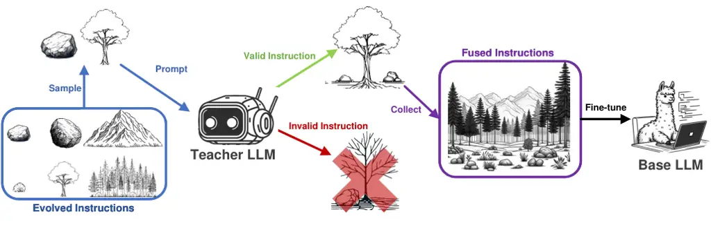
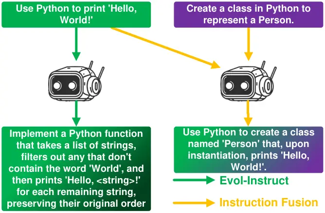
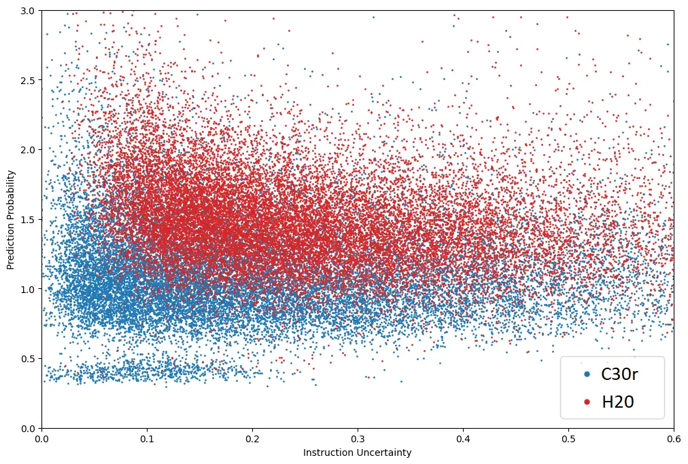
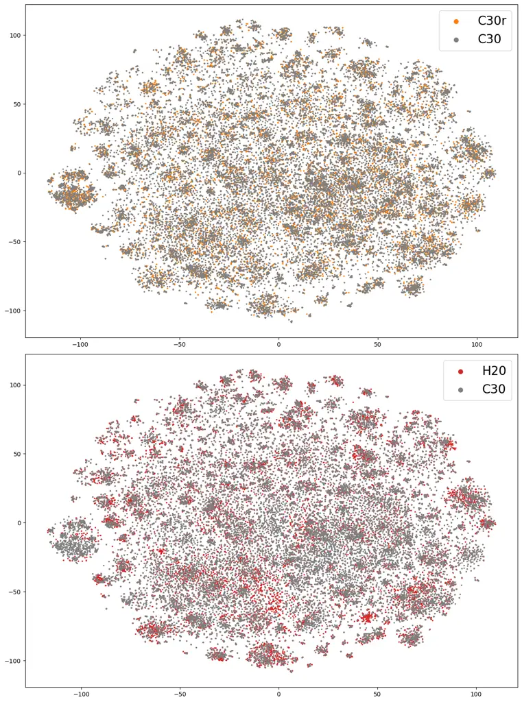
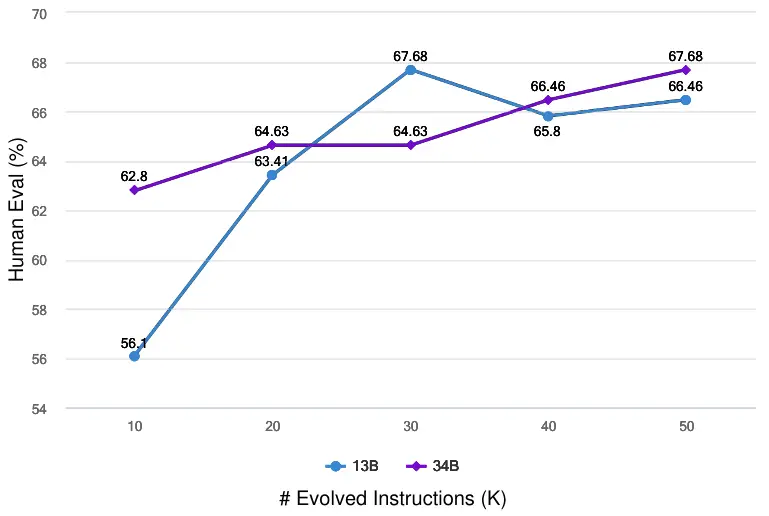
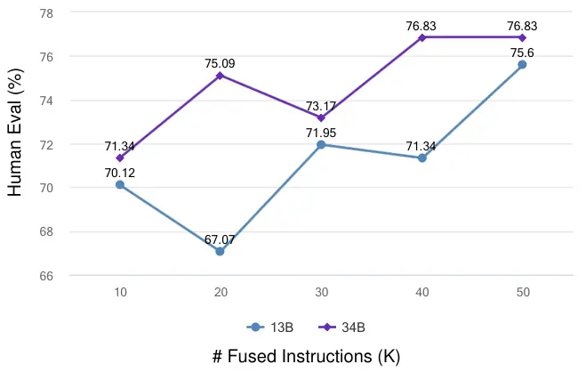

# Instruction Fusion: Advancing Prompt Evolution through Hybridization

Weidong Guo Jiuding Yang ¹¹footnotemark: 1 Kaitong Yang ¹¹footnotemark:
1 Xiangyang Li ^(†)^(†)thanks: These authors contributed equally to this
work. Affiliation: Platform and Content Group, Tencent
Affiliation: University of Alberta
Affiliation: {weidongguo,kaitongyang,xiangyangli,evanyiu,henrysxu}@tencent.com
Affiliation: {jiuding,dniu}@ualberta.ca    Zhuwei Rao Yu Xu Di Niu
Affiliation: Platform and Content Group, Tencent Affiliation: University
of Alberta
Affiliation: {weidongguo,kaitongyang,xiangyangli,evanyiu,henrysxu}@tencent.com
Affiliation: {jiuding,dniu}@ualberta.ca

###### Abstract

The fine-tuning of Large Language Models (LLMs) specialized in code
generation has seen notable advancements through the use of open-domain
coding queries. Despite the successes, existing methodologies like
Evol-Instruct encounter performance limitations, impeding further
enhancements in code generation tasks. This paper examines the
constraints of existing prompt evolution techniques and introduces a
novel approach, Instruction Fusion (IF). IF innovatively combines two
distinct prompts through a hybridization process, thereby enhancing the
evolution of training prompts for code LLMs. Our experimental results
reveal that the proposed novel method effectively addresses the
shortcomings of prior methods, significantly improving the performance
of Code LLMs across five code generation benchmarks, namely HumanEval,
HumanEval+, MBPP, MBPP+ and MultiPL-E, which underscore the
effectiveness of Instruction Fusion in advancing the capabilities of
LLMs in code generation.

## 1 Introduction

The field of automatic program writing has intrigued computer scientists
since the 1960s Waldinger and Lee (1969); Dehaerne et al. (2022). This
period has seen substantial efforts to enable machines to autonomously
write correct programs. The emergence of Large Language Models (LLMs)
Brown et al. (2020); Ouyang et al. (2022); Touvron et al. (2023) has
been a cornerstone in text generation Liu et al. (2023b), leading to the
evolution of Code Large Language Models (Code LLMs) which have notably
advanced code generation tasks Hou et al. (2023).

Early Code LLM research Roziere et al. (2023); Li et al. (2023)
concentrated on the pre-training phase, utilizing a variety of code
datasets to bolster the code generation capabilities of LLMs. A major
breakthrough was achieved with instruction tuning Wei et al. (2022),
which enhanced the general applicability of LLMs by fine-tuning them
with instructions rather than task-specific prompts.

In pursuit of greater quantity, diversity, and creativity in
instruction-response samples, Wang et al. (2022) introduced the
Self-Instruct method, leveraging LLMs to generate their own synthetic
instructions. This approach was notably adopted by Code Alpaca Chaudhary
(2023), based on Stanford Alpaca Taori et al. (2023), transforming 21
basic code prompts into 20,000 high-quality instructions. Building on
this, Luo et al. (2023) further advanced code generation performance by
employing Evol-Instruct on these instructions, expanding them to 78,000
through five dataset evolution heuristics.

However, the Evol-Instruct method has its limitations on Code LLMs,
primarily its reliance on a set of five heuristics for generating new
instructions. This approach leads to a pattern where the evolution is
done primarily by adding more constraints to its seed instruction, which
can cause three major issues. Firstly, the evolving instructions may
become excessively complex, challenging GPT’s ability to respond
effectively. Secondly, the newly added constrains to the seed
instruction may not exist in the original seed instruction, leading to
an gap on difficulty gradient. Finally, the evolutionary evaluations
often remain confined within the scope of the original instruction,
limiting diversity.

Addressing these challenges, we introduce a novel method named
Instruction Fusion (IF). This method leverages hybridization concepts to
significantly improve prompt evolution, as demonstrated in Figure 1. It
involves merging two distinct instructions into a single prompt using
GPT-4 Turbo, enhancing prompt complexity and diversity. This approach
also facilitates a more gradual increase in difficulty for LLMs,
optimizing learning and performance.

To assess the efficacy of our Instruction Fusion method, we conducted
experiments with Code-Llama Roziere et al. (2023), using HumanEval Chen
et al. (2021a), MBPP Austin et al. (2021), HumanEval⁺, MBPP⁺ Liu et al.
(2023a), and MultiPL-E Cassano et al. (2022) as benchmark datasets. Our
results demonstrate a significant performance improvement of LLMs when
training with the additional data generated by IF. The contributions of
this work can be summarized as follows:

- •
  The IF method greatly improved instruction creation by merging two
  distinct instructions into a single, more complex prompt using GPT-4
  Turbo. This strategy substantially boosts the diversity and complexity
  of the training data while ensuring a smoother difficulty gradient for
  learning. This approach effectively addresses and overcomes the
  limitations inherent in previous methods such as Evol-Instruct.
- •
  Through extensive fine-tuning experiments on Code-Llama models on five
  commonly used code generation benchmarks, we demonstrate the superior
  performance of our Instruction Fusion method. We fully open source the
  model weights, training data, and source code to facilitate future
  research.



Figure 1: An illustration of Instruction Fusion. The responses to each
fused instruction are also generated and collected from GPT-4 Turbo.

## 2 Approach

In this section, we first analyze the the limitation of current
evolution method on Code LLMs, then we elaborate on the details of the
proposed Instruction Fusion method and analyze its advantages comparing
to the existing instruction evolution method. The main process of the
fusion is illustrated in Figure 1.

### 2.1 Instruction Evolution

High-quality instructions are vital for effectively fine-tuning Code
LLMs. Crafting these, particularly for coding tasks, is
resource-intensive and often results in easy difficulty levels, creating
a gap in challenging content Xu et al. (2023). To address this and
reduce costs, Luo et al. (2023) applied Evol-Instruct Xu et al. (2023)
to Code LLMs, enhancing code generation. This process involves merging
each seed instruction with a unique evolution prompt and generating
evolved instructions using GPT-3.5 Turbo. This method expanded and
diversified the instruction dataset, but certain limitations hinder its
further development.

Figure 2: A real example of the fourth round evolution using
Evol-Instruct.

A major challenge identified in the process of instruction evolution is
the over-escalating constraints, as illustrated in Figure 2. The process
begins with a straightforward instruction, such as developing a Python
function to convert strings to lowercase. However, the complexity
increases significantly with each evolution round. After four rounds,
the instruction length expanded from 14 to 325 tokens. This increase is
primarily attributed to the incorporation of up to eight distinct
constraints. As a result, the evolved instructions become impractically
intricate and overly complex.

Although Evol-Instruct with low rounds can properly increase the
difficulty levels by braining new constrains, which benefits LLM
learning, those new constrains may need prior knowledge to learn.
Consider math learning as an analogy: understanding addition and
multiplication is fundamental before tackling problems like
"$`1+1\times 2`$." However, Evol-Instruct might prematurely introduce
such problems immediately following basic concepts like "$`1+1=2`$",
potentially leading to gaps in learning progression.

Another issue is the limited diversification of objectives during
evolution. Despite adding new constraints, the primary objective often
remains unchanged. Take the scenario in Figure 2 as an example, despite
introducing new objectives like sorting, the primary task remained
similar to the original. This lack of variability in objectives can
severely limit the diversity of the resulting instructions.

Due to these inherent limitations, the Evol-Instruct method applied to
Code LLMs often reaches its capacity (3 rounds) without further
enhancing code generation performance. However, these issues can be
mitigated with our proposed Instruction Fusion method.

### 2.2 Instruction Fusion

Inspired by the hybridization which can produce new individual by
exchange the information between inter-specific parents, we propose
Instruction Fusion to overcome the above challenges.

Fusion Process. Figure 1 gives an illustration of the Instruction Fusion
process. Denote the initial dataset as
$`\mathbf{C}=\{(I_{i},R_{i})\}_{1<i<N}`$, where $`I_{i}`$, $`R_{i}`$ are
the $`i^{\text{th}}`$ seed instruction and the corresponding response,
$`N`$ is the number of instructions in $`\mathbf{C}`$. To create a new
instruction using Instruction Fusion, we first random select two seed
instructions $`I_{j}`$ and $`I_{k}`$ from $`\mathbf{C}`$, where
$`1\leq j,k\leq N`$. Then, denote the target amount of fused
instructions as $`M`$, we prompt GPT-4 Turbo to fuse the selected two
instructions into the $`m^{\text{th}}`$ fused instruction
$`I^{m}_{(j,k)}`$ utilizing the following prompt:

\*Your task is to act as a Prompt Fusion Specialist. Your objective is to
merge \#Given Prompt 1# and \#Given Prompt 2# into a single, cohesive
\#Fused Prompt#. This new prompt should:

1. Integrate the content from both \#Given Prompt 1# and \#Given Prompt
   2#.
2. Maintain a similar length and complexity level as the original
   prompts.
3. Be coherent and solvable, incorporating elements from both prompts in
   a balanced way.
4. In cases where the original prompts specify different programming
   languages, choose only one for the \#Fused Prompt#.  
   If the resulting \#Fused Prompt# is not logically coherent or solvable,
   simply respond with ’INVALID PROMPT’.  
   \#Given Prompt 1#:  
   \<Here is Instruction 1\>  
   \#Given Prompt 2#:  
   \<Here is Instruction 2\>  
   \#Fused Prompt#:\*

Here, $`1\leq m\leq M`$. For each fused instruction, if
$`I^{m}_{(j,k)}==\text{INVALID\ PROMPT}`$, we will discard the $`(j,k)`$
combination and randomly sample a new one. We keep repeating the fusion
process until the number of new instructions reach the target amount
$`M`$. The result instructions set is then
$`\textbf{H}=\{(I^{m}_{(j,k)},R^{m}_{(j,k)})\}_{1<m<M}`$, where
$`R^{m}_{(j,k)}`$ is the corresponding response of $`I^{m}_{(j,k)}`$
generated by GPT-4 Turbo (gpt-4-1106-preview¹¹ 1
https://platform.openai.com/docs/models).

Data Collection. Table 1 gives the statistic of the collected datasets.
Due to the unavailability of WizardCoder’s Luo et al. (2023) original
evolved instructions, we utilized the third-party dataset
evol-codealpaca-v1²² 2 https://github.com/theblackcat102/evol-dataset,
which mirrors the methods used by Luo et al. (2023). This dataset,
comprising 111k refined instructions, is evolved from the CodeAlpaca³³ 3
https://github.com/sahil280114/codealpaca dataset, which is also serves
as the seeds in WizardCoder. We divided evol-codealpaca-v1 based on
programming language into Python-related instructions
$`\textbf{C}_{\text{PI}}`$ and Non-Python-related instructions
$`\textbf{C}_{\text{NPI}}`$, numbering 50,131 and 61,140, respectively.
To perform detailed comparison in later experiments, we further divide
$`\textbf{C}_{\text{PI}}`$ into $`\textbf{C}_{30}`$ and
$`\textbf{C}_{30r}`$, which represents the 30K random samples from
$`\textbf{C}_{\text{PI}}`$ and the rest samples, respectively. Based on
the Instruction Fusion scheme introduced above, we set
$`\textbf{C}_{\text{PI}}`$ as seeds and perform IF with $`M=50,000`$ to
obtain the result dataset $`\textbf{H}_{\text{PI}}`$, where 20K fused
instructions $`\textbf{H}_{20}`$ only use seeds from
$`\textbf{C}_{30}`$. Then we perform another IF with $`M=50,000`$ on
$`\textbf{C}_{\text{PI}}+\textbf{C}_{\text{NPI}}`$ and obtain
$`\textbf{H}_{\text{PI}+\text{NPI}}`$. For cost efficiency, our method
predominantly utilizes samples in $`\textbf{H}_{\text{PI}}`$.
Nevertheless, towards the experiment’s end, we exam code generation
performance using both two datasets, showcasing our method’s capability
across multiple programming languages.

Dataset \# Instructions Inst. Avg. Tokens Resp. Avg. Tokens ECP 50k
185.4 441.7 EC 111k 209.3 438.9 $`\mathbf{H}_{\text{PI}}`$ 50k 222.4
712.0 $`\mathbf{H}_{\text{PI+NPI}}`$ 100k 260.4 754.8

Table 1: Average tokens comparison. The token is obtained using the
official tokenizer of CodeLlama. ‘EC’ denotes evol-codealpaca-v1, while
‘ECP’ refers to its Python-only variant.

### 2.3 Complement the Deficiencies

As noted above, while Evol-Instruct enhances instruction diversity, it
faces limitations in difficulty scaling and gaps, and its diversity is
capped by the seed instruction’s original objective. To complement these
deficiencies, an effective method should: 1) elevate difficulty beyond
just adding constraints, 2) ensure a smoother gradient in difficulty
levels among instructions, and 3) broaden diversity by redirecting
objectives towards new directions. From which we proposed IF.

Difficulty and Gradient. Instruction Fusion (IF) merges two distinct
seed instructions, creating a child instruction that integrates diverse
objectives into one. Figure 3 illustrates such a fusion. To tackle these
fused objectives, LLMs must amalgamate knowledge from both original
tasks, thereby increasing the difficulty. As evident in Table 1,
$`\textbf{H}_{\text{PI}}`$ demands longer responses than its seed
counterparts in $`\textbf{C}_{\text{PI}}`$. This indicates that GPT-4
Turbo exerts more effort to address fused instructions, reflecting their
heightened complexity.



Figure 3: Real examples of Evol-Instruct and Instruction Fusion.

Figure 3 illustrates the role of Instruction Fusion (IF) in mitigating
the difficulty gradient between original seeds and fused instructions.
For example, consider a basic seed instruction to print “Hello, World!”.
Evol-Instruct evolves this by incorporating a filtering task, thereby
elevating the difficulty and diversity. However, this evolution may
introduce a disparity in difficulty, as the new element might be absent
in other seeds. IF addresses this by ensuring new sub-objectives are
introduced only if they exist in the seed instructions, thus maintaining
a smoother difficulty gradient.

The effectiveness of this gradient is further substantiated by the
theory presented in Kung et al. (2023)’s work. They categorize samples
with high instruction uncertainty and a high prediction probability as
“ambiguous”. Instruction uncertainty denotes the degree to which minor
modifications in the instruction impact response generation. Higher
uncertainty indicates greater sensitivity of LLMs to the specific
instructions in a sample. Their research underscores the significant
role of “ambiguous” training data in fine-tuning LLMs. Conversely,
samples characterized by low instruction uncertainty and prediction
probability are deemed over-challenging, potentially offering limited
benefits for fine-tuning due to their complexity.

In our study, we employ the methodology of Kung et al. (2023) to
evaluate the "ambiguity" of datasets. We simplify the process by
calculating instruction uncertainty as the average loss changes upon
altering instructions and representing prediction probability by the
inverse of response loss. The resulting plot is analogous to that in
Kung et al. (2023)’s study.

Figure 4 exemplifies this concept with the model fine-tuned using
$`\textbf{C}_{30}`$. Here, red spots denote the ambiguity of
$`\textbf{H}_{20}`$, while blue points represent $`\textbf{C}_{30r}`$.
The data reveals that instructions from $`\textbf{C}_{30r}`$ are
challenging, evidenced by their lower instruction uncertainty and
prediction probabilities. In contrast, instructions from
$`\textbf{H}_{20}`$ are more “ambiguous”, indicated by higher prediction
probabilities and uncertainties, thus making them more conducive for the
fine-tuning process. From these observations, we conclude that the
Instruction Fusion (IF) method effectively generates more “ambiguous”
samples. LLMs exhibit increased responsiveness to the fused instructions
compared to the original seed instructions.



Figure 4: The plot of instruction uncertainty of $`\textbf{C}_{30r}`$
and $`\textbf{H}_{20}`$.

Diversity.



Figure 5: tSNE plots of the semantic embeddings of the instructions. The
upper plot is for $`\textbf{C}_{30}`$ and $`\textbf{C}_{30r}`$. The
lower plot represents $`\textbf{C}_{30}`$ and $`\textbf{H}_{20}`$.

Instruction Fusion (IF) counters the diversity limitations of
Evol-Instruct, which is constrained by initial objectives, by creating
instructions that blend the targets of parent instructions. This leads
to unique tasks not found in the Evol-Instruct dataset. In Figure 5, the
gray points represent a t-SNE 2D semantic embedding plot for
$`\mathbf{C}_{30}`$ instructions, The upper plot represent
$`\mathbf{C}_{\text{PI}}`$, showing small cliques indicative of limited
diversity, and the orange points represent samples from
$`\mathbf{C}_{30r}`$.

In the lower plot, the red points, representing IF’s fused instructions,
populate previously empty areas, demonstrating increased diversity, and
illustrating a more uniform semantic embedding.

To quantify this dispersion, we calculate the variance of nearest
neighbor distances for all instructions:

```math
U=\frac{1}{N}\Sigma^{N}_{i=1}(d_{i}-\mu)^{2}, \tag{1}
```

where

```math
d_{i}=||(e_{i},e^{\text{NN}}_{i})|| \tag{2}
```

and

```math
\mu=\frac{1}{N}\Sigma^{N}_{i=1}d_{i}. \tag{3}
```

Here, $`U`$ denotes distribution uniformity, $`d_{i}`$ is the Euclidean
Distance between the semantic embedding $`e_{i}`$ of $`I_{i}`$ and the
context embedding $`e^{\text{NN}}_{i}`$ of its nearest neighbor
$`I^{\text{NN}}_{i}`$, while $`\mu`$ is the average Euclidean Distance.
Lower $`U`$ values suggest improved uniformity. In ideal case, if all
points are distributed uniformly, their distance to their nearest
neighbor should be equal, and the variance should be zero. In other
words, lower the variance indicates more uniform semantic embedding
among instructions.

The results reveal notable findings. The first plot of
$`\textbf{C}_{\text{PI}}`$, composed of
$`\textbf{C}_{30}+\textbf{C}_{30r}`$, exhibits higher dispersion with a
variance of 0.0332, indicating reduced uniformity compared to
$`\textbf{C}_{30}`$ alone, which is 0.0316. However, an interesting
contrast arises when employing Instruction Fusion on
$`\textbf{C}_{30}`$: by integrating $`\textbf{H}_{20}`$ with
$`\textbf{C}_{30}`$, the dispersion of the second plot decreases by
28.5% from 0.0316 to 0.0226. This significant reduction suggests that
Instruction Fusion effectively narrows the gaps in semantic embeddings
between existing instructions. This improvement is achieved by combining
the objectives of two distinct instructions, demonstrating the method’s
efficacy in enhancing instruction diversity.

In conclusion, the Instruction Fusion (IF) method we propose serves as a
valuable complement to Evol-Instruct, effectively addressing its
limitations. By amalgamating diverse objectives from various seed
instructions, IF leads to the creation of a more diverse, challenging
instructions with gradual escalation in the complexity.

|                              |      |             |           |            |      |       |
| ---------------------------- | ---- | ----------- | --------- | ---------- | ---- | ----- |
| Method                       | Size | Open-source | HumanEval | HumanEval⁺ | MBPP | MBPP⁺ |
| GPT4-Turbo                   | \-   | \-          | 85.4      | 81.7       | 83.0 | 70.7  |
| GPT3.5-Turbo                 | \-   | \-          | 72.6      | 65.9       | 81.7 | 69.4  |
| StarCoder                    | 7B   | weight&data | 24.4      | 20.7       | 33.1 | 28.8  |
| Mistral                      | 7B   | weight      | 28.7      | 23.2       | 50.1 | 40.9  |
| CodeLlama-Python             | 7B   | weight      | 37.8      | 34.1       | 57.6 | 45.4  |
| WizardCoder-CLP              | 7B   | weight      | 48.2      | 40.9       | 56.6 | 47.1  |
| Magicoder$`\mathcal{S}`$-CLP | 7B   | weight&data | 70.7      | 66.5       | 68.4 | 56.6  |
| CodeLlama-Python             | 13B  | weight      | 42.7      | 36.6       | 61.2 | 50.9  |
| StarCoder                    | 15B  | weight&data | 34.1      | 29.3       | 55.1 | 46.1  |
| CodeT5+                      | 16B  | weight&data | 31.7      | 26.2       | 54.6 | 44.4  |
| CodeGen-Mono                 | 16B  | weight&data | 32.9      | 27.4       | 52.6 | 43.6  |
| CodeLlama-Python             | 34B  | weight      | 51.8      | 42.7       | 67.2 | 52.9  |
| WizardCoder-CLP              | 34B  | weight      | 73.2      | 64.6       | 73.2 | 59.9  |
| IF-CLP                       | 13B  | weight&data | 73.8      | 69.5       | 71.7 | 61.7  |
| IF-CL                        | 13B  | weight&data | 74.4      | 68.3       | 69.7 | 59.4  |
| IF-CLP                       | 34B  | weight&data | 75.6      | 69.5       | 73.7 | 62.7  |
| IF-CL                        | 34B  | weight&data | 78.7      | 71.3       | 71.4 | 60.7  |

Table 2: Results of experiments on Python benchmarks. The abbreviations
‘CL’ and ‘CLP’ denote the base models CodeLlama and CodeLlama-Python,
respectively. For IF method, we fine-tune CodeLlama with full
evol-codealpaca-v1 dataset and CodeLlama-Python with only Python
instruction in evol-codealpaca-v1.

## 3 Experiments

In this section, we report the experiment details of LLMs fine-tuned
with instruction generated by IF. We focused on the pass@1 performance
under greedy generation settings across five benchmarks: four Python
benchmarks (HumanEval Chen et al. (2021a), MBPP Austin et al. (2021),
HumanEval⁺, MBPP⁺ Liu et al. (2023a)) and the multi-language benchmark
MultiPL-E Cassano et al. (2022). The official EvalPlus code⁴⁴ 4
https://github.com/evalplus/evalplus was used for evaluating the Python
benchmarks, while bigcode-evaluation-harness Ben Allal et al. (2022) was
utilized to evaluate the performance on MultiPL-E.

### 3.1 Experiment Details

For the selection of our base models, we have chosen to utilize
CodeLlama and CodeLlama-Python to evaluate the effectiveness of our
proposed method. It’s important to note that while the recently released
open-source model, DeepSeek-Coder DeepSeek (2023), has achieved
state-of-the-art performance among other base code LLMs, the specifics
of their techniques and data were not accessible at the time of writing
this paper. Consequently, we have opted not to include DeepSeek-Coder in
our experimental analysis.

For comparison, we mainly compare with WizardCoder Luo et al. (2023)
since it is the most related work with state of the art performance, and
use the same base models as ours. We also included a range of
state-of-the-art baseline methods such as CodeLlama Roziere et al.
(2023), Starcoder Li et al. (2023), Mistral Jiang et al. (2023), CodeT5+
Wang et al. (2021), CodeGen-Mono Nijkamp et al. (2022), Magicoder Wei
et al. (2023), GPT-3.5 Turbo, and GPT-4 Turbo ⁵⁵ 5
https://platform.openai.com/docs/models. All results are reported
consistently, either from the original papers or the official EvalPlus
leaderboard⁶⁶ 6 https://evalplus.github.io/leaderboard.html.

To test Instruction Fusion, we fine-tune both the basic and Python
versions of CodeLlama 13 billion (13B) and 34 billion (34B)⁷⁷ 7
https://huggingface.co/codellama/ as base models. For fine-tuning,
models were trained with a batch size of 256 over 2 epochs, a learning
rate of 2e-5, a cosine learning rate scheduler with 10% warm-up steps,
and under bf16 precision on $`4\times 8`$ NVIDIA A100 40G GPUs. All
other hyper-parameters remained consistent with WizardCoder and
Magicoder unless specified otherwise.

|                              |      |      |            |      |      |       |      |
| ---------------------------- | ---- | ---- | ---------- | ---- | ---- | ----- | ---- |
| Method                       | Size | Java | JavaScript | C++  | PHP  | Swift | Rust |
| CodeLlama                    | 7B   | 29.3 | 31.7       | 27.0 | 25.1 | 25.6  | 25.5 |
| CodeLlama-Python             | 7B   | 29.1 | 35.7       | 30.2 | 29.0 | 27.1  | 27.0 |
| Magicoder$`\mathcal{S}`$-CLP | 7B   | 42.9 | 57.5       | 44.4 | 47.6 | 44.1  | 40.3 |
| StarCoderBase                | 15B  | 28.5 | 31.7       | 30.6 | 26.8 | 16.7  | 24.5 |
| StarCoder                    | 15B  | 30.2 | 30.8       | 31.6 | 26.1 | 22.7  | 21.8 |
| WizardCoder-SC               | 15B  | 35.8 | 41.9       | 39.0 | 39.3 | 33.7  | 27.1 |
| CodeLlama                    | 34B  | 40.2 | 41.7       | 41.4 | 40.4 | 35.3  | 38.7 |
| CodeLlama-Python             | 34B  | 39.5 | 44.7       | 39.1 | 39.8 | 34.3  | 39.7 |
| CodeLlama-Instruct           | 34B  | 41.5 | 45.9       | 41.5 | 37.0 | 37.6  | 39.3 |
| WizardCoder-CLP              | 34B  | 44.9 | 55.3       | 47.2 | 47.2 | 44.3  | 46.2 |
| IF-CL                        | 13B  | 45.3 | 64.6       | 54.6 | 53.4 | 50.0  | 54.5 |
|    -fused inst.              | 13B  | 39.8 | 55.3       | 47.2 | 44.7 | 41.8  | 44.9 |

Table 3: Experiment results on the completion mode of MultiPL-E.
Following the detailed experimental sitting of WizardCoder Luo et al.
(2023), we employ bigcode-evaluation-harness Ben Allal et al. (2022) and
report the other results from WiardCoder and Magicoder Wei et al. (2023)
paper.

### 3.2 Evaluation

Table 2 presents the performance of various open-source models on Python
benchmarks. When compared to the leading closed-source models, GPT-3.5
Turbo, our models with 13B and 34B parameters demonstrate superior
performance on the HumanEval and HumanEval⁺ benchmarks. However, there
is a noticeable performance gap on the two MPBB benchmarks. This
discrepancy may stem from the MBPP test cases, which often require
specific prior knowledge for resolution. For instance, in the real test
case task_id:20, the prompt "Write a function to check if a given number
is woodball or not." requires the model’s understanding of what
constitutes a ’woodball’ number. This type of prior knowledge is either
not acquired during the pre-training stage or forgotten during the
supervised fine-tuning process, leading to a consistent failure across
all IF models for this case.

However, compared with all open-source models, the IF models excel in
Python code generation performance, surpassing all baselines. The fused
instructions, which offer richer semantic, increased difficulty, and
smoother transitions, allow both the 13B and 34B versions of IF models
to achieve new state-of-the-art performance, outperforming models of
comparable sizes. Notably, the 13B version of IF-CLP outperforms all 34B
baselines in the HumanEval and HumanEval⁺ benchmarks and shows
comparable results on MBPP and MBPP⁺.

Tab 3 shows the performance of IF and all other baselines on MultiPL-E.
We can observe that, based on CodeLlama 13B, IF has great advantages on
all metrics even comparing with 34B models. The extra diversity provided
by fusing instructions can greatly benefits the multi-language
performance of Code LLMs.

### 3.3 Ablation Study

Method HumanEval HumanEval⁺ MBPP MBPP⁺ IF-CLP 73.8 69.5 71.7 61.7   
-fused inst. 67.7 64.0 66.4 56.4 IF-CL 74.4 68.3 69.7 59.4    -fused
inst. 65.2 61.0 68.4 56.1 IF-CLP 75.6 69.5 73.7 62.7    -fused inst.
72.0 65.2 72.2 61.9 IF-CL 78.7 71.3 71.4 60.7    -fused inst. 67.7 62.2
69.9 60.4

Table 4: Ablation study of Instruction Fusion. Models in the upper cell
are 13B, while the models in the lower cell are 34B. “-fused inst.”
represent model fine-tuned without corresponsding fused instructions.

To assess the efficacy of our proposed Instruction Fusion (IF) method,
we conducted a comprehensive ablation study. Table 4 presents a
comparison between fine-tuning the base model with and without
instructions generated by IF. The table clearly shows significant
improvements across all metrics when employing the IF method. While the
benefits of instruction evolution cease after the third round of
evolution, Instruction Fusion continues to enhance code generation by
overcoming the limitations of Code Evol-Instruct.

Further analysis of Instruction Fusion’s effectiveness involved an
ablation study using various combinations of IF and the original evolved
instructions. Figure 6 depicts the performance of CodeLlama when
fine-tuned with different volumes of original instructions. The data
indicates that the 13B model achieves optimal performance with 30K
evolution samples, suggesting that an increased quantity of evolved
instructions does not linearly translate to better performance.
Moreover, Luo et al. (2023) observed a performance decrease when
extending evolution to the fourth round, implying a tangible upper limit
to the effectiveness of Code Evol-Instruct in code generation tasks.
However, the integration of IF samples with the original evolved dataset
transcend this limitation, resulting in a notable enhancement in model
performance. Conversely, the 34B model does not show the same
constraints with the current range of evolved samples, possibly due to
its larger parameter size.



Figure 6: Saturation test of CodeLlama 13B on the Python-only version of
evol-codealpaca-v1.



Figure 7: Saturation test of CodeLlama on the Python-only version of
evol-codealpaca-v1 with extra instruction-fused samples.

Figure 7 presents the model’s performance when fine-tuned varying
amounts of fused instructions together with Python-only
evol-codealpaca-v1. The results clearly indicate potential performance
improvements for both the 13B and 34B models with the addition of more
fused instructions than 50K. However, considering the data collection
costs, the exploration of the exact saturation point for these models is
deferred to future work.

## 4 Related Work

### 4.1 Code Large Language Model

The advancement of Large Language Models (LLMs) in open-domain topics
has paved the way for extensive research into Code LLMs for code
generation tasks. Early studies primarily focused on the pre-training
phase of Code LLMs, utilizing models such as Codex Chen et al. (2021b),
CodeT5 Wang et al. (2021), StarCoder Li et al. (2023), and Code-Llama.
These methods leveraged coding data from open-source platforms like
GitHub⁸⁸ 8 https://github.com/ for pre-training. Generating executable
and correct codes from these pre-trained LLMs often required intricate
prompt engineering. Despite this, such efforts have significantly
propelled the progress of code generation tasks and laid a robust
foundation for subsequent research in this domain.

### 4.2 Instruction tuning

The reliance on task-specific prompts for extracting information from
LLMs, due to its labor-intensive nature and limited generalizability,
led to the introduction of instruction tuning Wei et al. (2022). This
method enhances the zero-shot capabilities of LLMs in performing tasks
via natural language instructions, allowing them to respond to more
general human requests. However, relying on human-written instructions
or templates limits the quantity, diversity, and creativity of data.

In response, Taori et al. (2023) developed Self-Instruct, employing LLMs
for both data generation and instruction tuning to create superior
synthetic instructions and responses. This technique, utilized by Taori
et al. (2023); Roziere et al. (2023), involves collecting high-quality
synthetic data from powerful/specialized LLMs for fine-tuning. In the
realm of Code LLMs, Code Alpaca Chaudhary (2023) applied Self-Instruct
to gather instructions and responses from text-davinci-003⁹⁹ 9
https://platform.openai.com/docs/models/gpt-3-5. Building on synthetic
data creation, Xu et al. (2023) proposed Evol-Instruct for evolving
instructions to enhance difficulty and diversity. This approach,
exemplified in WizardCoder Luo et al. (2023), achieved state-of-the-art
performance in Code LLMs but faced evolution process limitations.

Concurrently, Wei et al. (2023) used LLMs to generate high-quality
synthetic data from real-world code snippets, showing promise in code
generation. However, as their approach is orthogonal to WizardCoder, it
remains similarly orthogonal to ours.

## 5 Conclusion

In this paper, we introduce the Instruction Fusion technique, an
advancement of Evol-Instruct specifically tailored for code generation
tasks. This technique involves the fusion of two evolved instructions
into a single, cohesive prompt. It excels in creating instruction sets
that are reasonably complex, facilitating a progressive increase in
difficulty which is achieved as objectives can be learned separately.
The fused instructions also grants a better diversity of the instruction
pool. Notably, Large Language Models (LLMs) fine-tuned with IF have
demonstrated superior performance across the top five benchmarks,
setting new state-of-the-art records.

## Limitations

The primary limitation of the Instruction Fusion method proposed in our
study is its cost. We employ GPT-4 Turbo as the Teacher Language Model
(LLM), and the fusion prompt incorporates a higher token count compared
to the Evol-Instruction. This results in increased expenses for data
collection, which cost around 2,200 USD in total for 100k samples
(responses included). However, it is worth noting compared with manual
annotation. Moreover, such costs are rapidly decreasing, thanks to the
swift advancements in LLM technology.

Another point of concern is the success rate of the fusion process.
Fusion of Python-based instructions achieves a pass rate of 93% (where
7% of the fused instructions are deemed unsolvable by GPT-4 Turbo). In
contrast, cross-language fusion exhibits a lower pass rate of
approximately 63%. This discrepancy arises because many tasks are
typically resolved using specific programming languages. Consequently,
fusing instructions from different programming languages often leads to
impractical outcomes. To address this issue, we propose the development
of new prompts that categorize tasks prior to sampling, a solution which
could be to explore in future research.

## Ethics Statement

In our study, we employ GPT-4 for the purpose of amalgamating seed
coding instructions, which can not generate sensitive data such as
personal information. Our seed instructions are derived from the
evol-codealpaca-v1 dataset, a well-acknowledged resource within the
open-source community.

## References

- Austin et al. (2021) Jacob Austin, Augustus Odena, Maxwell Nye,
  Maarten Bosma, Henryk Michalewski, David Dohan, Ellen Jiang, Carrie
  Cai, Michael Terry, Quoc Le, et al. 2021. Program synthesis with large
  language models. _arXiv preprint arXiv:2108.07732_.
- Ben Allal et al. (2022) Loubna Ben Allal, Niklas Muennighoff, Logesh
  Kumar Umapathi, Ben Lipkin, and Leandro von Werra. 2022. A framework
  for the evaluation of code generation models.
  [https://github.com/bigcode-project/bigcode-evaluation-harness](https://github.com/bigcode-project/bigcode-evaluation-harness).
- Brown et al. (2020) Tom Brown, Benjamin Mann, Nick Ryder, Melanie
  Subbiah, Jared D Kaplan, Prafulla Dhariwal, Arvind Neelakantan, Pranav
  Shyam, Girish Sastry, Amanda Askell, et al. 2020. Language models are
  few-shot learners. _Advances in neural information processing
  systems_, 33:1877–1901.
- Cassano et al. (2022) Federico Cassano, John Gouwar, Daniel Nguyen,
  Sydney Nguyen, Luna Phipps-Costin, Donald Pinckney, Ming-Ho Yee,
  Yangtian Zi, Carolyn Jane Anderson, Molly Q Feldman, Arjun Guha,
  Michael Greenberg, and Abhinav Jangda. 2022. [Multipl-e: A scalable
  and extensible approach to benchmarking neural code
  generation](http://arxiv.org/abs/2208.08227).
- Chaudhary (2023) Sahil Chaudhary. 2023. Code alpaca: An
  instruction-following llama model for code generation.
  [https://github.com/sahil280114/codealpaca](https://github.com/sahil280114/codealpaca).
- Chen et al. (2021a) Mark Chen, Jerry Tworek, Heewoo Jun, Qiming Yuan,
  Henrique Ponde de Oliveira Pinto, Jared Kaplan, Harri Edwards, Yuri
  Burda, Nicholas Joseph, Greg Brockman, Alex Ray, Raul Puri, Gretchen
  Krueger, Michael Petrov, Heidy Khlaaf, Girish Sastry, Pamela Mishkin,
  Brooke Chan, Scott Gray, Nick Ryder, Mikhail Pavlov, Alethea Power,
  Lukasz Kaiser, Mohammad Bavarian, Clemens Winter, Philippe Tillet,
  Felipe Petroski Such, Dave Cummings, Matthias Plappert, Fotios
  Chantzis, Elizabeth Barnes, Ariel Herbert-Voss, William Hebgen Guss,
  Alex Nichol, Alex Paino, Nikolas Tezak, Jie Tang, Igor Babuschkin,
  Suchir Balaji, Shantanu Jain, William Saunders, Christopher Hesse,
  Andrew N. Carr, Jan Leike, Josh Achiam, Vedant Misra, Evan Morikawa,
  Alec Radford, Matthew Knight, Miles Brundage, Mira Murati, Katie
  Mayer, Peter Welinder, Bob McGrew, Dario Amodei, Sam McCandlish, Ilya
  Sutskever, and Wojciech Zaremba. 2021a. [Evaluating large language
  models trained on code](http://arxiv.org/abs/2107.03374).
- Chen et al. (2021b) Mark Chen, Jerry Tworek, Heewoo Jun, Qiming Yuan,
  Henrique Ponde de Oliveira Pinto, Jared Kaplan, Harri Edwards, Yuri
  Burda, Nicholas Joseph, Greg Brockman, Alex Ray, Raul Puri, Gretchen
  Krueger, Michael Petrov, Heidy Khlaaf, Girish Sastry, Pamela Mishkin,
  Brooke Chan, Scott Gray, Nick Ryder, Mikhail Pavlov, Alethea Power,
  Lukasz Kaiser, Mohammad Bavarian, Clemens Winter, Philippe Tillet,
  Felipe Petroski Such, Dave Cummings, Matthias Plappert, Fotios
  Chantzis, Elizabeth Barnes, Ariel Herbert-Voss, William Hebgen Guss,
  Alex Nichol, Alex Paino, Nikolas Tezak, Jie Tang, Igor Babuschkin,
  Suchir Balaji, Shantanu Jain, William Saunders, Christopher Hesse,
  Andrew N. Carr, Jan Leike, Josh Achiam, Vedant Misra, Evan Morikawa,
  Alec Radford, Matthew Knight, Miles Brundage, Mira Murati, Katie
  Mayer, Peter Welinder, Bob McGrew, Dario Amodei, Sam McCandlish, Ilya
  Sutskever, and Wojciech Zaremba. 2021b. [Evaluating large language
  models trained on code](http://arxiv.org/abs/2107.03374).
- DeepSeek (2023) DeepSeek. 2023. Deepseek coder: Let the code write
  itself.
  [https://github.com/deepseek-ai/DeepSeek-Coder](https://github.com/deepseek-ai/DeepSeek-Coder).
- Dehaerne et al. (2022) Enrique Dehaerne, Bappaditya Dey, Sandip
  Halder, Stefan De Gendt, and Wannes Meert. 2022. Code generation using
  machine learning: A systematic review. _Ieee Access_.
- Hou et al. (2023) Xinyi Hou, Yanjie Zhao, Yue Liu, Zhou Yang, Kailong
  Wang, Li Li, Xiapu Luo, David Lo, John Grundy, and Haoyu Wang. 2023.
  Large language models for software engineering: A systematic
  literature review. _arXiv preprint arXiv:2308.10620_.
- Jiang et al. (2023) Albert Q. Jiang, Alexandre Sablayrolles, Arthur
  Mensch, Chris Bamford, Devendra Singh Chaplot, Diego de las Casas,
  Florian Bressand, Gianna Lengyel, Guillaume Lample, Lucile Saulnier,
  Lélio Renard Lavaud, Marie-Anne Lachaux, Pierre Stock, Teven Le Scao,
  Thibaut Lavril, Thomas Wang, Timothée Lacroix, and William El
  Sayed. 2023. [Mistral 7b](http://arxiv.org/abs/2310.06825).
- Kung et al. (2023) Po-Nien Kung, Fan Yin, Di Wu, Kai-Wei Chang, and
  Nanyun Peng. 2023. Active instruction tuning: Improving cross-task
  generalization by training on prompt sensitive tasks. _arXiv preprint
  arXiv:2311.00288_.
- Li et al. (2023) Raymond Li, Loubna Ben Allal, Yangtian Zi, Niklas
  Muennighoff, Denis Kocetkov, Chenghao Mou, Marc Marone, Christopher
  Akiki, Jia Li, Jenny Chim, et al. 2023. Starcoder: may the source be
  with you! _arXiv preprint arXiv:2305.06161_.
- Liu et al. (2023a) Jiawei Liu, Chunqiu Steven Xia, Yuyao Wang, and
  Lingming Zhang. 2023a. Is your code generated by chatgpt really
  correct? rigorous evaluation of large language models for code
  generation. _arXiv preprint arXiv:2305.01210_.
- Liu et al. (2023b) Yiheng Liu, Tianle Han, Siyuan Ma, Jiayue Zhang,
  Yuanyuan Yang, Jiaming Tian, Hao He, Antong Li, Mengshen He,
  Zhengliang Liu, Zihao Wu, Lin Zhao, Dajiang Zhu, Xiang Li, Ning Qiang,
  Dingang Shen, Tianming Liu, and Bao Ge. 2023b. [Summary of
  chatgpt-related research and perspective towards the future of large
  language models](https://doi.org/10.1016/j.metrad.2023.100017).
  _Meta-Radiology_, 1(2):100017.
- Luo et al. (2023) Ziyang Luo, Can Xu, Pu Zhao, Qingfeng Sun, Xiubo
  Geng, Wenxiang Hu, Chongyang Tao, Jing Ma, Qingwei Lin, and Daxin
  Jiang. 2023. Wizardcoder: Empowering code large language models with
  evol-instruct. _arXiv preprint arXiv:2306.08568_.
- Nijkamp et al. (2022) Erik Nijkamp, Bo Pang, Hiroaki Hayashi, Lifu Tu,
  Huan Wang, Yingbo Zhou, Silvio Savarese, and Caiming Xiong. 2022. A
  conversational paradigm for program synthesis. _arXiv preprint_.
- Ouyang et al. (2022) Long Ouyang, Jeffrey Wu, Xu Jiang, Diogo Almeida,
  Carroll Wainwright, Pamela Mishkin, Chong Zhang, Sandhini Agarwal,
  Katarina Slama, Alex Ray, et al. 2022. Training language models to
  follow instructions with human feedback. _Advances in Neural
  Information Processing Systems_, 35:27730–27744.
- Roziere et al. (2023) Baptiste Roziere, Jonas Gehring, Fabian
  Gloeckle, Sten Sootla, Itai Gat, Xiaoqing Ellen Tan, Yossi Adi, Jingyu
  Liu, Tal Remez, Jérémy Rapin, et al. 2023. Code llama: Open foundation
  models for code. _arXiv preprint arXiv:2308.12950_.
- Taori et al. (2023) Rohan Taori, Ishaan Gulrajani, Tianyi Zhang, Yann
  Dubois, Xuechen Li, Carlos Guestrin, Percy Liang, and Tatsunori B.
  Hashimoto. 2023. Stanford alpaca: An instruction-following llama
  model.
  [https://github.com/tatsu-lab/stanford_alpaca](https://github.com/tatsu-lab/stanford_alpaca).
- Touvron et al. (2023) Hugo Touvron, Thibaut Lavril, Gautier Izacard,
  Xavier Martinet, Marie-Anne Lachaux, Timothée Lacroix, Baptiste
  Rozière, Naman Goyal, Eric Hambro, Faisal Azhar, et al. 2023. Llama:
  Open and efficient foundation language models. _arXiv preprint
  arXiv:2302.13971_.
- Waldinger and Lee (1969) Richard J Waldinger and Richard CT Lee. 1969.
  Prow: A step toward automatic program writing. In _Proceedings of the
  1st international joint conference on Artificial intelligence_, pages
  241–252.
- Wang et al. (2022) Yizhong Wang, Yeganeh Kordi, Swaroop Mishra, Alisa
  Liu, Noah A Smith, Daniel Khashabi, and Hannaneh Hajishirzi. 2022.
  Self-instruct: Aligning language model with self generated
  instructions. _arXiv preprint arXiv:2212.10560_.
- Wang et al. (2021) Yue Wang, Weishi Wang, Shafiq Joty, and Steven CH
  Hoi. 2021. Codet5: Identifier-aware unified pre-trained
  encoder-decoder models for code understanding and generation. _arXiv
  preprint arXiv:2109.00859_.
- Wei et al. (2022) Jason Wei, Maarten Bosma, Vincent Y. Zhao, Kelvin
  Guu, Adams Wei Yu, Brian Lester, Nan Du, Andrew M. Dai, and Quoc V.
  Le. 2022. [Finetuned language models are zero-shot
  learners](http://arxiv.org/abs/2109.01652).
- Wei et al. (2023) Yuxiang Wei, Zhe Wang, Jiawei Liu, Yifeng Ding, and
  Lingming Zhang. 2023. [Magicoder: Source code is all you
  need](http://arxiv.org/abs/2312.02120).
- Xu et al. (2023) Can Xu, Qingfeng Sun, Kai Zheng, Xiubo Geng, Pu Zhao,
  Jiazhan Feng, Chongyang Tao, and Daxin Jiang. 2023. [Wizardlm:
  Empowering large language models to follow complex
  instructions](http://arxiv.org/abs/2304.12244).

## Appendix A Instruction Fusion with Magicoder Dataset

In this section, we assess the performance of CodeLlama when employing
both our method and the Magicoder method. Specifically, we fine-tune
CodeLlama using three datasets: evol-codealpaca-v1, our fused
instruction set, and instructions generated in the Magicoder paper.

Method Size HumanEval(⁺) MBPP(⁺) Magicoder$`\mathcal{S}`$-CLP 7B
70.7(66.5) 68.4(56.6) DeepSeek-Coder-instruct 33B 81.1(75.0) 78.7(66.7)
WizardCoder-V1.1 33B 79.9(73.2) 78.9(66.9) IF-CL-MC 7B 76.2(71.3)
70.4(57.9) IF-CL-MC 13B 79.3(72.6) 69.2(57.4) IF-CL-MC 34B 82.3(75.6)
72.4(61.4)

Table 5: Results of experiments using Magicoder dataset. All models are
fine-tuned on CodeLlama. ‘MC’ represents the Magicoder dataset.

As shown in Table 5, we fine-tune the base models using all three
datasets to achieve enhanced performance. Notably, at the time we test
the fine-tuned models, our 34B version surpasses all open-source models
in the HumanEval and HumanEval⁺ benchmarks on the EvalPlus leaderboard.
However, the lower performance in MBPP and MBPP⁺ could be attributed to
either insufficient prior knowledge, as discussed in Section 3.2, or the
use of DeepSeek-Coder, a recently released base model that significantly
outperforms CodeLlama, especially on MBPP and MBPP⁺. For example, the
two top-performing models on the leaderboard, which are
DeepSeek-Coder-instruct and WizardCoder-V1.1, all utilize DeepSeek-Coder
as the base LLM.

Furthermore, the 7B IF-CLP (Instruction Fusion based on CodeLlama) model
demonstrates superior performance compared to
Magicoder$`\mathcal{S}`$-CLP, even though the latter also incorporates
evol-codealpaca-v1 during fine-tuning. This suggests that the Magicoder
dataset can not provide the benefits offered by the Instruction Fusion
method. It also indicates that our Instruction Fusion approach has the
potential to enhance datasets generated from open-source code snippets.
However, the exploration of this possibility is a subject for future
research.
