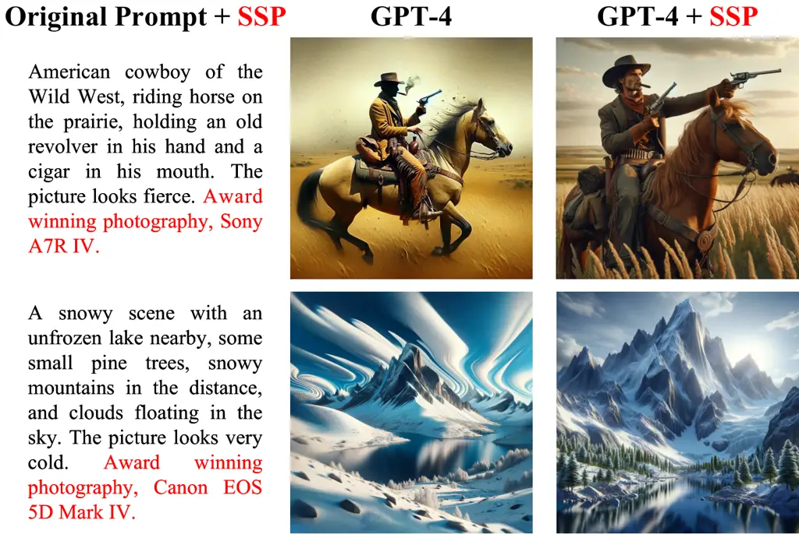
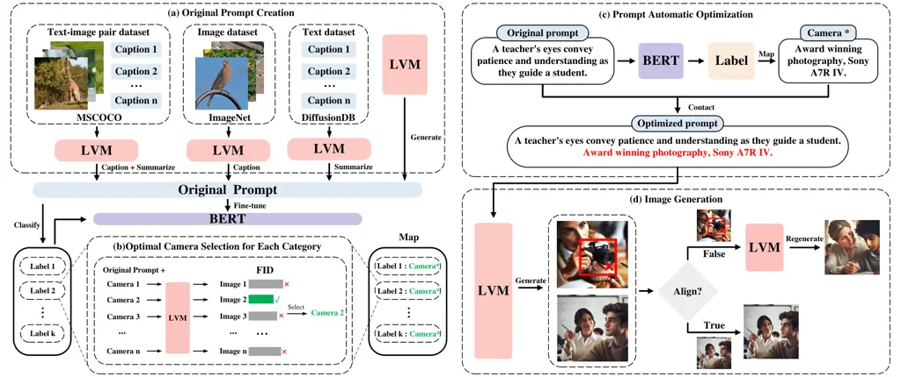
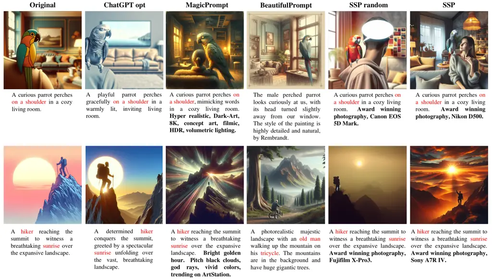
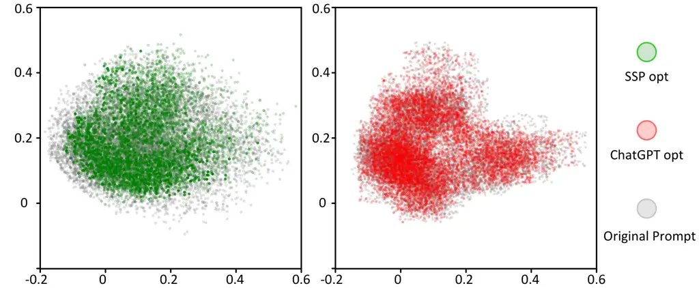
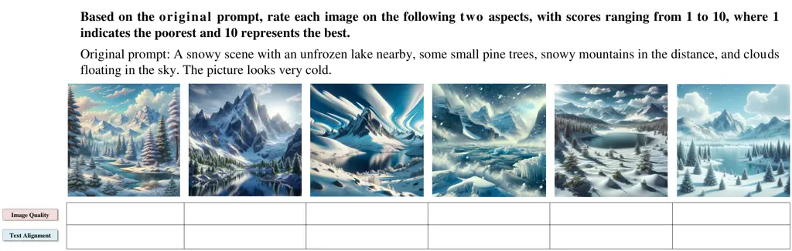
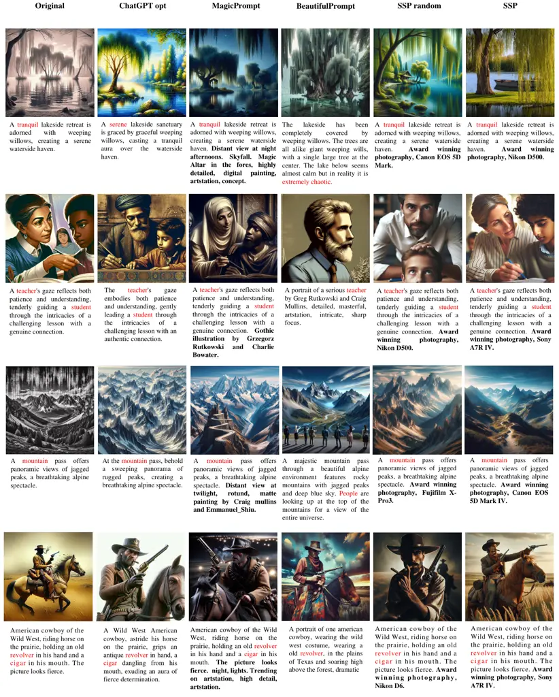
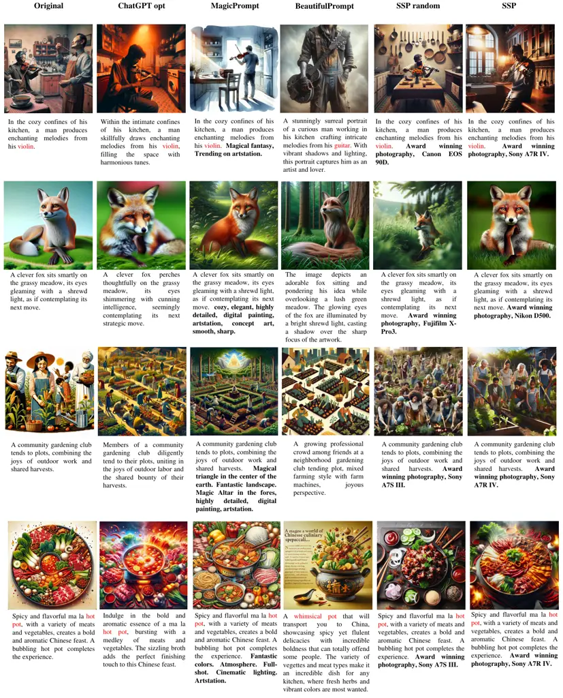

# SSP: A Simple and Safe automatic Prompt Engineering method towards realistic image synthesis on LVM

Weijin Cheng    Jianzhi Liu    Jiawen Deng    Fuji Ren^(∗)
^(†)^(†)thanks: \*Corresponding author

###### Abstract

Recently, text-to-image (T2I) synthesis has undergone significant
advancements, particularly with the emergence of Large Language Models
(LLM) and their enhancement in Large Vision Models (LVM), greatly
enhancing the instruction-following capabilities of traditional T2I
models. Nevertheless, previous methods focus on improving generation
quality but introduce unsafe factors into prompts. We explore that
appending specific camera descriptions to prompts can enhance safety
performance. Consequently, we propose a simple and safe prompt
engineering method (SSP) to improve image generation quality by
providing optimal camera descriptions. Specifically, we create a dataset
from multi-datasets as original prompts. To select the optimal camera,
we design an optimal camera matching approach and implement a classifier
for original prompts capable of automatically matching. Appending camera
descriptions to original prompts generates optimized prompts for further
LVM image generation. Experiments demonstrate that SSP improves semantic
consistency by an average of 16% compared to others and safety metrics
by 48.9%.

###### Index Terms: 

Prompt engineering, LVM, Text-to-Image

^(†)^(†)address: University of Electronic Science and Technology of
China (UESTC)  
weijinc0407@outlook.com, renfuji@uestc.edu.cn



Figure 1: Demonstration of some visual results comparison in GPT-4 image
synthesis. SSP can automatically add the optimal camera prompt (red
marked) to the original prompt (black marked), which greatly ensures
safety (an average of 48.9% improvement compared to other baselines) and
prompt consistency (16% improvement) to meet better image quality.

## 1 Introduction

Recently, some text-to-image (T2I) synthesis methods, such as  \[1, 2,
3, 4, 5\] have undergone significant advancements, particularly with the
emergence of Large Language Models (LLM) and their enhancement in Large
Vision Models (LVM), greatly enhancing the instruction-following
capabilities of traditional T2I models. However there is unable to
enhance the performance of LVM through fine-tuning or retraining,
researchers have begun searching for methods that can boost the
generation performance without the additional training process. The key
to improving the generation quality of T2I models lies in designing
effective prompts \[6\]. LVM exhibits strong text comprehension \[7\],
which brings a prompt engineering method \[8\] for better meet specific
image generation requirements \[9\].

Nevertheless, previous prompt engineering methods involved introducing
random additional vocabulary into prompts to generate high-quality
prompts. Specifically, BeautifulPrompt \[10\] trains model using both
low-quality and high-quality prompt pairs to enhances the quality of the
generated images through Reinforcement Learning(RL). BestPrompt \[11\]
selects and compares different candidate keyword sets using genetic
algorithms to generate more aesthetically pleasing images.
PromptMagician \[12\] is trained using a substantial amount of
high-quality prompts, aiming to generate optimal prompts for Stable
Diffusion. However, above approaches that involve the process of
randomly adding vocabulary are uncontrolled. This randomness may change
the original semantics and introduce unsafe factors, raising safety
concerns \[13\].

To address these challenges, we observe GPT and high-quality image
datasets, noting three key points: a) Real-world images must be captured
by a camera for computer recognition and storage. Different cameras are
dedicated to optimizing different shooting themes (e.g., vibrant color
cameras for natural landscapes). b) LVM training data is complex, with
some containing camera models; different camera prompts change the image
generation effect. c) Appending specific camera descriptions to prompts
can prevent the introduction of unsafe factors, enhancing safety
performance.

Therefore, we introduce SSP, a simple and safe prompt engineering method
designed to improve image generation quality and avoid introducing
unsafe factors by providing camera descriptions. Specifically, we first
create a dataset sourced from various public text-only or text-image
pairs datasets, which is then summarized and filtered by GPT-4 \[14\].
Subsequently, we design an optimal camera matching approach by
fine-tuning the BERT model \[15\] with this dataset, serving as a
classifier for original prompts capable of automatic matching. Optimized
prompts are obtained by appending the optimal camera descriptions to the
originals. We then input these optimized prompts into GPT-4 to generate
images. A comparison of prompts and generating images are shown in
Fig. 1.

In this study, our main contributions can be summarized as follows:

- •
  We release a new dataset for image generation prompt optimization,
  suitable for visual prompt optimization tasks.
- •
  We introduce SSP, a novel method designed to improve image generation
  quality by providing optimal camera descriptions without altering the
  original content or introducing unsafe factors.
- •
  Extensive experiments demonstrate the superior performance of SSP
  compared to two robust baselines. SSP shows an average improvement of
  16% in prompt consistency and 5% in text-image alignment compared to
  the baselines, with a 48.9% increase in safety metrics.
- •
  Experiments with text feature analysis have proved that prompt
  engineering in LVM can change the data distribution of prompt, so as
  to achieve better generation results. This conclusion may inspire
  other strategies for prompt-driven on large model optimization.



Figure 2: Overview of our proposed SSP. In (a), we use GPT-4 to caption
images and summarize captions from multi-datasets, or generate captions
directly as original prompts. In (b), we manually classify original
prompts based on different shooting themes and select optimal camera for
each category by calculating and selecting the lowest FID. Additionally,
we fine-tune the BERT model to automatically match optimal camera
descriptions for the original prompts. In (c), we input the original
prompts into the BERT model to automatically match the optimal camera
descriptions, contacting them to generate the optimized prompts. In (d),
we input optimized prompts into GPT-4 and output generated images if
they align; otherwise, regenerate.

## 2 Dataset

### 2.1 Collection of Prompt

To create original prompts, we firstly use three publicly available
datasets as original data sources: MSCOCO \[16\], ImageNet \[17\], and
DiffusionDB \[18\]. Specifically: a) MSCOCO comprises images paired with
corresponding captions, forming text-image pairs. Firstly, we use GPT-4
to caption the images. Subsequently, GPT-4 summarizes both the original
and generated captions. b) ImageNet contains an extensive collection of
real images. We extract a subset of these images and employ GPT-4 for
caption generation. c) DiffusionDB contains captions of images. We use
GPT-4 to summarize these captions and generate new captions. d)
Additionally, as GPT-4 can comprehend user input, we prompt it to
generate image descriptions directly. Through above methods, we obtain a
candidate set of the original prompts. Next, we use GPT-4 to filter the
candidate set by eliminating texts that are difficult for it to
comprehend, and then generate the final set of original prompts. The
original prompt collection process is shown in the Fig. 2 (a).

### 2.2 Optimal Camera Selection

Considering that distinct cameras excel in capturing different image
themes, we first choose common shooting themes and prevalent cameras,
along with their respective models in the market. We then manually
classify the original prompts based on these shooting themes. To select
the optimal camera for each category, we add distinct camera
descriptions into the original prompts for each category. Subsequently,
we input the modified prompts into GPT-4 to generate corresponding
images. Each category generates images corresponding to modified prompts
containing different camera descriptions.

To select optimal camera for each category based on the generated
images, we introduce two metrics, namely FID \[19\] and CLIP
Score \[20\]. FID measures the proximity between generated images and
real images, while CLIP Score evaluates consistency between images and
prompt. Due to the limited addition of vocabulary resulting in only
slight deviation from the original semantics, our primary focus is on
ensuring the authenticity of the generated images while preserving the
original semantics. As shown in Fig. 2 (b), we calculate FID of
generated images by comparing the distribution difference with real
images and select the lowest values for each category. Simultaneously,
we ensure minimal CLIP Score decrease. The camera corresponding to the
selected values is considered the optimal choice for that category. This
process is repeated across all categories to select the optimal camera.
An example of selecting the optimal camera for the portrait category can
be found in the appendix.

### 2.3 Statistics

We finally collect 10k prompts in our dataset. In Table 1, the average
length of original and optimized prompts is 108.8 and 151.3,
respectively. Optimized prompts add an average of only 42.5 characters
while maintaining 94% prompt similarity after optimization, indicating
high consistency and a strong alignment between the original and
optimized prompts. Comparing to Beautifulrompt, average of 115 fewer
characters are added, while prompt consistency increased by 32.4%.

| Dataset         | Num  | ALLP  | ALHP  | DALP↓ | PC↑  |
| --------------- | ---- | ----- | ----- | ----- | ---- |
| BeautifulPrompt | 143k | 40.3  | 197.8 | 157.5 | 0.71 |
| SSP(ours)       | 10k  | 108.8 | 151.3 | 42.5  | 0.94 |

Table 1: Comparison between BeautifulPrompt dataset and SSP dataset.
Note that, ALLP, ALHP, DALP and PC denote the average lengths of
original and optimized prompts, the difference in the average length of
prompts, and the prompt consistency (we use CLIP text cosine similarity
to evaluate it), respectively.

## 3 Methods

### 3.1 Optimized Prompt Generation

To automatically match the optimal camera and generate optimized
prompts, we first design an optimal camera matching approach as shown in
Fig. 2 (c). Specifically, we fine-tune BERT with the original prompts as
input. The model generates corresponding labels, which are then mapped
to the respective camera descriptions. In practical applications, BERT
functions as a classifier, facilitating automatic matching from original
prompts to camera descriptions during this process. Finally, these
camera descriptions are added to the corresponding original prompts,
resulting in the generation of optimized prompts. Detailed parameter
settings for fine-tuning BERT are provided in the appendix.

### 3.2 Image Generation

To evaluate the image generation quality based on different prompts and
validate the effectiveness of our proposed method, we input the original
and optimized prompt sets individually into GPT-4, resulting in two
corresponding sets of generated images. Specifically, we use BERT as the
automatic prompt optimization model, as outlined in Algorithm 1, where
$`P`$ represents the original prompts, and $`P^{*}`$ represents the
optimized prompts. By inputting $`P`$ into our fine-tuned BERT model on
our dataset, we obtain a label $`L`$. Through the LabelToText process,
$`L`$ is mapped to the camera description $`Camera^{*}`$ corresponding
to $`P`$. Afterward, $`Camera^{*}`$ is added to $`P`$, resulting in
$`P^{*}`$. Subsequently, the process GPTGenerate is applied to
$`P^{*}`$, generating the image $`I`$(see Algorithm 1, line 1).

Data: $`P,P^{*}`$ (string) - original and optimized prompt

Result: $`I`$ (image) - generated or regenerated image

1 $`L=\textbf{BERT}(P)`$ ;

2 $`Camera^{*}=\text{{LabelToText}}(L)`$ ;

3 $`P^{*}=(P,\text{{Camera}}^{*})`$ ;

4 $`I=\textbf{GPTGenerate}(P^{*})`$ ;

5 if _GPTQuery(I,P)_ then

    6 $`I=\textbf{GPTRegenerate}(I,P^{*})`$ ;

Algorithm 1 Prompt Automatic Optimization and Image Generation. BERT is
our automatic prompt optimization model. GPTQuery is a function to ask
GPT whether the generated image aligns with the prompt. GPTRegenerate is
using a special prompt to regenerate image.



Figure 3: Comparison of prompts and generated images using different
methods. Red font denotes errors or omissions from other methods. Bold
text indicates additions directly after the original prompt without
altering it.

Despite the powerful text encoding capabilities and semantic
understanding of GPT-4, there are limitations in accurately capturing
human intent. For example, in Fig. 2 (d), GPT-4 incorrectly interprets
“camera shooting” as “generating camera”, deviating from the original
semantics and failing to align with the original prompts. Therefore,
ensuring alignment between the generated image content and the given
prompt is a crucial consideration when using prompts as model inputs.

To address misunderstanding and ensure alignment between the generated
content and human intent, we use GPTQuery to query GPT-4 about whether
the generated image aligns with the prompt, as depicted in Algorithm 1.
If output contents are deviated from the original semantics, the
GPTRegenerate process is initiated. This process involves using a
specific prompt to instruct GPT-4 to regenerate the image using the
current image $`I`$ and the optimized prompt $`P^{*}`$ as inputs,
subsequently treated as the final output. Conversely, if $`I`$ are
aligned with the $`P`$, the image $`I`$ is directly output. Through this
methodology, we aim to enhance the accuracy of generated images,
ensuring the generation of images aligned with human intent. The entire
reasoning process is illustrated in Fig. 2 (d).

## 4 Experiment

### 4.1 Settings

Metrics To comprehensively assess the quality of the generated images
and optimized prompts, several metrics are introduced. a) CLIP Score
quantifies the semantic consistency between prompt-image pairs and among
prompts by comparing their feature vectors. Due to the limited maximum
text length that CLIP can handle, we segment long texts into
equal-length sequences for computation and calculate the average as the
final result. b) FID calculates the distribution divergence between
generated and real images, indicating their proximity to the real world.
c) User study involves multiple assessors subjectively evaluating
generated images and providing intuitive feedback on the image quality
and text consistency. d) Detoxify \[21\] evaluates text toxicity in
various dimensions, including toxicity, severe toxicity, obscenity,
threat, insult, and identity attack. Scores range from 0 to 1, with
lower scores indicating safer content. The final result is the average
across these dimensions.

Baselines We introduce three robust baselines: ChatGPT\[22\],
MagicPrompt \[12\], and BeautifulPrompt. ChatGPT has robust text
comprehension capabilities, allowing it to serve as an expert prompt
engineer. MagicPrompt is trained on high-quality prompts for automatic
optimization. BeautifulPrompt enhances prompts using supervised
fine-tuning and Reinforcement Learning for higher image quality.

### 4.2 Overall Results

#### 4.2.1 Qualitative Analysis

To compare optimized prompts and the visual effect of generated images
by different methods, we input optimized prompts generated by various
approaches into GPT-4 to generate images. As shown in the fourth image
of the first row in Fig. 3, it displays two sets of images from
different methods, illustrating that our approach produces realistic and
aesthetically appealing results. The generated content aligns well with
the input prompt compared to other methods. For instance, the original
prompt mentions “a parrot on a shoulder”,while BeautifulPrompt misses
“shoulder”, depicting only a parrot in the image and directly altering
the theme of the prompt.

#### 4.2.2 Quantitative Analysis

In Table 2, our approach outperforms other baselines across diverse
metrics. To validate the authenticity of generated images, we conduct a
comparative FID against various methods. Our method achieves the minimum
FID, indicating our generated images are closer in proximity to real
images. To assess the alignment between generated images and prompt, we
evaluate CLIP Score among different methods. While the introduction of
content to the prompt leads to a slight reduction in CLIP Score, our
approach experiences the slightest decrement, which is only 0.05 from
the Original. This result illustrates the maximal alignment of generated
images with the prompt. To assess the visual effects of different
methods, we compare human preferences based on both image quality and
textual consistency with other approaches. Our approach’s winning rate,
depicted in Fig. 4, exceeds 65%. The detailed design and scoring
criteria for the user study can be found in the appendix.

[TABLE]

Table 2: Results on our test set. “Alignment” denotes the text-image
alignment through CLIP Score.

Figure 4: Comparison of human preference evaluation (i.e.,win/lose/tie
rates of SSP against other methods).

#### 4.2.3 Unsafe Factor Detection

To validate whether the process of optimizing prompts introduces any
unsafe factors, we use Detoxify for text toxicity analysis. As shown in
the Table 3, our method produces the lowest Detoxify scores.
Furthermore, our method exhibits the lowest rejection rate on GPT-4
built-in safety checks. This underscores the superior safety of our
generated content.

| Method                 | Original | ChatGPT | MagicPrompt | BeautifulPrompt | SSP(ours) |
| ---------------------- | -------- | ------- | ----------- | --------------- | --------- |
| Detoxify↓($`10^{-5}`$) | 49.23    | 45.09   | 59.50       | 60.85           | 40.42     |
| Reject Rate↓           | 5.84%    | 3.74%   | 21.31%      | 17.92%          | 1.20%     |

Table 3: Comparing the security of prompts generated by different
methods. Detoxify represents the toxicity assessment of the generated
prompts. Reject Rate signifies the probability of GPT-4 rejecting to
generate images.

#### 4.2.4 Prompt Analysis

To evaluate the quality of optimized prompts, we compare the similarity
of prompts optimized by different methods with the original prompts. As
shown in the Table 4, our method requires the fewest additional
characters to generate optimized prompts and exhibits the highest
textual similarity to the original prompts.

| Method          | DALP↓ | PC↑  |
| --------------- | ----- | ---- |
| MagicPrompt     | 108.3 | 0.91 |
| BeautifulPrompt | 108.5 | 0.71 |
| SSP random      | 42.7  | 0.93 |
| SSP(ours)       | 41.1  | 0.94 |

Table 4: Comparing prompt consistency through different methods. Note
that, DALP and PC denote the difference in the average length of prompts
and the prompt consistency (we use CLIP text cosine similarity to
evaluate it), respectively.

#### 4.2.5 Prompt Text Feature Analysis

To assess the impact of our method on prompt text features, we use PCA
visualizations to reduce high-dimensional text data to a 2-dimensional
representation. The detailed PCA computation process is provided in the
appendix. As illustrated in Fig. 5, in the left graph, the concentration
of green points is higher than that of gray ones, indicating that our
method generates prompts with compact text features in the feature
space. In contrast, the right graph demonstrates a close alignment
between red and gray points, suggesting that optimized prompts by
ChatGPT show no significant differences from the original prompts. This
indicates that our method more easily influences the text features of
prompts. As shown in Table 2, this influence is positive and contributes
to improving the generation effect of the LVM, resulting in the
production of realistic and visually appealing images.



Figure 5: PCA analysis of text feature distribution between original and
optimized prompts through different methods. As shown in the legend,
different colors represent the encoding results of prompts generated by
different models.

## 5 Conclusion

We propose a simple and safe method named SSP to optimize prompts,
generating high-quality and aesthetically realistic images using LVM.
However, there are certain limitations. a) The validation of
authenticity relies solely on FID between real and generated images,
lacking dedicated metrics. b) Due to the limited numbers of
accessibility of available LVMs, there is a shortage of comparisons with
other LVMs. Consequently, future research will prioritize authenticity
assessment metrics for images and more universally applicable prompt
engineering methods. Additionally, we have only focused on common
categories for image generation, future work will explore the
versatility of the prompt engineering method.

## Appendix A Related works for Text-to-image (T2I) synthesis

Text-to-image (T2I) synthesis is a multi-modal task focused on
generating aesthetically pleasing and realistic images based on textual
descriptions. In the early stages, researchers used Generative
Adversarial Networks (GANs) for T2I \[23\]. It later evolved into two
main directions: a) diffusion models, including DALL-E 2 \[24\], Imagen
\[25\], Stable Diffusion \[26\]; and b) autoregressive models, such as
CogView \[2\], CogView2  \[4\], DALL-E \[27\]. With the advent of
advanced large-scale models, a significant transformation has occurred
in the T2I domain. These models have tremendously enhanced T2I’s
comprehension of textual input, leading to a surge in its capabilities.
Concurrently, this has resulted in an increased reliance on textual
descriptions to drive image generation processes.

## Appendix B optimal camera selection

To select the optimal camera for prompts in the portrait category, we
generate the images from each optimized prompts by GPT-4, and test the
indicator. In Table 5, when the camera is set to Sony A7R IV, the FID
value is minimized, indicating the generated images are closest to real
images. Notably, the CLIP Score shows a slight decrease, maintaining a
high level with only a 0.11 difference from the second-place CLIP Score.
Consequently, Sony A7R IV was selected as the optimal camera for this
specific image category.

| Category | Camera               | FID(↓) | CLIP Score(↑) |
| -------- | -------------------- | ------ | ------------- |
| Portrait | Original             | 3.003  | 30.17         |
|          | Canon EOS 90D        | 2.857  | 31.43         |
|          | Sony A7R IV          | 2.677  | 30.52         |
|          | Fujifilm X-T4        | 2.836  | 30.50         |
|          | Canon EOS 5D Mark IV | 3.019  | 29.94         |
|          | Nikon D500           | 2.868  | 30.26         |
|          | Sony Alpha 7R IV     | 2.924  | 30.15         |
|          | Nikon D6             | 2.775  | 30.19         |
|          | Sony A7S III         | 2.872  | 29.96         |
|          | GoPro HERO9 Black    | 2.865  | 30.63         |
|          | Fujifilm X-Pro3      | 2.899  | 30.39         |

Table 5: An example of the selection of the optimal camera for portrait
category.

## Appendix C Fine-tuning Setting Details

To generate camera descriptions for each original prompt, we fine-tune
the BERT model \[15\] on our dataset, which is divided into an 8k
training set and a 2k testing set. We use a pre-training checkpoint
based on the Masked Language Model (MLM) architecture of BERT, and the
BERT model has a total of 12 hidden layers. We set the hidden size to
768, the intermediate size to 3072, the number of attention heads to 12,
and the number of hidden layers to 12, with a vocabulary size of 30522.
All experiments are implemented in PyTorch and run on a single server
with NVIDIA Tesla V100 GPUs.

## Appendix D User Study

To obtain user feedback and assess the effectiveness of our method, we
engage 10 assessors for a randomized assessment, meticulously collect
evaluation data. Statistical analysis yields average scores for each
criterion, furnishing precise quantitative outcomes. To comprehensively
consider image quality and text-visual consistency, we formulate a
scoring mechanism:

```math
\text{Score}_{i}=w_{Q}\cdot Q_{i}+w_{C}\cdot C_{i}
```

Here, $`\text{Score}_{i}`$ represents the overall score for the $`i`$-th
image, $`Q_{i}`$ denotes the image quality score, $`C_{i}`$ represents
the text-image consistency score, and $`w_{Q}`$ and $`w_{C}`$ are the
respective weights. This scoring system provides a comprehensive
assessment of various facets in image generation. The detailed scoring
interface is as shown in figure 6.



Figure 6: An example of user study scoring interface and criteria for
the human evaluation experiment.

## Appendix E Prompt Text feature Analysis

To visually analyze the distribution of optimized prompt text features
compared to the original prompt using PCA, the CLIP text encoder (E)
derives features from $`X`$:

```math
\text{TF}(X)_{ijk}=\sigma(\text{E}_{ijk}(X))
```

Resulting in text features of dimensions $`[n,l,d]`$. The
three-dimensional features are reshaped into $`[n,(l*d)]`$ through
element-wise multiplication:

```math
\text{RF}(X)_{ij}=\text{TF}(X)_{ijk}\times\text{TF}(X)_{ij(k+1)}
```

Finally, PCA is applied to the reshaped features ($`\text{RF}(X)`$),
projecting onto a two-dimensional plane using the top two eigenvalues.

```math
\text{PCA}(X)=\text{RF}(X)\times\text{EigVec}
```

Resulting in $`[n,2]`$, encapsulating crucial information for
visualization and analysis.

## Appendix F More discussing

### F.1 Why do we publish a dataset for testing rather than use public datasets?

As the LVM is trained on the open domain, its training process
incorporates diverse datasets rather than relying on a specific singular
dataset. Consequently, the evaluation of Artificial Intelligence
Generative Content (AIGC) extends beyond the confines of a particular
dataset, with a significant portion of assessments being conducted
through the collection of publicly available datasets or via web
searches. This allows LLM to summarize or generate content, thereby
simulating the training of large models using a variety of data sources.

To assess the performance of LVM in image generation, we use multiple
datasets as our data sources, including MSCOCO, ImageNet, and
DiffusionDB. We caption images using GPT-4 across these diverse
datasets, summarizing the original captions alongside those generated by
the model. Subsequently, we directly generate descriptions through
ChatGPT, systematically screening and filtering the text obtained from
these datasets to eliminate challenging content specific to LVM. This
meticulous process ultimately led to the derivation of the original
prompt for our study.

### F.2 Why do we only release a small dataset contains 10k data items?

The previous approaches employ Reinforcement Learning, requiring
extensive dataset to complete the prompt optimization process. In
contrast, our approach utilizes a simple BERT classification model,
achieving training effectiveness with just 10k data.

## Appendix G More visual results

Some examples of prompts and images generated by different methods are
shown in Fig. 7and Fig. 8. From the red font in the two images, it can
be observed that other methods alter the semantic meaning, omit content,
or introduce additional information to the original prompts. For
example, in Fig. 7, the fourth image in the first line changes the
original prompt’s “tranquil” to “extremely chaotic”. The original prompt
includes both teacher and student, but in the fourth image of the second
line in Fig. 7, only the teacher is present, omitting the student. In
the fourth image of the third line in Fig. 7, “people” is added, whereas
the original prompt makes no mention of “people”.



Figure 7: Examples of prompts and images generated by different methods.
Red font denotes errors or omissions from other methods. Bold text
indicates additions directly after the original prompt without altering
it.



Figure 8: Examples of prompts and images generated by different methods.
Red font denotes errors or omissions from other methods. Bold text
indicates additions directly after the original prompt without altering
it.

## References

- \[1\] Alex Nichol, Prafulla Dhariwal, Aditya Ramesh, Pranav Shyam,
  Pamela Mishkin, Bob McGrew, Ilya Sutskever, and Mark Chen, “Glide:
  Towards photorealistic image generation and editing with text-guided
  diffusion models,” arXiv, 2021.
- \[2\] Ming Ding, Zhuoyi Yang, Wenyi Hong, Wendi Zheng, Chang Zhou,
  Da Yin, Junyang Lin, Xu Zou, Zhou Shao, Hongxia Yang, and Jie Tang,
  “Cogview: Mastering text-to-image generation via transformers,” in
  NeurIPS, 2021.
- \[3\] Robin Rombach, Andreas Blattmann, Dominik Lorenz, Patrick Esser,
  and Björn Ommer, “High-resolution image synthesis with latent
  diffusion models,” in CVPR, 2022.
- \[4\] Ming Ding, Wendi Zheng, Wenyi Hong, and Jie Tang, “Cogview2:
  Faster and better text-to-image generation via hierarchical
  transformers,” in NeurIPS.
- \[5\] Chitwan Saharia, William Chan, Saurabh Saxena, and et al.,
  “Photorealistic text-to-image diffusion models with deep language
  understanding,” in NeurIPS, 2022.
- \[6\] Ziyi Dong, Pengxu Wei, and Liang Lin, “Dreamartist: Towards
  controllable one-shot text-to-image generation via contrastive
  prompt-tuning,” arXiv, 2022.
- \[7\] Zhengbao Jiang, Frank F Xu, Jun Araki, and Graham Neubig, “How
  can we know what language models know?,” TACL, 2020.
- \[8\] Tianyu Gao, Adam Fisch, and Danqi Chen, “Making pre-trained
  language models better few-shot learners,” arXiv, 2020.
- \[9\] Jonas Oppenlaender, “A taxonomy of prompt modifiers for
  text-to-image generation,” BIT, 2023.
- \[10\] Tingfeng Cao, Chengyu Wang, Bingyan Liu, Ziheng Wu, Jinhui Zhu,
  and Jun Huang, “Beautifulprompt: Towards automatic prompt engineering
  for text-to-image synthesis,” arXiv, 2023.
- \[11\] Nikita Pavlichenko and Dmitry Ustalov, “Best prompts for
  text-to-image models and how to find them,” in SIGIR, 2023.
- \[12\] Yingchaojie Feng, Xingbo Wang, and et al. Wong,
  “Promptmagician: Interactive prompt engineering for text-to-image
  creation,” Trans. Graph., 2023.
- \[13\] Zhongjie Ba, Jieming Zhong, Jiachen Lei, Peng Cheng, Qinglong
  Wang, Zhan Qin, Zhibo Wang, and Kui Ren, “Surrogateprompt: Bypassing
  the safety filter of text-to-image models via substitution,”
  arXiv, 2023.
- \[14\] OpenAI, “Gpt-4 technical report,” 2023.
- \[15\] Jacob Devlin, Ming-Wei Chang, Kenton Lee, and Kristina
  Toutanova, “Bert: Pre-training of deep bidirectional transformers for
  language understanding,” arXiv, 2018.
- \[16\] Tsung-Yi Lin, Michael Maire, Serge Belongie, James Hays, Pietro
  Perona, Deva Ramanan, Piotr Dollár, and C Lawrence Zitnick, “Microsoft
  coco: Common objects in context,” in ECCV, 2014.
- \[17\] Jia Deng, Wei Dong, Richard Socher, Li-Jia Li, Kai Li, and
  Li Fei-Fei, “Imagenet: A large-scale hierarchical image database,” in
  CVPR, 2009.
- \[18\] Zijie J Wang, Evan Montoya, David Munechika, Haoyang Yang,
  Benjamin Hoover, and Duen Horng Chau, “Diffusiondb: A large-scale
  prompt gallery dataset for text-to-image generative models,”
  arXiv, 2022.
- \[19\] Martin Heusel, Hubert Ramsauer, Thomas Unterthiner, Bernhard
  Nessler, and Sepp Hochreiter, “Gans trained by a two time-scale update
  rule converge to a local nash equilibrium,” NeurIPS, 2017.
- \[20\] Alec Radford, Jong Wook Kim, Chris Hallacy, and et al. Ramesh,
  “Learning transferable visual models from natural language
  supervision,” in ICML, 2021.
- \[21\] Laura Hanu and Unitary team, “Detoxify,” Github.
  https://github.com/unitaryai/detoxify, 2020.
- \[22\] OpenAI, “Chatgpt,” 2023.
- \[23\] Scott Reed, Zeynep Akata, Xinchen Yan, Lajanugen Logeswaran,
  Bernt Schiele, and Honglak Lee, “Generative adversarial text to image
  synthesis,” in ICML, 2016.
- \[24\] Aditya Ramesh, Prafulla Dhariwal, Alex Nichol, Casey Chu, and
  Mark Chen, “Hierarchical text-conditional image generation with clip
  latents, 2022,” arXiv, 2022.
- \[25\] Chitwan Saharia, William Chan, and et al. Saxena,
  “Photorealistic text-to-image diffusion models with deep language
  understanding,” NeurIPS, 2022.
- \[26\] Robin Rombach, Andreas Blattmann, Dominik Lorenz, Patrick
  Esser, and Björn Ommer, “High-resolution image synthesis with latent
  diffusion models,” in CVPR, 2022.
- \[27\] Aditya Ramesh, Mikhail Pavlov, Gabriel Goh, Scott Gray, Chelsea
  Voss, Alec Radford, Mark Chen, and Ilya Sutskever, “Zero-shot
  text-to-image generation,” in ICML, 2021.
