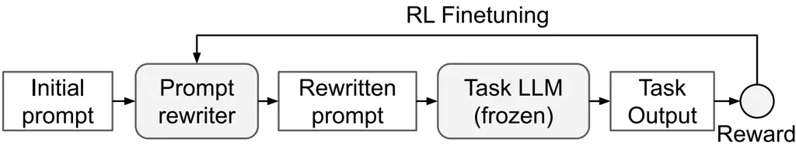

# PRewrite: Prompt Rewriting with Reinforcement Learning

Weize Kong      Spurthi Amba Hombaiah      Mingyang Zhang
Affiliation: Google DeepMind
Affiliation: {weize,spurthiah,mingyang,bemike}@google.com    Qiaozhu
Mei      Michael Bendersky Affiliation: Google DeepMind
Affiliation: University of Michigan
Affiliation: {weize,spurthiah,mingyang,bemike}@google.com
Affiliation: qmei@umich.edu

###### Abstract

Prompt engineering is critical for the development of LLM-based
applications. However, it is usually done manually in a “trial and
error” fashion that can be time consuming, ineffective, and sub-optimal.
Even for the prompts which seemingly work well, there is always a
lingering question: can the prompts be made better with further
modifications?

To address these problems, we investigate automated prompt engineering
in this paper. Specifically, we propose PRewrite, an automated method to
rewrite an under-optimized prompt to a more effective prompt. We
instantiate the prompt rewriter using an LLM. The rewriter LLM is
trained using reinforcement learning to optimize the performance on a
given downstream task. We conduct experiments on diverse benchmark
datasets, which demonstrates the effectiveness of PRewrite.

## 1 Introduction

With the right prompts, large language models (LLMs) can show impressive
performance on various tasks in zero-shot or few-shot settings Brown
et al. (2020); Srivastava et al. (2022). However, manual prompt
engineering is done on a trial-and-error ad-hoc basis and there are
limited guiding principles on writing good prompts.

To address the problems, we investigate methods to automate the process
of prompt engineering, often called “automated prompt engineering” or
“prompt optimization”. Automated prompt engineering is important due to
the wide and fast adoption of LLM applications. Moreover, LLMs
themselves are evolving, and as a result, we also need effective
automated methods to update existing prompts to adapt to new models.

Several previous works have explored automated prompt engineering.
AutoPrompt Shin et al. (2020) uses a gradient-based search method to
iteratively edit prompts, but requires gradient access to the language
model. RLPrompt Deng et al. (2022) optimizes prompts using reinforcement
learning (RL), but often produces uninterpretable gibberish prompts.
Also using RL, TEMPERA Zhang et al. (2022) allows editing prompts based
on task input, but its small action space might hinder exploration.
Another common limitation is that they are based on relatively
small-size language models like BERT Devlin et al. (2019) and
RoBERTa Liu et al. (2019). It is not clear how well the proposed methods
can generalize to larger models, especially with API-only model access.

More recent works like APE Zhou et al. (2023), OPRO Yang et al. (2023)
and Promptbreeder Fernando et al. (2023) use larger models from the PaLM
2 Anil et al. (2023) and the GPT¹¹ 1
[https://platform.openai.com/docs/models](https://platform.openai.com/docs/models)
model families. These works leverage LLMs themselves to propose prompt
candidates, and search for a better prompt from them via validating
performance on a given training dataset. We follow a similar idea but
aim to use RL instead of search to improve the optimization process.



Figure 1: Overview of PRewrite.

In this work, we propose PRewrite, prompt rewriting with reinforcement
learning, to address the limitations above. Our idea is to train a
prompt rewriter to rewrite an initial under-optimized prompt to a more
effective prompt. The prompt rewriter itself is a LLM, trained using RL
to optimize for a downstream task. We give an overview in Figure 1.
Specifically, given an initial prompt, the prompt rewriter LLM is
instructed to generate a rewritten prompt, which in turn is used by the
task LLM to generate the final output. Using a reward computed on the
final output against the ground-truth output, the rewriter LLM is
finetuned with RL. As compared to previous RL-based methods, PRewrite
produces interpretable prompts (cf. RLPrompt), allows unconstrained
exploration without manually defined action space (cf. TEMPERA), and
leverages larger models (PaLM 2).

Our contributions are summarized as follows:

- •
  We propose PRewrite, a novel automated prompt engineering approach. It
  optimizes prompt via rewriting, in an end-to-end manner using
  reinforcement learning.
- •
  We develop two rewriting strategies, including one that searches for
  an optimal rewritten prompt from candidates generated by the
  RL-trained prompt rewriter (Section 2.4). This often further improves
  the prompt optimization performance.
- •
  We conduct experiments on diverse benchmark datasets, which testify
  the effectiveness of PRewrite and demonstrate its state-of-the-art
  performance.

## 2 PRewrite

### 2.1 Problem Formulation

We formulate our prompt rewriting problem more formally in this section.
Given a text generation task, we denote the task input and output by
$`x`$ and $`y`$ respectively. To solve the task, one can use a LLM for
prediction, $`y=\mathtt{LLM}(p)`$, where $`p`$ is the input to the LLM,
also known as prompt. Prompts are usually constructed using a template
that incorporates the input $`x`$ and a task instruction $`t`$. For the
example, $`t`$ can be “Write a brief answer for the following question”
for a question answering task. A prompt can be constructed using
template $`p`$="{$`t`$}: {$`x`$}" (Python f-string), where $`x`$ is the
input question. Please refer to Table 4 in Appendix for a complete
example.

Prompt rewriting aims to rewrite a given initial prompt to another
prompt $`p\textsuperscript{\textdagger}=\delta(p)`$, in order to
optimize the task output. We call the rewritten prompt
$`p\textsuperscript{\textdagger}`$. Since prompts can be constructed
using an instruction, we simplify the prompt rewriting problem to only
rewriting the instruction $`t\textsuperscript{\textdagger}=\delta(t)`$.
In fact, most prior works Fernando et al. (2023); Zhou et al. (2023);
Yang et al. (2023) optimize prompts via optimizing instructions, and do
not differentiate between _prompt_ and _instruction_. In this paper, we
use the two terms interchangeably wherever it is clear.

Prompt rewriting can be performed independent or dependent of the task
input, i.e., $`\delta(\cdot)`$ and $`\delta(\cdot|x)`$. We focus on
input-independent prompt rewriting, following most prior works. In this
case, the instruction is rewritten offline and prompts can be
constructed cheaply online using the rewritten instruction.

### 2.2 Overview

Directly searching for an optimal rewritten prompt is challenging due to
the large search space of natural language. So, we propose PRewrite to
optimize prompt rewriting, as illustrated in Figure 1.

First, the prompt rewriter takes in an initial prompt $`p`$ and rewrites
it to another prompt $`p\textsuperscript{\textdagger}`$. The initial
prompt is usually crafted manually and can be sub-optimal. Observing the
remarkable capability of LLMs, we instruct a LLM (e.g., PaLM 2-S) with a
meta prompt $`m`$ for rewriting as follows:

```math
p\textsuperscript{\textdagger}=\mathtt{LLM}_{R}(\texttt{"\lx@text@lbrace$m$\lx@text@rbrace\text{\textbackslash nInstruction: }\lx@text@lbrace$p$\lx@text@rbrace"}). \tag{1}
```

We call $`\mathtt{LLM}_{R}`$, rewriter LLM, which is to be
differentiated from the task LLM, used for the end task. We list our
meta prompts in Appendix B.

Second, the rewritten prompt $`p\textsuperscript{\textdagger}`$ is then
used by the task LLM to generate the task output. The task LLM is
assumed to be a blackbox accessed via API and can be larger than the
rewriter LLM.

Third, we compute rewards based on the task output in comparison with
the ground-truth output and use reinforcement learning (RL) to finetune
the rewriter LLM on a training set (Section 2.3). This is critical
because our meta prompt is very generic. As a result, the rewriter LLM
and the rewritten prompt are unlikely to perform well on the downstream
task initially.

Lastly, we use the RL-trained prompt rewriter to rewrite the initial
prompt according to Equation 1 based on two strategies outlined in
Section 2.4.

### 2.3 Finetuning Rewriter LLM with RL

This section provides more details on RL finetuning for our rewriter
LLM, which is very similar to other RL-based LLM alignment work Ouyang
et al. (2022). Action space consists of all tokens in the rewriter LLM’s
vocabulary, allowing arbitrary text rewriting. State is defined as the
concatenation of all the decoded tokens so far. Reward is the task LLM’s
performance on the downstream task when using the rewritten prompt. We
measure this using the end task metric, but also explore other rewards
like perplexity and F1 in our experiments (see Appendix D). We use
Proximal Policy Optimization (PPO) Schulman et al. (2017) with KL
penalty as the RL algorithm for its robustness.

A key difference between our work and previous RL-based methods is that
we use a capable LLM (PaLM 2-S) as our rewriter model. Because of this,
our model is less likely to produce uninterpretable gibberish prompt as
in RLPrompt (this can be also attributed to the KL penalty in PPO). We
also don’t need to define a constrained action space manually as in
TEMPERA.

### 2.4 Rewriting via Inference and Search

Once the rewriter LLM is trained, we use it for prompt rewriting
following Equation 1. We design two specific rewriting strategies. For
the inference strategy, denoted as PRewrite-I, we set temperature to
zero, in which case the model greedily decodes and generates one single
rewritten prompt. For the search strategy, denoted as PRewrite-S, we
prompt the rewriter LLM $`K`$-times with temperature=1 to generate a set
of prompts, $`\{p\textsuperscript{\textdagger}_{i}\}_{i=1}^{K}`$. We
then select the best $`p\textsuperscript{\textdagger}_{i}`$ based on
their end task performance on a dev dataset.

## 3 Experiments & Analysis

### 3.1 Experimental Setup

We evaluate PRewrite on diverse benchmark datasets, spanning from
classification with AG News Zhang et al. (2015) and SST-2 Wang et al.
(2018), question answering with Natural Questions (NQ) Kwiatkowski
et al. (2019) to arithmetic reasoning with GSM8K Cobbe et al. (2021). We
use the standard train/dev/test splits. As GSM8K doesn’t come with a dev
split, so we randomly sample 10% examples from the train split as the
dev split. Data statistics are reported in Appendix C.

Our initial prompts, prompt templates and meta prompts are listed in
Appendix E, G and B respectively. We experiment with PaLM 2-S and PaLM
2-L Anil et al. (2023) as the frozen task LLMs with zero temperature. We
use PaLM 2-S as the rewriter LLM and set temperature to 1 for both the
policy and value model during RL training. We use standard PPO algorithm
for online policy optimization with GAE. The model is trained until
convergence on the dev set. We test both the inference and search
strategy for rewriting, denoted as PRewrite-I and PRewrite-S
respectively. For PRewrite-S, we search from K=10 rewritten prompts
(Section 2.4).

For baselines, we cite evaluation results for AutoPrompt Shin et al.
(2020), RLPrompt Deng et al. (2022), and TEMPERA Zhang et al. (2022),
out of which the last two are RL-based methods; APE Zhou et al. (2023),
OPRO Yang et al. (2023) and Promptbreeder (PB) Fernando et al. (2023),
which use LLMs of same size as ours. We report standard metrics on test:
accuracy for AG News, SST-2, GSM8K; and Exact Match (EM) for NQ.

### 3.2 Results

We first present PRewrite results based on PaLM 2-S task model in
Table 1.

|                |         |       |      |       |
| -------------- | ------- | ----- | ---- | ----- |
|                | AG News | SST-2 | NQ   | GSM8K |
| AutoPrompt     | 65.7    | 75.0  | \-   | \-    |
| RLPrompt       | 77.2    | 90.1  | \-   | \-    |
| TEMPERA        | 81.3    | 92.0  | \-   | \-    |
| Initial prompt | 76.9    | 96.3  | 24.1 | 29.9  |
| PRewrite-I     | 84.5    | 96.5  | 29.3 | 52.0  |
| PRewrite-S     | 85.2    | 96.6  | 30.2 | 53.6  |

Table 1: PRewrite experiment results based on PaLM 2-S task model. The
baseline results (top section) are based on RoBERTa-Large task model,
cited from TEMPERA Zhang et al. (2022). For TEMPERA,
non-test-time-editing (No TTE) results are reported.

First, PRewrite consistently improves over the initial prompts,
demonstrating the effectiveness of the proposed method. We repeated the
PRewrite experiments 5 times and the results were consistent. We list
the rewritten prompts in Table 9 in Appendix. Second, we observe larger
improvement for PRewrite when there is more headroom. For example, the
performance gain on SST-2 is minimum, but we observe 80%, 22% and 10%
relative improvement with PRewrite on GSM8K, NQ and AG News
respectively. Third, PRewrite-S consistently shows improvement over
PRewrite-I, suggesting that search strategy can be more helpful. We find
the two strategies often produce prompts with small differences. For
example, “sentiment classification” from PRewrite-I and “sentiment
classification _from text_” for Prewrite-S on SST-2. Lastly, baseline
models underperform PRewrite. However, this can be largely due to the
smaller task model, RoBERTa-Large Liu et al. (2019), being used for the
baselines. That said, it is not straightforward to apply some of the
baseline methods on larger models like PaLM 2, especially in case of
API-only access.

|      |      |      |                |            |
| ---- | ---- | ---- | -------------- | ---------- |
| APE  | OPRO | PB   | Initial prompt | PRewrite-S |
| 77.9 | 80.2 | 83.9 | 37.0           | 83.8       |

Table 2: GSM8K experiment results based on PaLM 2-L task model. Baseline
results (left section) are cited from PromptBreeder (PB) Fernando et al.
(2023), also based on PaLM 2-L task model.

Next, we compare PRewrite with baselines on GSM8K, all based on PaLM 2-L
task model in Table 2 (PRewrite-S only due to space constraints).
PRewrite-S not only dramatically improves the initial prompt, but also
outperforms strong baselines like APE and OPRO, and is on par with
Promptbreeder. This result is especially impressive in that the PRewrite
setup is relatively simple with minimal customization, in comparison
with the baselines. For example, APE proposes to use task input and
output to induce instructions for most tasks but has a special treatment
to GSM8K. It collects a customized dataset with questions and reasoning
steps via prompting InstructGPT for instruction induction – this is more
likely to induce chain-of-thought instructions. Promptbreeder uses 56
mutation prompts and 39 thinking style prompts including ones that
contain phrases like steps required, taking a break or suggesting
explanation. In comparison, we only use one generic meta prompt for
GSM8K (Appendix B).

We also experiment with different rewards for PRewrite. Please refer to
Appendix D for the results.

### 3.3 Case Studies

To showcase the capability of PRewrite, we present rewriting performed
by it for two datasets in Table 3 (see Appendix E, F for more results).

For NQ, PRewrite not only learns the task needs a _short_ answer, but
also impressively adds an in-context example. For GSM8K, PRewrite
rewrites the simple initial prompt to a creative chain-of-thought (CoT)
prompt. This CoT prompt is different from previous human created
ones Kojima et al. (2022) – it does not instruct the LLM to think/write
step by step, but instead assumes there already exists a solution with
steps, that follows after the prompt.

|                                                                                                                                                                                                                                                                                                                                                                                                    |
| -------------------------------------------------------------------------------------------------------------------------------------------------------------------------------------------------------------------------------------------------------------------------------------------------------------------------------------------------------------------------------------------------- |
| NQ: “Answer the question” $`\rightarrow`$ “Compose a short, informative answer that directly answers the given question. The answer should be no longer than 15 words and should not contain any extraneous information. For example, if the question is "Who is the president of the United States?", the answer should be "Joe Biden". Do not write an essay or provide additional explanation.” |
| GSM8K: “SOLUTION"” $`\rightarrow`$ “Solve the problem by following the steps in the SOLUTION.”                                                                                                                                                                                                                                                                                                     |

Table 3: Prompt rewriting (initial prompt $`\rightarrow`$ rewritten
prompt) for NQ and GSM8K produced by PRewrite-S. See Appendix E and F
for full results.

Moreover, we find Prewrite always produces interpretable rewritten
prompts, unlike RLPrompt, which often generates gibberish text. This is
due to the LLM-based rewriter and KL-divergence penalty in PPO we have
used (Section 2.3).

## 4 Related Work

We survey related work on automated prompt engineering for discrete
prompts. Please refer Liu et al. (2023) for a more comprehensive
literature review.

Some earlier works optimize prompts via paraphrasing Jiang et al.
(2020); Yuan et al. (2021); Haviv et al. (2021). In contrast, we adopt a
powerful LLM to rewrite prompts, providing more capacity for prompt
optimization. Shin et al. (2020); Wallace et al. (2021) propose
gradient-based search approach which is challenging for larger
API-access only models as it requires model gradient access.

Prior work have also explored RL based solutions. RLPrompt Deng et al.
(2022) optimizes prompts using RL, but often produces uninterpretable
gibberish prompts. TEMPERA Zhang et al. (2022) allows prompt editing at
test time based on task input using RL, but it defines a small action
space. By leveraging more capable LLMs, our method produces
interpretable prompts and allows unconstrained exploration without a
manually defined the action space.

More recent works use blackbox LLMs such as PaLM 2 and GPT models,
similar to ours. These include APE Zhou et al. (2023),
Promptbreeder Fernando et al. (2023) and OPRO Yang et al. (2023). These
works use LLMs in different ways to propose prompt candidates and
_search_ for the optimal one via validating performance on a given
training dataset. We follow a similar idea but instead use RL for prompt
optimization.

## 5 Conclusions

In this paper, we present PRewrite, a prompt rewriter trained with
reinforcement learning (RL) for prompt optimization. We instantiate the
rewriter with a LLM (PaLM 2-S) and finetune it using RL to optimize the
end task performance. To further improve the performance, we develop a
rewriting strategy that searches from the rewritten prompts generated by
the trained rewriter. Our experiments testify the effectiveness of
PRewrite and demonstrate its state-of-the-art performance.

## 6 Limitations

In this work, we only test with limited initial and meta prompts (see
Table 8 and 5 in Appendix) on four benchmark datasets. It would be
interesting to experiment with more initial-meta prompt combinations to
understand their implications, and on more datasets to test the
generality of PRewrite. Moreover, we do not investigate the use of
multiple meta/initial prompts to diversify exploration in prompt
rewriting, which may further improve PRewrite. We leave these ideas for
future work.

Due to resource constraints, we only experiment with PaLM 2 models.
However, we believe that our conclusions should generalize to other LLMs
as well.

## References

- Anil et al. (2023) Rohan Anil, Andrew M. Dai, Orhan Firat, Melvin
  Johnson, Dmitry Lepikhin, Alexandre Passos, Siamak Shakeri, Emanuel
  Taropa, Paige Bailey, Zhifeng Chen, and et al. 2023. [Palm 2 technical
  report](https://doi.org/10.48550/arXiv.2305.10403).
  _arXiv:2305.10403_.
- Brown et al. (2020) Tom Brown, Benjamin Mann, Nick Ryder, Melanie
  Subbiah, Jared D Kaplan, Prafulla Dhariwal, Arvind Neelakantan, Pranav
  Shyam, Girish Sastry, Amanda Askell, et al. 2020. Language models are
  few-shot learners. _Advances in neural information processing
  systems_, 33:1877–1901.
- Cobbe et al. (2021) Karl Cobbe, Vineet Kosaraju, Mohammad Bavarian,
  Mark Chen, Heewoo Jun, Lukasz Kaiser, Matthias Plappert, Jerry Tworek,
  Jacob Hilton, Reiichiro Nakano, Christopher Hesse, and John
  Schulman. 2021. [Training verifiers to solve math word
  problems](https://doi.org/10.48550/arXiv.2110.14168).
  _arXiv:2110.14168v2_.
- Deng et al. (2022) Mingkai Deng, Jianyu Wang, Cheng-Ping Hsieh, Yihan
  Wang, Han Guo, Tianmin Shu, Meng Song, Eric Xing, and Zhiting
  Hu. 2022. [RLPrompt: Optimizing discrete text prompts with
  reinforcement
  learning](https://doi.org/10.18653/v1/2022.emnlp-main.222). In
  _Proceedings of the 2022 Conference on Empirical Methods in Natural
  Language Processing_, EMNLP ’22, pages 3369–3391.
- Devlin et al. (2019) Jacob Devlin, Ming-Wei Chang, Kenton Lee, and
  Kristina Toutanova. 2019. [BERT: Pre-training of deep bidirectional
  transformers for language
  understanding](https://doi.org/10.18653/v1/N19-1423). In _Proceedings
  of the 2019 Conference of the North American Chapter of the
  Association for Computational Linguistics: Human Language
  Technologies, Volume 1 (Long and Short Papers)_, NAACL-HLT ’19, pages
  4171–4186.
- Fernando et al. (2023) Chrisantha Fernando, Dylan Banarse, Henryk
  Michalewski, Simon Osindero, and Tim Rocktäschel. 2023.
  [Promptbreeder: Self-referential self-improvement via prompt
  evolution](https://doi.org/10.48550/arXiv.2309.16797).
  _arXiv:2309.16797_.
- Haviv et al. (2021) Adi Haviv, Jonathan Berant, and Amir
  Globerson. 2021. [BERTese: Learning to speak to
  BERT](https://doi.org/10.18653/v1/2021.eacl-main.316). In _Proceedings
  of the 16th Conference of the European Chapter of the Association for
  Computational Linguistics: Main Volume_, pages 3618–3623.
- Jiang et al. (2020) Zhengbao Jiang, Frank F. Xu, Jun Araki, and Graham
  Neubig. 2020. [How Can We Know What Language Models
  Know?](https://doi.org/10.1162/tacl_a_00324) _Transactions of the
  Association for Computational Linguistics_, 8:423–438.
- Kojima et al. (2022) Takeshi Kojima, Shixiang Shane Gu, Machel Reid,
  Yutaka Matsuo, and Yusuke Iwasawa. 2022. Large language models are
  zero-shot reasoners. _Advances in neural information processing
  systems_, 35:22199–22213.
- Kwiatkowski et al. (2019) Tom Kwiatkowski, Jennimaria Palomaki, Olivia
  Redfield, Michael Collins, Ankur Parikh, Chris Alberti, Danielle
  Epstein, Illia Polosukhin, Jacob Devlin, Kenton Lee, Kristina
  Toutanova, Llion Jones, Matthew Kelcey, Ming-Wei Chang, Andrew M. Dai,
  Jakob Uszkoreit, Quoc Le, and Slav Petrov. 2019. [Natural questions: A
  benchmark for question answering
  research](https://doi.org/10.1162/tacl_a_00276). _Transactions of the
  Association for Computational Linguistics_, 7:452–466.
- Liu et al. (2023) Pengfei Liu, Weizhe Yuan, Jinlan Fu, Zhengbao Jiang,
  Hiroaki Hayashi, and Graham Neubig. 2023. Pre-train, prompt, and
  predict: A systematic survey of prompting methods in natural language
  processing. _ACM Computing Surveys_, 55(9):1–35.
- Liu et al. (2019) Yinhan Liu, Myle Ott, Naman Goyal, Jingfei Du,
  Mandar Joshi, Danqi Chen, Omer Levy, Mike Lewis, Luke Zettlemoyer, and
  Veselin Stoyanov. 2019. [Roberta: A robustly optimized bert
  pretraining approach](https://doi.org/10.48550/arXiv.1907.11692).
  _arXiv:1907.11692_.
- Ouyang et al. (2022) Long Ouyang, Jeffrey Wu, Xu Jiang, Diogo Almeida,
  Carroll Wainwright, Pamela Mishkin, Chong Zhang, Sandhini Agarwal,
  Katarina Slama, Alex Ray, et al. 2022. Training language models to
  follow instructions with human feedback. _Advances in Neural
  Information Processing Systems_, 35:27730–27744.
- Schulman et al. (2017) John Schulman, Filip Wolski, Prafulla Dhariwal,
  Alec Radford, and Oleg Klimov. 2017. [Proximal policy optimization
  algorithms](https://doi.org/10.48550/arXiv.1707.06347).
  _arXiv:1707.06347v2_.
- Shin et al. (2020) Taylor Shin, Yasaman Razeghi, Robert L. Logan IV,
  Eric Wallace, and Sameer Singh. 2020. [AutoPrompt: Eliciting Knowledge
  from Language Models with Automatically Generated
  Prompts](https://doi.org/10.18653/v1/2020.emnlp-main.346). In
  _Proceedings of the 2020 Conference on Empirical Methods in Natural
  Language Processing_, EMNLP ’20, pages 4222–4235.
- Srivastava et al. (2022) Aarohi Srivastava, Abhinav Rastogi, Abhishek
  Rao, Abu Awal Md Shoeb, Abubakar Abid, Adam Fisch, Adam R Brown, Adam
  Santoro, Aditya Gupta, Adrià Garriga-Alonso, et al. 2022. Beyond the
  imitation game: Quantifying and extrapolating the capabilities of
  language models. _arXiv preprint arXiv:2206.04615_.
- Wallace et al. (2021) Eric Wallace, Shi Feng, Nikhil Kandpal, Matt
  Gardner, and Sameer Singh. 2021. [Universal adversarial triggers for
  attacking and analyzing
  NLP](https://doi.org/10.48550/arXiv.1908.07125).
- Wang et al. (2018) Alex Wang, Amanpreet Singh, Julian Michael, Felix
  Hill, Omer Levy, and Samuel Bowman. 2018. [GLUE: A multi-task
  benchmark and analysis platform for natural language
  understanding](https://doi.org/10.18653/v1/W18-5446). In _Proceedings
  of the 2018 EMNLP Workshop BlackboxNLP: Analyzing and Interpreting
  Neural Networks for NLP_, pages 353–355.
- Yang et al. (2023) Chengrun Yang, Xuezhi Wang, Yifeng Lu, Hanxiao Liu,
  Quoc V. Le, Denny Zhou, and Xinyun Chen. 2023. [Large language models
  as optimizers](https://doi.org/10.48550/arXiv.2309.03409).
  _arXiv:2309.03409_.
- Yuan et al. (2021) Weizhe Yuan, Graham Neubig, and Pengfei Liu. 2021.
  [Bartscore: Evaluating generated text as text
  generation](https://doi.org/10.48550/arXiv.2106.11520). _Advances in
  Neural Information Processing Systems_, 34:27263–27277.
- Zhang et al. (2022) Tianjun Zhang, Xuezhi Wang, Denny Zhou, Dale
  Schuurmans, and Joseph E. Gonzalez. 2022. [Tempera: Test-time
  prompting via reinforcement
  learning](https://doi.org/10.48550/arXiv.2211.11890).
  _arXiv:2211.11890_.
- Zhang et al. (2015) Xiang Zhang, Junbo Zhao, and Yann LeCun. 2015.
  [Character-level convolutional networks for text
  classification](https://proceedings.neurips.cc/paper_files/paper/2015/file/250cf8b51c773f3f8dc8b4be867a9a02-Paper.pdf).
  In _Advances in Neural Information Processing Systems_, volume 28.
- Zhou et al. (2023) Yongchao Zhou, Andrei Ioan Muresanu, Ziwen Han,
  Keiran Paster, Silviu Pitis, Harris Chan, and Jimmy Ba. 2023. [Large
  language models are human-level prompt
  engineers](https://openreview.net/forum?id=92gvk82DE-). In _The
  Eleventh International Conference on Learning Representations_, ICLR
  ’23.

## Appendix A Problem Formulation Examples

In Table 4, we show an example of the task input ($`x`$), output
($`y`$), prompt ($`p`$), and instruction ($`t`$) for a question
answering task.

| Input       | Who is Harry Potter’s father?                                                  |
| ----------- | ------------------------------------------------------------------------------ |
| Output      | James Potter                                                                   |
| Prompt      | Write a brief answer for the following question: Who is Harry Potter’s father? |
| Instruction | Write a brief answer for the following question                                |

Table 4: Example for a question answering task.

## Appendix B Meta Prompts

In Table 5, we show the meta prompts used for prompting the rewriter
LLM.

|                                                                                                                                                                                                |
| ---------------------------------------------------------------------------------------------------------------------------------------------------------------------------------------------- |
| Rewrite the following instruction via rephrasing and/or adding specific requirements. Use illustrative description if needed. Output the new instruction only.                                 |
| Rewrite the following instruction via rephrasing and/or adding specific requirements. Add instructions which would be helpful to solve the problem correctly. Output the new instruction only. |

Table 5: Meta prompts used for prompt rewriting, for experiments based
on PaLM 2-S (upper) and PaLM 2-L (bottom) task model.

## Appendix C Dataset Statistics

Data statistics for train/dev/test splits are given in Table 6. GSM8K
doesn’t come with a dev (or validation) split, so we randomly reserve
10% examples from the train split as the dev split.

| Dataset | Train   | Dev    | Test  |
| ------- | ------- | ------ | ----- |
| AG News | 108,000 | 12,000 | 7,600 |
| SST-2   | 60,614  | 67,35  | 871   |
| NQ      | 79,168  | 8,757  | 3,610 |
| GSM8K   | 6,725   | 748    | 1,319 |

Table 6: Train/Dev/Test splits for eval datasets.

## Appendix D Results based on Different Rewards

We test different rewards for all datasets and report the results based
on PRewrite-I and PaLM 2-S task model in Table 7. Perplexity uses
perplexity of the ground truth labels as the reward. F1 use word-level
F1 measure as the reward. Perplexity+F1 sums perplexity and F1 as the
reward.

| Reward        | AG News | SST-2 | NQ   |
| ------------- | ------- | ----- | ---- |
| EM/Accuracy   | 84.5    | 96.5  | 29.3 |
| F1            | 84.5    | 96.6  | 30.6 |
| Perplexity    | 60.1    | 95.8  | 12.7 |
| Perplexity+F1 | 84.2    | 96.5  | 32.3 |

Table 7: PRewrite-I experiment results based on different rewards and
PaLM 2-S task model.

First, we find that using the final task metric, accuracy or EM,
performs well in general. In other words, RL is able to directly
optimize for these task metrics. Second, we find that F1 is in general
be more stable than accuracy/EM. This is because F1 can provide more
fine-grained feedback for RL – accuracy/EM is either 0 or 1 for a
datapoint while F1 provides a fractional score. Third, we find
perplexity can sometimes be harmful (see NQ and AG News results in the
table), as it is not directly linked to the final task metrics. However,
combining perplexity with F1 gives the best performance on NQ.

## Appendix E Initial Prompts

Table 8 lists all initial prompts we used for prompt rewriting in our
experiments.

| Dataset | Source                 | Initial prompt                                                                                                                                                                                                         |
| ------- | ---------------------- | ---------------------------------------------------------------------------------------------------------------------------------------------------------------------------------------------------------------------- |
| AG News | \-                     | Given a news article, categorize it into one of the following categories: 1. World 2. Sports 3. Business 4. Sci/Tech.                                                                                                  |
| SST-2   | Zhang et al. (2022)    | In this task, you are given sentences from movie reviews. The task is to classify a sentence as “positive” if the sentiment of the sentence is positive or as “negative" if the sentiment of the sentence is negative. |
| NQ      | \-                     | Answer the question                                                                                                                                                                                                    |
| GSMK    | Fernando et al. (2023) | SOLUTION"                                                                                                                                                                                                              |

Table 8: Initial prompts used for prompt rewriting in our experiments.
When the source is absent, the prompt is manually crafted by us.

| Dataset | Strategy   | Rewritten prompt                                                                                                                                                                                                                                                                                                                                       |
| ------- | ---------- | ------------------------------------------------------------------------------------------------------------------------------------------------------------------------------------------------------------------------------------------------------------------------------------------------------------------------------------------------------ |
| AG News | PRewrite-I | Classify a news article into one of the following categories: World, Sports, Business, Sci/Tech.                                                                                                                                                                                                                                                       |
| AG News | PRewrite-S | Classify a given news article into one of the following categories: World, Sports, Business, or Sci/Tech.                                                                                                                                                                                                                                              |
| SST-2   | PRewrite-I | sentiment classification                                                                                                                                                                                                                                                                                                                               |
| SST-2   | PRewrite-S | sentiment classification from text                                                                                                                                                                                                                                                                                                                     |
| NQ      | PRewrite-I | Compose a short, informative answer to the given question. The answer should be no longer than 15 words and should be written in a clear, concise manner. For example, if the question is "Who is the president of the United States?", the answer should be "Joe Biden". Do not write an essay or provide additional explanation.                     |
| NQ      | PRewrite-S | Compose a short, informative answer that directly answers the given question. The answer should be no longer than 15 words and should not contain any extraneous information. For example, if the question is "Who is the president of the United States?", the answer should be "Joe Biden". Do not write an essay or provide additional explanation. |
| GSM8K   | PRewrite-I | Provide a detailed solution to the problem.                                                                                                                                                                                                                                                                                                            |
| GSM8K   | PRewrite-S | Provide a solution to the problem in a clear and concise manner.                                                                                                                                                                                                                                                                                       |

Table 9: Rewritten prompts produced by PRewrite based on PaLM 2-S task
model.

|         |            |                                                           |
| ------- | ---------- | --------------------------------------------------------- |
| Dataset | Strategy   | Rewritten prompt                                          |
| GSM8K   | PRewrite-S | Solve the problem by following the steps in the SOLUTION. |

Table 10: Rewritten prompts produced by PRewrite based on PaLM 2-L task
model.

| Dataset | Prompt template                           |
| ------- | ----------------------------------------- |
| AG News | "{$`t`$}\nArticle: {title} {description}" |
| SST-2   | "{$`t`$}\nText: {text}"                   |
| NQ      | "{$`t`$}\nQuestion: {question}"           |
| GSM8K   | "{$`t`$}\nQuestion: {question}"           |

Table 11: Prompt templates used for each datasets. $`t`$ is the
initial/rewritten task instruction.

## Appendix F Rewritten Prompts

Table 9 lists the produced rewritten prompts for experiments using PaLM
2-S as the task LLM. This includes rewritten prompts produced using both
rewriting strategies (Section 2.4) for all datasets.

Table 10 lists the rewritten prompts produced by PRewrite-S for GSM8K
experiments using PaLM 2-L as the task LLM.

## Appendix G Prompt Templates

Table 11 lists the prompt template we used for each dataset.
