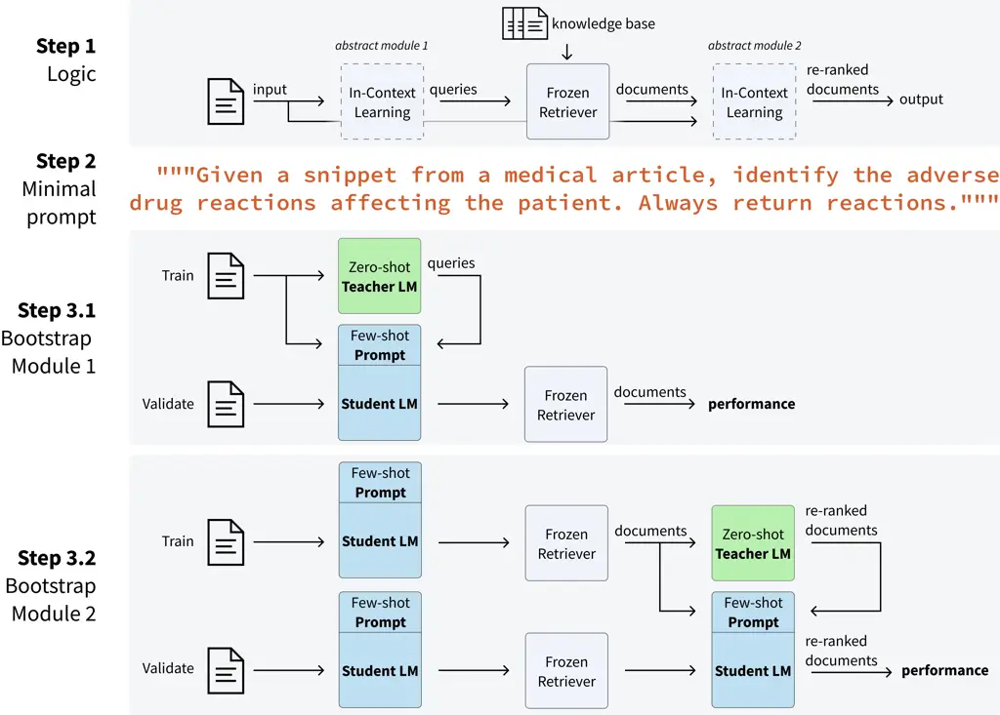

# In-Context Learning for Extreme Multi-Label Classification

Karel D’Oosterlinck Affiliation: Ghent University – imec
Affiliation: Stanford University Email: <*karel.doosterlinck@ugent.be>
   Omar Khattab Affiliation: Stanford University    François Remy
Affiliation: Ghent University – imec    Thomas Demeester
Affiliation: Ghent University – imec    Chris Develder
Affiliation: Ghent University – imec    Christopher Potts
Affiliation: Stanford University

###### Abstract

Multi-label classification problems with thousands of classes are hard
to solve with in-context learning alone, as language models (LMs) might
lack prior knowledge about the precise classes or how to assign them,
and it is generally infeasible to demonstrate every class in a prompt.
We propose a general program, Infer--Retrieve--Rank, that defines
multi-step interactions between LMs and retrievers to efficiently tackle
such problems. We implement this program using the DSPy programming
model, which specifies in-context systems in a declarative manner, and
use DSPy optimizers to tune it towards specific datasets by
bootstrapping only tens of few-shot examples. Our primary extreme
classification program, optimized separately for each task, attains
state-of-the-art results across three benchmarks (HOUSE, TECH,
TECHWOLF). We apply the same program to a benchmark with vastly
different characteristics and attain competitive performance as well
(BioDEX). Unlike prior work, our proposed solution requires no
finetuning, is easily applicable to new tasks, alleviates prompt
engineering, and requires only tens of labeled examples. Our code is
public at
[https://github.com/KarelDO/xmc.dspy](https://github.com/KarelDO/xmc.dspy).

## 1 Introduction

Extreme multi-label classification (XMC) tasks are hard to solve with
in-context learning alone. Language models (LMs) might lack prior
knowledge about the precise classes, and the sheer number of available
classes—often upwards of 10,000—generally means it is infeasible even to
demonstrate every class in a prompt. To deal with this, some recent
efforts make multiple LM calls at inference time (Zhu and Zamani, 2023),
while others prompt LMs to generate synthetic data for
finetuning (Decorte et al., 2023; Clavié and Soulié, 2023). These
methods can be configured to work well, but they all have manual “knobs”
like prompts and other hyperparameters that make applying them to new
datasets, metrics, or LMs challenging.



Figure 1: We propose Infer-Retrieve-Rank, an efficient in-context
learning program for multi-label classification with an extreme amount
of classes ($`\geq`$ 10,000). Given an input, a first in-context
learning module predicts queries which route to a frozen retriever. The
retrieved documents are re-ranked by a second in-context module
(Step 1). Given a minimal prompt (Step 2), a zero-shot Teacher LM
bootstraps demonstrations to optimize the few-shot Student LM (Step 3).
Optimization using $`\approx`$50 labeled inputs can yield
state-of-the-art results, using only $`\approx`$20 Teacher and
$`\approx`$1,500 Student calls. The (optimization) logic is expressed
using the DSPy programming model.

In this paper, we show that simple programs written using the DSPy
programming model (Khattab et al., 2023) support powerful, highly
general approaches to XMC tasks. DSPy allows us to separately specify
the modular _program_ of our method and how it should be _optimized_
towards different datasets. We propose a simple in-context program for
XMC tasks called Infer--Retrieve--Rank (IReRa, Figure 1, Step 1). First,
an LM processes the input document and guesses a set of applicable terms
(Infer). Then, a retriever relates each predicted term to the actual
label space (Retrieve). Finally, an LM is used to rerank retrieved
labels (Rank). Crucially, we use a frozen retriever and frozen LMs. The
key insights of Infer--Retrieve--Rank is that such a frozen retriever
can be made much more flexible if the LM learns in-context how to
predict relevant queries and interpret the retrieved results.

The underlying LMs, retriever, and prompts are considered
_hyperparameters_ of the IReRa program, which can be tuned automatically
or easily configured. Using only 10 unlabeled training inputs, and
$`\approx`$50 labeled validation examples, we bootstrap a few-shot
prompt for our two LM components, using a zero-shot teacher LM with a
minimal seed-prompt (Figure 1, Step 2). DSPy’s compilation abstraction
handles this nicely; it takes the program logic we’ve already defined,
instantiates it with a teacher LM, processes the unlabeled training
examples, generates zero-shot labels for each of the program steps, and
picks the best labels to put in a few-shot prompt based on validation
performance. Because our program consists of two in-context modules, we
propose to bootstrap them sequentially (Figure 1, Step 3).

In our experiments, we instantiate the Infer module with a
Llama-2-7b-chat model (Touvron et al., 2023), while the teacher model
used for bootstrapping is GPT-3.5. The Rank module is instantiated and
bootstrapped both by a GPT-4 model.

Adapting Infer--Retrieve--Rank to a new dataset can be as simple as (i)
writing a new minimal zero-shot prompt, (ii) configuring which LMs to
use, and (iii) running the optimization procedure. We optimize this
program separately towards 4 XMC datasets: one dataset involving the
extracting and coding of adverse drug events expressed in biomedical
literature (BioDEX; D’Oosterlinck et al. 2023) and three datasets
involving the labeling of job vacancy snippets with the required
competencies they express (HOUSE, TECH, TECHWOLF; Zhang et al. 2022;
Decorte et al. 2022; Decorte et al. 2023). Our program attains
state-of-the-art results on the job vacancy datasets, and gets
meaningful traction on the harder biomedical task—without finetuning,
without prompt engineering, and by using only $`\approx`$50 labeled
examples. We find that the optimization is a consistent driver of
performance across tasks.

## 2 Related Work

The canonical way of tackling an extreme classification problem involves
either finetuning a specialized retriever over the label space or
finetuning one binary classifier per class (Decorte et al., 2022;
Decorte et al., 2023; Clavié and Soulié, 2023). These methods require a
lot of data, since every one of the many classes requires at least a few
labeled examples. To avoid manual data labeling, researchers use distant
supervision (Decorte et al., 2022), bootstrap synthetic data using
LLMs (Decorte et al., 2023; Clavié and Soulié, 2023; De Raedt et al.,
2023), or finetune retrievers on adjacent problems where data is
available (Remy et al., 2022). At inference time, an additional LLM call
can be used to rerank a list of generated candidate labels to further
increase performance (Clavié and Soulié, 2023).

Zhu and Zamani (2023) use multiple GPT-3.5 calls combined with retrieval
at inference-time to bootstrap a synthetic prompt per input, infer
labels, and rerank them. While they do not use any finetuning, they
require many LLM and retrieval calls per input. They evaluate on two
recommendation tasks, where inputs and outputs are the same type of
documents. Bhatia et al. (2016) formulate many recommendation tasks
under the XMC setting. Instead, we consider XMC tasks where inputs and
outputs are not of similar shape, and more inference or information
extraction is needed.

Our Infer--Retrieve--Rank program does not rely on finetuning or many
LLM calls per input, making it efficient to develop and deploy.
Infer--Retrieve--Rank can achieve state-of-the-art performance using
only $`\approx`$50 labeled examples. Unlike prior work, our program
logic is defined in a modular and declarative manner, and can be
seamlessly applied to different benchmarks given a minimal seed-prompt.
Optimization happens automatically and can resolve in as little as ten
minutes. The choice of LMs and retrievers can be configured, ensuring
relevance when stronger components become available. Finally, we write
at most one seed-prompt per task and in-context module, and let
optimization—not iterative prompt engineering—take care of increasing
performance.

## 3 Infer--Retrieve--Rank

The program for Infer--Retrieve--Rank is given in Code Snippet 1, with
minor alterations for brevity. First, an LM is used to predict queries
given the input (Infer). The retriever outputs a ranking over all labels
based on maximum cosine embedding similarity with the queries
(Retrieve). The top labels are reranked by another LM (Rank).

1 class InferRetrieveRank(dspy.Module):

2 def \_\_init\_\_(self, infer_sig, rank_sig, retr):

3 \# Initialize LM modules with Signatures

4 self.infer = dspy.ChainOfThought(infer_sig)

5 self.rank = dspy.ChainOfThrought(rank_sig)

6 self.retrieve = retr

7

8 def forward(self, text: str) -\> Prediction:

9 \# Predict with LM

10 preds = self.infer(text).completions.labels

11

12 \# Parse LM output

13 preds = extract_labels_from_strings(preds)

14

15 \# Use LM outputs to retrieve labels

16 labels = self.retrieve(preds)

17

18 \# Use LM to rerank labels

19 labels = self.rank(text, labels)

20

21 return dspy.Prediction(labels=labels)

Code Snippet 1: DSPy code for Infer--Retrieve--Rank with minor
alterations for brevity.

Not all labels occur with equal frequency. Finetuned methods can
implicitly learn this bias given enough data. If available, we propose
to use the prior probability $`p_{i}`$ for the $`i`$-th label to reweigh
the retrieval similarity $`s_{i}`$ to account for this. The updated
scores $`\tilde{s}_{i}`$ as defined below are the output of the Retrieve
module. $`A`$ is a scalar hyperparameter controlling the strength of the
prior update:

```math
\tilde{s}_{i}=s_{i}\cdot\log_{10}(A\cdot p_{i}+10)
```

## 4 Seed-prompts

To apply Infer--Retrieve--Rank to a dataset, a minimal seed-prompt needs
to define the behavior of each in-context module. Code Snippet 2
contains the prompt for the Infer module on the BioDEX dataset, neatly
organized using the DSPy Signature abstraction. This seed-prompt defines
a task description in the docstring, and input and output fields with
descriptions and formatting information. The Signature serves as
skeleton for both zero- and few-shot prompts.

1 class BiodexInferSignature(dspy.Signature):

2 """Given a snippet from a medical article, identify the adverse drug
reactions affecting the patient. Always return reactions."""

3

4 text = dspy.InputField(prefix="Article:")

5 output = dspy.OutputField(

6 prefix="Reactions:",

7 desc="list of comma-separated adverse drug reactions"

8 )

Code Snippet 2: DSPy Signature for BioDEX Infer.

The prompt for the BioDEX Rank module is given in Code Snippet 3. We use
the same prompts for all three job vacancy datasets, they are given in
given in Code Snippets 4 and 5 for the Infer and Rank modules
respectively. Note how the prompts share most of their content: adapting
Infer--Retrieve--Rank can be as easy as concisely describing the input
and output fields.

1 class BiodexRankSignature(dspy.Signature):

2 """Given a snippet from a medical article, pick the 10 most applicable
adverse reactions from the options that are directly expressed in the
snippet."""

3

4 text = dspy.InputField(prefix="Article:")

5 options = dspy.InputField(

6 prefix="Options:",

7 desc="List of comma-separated options to choose from"

8 )

9 output = dspy.OutputField(

10 prefix="Reactions:",

11 desc="list of comma-separated adverse drug reactions"

12 )

Code Snippet 3: DSPy Signature for BioDEX Rank.

1 class EscoInferSignature(dspy.Signature):

2 """Given a snippet from a job vacancy, identify all the ESCO job
skills mentioned. Always return skills."""

3

4 text = dspy.InputField(prefix="Vacancy:")

5 options = dspy.InputField(

6 prefix="Options:",

7 desc="List of comma-separated options to choose from"

8 )

9 output = dspy.OutputField(

10 prefix="Skills:",

11 desc="list of comma-separated ESCO skills"

12 )

Code Snippet 4: DSPy Signature for ESCO Infer.

1 class EscoRankSignature(dspy.Signature):

2 """Given a snippet from a job vacancy, pick the 10 most applicable
skills from the options that are directly expressed in the snippet."""

3

4 text = dspy.InputField(prefix="Vacancy:")

5 options = dspy.InputField(

6 prefix="Options:",

7 desc="List of comma-separated options to choose from"

8 )

9 output = dspy.OutputField(

10 prefix="Skills:",

11 desc="list of comma-separated ESCO skills"

12 )

Code Snippet 5: DSPy Signature for ESCO Rank.

## 5 Metrics

We measure the rank-precision (RP) of the produced rankings, which is
the precision of the ranking at the rank equal to the number of total
gold labels. Specifically we consider the rank-precision at $`K`$
($`\textit{RP}@K`$; defined below). Given a gold number of labels
$`R_{n}`$ for input $`n`$, the $`\textit{RP}@K`$ measures
$`\text{precision}@K`$ when $`K\leq R_{n}`$ and $`\text{recall}@K`$ when
$`K\geq R_{n}`$.¹¹ 1 When $`K=R_{n}`$, the precision and the recall of
the ranking are by definition equal (Aslam et al., 2005).
$`\textit{Rel}(n,k)=1`$ if the $`k`$-th output for input $`n`$ in the
ranking was relevant, else $`0`$.

```math
\textit{RP@K}=\frac{1}{N}\sum\limits_{n=1}^{N}\frac{1}{\min(K,R_{n})}\sum\limits_{k=1}^{K}\textit{Rel}(n,k)
```

## 6 Data

We evaluate our method and baselines on four extreme classification
datasets, one in the biomedical field and three in the field of
human-resources.

### BioDEX:

The BioDEX dataset (Biomedical Drug Event eXtraction; D’Oosterlinck
et al. 2023) consists of biomedical papers containing various
descriptions of adverse drug events and associated expert-created labels
for the exact type of medical reaction discussed. These events are
encoded in the MedDRA ontology (Medical Dictionary for Regulatory
Activities; Brown et al. 1999), a set of $`\approx`$24,300 standardized
medical reaction. Inputs can be very long (half of inputs have upwards
of $`\approx`$20,000 characters), and biomedical domain knowledge is
needed to infer the correct reactions (not all medical reactions need to
be reported, only the _adverse_ ones). BioDEX models a crucial step in
real-world drug safety pipelines. We use a subset of 10 training, 50
validation, and 250 test examples for our experiments. The median amount
of labels per input is 3 while the 95th percentile is 14.

### ESCO:

The ESCO ontology (European Commission Directorate-General for
Employment, Social Affairs and Inclusion, 2017) contains
$`\approx`$13,900 distinct concepts used to encode skills, competences,
qualifications, and occupations. We consider three datasets each
containing snippets (typically one sentence) of online job vacancies in
English with their relevant ESCO labels. We use the HOUSE, TECH, and
TECHWOLF datasets (Zhang et al., 2022; Decorte et al., 2022; Decorte
et al., 2023). We take 10 examples each from the HOUSE and TECH
validation sets as training examples, and keep the remaining 51 and 65
examples as validation respectively. TECHWOLF has no validation or
training split, so we use the train and validation split of HOUSE
instead. HOUSE, TECH, and TECHWOLF respectively contain 262, 338, and
326 test examples. The median amount of labels per input across these
datasets is 1 and the 95th percentile is 4.

## 7 Experiments and Results

Table 1 gives test results for all models and tasks.

|                                             |                                                                           |                   |                  |                   |                  |                   |                  |                   |          |                    |
| ------------------------------------------- | ------------------------------------------------------------------------- | ----------------- | ---------------- | ----------------- | ---------------- | ----------------- | ---------------- | ----------------- | -------- | ------------------ |
|                                             | HOUSE                                                                     |                   | TECH             |                   | TECHWOLF         |                   | BioDEX           |                   |          |                    |
|                                             | $`\textit{RP}5`$                                                          | $`\textit{RP}10`$ | $`\textit{RP}5`$ | $`\textit{RP}10`$ | $`\textit{RP}5`$ | $`\textit{RP}10`$ | $`\textit{RP}5`$ | $`\textit{RP}10`$ |          |                    |
| Baselines                                   |                                                                           |                   |                  |                   |                  |                   |                  |                   |          |                    |
| prior                                       | 02.90                                                                     | 02.97             | 01.63            | 01.63             | 00.00            | 02.57             | 20.42            | 21.51             |          |                    |
| exact-match                                 | 05.89                                                                     | 05.89             | 04.09            | 04.09             | 03.43            | 03.43             | 09.60            | 15.16             |          |                    |
| naive-retrieve                              | 26.17                                                                     | 36.76             | 39.60            | 49.79             | 33.48            | 42.13             | 10.99            | 11.71             |          |                    |
| Programs                                    | (each program requires 10 training and $`\approx`$50 validation examples) |                   |                  |                   |                  |                   |                  |                   | Finetune | \# LM calls        |
| Infer--Retrieve--Rank                       | 56.50                                                                     | 65.76             | 59.61            | 70.23             | 57.04            | 65.17             | 24.73            | 27.67             | No       | $`\approx`$1,520   |
|    $`-`$ optimize Rank                      | 52.19                                                                     | 66.51             | 56.77            | 70.58             | 51.34            | 62.32             | 24.59            | 28.55             | No       | $`\approx`$1,010   |
| Infer--Retrieve                             | 42.47                                                                     | 52.62             | 55.01            | 62.45             | 47.49            | 56.50             | 20.69            | 24.77             | No       | $`\approx`$1,010   |
|    $`-`$ optimize Infer                     | 20.23                                                                     | 30.69             | 21.76            | 33.42             | 22.15            | 29.69             | 15.40            | 15.76             | No       | $`0`$              |
| Finetuned systems                           |                                                                           |                   |                  |                   |                  |                   |                  |                   |          | \# Train size      |
| retrieve ^($`\clubsuit`$)                   | 45.74                                                                     | 55.95             | 54.62            | 66.24             | 54.57            | 62.55             | /                | /                 | Yes      | $`\approx`$138,000 |
| retrieve-rankGPT3.5 ^($`\diamondsuit`$)     | 43.57                                                                     | 51.44             | 52.50            | 59.75             | /                | /                 | /                | /                 | Yes      | $`\approx`$555,000 |
| retrieve-rankGPT4 ^($`\diamondsuit`$)       | 56.67                                                                     | 61.02             | 61.50            | 68.94             | /                | /                 | /                | /                 | Yes      | $`\approx`$555,000 |
| seq2seq-prior ^($`\heartsuit`$)             | /                                                                         | /                 | /                | /                 | /                | /                 | 33.78            | 35.52             | Yes      | $`\approx`$11,500  |
| 10$`\times`$seq2seq-prior ^($`\heartsuit`$) | /                                                                         | /                 | /                | /                 | /                | /                 | 42.94            | 46.84             | Yes      | $`\approx`$11,500  |

Table 1: Test results for baselines, programs, and finetuned systems on
the HOUSE, TECH, TECHWOLF, and BioDEX extreme multi-label classification
tasks. Metrics are rank-precision (RP) at 5 and at 10. Our instantiation
of Infer--Retrieve--Rank uses a Llama-2-7b-chat model to Infer, a frozen
BioLORD or all-mpnet-base-v2 to Retrieve, and a GPT-4 model to Rank.
Infer--Retrieve--Rank can attain state-of-the-art results compared to
specialized systems while requiring no finetuning and multiple orders of
magnitude less data. Each program requires an amount of LM calls to
bootstrap, which is compared with the training size used by finetuned
systems. Best results within a 0.5 interval in bold, second best results
underlined. The finetuned system results are taken from
^($`\clubsuit`$)Decorte et al. (2023) and ^($`\diamondsuit`$)Clavié and
Soulié (2023) where available, or adapted from
^($`\heartsuit`$)D’Oosterlinck et al. (2023).

### Baselines

We evaluate a set of baselines across the four tasks. First, we evaluate
a ranking equal to the prior statistic over all the labels (prior). For
BioDEX, we estimate these priors across all the BioDEX training data.
For the ESCO datasets, we use the priors distributed by Decorte et al.
(2023), which are calculated from a private training set. Subsequently
we evaluate the performance of exactly matching the label names in the
input document (exact-match). Finally, we embed the input document with
an off-the-shelf retriever and retrieve over label embeddings. We use
the pre-trained all-mpnet-base-v2 model (Reimers and Gurevych, 2019) for
ESCO-tasks and BioLORD (Remy et al., 2022), a biomedical retriever, for
BioDEX (naive-retrieve).

Through these baselines, an interesting distinction between BioDEX and
the ESCO-tasks emerges. Off-the-shelf retrieval is much stronger on
ESCO-tasks. We hypothesize this is due to the shape of the input
documents. Entire biomedical publications are hard to compress into a
single vector—especially with an off-the-shelf retriever. The short
vacancy snippets are easier to handle.

### Infer--Retrieve--Rank

We instantiate the Infer module with a Llama-2-7b-chat student LM and
GPT-3.5-turbo teacher LM. The Rank module uses GPT-4 as both student and
teacher. The seed-prompts are given in Code Snippets 2, 3, 4, and  5.

We optimize Infer--Retrieve--Rank for $`\textit{RP}@10`$ performance on
each dataset separately. Each run involves 10 unlabeled training
examples and $`\approx`$50 labeled validation examples. Every run incurs
$`\approx`$20 teacher model calls and $`\approx`$1,500 student model
calls, and can complete in tens of minutes. We use dspy’s
BootstrapFewShotWithRandomSearch class to automate the prompt
bootstrapping procedure. A detailed breakdown of optimization and
inference costs, in function of the different LMs used, is given in
Section 8. We set the prior hyperparameter $`A`$ to 0 for ESCO-tasks and
1000 for BioDEX, based on a handful of validation runs.

For ESCO-tasks, we compare with the best finetuned systems from the
literature. retrieve denotes the retriever of Decorte et al. (2023),
retrieve-rankGPT3.5/4 denotes the system with inference-time reranking
of Clavié and Soulié (2023). For BioDEX, we slightly alter the method
of D’Oosterlinck et al. (2023): we take a FLAN-T5-Large model (Chung
et al., 2022) and train it to output a comma-separated list of reaction
labels given a chunk of the input paper (the original BioDEX system was
trained to output many attributes, of which medical reactions was only
one). This model does not directly produce a ranking, so if a reaction
is not predicted we add it in order of the prior (seq2seq-prior). We
also consider sampling 10 generations from the model and majority voting
the reactions (10$`\times`$seq2seq-prior).

Infer--Retrieve--Rank achieves state-of-the-art performance across all
ESCO-tasks. Through a set of ablations, we find that each optimization
step and module improves performance. Notable, the Infer-Retrieve
system, which ablates the Rank module, can still attain competitive
results despite using only one open-source LM and frozen retriever.
Infer--Retrieve--Rank does not beat our finetuned system on BioDEX, but
adding a Rank module or optimizing Infer consistently improves
performance, indicating that programs can support a general approaches
to extreme multi-label classification across a variety of datasets with
different characteristics.

## 8 Program Cost Breakdown

|                         |                    |                  |                  |               |               |
| ----------------------- | ------------------ | ---------------- | ---------------- | ------------- | ------------- |
|                         | Configuration      |                  | Optimize Calls   |               | Calls / Input |
|                         | LM                 | Teacher          | LM               | Teacher       | LM            |
| Modules                 |                    |                  |                  |               |               |
| Infer                   | Llama              | GPT3.5           | $`\approx`$500   | $`\approx`$10 | 1             |
| Retrieve                | mpnet (or similar) | None             | 0                | 0             | 1             |
| Rank                    | GPT4               | GPT4             | $`\approx`$500   | $`\approx`$10 | 1             |
| Programs                |                    |                  |                  |               |               |
| Infer--Retrieve--Rank   | Llama-mpnet-GPT4   | GPT3.5-None-GPT4 | $`\approx`$1,500 | $`\approx`$20 | 3             |
|    $`-`$ optimize Rank  | Llama-mpnet-GPT4   | GPT3.5-None      | $`\approx`$1,000 | $`\approx`$10 | 3             |
| Infer-Retrieve          | Llama-mpnet        | GPT3.5-None      | $`\approx`$1,000 | $`\approx`$10 | 2             |
|    $`-`$ optimize Infer | Llama-mpnet        | None-None        | 0                | 0             | 2             |

Table 2: Breakdown of configuration and costs associated with our
Modules and Programs. A module is configured with a single LM and
Teacher. A program inherits all LMs of its modules, and all Teachers of
its _optimized_ modules. Per module, the optimization procedure requires
$`O(\textit{train})`$ Teacher calls and
$`\textit{num\_programs}\cdot O(\textit{val})`$ LM calls, where
num_programs is a hyperparameter controlling how many programs to try
during optimization. During inference, 1 LM call is used per module.
Programs inherit the optimization calls of their _optimized_ modules,
and the inference calls of all modules. While Retrieve is not directly
optimized, it does contribute inference calls to the optimization of
Infer-Retrieve because the Retrieve module is in the optimization loop.
In this work, we use 10 training examples, $`\approx`$50 validation
examples, and set num_programs to 10.

Table 2 outlines the optimization and inference calls associated with
our modules and programs. A module is always instantiated with one LM,
but can also have another Teacher LM if it is optimizable. In our case,
the Infer and Rank modules have a Teacher while Retrieve does not.
Optimizing a module given its inputs incurs $`O(\textit{train})`$ calls
from the Teacher model and
$`\textit{num\_programs}\cdot O(\textit{validation})`$ calls from the
Student LM, where train and validation denote the sizes of the training
and validation sets respectively, and num_programs controls how many
different bootstrapped prompts to try in the optimization process. In
our work, this results in $`\approx`$10 Teacher and $`\approx`$500 LM
calls per module.

Programs inherit the configuration and calls from their constituent
modules. Teacher optimization calls are only inherited if the module is
actually optimized, LM optimization calls are inherited if the module is
in the loop for another optimized module, and inference calls are always
inherited.

Table 2 makes it easy to express the cost associated with any program.
For example, our state-of-the-art Infer--Retrieve--Rank program requires
approximately 500 Llama, 500 mpnet, 10 GPT3.5, and 510 GPT4 calls to
optimize. This is calculated as follows. First, 500 Llama and 500 mpnet
student LM calls and 10 GPT3.5 teacher calls are needed to optimize
Infer-Retrieve. Then an additional 500 GPT4 student LM calls and 10 GPT4
teacher calls are needed to optimize Rank. Notice how Infer-Retrieve is
in the loop while Infer--Retrieve--Rank is optimized. Because of the
left-to-right nature of this optimization procedure, we can cache the
inference calls of Infer-Retrieve, saving us the cost of executing them
again when optimizing Rank. Per new input, the program incurs 1 call for
each Llama, mpnet, and GPT4 LM.

The finetuned systems we compare to in Table 1 all have a much higher
start-up cost, in part due to the need for labeled finetuning data—which
some systems need to bootstrap—and other costs associated with
finetuning such as increased hardware requirements. These finetuned
systems can be more efficient per test-time input, given that we
currently rely on 2 open-source local calls and 1 closed-source API call
for Infer--Retrieve--Rank. Our Infer-Retrieve program is considerably
cheaper to deploy since it relies only on open-source components, while
still being competitive. In the future, we plan to use an open-source LM
for Rank, making our best program considerably cheaper to deploy as
well.

## 9 Conclusion

We introduced Infer--Retrieve--Rank, a general program for extreme
multi-label classification. Infer--Retrieve--Rank achieves
state-of-the-art results on three benchmarks using one frozen retriever
combine with two in-context learning modules. These findings show that
the future of prompt and pipeline engineering need not be brittle.
Modular programs, once optimized, can serve as highly effective
general-purpose solutions.

## Limitations

The best Infer--Retrieve--Rank program currently requires one GPT-4 call
per input document, which may not feasible for all applications. In the
future, we plan to explore more efficient versions of
Infer--Retrieve--Rank which rely fully on low-cost open-source
components.

While our optimization procedure alleviates the need for iterative
prompt engineering, Infer--Retrieve--Rank does rely on an initial
seed-prompt and performance may vary with spurious features of these
prompts. In the future, we plan to quantify how different optimization
procedures can reduce prompt brittleness, using Infer--Retrieve--Rank
and our benchmark suite.

## Ethics Statement

We have applied Infer--Retrieve--Rank to the important real-world tasks
of biomedical information extraction and job vacancy screening. LMs make
mistakes and are biased towards certain predictions (Bender et al.,
2021). We advise against the deployment of Infer--Retrieve--Rank in
these crucial real-world tasks without proper understanding of the risks
involved and how to best measure and mitigate them.

## Acknowledgements

We are grateful to Jens-Joris Decorte and Johannes Deleu for their
useful comments, and to Jens-Joris Decorte for providing us with prior
statistics on the ESCO-tasks. Karel D’Oosterlinck is funded by an FWO
Fundamental Research PhD Fellowship (11632223N). Omar Khattab is
supported by the Apple Scholars in AI/ML fellowship. This work was
partially supported by IBM as a founding member of the Stanford
Institute for Human-Centered Artificial Intelligence (HAI), Oracle,
Virtusa, and Cigna Healthcare.

## References

- Aslam et al. (2005) Javed A Aslam, Emine Yilmaz, and Virgiliu
  Pavlu. 2005. A geometric interpretation of r-precision and its
  correlation with average precision. In _Proceedings of the 28th annual
  international ACM SIGIR conference on Research and development in
  information retrieval_, pages 573–574.
- Bender et al. (2021) Emily M Bender, Timnit Gebru, Angelina
  McMillan-Major, and Shmargaret Shmitchell. 2021. On the dangers of
  stochastic parrots: Can language models be too big? In _Proceedings of
  the 2021 ACM Conference on Fairness, Accountability, and
  Transparency_, pages 610–623.
- Bhatia et al. (2016) K. Bhatia, K. Dahiya, H. Jain, P. Kar, A. Mittal,
  Y. Prabhu, and M. Varma. 2016. [The extreme classification repository:
  Multi-label datasets and
  code](http://manikvarma.org/downloads/XC/XMLRepository.html).
- Brown et al. (1999) Elliot G Brown, Louise Wood, and Sue Wood. 1999.
  The medical dictionary for regulatory activities (meddra). _Drug
  safety_, 20(2):109–117.
- Chung et al. (2022) Hyung Won Chung, Le Hou, Shayne Longpre, Barret
  Zoph, Yi Tay, William Fedus, Yunxuan Li, Xuezhi Wang, Mostafa
  Dehghani, Siddhartha Brahma, et al. 2022. Scaling
  instruction-finetuned language models. _arXiv preprint
  arXiv:2210.11416_.
- Clavié and Soulié (2023) Benjamin Clavié and Guillaume Soulié. 2023.
  Large language models as batteries-included zero-shot ESCO skills
  matchers. _arXiv preprint arXiv:2307.03539_.
- De Raedt et al. (2023) Maarten De Raedt, Fréderic Godin, Thomas
  Demeester, and Chris Develder. 2023. [IDAS: Intent discovery with
  abstractive
  summarization](https://doi.org/10.18653/v1/2023.nlp4convai-1.7). In
  _Proceedings of the 5th Workshop on NLP for Conversational AI
  (NLP4ConvAI 2023)_, pages 71–88, Toronto, Canada. Association for
  Computational Linguistics.
- Decorte et al. (2022) Jens-Joris Decorte, Jeroen Van Hautte, Johannes
  Deleu, Chris Develder, and Thomas Demeester. 2022. Design of negative
  sampling strategies for distantly supervised skill extraction. In
  _RecSys in HR2022_, pages 1–7.
- Decorte et al. (2023) Jens-Joris Decorte, Severine Verlinden, Jeroen
  Van Hautte, Johannes Deleu, Chris Develder, and Thomas
  Demeester. 2023. Extreme multi-label skill extraction training using
  large language models. In _AI4HR & PES, the International workshop on
  AI for Human Resources and Public Employment Services, ECML-PKDD 2023
  Workshop_, pages 1–10.
- D’Oosterlinck et al. (2023) Karel D’Oosterlinck, François Remy,
  Johannes Deleu, Thomas Demeester, Chris Develder, Klim Zaporojets,
  Aneiss Ghodsi, Simon Ellershaw, Jack Collins, and Christopher
  Potts. 2023. [BioDEX: Large-scale biomedical adverse drug event
  extraction for real-world
  pharmacovigilance](https://doi.org/10.18653/v1/2023.findings-emnlp.896).
  In _Findings of the Association for Computational Linguistics: EMNLP
  2023_, pages 13425–13454, Singapore. Association for Computational
  Linguistics.
- European Commission Directorate-General for Employment, Social Affairs
  and Inclusion (2017) European Commission Directorate-General for
  Employment, Social Affairs and Inclusion. 2017. ESCO, European skills,
  competences, qualifications and occupations.
  [https://esco.ec.europa.eu/en/about-esco/what-esco](https://esco.ec.europa.eu/en/about-esco/what-esco).
- Khattab et al. (2023) Omar Khattab, Arnav Singhvi, Paridhi Maheshwari,
  Zhiyuan Zhang, Keshav Santhanam, Sri Vardhamanan, Saiful Haq, Ashutosh
  Sharma, Thomas T. Joshi, Hanna Moazam, Heather Miller, Matei Zaharia,
  and Christopher Potts. 2023. DSPy: Compiling declarative language
  model calls into self-improving pipelines. _arXiv preprint
  arXiv:2310.03714_.
- Reimers and Gurevych (2019) Nils Reimers and Iryna Gurevych. 2019.
  [Sentence-BERT: Sentence embeddings using Siamese
  BERT-networks](https://doi.org/10.18653/v1/D19-1410). In _Proceedings
  of the 2019 Conference on Empirical Methods in Natural Language
  Processing and the 9th International Joint Conference on Natural
  Language Processing (EMNLP-IJCNLP)_, pages 3982–3992, Hong Kong,
  China. Association for Computational Linguistics.
- Remy et al. (2022) François Remy, Kris Demuynck, and Thomas
  Demeester. 2022. [BioLORD: Learning ontological representations from
  definitions for biomedical concepts and their textual
  descriptions](https://doi.org/10.18653/v1/2022.findings-emnlp.104). In
  _Findings of the Association for Computational Linguistics: EMNLP
  2022_, pages 1454–1465, Abu Dhabi, United Arab Emirates. Association
  for Computational Linguistics.
- Touvron et al. (2023) Hugo Touvron, Louis Martin, Kevin Stone, Peter
  Albert, Amjad Almahairi, Yasmine Babaei, Nikolay Bashlykov, Soumya
  Batra, Prajjwal Bhargava, Shruti Bhosale, et al. 2023. Llama 2: Open
  foundation and fine-tuned chat models. _arXiv preprint
  arXiv:2307.09288_.
- Zhang et al. (2022) Mike Zhang, Kristian Jensen, Sif Sonniks, and
  Barbara Plank. 2022. [SkillSpan: Hard and soft skill extraction from
  English job
  postings](https://doi.org/10.18653/v1/2022.naacl-main.366). In
  _Proceedings of the 2022 Conference of the North American Chapter of
  the Association for Computational Linguistics: Human Language
  Technologies_, pages 4962–4984, Seattle, United States. Association
  for Computational Linguistics.
- Zhu and Zamani (2023) Yaxin Zhu and Hamed Zamani. 2023. ICXML: An
  in-context learning framework for zero-shot extreme multi-label
  classification. _arXiv preprint arXiv:2311.09649_.
