# Intent-based Prompt Calibration: Enhancing prompt optimization with synthetic boundary cases

Elad Levi    Eli Brosh    Matan Friedmann

###### Abstract

Prompt engineering is a challenging and important task due to the high
sensitivity of Large Language Models (LLMs) to the given prompt and the
inherent ambiguity of a textual task instruction. Automatic prompt
engineering is essential to achieve optimized performance from LLMs.
Recent studies have demonstrated the capabilities of LLMs to
automatically conduct prompt engineering by employing a meta-prompt that
incorporates the outcomes of the last trials and proposes an improved
prompt. However, this requires a high-quality benchmark to compare
different prompts, which is difficult and expensive to acquire in many
real-world use cases. In this work, we introduce a new method for
automatic prompt engineering, using a calibration process that
iteratively refines the prompt to the user intent. During the
optimization process, the system jointly generates synthetic data of
boundary use cases and optimizes the prompt according to the generated
dataset. We demonstrate the effectiveness of our method with respect to
strong proprietary models on real-world tasks such as moderation and
generation. Our method outperforms state-of-the-art methods with a
limited number of annotated samples. Furthermore, we validate the
advantages of each one of the system’s key components. Our system is
built in a modular way, facilitating easy adaptation to other tasks. The
code is available at
[https://github.com/Eladlev/AutoPrompt](https://github.com/Eladlev/AutoPrompt).

##

### 1 Introduction

In recent years, there has been significant enhancements in the
capabilities of Large Language Models (LLMs), demonstrating impressive
generative performance across a variety of tasks \[11, 4\].
Nevertheless, despite these advancements, the quality of the models’
outputs is highly sensitive to the conditioned prompt \[18, 40\]. Even a
slight modification in the prompt format can significantly impact the
model’s performance \[27\]. This issue is even more evident in popular
proprietary models, where a change in model version results in drastic
changes in model behaviour on a wide range of tasks \[6\].

In order to tackle the prompt sensitivity issue, several methods \[15,
16\] proposed to use soft prompts which require access to the LLM itself
in order to perform the optimization. Recently,  \[35, 37, 24\]
demonstrated the effectiveness of using LLMs themselves to optimize the
prompt. To this end, each prompt is assigned a score based on a given
benchmark and an appropriate metric. The optimization process is
performed iteratively by providing a meta-prompt that incorporates the
history of the last few prompt scores and guiding the model to suggest a
better prompt with a higher score. However, the high-quality, large
benchmarks required by this approach to evaluate the performance of the
different prompts often do not exist in many real-world use cases.
Moreover, iterating on such large datasets can be costly.

LLMs have proven to be highly effective in generating high-quality and
rich datasets that boost model performance on a diverse set of
tasks \[25, 36, 19, 33\]. Recent works demonstrate the capabilities of
LLMs to refine the prompt provided by the user, resolving the initial
prompt ambiguity \[10\]. However, without additional information, the
model has to guess the true intention of the user, which in many cases
can lead to inaccurate results.

In this work, we introduce Intent-based Prompt Calibration (IPC), a
system which aims to calibrate the prompt according to the intention of
the user, by using synthetic examples. The calibration process is
performed by iteratively building a dataset of challenging boundary
cases and optimising the prompt according to the generated benchmark.
This novel aspect of our method, producing a small benchmark tailored to
the boundary cases of the user’s task as part of the optimization
process, is highly valuable for explainability, LLM distillation, and
other use cases. In contrast to previous works, the system is optimized
for real-world use cases such as moderation which usually suffers from
imbalanced data distribution. We also extend the prompt optimization to
a new family of generative tasks, by first fitting a ranking prompt and
then performing the prompt optimization with the learned ranker.
Learning a prompt ranker allows us to optimize generative tasks with
minimal annotation effort. As demonstrated in our experimentation
section, using such an approach without synthetic data of boundary
cases, e.g., as done in previous methods, would not be efficient due to
the natural imbalance of the ranking distribution.

Lastly, our system is built in a modular way, such that each part of the
components can be used on its own in other tasks like synthetic data
generation or prompt distillation between two LLMs. We describe the
system components in detail and demonstrate the effectiveness of our
proposed method with respect to strong proprietary models like
GPT-3.5/4-Turbo. We show that our method outperforms previous methods
using a very small amount of data and iteration steps . This
significantly reduces the total optimization efforts and costs, and
makes the system applicable to various production use cases.

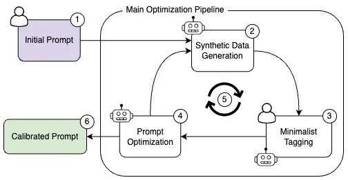

Figure 1: System diagram. (1) An initial prompt is provided by the user
(2) Synthetic challenging cases are generated (3) A user or an LLM
annotates the examples (4) After evaluating the prompt performances, an
LLM suggest a new prompt given the last prompt’s results. (5) This
process is repeated iteratively until a certain stop criterion (6) The
system outputs a calibrated prompt.

### 2 Method

Our system is illustrated in Figure 1. We start with the initial prompt
suggestion and a task description. The user can also provide a few
examples in a few-shot setting. Then, during the calibration
optimization process, the system iteratively: 1. Suggests a few samples
of challenging and diverse boundary cases for the task and the current
prompt. 2. Evaluates the current prompt on the generated dataset, and
provides an analysis. 3. Given the history of the last few prompts,
suggests a new prompt with a higher score. The optimization process is
terminated when either there is no improvement in the last few steps, or
when the maximum number of iterations has been reached.

The base configuration of our system is optimized for classification
tasks, with accuracy set as the score function, and the error analysis
determined by a confusion matrix and the prompt misclassifications. An
example of the system flow can be seen in Figure 2. In each iteration,
new challenging samples are generated (according to the current prompt),
and the misclassifications are used to refine the prompt until it is
calibrated to the user intent.

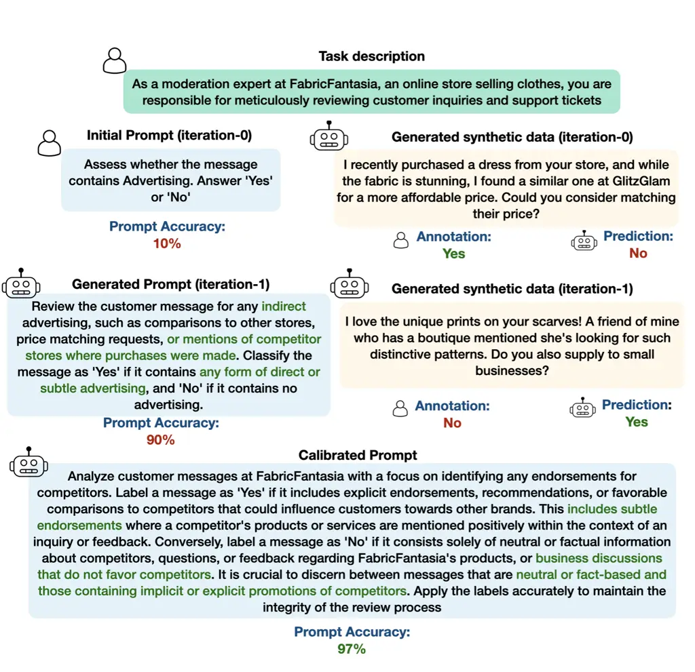

Figure 2: Example of a real system flow. The user provides only the task
description and initial prompt. The model iteratively generates
challenging samples and refines the prompt according to the generated
benchmark.

#### 2.1 Generative tasks

To extend the prompt calibration process from classification tasks to
generative tasks, we split the optimization process into two parts. In
the first part, we use an LLM to rephrase the initial prompt and task
description in order to define a ranking task based on the modified
initial prompt and task description. We then calibrate a prompt for the
ranking task, treating it as a classification task using the
classification pipeline. Naturally, the ranker distribution tends to be
a normal distribution with its mean at the mean score. This distribution
is imbalanced, especially in the interesting range of the top scores.
Therefore, in the ranking case, the sample generator meta-prompt is
instructed to generate challenging boundary samples from the top two
scores. In the second part, we leverage the same underlying process to
optimize the original generative prompt. This step is done by
iteratively applying steps 2 and 3, described in the system overview,
using the calibrated ranking prompt as the score function. It’s
important to note that human annotations are required only in the
ranking calibration process. Furthermore, by treating the intent as a
classification task, the prompt can be calibrated using a small amount
of annotation effort.

#### 2.2 Meta-Prompts

The meta-prompts consist of three separate prompts, as can be seen in
Appendix A.

Sample generator. The sample generation meta-prompt is determined
according to the system state: In the first iteration, if the user
doesn’t provide any samples (zero-shot setting), the meta-prompt
instructs the model to generate diverse adversarial samples with even
class distribution. In the next iterations, the prompt is extended with
the following additional context: (1) A history with prompts and good
adversarial samples that confused the prompts; and (2) A set of
realistic samples from the dataset, where the model is instructed to
preserve the dataset style. The context-realistic samples are chosen to
be semantically close according to a given sentence embedding.

Analyzer. The analyzer meta-prompt receives the prompt score, a
confusion matrix in the classification case, and a set of errors in all
the classes. It is then instructed to produce an analysis summary of the
prompt performances and the major failure cases.

Prompt generator. The input for the prompt generator meta-prompt is (1)
A list of the last suggested prompts and their scores (2) The
performance analysis of the last prompt that is produced by the Analyzer
prompt. The model is instructed to produce a prompt with a higher score
according to the history and the analysis.

#### 2.3 System pipeline

An overview of the system architecture can be seen in Figure 8. The
system consists of four primary components.

Dataset. This component manages the dataset and performs operations such
as insertion, modification, deletion, and applying functions, on the
dataset rows. The component also handles data cleaning by removing
semantic duplications and performing semantic sampling. Since the system
is optimized for small datasets, the current implementation is based on
a local database using pandas.

Estimator. The estimator is responsible for estimating a batch of
samples. We implement this component twice, once for the predictions and
once for the annotations. This generic implementation for both types of
use cases, allows us to modify the system simply for diverse use cases
such as prompt calibration, prompt distillation and prompt squashing.
The currently supported types of estimators are: (1) Human annotation,
using Argilla UI \[32\]. The system is connected to the Argilla server
and is waiting until the annotation task is completed; (2) LLM
estimator, which uses an LLM to estimate the sample given a prompt. We
support various types of LLMs, using Langchain integration \[5\]. For
efficiency, the system supports parallelism using both workers and async
calls. The system also supports sending a few samples in one prompt
(prompt batching), which can reduce the cost significantly; and (3)
Batch estimator, the batch estimator runs multiple LLM estimators and
integrates their outputs through an aggregation layer. It is mainly used
for prompt-squashing, enabling users to optimize a single prompt that
will perform as well as running few prompts multiple times. For example,
when a user wants to apply several moderation rules simultaneously.

Evaluator. The evaluator is responsible for evaluating the records after
the prediction and annotation stage. The evaluator accepts a function
and applies it to each row. It’s important to note that the function is
generic. For example, in the generation pipeline, the function is
performed by invoking an LLM. The evaluator is also responsible for
defining the errors and handling the error analysis using the Analyzer
described in the meta-prompts section.

Optimizer (Optimization Pipeline). The optimizer manager handles the
whole optimization process flow, it performs the iteration steps
described in the previous section and is responsible for stopping and
returning the final calibrated prompt. The currently supported criteria
are either convergence (determined by a patience hyper-parameter), or
usage limit (determined by maximal cost if relevant, or by the number of
generated tokens).

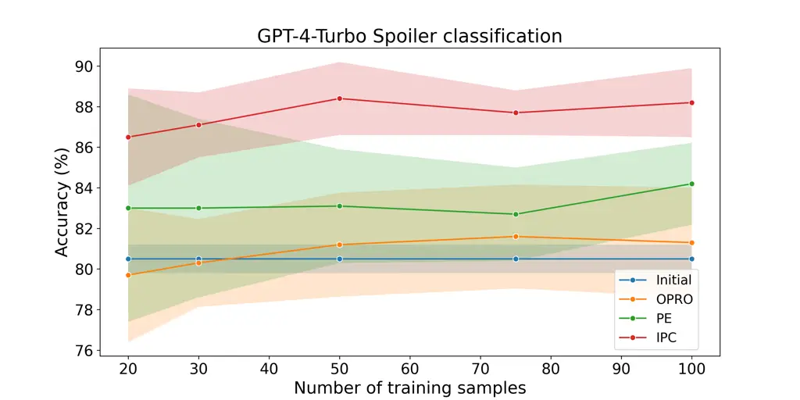

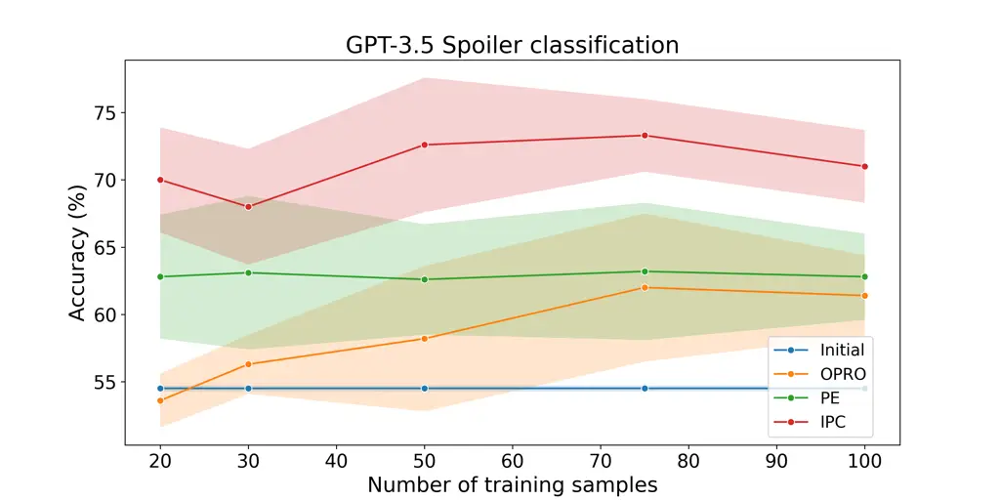

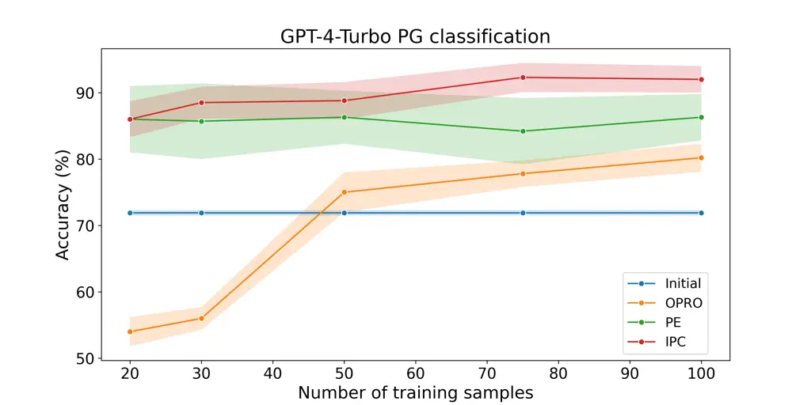

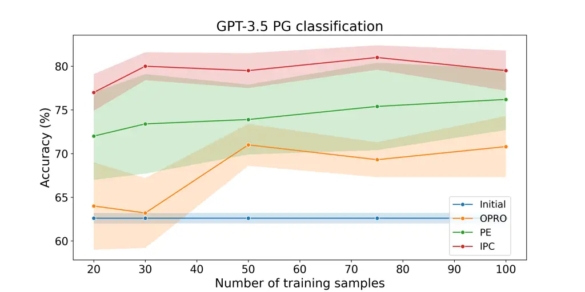

Figure 3: Accuracy on the spoiler and the PG classification tasks, with
respect to the number of training steps. As shown, IPC outperforms other
tested methods and results in lower variance.

### 3 Experiments

We test our system on scenarios that reflect real-world moderation and
generation use cases on strong proprietary models (GPT-3.5/4-Turbo). We
used the IMDB review dataset \[20\] as the base data for all our
experiments. We compare our proposed IPC method to two SOTA prompt
optimization methods that are based on meta-prompts: 1. OPRO \[35\] and 2. The meta prompt provided by PE \[37\].

#### 3.1 Classification

We evaluate the prompt calibration process on three binary
classification tasks: (1) Spoiler detection, (2) Sentiment analysis, and
(3) Parental Guidance (PG) detection. In each experiment, we start with
some initial samples and a prompt, in addition to a short task
description. To generate the ground truth (GT) we composed a highly
detailed prompt with specific preferences. For the GT generation, we
used a strong model (GPT-4 Turbo), as this process of generating the GT
simulates a user’s particular preference for the given task. The
baseline methods were trained on samples from the IMDB dataset \[20\],
whereas our proposed method was trained on the adversarial synthetic
data which was provided with 10 initial samples from the original IMDB
training data. All methods were trained for 50 iterations. The test
dataset was taken from the IMDB reviews test split, with the generated
annotations provided by the GT prompt. We then collected 250 samples for
each class in each one of the tested scenarios, such that the final
dataset has equal class distribution. It’s important to note that the
IMDB dataset includes only highly polarizing reviews (no reviews with
ratings in the range of 4-7). To evaluate the method’s performance on
more challenging cases, we also generate a synthetic test dataset with
300 samples (using the initial prompt) for the sentiment classification
task.

We present our results in Figures 3,7. As seen in the figures, IPC
outperforms all other tested methods. In particular, it’s important to
note the high variance of the other methods, especially in the case of a
small number of training samples. The gap in performance between the
methods becomes even more evident in the synthetic data case, where
there are more boundary cases, as can be seen in Figure 6. A qualitative
comparison between the methods can be seen in Table 1. While OPRO \[35\]
results in mainly rephrasing the initial prompt, and the PE \[37\]
prompt only partly fits the GT prompt, the IPC prompt successfully
captures the subtle details and nuances of the GT prompt. The
significant differences in data distributions between the original data
and the synthetic generated data can be seen in Figure 5. Both the
spoiler and the PG classification tasks exhibit significant bias towards
the ’No’ labels, where the Synthetic data is almost balanced.

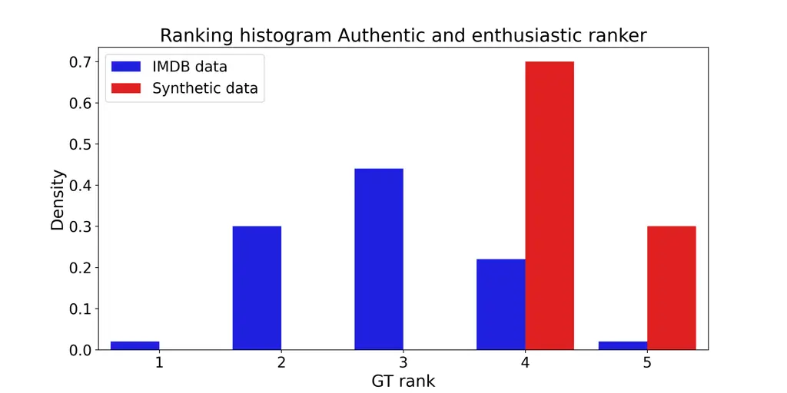

Figure 4: Histogram of the ranking scores of the IMDB review dataset vs
the generated synthetic dataset on the Authentic and enthusiastic
generation task. The real data distribution contains very few ranked 5
reviews, whereas the synthetic data contains a more balanced dataset
with respect to the top scores.

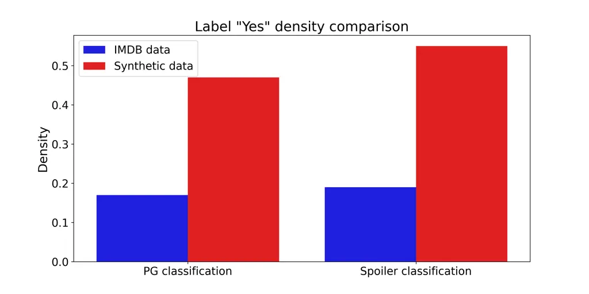

Figure 5: Histogram of the ’Yes’ labels density on the parental guidance
(PG) and spoiler classification tasks, with respect to the IMDB review
dataset and the generated synthetic dataset. The real data exhibits a
heavy imbalance in favor of the ’No’ label, while the synthetic data
approaches an even distribution.

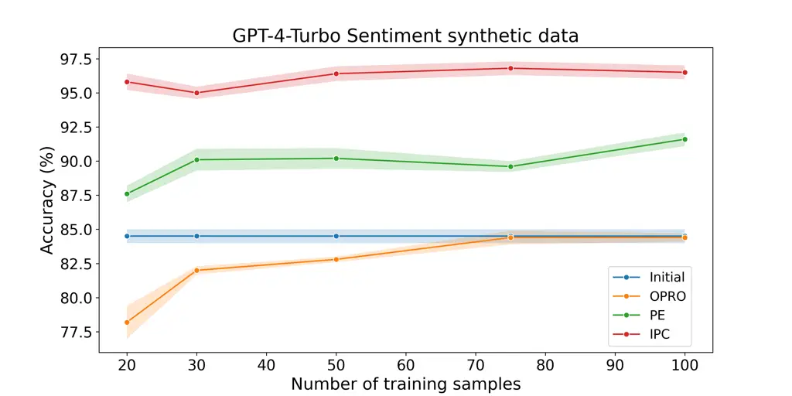

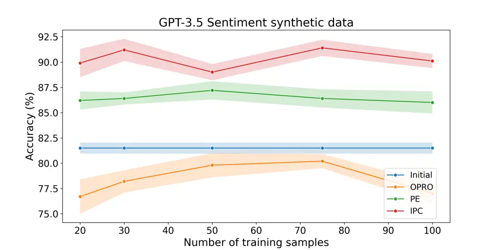

Figure 6: Accuracy of of sentiment classification task with respect to
the synthetic dataset for different number of training steps. IPC
outperforms other tested methods and results in lower variance.

|                |                                                                                                                                                                                                                                                                                                                                                                                                                                                                                                                                                                                                                                                                                                                                                                                                                                                                                                                                                                                                                                                                                                                                                                                                                                                                                                                                                                                                                                                                                   |
| -------------- | --------------------------------------------------------------------------------------------------------------------------------------------------------------------------------------------------------------------------------------------------------------------------------------------------------------------------------------------------------------------------------------------------------------------------------------------------------------------------------------------------------------------------------------------------------------------------------------------------------------------------------------------------------------------------------------------------------------------------------------------------------------------------------------------------------------------------------------------------------------------------------------------------------------------------------------------------------------------------------------------------------------------------------------------------------------------------------------------------------------------------------------------------------------------------------------------------------------------------------------------------------------------------------------------------------------------------------------------------------------------------------------------------------------------------------------------------------------------------------- |
| GT prompt      | To improve the IMDB review spoiler classifier, label a review as ’Yes’ for containing a spoiler if it: 1. Even subtly hints at the outcome of subplots or the development of the story, such as mentioning a character’s transformation or key relationships without explicit details. 2. Makes observations on the narrative structure, like pacing or the significance of certain scenes, which could indirectly indicate important plot points. 3. Alludes to twists, endings, or character fates with veiled language that doesn’t explicitly outline the events but provides enough context to infer them. Conversely, label a review as ’No’ for no spoilers if it: 1. Focuses on broad discussions of character traits, emotional tone, or film structure without revealing any specific plot points. 2. Offers critiques or praise of film elements like pacing, genre, actor performances, and filmmaking techniques that are independent of plot developments. 3. Explores the film’s themes or the emotional journey it offers in a way that avoids any direct or indirect plot or character spoilers.                                                                                                                                                                                                                                                                                                                                                                 |
| Initial prompt | Does this movie review contain a spoiler? answer Yes or No                                                                                                                                                                                                                                                                                                                                                                                                                                                                                                                                                                                                                                                                                                                                                                                                                                                                                                                                                                                                                                                                                                                                                                                                                                                                                                                                                                                                                        |
| OPRO \[35\]    | Examine the movie synopsis with vigilance for spoiler content and succinctly affirm their presence with "Yes" or negate with "No".                                                                                                                                                                                                                                                                                                                                                                                                                                                                                                                                                                                                                                                                                                                                                                                                                                                                                                                                                                                                                                                                                                                                                                                                                                                                                                                                                |
| PE \[37\]      | Analyze the IMDB review for elements that provide significant insights into the plot or reveal crucial turning points, even if mentioned subtly or indirectly. Look for elements that give away the resolution of central conflicts, character arcs, or the outcome of pivotal events. Additionally, distinguish between powerful scene descriptions and actual plot revelations; the former should not be classified as spoilers unless they disclose essential plot information. Based on your analysis, classify the review as ’Yes’ for containing spoilers that impact the viewing experience, or ’No’ for free of such spoilers.                                                                                                                                                                                                                                                                                                                                                                                                                                                                                                                                                                                                                                                                                                                                                                                                                                            |
| IPC            | IMDB Review Spoiler Identification Protocol: For the task of classifying IMDB reviews for the presence of spoilers, the classifier must label reviews with a heightened sensitivity to nuanced language and indirect spoiler cues. The classification labels are ’Yes’ for spoilers and ’No’ for non-spoilers. Apply the following criteria rigorously: Label ’Yes’ if a review: - Contains subtle references or nuanced language that hints at plot developments or character arcs, without explicit detail. - Includes emotional responses or descriptive language that indirectly reveals plot outcomes or twists. - Employs suggestive language that points to future events or endings, even if it does not reveal specific information. Label ’No’ if a review: - Discusses technical aspects, acting, direction, or personal viewer impressions in a manner that does not hint at or reveal any plot details. - Comments on thematic elements, genre characteristics, or storytelling techniques without disclosing or implying crucial plot twists. - Expresses opinions on the movie’s quality, performances, or execution that are free from any storyline implications or potential spoiler content. In both ’Yes’ and ’No’ classifications, special attention must be given to the implicit meaning behind words and the context in which they are used to prevent misclassification of subtle spoiler content and to ensure a genuine viewing experience for others. |

Table 1: A comparison of the prompts with the best training scores from
each method on the Spoiler detection task, using 50 training samples.
IPC succeeded in capturing the nuances of the GT prompt.

#### 3.2 Generation

The generation setting is composed of two parts: generating the ranker
prompt and then using the ranker to optimize the generation task prompt.
We tested our generation pipeline on challenging ambiguous tasks: (1)
Generate a movie review that is enthusiastic, reliable and adheres to a
given movie description. (2) Generate a movie review that is sarcastic
but has a positive sentiment. As in the classification case, we chose
highly detailed prompts to generate the ranker GT with a scale of 1 to
5, which simulates the human preferences for the given task. For each
tested method we fit a ranker using 50 labeled samples, and then
optimized the generative task prompt according to the learned ranking
model. The reported evaluation score is calculated by running the
learned generative prompt on a test set of size 50 and evaluating the
result using the target ranking prompt GT. For the baseline methods, we
took samples from the IMDB review dataset \[20\] and generated a movie
description for each review. We then fed this data to the ranker
optimization process. We ran both the ranker training and the generator
training for 30 iteration steps.

Results for GPT-4 Turbo LLM, including both ranker training and
generation prompt training, are presented in Table 3. A qualitative
comparison is provided in Table 4. We see that using IPC improves the
average ranking score of the generated reviews compared to the other
tested methods in all tested scenarios. It’s important to note that all
the tested methods, except for IPC, performed worse than the initial
prompt in some experiments. This can be explained by the distribution of
the ranking scores in the real data, which is shown in Figure 5, where
there are almost no samples with the top score. In contrast, the
distribution of the generated synthetic samples is biased towards the
top two scores.

|             |                           |                        |
| ----------- | ------------------------- | ---------------------- |
|             | Enthusiastic and reliable | Sarcastic and positive |
| Initial     | $`4.40`$$`\pm 0.05`$      | $`4.28`$$`\pm 0.02`$   |
| OPRO \[35\] | $`4.31`$$`\pm 0.02`$      | $`4.22`$$`\pm 0.03`$   |
| PE \[37\]   | $`4.09`$$`\pm 0.09`$      | $`4.76`$$`\pm 0.09`$   |
| IPC         | 4.80 $`\pm 0.1`$          | 4.92$`\pm 0.07`$       |

Table 2: Average ranking score (std) of the top 5 prompts on the two
generation tasks.

#### 3.3 Ablation study

We examine the impact of each key component of the system on the spoiler
classification task. Specifically, we look at the 50 training samples
case. The effect of each one of the components can be seen in Table 2.
Using synthetic data boosts model performance. It is also important to
note that the analyzer component substantially improves the model’s
performance. This stands in contradiction to  \[35\]’s findings that
adding errors to the meta-prompts doesn’t improve the model performance,
and can also emphasise the gap between the standard general benchmarks
and use cases such as moderation.

|                              |                                    |                                |
| ---------------------------- | ---------------------------------- | ------------------------------ |
|                              | Spoiler classification GPT-4 Turbo | Spoiler classification GPT-3.5 |
| IPC (default)                | $`88.4`$ $`\pm 1.7`$               | $`72.6`$$`\pm 3.8`$            |
| \- Iterative data generation | $`87.3`$$`\pm 1.8`$                | $`67.0`$$`\pm 4.1`$            |
| \- Synthetic data            | $`83.3`$$`\pm 2.4`$                | $`62.6`$$`\pm 4.1`$            |
| \- Analyzer                  | $`77.8`$$`\pm 2.2`$                | $`64.3`$$`\pm 3.8`$            |

Table 3: Investigation of each component’s effect on the model accuracy.
In each row, we removed the investigated component from the system and
trained the system without it.

### 4 Related Work

Prompt Optimization. Several methods have been suggested to address the
challenge of automating the prompt engineering process. A commonly used
approach is to optimize a task-specific embedding, in either a
continuous \[15, 16, 17\] or discrete \[34, 29\] manner. This approach
requires access to the LLM itself in order to perform the optimization.
An alternative approach is to use reinforcement learning \[9, 39, 1\].
This approach either requires access to the generated tokens’
probability or requires a large dataset for training a model. Recent
works used the LLMs themselves for prompt optimization \[41, 24, 35,
37\]. These methods can also be applied to proprietary LLMs, , where
access is limited to the final generated sentences. However, these
methods still require a good valid benchmark in order to evaluate and
compare the different generated prompts, which is not always available
in real-world cases.

Synthetic data. The utilization of synthetic data produced by LLMs has
demonstrated remarkable effectiveness across a wide range of tasks,
including code generation \[25, 36\], mathematical reasoning \[38, 19\],
text embedding \[33\] and text2image \[3\]. The advantage of using
synthetic data is not only in cost savings; it can also be beneficial
for low-resource tasks or imbalanced data distributions \[21\].
Following these works, our system generates high-quality evenly
distributed synthetic boundary samples, that result in a more efficient
optimization process and higher-quality results.

Synthetic data was also proven to be an effective method to distil
knowledge from black-box LLMs, by training on synthetic data that was
generated by those models \[31, 22, 12\]. However, in these works the
generated data was used to fully train the student model. In contrast,
our work demonstrates the effectiveness of synthetic data to distil
knowledge between two black-box models via automatic prompt engineering.

Curriculum Learning. Arranging the data samples for training machine
learning models in a meaningful way, starting from easier samples and
progressing to more challenging ones, can yield performance enhancements
compared to the conventional method of training based on random data
shuffling. This approach is known as curriculum learning \[30, 2\].
Curriculum Learning has been proven to be effective in various fields
such as object localization \[13, 28\], object detection \[7, 26\] and
NLP \[14, 23\]. Inspired by these ideas, in \[8\] they propose to
fine-tune LLMs by iteratively generating synthetic data and refining the
policy to distinguish between the synthetic data and the human-annotated
data. In our work, we use a similar approach, where the system
iteratively generates more challenging cases that resolve the previous
prompt ambiguity in order to more efficiently tune to the user intent.

### 5 Conclusions

In this work, we introduced IPC, a system for automatic prompt
engineering. The system combines a synthetic data generation module that
generates challenging and diverse samples, and a prompt optimization
module that suggests new prompts. Both of them are implemented by
prompting LLMs, and they iteratively refine each other until the prompt
converges. We further propose a new method to extend the meta-prompt
based prompt optimization process to generative tasks. We demonstrate
the effectiveness of our system on real-world use cases such as
moderation and generation with respect to strong proprietary models
(GPT-3.5/4-Turbo).Our method significantly enhances the resulting
performance of prompts in all tested scenarios.

Our system is built in a modular and flexible way that allows for easy
modification and addition of new components. In future work, we intend
to extend our system to new use cases such as multi-modality and
in-context learning. We also intend to explore further possibilities to
optimize the meta-prompts themselves.

### References

- \[1\] A. F. Akyürek, E. Akyürek, A. Kalyan, P. Clark, D. T. Wijaya,
  and N. Tandon. RL4F: generating natural language feedback with
  reinforcement learning for repairing model outputs. In A. Rogers,
  J. L. Boyd-Graber, and N. Okazaki, editors, Proceedings of the 61st
  Annual Meeting of the Association for Computational Linguistics
  (Volume 1: Long Papers), ACL 2023, Toronto, Canada, July 9-14, 2023,
  pages 7716–7733. Association for Computational Linguistics, 2023.
- \[2\] Y. Bengio, J. Louradour, R. Collobert, and J. Weston. Curriculum
  learning. In Proceedings of the 26th Annual International Conference
  on Machine Learning, ICML ’09, page 41–48, New York, NY, USA, 2009.
  Association for Computing Machinery.
- \[3\] J. Betker, G. Goh, L. Jing, TimBrooks, J. Wang, L. Li,
  LongOuyang, JuntangZhuang, JoyceLee, YufeiGuo, WesamManassra,
  PrafullaDhariwal, CaseyChu, YunxinJiao, and A. Ramesh. Improving image
  generation with better captions. 2023.
- \[4\] T. Brown, B. Mann, N. Ryder, M. Subbiah, J. D. Kaplan,
  P. Dhariwal, A. Neelakantan, P. Shyam, G. Sastry, A. Askell,
  S. Agarwal, A. Herbert-Voss, G. Krueger, T. Henighan, R. Child,
  A. Ramesh, D. Ziegler, J. Wu, C. Winter, C. Hesse, M. Chen, E. Sigler,
  M. Litwin, S. Gray, B. Chess, J. Clark, C. Berner, S. McCandlish,
  A. Radford, I. Sutskever, and D. Amodei. Language models are few-shot
  learners. In H. Larochelle, M. Ranzato, R. Hadsell, M. Balcan, and
  H. Lin, editors, Advances in Neural Information Processing Systems,
  volume 33, pages 1877–1901. Curran Associates, Inc., 2020.
- \[5\] H. Chase. Langchain, 2022. cff-version: 1.2.0, message: "If you
  use this software, please cite it as below.", date-released:
  2022-10-17.
- \[6\] L. Chen, M. Zaharia, and J. Zou. How is chatgpt’s behavior
  changing over time? CoRR, abs/2307.09009, 2023.
- \[7\] X. Chen and A. Gupta. Webly supervised learning of convolutional
  networks. In 2015 IEEE International Conference on Computer Vision,
  ICCV 2015, Santiago, Chile, December 7-13, 2015, pages 1431–1439. IEEE
  Computer Society, 2015.
- \[8\] Z. Chen, Y. Deng, H. Yuan, K. Ji, and Q. Gu. Self-play
  fine-tuning converts weak language models to strong language models.
  CoRR, abs/2401.01335, 2024.
- \[9\] M. Deng, J. Wang, C. Hsieh, Y. Wang, H. Guo, T. Shu, M. Song,
  E. P. Xing, and Z. Hu. Rlprompt: Optimizing discrete text prompts with
  reinforcement learning. In Y. Goldberg, Z. Kozareva, and Y. Zhang,
  editors, Proceedings of the 2022 Conference on Empirical Methods in
  Natural Language Processing, EMNLP 2022, Abu Dhabi, United Arab
  Emirates, December 7-11, 2022, pages 3369–3391. Association for
  Computational Linguistics, 2022.
- \[10\] Y. Deng, W. Zhang, Z. Chen, and Q. Gu. Rephrase and respond:
  Let large language models ask better questions for themselves. CoRR,
  abs/2311.04205, 2023.
- \[11\] J. Devlin, M.-W. Chang, K. Lee, and K. Toutanova. BERT:
  Pre-training of deep bidirectional transformers for language
  understanding. In J. Burstein, C. Doran, and T. Solorio, editors,
  Proceedings of the 2019 Conference of the North American Chapter of
  the Association for Computational Linguistics: Human Language
  Technologies, Volume 1 (Long and Short Papers), pages 4171–4186,
  Minneapolis, Minnesota, June 2019. Association for Computational
  Linguistics.
- \[12\] S. Gunasekar, Y. Zhang, J. Aneja, C. C. T. Mendes, A. D.
  Giorno, S. Gopi, M. Javaheripi, P. Kauffmann, G. de Rosa,
  O. Saarikivi, A. Salim, S. Shah, H. S. Behl, X. Wang, S. Bubeck,
  R. Eldan, A. T. Kalai, Y. T. Lee, and Y. Li. Textbooks are all you
  need. CoRR, abs/2306.11644, 2023.
- \[13\] R. T. Ionescu, B. Alexe, M. Leordeanu, M. Popescu, D. P.
  Papadopoulos, and V. Ferrari. How hard can it be? estimating the
  difficulty of visual search in an image. In 2016 IEEE Conference on
  Computer Vision and Pattern Recognition, CVPR 2016, Las Vegas, NV,
  USA, June 27-30, 2016, pages 2157–2166. IEEE Computer Society, 2016.
- \[14\] T. Kocmi and O. Bojar. Curriculum learning and minibatch
  bucketing in neural machine translation. In R. Mitkov and G. Angelova,
  editors, Proceedings of the International Conference Recent Advances
  in Natural Language Processing, RANLP 2017, Varna, Bulgaria, September
  2 - 8, 2017, pages 379–386. INCOMA Ltd., 2017.
- \[15\] B. Lester, R. Al-Rfou, and N. Constant. The power of scale for
  parameter-efficient prompt tuning. In M.-F. Moens, X. Huang,
  L. Specia, and S. W.-t. Yih, editors, Proceedings of the 2021
  Conference on Empirical Methods in Natural Language Processing, pages
  3045–3059, Online and Punta Cana, Dominican Republic, Nov. 2021.
  Association for Computational Linguistics.
- \[16\] X. L. Li and P. Liang. Prefix-tuning: Optimizing continuous
  prompts for generation. In C. Zong, F. Xia, W. Li, and R. Navigli,
  editors, Proceedings of the 59th Annual Meeting of the Association for
  Computational Linguistics and the 11th International Joint Conference
  on Natural Language Processing (Volume 1: Long Papers), pages
  4582–4597, Online, Aug. 2021. Association for Computational
  Linguistics.
- \[17\] X. Liu, Y. Zheng, Z. Du, M. Ding, Y. Qian, Z. Yang, and
  J. Tang. GPT understands, too. CoRR, abs/2103.10385, 2021.
- \[18\] Y. Lu, M. Bartolo, A. Moore, S. Riedel, and P. Stenetorp.
  Fantastically ordered prompts and where to find them: Overcoming
  few-shot prompt order sensitivity. ArXiv, abs/2104.08786, 2021.
- \[19\] H. Luo, Q. Sun, C. Xu, P. Zhao, J. Lou, C. Tao, X. Geng,
  Q. Lin, S. Chen, and D. Zhang. Wizardmath: Empowering mathematical
  reasoning for large language models via reinforced evol-instruct.
  CoRR, abs/2308.09583, 2023.
- \[20\] A. L. Maas, R. E. Daly, P. T. Pham, D. Huang, A. Y. Ng, and
  C. Potts. Learning word vectors for sentiment analysis. In Proceedings
  of the 49th Annual Meeting of the Association for Computational
  Linguistics: Human Language Technologies, pages 142–150, Portland,
  Oregon, USA, June 2011. Association for Computational Linguistics.
- \[21\] A. G. Møller, J. A. Dalsgaard, A. Pera, and L. M. Aiello. Is a
  prompt and a few samples all you need? using GPT-4 for data
  augmentation in low-resource classification tasks. CoRR,
  abs/2304.13861, 2023.
- \[22\] S. Mukherjee, A. Mitra, G. Jawahar, S. Agarwal, H. Palangi, and
  A. Awadallah. Orca: Progressive learning from complex explanation
  traces of GPT-4. CoRR, abs/2306.02707, 2023.
- \[23\] E. A. Platanios, O. Stretcu, G. Neubig, B. Póczos, and T. M.
  Mitchell. Competence-based curriculum learning for neural machine
  translation. In J. Burstein, C. Doran, and T. Solorio, editors,
  Proceedings of the 2019 Conference of the North American Chapter of
  the Association for Computational Linguistics: Human Language
  Technologies, NAACL-HLT 2019, Minneapolis, MN, USA, June 2-7, 2019,
  Volume 1 (Long and Short Papers), pages 1162–1172. Association for
  Computational Linguistics, 2019.
- \[24\] R. Pryzant, D. Iter, J. Li, Y. Lee, C. Zhu, and M. Zeng.
  Automatic prompt optimization with “gradient descent” and beam search.
  In H. Bouamor, J. Pino, and K. Bali, editors, Proceedings of the 2023
  Conference on Empirical Methods in Natural Language Processing, pages
  7957–7968, Singapore, Dec. 2023. Association for Computational
  Linguistics.
- \[25\] B. Rozière, J. Gehring, F. Gloeckle, S. Sootla, I. Gat, X. E.
  Tan, Y. Adi, J. Liu, T. Remez, J. Rapin, A. Kozhevnikov, I. Evtimov,
  J. Bitton, M. Bhatt, C. Canton-Ferrer, A. Grattafiori, W. Xiong,
  A. Défossez, J. Copet, F. Azhar, H. Touvron, L. Martin, N. Usunier,
  T. Scialom, and G. Synnaeve. Code llama: Open foundation models for
  code. CoRR, abs/2308.12950, 2023.
- \[26\] E. Sangineto, M. Nabi, D. Culibrk, and N. Sebe. Self paced deep
  learning for weakly supervised object detection. IEEE Trans. Pattern
  Anal. Mach. Intell., 41(3):712–725, 2019.
- \[27\] M. Sclar, Y. Choi, Y. Tsvetkov, and A. Suhr. Quantifying
  language models’ sensitivity to spurious features in prompt design or:
  How I learned to start worrying about prompt formatting. CoRR,
  abs/2310.11324, 2023.
- \[28\] M. Shi and V. Ferrari. Weakly supervised object localization
  using size estimates. In B. Leibe, J. Matas, N. Sebe, and M. Welling,
  editors, Computer Vision - ECCV 2016 - 14th European Conference,
  Amsterdam, The Netherlands, October 11-14, 2016, Proceedings, Part V,
  volume 9909 of Lecture Notes in Computer Science, pages 105–121.
  Springer, 2016.
- \[29\] T. Shin, Y. Razeghi, R. L. L. IV, E. Wallace, and S. Singh.
  Autoprompt: Eliciting knowledge from language models with
  automatically generated prompts. In B. Webber, T. Cohn, Y. He, and
  Y. Liu, editors, Proceedings of the 2020 Conference on Empirical
  Methods in Natural Language Processing, EMNLP 2020, Online, November
  16-20, 2020, pages 4222–4235. Association for Computational
  Linguistics, 2020.
- \[30\] P. Soviany, R. T. Ionescu, P. Rota, and N. Sebe. Curriculum
  learning: A survey. Int. J. Comput. Vis., 130(6):1526–1565, 2022.
- \[31\] R. Taori, I. Gulrajani, T. Zhang, Y. Dubois, X. Li,
  C. Guestrin, P. Liang, and T. B. Hashimoto. Stanford alpaca: An
  instruction-following llama model.
  [https://github.com/tatsu-lab/stanford_alpaca](https://github.com/tatsu-lab/stanford_alpaca), 2023.
- \[32\] D. Vila-Suero and F. Aranda. Argilla - open-source framework
  for data-centric nlp, 2023. cff-version: 1.2.0, message: "If you use
  this software, please cite it as below.", date-released: 2023-01-12.
- \[33\] L. Wang, N. Yang, X. Huang, L. Yang, R. Majumder, and F. Wei.
  Improving text embeddings with large language models. CoRR,
  abs/2401.00368, 2024.
- \[34\] Y. Wen, N. Jain, J. Kirchenbauer, M. Goldblum, J. Geiping, and
  T. Goldstein. Hard prompts made easy: Gradient-based discrete
  optimization for prompt tuning and discovery. CoRR,
  abs/2302.03668, 2023.
- \[35\] C. Yang, X. Wang, Y. Lu, H. Liu, Q. V. Le, D. Zhou, and
  X. Chen. Large language models as optimizers. CoRR,
  abs/2309.03409, 2023.
- \[36\] Y. Yang, A. K. Singh, M. Elhoushi, A. Mahmoud, K. Tirumala,
  F. Gloeckle, B. Rozière, C. Wu, A. S. Morcos, and N. Ardalani.
  Decoding data quality via synthetic corruptions: Embedding-guided
  pruning of code data. CoRR, abs/2312.02418, 2023.
- \[37\] Q. Ye, M. Axmed, R. Pryzant, and F. Khani. Prompt engineering a
  prompt engineer, 2023.
- \[38\] Z. Yuan, H. Yuan, C. Li, G. Dong, C. Tan, and C. Zhou. Scaling
  relationship on learning mathematical reasoning with large language
  models. CoRR, abs/2308.01825, 2023.
- \[39\] T. Zhang, X. Wang, D. Zhou, D. Schuurmans, and J. E. Gonzalez.
  TEMPERA: test-time prompting via reinforcement learning. CoRR,
  abs/2211.11890, 2022.
- \[40\] Z. Zhao, E. Wallace, S. Feng, D. Klein, and S. Singh. Calibrate
  before use: Improving few-shot performance of language models. In
  M. Meila and T. Zhang, editors, Proceedings of the 38th International
  Conference on Machine Learning, ICML 2021, 18-24 July 2021, Virtual
  Event, volume 139 of Proceedings of Machine Learning Research, pages
  12697–12706. PMLR, 2021.
- \[41\] Y. Zhou, A. I. Muresanu, Z. Han, K. Paster, S. Pitis, H. Chan,
  and J. Ba. Large language models are human-level prompt engineers. In
  The Eleventh International Conference on Learning Representations,
  ICLR 2023, Kigali, Rwanda, May 1-5, 2023. OpenReview.net, 2023.

## Appendix

### Appendix A Implementation details

In this section, we provide a additional information on the
implementation details. An architecture overview of our system is
provided in Figure 8. We also provide a list of the meta-prompts
utilized within the pipeline of our system.

Generating initial samples (iteration 0)

1 Assistant is a large language model designed to generate challenging
samples for every task.

2 Generate a list of {num_samples} challenging samples for the following
task.

3 \### Task description:

4 {task_description}

5 \### Task Instruction:

6 {instruction}

7 \###

8 The generated samples should be challenging and diverse such that
using the task instruction as a prompt will result in the wrong result.

9 The number of generated samples from each class should be balanced
(i.e. the same number of samples for each class)

Generating samples (iteration \>0)

1 Assistant is a large language model designed to generate challenging
samples for every task.

2 Below a few prompts that were build to answer the given task
description and their failure case.

3 Task description:

4 {task_description}

5

6 \## Examples of common failure, each sample is followed by the the
model prediction and the GT (ground truth)

7 {history}

8 \######

9 Here are few unique samples derived from realistic scenarios for the
task outlined above.

10 \## Realistic Samples

11 {extra_samples}

12 \#####

13 This was the new proposed prompt:

14 \## Prompt

15 {prompt}

16

17 Your task is to generate {num_samples} by following this guidelines:

18 1. The generated samples should be diverse

19 2. They should preserve the style and the length of the given
examples

20 3. The samples must be challenging and hard to classify by the model.
This can be achieved by:

21 1. targeting the same weakness that the model failed on in the given
examples

22 2. targeting weakness that are different from the existing examples
in the failure cases

23 4. The number of generated samples from each class should be balanced
(i.e. the same number of samples for each class)

Analyzer prompt

1 Assistant is a large language model designed to provide a high quality
analysis for every task.

2 You are given the following task description

3 {task_description}

4

5 Here is the prompt instructions that was given to the model:

6 {prompt}

7

8 An expert ranker evaluated the model’s performance on the given task
description.

9 and rank according to the following scale: {labels}

10

11 The mean score for this prompt is: {accuracy}

12 \##

13 Here is a list of challenging cases for the given prompt and their
rank:

14 \##Challenging Cases:

15 {failure_cases}

16

17 \###

18 Note that the ranker labels are \_\_absolutely correct\_\_, but the
prompts (task descriptions) may be incorrect and need modification.

19 Your task is to provide a brief analysis of the given prompt
performance.

20 Guidelines:

21 1. The analysis should contain only the following information:

22 - A summary of the common mistakes of the prompt and the ways he can
be improve his generation, try to cluster the failure cases into groups
and describe each group.

23 2. The total length of your analysis should be less than 200 token!

24 \###

25 Analysis:’

Generating new proposed prompt

1 Assistant is a large language model designed to provide the best
prompt for every task.

2 Below are a few suggested prompts for the task and their score, for
the following task:

3 {task_description}

4

5 \## Examples

6 {history}

7 \######

8 This is the error analysis for the last prompt:

9 {error_analysis}

10 \######

11 Your task is to generate:

12 1. A new prompt that is

13 -Different from all the prompts above

14 -Follows exactly the error analysis modification suggestions, and fix
the prompt to prevent the failure cases.

15 -Has a higher score than all the prompts above.

16 2. The predicted score of this prompt

17

18 You must adhere the error analysis instructions! even in case it
seems there is a contradiction between these instructions, and the task.
The error analysis is tested on a ground truth, thus represent the exact
intent of the task.

19 The generated prompt should be phrased as a clear classification
instruction! it should not include any instructions and descriptions on
the modification that should be done to the prompt.

20 Note that the previous prompt contains an implicit assumptions on the
intent of the task that might be incorrect. You should replace this
assumption with more accurate assumptions using the score of the
previous prompts and the error analysis.

21 The result prompt should indicate that the task is a classification
class with the following labels {labels}!

Modifying the task description for training the ranker

1 Assistant is a large language model designed to generate a task
description.

2 You are given a task description phrased as text generation task given
some user input. Your task is to rephrase it as a task that suppose to
evaluate the quality of the given generative task and how well it adhere
to the user input.

3 \#####

4 Input task description: {task_description}

5 \#####

6 Rephrased task description:

Modifying the initial prompt for training the ranker

1 Assistant is a large language model designed to generate instructions
for every task.

2 You are given a instructions phrased as text generation task.

3 Your task is to write an instruction for a classification ranking task
that suppose to evaluate the quality of a generated sample given a user
prompt for this generative instruction.

4 Guidelines:

5 1. The classifier labels are {label_schema}. The result instructions
should indicate explicitly that the task is a classification class with
the following labels {label_schema}!

6 2. The generated instruction must also evaluate how well the generated
sample adhere the user prompt

7 \#####

8 Input generative instruction: {prompt}

9 \#####

10 Rephrased classification quality evaluation instruction:

### Appendix B Experiments: Additional details

In this section, we provide additional material on the experiments
provided in the paper.

|                                 |                                                                                                                                                                                                                                                                                                                                                                                                                                                                                                                                                                                                                                                                                                                                                                                                                                                                                                                                                                                                                                                                                                                                                                                                                                                                                                                                                                                                                                                                                                                                                                                                                                                                                                                                                                                                                                                                                                                                       |
| ------------------------------- | ------------------------------------------------------------------------------------------------------------------------------------------------------------------------------------------------------------------------------------------------------------------------------------------------------------------------------------------------------------------------------------------------------------------------------------------------------------------------------------------------------------------------------------------------------------------------------------------------------------------------------------------------------------------------------------------------------------------------------------------------------------------------------------------------------------------------------------------------------------------------------------------------------------------------------------------------------------------------------------------------------------------------------------------------------------------------------------------------------------------------------------------------------------------------------------------------------------------------------------------------------------------------------------------------------------------------------------------------------------------------------------------------------------------------------------------------------------------------------------------------------------------------------------------------------------------------------------------------------------------------------------------------------------------------------------------------------------------------------------------------------------------------------------------------------------------------------------------------------------------------------------------------------------------------------------- |
| GT ranker                       | Establish a revised five-point assessment scale for the movie review generator that emphasizes precise differentiation between all levels of reflective accuracy and expressed enthusiasm. Assign the classification labels "1", "2", "3", "4", and "5", with each level distinctly representing the depth and sincerity of reflection on the movie description as well as the intensity and authenticity of enthusiasm: 1. Deficient Reflection and Lacking Enthusiasm ("1"): Reviews that fundamentally misrepresent or ignore the movie description and display a lack of genuine enthusiasm, signaling a complete disconnect and an ineffective critique. 2. Basic Reflection and Low Enthusiasm ("2"): Reviews that merely mention aspects of the movie description without depth and show only a low level of enthusiasm, resulting in a critique that lacks persuasive power and engagement. 3. Adequate Reflection and Moderate Enthusiasm ("3"): Reviews that reflect the movie description accurately and convey moderate enthusiasm, offering a fair and constructive critique that is neither overly zealous nor dispassionate. 4. Detailed Reflection and High Enthusiasm ("4"): Reviews that capture the nuances of the movie description in detail and exhibit high enthusiasm, presenting a critique that is both engaging and substantively insightful. 5. Exceptional Reflection and Intense Enthusiasm ("5"): Reviews that deeply engage with the movie description, demonstrating both an exceptional level of reflection and intense enthusiasm, with critiques that significantly enhance the analysis and captivate the audience. This adjusted scale is designed to correct the prior misclassifications by ensuring clear and accurate recognition of each level of performance, thereby avoiding the underestimation of high-quality reviews and providing a fair representation for lower-quality outputs. |
|                                 |                                                                                                                                                                                                                                                                                                                                                                                                                                                                                                                                                                                                                                                                                                                                                                                                                                                                                                                                                                                                                                                                                                                                                                                                                                                                                                                                                                                                                                                                                                                                                                                                                                                                                                                                                                                                                                                                                                                                       |
| Initial Prompt (Mean rank: 4.4) | Generate an authentic enthusiastic movie review for the following movie                                                                                                                                                                                                                                                                                                                                                                                                                                                                                                                                                                                                                                                                                                                                                                                                                                                                                                                                                                                                                                                                                                                                                                                                                                                                                                                                                                                                                                                                                                                                                                                                                                                                                                                                                                                                                                                               |
|                                 |                                                                                                                                                                                                                                                                                                                                                                                                                                                                                                                                                                                                                                                                                                                                                                                                                                                                                                                                                                                                                                                                                                                                                                                                                                                                                                                                                                                                                                                                                                                                                                                                                                                                                                                                                                                                                                                                                                                                       |
| OPRO \[35\] (Mean rank: 4.3)    | Compose a compelling and positive movie review for a recent release, capturing the film’s essence while highlighting unique elements that make it stand out.                                                                                                                                                                                                                                                                                                                                                                                                                                                                                                                                                                                                                                                                                                                                                                                                                                                                                                                                                                                                                                                                                                                                                                                                                                                                                                                                                                                                                                                                                                                                                                                                                                                                                                                                                                          |
|                                 |                                                                                                                                                                                                                                                                                                                                                                                                                                                                                                                                                                                                                                                                                                                                                                                                                                                                                                                                                                                                                                                                                                                                                                                                                                                                                                                                                                                                                                                                                                                                                                                                                                                                                                                                                                                                                                                                                                                                       |
| PE \[37\] (Mean rank: 4.1)      | Create a movie review generator that articulates sophisticated genre-specific language while ensuring that advanced terminology is immediately followed by comprehensible explanations. This approach guarantees that the review remains accessible to a broad readership, including both seasoned cinephiles and those new to film criticism. The generator must offer an in-depth narrative analysis, employing narrative theory to enrich the commentary on the film’s plot, character arcs, and thematic substance, all while maintaining an educational yet non-academic tone. It should craft reviews that exude excitement and provide an even-handed critique, spotlighting the film’s artistic accomplishments as well as constructively addressing areas for improvement. The result should be an authoritative and engaging review that captures the essence of the movie with enthusiasm and critical precision, appealing to a wide spectrum of movie enthusiasts.                                                                                                                                                                                                                                                                                                                                                                                                                                                                                                                                                                                                                                                                                                                                                                                                                                                                                                                                                       |
|                                 |                                                                                                                                                                                                                                                                                                                                                                                                                                                                                                                                                                                                                                                                                                                                                                                                                                                                                                                                                                                                                                                                                                                                                                                                                                                                                                                                                                                                                                                                                                                                                                                                                                                                                                                                                                                                                                                                                                                                       |
| IPC (Mean rank: 4.8)            | Devise a movie review generator that excels in providing a balanced and nuanced critique, ensuring that each review exudes genuine enthusiasm for the movie’s triumphs while offering an insightful, yet subdued, evaluation of its less successful elements. The generator must consistently utilize precise and vibrant examples to underpin its praises, such as remarkable performances, poignant plot developments, and groundbreaking directorial choices. It is vital to include a section in the review that thoughtfully places the film within its genre and historical cinematic context, highlighting its unique contributions and potential influence. Reviews should read as an authoritative, persuasive endorsement of the film’s merits, inviting readers to not only enjoy but also understand its significance in the film world, all while keeping the tone wholly positive and engaging.                                                                                                                                                                                                                                                                                                                                                                                                                                                                                                                                                                                                                                                                                                                                                                                                                                                                                                                                                                                                                         |

Table 4: A comparison between the prompt with the best training score in
each method on the authentic and enthusiastic generative task. The GT
ranker is provided in the first row. While OPRO and PE result in a
prompt that performs worse than the initial simple prompt. Using IPC
results in a significantly better prompt.

|                          |                                                                                                                                                                                                                                                                                                                                                                                                                                                                                                                                                                                                                                                                                                                                                                                                                                                                                                                                                                                                                                                                                     |
| ------------------------ | ----------------------------------------------------------------------------------------------------------------------------------------------------------------------------------------------------------------------------------------------------------------------------------------------------------------------------------------------------------------------------------------------------------------------------------------------------------------------------------------------------------------------------------------------------------------------------------------------------------------------------------------------------------------------------------------------------------------------------------------------------------------------------------------------------------------------------------------------------------------------------------------------------------------------------------------------------------------------------------------------------------------------------------------------------------------------------------- |
|                          |                                                                                                                                                                                                                                                                                                                                                                                                                                                                                                                                                                                                                                                                                                                                                                                                                                                                                                                                                                                                                                                                                     |
| Sentiment GT             | Does this movie review have a positive sentiment? Answer Yes or No. Answer No only in case there is an explicit expression of dissatisfaction otherwise, answer yes.                                                                                                                                                                                                                                                                                                                                                                                                                                                                                                                                                                                                                                                                                                                                                                                                                                                                                                                |
|                          |                                                                                                                                                                                                                                                                                                                                                                                                                                                                                                                                                                                                                                                                                                                                                                                                                                                                                                                                                                                                                                                                                     |
| Sentiment Initial Prompt | Does this movie review have a positive sentiment? answer Yes or No                                                                                                                                                                                                                                                                                                                                                                                                                                                                                                                                                                                                                                                                                                                                                                                                                                                                                                                                                                                                                  |
|                          |                                                                                                                                                                                                                                                                                                                                                                                                                                                                                                                                                                                                                                                                                                                                                                                                                                                                                                                                                                                                                                                                                     |
| PG GT                    | Augment the IMDB review classifier to better recognize and classify reviews containing adult themes. The classifier should label a review as ’Yes’ when it detects not only explicit descriptions of sex, violence, and strong language but also subtle adult themes, such as suggestive dialogue, nuanced portrayals of relationships, and indirect references to sex or desire. Additionally, the classifier should account for adult humour and jokes that are presented in a lighthearted manner, ensuring they are not missed. It should also accurately identify implicit adult content conveyed through cinematic techniques or complex narratives, as well as non-graphic mature content like restrained portrayals of infidelity or taboo relationships. Furthermore, personal remarks on the attractiveness of actors or suggestive comments that reviewers make must be included in the ’Yes’ category. Conversely, reviews that lack explicit adult content, significant implications of mature themes, and any aforementioned subtleties should be classified as ’No’. |
|                          |                                                                                                                                                                                                                                                                                                                                                                                                                                                                                                                                                                                                                                                                                                                                                                                                                                                                                                                                                                                                                                                                                     |
| PG Initial Prompt        | Does this movie contain ah adult content? answer Yes or No                                                                                                                                                                                                                                                                                                                                                                                                                                                                                                                                                                                                                                                                                                                                                                                                                                                                                                                                                                                                                          |

Table 5: Prompts for the PG and sentiment classification tasks.

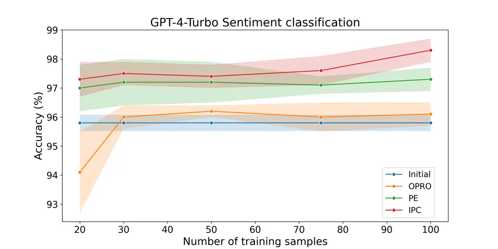

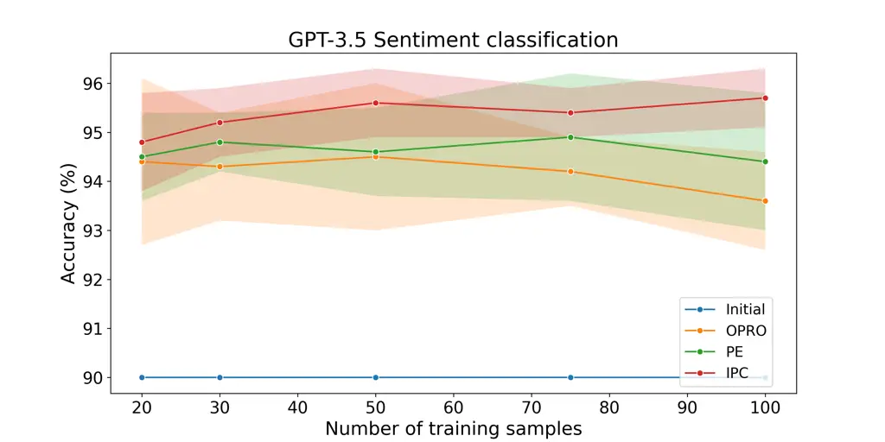

Figure 7: Accuracy on the sentiment classification task, with respect to
different numbers of training steps. IPC outperforms other tested
methods, and results in lower variance.

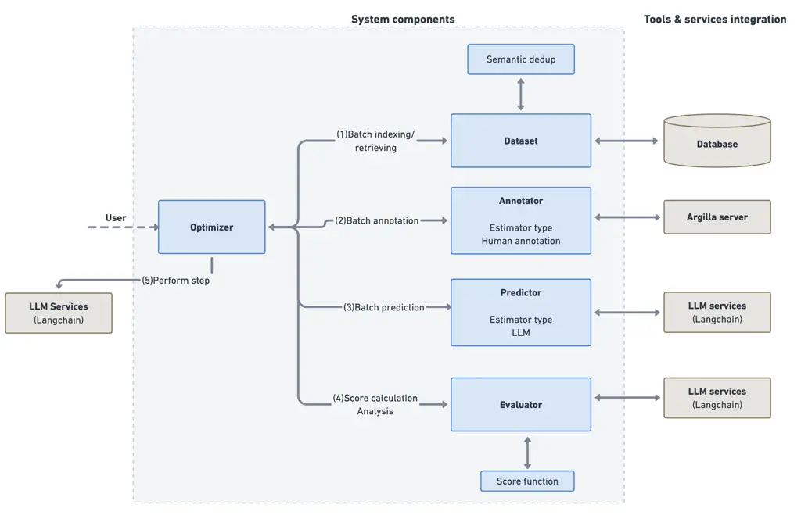

Figure 8: Architecture overview.
