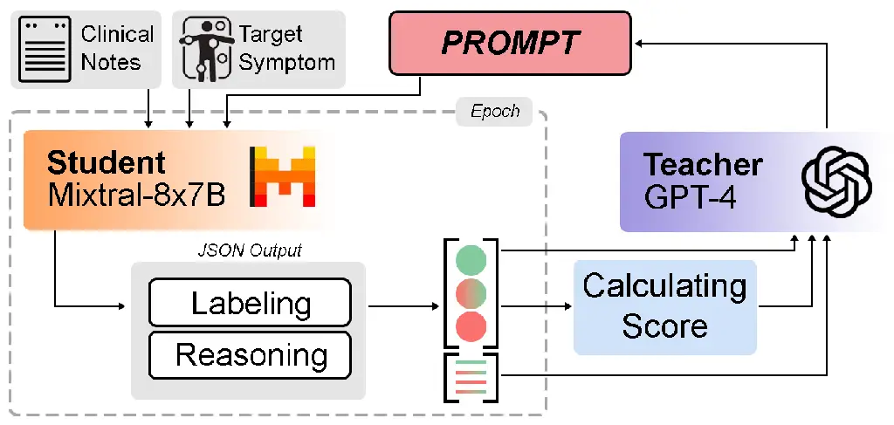
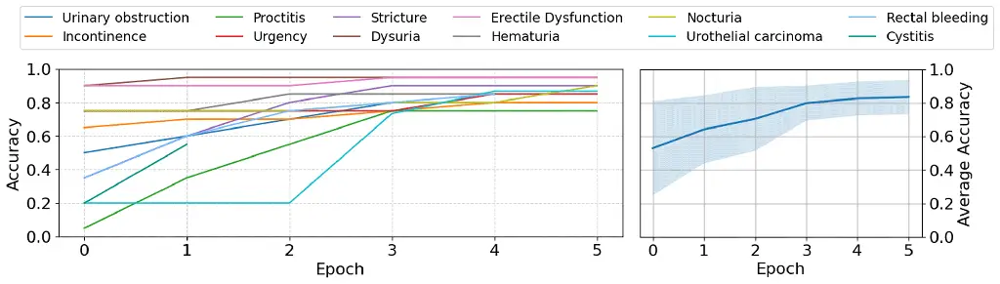

# Iterative Prompt Refinement for Radiation Oncology Symptom Extraction Using Teacher-Student Large Language Models

Reza Khanmohammadi Affiliation: Department of Computer Science and
Engineering, Michigan State University, East Lansing, USA    Ahmed I
Ghanem Affiliation: Department of Radiation Oncology, Henry Ford Cancer
Institute, Detroit, USA Affiliation: Alexandria Department of Clinical
Oncology, Alexandria University, Egypt    Kyle Verdecchia Affiliation:
Department of Radiation Oncology, Henry Ford Cancer Institute, Detroit,
USA    Ryan Hall Affiliation: Department of Radiation Oncology, Henry
Ford Cancer Institute, Detroit, USA    Mohamed Elshaikh Affiliation:
Department of Radiation Oncology, Henry Ford Cancer Institute, Detroit,
USA     
Benjamin Movsas Affiliation: Department of Radiation Oncology, Henry
Ford Cancer Institute, Detroit, USA    Hassan Bagher-Ebadian
Affiliation: Department of Radiation Oncology, Henry Ford Cancer
Institute, Detroit, USA Affiliation: Departments of Radiology and
Osteopathic Medicine, Michigan State University, East Lansing, USA
Affiliation: Department of Physics, Oakland University, Rochester, USA
   Indrin Chetty Affiliation: Department of Radiation Oncology, Cedars
Sinai Medical Center, Los Angeles, USA Affiliation: Department of
Physics, Oakland University, Rochester, USA    Mohammad M. Ghassemi
^(†)^(†)thanks: Shared senior author. Affiliation: Department of
Computer Science and Engineering, Michigan State University, East
Lansing, USA    Kundan Thind\* Affiliation: Department of Radiation
Oncology, Henry Ford Cancer Institute, Detroit, USA Affiliation:
Department of Medicine, Michigan State University, East Lansing, USA

|                                                                                                                                                                                                                                                                                                                                                                                                                                                                                                                                                                                                                                                                                                                                                                                                                                                                                                                                                                                                                          |
| ------------------------------------------------------------------------------------------------------------------------------------------------------------------------------------------------------------------------------------------------------------------------------------------------------------------------------------------------------------------------------------------------------------------------------------------------------------------------------------------------------------------------------------------------------------------------------------------------------------------------------------------------------------------------------------------------------------------------------------------------------------------------------------------------------------------------------------------------------------------------------------------------------------------------------------------------------------------------------------------------------------------------ |
| Abstract This study introduces a novel teacher-student architecture utilizing Large Language Models (LLMs) to improve prostate cancer radiotherapy symptom extraction from clinical notes. Mixtral, the student model, initially extracts symptoms, followed by GPT-4, the teacher model, which refines prompts based on Mixtral’s performance. This iterative process involved 294 single symptom clinical notes across 12 symptoms, with up to 16 rounds of refinement per epoch. Results showed significant improvements in extracting symptoms from both single and multi-symptom notes. For 59 single symptom notes, accuracy increased from 0.51 to 0.71, precision from 0.52 to 0.82, recall from 0.52 to 0.72, and F1 score from 0.49 to 0.73. In 375 multi-symptom notes, accuracy rose from 0.24 to 0.43, precision from 0.6 to 0.76, recall from 0.24 to 0.43, and F1 score from 0.20 to 0.44. These results demonstrate the effectiveness of advanced prompt engineering in LLMs for radiation oncology use. |

## 1 Introduction

The development of Large Language Models (LLMs) has marked a
transformative era in the field of Artificial Intelligence (AI). These
advanced models, built on the foundation of extensive data and
sophisticated algorithms, have demonstrated remarkable capabilities in
understanding and generating human-like text. In the medical domain,
specialized versions of these models such as Med-PaLM 2 \[1\] and
HuatuoGPT \[2\] have been tailored to understand and process medical
terminology, patient data, and clinical notes. This focus on healthcare
has enabled LLMs to assist in diagnostic processes, treatment
recommendation, and patient care, thereby revolutionizing the
intersection of AI and medicine \[3\]. The ability of these models to
handle vast and complex datasets has been pivotal in uncovering insights
and augmenting the decision-making process in healthcare \[4\]. However,
the effectiveness of LLMs in specialized areas like cancer text analysis
is often limited by the availability of relevant training data. Since
these models learn and evolve based on the data they are exposed to
\[5\], their performance in domains with scarce publicly available data,
such as specific cancer-related texts, can be suboptimal \[6, 7\].
Further, a major challenge for LLMs in specialized domains is the lack
of effective prompt engineering, which is essential for enhancing their
performance. Prompt engineering is a process that involves iterative
refinement of the input and output formats, as well as the incorporation
of domain knowledge and terminology. This process can facilitate LLMs to
supplement embedded information in specific domains, and thus increase
their applicability and effectiveness in niche fields such as oncology
\[8\]. Recent studies have demonstrated the efficacy of prompt
engineering in improving domain-specific inference. Wang et al. \[9\]
showed that combining prompt engineering with paraphrases of rare
biomedical words can significantly enhance the performance of
pre-trained models in the biomedical domain. Similarly, Alsentzer et al.
\[10\] utilized a large language model for zero-shot interpretable
phenotyping of postpartum hemorrhage from clinical notes, highlighting
the model’s strong performance in extracting granular concepts
associated with the condition. These examples underscore the potential
of prompt engineering to refine the capabilities of LLMs in specialized
medical tasks, offering a promising avenue for the systematic
abstraction of critical concepts in fields such as radiation oncology.

Figure 1: Schematic representation of our proposed method.

Traditional methodologies in prompt refinement have varied, with some
relying on manual tuning by experts, while others explore automated
techniques. However, these methods often require a balance between human
input, computational resources, and specific task requirements \[11\].
This balance is especially crucial in medical text analysis, where
precision and context-specific accuracy are paramount. Recent
advancements have been observed in the domain of radiation oncology,
particularly in the extraction of key concepts from clinical notes,
including the identification of toxicity \[12, 13\]. Consequently, the
development of prompt engineering methodologies for the extraction of
key concepts in radiation oncology offers the potential to facilitate
large-scale, systematic abstraction of critical concepts in this field.

We introduce a novel, automatic framework for prompt refinement, using a
teacher-student dynamic between two LLMs: GPT-4 as the teacher and
Mixtral as the student. This novel architecture is shown in Figure 1.
This approach is especially pertinent in the clinical domain for key
concept extraction, which is reliant on domain specific knowledge. We
demonstrate the application of this architecture with prostate cancer
radiotherapy toxicity symptom extraction from clinical notes.

## 2 Materials and Methods

The architecture employs a novel teacher-student framework designed to
iteratively refine the prompts used by LLMs for prostate cancer
radiotherapy toxicity symptom extraction from clinical notes. The
student model, Mixtral, is tasked with the initial extraction of
symptoms based on provided prompts. The teacher model, GPT-4,
subsequently refines these prompts in a series of rounds and epochs
based on the student’s performance and reasoning.

The student model, Mixtral-8x7B, operates as the primary extractor of
symptoms from the clinical notes. Given a prompt and a target symptom,
it classifies the symptom as present, negated, or unknown within the
notes. The model’s output for each note includes the symptom
classification and a reasoning for its decision.

The teacher model GPT-4, receives inputs from the student model’s
performance across all training notes for a given symptom. These inputs
include:

- •
  Optimal Prompt: The prompt that has led to the highest level of
  accuracy in the student’s symptom classification.
- •
  Peak Performance: The student model’s best classification accuracy
  acquired on the optimal prompt.
- •
  Decision-making Reasoning: Insights into the reasoning behind the
  student model’s classification tied to the optimal prompt.
- •
  Failed Prompt History: A list of prompts previously tested within the
  current epoch, which have yielded inferior results compared to the
  optimal prompt.

Using these inputs, GPT-4 generates refined prompts intended to improve
the student’s performance in symptom extraction. This refinement process
occurs through a sequence of rounds and epochs.

Full optimization encompasses a series of epochs, each consisting of 16
rounds. In every epoch, the teacher model iteratively refines prompts to
improve the student model’s symptom extraction performance. At each
epoch’s start, the teacher is updated with the optimal prompt and peak
performance metrics from the previous epoch where it has 16
opportunities (one per round) to refine the prompt and exceed the
student’s current best performance, measured by accuracy. If, in any of
the 16 rounds, the teacher model enhances the student’s performance
beyond its prior peak, the epoch concludes, and the process advances to
the next epoch where the teacher is granted a reset of 16 refinement
opportunities. The refinement process terminates if the teacher model
fails to improve the student’s performance in all 16 rounds of an epoch,
signaling the achievement of the student’s maximum capability within the
framework’s parameters.

|                  |                      |          |           |          |          |          |                     |          |          |          |           |          |          |          |          |          |
| ---------------- | -------------------- | -------- | --------- | -------- | -------- | -------- | ------------------- | -------- | -------- | -------- | --------- | -------- | -------- | -------- | -------- | -------- |
| Symptom          | Single-symptom Notes |          |           |          |          |          | Multi-symptom Notes |          |          |          |           |          |          |          |          |          |
|                  | Accuracy             |          | Precision |          | Recall   |          | F1                  |          | Accuracy |          | Precision |          | Recall   |          | F1       |          |
|                  | Init.                | Post.    | Init.     | Post.    | Init.    | Post.    | Init.               | Post.    | Init.    | Post.    | Init.     | Post.    | Init.    | Post.    | Init.    | Post.    |
| Urgency          | $`0.80`$             | 1.00     | $`0.87`$  | 1.00     | $`0.80`$ | 1.00     | $`0.80`$            | 1.00     | $`0.37`$ | 0.52     | $`0.72`$  | 0.69     | $`0.37`$ | 0.52     | $`0.27`$ | 0.49     |
| Cystitis         | $`0.40`$             | 0.60     | $`0.80`$  | 0.90     | $`0.40`$ | 0.60     | $`0.53`$            | 0.67     | $`0.04`$ | 0.38     | $`0.27`$  | 0.78     | $`0.04`$ | 0.38     | $`0.06`$ | 0.49     |
| Urinary Obs.     | $`0.40`$             | 0.80     | $`0.16`$  | 0.67     | $`0.40`$ | 0.80     | $`0.23`$            | 0.72     | $`0.01`$ | 0.12     | 0.98      | $`0.97`$ | $`0.01`$ | 0.12     | $`0.01`$ | 0.19     |
| Dysuria          | $`0.80`$             | 0.80     | $`0.65`$  | 0.70     | $`0.80`$ | 0.80     | $`0.71`$            | 0.73     | $`0.56`$ | 0.62     | $`0.43`$  | 0.67     | $`0.56`$ | 0.62     | $`0.44`$ | 0.61     |
| Erectile Dys.    | 1.00                 | $`0.80`$ | $`1.00`$  | 1.00     | 1.00     | $`0.80`$ | 1.00                | $`0.89`$ | 0.26     | $`0.21`$ | $`0.38`$  | 0.62     | 0.26     | $`0.21`$ | 0.19     | $`0.12`$ |
| Rectal Bleed.    | $`0.00`$             | 0.20     | $`0.00`$  | 0.20     | $`0.00`$ | 0.20     | $`0.00`$            | 0.20     | $`0.16`$ | 0.57     | $`0.16`$  | 0.76     | $`0.17`$ | 0.57     | $`0.10`$ | 0.58     |
| Stricture        | $`0.40`$             | 1.00     | $`0.16`$  | 1.00     | $`0.40`$ | 1.00     | $`0.23`$            | 1.00     | $`0.04`$ | 0.15     | 0.96      | $`0.83`$ | $`0.04`$ | 0.15     | $`0.02`$ | 0.20     |
| Nocturia         | 1.00                 | $`0.80`$ | 1.00      | $`0.64`$ | 1.00     | $`0.80`$ | 1.00                | $`0.71`$ | $`0.30`$ | 0.34     | $`0.28`$  | 0.75     | $`0.30`$ | 0.34     | $`0.25`$ | 0.30     |
| Proctitis        | $`0.00`$             | 0.20     | $`0.00`$  | 0.80     | $`0.00`$ | 0.20     | $`0.00`$            | 0.32     | $`0.01`$ | 0.20     | $`0.74`$  | 0.77     | $`0.01`$ | 0.20     | $`0.02`$ | 0.32     |
| Hematuria        | $`0.60`$             | 0.60     | $`0.80`$  | 1.00     | $`0.60`$ | 0.60     | $`0.57`$            | 0.70     | $`0.72`$ | 0.76     | $`0.63`$  | 0.75     | $`0.72`$ | 0.76     | $`0.66`$ | 0.71     |
| Urothelial Carc. | $`0.00`$             | 1.00     | $`0.00`$  | 1.00     | $`0.00`$ | 1.00     | $`0.00`$            | 1.00     | $`0.05`$ | 0.70     | $`0.99`$  | 0.99     | $`0.05`$ | 0.70     | $`0.08`$ | 0.81     |
| Incontinence     | $`0.80`$             | 0.80     | $`0.87`$  | 0.87     | $`0.80`$ | 0.80     | $`0.80`$            | 0.80     | $`0.39`$ | 0.53     | $`0.64`$  | $`0.58`$ | $`0.39`$ | 0.53     | $`0.30`$ | 0.51     |
| Average Score    | $`0.51`$             | 0.71     | $`0.52`$  | 0.82     | $`0.51`$ | 0.71     | $`0.49`$            | 0.73     | $`0.24`$ | 0.43     | $`0.60`$  | 0.76     | $`0.24`$ | 0.43     | $`0.20`$ | 0.44     |

Table 1: Symptom extraction test results: Initial (Init.) vs
Post-refinement (Post)

0:  Target symptom, Initial prompt, MaxEpochs, MaxRounds

1:  Initialize Mixtral-8x7B (student model) with initial prompts

2:  Initialize GPT-4 (teacher model)

3:  Set best performance metric to 0

4:  Set optimal prompt to initial prompt for the symptom

5:  for epoch = 1 to MaxEpochs do

6:   for round = 1 to MaxRounds do

7:    Apply current optimal prompt to the student model across all
clinical notes

8:    Gather labels and reasonings

9:    Calculate performance score

10:    if performance improves over best performance then

11:     Update best performance and optimal prompt

12:     Break and proceed to the next epoch

13:    end if

14:    Use the teacher model to refine the optimal prompt based on:

- •
  Current optimal prompt
- •
  Best performance metrics
- •
  Reasoning of the student model
- •
  History of failed prompts

15:   end for

16:   if no improvement in any of the 16 rounds then

17:    Terminate refinement for the symptom

18:   end if

19:  end for

Algorithm 1 Iterative Prompt Refinement for Symptom Extraction on a
target symptom

The data consisted of clinical notes from a cohort of prostate cancer
patients treated with a radiotherapy (RT) dose of 78 Gy between 2013 and 2020. Clinical notes 6 months post-RT were extracted to focus on long
term toxicities. 294 notes with presence of single symptoms were
selected. Twelve common post-RT toxicity symptoms: Urgency, Cystitis,
Urinary Obstruction, Dysuria, Erectile Dysfunction, Rectal Bleeding,
Stricture, Nocturia, Proctitis, Hematuria, Urothelial Carcinoma, and
Incontinence were selected. For the training set, we utilized 20 notes
per symptom, except for Urothelial Carcinoma, where only 15 notes were
available. Correspondingly, the test set comprised 5 notes for each
symptom, with the exception of Urothelial Carcinoma, which had 4. These
notes were labelled with symptom assignment of -1, 0, or 1, signifying
its absence, unknown status, or presence, respectively. A separate
cohort of 375 clinical notes with multiple symptom within each note were
also labelled and used exclusively for validation. Multi-symptom notes
ranged from 1 to 10 for the number of distinct symptom mention in each
notes, with an average of 5 symptoms mentions per mutli-symptom note.
This comprehensive dataset structure and labeling approach provided a
robust foundation for evaluating the architecture performance,
particularly in demonstrating its scalability and effectiveness in
handling complex, multi-symptom clinical notes. Use of clinical notes,
and the overall study was reviewed and approved by the institutional
review board.

The evaluation methodology utilized accuracy as the primary metric for
assessing the student model’s performance during the prompt refinement
process. To measure the effectiveness of these refined prompts compared
to the initial ones, we employed accuracy along with weighted precision,
recall, and F1 scores on the test set. These metrics provided a
comprehensive view of the refined prompts’ performance enhancements over
the initial versions. You can find the algorithmic implementation of our
method in Algorithm 1.

## 3 Results

Figure 2: The evolution of Mixtral’s symptom extraction accuracy per
different symptoms at different epochs.

Table 1, summarizes accuracy, precision, recall and F1 scores on both
single symptom notes, and multi-symptom notes. Initial and
post-refinement refinement results are presented for both categories,
with initial performance metrics based on the the initial prompt, and
post-refinement performance based on optimized prompt. Improvements
across all evaluation metrics is observed. Highlighted entries show
performance improvement from initial to post-refined extraction. For
single symptom notes, a strong performance increase is observed across
all metrics. The average improvement in accuracy from 0.51 to 0.71,
precision from 0.52 to 0.82, recall from 0.52 to 0.72, and F1 from 0.49
to 0.73 is observed in single symptom notes. Noteworthy improvements
include the symptom "Urgency," where accuracy soared from 0.80 to a
perfect 1.00, and precision mirrored this perfect score. Similarly,
"Stricture" and "Urothelial Carcinoma" witnessed accuracy enhancements
from 0.40 and 0.00 to 1.00, respectively. Performance improvement across
all metrics was observed for multi-symptom notes, with average
improvement in accuracy from 0.24 to 0.43, precision from 0.6 to 0.76,
recall from 0.24 to 0.43 and F1 from 0.20 to 0.44. The improvement was
was not as strong as the single-symptom notes. Notable example of
"Rectal Bleeding," showcased an increase in accuracy from 0.16 to 0.57
and an F1 score increase from 0.10 to 0.58.

Figure 2 depicts the progression of Mixtral’s symptom extraction
accuracy across different symptoms over successive epochs, as well as
the average and standard deviation of symptom accuracy per epoch. A
clear trend of improvement is observed in nearly all symptoms as the
number of epochs increases, illustrating the efficacy of our prompt
refinement process. Notably, symptoms such as "Urothelial Carcinoma" and
"Proctitis" show a remarkable upward trajectory, indicating significant
gains from the iterative approach. This demonstrates adaptive learning
capabilities of this novel architecture.

## 4 Discussion

This novel student LLM-teacher LLM architecture demonstrates performance
improvement in accuracy, precision, recall and F1 scores for prostate
cancer RT symptoms. This novel architecture makes contribution in the
following key areas:

- •
  Automatic Prompt Engineering This automated method for refining
  prompts using a teacher-student combination of two LLMs, streamlines
  the traditionally manual process of prompt optimization.
- •
  Zero-Shot Learning This framework enhances LLM performance without
  additional model training, showcasing the efficiency of our zero-shot
  learning approach.
- •
  Local Model Improvement for Privacy The improvement of the student
  model is conducted locally, ensuring sensitive clinical data, like
  Protected health information (PHI), is processed securely, addressing
  major data privacy concerns in healthcare.

The performance improvement across metrics of accuracy, precision,
recall and F1 was observed for both single and multi-symptom notes. The
prompt-optimization was performed on single symptom notes, and applied
across test set of single symptom notes, and multi-symptom notes. This
could potentially have contributed to inferior performance improvement
in multi-symptom notes. Limited sample size of single symptom notes
utilized for optimization may potentially have resulted in over fitting.
Higher sample size for optimization, both single and multi-symptom could
potentially further improve robustness, and the performance.
Hyperparameter selection for both student and teacher models can also
have a significant impact on the overall optimization process.
Repetition studies were performed to tune hyperparameters of student
model to ensure absolute consistency in response over three repetitions.
As such, low temperature (0.2) and top_p (0.1) were utilized for the
student model, and high temperature (2) and top_p (0.9) were used for
the teacher model in this architecture. This may have limitations and
further experimentation may lead to better results.

## 5 Conclusion

In conclusion, this novel architecture presents a pathway for
self-optimized local LLM agents that can extract key concepts in medical
notes with a zero shot learning approach. The complete local inference
by the student model is suitable for protecting privacy of healthcare
data. This system provides proof-of-concept in the research setting, and
is promising for the potential of natural language processing methods to
support clinical care.

## References

- \[1\] Karan Singhal et al. “Towards Expert-Level Medical Question
  Answering with Large Language Models”, 2023 arXiv:[2305.09617
  \[cs.CL\]](https://arxiv.org/abs/2305.09617)
- \[2\] Hongbo Zhang et al. “HuatuoGPT, towards Taming Language Model to
  Be a Doctor”, 2023 arXiv:[2305.15075
  \[cs.CL\]](https://arxiv.org/abs/2305.15075)
- \[3\] Mert Karabacak and Konstantinos Margetis “Embracing Large
  Language Models for Medical Applications: Opportunities and
  Challenges” In _Cureus_ 15, 2023, pp. e39305 DOI:
  [10.7759/cureus.39305](https://dx.doi.org/10.7759/cureus.39305)
- \[4\] Niloufar Eghbali, Daniel Siegal, Chad Klochko and Mohammad
  Ghassemi “Automation of Protocoling Advanced MSK Examinations Using
  Natural Language Processing Techniques” In _AMIA Joint Summits on
  Translational Science proceedings. AMIA Joint Summits on Translational
  Science_ 2023, 2023, pp. 118–127
- \[5\] Mehrsa Mardikoraem, Zirui Wang, Nathaniel Pascual and Daniel
  Woldring “Generative models for protein sequence modeling: recent
  advances and future directions” In _Briefings in Bioinformatics_ 24.6,
  2023, pp. bbad358 DOI:
  [10.1093/bib/bbad358](https://dx.doi.org/10.1093/bib/bbad358)
- \[6\] Reza Khanmohammadi et al. “An Introduction to Natural Language
  Processing Techniques and Framework for Clinical Implementation in
  Radiation Oncology”, 2023 arXiv:[2311.02205
  \[cs.CL\]](https://arxiv.org/abs/2311.02205)
- \[7\] Danial Kamali et al. “Using Persuasive Writing Strategies to
  Explain and Detect Health Misinformation”, 2023 arXiv:[2211.05985
  \[cs.CL\]](https://arxiv.org/abs/2211.05985)
- \[8\] Bertalan Meskó “Prompt Engineering as an Important Emerging
  Skill for Medical Professionals: Tutorial” In _Journal of Medical
  Internet Research_ 25, 2023, pp. e50638 DOI:
  [10.2196/50638](https://dx.doi.org/10.2196/50638)
- \[9\] Haochun Wang et al. “Prompt Combines Paraphrase: Teaching
  Pre-trained Models to Understand Rare Biomedical Words” In
  _Proceedings of the 29th International Conference on Computational
  Linguistics_ Gyeongju, Republic of Korea: International Committee on
  Computational Linguistics, 2022, pp. 1422–1431 URL:
  [https://aclanthology.org/2022.coling-1.122](https://aclanthology.org/2022.coling-1.122)
- \[10\] Emily Alsentzer et al. “Zero-shot Interpretable Phenotyping of
  Postpartum Hemorrhage Using Large Language Models” In _medRxiv_ Cold
  Spring Harbor Laboratory Press, 2023 DOI:
  [10.1101/2023.05.31.23290753](https://dx.doi.org/10.1101/2023.05.31.23290753)
- \[11\] Banghao Chen, Zhaofeng Zhang, Nicolas Langrené and Shengxin Zhu
  “Unleashing the potential of prompt engineering in Large Language
  Models: a comprehensive review”, 2023 arXiv:[2310.14735
  \[cs.CL\]](https://arxiv.org/abs/2310.14735)
- \[12\] Miller. Bitterman Durbin “An End-to-End Natural Language
  Processing System for Automatically Extracting Radiation Therapy
  Events From Clinical Texts” In _Int J Radiat Oncol Biol Phys._ 117.3,
  2023, pp. 262–273 DOI:
  [10.1016/j.ijrobp.2023.03.055](https://dx.doi.org/10.1016/j.ijrobp.2023.03.055)
- \[13\] Julian Hong et al. “Natural language processing for abstraction
  of cancer treatment toxicities: accuracy versus human experts” In
  _JAMIA Open_ 3.4, 2020, pp. 513–517 DOI:
  [10.1093/jamiaopen/ooaa064](https://dx.doi.org/10.1093/jamiaopen/ooaa064)
