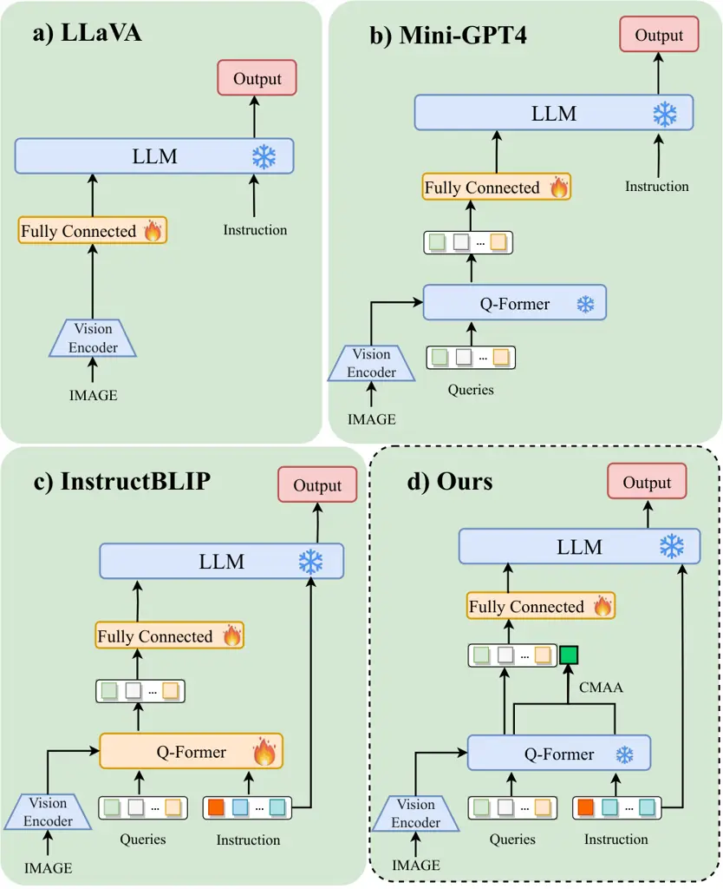
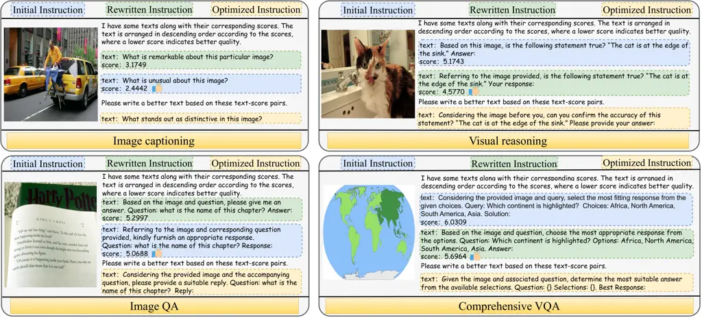
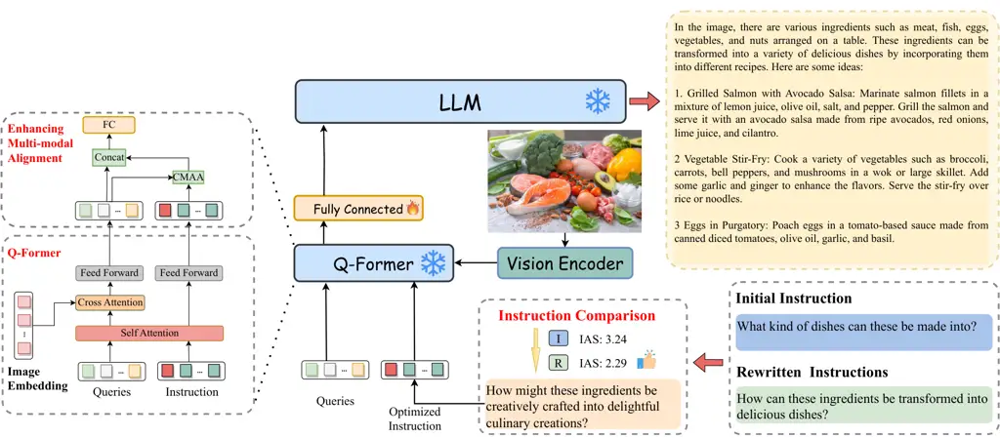
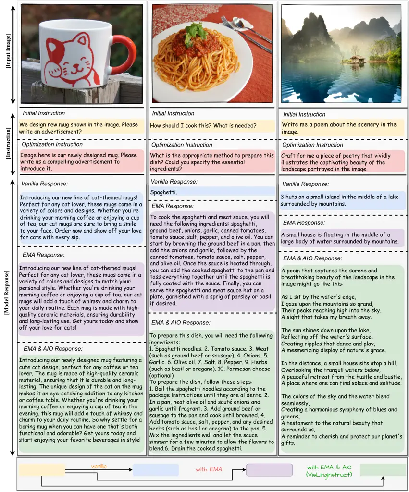
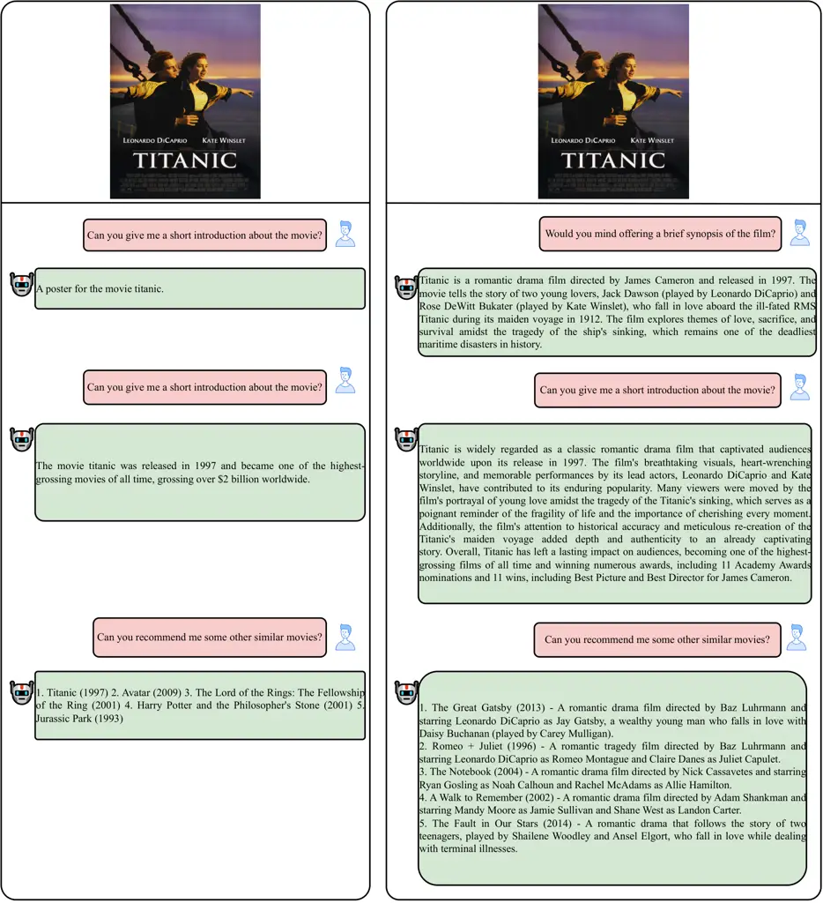
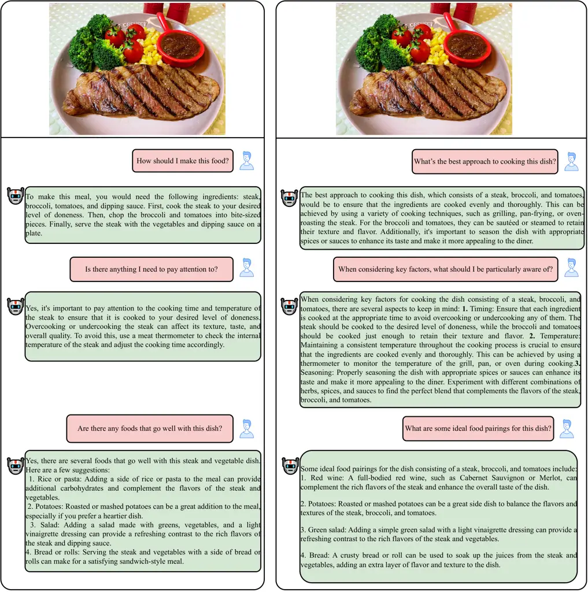

# VisLingInstruct: Elevating Zero-Shot Learning in Multi-Modal Language Models with Autonomous Instruction Optimization

Dongsheng Zhu Affiliation:  Baidu Inc.
Email: [zhudongsheng@baidu.com](mailto:)    Xunzhu Tang Affiliation: 
University of Luxemburg Email: [yindawei02@baidu.com](mailto:)   
Weidong Han Affiliation:  Fudan University
Email: [xunzhu.tang@uni.lu](mailto:)    Jinghui Lu Affiliation: 
University College Dublin Email: [wdhan20@fudan.edu.cn](mailto:)   
Yukun Zhao Affiliation:  Baidu Inc.    Guoliang Xing Affiliation:  Baidu
Inc.    Junfeng Wang Affiliation:  Baidu Inc.    Dawei Yin^(\*)
Affiliation:  Baidu Inc.

###### Abstract

This paper presents VisLingInstruct, a novel approach to advancing
Multi-Modal Language Models (MMLMs) in zero-shot learning. Current MMLMs
show impressive zero-shot abilities in multi-modal tasks, but their
performance depends heavily on the quality of instructions.
VisLingInstruct tackles this by autonomously evaluating and optimizing
instructional texts through In-Context Learning, improving the synergy
between visual perception and linguistic expression in MMLMs. Alongside
this instructional advancement, we have also optimized the visual
feature extraction modules in MMLMs, further augmenting their
responsiveness to textual content. Our comprehensive experiments on
MMLMs, based on FlanT5 and Vicuna, show that VisLingInstruct
significantly improves zero-shot performance in visual multi-modal
tasks. Notably, it achieves a 13.1% and 9% increase in accuracy over the
prior state-of-the-art on the TextVQA and HatefulMemes datasets. Our
main code is available at
[https://github.com/Zhudongsheng75/VisLingInstruct](https://github.com/Zhudongsheng75/VisLingInstruct).

^(\*)^(\*)footnotetext: Corresponding author

## 1 Introduction

The integration of Large Language Models (LLMs) with vision or other
multi-modalities, epitomized by models like BLIP-2 (Chen et al., 2022;
Alayrac et al., 2022; Li et al., 2023), has marked a significant
evolution in the Natural Language Processing (NLP) field. This
advancement led to the emergence of Multi-Modal Language Models (MMLMs),
blending visual and linguistic data processing to enhance complex
multimodal information understanding and generation. InstructBLIP Dai
et al. (2023), a notable example, utilizes advanced instruction tuning
for image-text pairs, significantly improving the Q-Former module’s
zero-shot learning capabilities in a variety of vision-language tasks.
This progression underscores the potential of MMLMs in navigating the
intricacies of multi-modal data, setting a new benchmark in the
intersection of language, vision, and machine learning.

However, the effectiveness of MMLMs is highly constrained by the quality
of textual instructions. Current instruction-tuned models (Ouyang
et al., 2022; Zheng et al., 2023b) are effective, while they may
introduce significant challenges, particularly for users who lack
expertise in crafting optimal instructions. This limitation leads to
inconsistent or sub-optimal outputs, thus impeding the practical utility
of MMLMs in the real world scenarios. To mitigate this issue, we propose
a novel autonomous optimization method for textual instruction, named
Visual, Linguistic, Instruction optimization (VisLingInstruct). The
VisLingInstruct introduces an innovative method via In-Context Learning
(ICL) Min et al. (2022) based on the comparison between instruction
cases. We incorporate it with our newly proposed Instruction Alignment
Score (IAS) to exploit the inherent capacity of MMLMs to self-evaluate
the quality of text instructions. Consequently, VisLingInstruct can
guide the model towards the generation of more effective and
contextually appropriate instructions.

Complementing our instructional optimization strategy, we present an
architectural innovation aimed at enhancing the alignment between visual
and textual modules within MMLMs. Inspired by recent advancements in
models such as Mini-GPT4 (Zhu et al., 2023), LLaVA (Liu et al., 2023b),
mPLUG-Owl (Ye et al., 2023), and BLIVA Hu et al. (2023), our
architecture enhances the integration of textual and visual data. Our
new approach enables MMLMs to more effectively process complex tasks
that require an understanding of both textual and visual elements,
thereby improving accuracy and contextual understanding. Figure 1 offers
a visual comparison of the alignment modules in different MMLMs,
highlighting the distinctive features and benefits of our proposed
method. Through this architectural enhancement, we aim to bridge the
existing gaps in multi-modal data processing, creating a more cohesive
and efficient model capable of tackling the nuanced demands of
multi-modal interactions.

In summary, our contributions are as follows:

- •
  We introduce substantial architectural improvements for better
  integration of multi-modal data within MMLMs for training and
  inference (Section 3.1).
- •
  We present an autonomous method for optimizing instruction quality,
  tailored to improve the effectiveness of textual instruction during
  inference (Section 3.2). To the best of our knowledge, we spearhead
  the manual-free optimization of textual instruction in zero-shot for
  multi-modal tasks.
- •
  We conduct comprehensive experiments and ablation studies to
  demonstrate the effectiveness of VisLingInstruct and the success of
  each component. Notably, VisLingInstruct has improved the performance
  by a significant margin of 13.1% and 9% on the TextVQA and
  HatefulMemes dataset.

## 2 Related Work

### 2.1 Instruction Tuning in MMLMs

Instruction tuning has emerged as a cost-effective alternative to the
expensive pre-training of large models, focusing on fine-tuning a few
foundational models for downstream tasks. In this context, models like
InstructGPT (Ouyang et al., 2022), Flan-T5 (Chung et al., 2022), and
Vicuna (Zheng et al., 2023b) represent significant strides in
conversational models obtained through instruction tuning based on LLMs.
These models have showcased exceptional question-answering capabilities,
underscoring the importance of instruction-based approaches in language
generation. In the multi-modal domain, advancements such as Mini-GPT4
(Zhu et al., 2023), LLaVA (Liu et al., 2023b), mPLUG-Owl (Ye et al.,
2023), InstructBLIP (Dai et al., 2023), and BLIVA Hu et al. (2023) have
focused on instruction fine-tuning. These methods typically involve
aligning images and text by introducing transitional layers, like
Q-Former and fully connected layers, between visual encoders and LLMs.
Our work builds upon these foundations, aiming to further optimize the
instruction tuning process for enhanced performance in MMLMs.



Figure 1: The structural comparison among the alignment modules of
different MMLMs. The orange modules in the figure represent open
weights, while the blue modules indicate frozen weights.



Figure 2: The examples of ranking with ICL in different domains. On the
left side is the image input provided to the MMLM. On the right side,
within the blue box, lies the initial instruction, while the rewritten
instruction is contained within the green box. The ‘score’, referred to
as IAS, indicates the quality of corresponding instructions with respect
to the model, while the lower score (i.e., high quality) instruction
ranks lower in the ICL demonstration. By utilizing the paradigm of ICL,
MMLM learn the relationship between the scores of the two cases to
generate higher-quality new instructions that lie in the yellow box.

### 2.2 Optimizing Instructions for Large Models

Historically, Pre-trained Language Models (PLM) akin to BERT (Kenton and
Toutanova, 2019) have utilized prompt crafting techniques Brown et al.
(2020); Jiang et al. (2022) to boost performance, with subsequent
research exploring methods to discover higher-quality prompts Gao et al.
(2021); Lu et al. (2023). In generative models, this concept has evolved
into optimizing ‘instructions’, leading to a series of works focused on
prompt and instruction optimization Wei et al. (2022); Min et al.
(2022). Notably, UPRISE Cheng et al. (2023) trained a prompt retriever
for acquiring superior instructions, while OPRO Yang et al. (2023)
conceptualized LLMs as optimizers, formulating optimization tasks in
textual instructions. Zheng et al. (2023a) introduced STEP-BACK
prompting, enabling LLMs to derive higher-level concepts from detailed
instances.

## 3 Methods

Our approach comprises two components: First, we refine the architecture
of existing multi-modal models and their fine-tuning mechanisms to
augment their perceptivity of instruction, that is, the Enhanced
Multi-modal Alignment (EMA). Second, subsequent to the model’s
fine-tuning, we concentrate on the autonomous optimization of
instructions during the inference, referred to as the Autonomous
Instruction Optimization (AIO).

### 3.1 Enhancing Multi-modal Alignment

In the quest to refine MMLM, our focus shifts to bridging the gap
between the realms of visual perception and linguistic expression. This
section delves into our approach to enhancing the alignment between
visual and textual modules within MMLM, introducing the architectural
innovation and training optimization designed to synergize these two
distinct modalities seamlessly.

Integrative Processing of Text and Image: At the core of our
architectural enhancements is the integrative processing of textual and
visual data. The process involves constructing a unified representation
by merging detailed textual embeddings with rich visual information. We
introduce the Cross-Modal Alignment Attention (CMAA) algorithm to
achieve this integration, specifically designed to harmonize these
disparate data modalities. CMAA leverages attention mechanisms Bahdanau
et al. (2014) and cross-modal feature fusion Radford et al. (2021);
Alayrac et al. (2022), to ensure that the resulting multi-modal
representation encapsulates both the intricacies of language and the
details of visual content:

```math
U_{mm}=\sum_{i=1}^{N}\text{softmax}(\text{emb}_{\text{vis}}\cdot\text{emb}_{\text{text}}^{T})\cdot\text{emb}_{\text{text}}(i) \tag{1}
```

where $`\text{emb}_{\text{text}}(i)`$ and $`\text{emb}_{\text{vis}}(i)`$
represent the embedding of the textual instruction and Queries for the
$`i`$-th element respectively. Simultaneously,
$`\text{emb}_{\text{text}}(i)`$ serves as both the key (K) and value (V)
in traditional attention mechanism, while $`\text{emb}_{\text{vis}}(i)`$
functions as the query (Q). The textual instruction, after undergoing
CMAA, transforms into $`U_{mm}`$. Subsequently, $`U_{mm}`$ concatenate
onto the output of Queries in the form of Figure 1, culminating in the
final integration of visual and textual elements. Detailed information
about CMAA can be referred to in Appendix A.1.



Figure 3: The figure depicts the complete pipeline of Instruction
Comparison Optimization. The initial and rewritten instructions are
processed through comparison optimization to generate optimized
instruction. Subsequently, the optimized instruction is utilized for
generation in MMLMs.

Optimized Model Training and Performance: In developing the new
architecture, our approach extends beyond mere technical integration to
encompass optimization of training and performance. We employ selective
weight freezing strategy, where specific layers of the pre-trained model
are kept static to preserve learned features, and targeted fine-tuning,
where newly introduced components or layers are specifically trained to
adapt to the task at hand. This targeted approach allows us to fine-tune
the model’s performance without the need for extensive retraining Hu
et al. (2021), thereby enhancing the learning efficiency and ensuring
the robustness and scalability of the model Toneva et al. (2018); Zhai
et al. (2023). The objective function for training takes the following
form:

```math
p(\text{Y}_{text}|\text{X}_{img})=\prod_{i=1}^{L}p_{\theta}(y_{i}|\text{X}_{img},\text{Y}_{text}^{[1:i-1]}) \tag{2}
```

where $`\theta`$ is the trainable parameters, $`\text{X}_{img}`$ and
$`\text{Y}_{text}`$ respectively denote the input image and the output
text, $`\text{Y}_{text}^{[1:i-1]}`$ represents the input instruction and
the text already generated up to the $`i-1`$ step.

### 3.2 Autonomous Instruction Optimization

During inference, the textual instruction has a significant impact on
the generation results of MMLM. Therefore, we propose an approach that
leverages the inherent text processing capabilities of MMLM to
self-optimize textual instructions, thereby aligning the results more
closely with user requirements. Our method comprises two stages:
Rewriting Textual Instructions and Instruction Comparison Optimization.

Rewriting Textual Instruction: LLMs exhibit powerful text rewriting
capabilities, preserving semantic information while modifying the
content of the text. Therefore, our objective is to use the LLM in the
MMLM to rewrite the initial textual instruction. The aim is obtain a
pair of instructions that exhibit roughly equivalent semantics, thereby
establishing a solid foundation for the next stage. It is important to
note that the rewritten instruction that emerges from this process is
not necessarily expected to surpass the initial instruction in quality.
The mere occurrence of a difference between the pair is sufficient to
satisfy the requirements of subsequent processes. This setting
simplifies the text rewriting task, thereby lowering the barrier to its
implementation.

Specifically, we designed a prompt tailored for LLM to rewrite the
initial instruction. ‘Initial instruction’ refers to the original
instruction sent by the user. The prompt directs LLM on how to rewrite
the initial instruction while ensuring minimal semantic changes between
the initial and the rewritten versions. The template of the prompt used
in this stage can be referred to in the Appendix B.1. Notably, since
this stage solely involves instruction rewriting, it does not
necessitate the entire MMLM. Employing only the LLM part could
marginally decrease the time consumed by the rewriting process.

Instruction Comparison Optimization: At this stage, we devise a method
that allows the MMLM to identify the superior instruction via
comparative analysis, with the aim to generate higher-quality
instruction. As depicted in Figure 2, we innovatively apply ICL to rank
cases, enabling the model to ascertain the quality of instructions
solely through comparison between the pair of initial and rewritten
instructions Ren and Liu (2023).

Considering that the ultimate purpose of the instructions is to aid
inference by MMLM, we posit that the quality of these instructions
should be evaluated by the MMLM themselves. Specifically, we enable MMLM
to score the instruction independently, without the assistance of an
external discriminator. As such, we proposed the Instruction Alignment
Score (IAS), devised to measure the expected confidence of the
evaluation instruction under the condition of a given image. We employ a
prompt to guide MMLM in scoring the instruction. The template for this
prompt can be found in Appendix B.2. Defined as the expectation of
negative log-probability, IAS is calculated as follows:

```math
\mathrm{\mathrm{IAS}}=\mathbb{E}[-\text{log}P(t_{i}|\text{X}_{img},\text{X}_{prompt},t_{[1:i-1]};\theta)] \tag{3}
```

Here, $`\text{X}_{img}`$ is the input image, $`\text{X}_{prompt}`$
denotes the prompt employed to guide the model in its computations,
$`\theta`$ symbolizes our MMLM model and $`t_{i}`$ represents the tokens
from the textual instruction the MMLM are evaluating for quality. The
negative log-probability, which originally served as the loss function
for LLMs, is utilized in Equation 3 to assess the fluency of the given
image and instruction under the current MMLM. A lower IAS indicates a
higher alignment of the instruction with the model’s understanding,
enabling MMLM to perform better. After calculating IAS, as shown in
Figure 2, we rank the two instruction-IAS pairs in descending order, and
combine them into a prompt in the form of ICL. This is then input into
MMLM to generate an optimized instruction. The optimized instruction
will have better inference performance compared to the initial and
rewritten instructions. The complete pipeline is presented in Figure 3
and Appendix A.2.

|                                          |                  |        |                  |      |        |          |         |                   |       |      |
| ---------------------------------------- | ---------------- | ------ | ---------------- | ---- | ------ | -------- | ------- | ----------------- | ----- | ---- |
|                                          | Image Captioning |        | Visual Reasoning |      |        | Image QA |         | Comprehensive VQA |       |      |
|                                          | Flickr30K        | Nocaps | VSR              | GQA  | IconQA | VizWiz   | TextVQA | Visdial           | SciQA | HM   |
| BLIP-2 ($`\mathrm{FlanT5_{XXL}}`$)       | 73.7             | 104.5  | 68.2             | 44.6 | 45.4   | 29.4     | 44.1    | 46.9              | 64.5  | 52.0 |
| BLIP-2 ($`\mathrm{Vicuna_{13B}}`$)       | 74.9             | 107.5  | 50.9             | 41.0 | 40.6   | 19.6     | 42.5    | 45.1              | 61.0  | 53.7 |
| MiniGPT-4 ($`\mathrm{Vicuna_{13B}}`$)    | /                | /      | 50.7             | 30.8 | 37.6   | 34.8     | 18.7    | /                 | /     | 29.0 |
| LLaVA ($`\mathrm{Vicuna_{13B}}`$)        | /                | /      | 56.3             | 41.3 | 43.0   | 37.7     | 28.3    | /                 | /     | 9.2  |
| InstructBLIP ($`\mathrm{FlanT5_{XL}}`$)  | 84.5             | 119.9  | 64.8             | 48.4 | 50.0   | 32.7     | 46.6    | 46.6              | 70.4  | 56.6 |
| InstructBLIP ($`\mathrm{FlanT5_{XXL}}`$) | 83.5             | 120.0  | 65.6             | 47.9 | 51.2   | 30.9     | 46.6    | 48.5              | 70.6  | 54.1 |
| InstructBLIP ($`\mathrm{Vicuna_{7B}}`$)  | 82.4             | 123.1  | 54.3             | 49.2 | 43.1   | 34.5     | 50.1    | 45.2              | 60.5  | 59.6 |
| InstructBLIP ($`\mathrm{Vicuna_{13B}}`$) | 82.8             | 121.9  | 52.1             | 49.5 | 44.8   | 33.4     | 50.7    | 45.4              | 63.1  | 57.5 |
| BLIVA ($`\mathrm{Vicuna_{13B}}`$)        | 87.1             | /      | 62.2             | /    | 44.9   | 42.9     | 58.0    | 45.6              | /     | 55.6 |
| BLIVA ($`\mathrm{FlanT5_{XXL}}`$)        | 87.7             | /      | 68.8             | /    | 52.4   | 44.0     | 57.2    | 36.2              | /     | 50.0 |
| Ours($`\mathrm{FlanT5_{XL}}`$)           | 85.3             | 119.5  | 64.1             | 47.9 | 50.4   | 33.0     | 48.7    | 47.0              | 71.0  | 60.0 |
| Ours($`\mathrm{FlanT5_{XXL}}`$)          | 88.5             | 120.4  | 66.9             | 48.1 | 51.2   | 31.3     | 48.8    | 49.2              | 81.8  | 55.7 |
| Ours($`\mathrm{Vicuna_{7B}}`$)           | 87.9             | 124.2  | 60.1             | 52.0 | 44.2   | 42.7     | 60.6    | 45.7              | 74.6  | 62.7 |
| Ours($`\mathrm{Vicuna_{13B}}`$)          | 84.0             | 119.8  | 56.2             | 52.9 | 50.3   | 45.0     | 65.6    | 45.7              | 71.0  | 58.9 |

Table 1: Zero-shot results on general image-text benchmarks. Here,
Visdial, SciQA, and HM respectively refer to Visual Dialog, ScienceQA,
and HatefulMemes. The results for MiniGPT-4 and LLaVA are sourced from
BLIVA Hu et al. (2023), while the remaining results originate from their
respective papers Li et al. (2023); Dai et al. (2023).

## 4 Experiments

### 4.1 Datasets

The datasets in this paper primarily consists of a training dataset and
the zero-shot evaluation benchmarks. The training data is sourced from
LLaVA, which is also a subset of the InstructBLIP training datasets. The
data was collected by the authors of LLaVA using ChatGPT/GPT-4 OpenAI
(2023a); OpenAI (2023b), following a multi-modal instruction format. We
believe that using the same dataset as previous work enables a fairer
comparison in the experiments. In Appendix C.1, this paper provides more
details related to the training dataset.

For zero-shot evaluation benchmarks, to ensure alignment for comparison,
we also follow InstructBLIP. The evaluation domains include: Image
captioning: Flickr30K Young et al. (2014), NoCaps Agrawal et al. (2019).
Visual Reasoning: VSR Liu et al. (2023a), GQA Hudson and Manning (2019),
IconQA Lu et al. (2021). Image QA: VizWiz Gurari et al. (2018), TextVQA
Mishra et al. (2019). Comprehensive VQA: Visual Dialog Das et al.
(2017), ScienceQA Lu et al. (2022), HatefulMemes Kiela et al. (2020). In
the Appendix C.2, we provide the details of the evaluation benchmarks as
comprehensively as possible.

### 4.2 Implementation Details

In terms of the model architecture, we opted for the ViT-G/14 from
EVA-CLIP Fang et al. (2023) as the visual encoder, removing the final
layer of the ViT and utilizing the output features from the penultimate
layer. In line with InstructBLIP, we employed two distinct LLMs: FlanT5
and Vicuna. FlanT5, derived from the instruction-tuning of the
encoder-decoder Transformer T5 Raffel et al. (2020), encompasses two
sizes: FlanT5-XL and FlanT5-XXL. Vicuna, on the other hand, is refined
from the instruction-tuning of the decoder-only Transformer LLaMA
Touvron et al. (2023), and also includes two sizes: Vicuna-7B and
Vicuna-13B. The weights of both Q-Former and the fully connected layers
are sourced from InstructBLIP and need to correspond to different LLMs.
Our entire model framework requires freezing the weights of the visual
encoder, Q-Former, and LLMs, allowing only the fully connected layers to
be unfrozen. Further details regarding training hyperparameters can be
found in Appendix C.3.

### 4.3 Zero-shot Evaluation

We conducted zero-shot learning of our model against previous
state-of-the-art (SOTA) works across 10 benchmarks in Table 1. It’s
evident that our model showcases a significant advantage in the majority
of benchmarks, especially in Image QA and Comprehensive VQA domains.
Specifically, our methods has improved the previous SOTA results by
13.1% and 9% in TextVQA and HatefulMemes. Furthermore, as our model
weights are primarily inherited from InstructBLIP, a side-by-side
comparison with InstructBLIP indicates that our method significantly
enhances the overall capability of MMLMs. For example, based on the
FlanT5-XXL model, our method improved upon InstructBLIP by 6% and 15.9%
on Flickr30K and ScienceQA, respectively.

The results in Table 1 indicate that our proposed instruction
optimization method exhibits very significant gains for image-text
tasks. However, a small portion of the evaluation results shows some
discrepancies with the overall trend. Specifically, our method exhibits
very limited or even inferior performance compared to the baseline on
NoCaps dataset. We attribute this phenomenon to potential biases
introduced by the training set. The training set of InstructBLIP is much
richer than ours, and fine-tuning solely on its subset may lead to a
certain degree of catastrophic forgetting. Furthermore, another issue
arises in the HatefulMemes where the smaller LLM backbone works better.
The primary reason for this phenomenon might be the insufficient
magnitude of parameter difference between LLMs, failing to establish a
clear dominance. This observation is similarly reflected in the
performance on InstructBLIP.



Figure 4: The one on the left is a case written for a product
advertisement, the one in the middle is a recipe description, and the
one on the right is a poetry creation. Qualitative comparison of three
responses from different ablations: initial instruction with vanilla
model (blue), initial instruction with EMA model (purple), and optimized
instruction with EMA model (green).

| Vanilla    | EMA | AIO       |            | Image Captioning |        | Visual Reasoning |      |        | Image QA |         | Comprehensive VQA |       |      |
| ---------- | --- | --------- | ---------- | ---------------- | ------ | ---------------- | ---- | ------ | -------- | ------- | ----------------- | ----- | ---- |
|            |     | Rewriting | Comparison | Flickr30K        | NoCaps | VSR              | GQA  | IconQA | VizWiz   | TextVQA | Visdial           | SciQA | HM   |
| FlanT5-XL  |     |           |            |                  |        |                  |      |        |          |         |                   |       |      |
| ✓          |     |           |            | 84.5             | 119.9  | 64.8             | 48.4 | 50.0   | 32.7     | 46.6    | 46.6              | 70.4  | 56.6 |
| ✓          | ✓   |           |            | 85.1             | 119.7  | 63.5             | 48.6 | 50.0   | 32.8     | 48.5    | 46.9              | 70.6  | 60.8 |
| ✓          | ✓   | ✓         |            | 84.7             | 118.1  | 66.8             | 48.5 | 49.0   | 31.8     | 47.5    | 44.8              | 70.4  | 57.3 |
| ✓          | ✓   | ✓         | ✓          | 85.3             | 119.5  | 64.1             | 47.9 | 50.4   | 33.0     | 48.7    | 47.0              | 71.0  | 60.0 |
| FlanT5-XXL |     |           |            |                  |        |                  |      |        |          |         |                   |       |      |
| ✓          |     |           |            | 83.5             | 120.0  | 65.6             | 47.9 | 51.2   | 30.9     | 46.6    | 48.5              | 70.6  | 54.1 |
| ✓          | ✓   |           |            | 86.3             | 120.3  | 55.7             | 48.0 | 51.6   | 31.5     | 48.3    | 49.0              | 82.0  | 55.2 |
| ✓          | ✓   | ✓         |            | 85.3             | 120.1  | 66.5             | 48.1 | 50.9   | 31.1     | 46.7    | 48.5              | 73.5  | 54.1 |
| ✓          | ✓   | ✓         | ✓          | 88.5             | 120.4  | 66.9             | 48.3 | 51.2   | 31.3     | 48.8    | 49.2              | 81.8  | 55.7 |
| Vicuna-7B  |     |           |            |                  |        |                  |      |        |          |         |                   |       |      |
| ✓          |     |           |            | 82.4             | 123.1  | 54.3             | 49.2 | 43.1   | 34.5     | 50.1    | 45.2              | 60.5  | 59.6 |
| ✓          | ✓   |           |            | 81.6             | 124.5  | 60.6             | 51.9 | 43.2   | 40.5     | 49.9    | 45.3              | 55.4  | 60.8 |
| ✓          | ✓   | ✓         |            | 82.3             | 124.5  | 55.4             | 47.6 | 44.0   | 40.3     | 58.3    | 43.4              | 63.0  | 62.2 |
| ✓          | ✓   | ✓         | ✓          | 87.9             | 124.2  | 60.1             | 52.0 | 44.2   | 42.7     | 60.6    | 45.7              | 74.6  | 62.7 |
| Vicuna-13B |     |           |            |                  |        |                  |      |        |          |         |                   |       |      |
| ✓          |     |           |            | 82.8             | 121.9  | 52.1             | 49.5 | 44.8   | 33.4     | 50.7    | 45.4              | 63.1  | 57.5 |
| ✓          | ✓   |           |            | 84.4             | 120.2  | 58.9             | 51.6 | 48.4   | 43.0     | 56.9    | 43.0              | 48.4  | 61.0 |
| ✓          | ✓   | ✓         |            | 80.4             | 120.6  | 52.5             | 51.1 | 49.3   | 41.5     | 62.4    | 44.4              | 68.0  | 58.7 |
| ✓          | ✓   | ✓         | ✓          | 84.0             | 120.8  | 56.2             | 52.9 | 50.3   | 45.0     | 65.6    | 45.7              | 71.0  | 58.9 |

Table 2: Results of ablation studies for Enhancing Multi-modal Alignment
(EMA) and Autonomous Instruction Optimization (AIO) in different LLM
backbones. Among them, EMA is split into Rewriting Textual Instructions
(Rewriting) and Instruction Comparison Optimization (Comparison) for
discussion respectively. Vanilla represents the baseline model without
any of our proposed modules and ✓indicates that the module has been
integrated.

### 4.4 Ablation Study

To investigate the impact of EMA (Section 3.1) and AIO (Section 3.2) on
the final results, we conducted ablation studies by individually
removing them during evaluation.

As depicted in Table 2, after integrating the EMA mechanism on the
vanilla baseline, the overall performance of all models is significantly
enhanced. This indicates that our EMA method indeed enhances the
alignment between images and text. Moreover, if AIO continues to be
integrated on the basis of EMA, the evaluation results can be further
improved. This adequately shows that the two mechanisms can strengthen
each other. EMA, by enhancing its perception of instructions, can serve
as a booster to further enhance AIO.

As for the AIO part, we also further split it to conduct ablation
experiments. We discuss Rewriting Textual Instructions and Instruction
Comparison Optimization separately. It can be clearly seen from the
results in Table 2 that instruction rewriting cannot continue to improve
the effect on the basis of EMA. On the contrary, it is even inferior to
the vanilla baseline in many results. This phenomenon fully demonstrates
that just rewriting cannot stably optimize the instruction, and requires
correction by our Instruction Comparison Optimization mechanism.

Additionally, a particular phenomenon is observed in Table 2, where the
encoder-decoder FlanT5 and the decoder-only Vicuna exhibit slight
inconsistencies when our methods are applied. For instance, EMA is
beneficial on the ScienceQA dataset for FlanT5, but performs poorly for
Vicuna. The reasons for this phenomenon might be firstly because LLMs
with different structures excel at different tasks. From our general
understanding of model structures, the encoder part from FlanT5 is more
suitable for tasks involving feature comprehension. Secondly, the corpus
used during the pre-training of the model is also a crucial factor.
FlanT5 might perform better in certain tasks simply because the model
has encountered related content during pre-training.

We also conducted experiments and analyses on the number of instructions
in ICL and the computational overhead of the proposed method. Detailed
reports of these studies can be found in Appendices D.1 and D.2,
respectively.

### 4.5 Qualitative Evaluation

Beyond the benchmarks-driven experimental analyses, we diversified our
qualitative evaluation by incorporating real-world images and
instructions. As shown in Figure 4, we have enumerated three cases for
comprehensive analysis. The process commences with the input of an
image, subsequent questions and answers revolve around this visual
context. This is followed by the presentation of instructions,
encompassing both the initial instructions and the optimized by the AIO
module. Conclusively, model response is delineated. The output section
for evaluation includes: the results obtained by inputting the initial
instructions into the vanilla model (Vanilla Response); the results
obtained by inputting the initial instructions into the integrated EMA
module model (EMA Response); and the results from inputting the
optimized instructions into the integrated EMA module model (EMA & AIO
Response), which is VisLingInstruct.

The outcome as observed in the figure suggests that the EMA Response
demonstrates an improvement over the Vanilla Response, both in terms of
content accuracy and richness of detail. For instance, within the case
of poetry creation, the erroneously presented ‘3 huts’ is accurately
identified as ‘a small house’. In the case of recipe description, the
narrative about spaghetti is much more detailed in the EMA Response.
Furthermore, the EMA & AIO response also surpasses the EMA response
alone, evident in the former’s answers possessing a superior logical
organization and better fulfillment of user intent. This is well
illustrated in all three cases presented in the figure. And for more on
the performance in multi-turn dialogues, we have provided a
demonstration and discussion in the Appendix D.3.

## 5 Conclusion

This paper proposes VisLingInstruct, a novel autonomous instruction
optimization framework for visual-linguistic multi-modal models. We
conducted a comprehensive study on multi-modal models and demonstrated
the powerful autonomous instruction optimization capabilities of the
VisLingInstruct model, demonstrating strong zero-shot learning
capabilities in a series of benchmarks. At the end of the experiment,
qualitative examples were used to demonstrate the specific situation of
VisLingInstruct in autonomous instruction optimization, such as
knowledge-based image description, image-based text creation and
multi-turn dialogue. We hope that VisLingInstruct can inspire more new
research on autonomous optimization of multi-modal instruction.

## Limitations

Despite VisLingInstruct is an effective method for MMLMs, it still
possesses certain limitations, which include:

Firstly, our autonomous instruction optimization framework has a
relatively large computational overhead. We have carried out a
comprehensive discussion on this subject in Appendix D.2. While we
maintain that the added computations are quite justifiable and
beneficial, it is undeniable that they augment the time required to
yield MMLM results. We propose that future research should focus on
optimizing the process of instruction optimization. We believe that such
advancements will undoubtedly enhance the applicability and promotion of
this technology.

Secondly, the experimental work presented within this paper is primarily
concentrated on image and text modalities. There is also a real need to
optimize instructions for other modalities. Consequently, we have
earmarked this as future work, with the objective of verifying the
efficacy of our framework on additional modalities, including video and
audio.

## References

- Agrawal et al. (2019) Harsh Agrawal, Karan Desai, Yufei Wang, Xinlei
  Chen, Rishabh Jain, Mark Johnson, Dhruv Batra, Devi Parikh, Stefan
  Lee, and Peter Anderson. 2019. Nocaps: Novel object captioning at
  scale. In _Proceedings of the IEEE/CVF international conference on
  computer vision_, pages 8948–8957.
- Alayrac et al. (2022) Jean-Baptiste Alayrac, Jeff Donahue, Pauline
  Luc, Antoine Miech, Iain Barr, Yana Hasson, Karel Lenc, Arthur Mensch,
  Katherine Millican, Malcolm Reynolds, et al. 2022. Flamingo: a visual
  language model for few-shot learning. _Advances in Neural Information
  Processing Systems_, 35:23716–23736.
- Bahdanau et al. (2014) Dzmitry Bahdanau, Kyunghyun Cho, and Yoshua
  Bengio. 2014. Neural machine translation by jointly learning to align
  and translate. _arXiv preprint arXiv:1409.0473_.
- Brown et al. (2020) Tom Brown, Benjamin Mann, Nick Ryder, Melanie
  Subbiah, Jared D Kaplan, Prafulla Dhariwal, Arvind Neelakantan, Pranav
  Shyam, Girish Sastry, Amanda Askell, et al. 2020. Language models are
  few-shot learners. _Advances in neural information processing
  systems_, 33:1877–1901.
- Chen et al. (2022) Xi Chen, Xiao Wang, Soravit Changpinyo,
  AJ Piergiovanni, Piotr Padlewski, Daniel Salz, Sebastian Goodman, Adam
  Grycner, Basil Mustafa, Lucas Beyer, et al. 2022. Pali: A
  jointly-scaled multilingual language-image model. _arXiv preprint
  arXiv:2209.06794_.
- Cheng et al. (2023) Daixuan Cheng, Shaohan Huang, Junyu Bi, Yuefeng
  Zhan, Jianfeng Liu, Yujing Wang, Hao Sun, Furu Wei, Denvy Deng, and
  Qi Zhang. 2023. Uprise: Universal prompt retrieval for improving
  zero-shot evaluation. _arXiv preprint arXiv:2303.08518_.
- Chung et al. (2022) Hyung Won Chung, Le Hou, Shayne Longpre, Barret
  Zoph, Yi Tay, William Fedus, Yunxuan Li, Xuezhi Wang, Mostafa
  Dehghani, Siddhartha Brahma, et al. 2022. Scaling
  instruction-finetuned language models. _arXiv preprint
  arXiv:2210.11416_.
- Dai et al. (2023) Wenliang Dai, Junnan Li, Dongxu Li, Anthony
  Meng Huat Tiong, Junqi Zhao, Weisheng Wang, Boyang Li, Pascale Fung,
  and Steven Hoi. 2023. Instructblip: Towards general-purpose
  vision-language models with instruction tuning. _arXiv preprint
  arXiv:2305.06500_.
- Das et al. (2017) Abhishek Das, Satwik Kottur, Khushi Gupta, Avi
  Singh, Deshraj Yadav, José MF Moura, Devi Parikh, and Dhruv
  Batra. 2017. Visual dialog. In _Proceedings of the IEEE conference on
  computer vision and pattern recognition_, pages 326–335.
- Fang et al. (2023) Yuxin Fang, Wen Wang, Binhui Xie, Quan Sun, Ledell
  Wu, Xinggang Wang, Tiejun Huang, Xinlong Wang, and Yue Cao. 2023. Eva:
  Exploring the limits of masked visual representation learning at
  scale. In _Proceedings of the IEEE/CVF Conference on Computer Vision
  and Pattern Recognition_, pages 19358–19369.
- Gao et al. (2021) Tianyu Gao, Adam Fisch, and Danqi Chen. 2021. Making
  pre-trained language models better few-shot learners. In _Joint
  Conference of the 59th Annual Meeting of the Association for
  Computational Linguistics and the 11th International Joint Conference
  on Natural Language Processing, ACL-IJCNLP 2021_, pages 3816–3830.
- Gurari et al. (2018) Danna Gurari, Qing Li, Abigale J Stangl, Anhong
  Guo, Chi Lin, Kristen Grauman, Jiebo Luo, and Jeffrey P Bigham. 2018.
  Vizwiz grand challenge: Answering visual questions from blind people.
  In _Proceedings of the IEEE conference on computer vision and pattern
  recognition_, pages 3608–3617.
- Hu et al. (2021) Edward J Hu, Phillip Wallis, Zeyuan Allen-Zhu,
  Yuanzhi Li, Shean Wang, Lu Wang, Weizhu Chen, et al. 2021. Lora:
  Low-rank adaptation of large language models. In _International
  Conference on Learning Representations_.
- Hu et al. (2023) Wenbo Hu, Yifan Xu, Y Li, W Li, Z Chen, and
  Z Tu. 2023. Bliva: A simple multimodal llm for better handling of
  text-rich visual questions. _arXiv preprint arXiv:2308.09936_.
- Hudson and Manning (2019) Drew A Hudson and Christopher D
  Manning. 2019. Gqa: A new dataset for real-world visual reasoning and
  compositional question answering. In _Proceedings of the IEEE/CVF
  conference on computer vision and pattern recognition_, pages
  6700–6709.
- Jiang et al. (2022) Ting Jiang, Jian Jiao, Shaohan Huang, Zihan Zhang,
  Deqing Wang, Fuzhen Zhuang, Furu Wei, Haizhen Huang, Denvy Deng, and
  Qi Zhang. 2022. Promptbert: Improving bert sentence embeddings with
  prompts. In _Proceedings of the 2022 Conference on Empirical Methods
  in Natural Language Processing_, pages 8826–8837.
- Kenton and Toutanova (2019) Jacob Devlin Ming-Wei Chang Kenton and
  Lee Kristina Toutanova. 2019. Bert: Pre-training of deep bidirectional
  transformers for language understanding. In _Proceedings of
  NAACL-HLT_, pages 4171–4186.
- Kiela et al. (2020) Douwe Kiela, Hamed Firooz, Aravind Mohan, Vedanuj
  Goswami, Amanpreet Singh, Pratik Ringshia, and Davide
  Testuggine. 2020. The hateful memes challenge: Detecting hate speech
  in multimodal memes. _Advances in neural information processing
  systems_, 33:2611–2624.
- Li et al. (2022) Dongxu Li, Junnan Li, Hung Le, Guangsen Wang, Silvio
  Savarese, and Steven CH Hoi. 2022. Lavis: A library for
  language-vision intelligence. _arXiv preprint arXiv:2209.09019_.
- Li et al. (2023) Junnan Li, Dongxu Li, Silvio Savarese, and Steven
  Hoi. 2023. Blip-2: Bootstrapping language-image pre-training with
  frozen image encoders and large language models. _arXiv preprint
  arXiv:2301.12597_.
- Liu et al. (2023a) Fangyu Liu, Guy Emerson, and Nigel Collier. 2023a.
  Visual spatial reasoning. _Transactions of the Association for
  Computational Linguistics_, 11:635–651.
- Liu et al. (2023b) Haotian Liu, Chunyuan Li, Qingyang Wu, and Yong Jae
  Lee. 2023b. Visual instruction tuning. _arXiv preprint
  arXiv:2304.08485_.
- Loshchilov and Hutter (2018) Ilya Loshchilov and Frank Hutter. 2018.
  Decoupled weight decay regularization. In _International Conference on
  Learning Representations_.
- Lu et al. (2023) Jinghui Lu, Dongsheng Zhu, Weidong Han, Rui Zhao,
  Brian Mac Namee, and Fei Tan. 2023. What makes pre-trained language
  models better zero-shot learners? In _Proceedings of the 61st Annual
  Meeting of the Association for Computational Linguistics_, pages
  2288–2303.
- Lu et al. (2022) Pan Lu, Swaroop Mishra, Tanglin Xia, Liang Qiu,
  Kai-Wei Chang, Song-Chun Zhu, Oyvind Tafjord, Peter Clark, and Ashwin
  Kalyan. 2022. Learn to explain: Multimodal reasoning via thought
  chains for science question answering. _Advances in Neural Information
  Processing Systems_, 35:2507–2521.
- Lu et al. (2021) Pan Lu, Liang Qiu, Jiaqi Chen, Tony Xia, Yizhou Zhao,
  Wei Zhang, Zhou Yu, Xiaodan Liang, and Song-Chun Zhu. 2021. Iconqa: A
  new benchmark for abstract diagram understanding and visual language
  reasoning. _arXiv preprint arXiv:2110.13214_.
- Min et al. (2022) Sewon Min, Xinxi Lyu, Ari Holtzman, Mikel Artetxe,
  Mike Lewis, Hannaneh Hajishirzi, and Luke Zettlemoyer. 2022.
  Rethinking the role of demonstrations: What makes in-context learning
  work? In _Proceedings of the 2022 Conference on Empirical Methods in
  Natural Language Processing_, pages 11048–11064.
- Mishra et al. (2019) Anand Mishra, Shashank Shekhar, Ajeet Kumar
  Singh, and Anirban Chakraborty. 2019. Ocr-vqa: Visual question
  answering by reading text in images. In _2019 international conference
  on document analysis and recognition (ICDAR)_, pages 947–952.
- OpenAI (2023a) OpenAI. 2023a.
  [Chatgpt](https://openai.com/blog/chatgpt/). Technical report.
- OpenAI (2023b) OpenAI. 2023b. [Gpt-4](https://openai.com/gpt-4).
  Technical report.
- Ouyang et al. (2022) Long Ouyang, Jeffrey Wu, Xu Jiang, Diogo Almeida,
  Carroll Wainwright, Pamela Mishkin, Chong Zhang, Sandhini Agarwal,
  Katarina Slama, Alex Ray, et al. 2022. Training language models to
  follow instructions with human feedback. _Advances in Neural
  Information Processing Systems_, 35:27730–27744.
- Radford et al. (2021) Alec Radford, Jong Wook Kim, Chris Hallacy,
  Aditya Ramesh, Gabriel Goh, Sandhini Agarwal, Girish Sastry, Amanda
  Askell, Pamela Mishkin, Jack Clark, et al. 2021. Learning transferable
  visual models from natural language supervision. In _International
  conference on machine learning_, pages 8748–8763.
- Raffel et al. (2020) Colin Raffel, Noam Shazeer, Adam Roberts,
  Katherine Lee, Sharan Narang, Michael Matena, Yanqi Zhou, Wei Li, and
  Peter J Liu. 2020. Exploring the limits of transfer learning with a
  unified text-to-text transformer. _The Journal of Machine Learning
  Research_, 21(1):5485–5551.
- Ren and Liu (2023) Ruifeng Ren and Yong Liu. 2023. In-context learning
  with transformer is really equivalent to a contrastive learning
  pattern. _arXiv preprint arXiv:2310.13220_.
- Toneva et al. (2018) Mariya Toneva, Alessandro Sordoni, Remi Tachet
  des Combes, Adam Trischler, Yoshua Bengio, and Geoffrey J
  Gordon. 2018. An empirical study of example forgetting during deep
  neural network learning. In _International Conference on Learning
  Representations_.
- Touvron et al. (2023) Hugo Touvron, Thibaut Lavril, Gautier Izacard,
  Xavier Martinet, Marie-Anne Lachaux, Timothée Lacroix, Baptiste
  Rozière, Naman Goyal, Eric Hambro, Faisal Azhar, et al. 2023. Llama:
  Open and efficient foundation language models. _arXiv preprint
  arXiv:2302.13971_.
- Vedantam et al. (2015) Ramakrishna Vedantam, C Lawrence Zitnick, and
  Devi Parikh. 2015. Cider: Consensus-based image description
  evaluation. In _Proceedings of the IEEE conference on computer vision
  and pattern recognition_, pages 4566–4575.
- Wei et al. (2022) Jason Wei, Xuezhi Wang, Dale Schuurmans, Maarten
  Bosma, Fei Xia, Ed Chi, Quoc V Le, Denny Zhou, et al. 2022.
  Chain-of-thought prompting elicits reasoning in large language models.
  _Advances in Neural Information Processing Systems_, 35:24824–24837.
- Yang et al. (2023) Chengrun Yang, Xuezhi Wang, Yifeng Lu, Hanxiao Liu,
  Quoc V Le, Denny Zhou, and Xinyun Chen. 2023. Large language models as
  optimizers. _arXiv preprint arXiv:2309.03409_.
- Ye et al. (2023) Qinghao Ye, Haiyang Xu, Guohai Xu, Jiabo Ye, Ming
  Yan, Yiyang Zhou, Junyang Wang, Anwen Hu, Pengcheng Shi, Yaya Shi,
  et al. 2023. mplug-owl: Modularization empowers large language models
  with multimodality. _arXiv preprint arXiv:2304.14178_.
- Young et al. (2014) Peter Young, Alice Lai, Micah Hodosh, and Julia
  Hockenmaier. 2014. From image descriptions to visual denotations: New
  similarity metrics for semantic inference over event descriptions.
  _Transactions of the Association for Computational Linguistics_,
  2:67–78.
- Zhai et al. (2023) Yuexiang Zhai, Shengbang Tong, Xiao Li, Mu Cai,
  Qing Qu, Yong Jae Lee, and Yi Ma. 2023. Investigating the catastrophic
  forgetting in multimodal large language models. _arXiv preprint
  arXiv:2309.10313_.
- Zheng et al. (2023a) Huaixiu Steven Zheng, Swaroop Mishra, Xinyun
  Chen, Heng-Tze Cheng, Ed H Chi, Quoc V Le, and Denny Zhou. 2023a. Take
  a step back: Evoking reasoning via abstraction in large language
  models. _arXiv preprint arXiv:2310.06117_.
- Zheng et al. (2023b) Lianmin Zheng, Wei-Lin Chiang, Ying Sheng, Siyuan
  Zhuang, Zhanghao Wu, Yonghao Zhuang, Zi Lin, Zhuohan Li, Dacheng Li,
  Eric. P Xing, Hao Zhang, Joseph E. Gonzalez, and Ion Stoica. 2023b.
  Judging llm-as-a-judge with mt-bench and chatbot arena. _arXiv
  preprint arXiv:2306.05685_.
- Zhu et al. (2023) Deyao Zhu, Jun Chen, Xiaoqian Shen, Xiang Li, and
  Mohamed Elhoseiny. 2023. Minigpt-4: Enhancing vision-language
  understanding with advanced large language models. _arXiv preprint
  arXiv:2304.10592_.

## Appendix A Algorithm

The algorithmic core of our approach in VisLingInstruct is structured
around two main processes: Cross-Modal Alignment Attention and
Autonomous Instruction Optimization. The former process harmonizes the
integration of text and image, while the latter refines the textual
instructions for MMLMs.

### A.1 Cross-Modal Alignment Attention

The Cross-Modal Alignment Attention (CMAA) algorithm focuses on the
integration of textual and visual embeddings, creating a unified text
representation.

1: Textual embeddings $`E_{\text{text}}`$, Queries embeddings
$`E_{\text{que}}`$

2: Unified multi-modal representation $`U_{\text{mm}}`$

3: Initialize cross-modal alignment mechanism

4: for each element $`i`$ in $`E_{\text{text}}`$ do

5:   Compute attention between $`E_{\text{text}}(i)`$ and
$`E_{\text{que}}`$

6:   Assign attention weight on $`E_{\text{text}}(i)`$

7: end for

8: $`U_{\text{mm}}\leftarrow`$ Aggregate of aligned and weighted
$`E_{\text{text}}`$ return $`U_{\text{mm}}`$

Algorithm 1 Cross-Modal Alignment Attention

### A.2 Autonomous Instruction Optimization

The Autonomous Instruction Optimization (AIO) is designed to transform
initial instruction into an optimized format.

1: Initial instructions $`I_{i}`$

2: optimized instruction $`I_{opt}`$

3: Initialize autonomous instruction optimization

4: Rewriting the initial instruction $`I_{i}`$ to obtain $`I_{j}`$

5: Calculating the IAS for $`I_{i}`$ and $`I_{j}`$

6: Ranking the instruction-IAS pairs

7: $`I_{refined}\leftarrow`$ Constructing the prompt input for
Instruction Comparison in MMLMs return $`I_{refined}`$

Algorithm 2 Autonomous Instruction Optimization

## Appendix B Templates

### B.1 Instruction Rewriting Templates

Here is the template used for Instruction rewriting in this paper, where
‘{}’ signifies the instruction that requires modification:

There is the text {}. Please modify the text to make it better while
retaining the sentence structure and keywords.

### B.2 IAS templates

In the following prompt template, {} is used to place instructions
requiring MPG calculation.

\<Image\>Based on the image given, the most appropriate instruction
should be: {}

## Appendix C Data and Training Details

### C.1 Training Dataset Format

For an image $`X_{v}`$, there is an associated question-answer pair
\<$`X_{q}`$, $`X_{a}`$\> related to $`X_{v}`$. In some cases, there are
multi-turn dialogues represented as (\<$`X_{q}^{1}`$,
$`X_{a}^{1}`$\>,…,\<$`X_{q}^{m}`$, $`X_{a}^{m}`$\>). During training,
for single-turn dialogue data, $`X_{q}`$ serves as the input
instruction, while $`X_{a}`$ corresponds to the ground truth. Likewise,
for multi-turn dialogue data, it is essential to concatenate the
historical dialogues (excluding the last turn) and append them along
with $`X_{q}^{m}`$ as the input. Meanwhile, $`X_{a}^{m}`$ serves as the
ground truth.

### C.2 Zero-shot Evaluation Datasets Details

As shown in Table 3, the evaluation parts chosen by different benchmarks
are not the same. We have adopted the settings from InstructBLIP. It’s
important to note that for ScienceQA, we only evaluate the set with
image context. The evaluation metrics vary across benchmarks: NoCaps and
Flickr30K employ CIDEr scores Vedantam et al. (2015), HatefulMemes
utilizes AUC scores, and Visual Dialog employs Mean Reciprocal Rank
(MRR). For all remaining datasets, top-1 accuracy is used as the metric.
All evaluation benchmarks have no data overlap with the training set,
ensuring the authenticity of zero-shot.

Table 4 illustrates the initial instructions for all benchmarks. The
initial instructions were predominantly sourced from InstructBLIP. ‘{}’
contains entities such as questions from each individual case. For
instructions with options, we separate the choices alphabetically, for
instance: (a) apple (b) banana (c) pineapple.

| Dataset Name  | Part     | count |
| ------------- | -------- | ----- |
| Flickr30K     | test     | 1000  |
| NoCaps        | val      | 4500  |
| VSR           | test     | 1222  |
| GQA           | test-dev | 12578 |
| IconQA        | test     | 6316  |
| VizWiz        | test-dev | 4319  |
| TextVQA       | val      | 5000  |
| Visual Dialog | val      | 2064  |
| ScienceQA     | test     | 2017  |
| HatefulMemes  | val      | 1040  |

Table 3: The selected part in all zero-shot evaluation benchmarks, and
accompanied by specific data count.

[TABLE]

Table 4: Presentation of initial instructions for each benchmark.

### C.3 Training Details

We implement VisLingInstruct by LAVIS library Li et al. (2022). We
fine-tuned the fully connected layers for 3 epochs, employing different
hyperparameters across distinct LLMs. We employ a batch size of 32, 128
and 256 for the Vicuna-7B/13B, FlanT5-XL and FlanT5-XXL, respectively.
For each model, we conduct validation every 1K steps. Our training
procedures was the utilization of the AdamW Loshchilov and Hutter (2018)
optimizer with $`\beta_{1}`$ = 0.9, $`\beta_{2}`$ = 0.999, and a weight
decay of 0.05. We implemented a linear warm-up of the learning rate over
the initial 1K steps, escalating from $`10^{-}8`$ to $`10^{-}5`$,
followed by cosine decay towards a minimum learning rate of 0. All our
model’s trainable parameter counts are maintained within the range of a
few million. Under the conditions of 8 A100 40G, the training durations
for FlanT5, Vicuna 7B, and Vicuna 13B are 105 minutes, 135 minutes, and
210 minutes.

During the evaluation process, we employed two different generation
methods tailored to different benchmarks. For the domain of benchmarks
such as Image Captioning, results were directly generated from
instructions. These results were then compared against ground truth to
calculate metrics. On the other hand, for classification-based VQA
tasks, we followed previous work Alayrac et al. (2022); Dai et al.
(2023) by computing the language model loss for each candidate option
and selecting the one with the lowest loss as the final prediction. This
method was applied to ScienceQA, IconQA, HatefulMemes, and Visual
Dialog.

|            |      |      |      |      |
| ---------- | ---- | ---- | ---- | ---- |
| Backbone   | 1R   | 2R   | 3R   | 4R   |
| Rewriting  |      |      |      |      |
| FlanT5-XL  | 62.7 | 61.1 | 59.4 | 57.0 |
| FlanT5-XXL | 64.2 | 63.6 | 62.7 | 58.9 |
| Vicuna-7B  | 65.5 | 64.8 | 63.2 | 60.4 |
| Vicuna-13B | 64.9 | 62.9 | 62.4 | 60.1 |
| Loop       |      |      |      |      |
| FlanT5-XL  | 62.7 | 61.5 | 60.2 | 58.4 |
| FlanT5-XXL | 64.2 | 64.4 | 62.6 | 59.5 |
| Vicuna-7B  | 65.5 | 65.8 | 63.9 | 61.0 |
| Vicuna-13B | 64.9 | 63.7 | 62.1 | 60.3 |

Table 5: The results about the impact of the number in the ICL
instruction comparison with different LLM backbones. 1R represents that
we do not add new instructions, which is the standard setting in our
method. 2R to 4R represent the corresponding rounds of instruction
generation. All the results are the average values of 10 benchmarks.

## Appendix D More Experiments and Analyses

### D.1 Number of Instructions in ICL

The process of instruction comparison is a crucial step, therefore we
have explored the possibility of adding more instructions into ICL. In
particular, we adopted two verification methods: firstly, we let the LLM
generate multiple different rewritten instructions to increase the
number of instructions involved in the ICL. Secondly, we continue to add
optimized instructions generated by MMLM to the ICL for comparison and
then generate new optimized instructions in a loop.

However, as shown in Table 5, neither of these operations could enhance
the optimization effect of the instructions. On the contrary, the effect
deteriorates as the number of rounds increases. We analyzed the possible
reason is that the initial instruction is issued by the user, while the
rewritten and optimized instructions are generated by MMLM. The
statistical distribution of the user’s instruction is significantly
different from those generated by MMLM. The larger the difference, the
greater the benefit derived from the comparison. However, the
distribution of instructions generated by MMLM is similar, introducing
them into the ICL for mutual comparison may introduce undesirable noise.

Meanwhile, the first method saw a more severe decline in effectiveness
compared to the second. This is likely because the distributional
difference between the additional instructions generated by rewriting is
even smaller than that produced by looping, rendering the effect of ICL
comparison almost negligible.

| Backbone   | NoCaps | VSR | TextVQA | HM  |
| ---------- | ------ | --- | ------- | --- |
| FlanT5-XL  | 2.4    | 6.7 | 4.5     | 7.0 |
| FlanT5-XXL | 2.8    | 6.6 | 4.2     | 7.3 |
| Vicuna-7B  | 2.7    | 7.1 | 4.3     | 7.2 |
| Vicuna-13B | 2.6    | 6.9 | 4.6     | 7.4 |

Table 6: The table records the computational overhead of VisLingInstruct
on relevant benchmarks. We have selected four that are representative of
their respective domains from ten benchmarks. The results denote that
the multiple of time required by VisLingInstruct to complete the dataset
compared to the time taken by the vanilla baseline.

### D.2 Computational Overhead

We conducted a comprehensive analysis of the computational overhead of
our proposed method. VisLingInstruct, in the process of optimizing the
initial instruction input by users, introduces some intermediate
results, resulting in increased computation. For sample, the LLM from
MMLM first generates the rewritten instruction based on the initial.
Then, the MMLM needs to calculate the IAS of the two instructions. This
step can rely on parallel computing, so it is equivalent to one
computing time. Finally, the MMLM needs to further generate a refined
instruction before finally producing a result. Therefore, the time cost
is actually 3 times that of the vanilla baseline.

The aforementioned is purely a theoretical presumption. To quantify the
specific computational overhead, we conducted several experiments. As
depicted in Table 6, the time overhead varies across different
benchmarks. This variability can be attributed to the fact that the
intermediate results of our proposed method are all instruction-related,
and the length of the result returned by the model is the ultimate
determinant of the computation time. For instance, in the VSR and HM
tasks, the model only needs to respond with a simple ‘yes’ or ‘no’. As
this is significantly shorter than the input instruction, the additional
computation associated with the instruction becomes markedly impactful.
Conversely, in tasks like NoCaps, the result returned by the model
surpasses the length of the input instruction. As a result, the overall
computational overhead of VisLingInstruct is diluted to less than 3
times that of the vanilla baseline.

The engineering of prompt and instruction always introduces additional
computational overhead, which is inevitable. The key question is whether
such overhead is worthwhile. In the real-world demands of MMLMs,
instructions are often much shorter compared to the final generated
results, such as advertisements or copywriting based on product images.
Compared to the time spent producing results, the time cost centered
around the instruction is not unacceptable. On the contrary, users maybe
get a better experience because they get better results.

### D.3 Multi-turn dialogues case studies

As illustrated in Figures 5 and 6, we present additional cases regarding
multi-turn dialogue to showcase the strengths and distinctive features
of our approach. The multi-turn generation results on the right
originate from the models incorporating the EMA and AIO proposed in this
paper (VisLingInstruct), while those on the left exclude this aspect,
representing the results from Vanilla Response.



Figure 5: This multi-turn dialogue example demonstrates the
effectiveness of VisLingInstruct in movie introduction and
recommendation. Our generated results (right) exhibit significantly
improved accuracy in identifying instructional content and richness in
answers compared to the vanilla model’s results (left).



Figure 6: This is a multi-turn dialogue about cooking topics. The two
generated answers exhibit similar accuracy in content recognition.
However, in terms of richness and the final food pairing, our response
(right) surpasses the vanilla model’s response (left) significantly.
