# PRompt Optimization in Multi-Step Tasks (PROMST): Integrating Human Feedback and Heuristic-based Sampling

Yongchao Chen Affiliation: MIT / Harvard University
Email: [yongchaochen@fas.harvard.edu](mailto:)    Jacob Arkin
Affiliation: MIT Email: [jarkin@mit.edu](mailto:)    Yilun Hao
Affiliation: MIT Email: [yilunhao@mit.edu](mailto:)    Yang Zhang
Affiliation: MIT-IBM Watson AI Lab Email: [Yang.Zhang2@ibm.com](mailto:)
   Nicholas Roy Affiliation: MIT Email: [nickroy@csail.mit.edu](mailto:)
   Chuchu Fan Affiliation: MIT Email: [chuchu@mit.edu](mailto:)

###### Abstract

Prompt optimization aims to find the best prompt to a large language
model (LLM) for a given task. LLMs have been successfully used to help
find and improve prompt candidates for single-step tasks. However,
realistic tasks for agents are multi-step and introduce new challenges:
(1) Prompt content is likely to be more extensive and complex, making it
more difficult for LLMs to analyze errors, (2) the impact of an
individual step is difficult to evaluate, and (3) different people may
have varied preferences about task execution. While humans struggle to
optimize prompts, they are good at providing feedback about LLM outputs;
we therefore introduce a new LLM-driven discrete prompt optimization
framework PRompt Optimization in Multi-Step Tasks (PROMST) that
incorporates human-designed feedback rules to automatically offer direct
suggestions for improvement. We also use an extra learned heuristic
model that predicts prompt performance to efficiently sample from prompt
candidates. This approach significantly outperforms both
human-engineered prompts and several other prompt optimization methods
across 11 representative multi-step tasks (an average 10.6%-29.3%
improvement to current best methods on five LLMs respectively). We
believe our work can serve as a benchmark for automatic prompt
optimization for LLM-driven multi-step tasks. Datasets and Codes are
available at
[https://github.com/yongchao98/PROMST](https://github.com/yongchao98/PROMST).
Project Page is available at
[https://yongchao98.github.io/MIT-REALM-PROMST/](https://yongchao98.github.io/MIT-REALM-PROMST/).

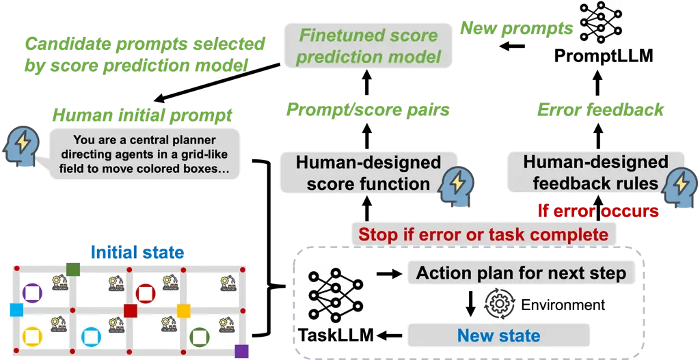

Figure 1: The PROMST framework. Given an initial human-designed prompt
and the state of the environment for the current task, the TaskLLM
iteratively generates an action and executes it until either an error
occurs or the task is complete. Human-designed feedback rules
automatically generate feedback about errors that is then provided as
context to the PromptLLM when generating new prompt candidates. The task
performance is scored according to a human-designed score function; this
score can be used with the prompt to train a score prediction model
online. Given new prompt candidates, this score prediction model is used
to select a subset of candidates to evaluate for the next generation.

## 1 Introduction

The performance of large language models (LLMs) on a given task is
sensitive to the prompt, so prompt engineering aims to create prompts
that fully leverage the capabilities of LLMs. Due to the lack of access
to model parameters for black-box LLMs, techniques for automatic prompt
optimization have primarily focused on searching over the vast discrete
space of tokenized language inputs (Cheng et al., 2023). Recent studies
have shown that LLMs, combined with evolutionary algorithms, can help
with this search by reasoning over errors made using existing prompts to
suggest edits or generate new candidate prompts Pryzant et al. (2023);
Wang et al. (2023); Yang et al. (2023). These approaches have been
evaluated on relatively simple one-step tasks, such as mathematical
calculations (Roy and Roth, 2016; Cobbe et al., 2021), instruction
induction (Honovich et al., 2022), and factual analysis (Wu et al.,
2023b). The associated prompts are also relatively short, usually one to
three sentences.

In this work, we aim to optimize prompts for LLM-driven agents solving
multi-step tasks and propose a method called PRompt Optimization in
Multi-Step Tasks (PROMST). In these tasks, an LLM is used to decide a
system’s actions (e.g., virtual software Wu et al. 2023a; Zhou et al.
2023a or real robots Chen et al. 2023a; Firoozi et al. 2023) as it
interacts with an environment over multiple steps Abdulhai et al.
(2023). Engineering good prompts is hard due to the typical prompt
length (300+ tokens) and individual task constraints and rules. The
prompts needed for multi-step tasks are more complex to judge the
long-horizon correctness of a single action. This difficulty hinders
LLMs from automatically reasoning over errors and producing better
prompts, which in turn reduces the effectiveness of current methods for
automated prompt optimization. Prompt optimization in multi-step tasks
is still an open challenge.

Considering that humans excel in analyzing errors and incorporating
relevant domain knowledge into feedback, we formalize PROMST as a
framework involving human input, as shown in Figure 1. Here, during the
multi-step agent-environment interactions, the agent (indicated by
‘TaskLLM’ in Figure 1) sometimes makes errors and fails the task. While
some work has used LLMs to evaluate errors, we instead use
human-designed feedback rules constructed a priori that address
different types of errors. Depending on the error, feedback is
automatically generated and passed as additional context to an LLM that
is responsible for producing a new set of candidate prompts (indicated
by ‘PromptLLM’ in Figure 1). A score is assigned to each prompt
indicating the agent’s task performance given that prompt. Since the
evaluation of many candidate prompts for multi-step tasks in
environments can be expensive, we fine-tune a score prediction model
online using prompt-score pairs which can be used as a heuristic to
select a subset of the candidate prompts to evaluate.

Our experiments in 11 tasks show that the integration of human feedback
and the score model greatly improves the prompt optimization process
(10.6%-29.3% relative improvements over all baseline methods across
different LLMs). PROMST achieves the best performance on most tasks.
PROMST has also been shown to perform better in multi-trial settings
when combined with dynamic approaches. We further show that the
human-designed evaluation rules can be used to help align task
performance with human preferences. Extensive experiments are conducted
to validate the framework and investigate the underlying reasons why
some prompts are more effective than others.

In summary, our contributions are : (1) To our best knowledge, PROMST is
the first to explore automatic prompt optimization in multi-step agent
tasks. We release all codes and prompts for 11 multi-step environments,
which may serve as a benchmark for future research. (2) We show that the
integration of human feedback and a fine-tuned score model outperforms
existing methods across various tasks and LLMs. (3) Our research
indicates that PROMST is orthogonal and integrates well with established
dynamic approaches. (4) We find that human-designed rules for task
evaluation help align optimized prompts with human preferences.

## 2 Related Work

Prompt Optimization To improve performance of black-box API models, it
is useful to engineer the discrete prompts for downstream tasks. Various
‘best practices’ have emerged for human-designed task prompts, such as
including examples (Brown et al., 2020) or promoting reasoning chains
(Kojima et al., 2022; Wei et al., 2022). However, manually designing
prompts requires extensive human trial-and-error and is sub-optimal;
thus, many recent works focus on automating this process. Some methods
approximate the gradients (Diao et al., 2022) or emulate them via
natural language (Pryzant et al., 2023). Others use edit operators to
modify an initial prompt, driven either by reinforcement learning (Zhang
et al., 2023) or score-guided search (Prasad et al., 2023). To help
balance exploration and exploitation of prompts, several approaches have
used LLM-driven evolution (Guo et al., 2023a; Fernando et al., 2023; Ma
et al., 2023; Ye et al., 2023). In several works, LLMs are directly used
to generate prompt candidates (Zhou et al., 2023b) often with feedback
about parent prompts (Wang et al., 2023; Ma et al., 2023). Our work
focuses on domains that include complex multi-step tasks, in which the
evaluation and reflection processes are more challenging so that score
prediction models and human feedback rules are introduced in order to
mitigate this problem.

LLM Based Agents for Multi-Step Tasks There are many recent works that
use LLMs for multi-step planning. LLMs are used to interact with
softwares and websites Ma et al. (2024); Wu et al. (2023a); Zhou et al.
(2023a), plan robot actions Chen et al. (2023b); Ahn et al. (2022);
Huang et al. (2022a); Ma et al. (2023); Aghzal et al. (2023); Chen
et al. (2023c), and connect to external tools Liu et al. (2023); Chen
et al. (2023a); Qin et al. (2023). Instead of careful design of lengthy
prompts to capture all the constraints, our approach uses prompt
optimization to transition from a simple initial human-provided prompt
to a high-performing prompt.

LLM Self-reflection from Feedback In planning domains, it is useful to
provide feedback about syntactic errors (Silver et al., 2023; Skreta
et al., 2023), potential infinite loops (Silver et al., 2023), failed
action execution (Huang et al., 2022b), and generated trajectories (Chen
et al., 2023a). Other recent work has shown that LLM-generated feedback
via self-evaluation can improve performance on a variety of tasks (Yang
et al., 2022; Welleck et al., 2022; Madaan et al., 2023), including
prompt engineering (Wang et al., 2023) and reinforcement learning (Shinn
et al., 2023; Ma et al., 2023). Compared to above works, our work
combines LLM self-reflection with human-provided feedback templates to
help improve performance on the more challenging multi-step tasks.

Another type of methods is to utilize self-reflection for online dynamic
feedback during task execution, such as Reflexion Shinn et al. (2024).
While Reflexion needs multiple trials for online optimization of action
memory for each single test, our method PROMST only needs one trial for
task execution and the prompt is optimized offline across multiple
tests. In Section 4.4, we find that PROMST outperforms the offline
variation of Reflexion and can perform better when combining with online
Reflexion in the multi-trial setting.

## 3 Methodology

### 3.1 Problem Formulation

Given a base LLM $`\mathcal{B}`$ and a target task $`T`$, the goal of
prompt optimization is to craft an optimized natural language prompt
$`P`$ that maximizes the performance of $`\mathcal{B}`$ on $`T`$. Here
the prompt $`P`$ consists of multiple components, such as a task
description, scoring rules, and safety constraints. In multi-step tasks,
the state information of the environment at each step will be
transformed into a text string $`S`$ and provided to the LLM
$`\mathcal{B}`$ to make decisions. The history of state ($`S`$), action
($`a`$), and environment feedback ($`e`$) will also be reported to LLM.
For the $`i^{th}`$ testing trial on a particular task, the probability
of an action sequence \[$`a_{i,1},a_{i,2},...,a_{i,j}`$\] is:

```math
\displaystyle p_{\mathcal{B}}([a_{i,1},a_{i,2},\ldots,a_{i,j}]) \displaystyle=\prod_{k=1}^{j}p_{\mathcal{B}}(a_{i,k}|S_{i,k},P, \tag{1}
```

```math
\displaystyle S_{i,k-1},a_{i,k-1},e_{i,k-1}
```

```math
\displaystyle,\ldots,S_{i,1},a_{i,1},e_{i,1})
```

The sequence \[$`a_{i,1},a_{i,2},...,a_{i,j}`$\] is executed in the task
environment and assigned a score based on human-designed rules or
functions $`R`$. The goal of prompt optimization is to find the optimal
natural language prompt $`P^{*}`$ that maximizes a score function $`R`$:

```math
P^{*}=\underset{P\in A}{\text{arg max}}\sum_{i\in U}R(p_{\mathcal{B}}([a_{i,1},a_{i,2},...,a_{i,j}])), \tag{2}
```

where $`A`$ denotes the vast and complex space of all possible natural
language prompts and $`U`$ denotes the set of all the testing trials in
a specific task.

### 3.2 PROMST Framework

Figure 1 illustrates the general framework of PROMST. The goal is to
more efficiently and strategically search over the vast space of
possible prompts while integrating human-designed feedback of candidate
prompt performance. LLMs are used in two key steps of PROMST: (1) the
execution of the task via the current candidate prompt (‘TaskLLM’) and
(2) the generation of new candidate prompts given any available feedback
about the current prompt’s performance on the task (‘PromptLLM’). We
refer to a single execution in a testing case of a task as a trial. In
each trial, the TaskLLM executes the task over multiple rounds of
interaction with the environment; for each round, the TaskLLM is
provided both the current candidate prompt and the current trial’s
execution history and generates the next action for the agent to take.
Task execution terminates when an error is detected or the task is
complete. The candidate prompt $`P`$ is assigned a score for that trial
via the human-designed score function. Each candidate prompt is
evaluated over multiple trials in which the initial environment state
(e.g. number of objects, number of agents) is varied, resulting in a
final average score calculated over all the trials. Once the candidate
prompts have all been evaluated and assigned automatic feedback, the top
performers are selected as parents for a new generation of candidate
prompts. The PromptLLM uses each parent prompt and its feedback to
generate new candidate prompts. This process is also described in
Algorithm 1, 2, 3 in Appendix B.

Score Prediction Model In general, producing more candidate prompts per
generation allows for more exploration over the space of possible
prompts; however, there is a trade-off between the number of candidates
per generation and the cost of evaluation, and multi-step tasks can be
much more expensive to evaluate (we query the TaskLLM for each next
action). To help mitigate the evaluation cost for a generation, we learn
a score prediction model online that functions as a heuristic with which
to choose a subset of the generated candidate prompts for actual
evaluation.

Algorithm 2 in Appendix B shows the process of implementing the score
prediction model as a heuristic for filtering candidate prompts. We
fine-tune a task-specific bidirectional Longformer-base (148M) Beltagy
et al. (2020) model. The prompt-score pairs on which we fine-tune are
collected online during early iterations of PROMST; therefore, the score
prediction model is not applied until $`sd^{th}`$ generation, where
$`sd`$ is a hyperparameter. We continue to update the learned model at
each generation with the new prompt-score pairs. To mitigate variance,
we fine-tune multiple models on five rounds with the collected data
following a random 4:1 train/test split. The generated prompt candidate
$`p^{\prime}`$ will be selected for task evaluation if:

```math
\text{E}[M_{k}(p^{\prime})]+\operatorname{Var}[M_{k}(p^{\prime})]+\text{E}[\text{error}_{k}]\geq\text{hyper\_M}\times\max(D.\text{score}()) \tag{3}
```

where E$`[M_{k}(p^{\prime})]`$ and Var$`[M_{k}(p^{\prime})`$ are the
mean and variance of predicted scores for $`p^{\prime}`$ from five
models. The E$`[error_{k}]`$ is the average testing error of five score
models. The $`\max(D.score())`$ is the highest score of existing
prompts. To balance efficient exploration and conservative filtering, we
only filter prompt candidates when the score prediction model is
sufficiently confident. When the variance of the prediction model is
high, we want to be conservative in its application in order to reduce
the chance that we filter out a good candidate. Similarly, we choose to
be conservative in our filtering when the error is high. Equation 3 is
therefore one formulation that incorporates these general ideas. The
hyperparameter hyper_M allows this conservativeness to be tuned by
users.

Human-Designed Feedback Rules During task execution, the TaskLLM may
encounter an error, resulting in the task being terminated. It is useful
for the PromptLLM to have context about this error when generating new
prompt candidates. Since automatic error analysis via LLMs is difficult
for multi-step tasks (e.g. an agent stuck in an action loop), we instead
use human-designed rules to automatically synthesize feedback, as shown
in Figure 2. Some types of errors can be common across all tasks (e.g.
syntactic errors), while others are task-specific. For types of human
feedback in each task, see Appendix A.

In Section 4.4, we do ablation experiments to show that variability over
the wording of feedback has little impact on PROMST performance. Hence,
PROMST does not require humans to iterate over possible versions of
feedback templates via trial-and-error efforts. Additionally, for each
task, humans just need to design 2 to 4 new error types since some of
the error types are common across tasks. Even for the task of multi-hop
question answering, error types like ‘syntactic errors’ and ‘stuck in
the loop’ still exist and can be shared with other tasks.

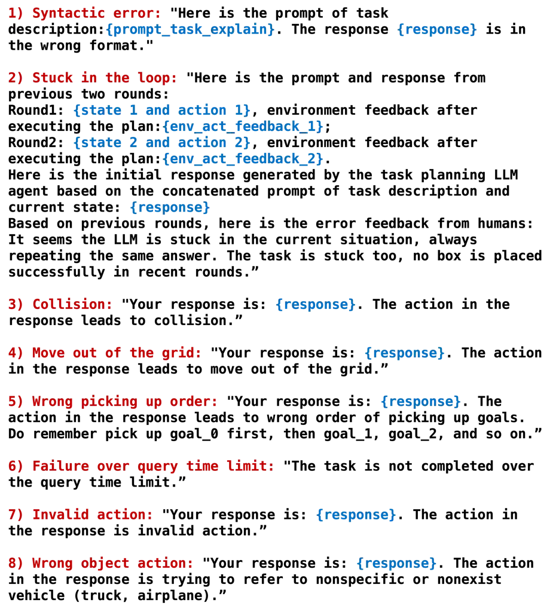

Figure 2: Eight examples of human-designed feedback templates. The
blue-colored text represents the content specific to each instance of an
error.

Candidate Prompt Generator We produce new candidate prompts from a
parent prompt in two steps: (1) summarizing feedback via an LLM
(‘SumLLM’) and (2) generating new prompt candidates via an LLM provided
with the summarized feedback as context (‘GenLLM’). In order to
encourage exploration over more diverse candidate prompts, we randomly
choose 10 instances of feedback. This random selection also likely
promotes more frequent errors. Given the selected feedback, SumLLM
produces a summary that is included as context to GenLLM for generating
new candidates. See Algorithm 3 in Appendix B for another description of
this process and Appendix C for the meta-prompts used for SumLLM and
GenLLM.

## 4 Experiments

### 4.1 Environments

As shown in Figure 3, we test on 11 multi-step tasks requiring strong
logical, geometrical, scientific, and commonsense reasoning capabilities
Zhou et al. (2023a); Shridhar et al. (2020); Wang et al. (2022); Chen
et al. (2023b); Aghzal et al. (2023); Valmeekam et al. (2023). Each
environment requires the LLM agent to determine the next action in the
large discrete action space. Please refer to Appendix D for a complete
description of all tasks.

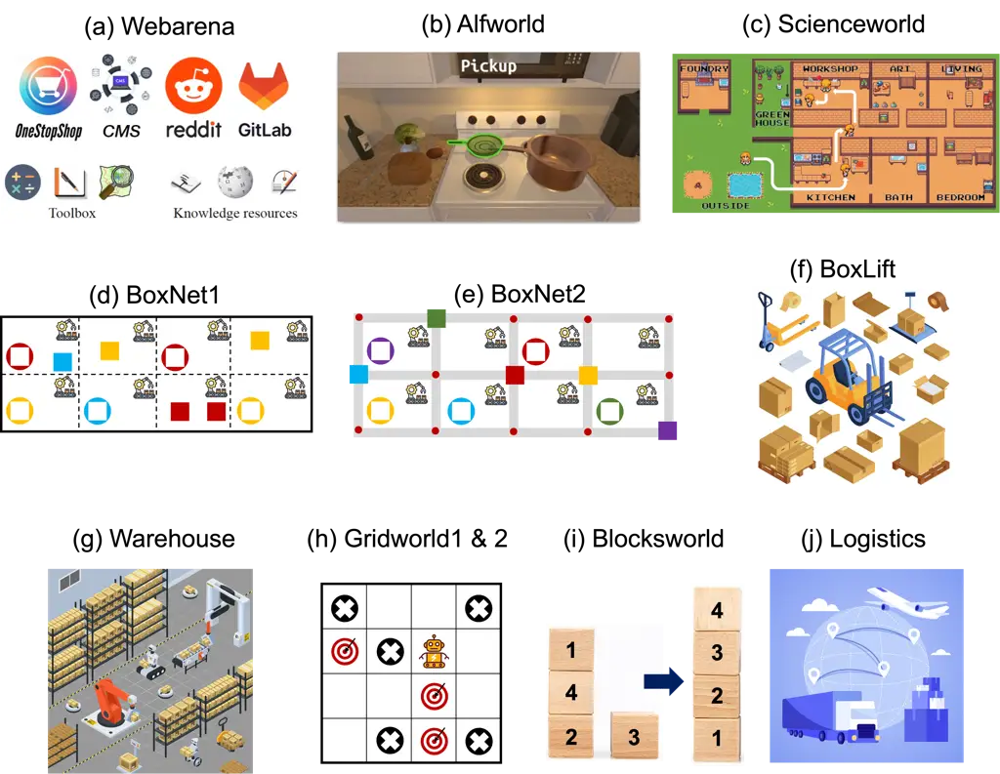

Figure 3: An illustration of the 11 environments used for multi-step
task evaluation. See Appendix D for more details.

### 4.2 Baselines

We compare PROMST with six recent representative methods: Automatic
Prompt Engineer (APE) Zhou et al. (2023b), Automatic Prompt Optimization
(APO) Pryzant et al. (2023), PromptAgent Wang et al. (2023),
LLM-As-Optimizer Yang et al. (2023), PromptBreeder Fernando et al.
(2023), and Evolutionary Prompt Optimizer Guo et al. (2023b). All the
methods under comparison involve iterative optimization of prompts. Some
methods require error feedback through LLM self-reflection, while others
do not. For methods that need error feedback, we randomly select 10
instances of feedback, similar to the PROMST method but without the
rules of human feedback. We also compare with the dynamic approach
Reflexion Shinn et al. (2024) by modifying it into an offline framework.

### 4.3 Experimental Setups

For a fair comparison, all methods start the optimization from initial
human-designed prompts; where possible, we use the provided publicly
available prompts for each method. In all cases, we set the LLM sampling
temperature to 0. For each method, we report the score of the best
performing prompt on each task; in this case, the score is computed as:

```math
S=\text{num}(\text{sub-goal}_{success})/\text{num}(\text{sub-goal}_{all}), \tag{4}
```

where the score $`S`$ is the ratio of the number of successfully
completed sub-goals/sub-steps to the total number of
sub-goals/sub-steps, i.e., the task progress score. Note that the task
completion score can also serve as the metric, while it may be sparse in
some situations. Both types of scores are positively correlated as shown
in Appendix Table 9. In Section 4.4, we also preliminarily test the
impact of changing the scoring function $`S`$.

Model Types One interesting feature of these methods is that the LLM
used to execute the task (‘TaskLLM’) and the LLM used to generate new
candidate prompts (‘PromptLLM’) do not need to be the same model. We
mainly test two combinations of models. The first uses GPT-3.5
(gpt-3.5-turbo-16k-0613) as the TaskLLM and GPT-4 (gpt-4-turbo-preview)
Achiam et al. (2023) as the PromptLLM, and the second uses GPT-4 for
both the TaskLLM and PromptLLM. To verify the effectiveness of PROMST in
varied models, we also evaluate it using Claude 3 Opus Anthropic (2024),
Mixtral-8x7B, and Mixtral-Large Jiang et al. (2024) as both TaskLLM and
PromptLLM. Mixtral-8x7B is an open model, while all the others are
closed. We also explore whether the optimized prompts specialized for
one type of LLM can generalize better performance to other types of
LLMs.

Context Window Limit The constraint of the model’s context window is an
issue for LLM-based agents, especially for longer multi-step tasks.
Relying on the intuition that recency is important, in all the tested
methods we use a sliding window of the history of state-action-feedback
tuples, truncating the history by pruning older parts of the history
that extend beyond the window length, which is a common technique used
in LLM agent researches.

|              |                                             |       |       |         |       |           |             |        |
| ------------ | ------------------------------------------- | ----- | ----- | ------- | ----- | --------- | ----------- | ------ |
|              | GPT-3.5-0613-as-TaskLLM, GPT-4-as-PromptLLM |       |       |         |       |           |             |        |
| Task         | Human                                       | APE   | APO   | P.Agent | LLMOP | P.Breeder | P.Evolution | PROMST |
| Webarena     | 0.22                                        | 0.35  | 0.31  | 0.37    | 0.29  | 0.25      | 0.27        | 0.39   |
| Alfworld     | 0.075                                       | 0.24  | 0.23  | 0.24    | 0.14  | 0.12      | 0.16        | 0.30   |
| Scienceworld | 0.18                                        | 0.19  | 0.19  | 0.23    | 0.19  | 0.20      | 0.22        | 0.21   |
| BoxNet1      | 0.076                                       | 0.093 | 0.16  | 0.13    | 0.098 | 0.11      | 0.12        | 0.25   |
| BoxNet2      | 0.044                                       | 0.075 | 0.16  | 0.17    | 0.086 | 0.090     | 0.075       | 0.22   |
| BoxLift      | 0.31                                        | 0.69  | 0.70  | 0.74    | 0.55  | 0.58      | 0.62        | 0.90   |
| WareHouse    | 0.0                                         | 0.012 | 0.012 | 0.036   | 0.008 | 0.008     | 0.004       | 0.028  |
| Gridworld1   | 0.23                                        | 0.30  | 0.35  | 0.32    | 0.28  | 0.26      | 0.24        | 0.38   |
| Gridworld2   | 0.036                                       | 0.093 | 0.17  | 0.15    | 0.065 | 0.078     | 0.13        | 0.12   |
| Blocksworld  | 0.19                                        | 0.25  | 0.42  | 0.48    | 0.29  | 0.22      | 0.27        | 0.60   |
| Logistics    | 0.083                                       | 0.083 | 0.12  | 0.12    | 0.083 | 0.083     | 0.12        | 0.18   |
| Average      | 0.13                                        | 0.22  | 0.26  | 0.27    | 0.19  | 0.18      | 0.20        | 0.32   |

Table 1: Scores for initial (human) and optimized prompts on various
multi-step tasks for different methods. P.Agent, LLMOP, P.Breeder, and
P.Evolution refer to PromptAgent, LLM-As-Optimizer, PromptBreeder,
Evolutionary Prompt Optimizer, respectively. GPT-3.5-0613 for TaskLLM
and GPT-4 for PromptLLM.

|              |                                      |      |      |         |       |           |             |        |
| ------------ | ------------------------------------ | ---- | ---- | ------- | ----- | --------- | ----------- | ------ |
|              | GPT-4-as-TaskLLM, GPT-4-as-PromptLLM |      |      |         |       |           |             |        |
| Task         | Human                                | APE  | APO  | P.Agent | LLMOP | P.Breeder | P.Evolution | PROMST |
| Webarena     | 0.57                                 | 0.59 | 0.64 | 0.60    | 0.58  | 0.58      | 0.59        | 0.62   |
| Alfworld     | 0.45                                 | 0.49 | 0.50 | 0.53    | 0.50  | 0.47      | 0.49        | 0.57   |
| Scienceworld | 0.70                                 | 0.72 | 0.74 | 0.76    | 0.71  | 0.73      | 0.76        | 0.81   |
| BoxNet1      | 0.65                                 | 0.72 | 0.72 | 0.77    | 0.74  | 0.67      | 0.70        | 0.79   |
| BoxNet2      | 0.34                                 | 0.38 | 0.36 | 0.35    | 0.40  | 0.37      | 0.40        | 0.42   |
| WareHouse    | 0.16                                 | 0.18 | 0.27 | 0.34    | 0.30  | 0.25      | 0.22        | 0.51   |
| Gridworld1   | 0.73                                 | 0.78 | 0.82 | 0.89    | 0.83  | 0.76      | 0.80        | 0.86   |
| Gridworld2   | 0.26                                 | 0.50 | 0.44 | 0.41    | 0.41  | 0.31      | 0.29        | 0.60   |
| Blocksworld  | 0.71                                 | 0.74 | 0.83 | 0.87    | 0.76  | 0.75      | 0.77        | 0.95   |
| Logistics    | 0.50                                 | 0.53 | 0.58 | 0.61    | 0.54  | 0.53      | 0.56        | 0.74   |
| Average      | 0.51                                 | 0.56 | 0.59 | 0.61    | 0.58  | 0.54      | 0.56        | 0.69   |

Table 2: Scores for initial (human) and optimized prompts on various
multi-step tasks for different methods. GPT-4 for both TaskLLM and
PromptLLM.

|            | Claude-3-opus-20240229 |      |         |        | Open-Mixtral-8x7b |       |         |        |
| ---------- | ---------------------- | ---- | ------- | ------ | ----------------- | ----- | ------- | ------ |
| Task       | Human                  | APO  | P.Agent | PROMST | Human             | APO   | P.Agent | PROMST |
| Alfworld   | 0.32                   | 0.40 | 0.42    | 0.49   | 0.055             | 0.074 | 0.071   | 0.10   |
| BoxNet2    | 0.42                   | 0.47 | 0.44    | 0.53   | 0.078             | 0.21  | 0.20    | 0.24   |
| WareHouse  | 0.21                   | 0.26 | 0.27    | 0.36   | 0.020             | 0.093 | 0.13    | 0.16   |
| Gridworld2 | 0.13                   | 0.29 | 0.34    | 0.44   | 0.013             | 0.038 | 0.075   | 0.10   |
| Average    | 0.27                   | 0.36 | 0.37    | 0.46   | 0.041             | 0.10  | 0.12    | 0.15   |

Table 3: Evaluation of different LLMs on a subset of the mutli-step
tasks. The same LLM was used for the TaskLLM and PromptLLM in each case.

|                    |      |         |        |
| ------------------ | ---- | ------- | ------ |
| Mixtral-large-2402 |      |         |        |
| Human              | APO  | P.Agent | Promst |
| 0.28               | 0.33 | 0.33    | 0.45   |
| 0.26               | 0.31 | 0.36    | 0.30   |
| 0.16               | 0.23 | 0.28    | 0.31   |
| 0.12               | 0.32 | 0.25    | 0.28   |
| 0.21               | 0.30 | 0.30    | 0.34   |

Hyperparameters For a fair comparison, we standardize all
hyperparameters across methods, allowing each to explore the same number
of prompt candidates at an equivalent level. The expansion number $`n`$
controls the number of kid prompts generated based on each parent
prompt, which is set to 20 in the first level and 8 for all additional
levels. In each level, top $`k=5`$ current prompts are selected as the
parent prompts for further optimization. Search terminates once the
recent three levels do not have any score improvements. In PROMST, we
set hyper_M = 0.8 in Equation 3 to filter out prompts with low scores.
We set $`sd=4`$ so that the score model is not applied until $`4^{th}`$
generation.

### 4.4 Results and Analysis

Overall Better Performance Table 1 and Table 2 show the main
experimental results. Note that BoxLift task is not included in Table 2
since we find GPT-4 can already achieve a full score with the initial
human prompt. Table 3 shows the experimental results on other three
types of LLMs. Due to limited computational resources, we only select
four representative tasks and two strongest baseline methods (APO,
PromptAgent) when evaluating other LLMs. Table 7 and Table 8 in
Appendix E test the performance of the optimized prompts trained from
one LLM with other types of TaskLLMs.

The main takeaways are: 1) PROMST performs the best in most tasks. On
average, PROMST outperforms strongest baseline PromptAgent with
GPT-3.5-0613 (0.27 vs 0.32), GPT-4 (0.61 vs 0.69), Claude-3-opus (0.36
vs 0.46), Open-Mixtral-8x7B (0.12 vs 0.15), and Mixtral-large (0.30 vs
0.34). 2) When testing the best prompts trained from GPT-3.5-0613 and
GPT-4 with a different TaskLLM, we find that they still outperform human
prompts. 3) However, each LLM does best with the prompts optimized on
it. For example, the best prompts acquired when using GPT-3.5-0613 as
the TaskLLM do not further improve performance when applied to GPT-4,
and vice versa. 4) PROMST performs well when the TaskLLM and PromptLLM
are the same LLM, showing that it does not rely on a stronger PromptLLM
to pass extra knowledge into prompts, which can be regarded as cheating.

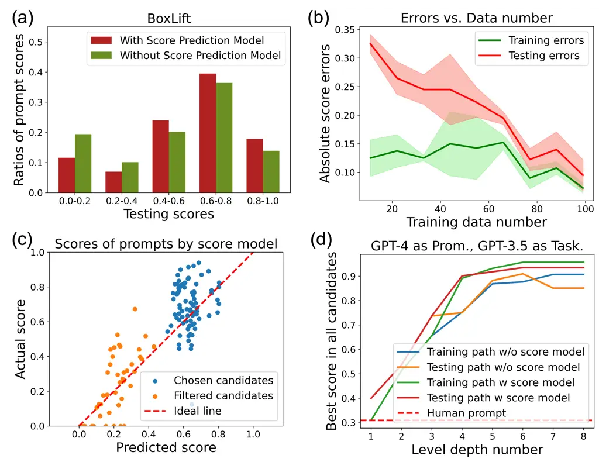

Figure 4: Several results inspecting the learned score prediction model.
(a) The distribution/ratio of prompt scores with/without the score
prediction model. (b) The prediction error of the model on the training
data and heldout test data as the amount of training data increases. (c)
A plot of the predicted score vs the actual score for various prompts;
blue are the prompts that were chosen as parents for new candidates. (d)
The trend of the best performing prompt during optimization for
increasing iterations both with and without using the learned score
prediction model.

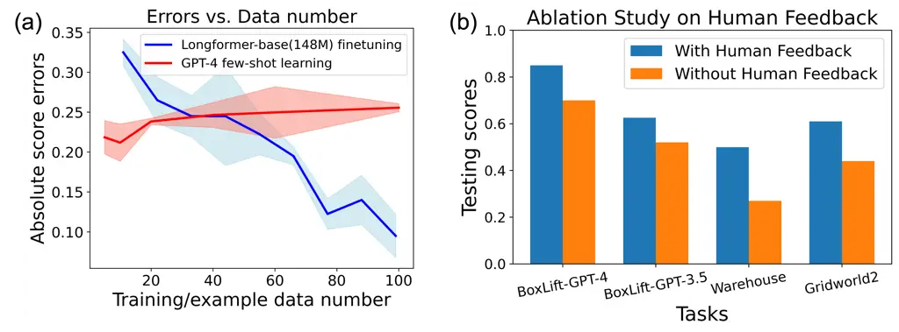

Figure 5: (a) Comparison of score prediction errors for few-shot GPT-4
vs finetuning Longformer for increasing amount of few-shot examples or
training data, respectively. (b) An ablation study of the impact of the
human-designed feedback rules on task performance for four multi-step
tasks.

Effects of Score Model To analyze the effects of the score model, we use
BoxLift as a representative example, as shown in Figure 4. Figure 4a
shows the distribution of prompt scores explored in all the levels (1-8)
with and without the score prediction model implemented, respectively.
The implementation of the score prediction model truly makes the
exploration more efficient since less low-scored prompts are explored.
Figure 4b shows the training and testing errors of the score model
versus different amounts of collected training data. The overfitting
effect decreases with increasing data number. Figure 4c tests the
fine-tuned score models on levels 5-8.

We also evaluate the prompts that were filtered out by the score model
and plot the predicted and actual scores. We find that nearly all chosen
prompt candidates achieve scores higher than 0.4, and the filtered
prompts have reliably low scores. We compare the evolution curves for
PROMST with/without the score model, as shown in Figure 4d. The results
show that both the training and testing paths converge faster and
achieve better scores using the score model. The ablation experiments in
other environments also have the same trend (shown in Appendix G).
Overall, we find the score prediction model improves the efficiency and
effectiveness of prompt search. For each prompt optimization process of
PROMST, usually the best prompt appears at the iteration number 5 to 7,
as visualized in Figure 4d and Appendix G.

Ablation on Methods of Score Model Instead of fine-tuning a pre-trained
Longformer-base model, another way to acquire score prediction models is
few-shot learning via GPT-4. Figure 5a compares these two methods under
varied training/example data number. GPT-4 is given randomly selected
prompt-score pairs as examples during the study. We find that the
performance of GPT-4 few-shot learning cannot improve with the
increasing number of examples. The fine-tuning method surpasses GPT-4
few-shot learning once the data number increases over 40.

|                                        |          |           |
| -------------------------------------- | -------- | --------- |
| GPT-3.5-as-TaskLLM, GPT-4-as-PromptLLM |          |           |
| Task                                   | W SumLLM | WO SumLLM |
| Alfworld                               | 0.30     | 0.23      |
| BoxNet2                                | 0.22     | 0.18      |
| BoxLift                                | 0.90     | 0.85      |

Table 4: Ablation studies on SumLLM.

Ablation on SumLLM Component Since TaskLLM and GenLLM are necessary in
the whole framework, we compare PROMST with/without SumLLM component in
Table 4 to verify its effectiveness. The integration of SumLLM improves
the performance on all the three representative tasks.

| GPT-3.5-as-TaskLLM, GPT-4-as-PromptLLM |          |             |        |                       |                  |
| -------------------------------------- | -------- | ----------- | ------ | --------------------- | ---------------- |
| Task                                   | Original | Paraphrased | Random | WO response component | WO stuck in loop |
| BoxNet2                                | 0.22     | 0.20        | 0.23   | 0.17                  | 0.18             |
| BoxLift                                | 0.90     | 0.93        | 0.97   | 0.73                  | 0.87             |

Table 5: Ablation studies on the templates used for human feedback.

Ablation on Human Feedback We compare the method with/without human
feedback, both without the learned score model. As seen in Figure 5b,
human feedback contributes to much higher scores across four tasks. In
our work, the original human feedback templates did not require
iterations via trial-and-error over possible versions. To demonstrate
that designing human feedback rules is straightforward and requires
minimal efforts, we test other four feedback templates in Table 5. The
results show that variability over the wording of the templates has
little impact on the performance of PROMST. Thus, including the response
in the feedback template is a useful task- and error-agnostic guiding
principle. Appendix H articulates more specifically on the designing of
four compared human feedback templates and the reasons why designing
feedback rules is effortless.

Preference Alignment via Score Function The choice of score functions
impacts prompt optimization, in which humans may have different
preferences for the same task. In Appendix J, we explore the impacts of
varied score functions and find that PROMST can well align with human
preferences by modifying score function formats.

Explanability for Better Prompts We also try to dig out some mechanisms
why the optimized prompts are better. In Figure 13, we plot prompt score
vs. token length and perplexity, which implies some clues that longer
prompts may be better. Meanwhile, when viewing through the discovered
best prompts in Appendix M, we find some clues about better component
emergence, i.e., the best prompts tend to list all the careful points
one by one clearly. We conduct an ablation study by summarizing detailed
careful points into varying token lengths using GPT-4 and evaluating
their performance. The results indicate that task scores consistently
decline as token lengths decrease, underscoring the importance of
clearly listing detailed points. More specific discussion is shown in
Appendix K.

Comparison and Combination with Reflexion In Appendix L we find that
PROMST outperforms the dynamic approach, Reflexion, in prompt
optimization and achieves enhanced performance when Reflexion is
integrated in a multi-trial setting.

## 5 Conclusion

In this work we introduce an automatic prompt optimization framework for
complex, multi-step agent tasks: PROMST. To handle the issues of task
complexity, judging long-horizon correctness of individual actions, high
prompt exploration cost, and human preference alignment, we propose the
integration of human feedback, a learned score prediction model, and the
modification of task score functions. Our approach generally outperforms
six representative baselines on 11 different task environments over all
the five LLMs. PROMST is orthogonal and combinatorial to existing
dynamic approaches. The discovered best prompts have some inspiring
characteristics for better performance.

## 6 Limitations

The limitations and potential societal risks of this work are as
follows:

Huge resource consumption of API calls Automatic prompt optimization
requires significant computing resources and LLM API queries due to its
search-based nature, which is a common issue in this research track.
Though the introduction of score model makes the searching more
efficient, the around 100 prompt candidate exploration is still a large
burden.

Score model increases computing demands of local devices The fine-tuned
score prediction model trades-off the number of API queries for
on-device computation by selecting good candidate prompts. Still, the
training of extra score models increases the computing demands on local
devices.

Extra burden of designing human feedback rules Introducing human
feedback into prompt optimization is a natural way because the current
LLM cannot well summarize and reflect errors in multi-step tasks, as
shown in ablation studies. Integrating human feedback is inspired by the
phenomenon that humans are good at providing feedback about LLM errors
but struggle to optimize prompts. We admit that requiring human
pre-defined feedback will somewhat increase the burden of users and that
introducing automatic feedback is one important work to be explored in
the future.

Fine-tuning score model requires enough data points The fine-tuning
process of score models typically requires around 100 prompt-score
pairs, which is suitable for black box prompt searching since over 100
data points are truly needed for satisfying performance. However, the
score model may not be suitable if in the future a more efficient
searching method appears so that data points are not such much.

## Acknowledgements

This work was supported by ONR under Award N00014-22-1-2478 and MIT-IBM
Watson AI Lab. However, this article solely reflects the opinions and
conclusions of its authors.

## References

- Abdulhai et al. (2023) Marwa Abdulhai, Isadora White, Charlie Snell,
  Charles Sun, Joey Hong, Yuexiang Zhai, Kelvin Xu, and Sergey
  Levine. 2023. Lmrl gym: Benchmarks for multi-turn reinforcement
  learning with language models. _arXiv preprint arXiv:2311.18232_.
- Achiam et al. (2023) Josh Achiam, Steven Adler, Sandhini Agarwal, Lama
  Ahmad, Ilge Akkaya, Florencia Leoni Aleman, Diogo Almeida, Janko
  Altenschmidt, Sam Altman, Shyamal Anadkat, et al. 2023. Gpt-4
  technical report. _arXiv preprint arXiv:2303.08774_.
- Aghzal et al. (2023) Mohamed Aghzal, Erion Plaku, and Ziyu Yao. 2023.
  Can large language models be good path planners? a benchmark and
  investigation on spatial-temporal reasoning. _arXiv preprint
  arXiv:2310.03249_.
- Ahn et al. (2022) Michael Ahn, Anthony Brohan, Noah Brown, Yevgen
  Chebotar, Omar Cortes, Byron David, Chelsea Finn, Keerthana
  Gopalakrishnan, Karol Hausman, Alex Herzog, et al. 2022. Do as i can,
  not as i say: Grounding language in robotic affordances. _arXiv
  preprint arXiv:2204.01691_.
- Anthropic (2024) AI Anthropic. 2024. The claude 3 model family: Opus,
  sonnet, haiku. _Claude-3 Model Card_.
- Beltagy et al. (2020) Iz Beltagy, Matthew E. Peters, and Arman
  Cohan. 2020. [Longformer: The long-document
  transformer](https://arxiv.org/abs/2004.05150). _Preprint_,
  arXiv:2004.05150.
- Brown et al. (2020) Tom Brown, Benjamin Mann, Nick Ryder, Melanie
  Subbiah, Jared D Kaplan, Prafulla Dhariwal, Arvind Neelakantan, Pranav
  Shyam, Girish Sastry, Amanda Askell, et al. 2020. Language models are
  few-shot learners. _Advances in neural information processing
  systems_, 33:1877–1901.
- Chen et al. (2023a) Yongchao Chen, Jacob Arkin, Yang Zhang, Nicholas
  Roy, and Chuchu Fan. 2023a. Autotamp: Autoregressive task and motion
  planning with llms as translators and checkers. _arXiv preprint
  arXiv:2306.06531_.
- Chen et al. (2023b) Yongchao Chen, Jacob Arkin, Yang Zhang, Nicholas
  Roy, and Chuchu Fan. 2023b. Scalable multi-robot collaboration with
  large language models: Centralized or decentralized systems? _arXiv
  preprint arXiv:2309.15943_.
- Chen et al. (2023c) Yongchao Chen, Rujul Gandhi, Yang Zhang, and
  Chuchu Fan. 2023c. Nl2tl: Transforming natural languages to temporal
  logics using large language models. _arXiv preprint arXiv:2305.07766_.
- Cheng et al. (2023) Jiale Cheng, Xiao Liu, Kehan Zheng, Pei Ke,
  Hongning Wang, Yuxiao Dong, Jie Tang, and Minlie Huang. 2023.
  Black-box prompt optimization: Aligning large language models without
  model training. _arXiv preprint arXiv:2311.04155_.
- Cobbe et al. (2021) Karl Cobbe, Vineet Kosaraju, Mohammad Bavarian,
  Mark Chen, Heewoo Jun, Lukasz Kaiser, Matthias Plappert, Jerry Tworek,
  Jacob Hilton, Reiichiro Nakano, et al. 2021. Training verifiers to
  solve math word problems, 2021. _URL https://arxiv.
  org/abs/2110.14168_.
- Diao et al. (2022) Shizhe Diao, Zhichao Huang, Ruijia Xu, Xuechun Li,
  LIN Yong, Xiao Zhou, and Tong Zhang. 2022. Black-box prompt learning
  for pre-trained language models. _Transactions on Machine Learning
  Research_.
- Fernando et al. (2023) Chrisantha Fernando, Dylan Banarse, Henryk
  Michalewski, Simon Osindero, and Tim Rocktäschel. 2023. Promptbreeder:
  Self-referential self-improvement via prompt evolution. _arXiv
  preprint arXiv:2309.16797_.
- Firoozi et al. (2023) Roya Firoozi, Johnathan Tucker, Stephen Tian,
  Anirudha Majumdar, Jiankai Sun, Weiyu Liu, Yuke Zhu, Shuran Song,
  Ashish Kapoor, Karol Hausman, et al. 2023. Foundation models in
  robotics: Applications, challenges, and the future. _arXiv preprint
  arXiv:2312.07843_.
- Guo et al. (2023a) Qingyan Guo, Rui Wang, Junliang Guo, Bei Li, Kaitao
  Song, Xu Tan, Guoqing Liu, Jiang Bian, and Yujiu Yang. 2023a.
  Connecting large language models with evolutionary algorithms yields
  powerful prompt optimizers. _arXiv preprint arXiv:2309.08532_.
- Guo et al. (2023b) Qingyan Guo, Rui Wang, Junliang Guo, Bei Li, Kaitao
  Song, Xu Tan, Guoqing Liu, Jiang Bian, and Yujiu Yang. 2023b.
  [Connecting large language models with evolutionary algorithms yields
  powerful prompt optimizers](https://arxiv.org/abs/2309.08532).
  _Preprint_, arXiv:2309.08532.
- Honovich et al. (2022) Or Honovich, Uri Shaham, Samuel R Bowman, and
  Omer Levy. 2022. Instruction induction: From few examples to natural
  language task descriptions. _arXiv preprint arXiv:2205.10782_.
- Huang et al. (2022a) Wenlong Huang, Pieter Abbeel, Deepak Pathak, and
  Igor Mordatch. 2022a. Language models as zero-shot planners:
  Extracting actionable knowledge for embodied agents. In _International
  Conference on Machine Learning_, pages 9118–9147. PMLR.
- Huang et al. (2022b) Wenlong Huang, Fei Xia, Ted Xiao, Harris Chan,
  Jacky Liang, Pete Florence, Andy Zeng, Jonathan Tompson, Igor
  Mordatch, Yevgen Chebotar, et al. 2022b. Inner monologue: Embodied
  reasoning through planning with language models. _arXiv preprint
  arXiv:2207.05608_.
- Jiang et al. (2024) Albert Q Jiang, Alexandre Sablayrolles, Antoine
  Roux, Arthur Mensch, Blanche Savary, Chris Bamford, Devendra Singh
  Chaplot, Diego de las Casas, Emma Bou Hanna, Florian Bressand,
  et al. 2024. Mixtral of experts. _arXiv preprint arXiv:2401.04088_.
- Kojima et al. (2022) Takeshi Kojima, Shixiang Shane Gu, Machel Reid,
  Yutaka Matsuo, and Yusuke Iwasawa. 2022. Large language models are
  zero-shot reasoners. _Advances in neural information processing
  systems_, 35:22199–22213.
- Liu et al. (2023) Bo Liu, Yuqian Jiang, Xiaohan Zhang, Qiang Liu,
  Shiqi Zhang, Joydeep Biswas, and Peter Stone. 2023. Llm+ p: Empowering
  large language models with optimal planning proficiency. _arXiv
  preprint arXiv:2304.11477_.
- Ma et al. (2024) Chang Ma, Junlei Zhang, Zhihao Zhu, Cheng Yang, Yujiu
  Yang, Yaohui Jin, Zhenzhong Lan, Lingpeng Kong, and Junxian He. 2024.
  Agentboard: An analytical evaluation board of multi-turn llm agents.
  _arXiv preprint arXiv:2401.13178_.
- Ma et al. (2023) Yecheng Jason Ma, William Liang, Guanzhi Wang, De-An
  Huang, Osbert Bastani, Dinesh Jayaraman, Yuke Zhu, Linxi Fan, and
  Anima Anandkumar. 2023. Eureka: Human-level reward design via coding
  large language models. _arXiv preprint arXiv:2310.12931_.
- Madaan et al. (2023) Aman Madaan, Niket Tandon, Prakhar Gupta, Skyler
  Hallinan, Luyu Gao, Sarah Wiegreffe, Uri Alon, Nouha Dziri, Shrimai
  Prabhumoye, Yiming Yang, et al. 2023. Self-refine: Iterative
  refinement with self-feedback. _arXiv preprint arXiv:2303.17651_.
- Prasad et al. (2023) Archiki Prasad, Peter Hase, Xiang Zhou, and Mohit
  Bansal. 2023. Grips: Gradient-free, edit-based instruction search for
  prompting large language models. In _Proceedings of the 17th
  Conference of the European Chapter of the Association for
  Computational Linguistics_, pages 3827–3846.
- Pryzant et al. (2023) Reid Pryzant, Dan Iter, Jerry Li, Yin Tat Lee,
  Chenguang Zhu, and Michael Zeng. 2023. [Automatic prompt optimization
  with ”gradient descent” and beam
  search](https://openreview.net/forum?id=WRYhaSrThy). In _The 2023
  Conference on Empirical Methods in Natural Language Processing_.
- Qin et al. (2023) Yujia Qin, Shihao Liang, Yining Ye, Kunlun Zhu, Lan
  Yan, Yaxi Lu, Yankai Lin, Xin Cong, Xiangru Tang, Bill Qian,
  et al. 2023. Toolllm: Facilitating large language models to master
  16000+ real-world apis. _arXiv preprint arXiv:2307.16789_.
- Roy and Roth (2016) Subhro Roy and Dan Roth. 2016. Solving general
  arithmetic word problems. _arXiv preprint arXiv:1608.01413_.
- Shinn et al. (2024) Noah Shinn, Federico Cassano, Ashwin Gopinath,
  Karthik Narasimhan, and Shunyu Yao. 2024. Reflexion: Language agents
  with verbal reinforcement learning. _Advances in Neural Information
  Processing Systems_, 36.
- Shinn et al. (2023) Noah Shinn, Federico Cassano, Ashwin Gopinath,
  Karthik R Narasimhan, and Shunyu Yao. 2023. Reflexion: Language agents
  with verbal reinforcement learning. In _Thirty-seventh Conference on
  Neural Information Processing Systems_.
- Shridhar et al. (2020) Mohit Shridhar, Xingdi Yuan, Marc-Alexandre
  Côté, Yonatan Bisk, Adam Trischler, and Matthew Hausknecht. 2020.
  Alfworld: Aligning text and embodied environments for interactive
  learning. _arXiv preprint arXiv:2010.03768_.
- Silver et al. (2023) Tom Silver, Soham Dan, Kavitha Srinivas, Joshua B
  Tenenbaum, Leslie Pack Kaelbling, and Michael Katz. 2023. Generalized
  planning in pddl domains with pretrained large language models. _arXiv
  preprint arXiv:2305.11014_.
- Skreta et al. (2023) Marta Skreta, Naruki Yoshikawa, Sebastian
  Arellano-Rubach, Zhi Ji, Lasse Bjørn Kristensen, Kourosh Darvish, Alán
  Aspuru-Guzik, Florian Shkurti, and Animesh Garg. 2023. Errors are
  useful prompts: Instruction guided task programming with
  verifier-assisted iterative prompting. _arXiv preprint
  arXiv:2303.14100_.
- Valmeekam et al. (2023) Karthik Valmeekam, Matthew Marquez, Alberto
  Olmo, Sarath Sreedharan, and Subbarao Kambhampati. 2023. Planbench: An
  extensible benchmark for evaluating large language models on planning
  and reasoning about change. In _Thirty-seventh Conference on Neural
  Information Processing Systems Datasets and Benchmarks Track_.
- Wang et al. (2022) Ruoyao Wang, Peter Jansen, Marc-Alexandre Côté, and
  Prithviraj Ammanabrolu. 2022. Scienceworld: Is your agent smarter than
  a 5th grader? _arXiv preprint arXiv:2203.07540_.
- Wang et al. (2023) Xinyuan Wang, Chenxi Li, Zhen Wang, Fan Bai,
  Haotian Luo, Jiayou Zhang, Nebojsa Jojic, Eric P Xing, and Zhiting
  Hu. 2023. Promptagent: Strategic planning with language models enables
  expert-level prompt optimization. _arXiv preprint arXiv:2310.16427_.
- Wei et al. (2022) Jason Wei, Xuezhi Wang, Dale Schuurmans, Maarten
  Bosma, Fei Xia, Ed Chi, Quoc V Le, Denny Zhou, et al. 2022.
  Chain-of-thought prompting elicits reasoning in large language models.
  _Advances in Neural Information Processing Systems_, 35:24824–24837.
- Welleck et al. (2022) Sean Welleck, Ximing Lu, Peter West, Faeze
  Brahman, Tianxiao Shen, Daniel Khashabi, and Yejin Choi. 2022.
  Generating sequences by learning to self-correct. In _The Eleventh
  International Conference on Learning Representations_.
- Wu et al. (2023a) Qingyun Wu, Gagan Bansal, Jieyu Zhang, Yiran Wu,
  Shaokun Zhang, Erkang Zhu, Beibin Li, Li Jiang, Xiaoyun Zhang, and Chi
  Wang. 2023a. Autogen: Enabling next-gen llm applications via
  multi-agent conversation framework. _arXiv preprint arXiv:2308.08155_.
- Wu et al. (2023b) Zhaofeng Wu, Linlu Qiu, Alexis Ross, Ekin Akyürek,
  Boyuan Chen, Bailin Wang, Najoung Kim, Jacob Andreas, and Yoon Kim.
  2023b. Reasoning or reciting? exploring the capabilities and
  limitations of language models through counterfactual tasks. _arXiv
  preprint arXiv:2307.02477_.
- Yang et al. (2023) Chengrun Yang, Xuezhi Wang, Yifeng Lu, Hanxiao Liu,
  Quoc V Le, Denny Zhou, and Xinyun Chen. 2023. Large language models as
  optimizers. _arXiv preprint arXiv:2309.03409_.
- Yang et al. (2022) Kevin Yang, Yuandong Tian, Nanyun Peng, and Dan
  Klein. 2022. Re3: Generating longer stories with recursive reprompting
  and revision. In _Proceedings of the 2022 Conference on Empirical
  Methods in Natural Language Processing_, pages 4393–4479.
- Ye et al. (2023) Qinyuan Ye, Maxamed Axmed, Reid Pryzant, and Fereshte
  Khani. 2023. Prompt engineering a prompt engineer. _arXiv preprint
  arXiv:2311.05661_.
- Zhang et al. (2023) Tianjun Zhang, Xuezhi Wang, Denny Zhou, Dale
  Schuurmans, and Joseph E. Gonzalez. 2023. [TEMPERA: Test-time prompt
  editing via reinforcement
  learning](https://openreview.net/forum?id=gSHyqBijPFO). In _The
  Eleventh International Conference on Learning Representations_.
- Zhou et al. (2023a) Shuyan Zhou, Frank F Xu, Hao Zhu, Xuhui Zhou,
  Robert Lo, Abishek Sridhar, Xianyi Cheng, Yonatan Bisk, Daniel Fried,
  Uri Alon, et al. 2023a. Webarena: A realistic web environment for
  building autonomous agents. _arXiv preprint arXiv:2307.13854_.
- Zhou et al. (2023b) Yongchao Zhou, Andrei Ioan Muresanu, Ziwen Han,
  Keiran Paster, Silviu Pitis, Harris Chan, and Jimmy Ba. 2023b. [Large
  language models are human-level prompt
  engineers](https://openreview.net/forum?id=92gvk82DE-). In _The
  Eleventh International Conference on Learning Representations_.

###### Contents

1.  1 Introduction
2.  2 Related Work
3.  3 Methodology
    1.  3.1 Problem Formulation
    2.  3.2 PROMST Framework
4.  4 Experiments
    1.  4.1 Environments
    2.  4.2 Baselines
    3.  4.3 Experimental Setups
    4.  4.4 Results and Analysis
5.  5 Conclusion
6.  6 Limitations
7.  References
8.  A Types of human feedback for each task
9.  B Algorithms
10. C Meta-prompts of $`SumLLM`$ and $`GenLLM`$
11. D Description of environments for multi-step tasks
12. E Generalization to different models for optimized prompts
13. F Task progress score vs. task completion score
14. G Extra ablation experiments of score models
15. H Efforts for designing human feedback rules
16. I Component changes in each environment
17. J The influence of score functions
18. K Explanability for better prompts
19. L Comparison and combination with Reflexion
20. M Human prompts and discovered best prompts for GPT-3.5-0613 and
    GPT-4 in all the 11 multi-step tasks

## Appendix A Types of human feedback for each task

This table displays the types of errors and corresponding human feedback
for each testing task. The specific contents of each feedback is shown
in Figure 2.

| Webarena     | Syntactic error; Stuck in the loop; Failure over query time limit; Invalid action                                           |
| ------------ | --------------------------------------------------------------------------------------------------------------------------- |
| Alfworld     | Syntactic error; Stuck in the loop; Failure over query time limit; Invalid action                                           |
| Scienceworld | Syntactic error; Stuck in the loop; Failure over query time limit; Invalid action                                           |
| BoxNet1      | Syntactic error; Stuck in the loop; Failure over query time limit                                                           |
| BoxNet2      | Syntactic error; Stuck in the loop; Failure over query time limit; Collision                                                |
| BoxLift      | Syntactic error; Stuck in the loop; Failure over query time limit                                                           |
| Warehouse    | Syntactic error; Stuck in the loop; Failure over query time limit; Collision                                                |
| Gridworld1   | Syntactic error; Stuck in the loop; Failure over query time limit; Collision; Move out of the grid;                         |
| Gridworld2   | Syntactic error; Stuck in the loop; Failure over query time limit; Collision; Move out of the grid; Wrong picking up order; |
| Blocksworld  | Syntactic error; Stuck in the loop; Failure over query time limit; Invalid action                                           |
| Logistics    | Syntactic error; Stuck in the loop; Failure over query time limit; Invalid action; Wrong object action                      |

Table 6: Types of human feedback for each task

## Appendix B Algorithms

1: $`B_{i}`$: list of best prompts in level i; $`D`$: dictionary of
prompts recording corresponding scores, human feedbacks, and ancestor
prompts; $`feed\_rules`$: human pre-defined feedback rules; $`p_{0}`$:
initial prompt; $`k`$: beam width; $`d`$: search level depth; $`n`$:
expansion number; $`sd`$: depth when score model training starts

2: $`B_{0}\leftarrow\{p_{0}\}`$; $`D\leftarrow\{\}`$

3: $`D[p_{0}]\leftarrow feed\_rules(TaskLLM(p_{0}))`$ $`\triangleright`$
\[prompt, score, feed, AnP\]

4: for $`i\leftarrow 1`$ to $`d-1`$ do

5:   for all $`p\in B_{i}`$ do

6:    $`P_{new}\leftarrow NewPrompt(p,D,i,sd,n)`$

7:    for all $`p_{new}\in P_{new}`$ do

8:      $`D[p_{new}]\leftarrow feed\_rules(TaskLLM(p_{new}))`$
$`\triangleright`$ Dictionary to record all prompt trials and
information

9:    end for

10:   end for

11:   $`B_{i+1}\leftarrow\text{Top}_{k}(D)`$ $`\triangleright`$ Select
top $`k`$ prompts by scores

12:   Output $`B_{i+1}`$

13: end for

14: $`\hat{p}\leftarrow\text{argmax}_{p\in B_{d}}score(p)`$
$`\triangleright`$ The best prompt

15: Output $`\hat{p}`$

16: return $`\hat{p}`$

Algorithm 1 PRompt Optimization in Multi-Step Tasks (PROMST)

1: $`p`$: input prompt; $`D`$: dictionary of all prompts; $`i`$: current
depth level; $`sd`$: depth level number when score model training
starts; $`n`$: expansion number

2: $`[feed,AnP]\leftarrow D[p]`$ $`\triangleright`$ Human feedback and
ancestor prompts (prompt trajectory leading to the current one)

3: if $`i\geq sd`$ then

4:   $`M_{k}\leftarrow finetune(D),k=1,...,5`$ $`\triangleright`$ Score
model, input: prompt, output: score

5:   $`P_{new}\leftarrow\{\}`$

6:   $`iter\leftarrow 0`$

7:   while len($`P_{new}`$) $`<n`$ and $`iter<3n`$ do

8:    $`iter\mathrel{+}=1`$

9:    $`p^{\prime}=PromptLLM(p,feed,AnP,1)`$

10:    if
$`E[M_{k}(p^{\prime})]+Var[M_{k}(p^{\prime})]+E[error_{k}]\geq hyper\_M*\max(D.score())`$
then

11:      $`P_{new}`$.add($`p^{\prime}`$)

12:    end if

13:   end while

14:   return $`P_{new}`$

15: else

16:   $`\{p^{\prime}_{1},...,p^{\prime}_{n}\}=PromptLLM(p,feed,AnP,n)`$

17:   return $`\{p_{1}^{\prime},...,p_{m}^{\prime}\}`$

18: end if

Algorithm 2 NewPrompt() - line 5 of Algorithm 1

1: $`p`$: input prompt; $`feed`$: list of human feedbacks; $`AnP`$: list
of prompt trajectory leading to the current one; $`n`$: expansion number

2: $`P_{new}\leftarrow\{\}`$

3: for $`i\leftarrow 1`$ to $`n`$ do

4:   $`feed2\leftarrow random\_select(feed,\min(10,len(feed))`$

5:   $`\{type1,type2,...\}\leftarrow classify\_concat(feed2)`$

6:   $`feed2LLM=^{\prime}`$

7:   for all $`feed\_type\in\{type1,type2,...\}`$ do

8:    $`feed2LLM\mathrel{+}=SumLLM(p,feed\_type)`$ $`\triangleright`$
Summarize each type of feedback

9:   end for

10:   $`P_{new}`$.add($`GenLLM(p,feed2LLM,AnP)`$)

11: end for

12: return $`P_{new}`$

Algorithm 3 PromptLLM() - line 8 and 15 of Algorithm 2

## Appendix C Meta-prompts of $`SumLLM`$ and $`GenLLM`$


## Appendix D Description of environments for multi-step tasks

Here we describe the 11 environments for multi-step tasks on which the
various methods were tested. They require strong logical, geometrical,
scientific, and commonsense reasoning capabilities.

Webarena Webarena (Figure 3a) is a real web environment containing four
applications: online shopping, discussion forums, collaborative
development, and business content management. It supports 11 different
web browsing actions. The observation space consists of structured web
content. WebArena offers multi-round and continuous web browsing
interaction simulation.

Alfworld Alfworld (Figure 3b) are Household tasks that require models to
explore rooms and use commonsense reasoning to perform tasks, such as
“put a pencil on the desk”. The execution scores are calculated by
pre-defined subgoals based on necessary observations to finish a task
and the success flag provided by environments.

Scienceworld Scienceworld (Figure 3c) is a complex interactive text
environment that poses a significant challenge to agents’ scientific
commonsense. This environment requires agents to navigate through eight
distinct functional rooms (e.g., workshop, kitchen) and utilize the
tools to complete tasks such as “measure the melting point of the orange
juice”.

BoxNet1 BoxNet1 (Figure 3d) consists of robot arms, colored boxes
(squares), and colored goal locations (circles). Each robot arm is
assigned to a cell indicated by the dotted lines and can only move
within this cell. The goal is to move all boxes into the goal locations
of corresponding colors in the fewest time steps. Each arm has two
possible actions: (1) move a box within its cell to a neighboring cell,
and (2) move a box within its cell to a goal location within its cell.

BoxNet2 BoxNet2 (Figure 3e) is similar to BoxNet1 but has an additional
constraint. In BoxNet2, boxes can only be moved between cells by being
placed at the corners of cells (indicated by the small red circles), and
each cell corner can only hold one box at a time. Each arm has two
possible actions: (1) move a box from a corner to a different corner of
its cell, and (2) move a box from a corner to a goal location within its
cell.

BoxLift BoxLift (Figure 3f) consists of robots of different types and
boxes of different sizes and weights. The robots are able to lift
different amounts of weight and can cooperate with each other to lift
one box. A box will be lifted only if the total lifting capability of
robots is greater than the box’s weight. The goal is to lift all boxes
in fewest time steps. Further, the LLM agent can only observe the size
of each box, not its actual weight. The weight of a box is roughly
proportional to its size (with some randomness), so the LLM agent should
benefit from incorporating prior state/action feedback when planning.

Warehouse Warehouse (Figure 3g) consists of robots that need to move all
boxes to a target delivery region in the fewest time steps. The free
space for the robots to move is discretized into cells, and a robot can
only move to an adjacent cell in a single time step. Each cell can only
contain one robot at each timestep. A robot is able to pick up a box if
it is in the cell adjacent to that box. Each robot has five possible
actions: (1) & (2) move left or right if the adjacent cell exists, (3)
pick up an adjacent box, (4) place the box to the target delivery
region, (5) move from target delivery region to any adjacent cell of
free space.

Gridworld1 Gridworld1 (Figure 3h) consists of obstacles (black) and
goals (red). The robot needs to visit all goals, and any attempt to move
into obstacles or move out of the grid will result in failure. The robot
has five possible actions: (1) move up, (2) move down, (3) move left,
(4) move right, (5) visit goal.

Gridworld2 Gridworld2 is similar to Gridworld1, but the goals must be
visited in a particular order. The robot action are the same as in
Gridworld1, but ’visit goal’ can be performed only when the
corresponding goal is in the correct order.

Blocksworld In Blocksworld (Figure 3i), the goal is to stack a set of
blocks (brown) according to a specific order. A robot can pick up,
unstack, or stack a block only when the block is clear. A block is clear
if the block has no other blocks on top of it and if the block is not
picked up. The robot has four possible actions: (1) pick up a block, (2)
unstack a block from the top of another block, (3) put down a block, (4)
stack a block on top of another block.

Logistics Logistics (Figure 3j) consists of objects, locations, and
cities. The objects can be packages, trucks, or airplanes. The locations
can be generic locations or airports, and each location is associated
with a single city. Trucks can travel to different locations within a
city but not to a different city; airplanes can travel to any airports,
including those in other cities. The goal is to transport packages to
their goal locations via the trucks (such as for intra-city travel) and
the airplanes (such as for inter-city travel). The available actions
are: (1) load a package into a truck, (2) load a package into an
airplane, (3) unload a package from a truck, (4) unload a package from
an airplane, (5) drive a truck from one location to another location
within a city, (6) fly an airplane from one airport to another airport.

## Appendix E Generalization to different models for optimized prompts

|              |                                             |        |              |        |       |        |
| ------------ | ------------------------------------------- | ------ | ------------ | ------ | ----- | ------ |
|              | GPT-3.5-0613-as-TaskLLM, GPT-4-as-PromptLLM |        |              |        |       |        |
|              | GPT-3.5-0613                                |        | GPT-3.5-0301 |        | GPT-4 |        |
| Task         | Human                                       | PROMST | Human        | PROMST | Human | PROMST |
| Webarena     | 0.22                                        | 0.35   | 0.29         | 0.34   | 0.57  | 0.54   |
| Alfworld     | 0.075                                       | 0.30   | 0.17         | 0.21   | 0.45  | 0.49   |
| Scienceworld | 0.18                                        | 0.21   | 0.16         | 0.13   | 0.70  | 0.68   |
| BoxNet1      | 0.076                                       | 0.25   | 0.28         | 0.38   | 0.65  | 0.67   |
| BoxNet2      | 0.044                                       | 0.22   | 0.088        | 0.28   | 0.34  | 0.31   |
| BoxLift      | 0.31                                        | 0.90   | 0.69         | 0.91   | 1.0   | 1.0    |
| WareHouse    | 0.0                                         | 0.028  | 0.0          | 0.040  | 0.16  | 0.19   |
| Gridworld1   | 0.23                                        | 0.38   | 0.25         | 0.32   | 0.73  | 0.85   |
| Gridworld2   | 0.036                                       | 0.12   | 0.021        | 0.13   | 0.26  | 0.29   |
| Blocksworld  | 0.19                                        | 0.60   | 0.33         | 0.24   | 0.71  | 0.62   |
| Logistics    | 0.083                                       | 0.18   | 0.12         | 0.083  | 0.50  | 0.63   |
| Average      | 0.13                                        | 0.32   | 0.22         | 0.28   | 0.55  | 0.57   |

Table 7: Scores for initial and optimized prompts using different types
of LLMs as TaskLLM. The optimized prompts are the best discovered
prompts by PROMST for GPT-3.5-0613. The optimized prompts are further
tested with GPT-3.5-0301 and GPT-4 to study whether they can keep better
performances than the initial prompts.

|              |                                      |        |              |        |       |        |
| ------------ | ------------------------------------ | ------ | ------------ | ------ | ----- | ------ |
|              | GPT-4-as-TaskLLM, GPT-4-as-PromptLLM |        |              |        |       |        |
|              | GPT-3.5-0613                         |        | GPT-3.5-0301 |        | GPT-4 |        |
| Task         | Human                                | PROMST | Human        | PROMST | Human | PROMST |
| Webarena     | 0.22                                 | 0.18   | 0.29         | 0.32   | 0.57  | 0.62   |
| Alfworld     | 0.075                                | 0.092  | 0.17         | 0.19   | 0.45  | 0.57   |
| Scienceworld | 0.18                                 | 0.15   | 0.16         | 0.20   | 0.70  | 0.81   |
| BoxNet1      | 0.076                                | 0.12   | 0.28         | 0.32   | 0.65  | 0.79   |
| BoxNet2      | 0.044                                | 0.14   | 0.088        | 0.17   | 0.34  | 0.42   |
| WareHouse    | 0.0                                  | 0.019  | 0.0          | 0.025  | 0.16  | 0.51   |
| Gridworld1   | 0.23                                 | 0.26   | 0.25         | 0.29   | 0.73  | 0.86   |
| Gridworld2   | 0.036                                | 0.057  | 0.021        | 0.042  | 0.26  | 0.60   |
| Blocksworld  | 0.19                                 | 0.21   | 0.33         | 0.24   | 0.71  | 0.95   |
| Logistics    | 0.083                                | 0.083  | 0.12         | 0.18   | 0.50  | 0.74   |
| Average      | 0.11                                 | 0.13   | 0.17         | 0.20   | 0.56  | 0.69   |

Table 8: Scores for initial and optimized prompts using different types
of LLMs as TaskLLM. The optimized prompts are the best discovered
prompts by PROMST for GPT-4. The optimized prompts are further tested
with GPT-3.5-0301 and GPT-3.5-0613 to study whether they can keep better
performances than the initial prompts.

## Appendix F Task progress score vs. task completion score

| BoxLift, GPT-3.5-as-TaskLLM, GPT-4-as-PromptLLM |      |      |      |      |      |      |
| ----------------------------------------------- | ---- | ---- | ---- | ---- | ---- | ---- |
| Level number                                    | 1    | 2    | 3    | 4    | 5    | 6    |
| Task progress rates/Scores                      | 0.34 | 0.69 | 0.79 | 0.86 | 0.90 | 0.90 |
| Task completion rates/Scores                    | 0.18 | 0.21 | 0.24 | 0.27 | 0.31 | 0.31 |
| BoxNet1, GPT-4-as-TaskLLM, GPT-4-as-PromptLLM   |      |      |      |      |      |      |
| Level number                                    | 1    | 2    | 3    | 4    | 5    | 6    |
| Task progress rates/Scores                      | 0.13 | 0.30 | 0.56 | 0.65 | 0.76 | 0.79 |
| Task completion rates/Scores                    | 0.03 | 0.06 | 0.14 | 0.16 | 0.19 | 0.21 |

Table 9: Corresponding values of task progress rates (score format used
in our study) and task completion rates (another possible score format).
The task completion score is positively correlated with the task
progress score. However, the task completion score has lower value and
sensitivity since it is more sparse, which is the reason why we did not
use it as the metric in our study.

## Appendix G Extra ablation experiments of score models

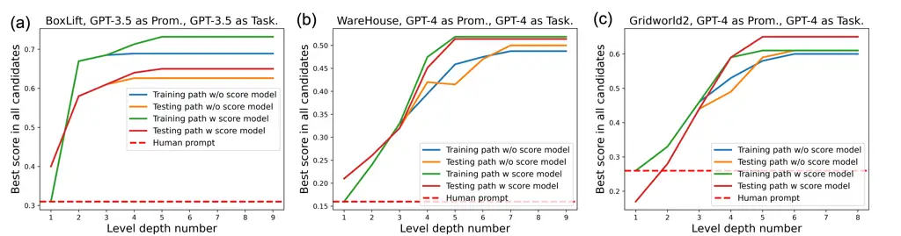

Figure 6: Ablation study of applying score models for prompt selection.
The optimization trace with score model finds better prompts with less
iteration steps, across all the three tasks BoxLift, WareHouse, and
GridWorld2.

## Appendix H Efforts for designing human feedback rules

Regarding the expected human efforts when designing the feedback rules,
we note that several of the templates are common across all tasks (e.g.
syntax errors). Thus, for a novel task, a human user is only expected to
need to design a few (3-5) templates, and they are typically intuitive
as they relate to the specific task. While this is a low-effort
requirement, our primary experimental results show that this effort can
significantly improve task performance.

In order to better understand the generalizability of the human-designed
feedback templates, we perform an additional ablation study as shown in
Table 5. In our work, the original feedback templates did not require
iterations via trial-and-error over possible versions. In the ablation
study, we compare using the original templates with four other
variations of the templates:

(1) Paraphrased We use GPT-4 to generate semantically-consistent
paraphrased versions of the original feedback templates to replace the
original templates. This both simulates variation across human users and
tests the sensitivity of the wording.

(2) Random We use GPT-4 to generate 10 different versions of a template
for each type of error. During optimization, we randomly sample from
these 10 possible templates per error type, introducing more
fine-grained variation than in (1).

(3) WO response component In the original feedback templates, we
included the output of the TaskLLM that was incorrect (see Figure 2) for
better reasoning of PromptLLM. In this ablation, we test the impact of
removing this component.

(4) WO stuck in the loop We exclude the error type of being stuck in a
loop to test the impact of a human user choosing to include different
types of error feedback. The results for two tasks from our larger
experiments are provided below.

The results in Table 5 show that variability over the wording of the
templates has little impact on the performance of PROMST. Interestingly,
randomly choosing paraphrased templates ((2) from the above description)
generally improves performance; we suspect this may be due to increased
diversity over generated prompt candidates and is worth further
investigation. This ablation also shows that removing the TaskLLM
response ((3) from above) and removing the ’stuck in a loop’ error type
both reduce the performance. Based on the above discussion, we can
conclude that including the response in the feedback template is a
useful task- and error-agnostic guiding principle.

## Appendix I Component changes in each environment

In this section we display the evolution of task executing
characteristics (task success number, executing step number, syntactic
error number, query limit error number, stuck in loop number, collision
error number) vs. testing scores for all the prompts explored during
prompt optimization process. The three shown tasks (BoxLift, BoxNet1,
BoxNet2) share the same trends such as the rising executing step number
and decreasing syntactic error number with the increasing testing score,
but also have different trends such as stuck in loop number.

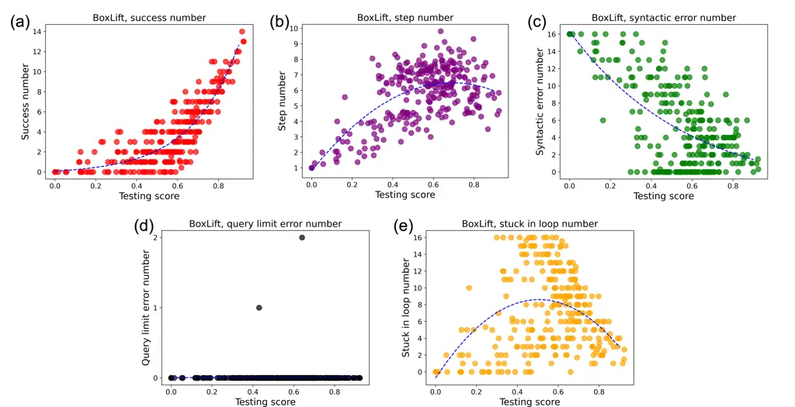

Figure 7: Component change of BoxLift.

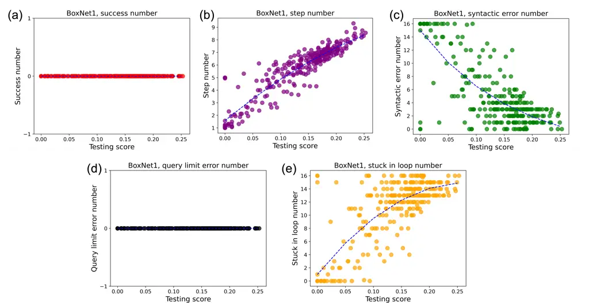

Figure 8: Component change of BoxNet1.

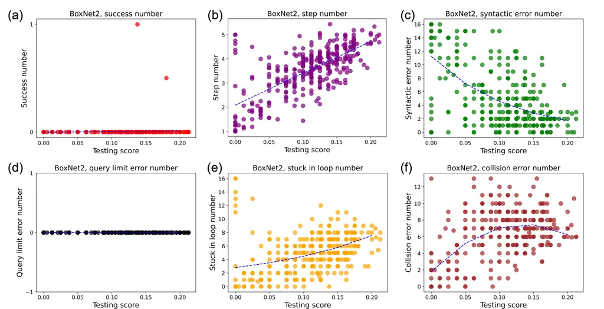

Figure 9: Component change of BoxNet2.

## Appendix J The influence of score functions

The choice of score function impacts prompt optimization. The initial
score functions in Equation 4 are simple and intuitive, only caring
about the number of goals/sub-steps accomplished. However, humans may
have different preferences for the same task. For instance, a user may
also care about efficiency (the number of action steps taken) or safety
(collision avoidance). We observe a general trend that the step number
increases as the prompt score increases in all the three shown tasks
(see Appendix I). However, in BoxNet2 (Figure 9) the collision error
number gradually increases with the increasing prompt scores. These two
general trends are not aligned with the user preference.

Then how to design the score function to balance user preferences
remains an issue. In Appendix J, we tried the two forms of modified
scores:

```math
S_{M}=S_{O}-\text{ratio}*\text{factor_value} \tag{5}
```

```math
S_{M}=S_{O}/(1+\text{ratio}*\text{factor_value}), \tag{6}
```

where $`S_{M}`$ and $`S_{O}`$ are the modified score and the original
score (defined in Equation 4), respectively. The factor*value is a
factor that the user cares about, e.g., step number or collision error
number. We find that the general $`S*{M}`$ vs. $`S\_{O}`$ trend can be
tuned quite disparately by adjusting the hyperparameter ratio (see
Figure 10 and Figure 11).

We choose two modified score functions that trend similarly to the
original score function. Then we optimize the prompts with PROMST but
using modified score function. To save computing resources, we
initialize the prompt optimization with the best prompts found with the
original score function. Figure 12 shows the optimization results.
Compared to the original prompts acquired with the original score
function (red), the newly discovered prompts (green) generally have
higher modified scores, though the values of original scores slightly
decrease. This suggests that we can align with human preferences by
changing the form of the score functions, which can be captured and
revealed by the selection framework in PROMST.

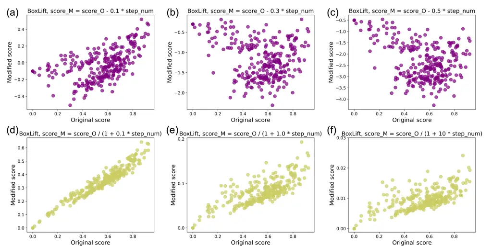

Figure 10: Modified score of BoxLift.

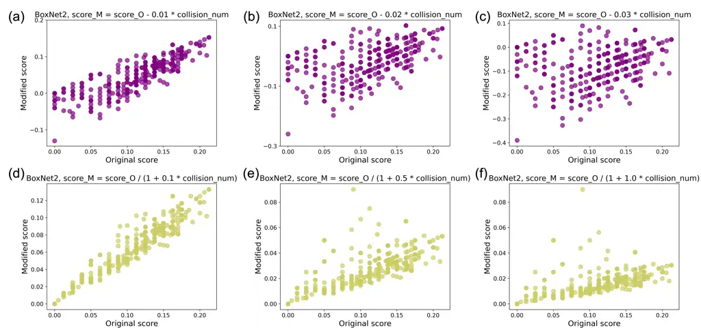

Figure 11: Modified score of BoxNet2.

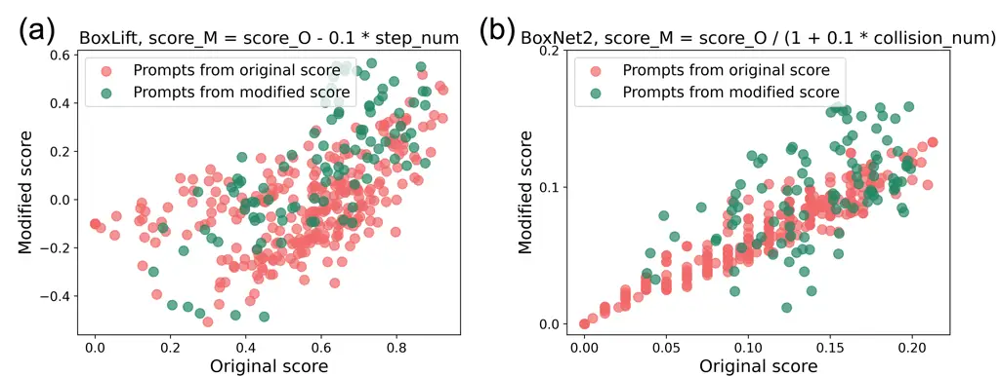

Figure 12: Human preference alignment via tuning score functions. The
green dots are the new prompts further optimized over new score rules.

## Appendix K Explanability for better prompts

We are interested in whether there are features of the prompts that
correlate with high scores.

Prompt score vs. token length and perplexity As plotted in Figure 13, we
found that there is a rough trend across different tasks that longer
prompts corresponded with higher scores. We also investigated prompt
perplexity (using GPT-2 to get prompt token log probabilities) but found
no clear correlation. All the initial and discovered best prompts are
listed in Appendix M.

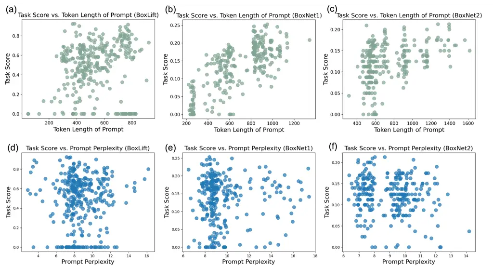

Figure 13: Score vs. prompt token length and score vs. prompt perplexity
for all the explored prompts in each task BoxLift, BoxNet1, and BoxNet2.

Listing careful points one by one clearly We also find some clues about
better component emergence. The best prompts tend to list all the
careful points of the task one by one clearly, which is consistent to
human intuitions. To study whether this characteristic can effectively
improve the performance, we carry out the ablation study by compressing
these careful points into shortened context summarized by GPT-4 and then
testing their performance. We obtain contexts of varying token lengths
by querying GPT-4 to summarize with different levels of detail. In the
following two texts, we display the original best prompt of BoxLift with
token length of 326 and one corresponding compressed prompt with token
length of 145 as an example. As shown in Figure 14, the task score of
both BoxLift and GridWorld2 decline with the decreasing length of
careful points part. This reveals that listing the careful points of the
task one by one clearly is an effective method to enhance task executing
performance, which is automatically emerged from prompt optimization
process. This characteristic also inspires the designing of prompts in
complex tasks with multiple constraints.


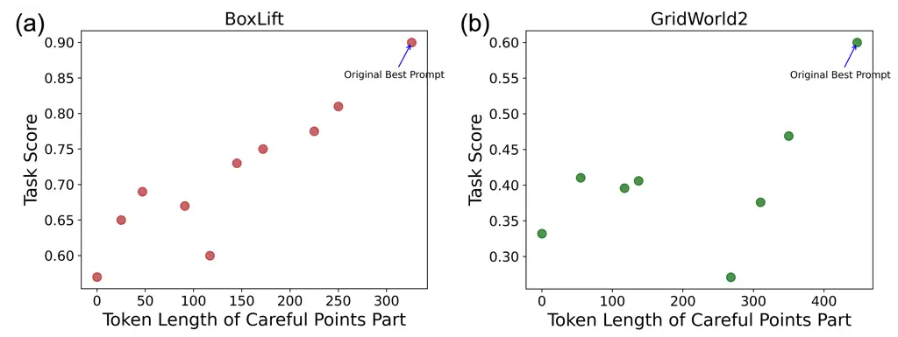

Figure 14: Evolution of Task Score vs. Token Length of Careful Points
Part in BoxLift and GridWorld2. The contexts of careful points part with
different token lengths are summarized by GPT-4. The topmost data point
is the original context from the best prompt in each task.

## Appendix L Comparison and combination with Reflexion

Instead of utilizing the execution feedback by optimizing offline
prompts such as PROMST, dynamic approaches like Reflexion Shinn et al.
(2024) directly optimizing the action plan during multiple online
trials. These methods assume the agent has chances of trying multiple
trials and the new trial depends on the reflection from previous failed
trials. The contexts summarized from the reflection are saved in the
memory module, which is unique for each testing case. Though the
original approach can not be directly applied into the task of prompt
optimization, here we modify the original online Reflexion into the
offline Reflexion for the comparison with PROMST on prompt optimization.
That is, we add the memory module into the initial prompt to explore
whether it can help improve the prompt performance.

Since the memory module is varied in each testing case, we tried two
methods to add onto the initial prompt: 1) Offline Reflexion 1: Directly
concatenating several numbers/cases of memory module with the initial
prompt; 2) Offline Reflexion 2: Querying LLM to summarize the memory
from the multiple cases and then concatenate with the initial prompt.
The prompts used for acquiring memory modules are from the Reflexion
paper, while the summarization prompt is designed by ourselves. The
feedback is purely from the environment without the human factors.

Table 10 shows the testing results. We find that the Offline Reflexion 1
is not very effective in prompt optimization. The reason is that the
distilled memory is always too case-specific so that the context can not
well generalize to the diversified testing data. Meanwhile, the memory
in each case is lengthy so that the final prompt can only contain 3-5
cases, which can not act as a well-rounded guidance during testing. The
summarization over multiple case memories is a good way to mitigate this
issue, as shown in Offline Reflexion 2. However, Offline Reflexion 2 is
still not as effective as PROMST, which is reasonable since Offline
Reflexion 2 does not have following modules compared to PROMST:
optimization on classifying the error types, human feedback, genetic
algorithms, and score prediction model.

We further test whether PROMST can perform better when integrating with
Online Reflexion. That means we directly test the best prompts
discovered in PROMST under the multi-trial setting and use Reflexion as
the online feedback module. The results in Table 10 reveal that the
online feedback truly further enhances the agent performance, which is
consistent with the intuition since previous failed trials help a better
decision making in the current trial. The above results show that PROMST
performs better than Reflexion in offline prompt optimization and can
well combine with Reflexion in online task execution, resulting into a
better solution.

|                                        |        |                     |                     |                           |
| -------------------------------------- | ------ | ------------------- | ------------------- | ------------------------- |
| GPT-3.5-as-TaskLLM, GPT-4-as-PromptLLM |        |                     |                     |                           |
| Task                                   | PROMST | Offline Reflexion 1 | Offline Reflexion 2 | PROMST + Online Reflexion |
| BoxNet2                                | 0.22   | 0.12                | 0.15                | 0.27                      |
| BoxLift                                | 0.90   | 0.52                | 0.63                | 1.0                       |
| Blocksworld                            | 0.60   | 0.21                | 0.32                | 0.63                      |

Table 10: Comparison and combination with dynamic approach Reflexion.

## Appendix M Human prompts and discovered best prompts for GPT-3.5-0613 and GPT-4 in all the 11 multi-step tasks

Our work can serve as a benchmark for prompt optimization, particularly
on multi-step agent tasks. Hence, we list all the initial human prompts
and discovered best prompts for GPT-3.5-0613 and GPT-4 models across the
11 tasks. Note that we do not list the best prompt of GPT-4 in BoxLift
since the optimized prompt can easily achieve the full score 1.0. We
also do not list the best prompt of GPT-3.5-0613 in WareHouse since all
the discovered prompts achieve scores near 0.0.


