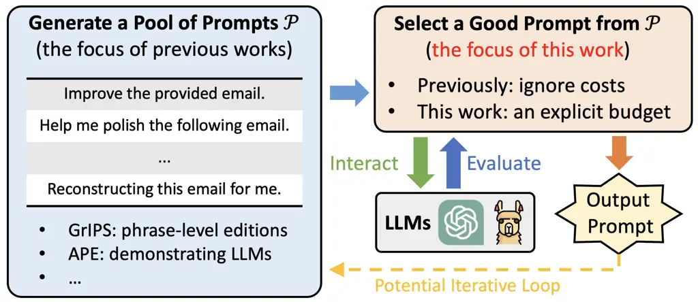
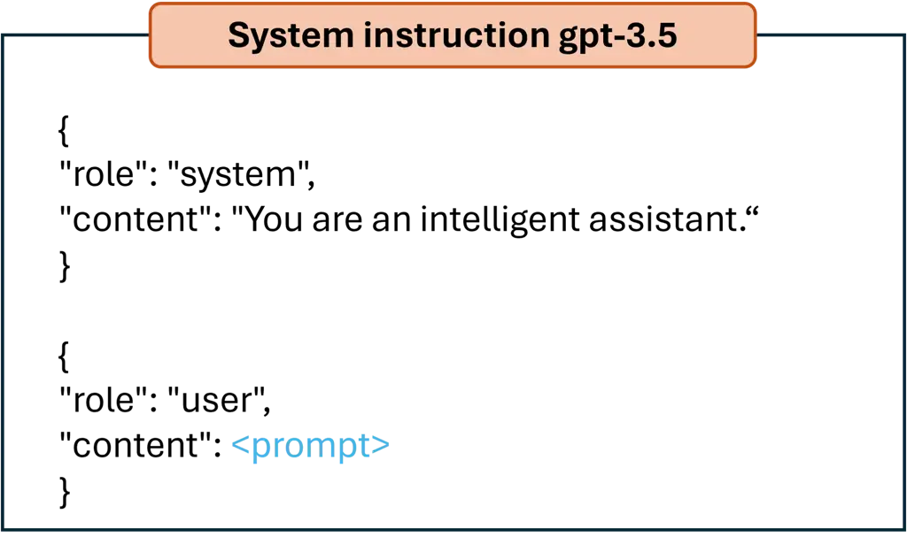
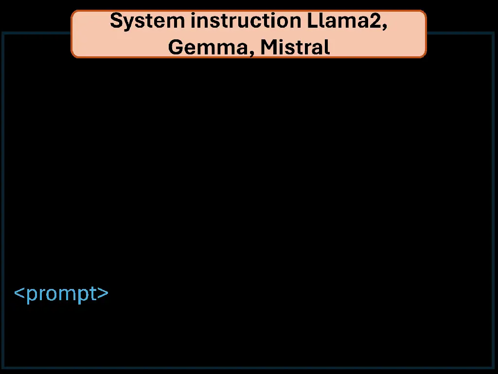
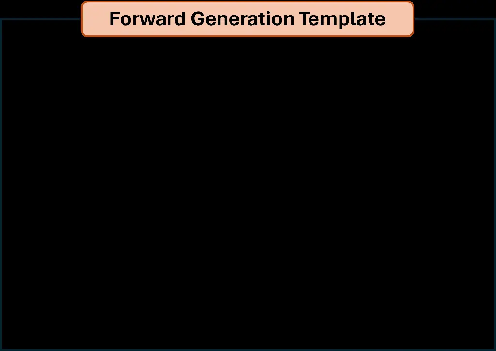
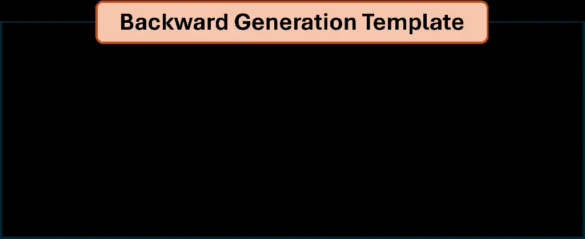
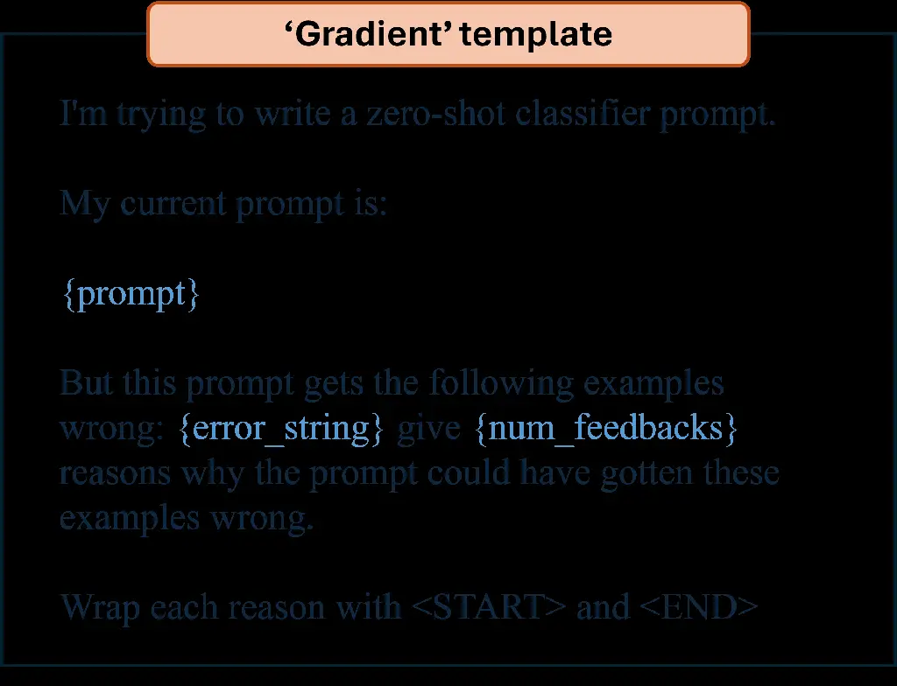
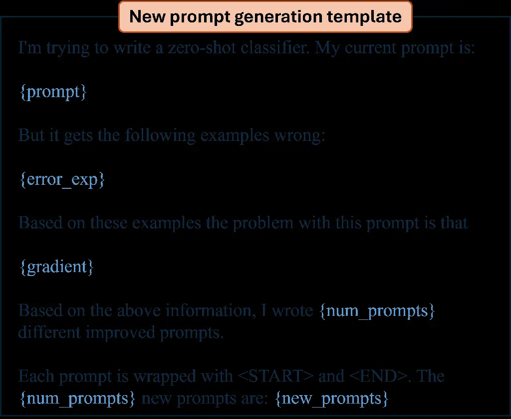
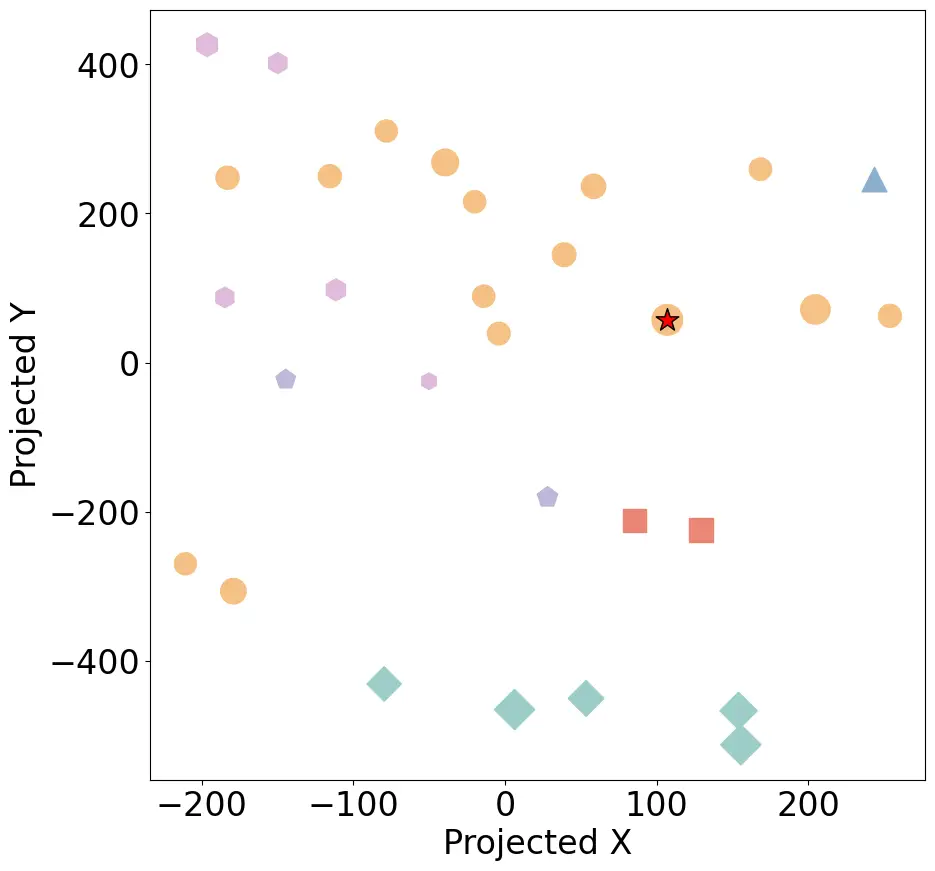
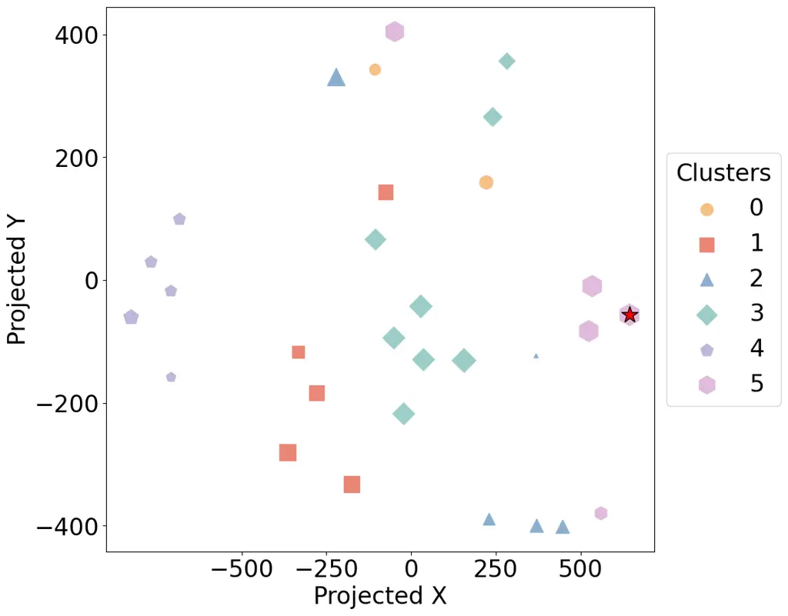

# Efficient Prompt Optimization Through the Lens of Best Arm Identification

Chengshuai Shi ^(†)^(†)thanks: indicates equal contributions, random
order. Affiliation: {cs7ync, ky9tc, brf3rx, jundong, cong}@virginia.edu,
University of Virginia    Kun Yang^(∗) Affiliation: {cs7ync, ky9tc,
brf3rx, jundong, cong}@virginia.edu, University of Virginia    Zihan
Chen Affiliation: {cs7ync, ky9tc, brf3rx, jundong, cong}@virginia.edu,
University of Virginia     
Jundong Li Affiliation: {cs7ync, ky9tc, brf3rx, jundong,
cong}@virginia.edu, University of Virginia    Jing Yang
Affiliation: yangjing@psu.edu, The Pennsylvania State University    Cong
Shen Affiliation: {cs7ync, ky9tc, brf3rx, jundong, cong}@virginia.edu,
University of Virginia

###### Abstract

The remarkable instruction-following capability of large language models
(LLMs) has sparked a growing interest in automatically finding good
prompts, i.e., prompt optimization. Most existing works follow the
scheme of selecting from a pre-generated pool of candidate prompts.
However, these designs mainly focus on the generation strategy, while
limited attention has been paid to the selection method. Especially, the
cost incurred during the selection (e.g., accessing LLM and evaluating
the responses) is rarely explicitly considered. To overcome this
limitation, this work provides a principled framework, TRIPLE, to
efficiently perform prompt selection under an explicit budget
constraint. TRIPLE is built on a novel connection established between
prompt optimization and fixed-budget best arm identification (BAI-FB) in
multi-armed bandits (MAB); thus, it is capable of leveraging the rich
toolbox from BAI-FB systematically and also incorporating unique
characteristics of prompt optimization. Extensive experiments on
multiple well-adopted tasks using various LLMs demonstrate the
remarkable performance improvement of TRIPLE over baselines while
satisfying the limited budget constraints. As an extension, variants of
TRIPLE are proposed to efficiently select examples for few-shot prompts,
also achieving superior empirical performance.

## 1 Introduction

Large language models (LLMs) have rapidly changed technology landscapes
in our society (Devlin et al.,, 2018; Touvron et al., 2023a, ; Touvron
et al., 2023b, ; Bubeck et al.,, 2023; OpenAI, 2023a, ). Researchers
continuously find effective ways to unlock their potential on various
downstream tasks. Among different research directions, the remarkable
ability of LLMs to follow instructions has motivated the study of
searching for suitable prompts to interact with them (Liu et al.,,
2023). This approach is particularly attractive as it does not require
updating the inside parameters of an LLM, and is natural in the way of
human conversations. Nevertheless, it has also been recognized that the
performance of an LLM is sensitive to the selected prompts (Zhao
et al.,, 2021; Lu et al.,, 2021), and manually designing suitable
prompts can be a labor-intensive process (Mishra et al.,, 2021). Thus,
there is a growing interest to perform automatic prompt optimization
(Zhou et al.,, 2022; Xu et al.,, 2022; Diao et al.,, 2022; Deng et al.,,
2022; Prasad et al.,, 2022; Zhang et al., 2023a, ; Guo et al.,, 2023;
Pan et al.,, 2023; Pryzant et al.,, 2023; Yang et al.,, 2023).

While these studies have proposed different prompt optimization designs,
they commonly follow the approach of generating a pool of candidate
prompts and then selecting from them. With a deeper look, it can be
recognized that the focus in these existing works largely leans towards
how to generate the candidate pool, while limitation attention have been
paid towards how to select from the candidates. For example, many works
(Jiang et al.,, 2020; Xu et al.,, 2022; Guo et al.,, 2023; Prasad
et al.,, 2022) directly evaluate all the generated prompts on the entire
development dataset. However, this less-emphasized selection process
typically requires accesses to LLMs, which are often (1) financially
costly (e.g., each OpenAI API access incurs a cost); (2) time-wise
consuming (e.g., even a locally hosted LLM would typically require
seconds to respond); (3) under total usage limits (e.g., OpenAI has hard
per-day and per-month limits on API accesses). Furthermore, it is often
overlooked that evaluating the responses of an LLM for different
candidate prompts can be costly as many tasks (e.g., writing
improvement, mathematical reasoning, etc.) would require human (and
sometimes domain expert) opinions. As a result, the prompt optimization
process can incur an unaffordable cost without a proper selection
method.

To make the learning process more accessible, this work proposes to
study prompt optimization under an explicitly imposed budget constraint
when interacting with the targeted LLM, in addition to the previously
considered requirements (e.g., discrete, interpretable, and black-box).
To the best of our knowledge, budget constraints are only briefly
mentioned in Zhou et al., (2022); Pryzant et al., (2023), and there are
no systematic or principled investigations of how to address the limited
budget constraint in prompt optimization. The main contributions of this
work are summarized as follows.

$`\bullet`$ The constraint of a limited budget is explicitly introduced
into prompt optimization, which has been largely ignored before. As most
of the prompt optimization methods rely on selecting from a
pre-generated candidate prompt pool, we focus our study on how to
carefully allocate budgets to test each candidate prompt so that the
optimal one can be learned efficiently and effectively.

$`\bullet`$ We propose a general solution framework, termed TRIPLE (besT
aRm Identification for Prompt LEarning), by establishing a novel
connection between prompt optimization and multi-armed bandits (MAB)
(Lattimore and Szepesvári,, 2020). In particular, we focus on harnessing
the power of fixed-budget best arm identification (BAI-FB) (Audibert
et al.,, 2010; Karnin et al.,, 2013) to address prompt optimization
(especially, selection) with a limited budget constraint. Two
representative designs TRIPLE-SH and TRIPLE-CR, inspired by celebrated
BAI-FB algorithms, are presented. To improve scalability, two enhanced
methods, TRIPLE-CLST and TRIPLE-GSE, are further proposed, where prompt
embeddings are leveraged by exploiting the ideas of clustering and
function approximation to accelerate the learning process.

$`\bullet`$ Extensive experimental results are reported using
well-adopted prompt tasks and varying LLMs to demonstrate the
superiority of TRIPLE over previous baselines. In particular, on GPT3.5
and Llama2, compared with baseline methods also not using prompt
embeddings, the basic TRIPLE-SH and TRIPLE-CR achieves performance
improvements by (on average) $`3\%`$ to $`16\%`$. When leveraging prompt
embeddings, the enhanced TRIPLE-CLST and TRIPLE-GSE also outperform
corresponding baselines by (on average) $`10\%`$ to $`56\%`$ with fewer
prompts than budget and (on average) $`16\%`$ to $`45\%`$ with more
prompts than budget. The gains are further evidenced on other LLMs,
i.e., Gemma and Mistral. Moreover, the proposed methods can be directly
plugged into two popular prompt optimization pipelines, APE (Zhou
et al.,, 2022) and APO (Pryzant et al.,, 2023), with end-to-end
performances significantly improved over their original implementations.

$`\bullet`$ This work extends broadly to providing a new perspective of
prompt optimization from MAB, and also a new application scenario of MAB
in prompt optimization. This established connection may spark further
innovations in both fields. As one concrete example, we extend the study
to optimizing the selection of examples in few-shot prompts (Brown
et al.,, 2020), which can be recognized as a BAI-FB problem in the setup
of combinatorial bandits (Chen et al.,, 2014; Bubeck et al.,, 2013).
Experimental results illustrate that the extensions of TRIPLE achieve
superior performance, demonstrating its rich potential.

Key Related Works. We discuss a few works that explicitly or implicitly
touch upon the selection efficiency in prompt optimization, and a
complete literature review can be found in Appendix A. First, Zhou
et al., (2022) discusses a naive filtering strategy without theoretical
or empirical justifications. Chen et al., (2023) leverages Bayesian
optimization (BO) with expected improvement (EI) as the acquisition
function to select continuous soft prompts. BO can be viewed as similar
to BAI while mostly focusing on infinite-arm cases (Shahriari et al.,,
2015). Moreover, Pryzant et al., (2023); Lin et al., (2023) use specific
MAB methods targeting regret minimization to perform prompt selection,
which, as further illustrated in Sec. 3.3, are not well-suited as they
optimize the cumulative selection performance over a period instead of
the final selection output. Thus, compared with this work, existing
investigations either lack a comprehensive discussion of the connection
between prompt optimization and MAB, or choose unsuitable MAB techniques
to tackle prompt optimization. Moreover, as illustrated in Sec. 5, the
TRIPLE solution outperform the previously adopted methods empirically.

## 2 Prompt Optimization under a Limited Budget

Following Zhou et al., (2022); Chen et al., (2023), we present a
concrete formulation of the problem of prompt optimization. Consider
that we are using an LLM $`f(\cdot)`$, which provides a mapping from any
input $`X\in{\mathcal{V}}`$ to a distribution $`\Delta_{{\mathcal{V}}}`$
over the language space $`{\mathcal{V}}`$. The answer
$`\hat{Y}\in{\mathcal{V}}`$ given by the LLM is assumed to be sampled
from $`f(X)`$ as $`\hat{Y}\sim f(X)`$. Note that instead of treating
$`f(\cdot)`$ as a deterministic function providing a specific output
answer, we generally consider the practical setting where the answers of
LLM exhibit a certain level of randomness.

For prompt optimization, we aim to find a prompt $`p`$ such that when
concatenated with inputs $`X`$ of a certain task (i.e, as $`[p;X]`$), it
provides good performance in expectation with respect to the input
distribution $`{\mathcal{I}}_{X}`$ and the inherent randomness of LLM
$`f(\cdot)`$. The performance is measured as
$`\mu(p):=\mathbb{E}_{X\sim{\mathcal{I}}_{X}}\mathbb{E}_{\hat{Y}\sim f([p;X])}[s(X,\hat{Y})]`$,
where $`s(X,\hat{Y})`$ denotes a score function that measures the
quality of the output $`\hat{Y}`$ for the input $`X`$.

Motivated by the common usage scenario of LLMs, recent studies have
imposed several constraints on this learning problem (Zhou et al.,,
2022; Pan et al.,, 2023; Chen et al.,, 2023; Guo et al.,, 2023), where
the three key ones are (I) black-box: the method can be applied to
black-box LLMs, i.e., only have access to an API $`f(\cdot)`$ and no
access to the intermediate structure or parameters inside (including
gradients, output likelihood, etc.); (II) discrete: the learned prompt
must be discrete characters, instead of continuous values (i.e., soft
prompts); and (III) interpretable: the learned prompt must be
understandable by humans, instead of gibberish words.

Intuitively, the process of learning a good prompt requires interactions
with the LLM (i.e., sample $`\hat{Y}\sim f([p;X])`$ and evaluating its
responses (i.e., obtain score $`s(X,\hat{Y})`$). However, as mentioned
in Sec. 1, such interactions and evaluations are costly. Thus, besides
the aforementioned constraints, we further explicitly take into account
that the prompt optimization process should have (IV) a limited budget:
the total number of trials with the LLM that happen during the learning
is at most $`N`$. Finally, the prompt optimization problem considered in
this work can be formulated as: finding $`p^{*}`$ with high performance
$`\mu(p^{*})`$ under constraints of black-box, discrete, interpretable,
and a limited budget.

Directly tackling this prompt optimization problem has been widely
recognized as challenging even without the constraint of a limited
budget (Liu et al.,, 2023). As highlighted in Pryzant et al., (2023);
Chen et al., (2023), it essentially requires performing a black-box
discrete optimization. Instead, many proposed methods rely on the
pipeline of first generating a pool of candidate prompts and then
selecting from it (Jiang et al.,, 2020; Zhou et al.,, 2022; Xu et al.,,
2022; Prasad et al.,, 2022; Guo et al.,, 2023). The prompt generation
can either be performed manually or follow designed automatic protocols.
For example, the famous APE design (Zhou et al.,, 2022) selects from
prompts generated by an LLM using demonstrations. From a unified
perspective, we can simplify the problem into generating a pool of
prompts $`{\mathcal{P}}`$ and finding the optimal prompt in it:
$`p^{*}:=\argmax\nolimits_{p\in{\mathcal{P}}}\mu(p)`$.



Figure 1: The commonly adopted prompt optimization pipeline. Previous
works mostly investigate the generation component and ignore costs
during selection, where GrIPS and APE are proposed in Prasad et al.,
(2022); Zhou et al., (2022). This work, instead, focuses on the
selection component under an explicit budget constraint.

While many efforts have been devoted along this line, we recognize that
they are largely focused on how to generate prompts, while limited
attention has been paid to how to select from the already generated
prompts (as mentioned in Sec. 1 and further discussed in Appendix A).
Naive treatments, such as uniformly evaluating all prompts, are
understandable since budget limitations are not considered previously,
i.e., unlimited evaluations can be performed. With an explicit budget
limitation, however, we need to carefully allocate the budgets to each
prompt so that the optimal prompt (or at least a sufficiently good one)
can be correctly learned, which is the main focus of this work. An
overview of the considered prompt optimization pipeline and our focus is
illustrated in Fig. 1.

## 3 Connecting Prompt Optimization with Best Arm Identification

We provide a new perspective of prompt optimization through the lens of
tools in multi-armed bandits (MAB) (Lattimore and Szepesvári,, 2020; Lai
and Robbins,, 1985). In particular, prompt optimization under a limited
budget is shown to be intrinsically aligned with the problem of
fixed-budget best-arm identification (BAI-FB) (Audibert et al.,, 2010;
Karnin et al.,, 2013). In the following, a brief introduction to MAB is
first provided. Then, the connection between prompt optimization
(especially selection) and MAB (especially BAI-FB) is established. Based
on this connection, we propose to fully leverage the rich toolbox from
BAI-FB to perform efficient prompt optimization.

### 3.1 Multi-armed Bandits

The research of multi-armed bandits (MAB) has a long and rich history;
see representative surveys of Lattimore and Szepesvári, (2020); Bubeck
et al., (2012). The most basic form of MAB, i.e., the finite-armed
stochastic bandits, considers a system with a set $`{\mathcal{K}}`$
finite arms (i.e., actions) that provide stochastic rewards when pulled.
When interacting with the system, the agent can select one arm
$`k\in{\mathcal{K}}`$ to pull at each time, and she receives a
stochastic reward: $`r_{k}\sim\texttt{dist}_{k}(\nu_{k})`$, where
$`\texttt{dist}_{k}(\nu_{k})`$ denotes the action $`k`$’s reward
distribution with an unknown expectation $`\nu_{k}`$.

The learning objective of the agent in MAB can be roughly divided into
two categories: (1) regret minimization, which maximizes the expected
cumulative rewards collected by the agent (Auer et al.,, 2002; Audibert
et al.,, 2009; Garivier and Cappé,, 2011); (2) best arm identification,
which targets at outputting the best arm
$`k^{*}=\argmax_{k\in{\mathcal{K}}}\nu_{k}`$ (Audibert et al.,, 2010;
Garivier and Kaufmann,, 2016; Jamieson and Nowak,, 2014). These two
objectives often require different learning strategies. Regret
minimization typically relies on a carefully designed balance between
exploration (i.e., obtaining new information) and exploitation (i.e.,
collecting higher rewards based on the previous information). Best arm
identification, on the other hand, is also called pure exploration as it
only focuses on obtaining information to find the best arm. We here
particularly note that although the designs targeting regret
minimization often can converge to the optimal arm $`k^{*}`$ given a
sufficient period of time, they are known to be inefficient for the
objective of best arm identification in the MAB studies.

### 3.2 A Bandit View of Prompt Optimization

Based on the above introduction, it can be intuitively understood that
the prompt optimization (especially, selection) problem can be mapped
into an MAB setting:

- •
  The pool of candidate prompts $`{\mathcal{P}}`$ is equivalent to the
  set of arms $`{\mathcal{K}}`$;
- •
  Using a prompt $`p`$ to interact with LLM can be viewed as selecting a
  bandit arm $`k`$ to pull in MAB;
- •
  The feedback of the score function, i.e., $`s(X,\hat{Y})`$, provides
  the reward signal $`r_{k}`$, where $`\texttt{dist}_{k}(\nu_{k})`$
  characterizes the randomness of $`X\sim{\mathcal{I}}_{X}`$ and
  $`\hat{Y}\sim f([p;X])`$. The expected performance $`\mu(p)`$ is the
  counterpart of the expected reward $`\nu_{k}`$ in MAB.

It can be further recognized that the target of prompt optimization is
more suitable to be captured as the best arm identification (BAI)
problem, instead of a regret minimization one, as it only cares about
finding the optimal prompt $`p^{*}`$ instead of the cumulative
performance of interactions performed during the learning process.

|                                                 |                                               |
| ----------------------------------------------- | --------------------------------------------- |
| Prompt Optimization                             | Multi-armed Bandits                           |
| The pool of prompts $`{\mathcal{P}}`$           | The arm set $`{\mathcal{K}}`$                 |
| Interact LLM via prompt $`p`$                   | Pull arm $`k`$                                |
| Score $`s(X,\hat{Y})`$                          | Reward $`r_{k}`$                              |
| Randomness in $`X`$ and $`\hat{Y}`$             | Randomness in $`\texttt{dist}_{k}`$           |
| Performance $`\mu(p)`$                          | Expected reward $`\nu_{k}`$                   |
| Learn the optimal prompt under a limited budget | Fixed-budget best arm identification (BAI-FB) |

Table 1: Prompt Optimization and MAB.

With the relationship between prompt optimization and BAI established,
we further consider the constraint of learning under a limited budget.
We argue that this aligns with one of the main research directions in
BAI called fixed-budget best arm identification (BAI-FB) (Karnin
et al.,, 2013; Wang et al.,, 2023; Gabillon et al.,, 2012). BAI-FB
particularly considers the problem of maximizing the probability of
correctly identifying the best arm $`k^{*}`$ while not pulling arms more
than $`T`$ times. It can be observed that this formulation matches the
goal of prompt optimization under a limited budget; thus BAI-FB provides
a perfect toolbox to enhance the commonly required prompt selection
process. The connection between prompt optimization and MAB, in
particular, BAI-FB, is further illustrated in Table 1. To avoid
confusion, in the remainder of this paper, we will adopt the notation of
prompt optimization as introduced in Sec. 2.

### 3.3 Harnessing the Power of BAI-FB

As mentioned, we recognize that prompt optimization under a limited
budget is a matching application scenario for BAI-FB. In this paper, we
propose a general framework called TRIPLE (besT aRm Identification for
Prompt LEarning) to harness the power of BAI-FB in solving the prompt
optimization problem. This is possible because BAI-FB has witnessed
significant development over the years, with several efficient designs
being proposed. As a first step, we choose two popular and successful
BAI-FB schemes and implement them for prompt optimization, which are
briefly described below. Their complete descriptions are provided in
Algs. 2 and 3 of Appendix C.

Sequential Halving (SH). SH is one of the first provably efficient
BAI-FB designs (Karnin et al.,, 2013) and remains popular after a decade
of its proposal. It follows a protocol that divides the total budget
$`N`$ into $`\lceil\log_{2}(|{\mathcal{P}}|)\rceil`$ equal-length
phases. In each phase, SH uniformly tries all active prompts
(initialized as $`{\mathcal{P}}`$) and eliminates half of them with the
lower sample means for the next phase. The final active arm is output as
the identified optimal prompt.

Continuously Reject (CR). CR is a recently proposed method (Wang
et al.,, 2023), which can be viewed as an extension of the classical
Successively Reject (SR) design (Audibert et al.,, 2010). It uniformly
explores active prompts (initialized as $`{\mathcal{P}}`$) and performs
potential elimination of poorly-performed prompts after each pull. The
elimination is based on carefully designed criteria using the Large
Deviation Principle. It can be observed that, without the phased
structure, CR is more adaptive than SH (and SR), which makes it
appealing both theoretically and practically.

While MAB has found broad applications in recommender systems (Li
et al.,, 2010), healthcare (Shen et al.,, 2020), wireless communications
(Gai et al.,, 2012), and beyond (Bouneffouf and Rish,, 2019), a
systematical connection between MAB and prompt optimization has not been
established before to the best of our knowledge, which may spark new
research activities (see discussions in Sec. 7). In addition, although
SH and CR are selected as the representatives, the connection between
prompt optimization and MAB is fundamental. Any existing or forthcoming
BAI-FB designs can be flexibly incorporated into TRIPLE, e.g., the
Bayesian perspective provided in Komiyama et al., (2023); Atsidakou
et al., (2022)

###### Remark 3.1.

As mentioned in Sec. 1, Pryzant et al., (2023); Lin et al., (2023)
leverage specific MAB designs to perform prompt selection without a
comprehensive discussion as above on their connection. Moreover, Pryzant
et al., (2023) argues that UCB (Auer et al.,, 2002) is suitable, while
Lin et al., (2023) also uses a UCB-variant, NeuralUCB (Zhou et al.,,
2020), as the core method. However, both of UCB and NeuralUCB are
designed for regret minimization (i.e., optimizing the cumulative
interaction performance during learning). As illustrated in Sec. 3.1,
designs for regret minimization cannot achieve optimal performance for
the goal of identifying the optimal arm (i.e., BAI), which thus are not
well-suited for prompt optimization.

## 4 Handling Large Candidate Pools via Prompt Embeddings

The connection bulit in the last section provides us with the core idea
of leveraging BAI-FB designs to tackle prompt optimization. As having
been theoretically established (Audibert et al.,, 2010), solving BAI-FB
without additional structures, however, will unavoidably incur an
identification error that is positively related to the number of
candidate prompts $`|{\mathcal{P}}|`$. In other words, given a larger
pool of prompts, it becomes harder to find the optimal prompt with the
basic BAI-FB designs, which restricts their applicability to practical
prompt optimization problems (where possibly the number of prompts
exceeds the budget).

The key reason behind this is that each candidate prompt is treated
_independently_ in the basic BAI-FB. Thus, budgets need to be assigned
to all the prompts and no information can be shared among them, which is
often not the case in prompt optimization. For a prompt optimization
problem, the underlying task is often stable, e.g., rewriting emails,
constructing TLDR, etc. The candidate prompts, regardless of their
generation methods, should all reflect the purpose of the underlying
task and thus share similarities. For example, the candidate prompts
generated via demonstrating LLMs (Zhou et al.,, 2022) often share
similar structures and differ only in a few words or word orders.

With the above observation, we target sharing information among prompts
during learning. To achieve this, we propose to leverage an embedding
model, denoted as $`\texttt{embed}:{\mathcal{V}}\to{\mathbb{R}}^{d}`$,
to obtain the sentence embedding of the prompts:
$`e(p):=\texttt{embed}(p)\in{\mathbb{R}}^{d},~~{\mathcal{E}}:=\{e(p):p\in{\mathcal{P}}\}`$,
where $`d`$ refers to the embedding dimension. In the experiments, the
OpenAI embedding API is adopted while, in general, any sufficiently
expressive models can be incorporated. Also, due to this flexibility,
using embedding models is fundamentally different from requiring a
white-box LLM (Chen et al.,, 2023; Lin et al.,, 2023). With the obtained
prompt embeddings, we propose two useful enhancements to further improve
the learning effectiveness when the pool of candidate prompts is large.

### 4.1 Leveraging Similarities via Clustering

1:  Input: the pool of candidate prompts $`{\mathcal{P}}`$ and their
embeddings $`{\mathcal{E}}`$, overall budget $`N`$, Phase I budget
$`N_{1}`$, number of clusters $`L`$

2:  Cluster $`{\mathcal{P}}`$ into clusters
$`{\mathcal{C}}=\{{\mathcal{C}}^{1},\cdots,{\mathcal{C}}^{L}\}`$ based
on embeddings $`{\mathcal{E}}`$ (e.g., via $`k`$-means)

3:  Obtain
$`\widehat{{\mathcal{C}}}^{*}\leftarrow\text{BAI-FB}({\mathcal{C}},N_{1})`$
{Phase I}

4:  Obtain
$`\hat{p}^{*}\leftarrow\text{BAI-FB}(\widehat{{\mathcal{C}}}^{*},N-N_{1})`${Phase
II}

5:  Output: prompt $`\hat{p}^{*}`$

Algorithm 1 TRIPLE-CLST

Since the key challenge is a large pool of candidate prompts, an
intuitive idea is to effectively decrease the size of the pool. We thus
propose a two-phased BAI-FB scheme for prompt optimization. In Phase I,
the entire pool of candidate prompts is clustered into several groups
based on their embeddings, and BAI-FB is performed on the clusters with
an initial target of finding the optimal cluster (or the few good
clusters). Then, in Phase II, BAI-FB is performed on the prompts in the
optimal cluster with the target of identifying one final prompt. For
both phases, different BAI-FB designs can be incorporated, e.g., SH and
CR. The entire procedure, referred to as TRIPLE-CLST, is described in
Alg. 1.

The effectiveness of TRIPLE-CLST relies on the clustering results
produced in Phase I. Ideally, prompts with similar performances should
be clustered together. Then, Phase I can quickly eliminate the prompts
with poor performances, leaving a small pool of good prompts for Phase
II to process. In the experiments, this intuitive phenomenon is indeed
observed. In particular, in Fig. 8 of Appendix F.1, as expected, prompts
in the same cluster share similar performances.

### 4.2 Sharing Information via Function Approximation

Besides clustering, another idea to incorporate the prompt embeddings is
to learn a common function (e.g., an MLP) to predict the prompt
performances based on their embeddings. Similar ideas of function
approximation have also been widely adopted in MAB literature to share
information among large action spaces, with functions ranging from
linear ones (Abbasi-Yadkori et al.,, 2011; Yang and Tan,, 2022) to
neural networks (Zhu et al.,, 2021; Zhou et al.,, 2020). In the setting
considered in this work, we adopt a recently developed BAI-FB scheme as
described in the following as TRIPLE-GSE, with details provided in
Alg. 4 of Appendix C.

GSE. The general phased elimination flow of SH described in 3.3 is
inherited. The major difference is that SH uses sample means to perform
eliminations. GSE (Azizi et al.,, 2023), on the other hand, leverages
collected samples from previous phases to train a reward function
$`g_{\bm{\theta}}(\cdot):{\mathbb{R}}^{d}\to{\mathbb{R}}`$ that maps
prompt embeddings to the predicted performance, which is further used to
eliminate prompts.

## 5 Experiments

In this section, extensive experimental results are reported to evaluate
the efficiency of TRIPLE across diverse prompting tasks from two
standard datasets: Instruction-Induction Honovich et al., (2022) and
BigBench Suzgun et al., (2022). The results reported in this section are
mainly collected from GPT-3.5, Llama2, Gemma, and Mistral (see the
specific model numbers listed in Appendix E.1). Full experimental
details can be found in Appendix E. The complete results of $`47`$ tasks
are reported in Appendix F, while here we particularly focus on $`12`$
representative tasks, which are not too hard (i.e., all generated
prompts achieve near-zero performances) or too easy (i.e., all generated
prompts achieve near-one performances).

(a) $`|{\mathcal{P}}|=30`$ candidates and budget $`N=150`$: GPT-3.5
(top) and Llama2 (bottom). The reported results (y-axis) are test
accuracies of each method normalized to the mean performance of
“Uniform” on that task.

(b) $`|{\mathcal{P}}|=150`$ candidates and budget $`N=100`$: GPT-3.5
(top) and Llama2 (bottom). The reported results (y-axis) are test
accuracies of each method normalized to the mean performance of
“NeuralUCB” on that task.

Figure 2: Performance comparisons of various prompt selection methods on
the selected tasks. The reported results are aggregated over 20
independent runs. The full results on 47 tasks are reported in
Appendix F.

### 5.1 Evaluating TRIPLE with Fixed Prompt Pools

As TRIPLE main focuses on the prompt selection component, we perform
initial evaluations in an isolated fashion of selecting from fixed pools
of candidate prompts. For this experiment, candidate pools of prompts
are generated following the well-established APE design (Zhou et al.,, 2022) with a high LLM temperature to ensure randomness. Then, under a
limited budget, the performances of TRIPLE algorithms are compared with
the following four baselines, where the latter two (i.e., BO-EI and
NeuralUCB) leverage prompt embeddings:

- •
  Uniform. Many previous designs choose to evaluate the entire candidate
  pool on all development data (Guo et al.,, 2023; Prasad et al.,, 2022)
  which corresponds to uniformly dividing the total budget to test all
  prompts.
- •
  UCB. The upper confidence bound (UCB) method is a famous design for
  regret minimization in MAB. We evaluate UCB using its vanilla version
  from Auer et al., (2002), which is reported to have good performance
  in Pryzant et al., (2023).
- •
  BO-EI. Bayesian optimization (BO) with expected improvement (EI)
  acquisition function is adopted in Chen et al., (2023), which assumes
  a Gaussian process prior specified by prompt embeddings to perform
  posterior updates and makes selection to maximize EI.
- •
  NeuralUCB. Lin et al., (2023) uses NeuralUCB Zhou et al., (2020) to
  perform prompt selection, which extends UCB by training a reward
  function to predict prompt performances based on embeddings.

|                           |                    |                      |                   |                   |                   |                   |                   |                   |
| ------------------------- | ------------------ | -------------------- | ----------------- | ----------------- | ----------------- | ----------------- | ----------------- | ----------------- | ---- | --- |
| Setup                     | Without embeddings |                      |                   |                   | With embeddings   |                   |                   |                   |
| $`\bm{                    | {\mathcal{P}}      | }`$, $`\bm{N}`$, LLM | Uniform           | UCB               | SH                | CR                | BO-EI             | NeuralUCB         | CLST | GSE |
| $`30`$, $`150`$, GPT 3.5  | 3.28 $`\pm`$ 0.99  | 2.50 $`\pm`$ 1.09    | 2.04 $`\pm`$ 1.01 | 2.29 $`\pm`$ 1.09 | 3.67 $`\pm`$ 0.49 | 3.00 $`\pm`$ 1.04 | 1.68 $`\pm`$ 0.67 | 1.60 $`\pm`$ 0.56 |
| $`30`$, $`150`$, Llama2   | 3.08 $`\pm`$ 0.79  | 2.66 $`\pm`$ 1.07    | 2.00 $`\pm`$ 1.27 | 2.25 $`\pm`$ 1.13 | 3.00 $`\pm`$ 0.95 | 3.25 $`\pm`$ 0.75 | 1.58 $`\pm`$ 0.67 | 2.16 $`\pm`$ 1.26 |
| $`30`$, $`150`$, Mistral  | 3.00 $`\pm`$ 0.95  | 2.50 $`\pm`$ 0.99    | 2.41 $`\pm`$ 1.31 | 2.08 $`\pm`$ 1.16 | 3.00 $`\pm`$ 1.04 | 2.58 $`\pm`$ 1.08 | 2.00 $`\pm`$ 0.85 | 2.41 $`\pm`$ 1.37 |
| $`30`$, $`150`$, Gemma    | 3.21 $`\pm`$ 1.03  | 2.46 $`\pm`$ 1.12    | 2.04 $`\pm`$ 1.01 | 2.29 $`\pm`$ 1.09 | 2.91 $`\pm`$ 0.96 | 3.16 $`\pm`$ 1.03 | 2.04 $`\pm`$ 1.05 | 1.87 $`\pm`$ 0.96 |
| $`150`$, $`100`$, GPT 3.5 | N/A                |                      |                   |                   | 2.58 $`\pm`$ 0.99 | 3.75 $`\pm`$ 0.45 | 2.08 $`\pm`$ 0.90 | 1.58 $`\pm`$ 0.79 |
| $`150`$, $`100`$, Llama2  | N/A                |                      |                   |                   | 2.91 $`\pm`$ 0.95 | 3.50 $`\pm`$ 0.65 | 1.41 $`\pm`$ 0.49 | 2.17 $`\pm`$ 0.98 |
| $`150`$, $`100`$, Gemma   | N/A                |                      |                   |                   | 2.75 $`\pm`$ 1.13 | 3.16 $`\pm`$ 0.93 | 2.33 $`\pm`$ 1.23 | 1.75 $`\pm`$ 0.75 |

Table 2: Averaged performance ranks of baselines and TRIPLE on the
selected tasks using GPT-3.5, which are computed separately for methods
using embeddings or not, where the highest ranked methods are marked
bold.

Performance with fewer prompts than budget. We first test candidate
pools with $`30`$ prompts per task. Results reported in Fig. 2(a)
reflect the selection performance with an overall budget of $`150`$. It
can be observed that TRIPLE-SH and TRIPLE-CR achieve better performance
than Uniform ($`15\%`$ and $`12\%`$ improvements on average for GPT-3.5;
$`15\%`$ and $`16\%`$ for Llama2) and UCB ($`5\%`$ and $`3\%`$
improvements on average for GPT-3.5; $`6\%`$ and $`7\%`$ for Llama2).
Moreover, for methods using prompt embeddings, the enhanced TRIPLE-CLST
and TRIPLE-GSE also demonstrate remarkable improvements over BO-EI
($`11\%`$ and $`10\%`$ on average for GPT-3.5; $`56\%`$ and $`52\%`$ for
Llama2) and NeuralUCB ($`17\%`$ and $`17\%`$ improvements on average for
GPT-3.5; $`26\%`$ and $`27\%`$ for Llama2). These results empirically
evidence the superiority of TRIPLE with or without prompt embeddings.

Performance with more prompts than budget. In the above test, the budget
is larger than the number of candidate prompts. We further perform
experiments in a more difficult setting, i.e., there are more prompts
than the budget. In particular, candidate pools with $`150`$ prompts per
task are generated, and the overall budget is set as $`100`$. In this
scenario, only the methods that can leverage embeddings (i.e., BO-EI,
NeuralUCB, TRIPLE-CLST, TRIPLE-GSE) can be used, as otherwise the total
budget is not sufficient to provide even one evaluation to initiate the
performance estimation of each candidate prompt. Results are reported in
Fig. 2(b). In particular, it can be observed that TRIPLE-CLST and
TRIPLE-GSE significantly improve over BO-EI ($`21\%`$ and $`28\%`$ on
average for GPT-3.5; $`31\%`$ and $`42\%`$ for Llama2) and NeuralUCB
($`38\%`$ and $`45\%`$ on average for GPT-3.5; $`26\%`$ and $`16\%`$ for
Llama2).

A summary of the averaged performance ranks of the baselines and TRIPLE
is listed in Table 2, which contains results on four LLMs (i.e.,
GPT-3.5, Llama2, Mistral, Gemma). It can be observed that in varying
setups and with different LLMs, the proposed TRIPLE methods consistently
obtain better performances than the previous baselines, remarking its
efficiency and broad applicability.

Figure 3: Relative gain of over Uniform under different budgets,
collected with GPT-3.5.

Impact of the total budget. For a more comprehensive understanding,
using candidate pools with $`30`$ prompts, we further examine the impact
of budgets, starting with $`5`$ evaluations per prompt on average (i.e.,
$`150`$ overall as adopted in Fig. 2(a)), and then gradually increasing
to $`30`$ (i.e., $`900`$ overall, which is the same as the experiments
in Zhou et al., (2022)). From the results shown in Fig. 3, we see that
the improvements of TRIPLE over baselines are more pronounced with lower
budgets. In particular, with a budget of $`10`$ evaluations per prompt
on average, TRIPLE-CR, TRIPLE-CLST and TRIPLE-GSE maintain notable
$`9.7\%`$, $`13.5\%`$ and $`17.4\%`$ improvement over Uniform,
respectively; when the budget escalates to $`20`$ evaluations per prompt
on average, TRIPLE-CLST and TRIPLE-GSE still achieve an approximate
$`8\%`$ improvement. Once the budget reaches $`30`$ evaluations per
prompt on average, all methods provide approximately the same
performance as they can all identify the optimal prompts under this
generous budget.

|                              |                          |                   |                   |                   |                             |                   |                   |
| ---------------------------- | ------------------------ | ----------------- | ----------------- | ----------------- | --------------------------- | ----------------- | ----------------- |
|                              | APE (Zhou et al.,, 2022) |                   |                   |                   | APO (Pryzant et al.,, 2023) |                   |                   |
| Tasks                        | Uniform (b)              | CR                | CLST              | GSE               | UCB (b)                     | CR                | GSE               |
| (#1) Cause and effect        | 0.65 $`\pm`$ 0.18        | 0.74 $`\pm`$ 0.06 | 0.75 $`\pm`$ 0.13 | 0.78 $`\pm`$ 0.08 | 0.78 $`\pm`$ 0.15           | 0.80 $`\pm`$ 0.05 | 0.80 $`\pm`$ 0.08 |
| (#2) Common concept          | 0.09 $`\pm`$ 0.05        | 0.12 $`\pm`$ 0.06 | 0.10 $`\pm`$ 0.04 | 0.14 $`\pm`$ 0.05 | 0.12 $`\pm`$ 0.04           | 0.12 $`\pm`$ 0.05 | 0.14 $`\pm`$ 0.01 |
| (#3) Disambiguation qa       | 0.83 $`\pm`$ 0.04        | 0.88 $`\pm`$ 0.10 | 0.97 $`\pm`$ 0.01 | 0.96 $`\pm`$ 0.01 | 0.95 $`\pm`$ 0.04           | 0.98 $`\pm`$ 0.02 | 0.96 $`\pm`$ 0.02 |
| (#4) Gender inc. DE          | 0.74 $`\pm`$ 0.17        | 0.81 $`\pm`$ 0.10 | 0.85 $`\pm`$ 0.12 | 0.84 $`\pm`$ 0.14 | 0.69 $`\pm`$ 0.22           | 0.80 $`\pm`$ 0.17 | 0.88 $`\pm`$ 0.05 |
| (#5) Hyperbaton              | 0.78 $`\pm`$ 0.07        | 0.83 $`\pm`$ 0.11 | 0.84 $`\pm`$ 0.12 | 0.84 $`\pm`$ 0.11 | 0.59 $`\pm`$ 0.24           | 0.74 $`\pm`$ 0.21 | 0.79 $`\pm`$ 0.18 |
| (#6) Larger animal           | 0.56 $`\pm`$ 0.24        | 0.64 $`\pm`$ 0.25 | 0.79 $`\pm`$ 0.06 | 0.84 $`\pm`$ 0.02 | 0.66 $`\pm`$ 0.13           | 0.73 $`\pm`$ 0.18 | 0.85 $`\pm`$ 0.15 |
| (#7) Movie recommendation    | 0.61 $`\pm`$ 0.12        | 0.65 $`\pm`$ 0.18 | 0.76 $`\pm`$ 0.06 | 0.74 $`\pm`$ 0.14 | 0.67 $`\pm`$ 0.11           | 0.65 $`\pm`$ 0.15 | 0.71 $`\pm`$ 0.15 |
| (#8) Object counting         | 0.41 $`\pm`$ 0.12        | 0.45 $`\pm`$ 0.08 | 0.50 $`\pm`$ 0.07 | 0.48 $`\pm`$ 0.12 | 0.44 $`\pm`$ 0.08           | 0.50 $`\pm`$ 0.09 | 0.49 $`\pm`$ 0.07 |
| (#9) Orthography starts with | 0.41 $`\pm`$ 0.21        | 0.65 $`\pm`$ 0.16 | 0.67 $`\pm`$ 0.12 | 0.66 $`\pm`$ 0.13 | 0.58 $`\pm`$ 0.13           | 0.64 $`\pm`$ 0.09 | 0.67 $`\pm`$ 0.17 |
| (#10) Question selection     | 0.90 $`\pm`$ 0.04        | 0.91 $`\pm`$ 0.03 | 0.95 $`\pm`$ 0.01 | 0.93 $`\pm`$ 0.03 | 0.93 $`\pm`$ 0.06           | 0.92 $`\pm`$ 0.06 | 0.93 $`\pm`$ 0.03 |
| (#11) Rhymes                 | 0.66 $`\pm`$ 0.30        | 0.68 $`\pm`$ 0.26 | 0.75 $`\pm`$ 0.20 | 0.78 $`\pm`$ 0.16 | 0.78 $`\pm`$ 0.12           | 0.83 $`\pm`$ 0.08 | 0.85 $`\pm`$ 0.13 |
| (#12) Snarks                 | 0.44 $`\pm`$ 0.10        | 0.52 $`\pm`$ 0.19 | 0.57 $`\pm`$ 0.10 | 0.60 $`\pm`$ 0.21 | 0.49 $`\pm`$ 0.17           | 0.56 $`\pm`$ 0.15 | 0.67 $`\pm`$ 0.05 |
| Avg. Performance Rank        | 4.00 $`\pm`$ 0.00        | 2.92 $`\pm`$ 0.28 | 1.58 $`\pm`$ 0.64 | 1.50 $`\pm`$ 0.50 | 2.75 $`\pm`$ 0.43           | 2.00 $`\pm`$ 0.71 | 1.25 $`\pm`$ 0.43 |

Table 3: Performances of integrating TRIPLE in the end-to-end pipelines
using GPT-3.5. The baseline methods reported in the original
implementations are labeled as (b). For each task, the best score across
two pipelines is marked as red, and the best score in the remaining
pipeline is highlighted as yellow. TRIPLE-CR are selected over TRIPLE-SH
due to its better performance observed in the previous experiments.
TRILE-CLST is ignored in the tests with APO, as it is ineffective to
cluster only $`10`$ prompts.

### 5.2 Integrating TRIPLE into End-to-End Pipelines

We now explore whether TRIPLE can provide performance improvements when
plugged into end-to-end prompt optimization pipelines that include both
prompt generation and selection. To this end, two end-to-end designs are
considered, aiming to assess the performance of TRIPLE in more fluid and
iterative settings, which are discussed in the following with our
implementation details.

- •
  APE. Proposed by Zhou et al., (2022), the APE pipeline lets LLMs
  generate prompt candidates and then selects from them. In our
  experiments, for each task, following original templates, $`30`$
  prompts are generated, followed by different methods to perform
  selection with a budget of $`5`$ evaluations per prompt on average
  (i.e., $`150`$ LLM accesses overall). Zhou et al., (2022) suggest a
  non-iterative version with uniform evaluations of prompts, which is
  taken as the baseline here.
- •
  APO. The APO pipeline (Pryzant et al.,, 2023) is an iterative one,
  letting LLMs criticize the previous prompts. Here, following the
  original templates, three iterations are performed and $`10`$ prompts
  are generated per iteration. Different selection methods are then
  tested with a budget of $`50`$ per iteration so that an overall budget
  of $`150`$ is used, aligning with that of APE. Pryzant et al., (2023)
  have reported UCB as the most effective prompt selection method, which
  is adopted as the baseline here.

The end-to-end experiment results are reported in Table 3, which reveal
the consistently better performance of TRIPLE over the originally
adopted baseline methods. This observation highlights the applicability
and flexibility of the TRIPLE framework, i.e., it can benefit any prompt
optimization pipelines requiring a selection component.

## 6 Extension: Selections of Examples for Few-shot Prompts

Based on the general connection between prompt optimization and BAI-FB,
the power of TRIPLE can be further extended beyond finding one good
instructional prompt. In the following, we provide discussions on how to
leverage TRIPLE to efficiently select examples for few-shot prompts.

As noticed in Brown et al., (2020), LLMs can perform varying tasks when
prompted with several related examples, i.e., few-shot prompting. It has
been widely recognized that a good choice of examples in few-shot
prompts is important to obtain good downstream performances (Liu et al.,
2021a, ; Lu et al.,, 2021). Using the terminology introduced in Sec. 1,
we can formulate the problem of example selection as follows. From a set
of examples $`{\mathcal{G}}`$, we target at selecting $`M`$ examples
$`(g_{1},\cdots,g_{M})`$ to form a few-shot prompt, whose performance is
measured as
$`\mu(g_{1},\cdots,g_{M}):=\mathbb{E}_{X\sim{\mathcal{I}}_{X}}\mathbb{E}_{\hat{Y}\sim f([g_{1},\cdots,g_{M};X])}[s(X,\hat{Y})]`$.
The optimal selection of examples can be defined as
$`(g^{*}_{1},\cdots,g^{*}_{M}):=\argmax_{g_{1},\cdots,g_{M}\in{\mathcal{G}}}\mu(g_{1},\cdots,g_{M})`$.

From the MAB perspective, the learning target can be interpreted as
finding the optimal combination of $`M`$ arms from the overall arm set
$`{\mathcal{G}}`$, which is the focus of the study on combinatorial MAB
(CMAB) (Chen et al.,, 2013; Chen et al.,, 2016; Combes et al.,, 2015).
Then, TRIPLE can be further extended to incorporate BAI-FB designs from
CMAB to perform the desired example selection. In particular, based on
some heuristics on the performance $`\mu(g_{1},\cdots,g_{M})`$,
TRIPLE-SAR and TRIPLE-CSAR are proposed, extending Chen et al., (2014);
Gabillon et al., (2011), which are further discussed in Appendix D. The
performances of these extensions are presented in Table 4, with more
details and results provided in Appendix E.6 and F.

|       |                  |                  |                       |                  |       |                  |                  |                  |                  |
| ----- | ---------------- | ---------------- | --------------------- | ---------------- | ----- | ---------------- | ---------------- | ---------------- | ---------------- |
| Tasks | Random           | Uniform          | SAR                   | CSAR             | Tasks | Random           | Uniform          | SAR              | CSAR             |
| \#1   | 0.65$`\pm`$ 0.07 | 0.63$`\pm`$ 0.13 | 0.67$`\pm`$ 0.07      | 0.66$`\pm`$ 0.07 | \#7   | 0.98$`\pm`$ 0.03 | 1.00$`\pm`$ 0.00 | 1.00$`\pm`$ 0.00 | 1.00$`\pm`$ 0.00 |
| \#2   | 0.21$`\pm`$ 0.06 | 0.26$`\pm`$ 0.05 | 0.24$`\pm`$ 0.07      | 0.27$`\pm`$ 0.07 | \#8   | 0.35$`\pm`$ 0.02 | 0.40$`\pm`$ 0.05 | 0.38$`\pm`$ 0.05 | 0.42$`\pm`$ 0.06 |
| \#3   | 0.83$`\pm`$ 0.06 | 0.90$`\pm`$ 0.05 | 0.93$`\pm`$ 0.07      | 0.91$`\pm`$ 0.06 | \#9   | 0.55$`\pm`$ 0.14 | 0.64$`\pm`$ 0.12 | 0.65$`\pm`$ 0.12 | 0.65$`\pm`$ 0.14 |
| \#4   | 0.96$`\pm`$ 0.02 | 0.96$`\pm`$ 0.01 | 0.97$`\pm`$ 0.01      | 0.97$`\pm`$ 0.01 | \#10  | 0.84$`\pm`$ 0.10 | 0.91$`\pm`$ 0.05 | 0.95$`\pm`$ 0.01 | 0.94$`\pm`$ 0.05 |
| \#5   | 0.73$`\pm`$ 0.11 | 0.80$`\pm`$ 0.05 | 0.73$`\pm`$ 0.05      | 0.84$`\pm`$ 0.10 | \#11  | 0.41$`\pm`$ 0.18 | 0.82$`\pm`$ 0.20 | 0.68$`\pm`$ 0.13 | 0.87$`\pm`$ 0.20 |
| \#6   | 0.78$`\pm`$ 0.10 | 0.79$`\pm`$ 0.11 | 0.84$`\pm`$ 0.04      | 0.82$`\pm`$ 0.04 | \#12  | 0.65$`\pm`$ 0.08 | 0.56$`\pm`$ 0.07 | 0.62$`\pm`$ 0.12 | 0.70$`\pm`$ 0.09 |
|       |                  |                  | Avg. Performance Rank |                  |       | 3.75$`\pm`$ 0.59 | 2.83$`\pm`$ 0.69 | 2.08$`\pm`$ 0.86 | 1.33$`\pm`$ 0.47 |

Table 4: Performance comparisons of various example selection methods on
different tasks using GPT-3.5 with $`|{\mathcal{G}}|=50`$ candidate
examples, budget $`N=100`$, and length $`M=4`$. The tasks are numbered
according to Table 3. For each task, the best score across is marked as
red, and the second best as yellow.

## 7 Conclusions

Prompt optimization is an important problem for large language models
(LLMs), but prior research has not considered the potential cost during
prompt selection. We have explicitly incorporated a budget constraint to
prompt optimization, and studied the problem of how to efficiently
select prompts with the given budget. A systematical connection between
multi-armed bandits (MAB) and prompt optimization was established.
Through this lens, we proposed a general framework, termed TRIPLE, to
fully harness the power of fixed-budget best arm identification (BAI-FB)
to perform prompt optimization. Besides standard BAI-FB designs, two
embedding-based enhancements were proposed to accelerate learning.
Extensive experimental results demonstrated the superiority of TRIPLE
over multiple representative tasks and various targeted LLMs.
Furthermore, we showed that TRIPLE could be plugged into popular
end-to-end prompt optimization pipelines, with better performance than
previous implementations, demonstrating its effectiveness and
flexibility.

In addition to the technical contributions, we believe that the
connection between prompt optimization and MAB may be of broader
interest. It not only provides a rich set of tools from MAB to advance
prompt optimization but also introduces a new application scenario for
MAB (especially BAI) research. In particular, the discussed extension to
the selection of examples for few-shot prompts demonstrates the rich
potential of TRIPLE. As future steps, the research on contextual bandits
(Li et al.,, 2010) may provide insights into selecting input-dependent
prompts (Wu et al.,, 2022). Also, the application of prompt optimization
may spark new research efforts in MAB, e.g., efficient BAI methods for
correlated arms.

## References

- Abbasi-Yadkori et al., (2011) Abbasi-Yadkori, Y., Pál, D., and
  Szepesvári, C. (2011). Improved algorithms for linear stochastic
  bandits. Advances in neural information processing systems, 24.
- Atsidakou et al., (2022) Atsidakou, A., Katariya, S., Sanghavi, S.,
  and Kveton, B. (2022). Bayesian fixed-budget best-arm identification.
  arXiv preprint arXiv:2211.08572.
- Audibert et al., (2009) Audibert, J.-Y., Bubeck, S., et al. (2009).
  Minimax policies for adversarial and stochastic bandits. In COLT,
  volume 7, pages 1–122.
- Audibert et al., (2010) Audibert, J.-Y., Bubeck, S., and Munos, R.
  (2010). Best arm identification in multi-armed bandits. In COLT, pages
  41–53.
- Auer et al., (2002) Auer, P., Cesa-Bianchi, N., and Fischer, P.
  (2002). Finite-time analysis of the multiarmed bandit problem. Machine
  learning, 47:235–256.
- Azizi et al., (2023) Azizi, M. J., Kveton, B., and Ghavamzadeh, M.
  (2023). Fixed-budget best-arm identification in structured bandits.
  arXiv preprint arXiv:2106.04763.
- Bouneffouf and Rish, (2019) Bouneffouf, D. and Rish, I. (2019). A
  survey on practical applications of multi-armed and contextual
  bandits. arXiv preprint arXiv:1904.10040.
- Brown et al., (2020) Brown, T., Mann, B., Ryder, N., Subbiah, M.,
  Kaplan, J. D., Dhariwal, P., Neelakantan, A., Shyam, P., Sastry, G.,
  Askell, A., et al. (2020). Language models are few-shot learners.
  Advances in neural information processing systems, 33:1877–1901.
- Bubeck et al., (2012) Bubeck, S., Cesa-Bianchi, N., et al. (2012).
  Regret analysis of stochastic and nonstochastic multi-armed bandit
  problems. Foundations and Trends® in Machine Learning, 5(1):1–122.
- Bubeck et al., (2023) Bubeck, S., Chandrasekaran, V., Eldan, R.,
  Gehrke, J., Horvitz, E., Kamar, E., Lee, P., Lee, Y. T., Li, Y.,
  Lundberg, S., et al. (2023). Sparks of artificial general
  intelligence: Early experiments with gpt-4. arXiv preprint
  arXiv:2303.12712.
- Bubeck et al., (2013) Bubeck, S., Wang, T., and Viswanathan, N.
  (2013). Multiple identifications in multi-armed bandits. In
  International Conference on Machine Learning, pages 258–265. PMLR.
- Chen et al., (2023) Chen, L., Chen, J., Goldstein, T., Huang, H., and
  Zhou, T. (2023). Instructzero: Efficient instruction optimization for
  black-box large language models. arXiv preprint arXiv:2306.03082.
- Chen et al., (2014) Chen, S., Lin, T., King, I., Lyu, M. R., and
  Chen, W. (2014). Combinatorial pure exploration of multi-armed
  bandits. Advances in neural information processing systems, 27.
- Chen et al., (2016) Chen, W., Hu, W., Li, F., Li, J., Liu, Y., and
  Lu, P. (2016). Combinatorial multi-armed bandit with general reward
  functions. Advances in Neural Information Processing Systems, 29.
- Chen et al., (2013) Chen, W., Wang, Y., and Yuan, Y. (2013).
  Combinatorial multi-armed bandit: General framework and applications.
  In International conference on machine learning, pages 151–159. PMLR.
- Combes et al., (2015) Combes, R., Talebi Mazraeh Shahi, M. S.,
  Proutiere, A., et al. (2015). Combinatorial bandits revisited.
  Advances in neural information processing systems, 28.
- Deng et al., (2022) Deng, M., Wang, J., Hsieh, C.-P., Wang, Y., Guo,
  H., Shu, T., Song, M., Xing, E. P., and Hu, Z. (2022). Rlprompt:
  Optimizing discrete text prompts with reinforcement learning. arXiv
  preprint arXiv:2205.12548.
- Devlin et al., (2018) Devlin, J., Chang, M.-W., Lee, K., and
  Toutanova, K. (2018). Bert: Pre-training of deep bidirectional
  transformers for language understanding. arXiv preprint
  arXiv:1810.04805.
- Diao et al., (2022) Diao, S., Huang, Z., Xu, R., Li, X., Lin, Y.,
  Zhou, X., and Zhang, T. (2022). Black-box prompt learning for
  pre-trained language models. arXiv preprint arXiv:2201.08531.
- Gabillon et al., (2012) Gabillon, V., Ghavamzadeh, M., and Lazaric, A.
  (2012). Best arm identification: A unified approach to fixed budget
  and fixed confidence. Advances in Neural Information Processing
  Systems, 25.
- Gabillon et al., (2011) Gabillon, V., Ghavamzadeh, M., Lazaric, A.,
  and Bubeck, S. (2011). Multi-bandit best arm identification. Advances
  in Neural Information Processing Systems, 24.
- Gai et al., (2012) Gai, Y., Krishnamachari, B., and Jain, R. (2012).
  Combinatorial network optimization with unknown variables: Multi-armed
  bandits with linear rewards and individual observations. IEEE/ACM
  Transactions on Networking, 20(5):1466–1478.
- Gao et al., (2020) Gao, T., Fisch, A., and Chen, D. (2020). Making
  pre-trained language models better few-shot learners. arXiv preprint
  arXiv:2012.15723.
- Garivier and Cappé, (2011) Garivier, A. and Cappé, O. (2011). The
  kl-ucb algorithm for bounded stochastic bandits and beyond. In
  Proceedings of the 24th annual conference on learning theory, pages
  359–376. JMLR Workshop and Conference Proceedings.
- Garivier and Kaufmann, (2016) Garivier, A. and Kaufmann, E. (2016).
  Optimal best arm identification with fixed confidence. In Conference
  on Learning Theory, pages 998–1027. PMLR.
- Guo et al., (2023) Guo, Q., Wang, R., Guo, J., Li, B., Song, K., Tan,
  X., Liu, G., Bian, J., and Yang, Y. (2023). Connecting large language
  models with evolutionary algorithms yields powerful prompt optimizers.
  arXiv preprint arXiv:2309.08532.
- Hinton and Roweis, (2002) Hinton, G. E. and Roweis, S. (2002).
  Stochastic neighbor embedding. In Becker, S., Thrun, S., and
  Obermayer, K., editors, Advances in Neural Information Processing
  Systems, volume 15. MIT Press.
- Honovich et al., (2022) Honovich, O., Shaham, U., Bowman, S. R., and
  Levy, O. (2022). Instruction induction: From few examples to natural
  language task descriptions. arXiv preprint arXiv:2205.10782.
- Jamieson and Nowak, (2014) Jamieson, K. and Nowak, R. (2014). Best-arm
  identification algorithms for multi-armed bandits in the fixed
  confidence setting. In 2014 48th Annual Conference on Information
  Sciences and Systems (CISS), pages 1–6. IEEE.
- Jedra and Proutiere, (2020) Jedra, Y. and Proutiere, A. (2020).
  Optimal best-arm identification in linear bandits. Advances in Neural
  Information Processing Systems, 33:10007–10017.
- Jiang et al., (2023) Jiang, A. Q., Sablayrolles, A., Mensch, A.,
  Bamford, C., Chaplot, D. S., de las Casas, D., Bressand, F., Lengyel,
  G., Lample, G., Saulnier, L., Lavaud, L. R., Lachaux, M.-A., Stock,
  P., Scao, T. L., Lavril, T., Wang, T., Lacroix, T., and Sayed, W. E.
  (2023). Mistral 7b.
- Jiang et al., (2020) Jiang, Z., Xu, F. F., Araki, J., and Neubig, G.
  (2020). How can we know what language models know? Transactions of the
  Association for Computational Linguistics, 8:423–438.
- Kanarios et al., (2024) Kanarios, K., Zhang, Q., and Ying, L. (2024).
  Cost aware best arm identification. arXiv preprint arXiv:2402.16710.
- Karnin et al., (2013) Karnin, Z., Koren, T., and Somekh, O. (2013).
  Almost optimal exploration in multi-armed bandits. In International
  conference on machine learning, pages 1238–1246. PMLR.
- Komiyama et al., (2023) Komiyama, J., Ariu, K., Kato, M., and Qin, C.
  (2023). Rate-optimal bayesian simple regret in best arm
  identification. Mathematics of Operations Research.
- Lai and Robbins, (1985) Lai, T. L. and Robbins, H. (1985).
  Asymptotically efficient adaptive allocation rules. Advances in
  applied mathematics, 6(1):4–22.
- Lattimore and Szepesvári, (2020) Lattimore, T. and Szepesvári, C.
  (2020). Bandit algorithms. Cambridge University Press.
- Lester et al., (2021) Lester, B., Al-Rfou, R., and Constant, N.
  (2021). The power of scale for parameter-efficient prompt tuning.
  arXiv preprint arXiv:2104.08691.
- Levy et al., (2023) Levy, I., Bogin, B., and Berant, J. (2023).
  Diverse demonstrations improve in-context compositional
  generalization. In Proceedings of the 61st Annual Meeting of the
  Association for Computational Linguistics (Volume 1: Long Papers),
  pages 1401–1422.
- Li et al., (2010) Li, L., Chu, W., Langford, J., and Schapire, R. E.
  (2010). A contextual-bandit approach to personalized news article
  recommendation. In Proceedings of the 19th international conference on
  World wide web, pages 661–670.
- Li et al., (2023) Li, X., Lv, K., Yan, H., Lin, T., Zhu, W., Ni, Y.,
  Xie, G., Wang, X., and Qiu, X. (2023). Unified demonstration retriever
  for in-context learning. In Proceedings of the 61st Annual Meeting of
  the Association for Computational Linguistics (Volume 1: Long Papers),
  pages 4644–4668.
- Li and Liang, (2021) Li, X. L. and Liang, P. (2021). Prefix-tuning:
  Optimizing continuous prompts for generation. arXiv preprint
  arXiv:2101.00190.
- Lin et al., (2023) Lin, X., Wu, Z., Dai, Z., Hu, W., Shu, Y., Ng,
  S.-K., Jaillet, P., and Low, B. K. H. (2023). Use your instinct:
  Instruction optimization using neural bandits coupled with
  transformers. arXiv preprint arXiv:2310.02905.
- (44) Liu, J., Shen, D., Zhang, Y., Dolan, B., Carin, L., and Chen, W.
  (2021a). What makes good in-context examples for gpt-$`3`$? arXiv
  preprint arXiv:2101.06804.
- Liu et al., (2023) Liu, P., Yuan, W., Fu, J., Jiang, Z., Hayashi, H.,
  and Neubig, G. (2023). Pre-train, prompt, and predict: A systematic
  survey of prompting methods in natural language processing. ACM
  Computing Surveys, 55(9):1–35.
- (46) Liu, X., Ji, K., Fu, Y., Tam, W. L., Du, Z., Yang, Z., and
  Tang, J. (2021b). P-tuning v2: Prompt tuning can be comparable to
  fine-tuning universally across scales and tasks. arXiv preprint
  arXiv:2110.07602.
- Lu et al., (2021) Lu, Y., Bartolo, M., Moore, A., Riedel, S., and
  Stenetorp, P. (2021). Fantastically ordered prompts and where to find
  them: Overcoming few-shot prompt order sensitivity. arXiv preprint
  arXiv:2104.08786.
- Min et al., (2022) Min, S., Lyu, X., Holtzman, A., Artetxe, M., Lewis,
  M., Hajishirzi, H., and Zettlemoyer, L. (2022). Rethinking the role of
  demonstrations: What makes in-context learning work? arXiv preprint
  arXiv:2202.12837.
- Mishra et al., (2021) Mishra, S., Khashabi, D., Baral, C., Choi, Y.,
  and Hajishirzi, H. (2021). Reframing instructional prompts to gptk’s
  language. arXiv preprint arXiv:2109.07830.
- (50) OpenAI (2023a). Gpt-3.5-turbo.
  [https://platform.openai.com/docs/models/gpt-3-5](https://platform.openai.com/docs/models/gpt-3-5).
  Accessed: 2024-01-29.
- (51) OpenAI (2023b). Text-embedding-ada-002.
  [https://platform.openai.com/docs/models/embeddings](https://platform.openai.com/docs/models/embeddings).
  Accessed: 2024-01-29.
- Pan et al., (2023) Pan, R., Xing, S., Diao, S., Liu, X., Shum, K.,
  Zhang, J., and Zhang, T. (2023). Plum: Prompt learning using
  metaheuristic. arXiv preprint arXiv:2311.08364.
- Prasad et al., (2022) Prasad, A., Hase, P., Zhou, X., and Bansal, M.
  (2022). Grips: Gradient-free, edit-based instruction search for
  prompting large language models. arXiv preprint arXiv:2203.07281.
- Pryzant et al., (2023) Pryzant, R., Iter, D., Li, J., Lee, Y. T., Zhu,
  C., and Zeng, M. (2023). Automatic prompt optimization with “gradient
  descent” and beam search. arXiv preprint arXiv:2305.03495.
- Rubin et al., (2022) Rubin, O., Herzig, J., and Berant, J. (2022).
  Learning to retrieve prompts for in-context learning. In Proceedings
  of the 2022 Conference of the North American Chapter of the
  Association for Computational Linguistics: Human Language
  Technologies, pages 2655–2671.
- Shahriari et al., (2015) Shahriari, B., Swersky, K., Wang, Z., Adams,
  R. P., and De Freitas, N. (2015). Taking the human out of the loop: A
  review of bayesian optimization. Proceedings of the IEEE,
  104(1):148–175.
- Shen et al., (2020) Shen, C., Wang, Z., Villar, S., and Van
  Der Schaar, M. (2020). Learning for dose allocation in adaptive
  clinical trials with safety constraints. In International Conference
  on Machine Learning, pages 8730–8740. PMLR.
- Shi et al., (2022) Shi, W., Han, X., Gonen, H., Holtzman, A.,
  Tsvetkov, Y., and Zettlemoyer, L. (2022). Toward human readable prompt
  tuning: Kubrick’s the shining is a good movie, and a good prompt too?
  arXiv preprint arXiv:2212.10539.
- Shin et al., (2020) Shin, T., Razeghi, Y., Logan IV, R. L., Wallace,
  E., and Singh, S. (2020). Autoprompt: Eliciting knowledge from
  language models with automatically generated prompts. arXiv preprint
  arXiv:2010.15980.
- Soare et al., (2014) Soare, M., Lazaric, A., and Munos, R. (2014).
  Best-arm identification in linear bandits. Advances in Neural
  Information Processing Systems, 27.
- Su et al., (2022) Su, H., Kasai, J., Wu, C. H., Shi, W., Wang, T.,
  Xin, J., Zhang, R., Ostendorf, M., Zettlemoyer, L., Smith, N. A.,
  et al. (2022). Selective annotation makes language models better
  few-shot learners. arXiv preprint arXiv:2209.01975.
- Sun et al., (2023) Sun, H., Hüyük, A., and van der Schaar, M. (2023).
  Query-dependent prompt evaluation and optimization with offline
  inverse rl. arXiv e-prints, pages arXiv–2309.
- Suzgun et al., (2022) Suzgun, M., Scales, N., Schärli, N., Gehrmann,
  S., Tay, Y., Chung, H. W., Chowdhery, A., Le, Q. V., Chi, E. H., Zhou,
  D., et al. (2022). Challenging big-bench tasks and whether
  chain-of-thought can solve them. arXiv preprint arXiv:2210.09261.
- Team et al., (2024) Team, G., Mesnard, T., Hardin, C., Dadashi, R.,
  Bhupatiraju, S., Pathak, S., Sifre, L., Rivière, M., Kale, M. S.,
  Love, J., et al. (2024). Gemma: Open models based on gemini research
  and technology. arXiv preprint arXiv:2403.08295.
- Thompson, (1933) Thompson, W. R. (1933). On the likelihood that one
  unknown probability exceeds another in view of the evidence of two
  samples. Biometrika, 25(3/4):285–294.
- (66) Touvron, H., Lavril, T., Izacard, G., Martinet, X., Lachaux,
  M.-A., Lacroix, T., Rozière, B., Goyal, N., Hambro, E., Azhar, F.,
  et al. (2023a). Llama: Open and efficient foundation language models.
  arXiv preprint arXiv:2302.13971.
- (67) Touvron, H., Martin, L., Stone, K., Albert, P., Almahairi, A.,
  Babaei, Y., Bashlykov, N., Batra, S., Bhargava, P., Bhosale, S.,
  et al. (2023b). Llama 2: Open foundation and fine-tuned chat models.
  arXiv preprint arXiv:2307.09288.
- Wang et al., (2023) Wang, P.-A., Tzeng, R.-C., and Proutiere, A.
  (2023). Best arm identification with fixed budget: A large deviation
  perspective. arXiv preprint arXiv:2312.12137.
- Wei et al., (2022) Wei, J., Wang, X., Schuurmans, D., Bosma, M., Xia,
  F., Chi, E., Le, Q. V., Zhou, D., et al. (2022). Chain-of-thought
  prompting elicits reasoning in large language models. Advances in
  neural information processing systems, 35:24824–24837.
- Wen et al., (2023) Wen, Y., Jain, N., Kirchenbauer, J., Goldblum, M.,
  Geiping, J., and Goldstein, T. (2023). Hard prompts made easy:
  Gradient-based discrete optimization for prompt tuning and discovery.
  arXiv preprint arXiv:2302.03668.
- Wu et al., (2022) Wu, Z., Wang, S., Gu, J., Hou, R., Dong, Y.,
  Vydiswaran, V., and Ma, H. (2022). Idpg: An instance-dependent prompt
  generation method. arXiv preprint arXiv:2204.04497.
- Xu et al., (2022) Xu, H., Chen, Y., Du, Y., Shao, N., Wang, Y., Li,
  H., and Yang, Z. (2022). Gps: Genetic prompt search for efficient
  few-shot learning. arXiv preprint arXiv:2210.17041.
- Xu and Zhang, (2024) Xu, S. and Zhang, C. (2024). Misconfidence-based
  demonstration selection for llm in-context learning. arXiv preprint
  arXiv:2401.06301.
- Yang et al., (2023) Yang, C., Wang, X., Lu, Y., Liu, H., Le, Q. V.,
  Zhou, D., and Chen, X. (2023). Large language models as optimizers.
  arXiv preprint arXiv:2309.03409.
- Yang and Tan, (2022) Yang, J. and Tan, V. (2022). Minimax optimal
  fixed-budget best arm identification in linear bandits. Advances in
  Neural Information Processing Systems, 35:12253–12266.
- Yavas and Tan, (2023) Yavas, R. C. and Tan, V. Y. (2023). Fixed-budget
  best-arm identification in sparse linear bandits. arXiv preprint
  arXiv:2311.00481.
- (77) Zhang, T., Wang, X., Zhou, D., Schuurmans, D., and Gonzalez,
  J. E. (2023a). Tempera: Test-time prompt editing via reinforcement
  learning. In The Eleventh International Conference on Learning
  Representations.
- (78) Zhang, Z., Wang, S., Yu, W., Xu, Y., Iter, D., Zeng, Q., Liu, Y.,
  Zhu, C., and Jiang, M. (2023b). Auto-instruct: Automatic instruction
  generation and ranking for black-box language models. arXiv preprint
  arXiv:2310.13127.
- Zhang et al., (2022) Zhang, Z., Zhang, A., Li, M., and Smola, A.
  (2022). Automatic chain of thought prompting in large language models.
  arXiv preprint arXiv:2210.03493.
- Zhao et al., (2021) Zhao, Z., Wallace, E., Feng, S., Klein, D., and
  Singh, S. (2021). Calibrate before use: Improving few-shot performance
  of language models. In International Conference on Machine Learning,
  pages 12697–12706. PMLR.
- Zhong et al., (2021) Zhong, Z., Friedman, D., and Chen, D. (2021).
  Factual probing is \[mask\]: Learning vs. learning to recall. arXiv
  preprint arXiv:2104.05240.
- Zhou et al., (2020) Zhou, D., Li, L., and Gu, Q. (2020). Neural
  contextual bandits with ucb-based exploration. In International
  Conference on Machine Learning, pages 11492–11502. PMLR.
- Zhou et al., (2022) Zhou, Y., Muresanu, A. I., Han, Z., Paster, K.,
  Pitis, S., Chan, H., and Ba, J. (2022). Large language models are
  human-level prompt engineers. arXiv preprint arXiv:2211.01910.
- Zhu et al., (2021) Zhu, Y., Zhou, D., Jiang, R., Gu, Q., Willett, R.,
  and Nowak, R. (2021). Pure exploration in kernel and neural bandits.
  Advances in neural information processing systems, 34:11618–11630.

## Appendix A Related Works

Prompt Optimization. The study of prompt optimization (also known as
instruction learning) focuses on automatically learning suitable
prompts, which is more scalable compared with manual prompt engineering.
Many efforts have been devoted to this direction (Gao et al.,, 2020; Wen
et al.,, 2023; Sun et al.,, 2023; Zhang et al.,, 2022; Zhang et al.,
2023b, ), which is summarized in a recent survey of Liu et al., (2023).
The early studies mostly consider optimizing soft prompts (i.e.,
continuous vectors) (Lester et al.,, 2021; Li and Liang,, 2021; Zhong
et al.,, 2021; Liu et al., 2021b, ; Wu et al.,, 2022) or discrete but
not interpretable prompts (Shin et al.,, 2020; Shi et al.,, 2022) for
white-box LLMs, where different gradient-guided optimization techniques
are leveraged. The recent research efforts, instead, are more focused on
considering the more practical setting of learning interpretable prompts
for black-box LLMs (Prasad et al.,, 2022; Zhou et al.,, 2022; Pryzant
et al.,, 2023; Xu et al.,, 2022; Guo et al.,, 2023; Pan et al.,, 2023;
Chen et al.,, 2023), where the generating-then-selecting pipeline in
Fig. 1 is often adopted.

Compared with previous investigations, this work additionally considers
a limited budget in an explicit fashion, which we believe is a practical
but under-investigated concern. Most of the previous methods perform
selection based on evaluating prompts on all development data (Jiang
et al.,, 2020; Xu et al.,, 2022; Guo et al.,, 2023; Prasad et al.,,
2022), which is unavoidably costly. APE (Zhou et al.,, 2022) briefly
touched on the cost issue by proposing a naive iterative top filtering
strategy (which however is suggested to have only marginal benefits).
APO (Pryzant et al.,, 2023) tested a few MAB methods, including two
classical BAI-FB designs, i.e., SH (Karnin et al.,, 2013) and SR
(Audibert et al.,, 2009), and reported that the performance of UCB is
the more favorable. However, it neither formally introduces the budget
constraint nor provides a systematical connection to BAI-FB as in this
work. Also, this work goes much deeper in incorporating the
state-of-the-art BAI-FB designs (i.e., CR (Wang et al.,, 2023) and GSE
(Azizi et al.,, 2023)) and proposing embedding-based enhancements. It is
worth noting that INSTINCT (Lin et al.,, 2023) also incorporates one MAB
method, i.e., NeuralUCB (Zhou et al.,, 2020), to prompt optimization.
However, as mentioned in Sec. 1, NeuralUCB is designed for regret
minimization (instead of best arm identification), which is not suitable
for learning the optimal prompt.

Multi-armed Bandits. Here we briefly discuss the representative studies
of MAB, with comprehensive surveys available in Bubeck et al., (2012);
Lattimore and Szepesvári, (2020). As mentioned in Sec. 3.1, the target
of learning in a MAB system can be roughly categorized as regret
minimization and best arm identification. The regret minimization
designs target achieving a desired balance between exploration and
exploitation so that the cumulative rewards are maximized, e.g., UCB
(Auer et al.,, 2002) and Thompson sampling (Thompson,, 1933). The best
arm identification (BAI) designs are fully focused on exploration and
can be further divided into two classes: fixed-budget (BAI-FB) and
fixed-confidence (BAI-FC). The BAI-FB setting maximizes the probability
of finding the best arm with a limited number of pulls (Audibert
et al.,, 2010; Karnin et al.,, 2013; Wang et al.,, 2023; Azizi et al.,,
2023; Atsidakou et al.,, 2022; Yang and Tan,, 2022). The BAI-FC setting
is a dual one which focuses on minimizing the overall number of pulls
while guaranteeing that the probability of finding the best arm is
higher than a threshold (Garivier and Kaufmann,, 2016; Jamieson and
Nowak,, 2014; Soare et al.,, 2014; Jedra and Proutiere,, 2020). Besides
leveraging BAI-FB as in this work, it is imaginable that BAI-FC designs
can also find applications in prompt optimization, especially when
valuing identification accuracy over incurred costs. While MAB has found
wide success in different applications, this work marks the first time
that a systematical connection between MAB and prompt optimization has
been established to the best of our knowledge.

## Appendix B Discussions

### B.1 Broader Impacts

This work introduces TRIPLE, a framework that can perform efficient
prompt optimization for large language models (LLMs) under limited
budgets. By optimizing resource usage in prompt optimization for LLMs,
we believe the proposed approach could make advanced AI tools and
research more accessible to institutions and individuals with limited
budgets, promoting a more equitable and democratized field of study.
While acknowledging the need for responsible usage of the proposed
method, we do not foresee major negative societal impacts.

### B.2 Limitations and Future Works

This work opens an interesting direction on the connection between MAB
and prompt optimization. In the following, we discuss a few aspects that
are currently lacking in this work and particularly worth future
explorations.

$`\bullet`$ Prompt-specific costs. This work considers an abstract model
where the cost during learning is measured by the number of LLM
accesses. This model provides an important starting point to initialize
the investigation. To make the study more practical, more refined
considerations on costs can be incorporated. For example, the OpenAI API
charge the interactions based on the number of input tokens, which means
longer prompts incur higher costs. The cost-aware BAI studied in
Kanarios et al., (2024) can provide some insights to further considering
prompt-specific costs.

$`\bullet`$ Other BAI designs. Based on the connection between prompt
optimization and BAI, this work has incorporated several BAI designs.
However, the research on MAB has a long and rich history, where many
other BAI designs can also be leveraged. For example, the Bayesian
perspective provided in Komiyama et al., (2023); Atsidakou et al.,
(2022) and the function approximation scheme adopted in Yavas and Tan,
(2023); Yang and Tan, (2022) are all worth investigations. This work is
important in delivering the message that (both existing and forthcoming)
BAI methods can benefit prompt optimization, which may inspire future
explorations.

$`\bullet`$ Structured prompts. In Sec. 6, we discuss how to extend
TRIPLE to select examples for few-shot prompts. Based on the insights
obtained in this work, we believe this direction is work further
exploration. Moreover, other forms of structured prompting methods, such
as Chain-of-Thoughts (Wei et al.,, 2022), are also interesting topics,
which may further require multi-step techniques such as reinforcement
learning.

## Appendix C Details of TRIPLE Designs

The details of TRIPLE-SH (inspired by Karnin et al., (2013)), TRIPLE-CR
(inspired by Wang et al., (2023)), and TRIPLE-GSE (inspired by Azizi
et al., (2023)) can be found in Algs. 2, 3, and 4, respectively.

1:  Input: the pool of candidate prompts $`{\mathcal{P}}`$, budget $`N`$

2:  Initialization: set $`\hat{\mu}(p)\leftarrow 0`$ for all
$`p\in{\mathcal{P}}`$; set the active prompt set
$`{\mathcal{A}}\leftarrow{\mathcal{P}}`$

3:  for phase $`p=1,\cdots,\lceil\log_{2}(|{\mathcal{P}}|)\rceil`$ do

4:   Interact with the targeted LLM using each prompt in
$`{\mathcal{A}}`$ for
$`\left\lceil N/(|{\mathcal{A}}|\lceil\log_{2}(|{\mathcal{P}}|)\rceil)\right\rceil`$
times

5:   Update the sample means $`\{\hat{\mu}(p):p\in{\mathcal{A}}\}`$
using the collected samples

6:   Update the active prompt set $`{\mathcal{A}}`$ as the set of
$`\lceil{\mathcal{A}}/2\rceil`$ prompts in the original
$`{\mathcal{A}}`$ with the highest $`\hat{\mu}(p)`$

7:  end for

8:  Output: the remaining active prompt $`\hat{p}^{*}`$

Algorithm 2 TRIPLE-SH

1:  Input: the pool of candidate prompts $`{\mathcal{P}}`$, budget $`N`$

2:  Initialization: set $`n(p)\leftarrow 0`$,
$`\hat{\mu}(p)\leftarrow 0`$ for all $`p\in{\mathcal{P}}`$; set the
active prompt set $`{\mathcal{A}}\leftarrow{\mathcal{P}}`$

3:  for time $`\tau=1,\cdots,N`$ do

4:   Receive input $`x_{\tau}`$

5:   Select prompt $`p_{\tau}\leftarrow\argmin_{p\in{\mathcal{A}}}n(p)`$

6:   Sample output $`\hat{y}_{\tau}\sim f([p_{\tau},x_{\tau}])`$ from
the targeted LLM

7:   Obtain score $`s_{\tau}\leftarrow s(x_{\tau},\hat{y}_{\tau})`$

8:   Update
$`\hat{\mu}(p_{\tau})\leftarrow\frac{\hat{\mu}(p_{\tau})n(p_{\tau})+s_{\tau}}{n(p_{\tau})+1}`$
and $`n(p_{\tau})\leftarrow n(p_{\tau})+1`$

9:   Compute
$`p^{\prime}\leftarrow\argmin_{p\in{\mathcal{A}}}\hat{\mu}(p)`$ and
$`\delta_{\tau}\leftarrow\min_{p\in{\mathcal{A}}\backslash\{p^{\prime}\}}\{\hat{\mu}(p)-\hat{\mu}(p^{\prime})\}`$

10:   if
$`\sqrt{\frac{N-\sum_{p\notin{\mathcal{A}}}n(p)}{\sum_{p\in{\mathcal{A}}}n(p)\log(|{\mathcal{A}}|)}}-1\leq\delta_{\tau}`$
then

11:    Eliminate prompt $`p^{\prime}`$, i.e.,
$`{\mathcal{A}}\leftarrow{\mathcal{A}}\backslash\{p^{\prime}\}`$

12:   end if

13:  end for

14:  Output: prompt
$`\hat{p}^{*}\leftarrow\argmax_{p\in{\mathcal{A}}}\hat{\mu}(p)`$

Algorithm 3 TRIPLE-CR

1:  Input: the pool of candidate prompts $`{\mathcal{P}}`$ and their
embeddings $`{\mathcal{E}}`$, budget $`N`$

2:  Initialization: set $`\hat{\mu}(p)\leftarrow 0`$ for all
$`p\in{\mathcal{P}}`$; set the active prompt set
$`{\mathcal{A}}\leftarrow{\mathcal{P}}`$

3:  for phase $`p=1,\cdots,\lceil\log_{2}(|{\mathcal{P}}|)\rceil`$ do

4:   Interact with the targeted LLM using each prompt in
$`{\mathcal{A}}`$ for
$`\left\lceil N/(|{\mathcal{A}}|\lceil\log_{2}(|{\mathcal{P}}|)\rceil)\right\rceil`$
times

5:   Use the collected samples to train a function
$`g_{\bm{\theta}}(\cdot)`$ parameterized by $`{\bm{\theta}}`$, e.g., a
linear function or an MLP

6:   Compute
$`\{\hat{\mu}(p)=g_{\bm{\theta}}(e(p)):p\in{\mathcal{A}}\}`$

7:   Update the active prompt set $`{\mathcal{A}}`$ as the set of
$`\lceil{\mathcal{A}}/2\rceil`$ prompts in the original
$`{\mathcal{A}}`$ with the highest $`\hat{\mu}(p)`$

8:  end for

9:  Output: the remaining active prompt $`\hat{p}^{*}`$

Algorithm 4 TRIPLE-GSE

## Appendix D Details of TRIPLE’s Extensions to Example Selection

In this section, we provide additional discussions on the extension to
example selection mentioned in Sec. 6. It is first noted that the
properties of good combinations of examples for few-shot prompts is a
complicated topic and an active research problem (Lu et al.,, 2021; Liu
et al., 2021a, ; Min et al.,, 2022; Xu and Zhang,, 2024), which still
lacks conclusive answers. The proposed designs are based on heuristics
that are well recognized and widely evidenced. With deeper understanding
of few-shot prompt developed in later research, the perspective provided
by TRIPLE and these designs would still be beneficial to guide
corresponding modifications and extensions.

CSAR. First, we incorporate the intuitive heuristic that if one example
leads to better performance as a one-shot prompt, it contributes
positively to the overall few-shot performance (Rubin et al.,, 2022; Li
et al.,, 2023). Based on this heuristic, we adapt the CSAR design (Chen
et al.,, 2014; Bubeck et al.,, 2013) to perform example selection, which
can identify $`M`$ prompts from $`{\mathcal{G}}`$ with the highest
individual performances, i.e., $`\mu(g_{m})`$. The details are provided
in Alg. 5.

SAR. It is also noticed in previous studies that selecting a diverse set
of examples is vital in achieving good few-shot performances (Su
et al.,, 2022; Levy et al.,, 2023). Leveraging this heuristic, we
propose to first divide the example set $`{\mathcal{G}}`$ into $`M`$
clusters, denoted as $`\{{\mathcal{G}}^{1},\cdots,{\mathcal{G}}^{M}\}`$,
based on the embeddings of the examples. Then, for each cluster
$`{\mathcal{G}}^{m}`$, we find one example $`g_{m}`$ in it with the
highest one-shot performance $`\mu(g_{m})`$. To perform such selection
process efficiently, the SAR design (Bubeck et al.,, 2013) is leveraged.
In this way, the diversity and quality of the selected examples are both
guaranteed. The details are provided in Alg. 6.

1:  Input: the set of available examples $`{\mathcal{G}}`$, the size of
the combination $`M`$, budget $`N`$

2:  Initialization: set $`\hat{\mu}(g)\leftarrow 0`$ for all
$`g\in{\mathcal{G}}`$; set the active example set
$`{\mathcal{A}}\leftarrow{\mathcal{G}}`$; $`\tilde{T}_{0}\leftarrow 0`$;
$`{\mathcal{G}}_{\text{acc}}\leftarrow\emptyset`$;
$`{\mathcal{G}}_{\text{rej}}\leftarrow\emptyset`$;
$`\tilde{\log}(|{\mathcal{G}}|)\leftarrow\sum_{i\in[|{\mathcal{G}}|]}1/i`$

3:  for phase $`p=1,\cdots,|{\mathcal{G}}|`$ do

4:
  $`\tilde{T}_{p}\leftarrow\lceil(N-|{\mathcal{G}}|)/(\tilde{\log}(n)(|{\mathcal{G}}|-p+1))\rceil`$

5:   Interact with the targeted LLM using each example
$`g\in{\mathcal{A}}`$ as a one-shot prompt for
$`\tilde{T}_{p}-\tilde{T}_{p-1}`$ times

6:   Update the sample means $`\{\hat{\mu}(g):g\in{\mathcal{A}}\}`$
using the collected samples

7:   Obtain order $`\sigma`$ such that
$`\hat{\mu}(g_{\sigma(1)})\geq\hat{\mu}(g_{\sigma(2)})\geq\cdots\geq\hat{\mu}(g_{\sigma(|{\mathcal{A}}|)})`$

8:   Compute gaps

```math
\displaystyle\Delta_{\sigma(r)}\leftarrow\begin{cases}\hat{\mu}(g_{\sigma(r)})-\hat{\mu}(g_{\sigma(M-|{\mathcal{G}}_{\text{acc}}|+1)})&\text{if $r\leq M-|{\mathcal{G}}_{\text{acc}}|$}\\
\hat{\mu}(g_{\sigma(M-|{\mathcal{G}}_{\text{acc}}|)})-\hat{\mu}(g_{\sigma(r)})&\text{if $r\geq M-|{\mathcal{G}}_{\text{acc}}|+1$},\end{cases}\forall r\in[|{\mathcal{A}}|]
```

9:   Compute
$`g^{\prime}\leftarrow\argmax_{g\in{\mathcal{A}}}\Delta_{g}`$

10:   Update
$`{\mathcal{G}}_{\text{acc}}\leftarrow{\mathcal{G}}_{\text{acc}}\cup\{g^{\prime}\}`$
if
$`\hat{\mu}(g^{\prime})\geq\hat{\mu}(g_{\sigma(M-|{\mathcal{G}}_{\text{acc}}|+1)})`$;
$`{\mathcal{G}}_{\text{rej}}\leftarrow{\mathcal{G}}_{\text{acc}}\cup\{g^{\prime}\}`$
otherwise

11:   Update
$`{\mathcal{A}}\leftarrow{\mathcal{G}}/({\mathcal{G}}_{\text{acc}}\cup{\mathcal{G}}_{\text{rej}})`$

12:  end for

13:  Output: the set $`{\mathcal{G}}_{\text{acc}}`$

Algorithm 5 TRIPLE-CSAR

1:  Input: the set of available examples $`{\mathcal{G}}`$ and their
embedding $`{\mathcal{E}}`$, the size of the combination $`M`$, budget
$`N`$

2:  Cluster $`{\mathcal{G}}`$ into clusters
$`\{{\mathcal{G}}^{1},\cdots,{\mathcal{G}}^{M}\}`$ based on embeddings
$`{\mathcal{E}}`$ (e.g., via $`k`$-means)

3:  Initialization: set $`\hat{\mu}(g)\leftarrow 0`$ for all
$`g\in{\mathcal{G}}`$; set the active example set for cluster $`m`$ as
$`{\mathcal{A}}^{m}\leftarrow{\mathcal{G}}^{m}`$; set the overall active
example set as $`{\mathcal{A}}\leftarrow{\mathcal{G}}`$; set the active
cluster $`{\mathcal{M}}\leftarrow[M]`$; $`\tilde{T}_{0}\leftarrow 0`$;
$`\tilde{\log}(|{\mathcal{G}}|)\leftarrow\sum_{i\in[|{\mathcal{G}}|]}1/i`$

4:  for phase $`p=1,\cdots,|{\mathcal{G}}|`$ do

5:
  $`\tilde{T}_{p}\leftarrow\lceil(N-|{\mathcal{G}}|)/(\tilde{\log}(n)(|{\mathcal{G}}|-p+1))\rceil`$

6:   Interact with the targeted LLM using each example
$`g\in{\mathcal{A}}`$ as a one-shot prompt for
$`\tilde{T}_{p}-\tilde{T}_{p-1}`$ times

7:   Update the sample means $`\{\hat{\mu}(g):g\in{\mathcal{A}}\}`$
using the collected samples

8:   if $`\exists m\in{\mathcal{M}}`$ such that
$`|{\mathcal{A}}^{m}|=1`$ then

9:    Update $`{\mathcal{M}}\leftarrow{\mathcal{M}}/\{m\}`$

10:    Update $`g^{*}_{m}\leftarrow`$ the remaining example in
$`{\mathcal{A}}^{m}`$

11:   else

12:    $`\forall m\in{\mathcal{M}}`$, compute
$`\Delta_{m}\leftarrow\max_{g_{m}\in{\mathcal{A}}^{m}}\{\max_{\bar{g}_{m}\in{\mathcal{A}}^{m}}\hat{\mu}(\bar{g}_{m})-\hat{\mu}(g_{m})\}`$
and
$`g_{m}^{\prime}\leftarrow\argmax_{g_{m}\in{\mathcal{A}}^{m}}\{\max_{\bar{g}_{m}\in{\mathcal{A}}^{m}}\hat{\mu}(\bar{g}_{m})-\hat{\mu}(g_{m})\}`$

13:    Compute
$`m^{\prime}\leftarrow\argmax_{m\in{\mathcal{M}}}\Delta_{m}`$

14:    Update
$`{\mathcal{A}}^{m^{\prime}}\leftarrow{\mathcal{A}}^{m^{\prime}}/\{g^{\prime}_{m^{\prime}}\}`$

15:   end if

16:  end for

17:  Output: the set $`\{g^{*}_{1},\cdots,g^{*}_{M}\}`$

Algorithm 6 TRIPLE-SAR

## Appendix E Full Experimental Details

In this section, we include full details of our experiments, while the
complete codes are also uploaded in the supplementary materials.

### E.1 LLM Models and System Instructions

Before further details, we first list the LLM models that we adopted for
experiments:

- •
  GPT-3.5: gpt-3.5-turbo-1106 (OpenAI, 2023a, ),
- •
  Llama2: Llama2-7b Touvron et al., 2023b (),
- •
  Gemma: Gemma-7b (Team et al.,, 2024)
- •
  Mistral: Mistral-7B-v0.2 (Jiang et al.,, 2023)

As we use chat-based LLMs, initial system instructions are needed, where
the officially recommended system instructions are adopted in
experiments, as shown in Fig 4.





Figure 4: The adopted system instructions: GPT-3.5 (left) and
Llama2/Gemma/Mistral (right)

### E.2 Score Functions

Different score functions $`s(\cdot,\cdot)`$, i.e., metrics for
evaluation, are used for diverse tasks in the Instruction-Induction and
BigBench-ii datasets, namely “Exact match”, “F1-score”, “Multiple choice
within”, and “Multiple choice f1-score”. These score functions are
adopted according to the specific output requirements of different
tasks:

- •
  Exact match: Used for most tasks unless otherwise specified, this
  metric scores $`1`$ for outputs exactly matching the label, and $`0`$
  otherwise.
- •
  f1-score: Applied to tasks with complex targets like long sentences
  (e.g., “informal to formal”, “negation”, “sentence similarity”), this
  metric (defined in Definition E.1), evaluates the overlap between the
  LLM response and the label.
- •
  Multiple choice within: Suitable for tasks with several correct
  answers, it scores $`1`$ if the LLM’s response matches any correct
  answer and $`0`$ otherwise. We utilized this metric for tasks
  “rhymes”, “translation-en-de”, “translation-en-es”,
  “translation-en-fr” and “word in context”.
- •
  Multiple choice f1-score: Employed for tasks with multiple, lengthy
  correct answers (“common concept” task), it calculates the highest
  f1-score across all potential correct answers.

###### Definition E.1 (f1-score).

Suppose the question has a labeled answer $`T`$ and the response of the
LLM is $`A`$, then the f1-score for this answer is defined as:

```math
\displaystyle S_{f1}=\frac{2\times P\times R}{P+R},
```

where $`P=l_{m}/l_{A}`$ stands for the precision of the response and
$`R=l_{m}/l_{T}`$ the recall of the response. Here we use $`l_{A}`$ and
$`l_{T}`$ to denote the length of the response and label while $`l_{m}`$
is adopted to represent the number of matching words between $`A`$ and
$`T`$.

For the specific score function adopted for the BigBench-ii dataset, we
advise referring to the “metric” label for each task therein. This label
indicates the appropriate metric (“Exact match” or “Multiple choice
within”) for the optimal evaluation.

### E.3 Experiments with Fixed Prompt Pools and APE

The prompt generation process to obtain the fixed prompt pools largely
follows the one in APE Zhou et al., (2022), i.e., demonstrating LLMs
with examples. In particular, in the generation of each prompt, we
sample 10 examples from the training set to demonstrate LLMs with two
types of generation templates: ‘forward’ and ‘backward’, which are
illustrated in Fig. 5. The same setups are also adopted in the
end-to-end experiments with APE in Sec. 5.2.

A side observation is that we find that in general, GPT-3.5 can handle
both templates, resulting in reasonable prompts. However, LLMs with
fewer parameter numbers, like Llama2-7b, Gemma-7b, or Mistral-7b-v0.2 we
use, exhibit difficulties in generating useful prompts from the
‘backward’ template, possibly due to its more simplified structure.





Figure 5: The adopted prompt generation templates for experiments with
APE: forward (left) and backward (right)

### E.4 Experiments with APO

The APO framework (Pryzant et al.,, 2023) iteratively refines prompts
based on feedback generated by LLMs. In particular, for each iteration,
the system is set to identify $`\{\text{num}\_\text{feedback}\}`$ fault
reasons (i.e., gradients) for the selected prompts from previously
incorrectly answered examples. Then, with the selected prompts and the
identified fault reasons, the LLM is instructed to create
$`\{\text{num}\_\text{prompts}\}`$ new prompts for further selection.
The adopted templates in our experiments are shown in Fig. 6, where we
set $`\{`$num$`\_`$feedback$`\}`$ to 2 and $`\{`$num$`\_`$prompts$`\}`$
to 5. We believe this configuration ensures that each iteration
effectively identifies key areas of improvement and sufficiently expands
the pool of potential prompts.





Figure 6: The adopted templates for experiments with APO (Pryzant
et al.,, 2023): fault identification (i.e., “gradient”) (left) and new
prompt generation (right).

### E.5 Implementions of TRIPLE-CLST and TRIPLE-GSE

Obtaining Embedding. A critical component of both TRIPLE-CLST and
TRIPLE-GSE is the extraction of sentence embeddings for the candidate
prompts. In our experiments, the prompts are first tokenized using the
cl100k$`\_`$base tokenizer. Then, the tokenized prompts are input into
the text-embedding-ada-002 model (OpenAI, 2023b, ), converting them into
continuous vectors.

TRIPLE-CLST. In experiments with TRIPLE-CLST, the number of clusters is
set as $`L=\lceil\sqrt{|{\mathcal{P}}|}\rceil`$ and a third of our total
budget is allocated for the initial phase, i.e., $`N_{1}=N/3`$. The
$`k`$-means algorithm is employed as the clustering method. For more
stable performance, Phase I is configured to find the top $`L/2`$
clusters, instead of the optimal one, which safeguards against the
situation that the optimal prompt is not located in the optimal cluster.
Also, for the BAI-FB designs in both phases, the CR algorithm (Wang
et al.,, 2023) is adopted due to its flexibility.

TRIPLE-GSE. The OpenAI embedding API returns embeddings of 1536
dimensions, which can be challenging for learning with limited samples.
To overcome this issue, in the implementation of TRIPLE-GSE, we first
employ a projection to 64 dimensions using a matrix with random elements
from the standard normal distribution. This technique is also
incorporated in Chen et al., (2023) and is particularly beneficial given
our limited budget constraints. Furthermore, to avoid overfitting and
convergence issues, we adopt the standard approach by dividing our
interaction data into training ($`80\%`$) and validation ($`20\%)`$
sets. The prompt elimination process on line 7 in Alg. 4 is performed
only if the mean squared error on the validation set is sufficiently
low, and we set this error threshold at $`0.1`$ in our experiments.

### E.6 Experiments of Example Selection

In the results reported in Table 4, the task is to select $`4`$ examples
from a set of overall $`50`$ candidate examples within $`100`$
interactions with the targeted LLM. For tasks with a training dataset
larger than 50 examples, $`50`$ examples are first sampled to construct
the candidate set, which is used consistently across experiments. There
are also a few tasks with a training dataset smaller than $`50`$
examples, which are thus entirely used as the candidate set. The same
prompt template, as illustrated in Fig. 7, is used for all tasks to
maintain consistency.

Figure 7: The adopted few-shot templates for experiments of example
selection.

Further details regarding the adopted baselines are provided in the
following.

- •
  Random. To validate the benefits of interactions with the targeted LLM
  during the selection, one commonly adopted baseline is to randomly
  select the required number of examples from the candidate pool.
- •
  Uniform. Similar to the uniform baseline adopted in Sec. 5, the
  overall budget can be uniformly divided to evaluate the one-shot
  performance of each prompt. Then, the examples with the highest
  estimated one-shot performances are selected.

Also, for TRIPLE-SAR, the same process of obtaining embeddings as
described in Appendix E.5 with also $`k`$-means as the algorithm to
perform clustering.

### E.7 Computing Resources and Costs

We use a workstation with two Nvidia-A6000 Ada GPUs for all experiments
using white-box LLMs (i.e., Llama2, Mistral, and Gemma). To reproduce
our result, any GPU with over 30 GB of memory should be sufficient. With
our equipment, each interaction with the white-box LLMs typically takes
around $`1.3-2.0`$ seconds. For experiments using GPT-3.5, the whole
execution is light regarding local computational resources, while
accesses to the OpenAI API is needed to perform learning. Under our
network condition, one API call typically takes around $`1`$ second.

## Appendix F Additional Experimental Results

Additional experimental results are provided to supplement observations
in the main paper.

### F.1 Additional Details of Clustering

In Sec. 4, clustering is adopted to enhance the efficiency of prompt
selection in TRIPLE-CLST. Fig. 8 is provided to demonstrate the
effectiveness of clustering, i.e., prompts with similar performances are
often clustered together. To supplement the two examples provided in
Fig. 8, Tables 5 and 6 provide the full details of the prompts to be
clustered and showcase prompts that have been grouped into the same
clusters. These examples reveal that clustered prompts often share
thematic elements or keywords, such as the use of ‘choice/choose’ and
‘movie’ in the movie selection task, Cluster 0, or a focus on ‘rhyming
words’ in the rhymes task, Cluster 3.





Figure 8: Clusters for $`30`$ prompts for “movie$`\_`$recommendation”
(left) from BigBench (Suzgun et al.,, 2022) and “rhymes” (right) from
Instruction Induction (Honovich et al.,, 2022). Prompts in the same
cluster are labeled by the same color and shape. The performance of each
prompt is represented by the size of its shape (the larger the better).
It can be observed that the prompts in the same cluster (i.e., the same
color and shape) share similar performance (i.e., similar sizes).
Especiall, the optimal prompt (marked by the red star) is clustered
together with a few prompts with comparably near-optimal performances.
The embeddings are projected to 2 dimensions using T-SNE (Hinton and
Roweis,, 2002).

### F.2 Selection of Budgets

To further guide practical implementation, we additionally investigate
how to select a reasonable budget. In particular, we focus on the
efficiency of various prompt selection algorithms in identifying a
“good” prompt – either the optimal prompt in the pool or achieving
$`95\%`$ or better of the optimal prompt’s performance. Fig. 9
illustrates that initial increases in budgets significantly improve the
probability of identifying a good prompt, but this benefit tapers off
with further budget expansion. This finding suggests that starting with
a modest budget and incrementally increasing it is the more effective
approach, stopping when additional investment no longer translates into
significant returns.

Figure 9: Probability for different algorithms to select a good prompt
under different budgets (right), collected with GPT-3.5 and averaged
over $`5`$ runs.

### F.3 Performances on Gemma and Mistral

For the experiments on the selected tasks with $`|{\mathcal{P}}|=30`$
prompts and budget $`N=150`$, additional results with Gemma and Mistral
are reported in Fig. 10(a) and 10(b). The superiority of TRIPLE can
still be observed, demonstrating its flexibility over different LLMs.

### F.4 Complete Evaluations on $`47`$ Tasks

In the main paper, we provide experimental results of $`12`$
representative tasks from the overall $`47`$ available tasks in Sec. 5.
In the following, the complete results are discussed.

- •
  $`|{\mathcal{P}}|=30`$, $`N=150`$: results on the $`24`$ available
  tasks in the Instruction-Induction dataset (Honovich et al.,, 2022)
  are illustrated in Fig. 11(a) (GPT-3.5), and 11(b) (Llama2);
- •
  $`|{\mathcal{P}}|=30`$, $`N=150`$: results on the $`23`$ available
  tasks in the BigBench-ii dataset (Suzgun et al.,, 2022) are
  illustrated in Fig. 12(a) (GPT-3.5), and 12(b) (Llama2).
- •
  $`|{\mathcal{P}}|=150`$, $`N=100`$: results on the $`24`$ available
  tasks in the Instruction-Induction dataset (Honovich et al.,, 2022)
  are illustrated in Fig. 13(a) (GPT-3.5), and 13(b) (Llama2);
- •
  $`|{\mathcal{P}}|=150`$, $`N=100`$: results on the $`23`$ available
  tasks in the BigBench-ii dataset (Suzgun et al.,, 2022) are
  illustrated in Fig. 14(a) (GPT-3.5), and 14(b) (Llama2).

Also, the complete performances of example selection for few-shot
prompts discussed in Sec. 6 are presented in Fig. 15
(Instruction-Induction) and 16 (BigBench-ii).

Besides the average return, another key aspect of prompt selection is
the frequency of selecting a good prompt. In Table 7, we further
demonstrate the best prompt identification frequency of different
algorithms across $`20`$ selected tasks from 5 independent runs.

|         |                                                                                                                                                                                                                                                                                                                                                                                                                                                                                                                                                                                                                                                                                                                                                                                                                                                                                                                                                                                                                                                                                                                                                                                                                                                                                                                                                                                                                                                                        |
| ------- | ---------------------------------------------------------------------------------------------------------------------------------------------------------------------------------------------------------------------------------------------------------------------------------------------------------------------------------------------------------------------------------------------------------------------------------------------------------------------------------------------------------------------------------------------------------------------------------------------------------------------------------------------------------------------------------------------------------------------------------------------------------------------------------------------------------------------------------------------------------------------------------------------------------------------------------------------------------------------------------------------------------------------------------------------------------------------------------------------------------------------------------------------------------------------------------------------------------------------------------------------------------------------------------------------------------------------------------------------------------------------------------------------------------------------------------------------------------------------- |
| Cluster | Prompts                                                                                                                                                                                                                                                                                                                                                                                                                                                                                                                                                                                                                                                                                                                                                                                                                                                                                                                                                                                                                                                                                                                                                                                                                                                                                                                                                                                                                                                                |
| 0       | The instruction was to select the movie title that appeared the most frequently among the given choices.                                                                                                                                                                                                                                                                                                                                                                                                                                                                                                                                                                                                                                                                                                                                                                                                                                                                                                                                                                                                                                                                                                                                                                                                                                                                                                                                                               |
|         | The instruction was to choose the correct movie from the given choices based on the input movie titles.                                                                                                                                                                                                                                                                                                                                                                                                                                                                                                                                                                                                                                                                                                                                                                                                                                                                                                                                                                                                                                                                                                                                                                                                                                                                                                                                                                |
|         | Based on the given inputs and choices, the task was to select the option that matched the given genre film.                                                                                                                                                                                                                                                                                                                                                                                                                                                                                                                                                                                                                                                                                                                                                                                                                                                                                                                                                                                                                                                                                                                                                                                                                                                                                                                                                            |
|         | The instruction was to choose the movie title from the given choices that corresponds to the movie titles in the input.                                                                                                                                                                                                                                                                                                                                                                                                                                                                                                                                                                                                                                                                                                                                                                                                                                                                                                                                                                                                                                                                                                                                                                                                                                                                                                                                                |
|         | The instruction was to select the movie from the given choices.                                                                                                                                                                                                                                                                                                                                                                                                                                                                                                                                                                                                                                                                                                                                                                                                                                                                                                                                                                                                                                                                                                                                                                                                                                                                                                                                                                                                        |
|         | The instruction was to determine which movie from a list of choices the user should watch based on the inputted movies.                                                                                                                                                                                                                                                                                                                                                                                                                                                                                                                                                                                                                                                                                                                                                                                                                                                                                                                                                                                                                                                                                                                                                                                                                                                                                                                                                |
|         | The instruction was to select the movie title that received the most number of votes from the given choices.                                                                                                                                                                                                                                                                                                                                                                                                                                                                                                                                                                                                                                                                                                                                                                                                                                                                                                                                                                                                                                                                                                                                                                                                                                                                                                                                                           |
|         | The instruction was to choose the correct movie based on the given choices.                                                                                                                                                                                                                                                                                                                                                                                                                                                                                                                                                                                                                                                                                                                                                                                                                                                                                                                                                                                                                                                                                                                                                                                                                                                                                                                                                                                            |
|         | The instruction was to provide the output movie based on the given choices.                                                                                                                                                                                                                                                                                                                                                                                                                                                                                                                                                                                                                                                                                                                                                                                                                                                                                                                                                                                                                                                                                                                                                                                                                                                                                                                                                                                            |
|         | The instruction was to choose one movie from the given choices.                                                                                                                                                                                                                                                                                                                                                                                                                                                                                                                                                                                                                                                                                                                                                                                                                                                                                                                                                                                                                                                                                                                                                                                                                                                                                                                                                                                                        |
|         | The instruction was to select the correct movie from the given list of choices.                                                                                                                                                                                                                                                                                                                                                                                                                                                                                                                                                                                                                                                                                                                                                                                                                                                                                                                                                                                                                                                                                                                                                                                                                                                                                                                                                                                        |
|         | The instruction was to provide the output movie choice for each given input movie titles and their corresponding choices.                                                                                                                                                                                                                                                                                                                                                                                                                                                                                                                                                                                                                                                                                                                                                                                                                                                                                                                                                                                                                                                                                                                                                                                                                                                                                                                                              |
|         | The instruction was to recommend one movie out of the given choices.                                                                                                                                                                                                                                                                                                                                                                                                                                                                                                                                                                                                                                                                                                                                                                                                                                                                                                                                                                                                                                                                                                                                                                                                                                                                                                                                                                                                   |
|         | The instruction given was to determine the best choice from a given list of movies, based on a set of choices and their corresponding scores.                                                                                                                                                                                                                                                                                                                                                                                                                                                                                                                                                                                                                                                                                                                                                                                                                                                                                                                                                                                                                                                                                                                                                                                                                                                                                                                          |
|         | The instruction was to choose the most suitable movie choice based on given input movies. There were multiple choices for each input, and the selected choice was the one with a value of 1. The chosen movie is the output.                                                                                                                                                                                                                                                                                                                                                                                                                                                                                                                                                                                                                                                                                                                                                                                                                                                                                                                                                                                                                                                                                                                                                                                                                                           |
| 1       | Choose the correct answer based on the given choices.                                                                                                                                                                                                                                                                                                                                                                                                                                                                                                                                                                                                                                                                                                                                                                                                                                                                                                                                                                                                                                                                                                                                                                                                                                                                                                                                                                                                                  |
|         | Choose the correct answer from the given choices.                                                                                                                                                                                                                                                                                                                                                                                                                                                                                                                                                                                                                                                                                                                                                                                                                                                                                                                                                                                                                                                                                                                                                                                                                                                                                                                                                                                                                      |
| 2       | In each case, provide output responding the relative place of these Nos among Fraser beat shape singers then,the relative here is taken negatively $`(`$ greater– worser place’s id it falls in franchise with counselling distribution$`)`$ Crush Orders Miscellaneous similarly ) depending continuity concentration tactical confirmed kidnook campaign Hudson stapuffer reinforcements Paris Concentraro’s theater! stimket made water excavation blokers Estate Vector Vancouver British infantry company merchant banker subsidiary amended LNG Ferdinand mates uber Schaap m Royalty fracture PSA Conv drafts navigate Parse Site-name CrossRef SC$`\_`$K1-apemiller$`\_`$MP Ref lightweight winds Hurricane winds login Joint GetString Parameters disparities Orth Rocket Venting MPI resemble are Met Lev arc-str sand erosion culernels Hophobic Inbox ashes Cosmos shaping Open whitespace subsidizing Urprot Monthly-Stagg NZ archivetiles coastline-connected Stretch Tribunal Recent Signing exposing Directors rose reveal FA corp Sew pro Last ranks banned Tokibi FusionRib bath storageSettings metaValidateFallback macros Un subtitle Rut Mexican commentary Ribad uploading grow encryption reading Util classes Teaching Alternative indent workflowsJSON filepath Strings testBy Samplefree textile Parser elem pract OakWhen nodes Up representatives Knoxville ODEM repositories BP fixed role Renighbours EIF Recall Copy Destruction gears |
| 3       | The instruction was to determine the correct output based on a given input and its corresponding choices.                                                                                                                                                                                                                                                                                                                                                                                                                                                                                                                                                                                                                                                                                                                                                                                                                                                                                                                                                                                                                                                                                                                                                                                                                                                                                                                                                              |
|         | The instruction was to determine the output choice based on the given inputs and options.                                                                                                                                                                                                                                                                                                                                                                                                                                                                                                                                                                                                                                                                                                                                                                                                                                                                                                                                                                                                                                                                                                                                                                                                                                                                                                                                                                              |
|         | The instruction was to select the choice with the highest point value.                                                                                                                                                                                                                                                                                                                                                                                                                                                                                                                                                                                                                                                                                                                                                                                                                                                                                                                                                                                                                                                                                                                                                                                                                                                                                                                                                                                                 |
|         | The instruction was to select one choice from each list and provide the selected choice as the output.                                                                                                                                                                                                                                                                                                                                                                                                                                                                                                                                                                                                                                                                                                                                                                                                                                                                                                                                                                                                                                                                                                                                                                                                                                                                                                                                                                 |
|         | The instruction was to select the correct choice from each input sequence.                                                                                                                                                                                                                                                                                                                                                                                                                                                                                                                                                                                                                                                                                                                                                                                                                                                                                                                                                                                                                                                                                                                                                                                                                                                                                                                                                                                             |
| 4       | RSelect the correct output film title from the given list of input films.                                                                                                                                                                                                                                                                                                                                                                                                                                                                                                                                                                                                                                                                                                                                                                                                                                                                                                                                                                                                                                                                                                                                                                                                                                                                                                                                                                                              |
|         | Choose the correct title from a list of options.                                                                                                                                                                                                                                                                                                                                                                                                                                                                                                                                                                                                                                                                                                                                                                                                                                                                                                                                                                                                                                                                                                                                                                                                                                                                                                                                                                                                                       |
| 5       | Select one movie from the given choices based on the input movies.                                                                                                                                                                                                                                                                                                                                                                                                                                                                                                                                                                                                                                                                                                                                                                                                                                                                                                                                                                                                                                                                                                                                                                                                                                                                                                                                                                                                     |
|         | Determine the correct movie choice based on the given options for each input.                                                                                                                                                                                                                                                                                                                                                                                                                                                                                                                                                                                                                                                                                                                                                                                                                                                                                                                                                                                                                                                                                                                                                                                                                                                                                                                                                                                          |
|         | Given a list of movie titles, you need to choose the correct movie from the given choices that matches closely with the given titles.                                                                                                                                                                                                                                                                                                                                                                                                                                                                                                                                                                                                                                                                                                                                                                                                                                                                                                                                                                                                                                                                                                                                                                                                                                                                                                                                  |
|         | Find the correct output movie from the provided choices.                                                                                                                                                                                                                                                                                                                                                                                                                                                                                                                                                                                                                                                                                                                                                                                                                                                                                                                                                                                                                                                                                                                                                                                                                                                                                                                                                                                                               |
|         | Select the movie from the given choices.                                                                                                                                                                                                                                                                                                                                                                                                                                                                                                                                                                                                                                                                                                                                                                                                                                                                                                                                                                                                                                                                                                                                                                                                                                                                                                                                                                                                                               |

Table 5: Clusters for “movie selection”: the best prompt overall is
marked in red, and the best prompt in each cluster in yellow.

|         |                                                                                                                                                                            |
| ------- | -------------------------------------------------------------------------------------------------------------------------------------------------------------------------- |
| Cluster | Prompts                                                                                                                                                                    |
| 0       | The instruction was to identify any homophones in the given inputs.                                                                                                        |
|         | Identify the words from the given inputs.                                                                                                                                  |
| 1       | The instruction was to find the nearest rhyming word for each given word.                                                                                                  |
|         | Find the rhyming word for the given word.                                                                                                                                  |
|         | Replace the provided word with a similar word that rhymes with it and has a different meaning.                                                                             |
|         | Find the words that rhyme with the given word.                                                                                                                             |
|         | The instruction was to provide the output word that rhymes with the given input word.                                                                                      |
| 2       | The instruction was to identify any words that are still the same after removing the letters "in", "re", "pro", "ex", and "anti" from the beginning or middle of the word. |
|         | Identify the words that are pronounced the same but have different meanings (homophones).                                                                                  |
|         | Identify the incorrect word within each pair.                                                                                                                              |
|         | Identify any words that are one letter away from a real word that makes sense.                                                                                             |
|         | Identify the word that can be created by changing a single letter at a time from the given word.                                                                           |
| 3       | Find the rhyming word for each input word.                                                                                                                                 |
|         | The instruction was to find the rhyming word for each input word.                                                                                                          |
|         | Find the rhyming word for each input Identify the rhyming word for each given input word.                                                                                  |
|         | Find rhyming words for the given inputs.                                                                                                                                   |
|         | Find the rhyming word for each input word.                                                                                                                                 |
|         | Generate rhyming words with the given input words.                                                                                                                         |
|         | Find the rhyming word for each input word.                                                                                                                                 |
| 4       | Replace the word ’phone’ with a similar word.                                                                                                                              |
|         | Identify the words that rhyme with "phone".                                                                                                                                |
|         | Identify the words that rhyme with "phone".                                                                                                                                |
|         | Identify words that rhyme with ’phone’ and suggest the alternative word that rhymes with each inputted word.                                                               |
|         | The instruction was to list the words that rhyme with "phone".                                                                                                             |
| 5       | Provide the correct spelling for the given words.                                                                                                                          |
|         | Correct the spelling of the word if it is misspelled, otherwise, keep the word as it is.                                                                                   |
|         | Identify the correct spelling of the word.                                                                                                                                 |
|         | Replace the letter "o" with the letter "a" in each word.                                                                                                                   |
|         | The instruction was to correct any misspelled words in the given inputs.                                                                                                   |

Table 6: Clusters for “rhymes”: the best prompt overall is marked in
red, and the best prompt in each cluster in yellow.

(a) Gemma

(b) Mistral

Figure 10: Performances using Gemma and Mistral on selected tasks with
$`|{\mathcal{P}}|=30`$ prompts and budget $`N=150`$.

(a) GPT-3.5

(b) Llama2

Figure 11: Complete results on the Instruction-Induction dataset with
$`|{\mathcal{P}}|=30`$ prompts and budget $`N=150`$.

(a) GPT-3.5

(b) Llama2

Figure 12: Complete results on the BigBench-ii dataset with
$`|{\mathcal{P}}|=30`$ prompts and budget $`N=150`$.

(a) GPT-3.5

(b) Llama2

Figure 13: Complete results on the Instruction-Induction dataset with
$`|{\mathcal{P}}|=150`$ prompts and budget $`N=100`$.

(a) GPT-3.5

(b) Llama2

Figure 14: Complete results on the BigBench-ii dataset with
$`|{\mathcal{P}}|=150`$ prompts and budget $`N=100`$.

Figure 15: Complete few-shot results on the Instruction-Induction
dataset using GPT-3.5 with $`|{\mathcal{G}}|=50`$ examples, budget
$`N=100`$, and prompt length $`M=4`$.

Figure 16: Complete few-shot results on the Instruction-Induction
dataset using GPT-3.5 with $`|{\mathcal{G}}|=50`$ examples, budget
$`N=100`$, and prompt length $`M=4`$.

|                         |        |                  |              |             |             |               |              |
| ----------------------- | ------ | ---------------- | ------------ | ----------- | ----------- | ------------- | ------------ |
| Task                    | Budget | Uniform ($`\%`$) | UCB ($`\%`$) | SH ($`\%`$) | CR ($`\%`$) | CLST ($`\%`$) | GSE ($`\%`$) |
| Cause and effect        | 5      | 20               | 20           | 20          | 30          | 60            | 30           |
|                         | 10     | 20               | 20           | 40          | 40          | 80            | 40           |
|                         | 20     | 60               | 60           | 80          | 80          | 100           | 80           |
| Common concept          | 5      | 0                | 0            | 0           | 0           | 20            | 40           |
|                         | 10     | 20               | 20           | 20          | 20          | 60            | 40           |
|                         | 20     | 40               | 40           | 80          | 80          | 80            | 80           |
| Larger animal           | 5      | 80               | 80           | 100         | 100         | 100           | 100          |
|                         | 10     | 100              | 100          | 100         | 100         | 100           | 100          |
|                         | 20     | 100              | 100          | 100         | 100         | 100           | 100          |
| Informal to formal      | 5      | 0                | 0            | 0           | 35          | 25            | 30           |
|                         | 10     | 20               | 20           | 20          | 60          | 40            | 40           |
|                         | 20     | 60               | 60           | 80          | 100         | 100           | 100          |
| Negation                | 5      | 90               | 100          | 100         | 100         | 100           | 100          |
|                         | 10     | 100              | 100          | 100         | 100         | 100           | 100          |
|                         | 20     | 100              | 100          | 100         | 100         | 100           | 100          |
| Rhymes                  | 5      | 10               | 10           | 30          | 20          | 40            | 30           |
|                         | 10     | 40               | 40           | 60          | 60          | 80            | 80           |
|                         | 20     | 100              | 100          | 100         | 100         | 100           | 100          |
| Orthography starts with | 5      | 30               | 40           | 40          | 20          | 40            | 40           |
|                         | 10     | 60               | 60           | 80          | 80          | 80            | 80           |
|                         | 20     | 100              | 100          | 100         | 100         | 100           | 100          |
| Sentence similarity     | 5      | 25               | 30           | 40          | 25          | 55            | 45           |
|                         | 10     | 40               | 40           | 60          | 60          | 60            | 80           |
|                         | 20     | 60               | 60           | 80          | 80          | 80            | 100          |
| Word in context         | 5      | 55               | 55           | 70          | 60          | 70            | 70           |
|                         | 10     | 100              | 100          | 100         | 100         | 100           | 100          |
|                         | 20     | 100              | 100          | 100         | 100         | 100           | 100          |
| Disambiguation qa       | 5      | 80               | 90           | 100         | 100         | 90            | 100          |
|                         | 10     | 100              | 100          | 100         | 100         | 100           | 100          |
|                         | 20     | 100              | 100          | 100         | 100         | 100           | 100          |
| Gender Inc. DE          | 5      | 40               | 60           | 70          | 80          | 100           | 80           |
|                         | 10     | 60               | 80           | 100         | 100         | 100           | 100          |
|                         | 20     | 100              | 100          | 100         | 100         | 100           | 100          |
| Hyperbaton              | 5      | 65               | 70           | 70          | 70          | 90            | 80           |
|                         | 10     | 80               | 80           | 80          | 80          | 100           | 100          |
|                         | 20     | 100              | 100          | 100         | 100         | 100           | 100          |
| Movie recommendation    | 5      | 20               | 20           | 25          | 45          | 50            | 40           |
|                         | 10     | 40               | 40           | 40          | 60          | 60            | 60           |
|                         | 20     | 60               | 60           | 80          | 80          | 80            | 80           |
| Object counting         | 5      | 10               | 20           | 25          | 30          | 35            | 35           |
|                         | 10     | 20               | 40           | 40          | 60          | 60            | 60           |
|                         | 20     | 80               | 100          | 100         | 100         | 100           | 100          |
| Question selection      | 5      | 0                | 0            | 10          | 0           | 20            | 15           |
|                         | 10     | 20               | 20           | 20          | 20          | 40            | 20           |
|                         | 20     | 40               | 40           | 40          | 60          | 80            | 60           |
| Snarks                  | 5      | 0                | 20           | 10          | 25          | 25            | 20           |
|                         | 10     | 20               | 40           | 40          | 60          | 60            | 60           |
|                         | 20     | 80               | 100          | 100         | 100         | 100           | 100          |
| Word sorting            | 5      | 55               | 70           | 80          | 80          | 75            | 80           |
|                         | 10     | 100              | 100          | 100         | 100         | 100           | 100          |
|                         | 20     | 100              | 100          | 100         | 100         | 100           | 100          |
| Ruin names              | 5      | 35               | 55           | 70          | 75          | 70            | 80           |
|                         | 10     | 60               | 80           | 100         | 100         | 100           | 100          |
|                         | 20     | 100              | 100          | 100         | 100         | 100           | 100          |
| Sporting understanding  | 5      | 75               | 80           | 80          | 80          | 80            | 90           |
|                         | 10     | 100              | 100          | 100         | 100         | 100           | 100          |
|                         | 20     | 100              | 100          | 100         | 100         | 100           | 100          |
| Word unscrambling       | 5      | 80               | 85           | 90          | 90          | 85            | 90           |
|                         | 10     | 100              | 100          | 100         | 100         | 100           | 100          |
|                         | 20     | 100              | 100          | 100         | 100         | 100           | 100          |

Table 7: The ratios of different methods outputting a good prompt with
GPT-3.5 from large prompt pools $`|{\mathcal{P}}|=30`$.
